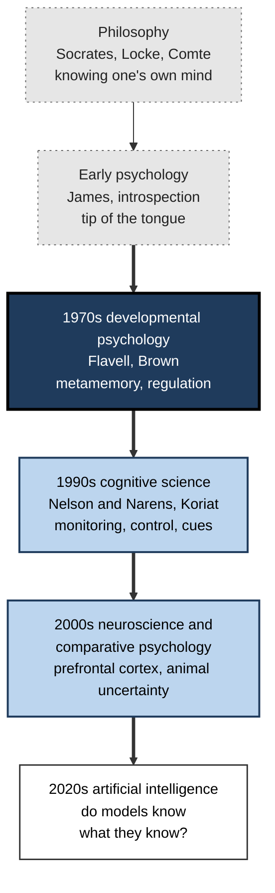
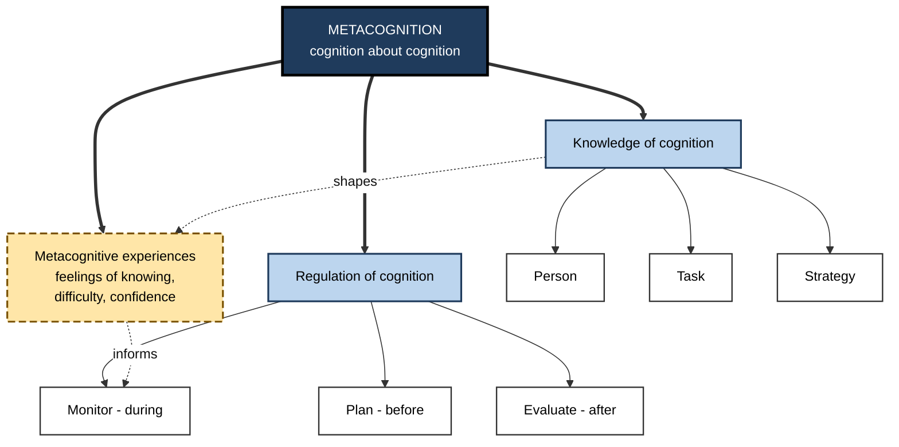
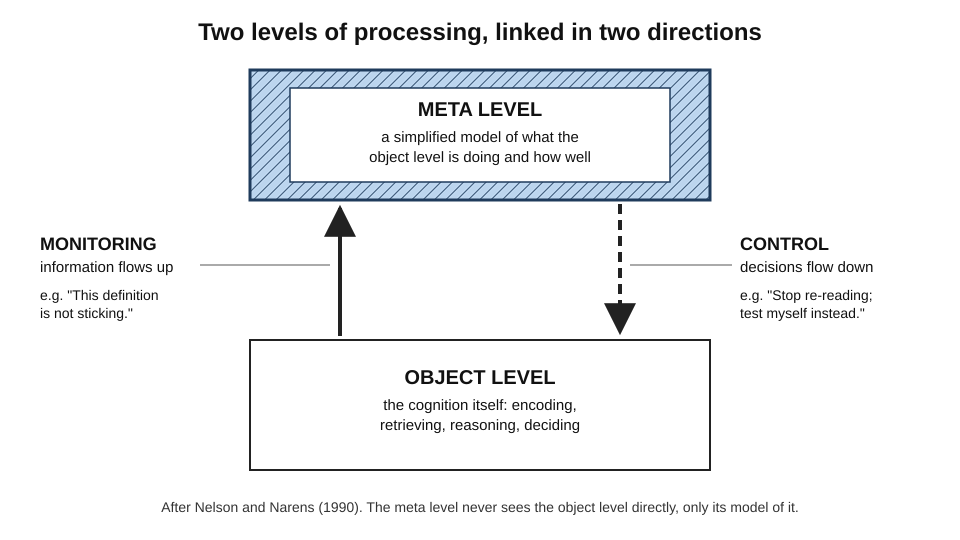
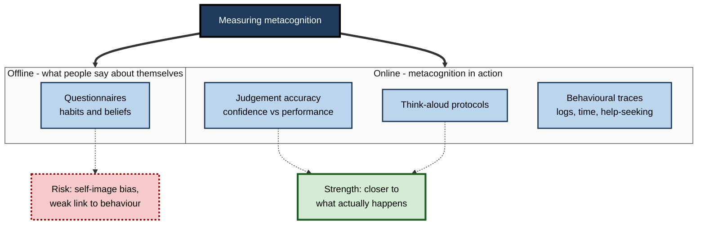
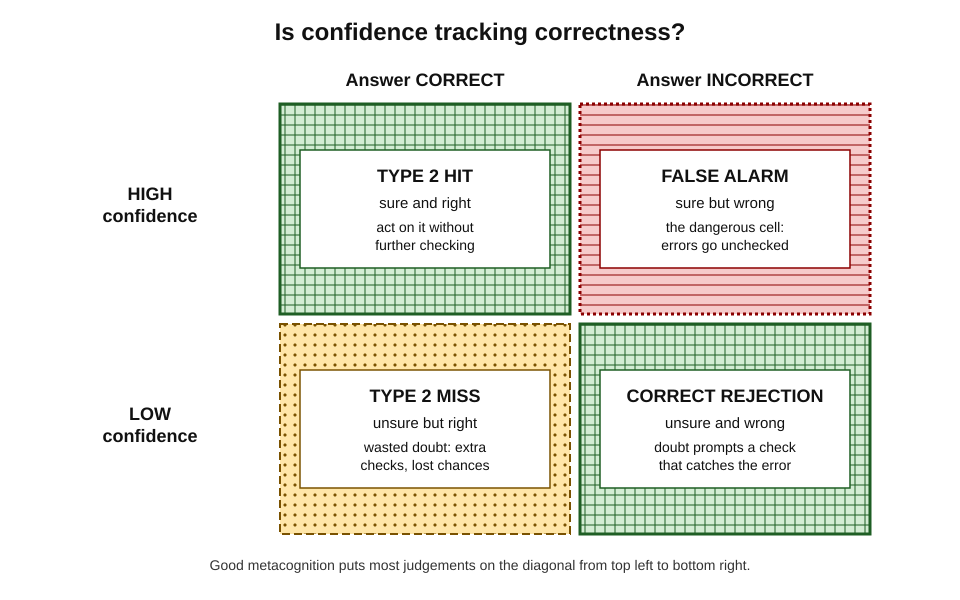

# K.1. Defining Metacognition

A reader reaches the foot of a page and realises that nothing has gone in, so goes back to the top. A software engineer about to merge a change pauses because the fix "feels too easy" and runs one more test. A doctor says, "I am not certain — let us get a second opinion." None of these people is doing the task itself; each is **watching and steering their own thinking about the task**.

> **Definition — Metacognition:** cognition about cognition — the knowledge a person has about their own and others' thinking, and the processes by which they monitor and control that thinking while it happens.

**Why the definition matters**

- It separates **doing** a mental task from **managing** it — two capacities that can succeed or fail independently.
- It explains why equally knowledgeable people learn and perform very differently: one notices errors and gaps, the other does not.
- It gives teachers, trainers and managers a precise target: not "think harder" but "check, judge and adjust".
- It frames a central question of the AI era — who, or what, is checking the thinking when a tool produces the answer.

---

## Thinking About Thinking

### Everyday instances

- **Noticing a failure to understand** — "I have read this clause three times and still cannot say what it obliges us to do."
- **Predicting one's own performance** — "I will remember the client's name only if I write it down."
- **Choosing a method for a mind** — "Diagrams work better for me than paragraphs when learning a system's architecture."
- **Judging an answer's reliability** — "I am fairly sure the deadline is the 14th, but not sure enough to tell the client."
- **Deciding to stop** — "Another hour on this proof will not help; I need a hint or a break."

> **Key point:** in every case there is a **first-order** activity (reading, remembering, calculating) and a **second-order** activity that takes the first as its object.

### Cognition and metacognition

> **Definition — Cognition:** the mental processes of acquiring, storing, transforming and using information — perceiving, attending, remembering, reasoning, deciding.

- **Cognition operates on the world.**
  - *e.g.* adding a column of figures; recalling a regulation; reading a log file.
- **Metacognition operates on cognition.**
  - *e.g.* judging whether the sum is likely to be right; deciding to check the regulation's current version; noticing that the log reading has become aimless.
- **The same act can be either, depending on its object.**
  - Asking "Is this figure right?" about a spreadsheet is cognition about data.
  - Asking "Am I the sort of person who checks figures carefully when tired?" is metacognition.

> **Example:** a translator rendering a sentence is doing cognition; the same translator thinking "my rendering of legal idioms is weaker than my rendering of technical terms, so I should check those twice" is doing metacognition.

---

## The Origins of the Concept

### Before the word existed

- **Socrates (5th century BCE)** — claimed wisdom lay in knowing the limits of one's knowledge; the idea of second-order knowing is ancient.
- **John Locke (1690)** — called the mind's perception of its own operations **"reflection"**, a second source of ideas alongside sensation.
- **Auguste Comte (1830s)** — objected that the mind cannot observe itself while thinking, as the eye cannot see itself; a challenge that still shapes how metacognition is measured.
- **William James (1890)** — described the **tip-of-the-tongue** state vividly: a gap that is "intensely active", sensed but not filled.
- **Early 20th century** — introspective psychology fell from favour because self-reports could not be verified; behaviourism set the inner life aside for decades.

### Flavell and the birth of a field

**Study card — Flavell and the developing memory monitor (1970s)**

- **Who:** developmental psychologist John Flavell, with colleagues including Kreutzer and Leonard.
- **Design:** children of different ages studied pictures until they judged they could recall them perfectly, then were tested; others were interviewed about how memory works.
- **Results:**
  - older children's "I am ready" judgements matched their actual recall far better;
  - younger children often declared readiness and then failed;
  - knowledge about memory — that longer lists are harder, that rehearsal helps — grew with age.
- **Conclusion:** knowing *about* one's memory is a distinct, developing capability, separable from memory itself.

- **Flavell (1976)** coined **metamemory** and **metacognition**; **Flavell (1979)** set out the classic model in the journal *American Psychologist*:
  - **metacognitive knowledge** — beliefs about persons, tasks and strategies;
  - **metacognitive experiences** — conscious feelings and thoughts that arise during cognitive activity;
  - **goals** and **actions** (strategies) — the elements that knowledge and experiences guide.
- **Ann Brown (late 1970s–1980s)** — emphasised the **regulation** side: planning, checking and revising during reading and problem solving, especially in learners who struggled.

### From developmental psychology to a general science

- **Thomas Nelson and Louis Narens (1990)** — a general information-processing model of monitoring and control (described below).
- **Asher Koriat (1990s onwards)** — showed that judgements of knowing are **inferences from cues**, not direct readings of memory.
- **Animal research (1990s onwards)** — J. David Smith and colleagues gave dolphins and monkeys an "uncertain" response; animals chose it most on the hardest trials, suggesting forms of uncertainty monitoring beyond humans.
- **Cognitive neuroscience (2000s onwards)** — Stephen Fleming, Hakwan Lau and others linked metacognitive accuracy to regions of the **prefrontal cortex**, especially its front-most parts.
- **Machine learning (2020s)** — whether language models "know what they know" became a research question in its own right.

**Figure 1.** How the idea of thinking about thinking developed.

---

## The Anatomy of Metacognition

### Two halves: knowledge and regulation

- **Knowledge of cognition** — what a person knows about thinking and learning.
  - About **persons** — *e.g.* "I lose concentration after about forty minutes."
  - About **tasks** — *e.g.* "Recall questions are harder than recognition questions."
  - About **strategies** — *e.g.* "Testing myself works better than re-reading."
  - Often split further into **declarative** (knowing that), **procedural** (knowing how) and **conditional** (knowing when and why).
- **Regulation of cognition** — what a person does to steer thinking.
  - **Planning** — before: goals, strategies, time.
  - **Monitoring** — during: judging progress and understanding.
  - **Evaluating** — after: judging outcome and process.
- The split was made explicit by **Ann Brown (1987)** and turned into a widely used questionnaire, the **Metacognitive Awareness Inventory**, by **Gregory Schraw and Rayne Dennison (1994)**.

> **Definition — Knowledge of cognition:** what a person knows or believes about how cognition works — their own, other people's and that of tasks and strategies.

> **Definition — Regulation of cognition:** the activities by which a person plans, monitors and evaluates their own thinking.

### The third element: metacognitive experiences

> **Definition — Metacognitive experience:** a conscious feeling or judgement that arises during a cognitive activity and concerns that activity — *e.g.* a feeling of knowing, of difficulty, of confidence or of confusion.

- **Feeling of knowing** — "I know this word, I just cannot produce it."
- **Feeling of difficulty** — "This chapter is heavy going."
- **Feeling of confidence** — "That answer is right."
- **Feeling of familiarity** — "I have seen this error message before."
- **Anastasia Efklides (2000s)** — argued these experiences are the **interface** between the person and the task: they are where knowledge and the current situation meet, and they carry emotion as well as information.

> **Mnemonic — "KRE" ("Know, Run, Experience"):** Knowledge of cognition, Regulation of cognition, metacognitive Experiences.

**Figure 2.** The three components of metacognition and their parts.

### Monitoring and control: the Nelson–Narens model

- **Two levels of processing:**
  - the **object level** — the cognition itself (encoding, retrieving, reasoning);
  - the **meta level** — a simplified **model** of the object level that is kept up to date.
- **Two flows of information:**
  - **monitoring** — information flows *up*: the meta level observes the object level and updates its model.
    - *e.g.* "This definition is not sticking."
  - **control** — information flows *down*: the meta level changes what the object level does.
    - *e.g.* "Start, stop or change the way of studying it."
- **The model's insight:** the meta level does not see the object level directly; it sees only a **representation**, which may be wrong.
  - This is why people can feel they know something they do not — and the reverse.

> **Definition — Monitoring:** the flow of information from cognition to the meta level — judging the state, progress or quality of one's own thinking.

> **Definition — Control:** the flow of information from the meta level to cognition — starting, stopping, continuing or changing a cognitive activity.

**Figure 3.** The object level and meta level, linked by monitoring and control.

> **Key point:** metacognition is only as good as the **accuracy of monitoring** and the **appropriateness of control**. An accurate monitor with no willingness to act is useless; vigorous control based on a false monitor is harmful.

---

## What Metacognition Is Not

### Neighbouring concepts

- **Intelligence** — general cognitive ability.
  - Correlated with metacognitive skill but **partly independent**: Marcel Veenman's studies in the 2000s found metacognitive skill predicted learning outcomes over and above intelligence.
  - Highly able people can be badly calibrated.
- **Reflection** — usually backward-looking review.
  - Metacognition also works *before* and *during* a task.
- **Self-awareness** — awareness of oneself broadly, including emotions, body and identity.
  - Metacognition is narrower: awareness of one's **cognitive** activity.
- **Executive functions** — control processes such as inhibiting impulses, switching tasks and updating working memory.
  - Overlap with metacognitive control, but executive functions can run without any awareness or self-knowledge; metacognition involves a **representation** of one's own cognition.
- **Critical thinking** — evaluating claims and arguments.
  - Uses metacognition (checking one's own reasoning) but is aimed at the *argument*, not the *mind*.
- **Confidence** — a feeling of certainty.
  - One metacognitive output; the **match** between confidence and accuracy is what matters.

| | Cognition | Metacognition | Executive function | Reflection |
|---|---|---|---|---|
| Object | The world, the task | One's own cognition | Ongoing goal-directed behaviour | Past experience |
| Typical question | "What is the answer?" | "Do I know the answer? How should I find it?" | "Stop that; switch to this" | "What happened and why?" |
| Needs a self-model? | No | Yes | No | Usually |
| Timing | During | Before, during, after | During | After |

> **Watch out:** metacognition is not the same as being **reflective** or **thoughtful** in temperament. A brooding, introspective person can monitor their learning badly; a brisk practitioner can monitor it superbly.

### Conscious and implicit metacognition

- **Explicit metacognition** — deliberate, reportable: "I will check this calculation."
- **Implicit metacognition** — fast, automatic, often unreportable: a vague unease that slows a decision.
  - Experiences such as fluency or familiarity arise without effort and steer behaviour before any deliberate thought.
- **Joëlle Proust and others** — argued that much metacognition is "procedural": felt and acted on rather than conceptualised.
- **Consequence:** improving metacognition often means learning **when to trust and when to override** automatic feelings.

> **Watch out:** the claim that all metacognition is conscious is false. Many people correctly sense that an answer is wrong without being able to say why.

### Worked example: sorting cognitive from metacognitive acts

- **Situation:** a junior financial analyst's working notes from one afternoon.

| Note | Cognitive or metacognitive | Why |
|---|---|---|
| "Revenue for Q3 is 4.2 million" | Cognitive | A statement about the data |
| "I keep mixing up gross and net margin — check every time" | Metacognitive (knowledge + control) | A belief about own error pattern and a resulting rule |
| "Calculated the variance" | Cognitive | Doing the task |
| "Not confident the FX adjustment is right — ask Priya" | Metacognitive (monitoring + control) | Judging own reliability, then seeking help |
| "Spent 40 minutes on formatting; the model logic matters more" | Metacognitive (monitoring + control) | Noticing misallocated effort and re-prioritising |
| "Summarised the variance drivers" | Cognitive | Doing the task |

- **Conclusion:** the test is the **object** of the thought. If it concerns the analyst's own knowledge, reliability, effort or method, it is metacognitive.

> **Watch out:** writing notes is not itself metacognition. A diary of what was done is cognition about the work; it becomes metacognitive only when it judges or redirects the thinking.

---

## Measuring Metacognition

### Why measurement is hard

- Comte's objection returns: the mind observing itself may change what it observes.
- Self-reports depend on **memory, vocabulary and honesty**.
- Measures that ask people to *describe* their metacognition and measures that capture it *in action* often correlate **weakly**.

### Families of measures

- **Questionnaires (offline)** — people rate statements about their habits.
  - *e.g.* the Metacognitive Awareness Inventory (52 items); the Motivated Strategies for Learning Questionnaire.
  - Cheap and scalable; but measure *beliefs about* metacognition, coloured by self-image.
- **Think-aloud protocols (online)** — people verbalise while working; trained coders score planning, monitoring and evaluating.
  - **K. Anders Ericsson and Herbert Simon (1980, 1993)** — showed that thinking aloud, *without* explaining, changes performance little.
  - Rich and valid; but slow and expensive.
- **Judgement accuracy (online)** — people make confidence or knowing judgements; these are compared with actual performance.
  - *e.g.* rating confidence after each test answer.
  - Precise and quantitative; but specific to the task tested.
- **Behavioural traces (online)** — logs of what people do: re-reading, checking, help-seeking, time allocation.
  - *e.g.* learning-platform clickstreams.
  - Objective and continuous; but behaviour must be interpreted.
- **Neural measures** — brain structure and activity associated with metacognitive accuracy.
  - Research use only.

**Figure 4.** Families of metacognition measures, from what people say to what they do.

### Type 1 and type 2 performance

- **Type 1 performance** — how well a person does the task.
  - *e.g.* the proportion of test items answered correctly.
- **Type 2 performance** — how well the person's confidence **discriminates** their correct answers from their errors.
  - High confidence on correct answers, low confidence on errors → good type 2 performance.
- **Two people can have identical type 1 scores and very different type 2 scores.**
  - Both score 70%; one knows which 30% are wrong, the other is equally confident throughout.
- **Brian Maniscalco and Hakwan Lau (2012)** — developed **meta-d′**, a signal-detection measure of type 2 sensitivity expressed in the same units as task sensitivity; the ratio meta-d′/d′ estimates **metacognitive efficiency** independent of task skill.

> **Definition — Metacognitive sensitivity (resolution):** the degree to which a person's confidence distinguishes their correct from their incorrect responses.

> **Definition — Calibration:** the match between a person's average confidence and their actual rate of being correct.

**Figure 5.** Confidence crossed with correctness: the four outcomes of a metacognitive judgement.

> **Formula — Simple type 2 hit rate:** proportion of correct answers given high confidence. Example: an analyst answers 20 questions, 14 correctly; she marks 12 of the 14 correct ones "sure" → type 2 hit rate = 12 ÷ 14 ≈ **0.86**. If she also marks 3 of her 6 errors "sure", her type 2 false-alarm rate is 3 ÷ 6 = **0.50**, showing confidence that only partly separates right from wrong.

### Domain-general or domain-specific?

- **The question:** is there one metacognitive ability, or separate abilities for memory, perception, reasoning and each field of expertise?
- **Evidence for generality:**
  - Veenman's work found metacognitive *skills* in learning transfer moderately across tasks and subjects.
  - Some neuroimaging studies find shared prefrontal regions.
- **Evidence for specificity:**
  - Confidence accuracy in perception and in memory correlates only weakly within the same person in several laboratory studies.
  - Experts' monitoring is excellent in their field and ordinary outside it.
- **Working view:** a **general toolkit** (habits of planning, checking, questioning) combined with **domain-specific accuracy** that depends on knowledge of the field.

> **Key point:** being a good monitor of one's chess moves does not make a person a good monitor of their tax return. Accurate judgement needs knowledge of what good looks like in the domain.

---

## Why Metacognition Matters

### For learning

- Learners who monitor accurately **study what they do not yet know** and stop studying what they do.
- Learners who monitor poorly **stop too early**, spend time on what is already mastered and choose weak strategies that feel productive.
- Large educational evidence reviews in England rate approaches that teach **metacognition and self-regulation** among the highest-impact, lowest-cost classroom approaches — with the caveat that impact depends on how well they are implemented.

### For professional work

- **Error detection** — catching one's own mistakes before others or the world do.
- **Knowing when to escalate** — recognising the edge of one's competence.
- **Communicating uncertainty** — stating confidence honestly to clients and colleagues.
- **Adaptation** — noticing that a familiar method is failing in a new situation.

> **In practice:** many safety-critical professions build metacognition into procedure — surgical "time-outs", aviation cross-checks, peer review of code — because individual monitoring is known to fail under pressure, fatigue and familiarity.

### For working with AI

- AI tools produce **fluent, confident output** whether right or wrong.
- The human role shifts towards **monitoring and control**: deciding when output is trustworthy, when to check, when to override.
- **Fernandes and colleagues (2025)** — participants solving logical-reasoning problems with an AI assistant performed better than without it but **overestimated** their performance substantially; the usual pattern in which weaker performers overestimate most largely disappeared, and those who rated themselves more AI-literate were *more* overconfident.

> **Watch out:** "the tool will check it" is a metacognitive decision — and often a poor one. Delegating the work does not delegate responsibility for judging it.

---

## Metacognition in Machines

### Do language models know what they know?

- **Kadavath and colleagues (2022)** — large language models asked to estimate the probability that their own answers were correct were **partly** calibrated: confidence was higher for correct answers, though imperfectly.
- **Later studies (2023–2025)** — confidence that models **state in words** tends to be **overconfident** across many models and tasks.
- **Interpretation:** a model's "confidence" is a further output of the same system, not an independent meta-level check — the problem Nelson and Narens's model highlights for humans.

### Agents that monitor themselves

- Modern AI systems increasingly include explicit **self-checking**: generating an answer, critiquing it, revising it, or deciding to search for more information.
- These designs mirror human metacognitive control — plan, monitor, revise — but their reliability depends on whether the "critic" has information the "generator" lacked.

> **Key point:** the definition of metacognition is now applied to artificial systems, which sharpens it: a genuine meta level must have **some independent access** to whether the first-order process is going well.

---

## Professional Mastery: Using the Concept Precisely

### Design decisions that depend on the definition

- **Training design** — teaching *strategies* (cognitive) differs from teaching *when to use them and how to check they work* (metacognitive). Programmes that teach only the first rarely change behaviour.
- **Assessment design** — adding confidence ratings to tests reveals type 2 performance at almost no cost.
- **Process design** — checklists, reviews and second opinions are **externalised metacognition**: they move monitoring out of a single fallible head.
- **AI deployment** — interfaces that show uncertainty, require users to predict before seeing output or prompt for verification are **metacognitive scaffolds**.

### Failure modes in organisations

- **Treating confidence as competence** — promoting the most certain voice.
- **Eliminating doubt** — cultures in which saying "I do not know" is punished drive monitoring underground.
- **Over-proceduralisation** — so many checks that people tick them without thinking; the metacognition is outsourced to the form and lost.
- **Measuring metacognition only by questionnaire** — rewarding people who describe themselves as reflective.

### Case study: introducing confidence ratings in a claims team

- **Situation:** an insurance company's claims assessors made coverage decisions on complex claims; a later audit sample found a persistent error rate.
- **Problem:** assessors' errors were spread evenly across cases they treated as routine; reviewers checked randomly, so most errors were missed.
- **Diagnosis:**
  - assessors' first-order skill (applying policy wording) was adequate;
  - their **monitoring** was never asked for — the system treated every decision as equally certain.
- **Actions:**
  1. Each decision was recorded with a confidence rating: *certain*, *probably right*, *unsure*.
  2. All *unsure* cases and a sample of the rest went to a senior reviewer.
  3. Every month each assessor received a simple report: accuracy within each confidence band.
  4. Team meetings discussed cases rated *certain* that turned out wrong.
- **Result:** within two quarters reviewer time concentrated on genuinely uncertain cases and audited errors fell; several assessors discovered that their *certain* ratings were least reliable on one claim type, and sought training on it.
- **Side effects:** some assessors initially rated everything *unsure* to avoid blame; the team leader had to make clear that well-used uncertainty was valued, not penalised.
- **Lesson:** asking for a **type 2 judgement** and feeding back its accuracy turns hidden monitoring into a manageable, improvable capability.

---

## Open Questions

- **Is metacognition one capacity or many?**
  - Correlations across domains are modest; whether a general metacognitive ability exists, or only domain-specific skills, is unresolved.
- **How much of metacognition is conscious?**
  - Implicit uncertainty signals guide behaviour; how they relate to reportable confidence is debated.
- **Do animals have metacognition, or clever associative learning?**
  - Uncertainty responses in monkeys and other species can sometimes be explained without a self-model; the interpretation remains contested.
- **Can AI systems have genuine metacognition?**
  - Whether a model's self-assessment is a separate meta level or merely more output is an open technical and philosophical question.
- **What is the best single measure?**
  - Questionnaires, think-aloud protocols, judgement accuracy and behavioural traces disagree; no gold standard exists.

---

## Summary

- **Metacognition** is cognition about cognition: knowledge of one's thinking plus its monitoring and control. The test is the **object** of the thought.
- The concept grew from **philosophy** (Socrates, Locke, Comte) to **Flavell's** developmental studies (1970s), **Brown's** work on regulation, the **Nelson–Narens** model (1990), **Koriat's** cue-based account, neuroscience, animal research and AI.
- Three components: **knowledge of cognition** (person, task, strategy; declarative, procedural, conditional), **regulation of cognition** (plan, monitor, evaluate) and **metacognitive experiences** (feelings of knowing, difficulty, confidence).
- **Monitoring** carries information up from the object level; **control** carries decisions down; the meta level sees only a **model**, which can be wrong.
- Metacognition differs from **intelligence, reflection, self-awareness, executive function, critical thinking** and **confidence**; much of it is **implicit**.
- It is measured by **questionnaires, think-aloud, judgement accuracy, behavioural traces** and neural measures; **type 2 performance**, **resolution** and **calibration** describe judgement quality.
- It is partly **general** (habits) and partly **domain-specific** (accuracy needs domain knowledge).
- It matters for learning, error detection, escalation and **working with AI**, where fluent output can inflate confidence.
- Organisations externalise metacognition through **confidence ratings, checklists, reviews** and **uncertainty-aware interfaces**.

---

## Self-Check

1. Define metacognition and explain how to decide whether a thought is cognitive or metacognitive.
2. What did Flavell's studies of children's memory readiness show?
3. Name the three components of metacognition and give a workplace example of each.
4. Explain the Nelson–Narens model, including the direction of monitoring and control.
5. Why can a person feel they know something they do not, according to the model?
6. Distinguish metacognition from executive function, with an example.
7. Distinguish metacognition from reflection.
8. What is implicit metacognition, and why does it matter for improving judgement?
9. Distinguish type 1 from type 2 performance. Can two people with the same test score differ in metacognition?
10. Distinguish calibration from resolution.
11. Why do questionnaire measures of metacognition often disagree with online measures?
12. Summarise the evidence on whether metacognition is domain-general.
13. What did the 2025 study of AI-assisted reasoning find about self-assessment?
14. A team leader wants to "improve the team's metacognition". Propose three concrete changes to work processes and explain which component each targets.

### Answer Key

1. Metacognition is knowledge about, and monitoring and control of, one's own cognition. A thought is metacognitive when its object is one's own knowledge, reliability, effort or method rather than the task content.
2. Older children's judgements that they were ready to recall matched their actual recall far better than younger children's; knowledge about memory grew with age, showing that knowing about memory is distinct from memory itself.
3. Knowledge: "I misread long contracts when tired." Regulation: planning to review the contract in the morning, checking each clause, evaluating afterwards. Experience: a feeling of unease that a clause has been misunderstood.
4. Cognition runs at the object level; the meta level holds a model of it. Monitoring sends information upward to update the model; control sends instructions downward to start, stop or change processing.
5. The meta level sees only its model of the object level, built from cues; if cues such as familiarity are misleading, the model is wrong and the person feels knowledge that is absent.
6. Executive function controls behaviour (inhibiting, switching, updating) without needing a model of oneself; metacognition involves representing one's cognition. Suppressing the urge to check email is executive; judging "I am not concentrating, so I will move to a quiet room" is metacognitive.
7. Reflection is usually retrospective review of experience; metacognition also operates before (planning) and during (monitoring, control) a task, and concerns cognition specifically.
8. Fast, automatic feelings — fluency, familiarity, unease — that steer behaviour without deliberate thought. Improving judgement often means learning when these feelings are trustworthy and when to override them.
9. Type 1 is task accuracy; type 2 is how well confidence separates correct from incorrect answers. Yes — two people scoring 70% may differ in whether they know which answers are wrong.
10. Calibration compares average confidence with the average rate of being correct; resolution is whether confidence is higher for correct than incorrect items. A person can be well calibrated on average yet have poor resolution, and vice versa.
11. Questionnaires capture beliefs and self-image, affected by memory and social desirability; online measures capture behaviour and judgements during a task. People may describe habits they do not use.
12. Habits and strategies show moderate transfer across tasks; accuracy of confidence correlates only weakly across domains and depends on domain knowledge. A working view combines a general toolkit with domain-specific accuracy.
13. AI raised performance but participants overestimated their performance substantially; the usual pattern where weaker performers overestimate most largely vanished, and greater self-rated AI literacy went with more overconfidence.
14. For example: confidence ratings on decisions with monthly accuracy feedback (monitoring, calibration); a pre-task plan template naming approach and checks (planning, strategy knowledge); short post-project reviews of what methods worked and why (evaluation, knowledge updating). Each should be framed so that honest uncertainty is valued.

---

## Glossary

| Term | Meaning |
|---|---|
| Calibration | The match between average confidence and actual accuracy. |
| Cognition | Mental processes of acquiring, storing, transforming and using information. |
| Conditional knowledge | Knowing when and why to use a strategy. |
| Control | Meta-level decisions that start, stop, continue or change cognitive activity. |
| Declarative knowledge | Knowing that — facts and beliefs about cognition. |
| Executive functions | Control processes such as inhibition, task switching and working-memory updating. |
| Feeling of knowing | A sense that information is in memory though not currently retrievable. |
| Implicit metacognition | Automatic, often unreportable monitoring signals that steer behaviour. |
| Knowledge of cognition | What a person knows about thinking — persons, tasks and strategies. |
| Meta level | The level that holds a model of ongoing cognition and directs it. |
| Meta-d′ | A signal-detection measure of how well confidence tracks accuracy. |
| Metacognition | Cognition about cognition: knowledge, monitoring and control of one's thinking. |
| Metacognitive Awareness Inventory | A 52-item questionnaire measuring knowledge and regulation of cognition. |
| Metacognitive efficiency | Metacognitive sensitivity relative to task performance. |
| Metacognitive experience | A conscious feeling or judgement about an ongoing cognitive activity. |
| Metamemory | Knowledge and monitoring of one's own memory. |
| Monitoring | Meta-level observation of the state and progress of one's own cognition. |
| Object level | The cognitive activity itself, as opposed to its management. |
| Procedural knowledge | Knowing how to carry out a cognitive strategy. |
| Regulation of cognition | Planning, monitoring and evaluating one's own thinking. |
| Resolution | How well confidence distinguishes correct from incorrect responses. |
| Think-aloud protocol | A method in which people verbalise their thoughts while working. |
| Type 1 performance | Accuracy on the task itself. |
| Type 2 performance | Accuracy of confidence judgements about one's own task responses. |
