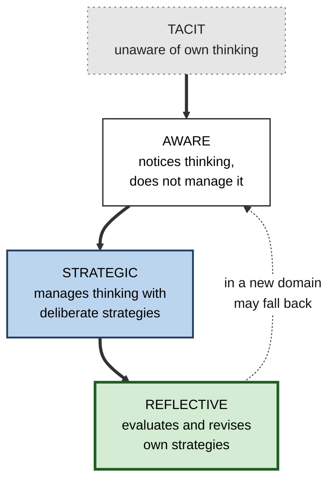
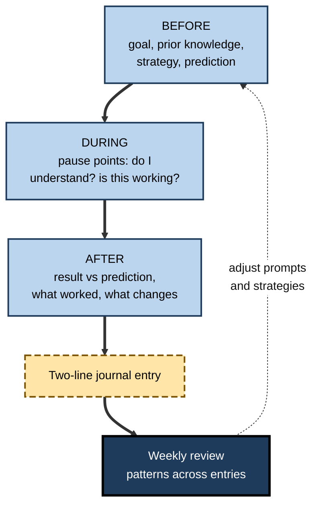
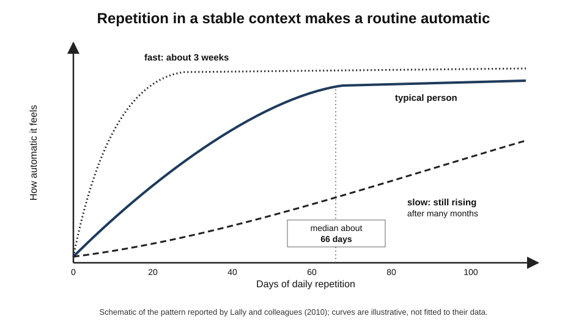
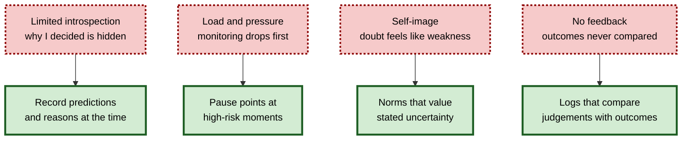
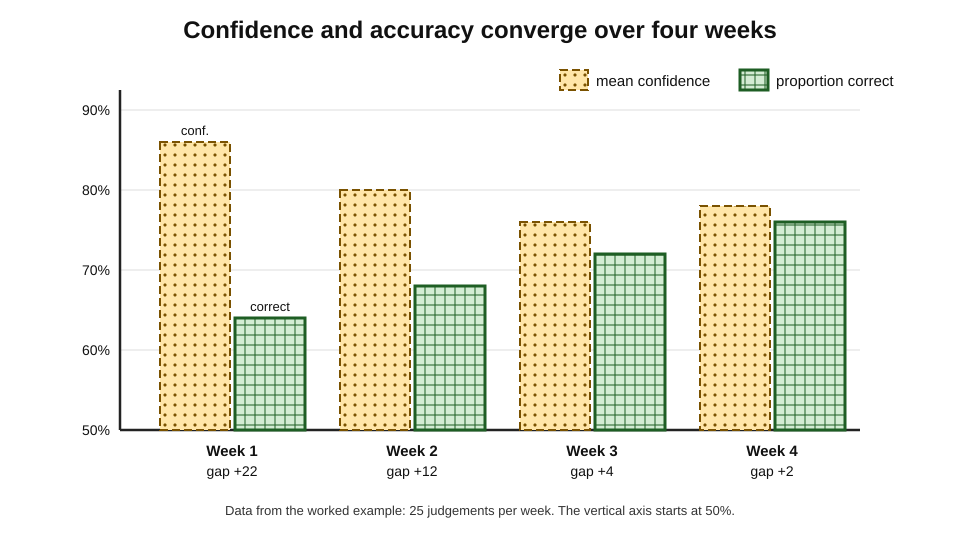

# K.10. Developing Metacognitive Awareness

A junior analyst writes down, at the end of each day, one judgement she made and how confident she was. At first the entries are vague — "felt OK about the model". By the second month they read: "80% sure the churn figure is right; less sure about the cohort definition, which I built late and did not test." Her intelligence has not changed; her **awareness of her own thinking** has — and with it her ability to catch errors before her manager does.

> **Definition — Metacognitive awareness:** the degree to which a person habitually notices, can describe and can use information about their own thinking — what they know, how they are approaching a task and how well it is going.

**Why it matters**

- Monitoring and control only operate when a person **notices** that there is something to monitor; awareness is the gateway.
- Awareness is not fixed: it **grows** with development, practice, feedback and deliberate habits.
- It is limited by real constraints — the **limits of introspection**, mental load and self-image — that must be designed around, not wished away.
- In professional life, well-developed awareness separates people who **improve with experience** from those who merely accumulate it.

---

## Levels of Awareness

### From tacit to reflective

**David Perkins (1992)** described four levels of learner awareness.

- **Tacit learners** — unaware of their thinking; they do not plan, monitor or reflect.
  - *e.g.* a trainee who reads every document in the same way, whatever its purpose.
- **Aware learners** — know some of their thinking (that they are confused, that they have a method) but do not deliberately manage it.
  - *e.g.* "I know I don't understand this, but I just keep reading."
- **Strategic learners** — organise their thinking with deliberate strategies: planning, checking, problem-solving routines.
  - *e.g.* switching to a diagram when a text is not making sense.
- **Reflective learners** — strategic, and also reflect on their strategies, judging whether they work and revising them.
  - *e.g.* "My diagram habit works for systems, but not for legal texts — there I need to paraphrase each clause."

> **Key point:** the levels describe **habits**, not fixed traits. The same person can be reflective in their own field and tacit in a new one.

**Figure 1.** Four levels of metacognitive awareness in learners.

### Development across the lifespan

- **Early childhood** — children begin to talk about knowing and forgetting around the pre-school years but greatly **overestimate** their memory.
- **Middle childhood** — monitoring and strategy knowledge grow rapidly with schooling; children start to use rehearsal and organisation spontaneously.
- **Adolescence** — more abstract awareness: thinking about thinking in general, not just in a task.
- **Adulthood** — awareness grows mainly through **domain expertise** and **feedback-rich experience**, not age itself.
- **Older adulthood** — **Christopher Hertzog and John Dunlosky (2011)** reviewed evidence that many monitoring abilities are **largely preserved** in healthy ageing, even as some memory functions decline; older adults can use accurate monitoring to compensate.

---

## The Limits of Self-Observation

### Introspection is partial

**Study card — Richard Nisbett and Timothy Wilson (1977)**

- **Design:** a series of studies in which people's choices were influenced by factors such as the **position** of items (*e.g.* shoppers choosing among identical stockings laid out in a row), then asked why they chose.
- **Results:**
  - choices showed a strong position effect — the right-most items were chosen most often;
  - people almost never mentioned position; they cited quality, colour or feel — and denied position mattered when asked.
- **Conclusion:** people often have **little direct access** to the causes of their own judgements; their explanations draw on plausible theories rather than observation.

> **Watch out:** a confident account of "why I decided that" is often a **reconstruction**. Awareness of *what* one is thinking is more reliable than awareness of *why*.

### The bias blind spot

- **Emily Pronin, Daniel Lin and Lee Ross (2002)** — people readily see cognitive biases in **others** but rate themselves as less susceptible.
- Knowing about biases does not, by itself, reduce them in one's own judgement.

### Monitoring costs capacity

- Monitoring uses the same limited working memory as the task.
- Under **high load, time pressure, fatigue or stress**, monitoring is one of the first things to drop.
- **Consequence:** awareness must be supported by **external routines** — prompts, checklists, pauses — at the moments when it is most likely to fail.

| | What introspection can report reasonably well | What it reports poorly |
|---|---|---|
| Content | What one is currently thinking about | Why one formed a judgement |
| State | Whether one feels confused or confident | Whether the feeling is accurate |
| Process | Which steps one took, if recorded at the time | Which influences shaped those steps |
| Remedy for the gaps | — | Record predictions; compare with outcomes; seek others' views |

> **Key point:** developing awareness is less about looking inwards harder and more about creating **records and comparisons** that reveal what introspection cannot.

---

## Practices That Build Awareness

### The prediction habit

- **Before** a task, test or decision, write a prediction and a confidence level.
- **After**, compare with the result.
- Builds awareness of **where one's confidence is trustworthy**.
- Cheap enough to do dozens of times a week.

### Learning and decision journals

- **Learning journal** — brief entries on what was learned, what was confusing, which strategies were used, what will change.
- **Decision journal** — at the time of a significant decision: options, reasoning, expected outcome, confidence, how one feels. Reviewed months later.
  - Protects against **hindsight bias**: the original reasoning is on paper.
- **Keep entries short** — a few lines — so the habit survives busy weeks.

### Self-questioning prompts

- **Alison King (1990s)** showed that training students to ask themselves structured questions — "What is the main idea?", "How does this relate to what I already know?", "What would happen if…?" — improved comprehension and learning.
- **Gregory Schraw's** regulatory prompts organise questions by phase:
  - **Before:** What is my goal? What do I already know? What strategy will I use?
  - **During:** Do I understand? Is my strategy working? Should I change pace or approach?
  - **After:** Did I reach my goal? What worked? What would I do differently?

**Figure 2.** A daily awareness routine with prompts before, during and after work.

### Thinking aloud and explaining

- **Thinking aloud** while working — alone or to a colleague — externalises steps that normally pass unnoticed.
  - Recording a short session and replaying it reveals habits: skipped checks, premature conclusions.
- **Self-explanation** — explaining to oneself why each step follows — exposes gaps in understanding as they arise.
- **Explaining to others** — the "rubber duck" of software engineering: explaining a problem to an inanimate listener often reveals the bug.

### Feedback-rich practice

- Awareness grows fastest where **feedback is quick, clear and frequent**.
- Create it where work does not supply it:
  - practice problems with answers;
  - peer review against criteria;
  - simulations;
  - tracking outcomes of past judgements.

### Pause points

- **Planned interruptions** that trigger monitoring at high-risk moments.
  - *e.g.* before sending a client email with figures; before merging code; before signing off a report.
- Surgical **time-outs** and aviation **cross-checks** are institutional pause points.

| Practice | Builds awareness of | Effort | Best for |
|---|---|---|---|
| Prediction habit | Accuracy of confidence | Very low | Any task with a checkable outcome |
| Learning journal | Strategy effectiveness, confusion | Low | Courses, new roles |
| Decision journal | Quality of reasoning over time | Moderate | Infrequent, high-stakes decisions |
| Self-questioning prompts | Understanding during study | Low | Reading, studying, analysis |
| Think-aloud recording | Hidden habits and skipped steps | Moderate | Problem-solving, procedures |
| Pause points | Errors at critical moments | Very low | High-consequence actions |

---

## Can Metacognitive Ability Itself Be Trained?

### Calibration training

- **Forecasting tournaments** — in research led by **Philip Tetlock and Barbara Mellers** (2010s), thousands of volunteers forecast world events with explicit probabilities, scored by Brier scores.
  - A short training module on **probabilistic reasoning** — base rates, averaging, avoiding common biases — improved accuracy measurably over untrained forecasters.
  - **Teams**, frequent updating and feedback further improved accuracy; a small group of consistently excellent "superforecasters" emerged.
- **Lesson:** calibration improves with **explicit probabilities, scoring, feedback and practice** — the same ingredients that make weather forecasters accurate.

### Laboratory training of metacognitive efficiency

- **Jason Carpenter, Stephen Fleming and colleagues (2019)** trained people over several sessions with **feedback on their confidence ratings** in perceptual tasks.
  - Metacognitive efficiency improved, and some benefit appeared on untrained tasks, including memory.
- **Interpretation:** confidence accuracy can be improved by direct feedback on confidence — not only on answers.

> **Watch out:** laboratory gains in metacognitive efficiency are modest and their transfer to complex real-world judgement is **not yet established**. Treat them as promising, not proven, for professional training.

### Mindfulness and decentering

- **Mindfulness** practices train attention to present experience, including one's own thoughts, without immediate reaction.
- **Decentering** — observing thoughts as mental events rather than facts — has been studied as a metacognitive capacity, notably by **John Teasdale** in work on preventing depression.
- **Benjamin Baird and colleagues (2014)** — two weeks of mindfulness training improved metacognitive accuracy for **memory** but not for **perception**.

> **Watch out:** evidence that mindfulness improves metacognition is **mixed and domain-specific**. It is a plausible support for noticing one's thoughts, not a general cure for poor calibration.

| Method | What improved | Strength of evidence | Transfer |
|---|---|---|---|
| Forecasting training and scoring | Probability accuracy on real-world events | Good, large studies | Within forecasting |
| Confidence-feedback training | Metacognitive efficiency in lab tasks | Moderate, few studies | Some across lab tasks |
| Mindfulness training | Memory-monitoring accuracy in one study | Limited, mixed | Domain-specific |
| Domain expertise with feedback | Monitoring within the domain | Strong, many studies | Little outside the domain |

---

## Making Awareness a Habit

### How long habits take

**Study card — Phillippa Lally and colleagues (2010)**

- **Design:** volunteers chose a new daily health behaviour (*e.g.* drinking water with lunch, a short run) and reported each day how automatic it felt, for 12 weeks.
- **Results:**
  - automaticity rose along a curve that **flattened** over time;
  - the median time to reach near-plateau was about **66 days**, ranging widely from under three weeks to many months;
  - missing a single day did **not** materially derail the process.
- **Conclusion:** habits form gradually through **repetition in a consistent context**; the "21 days" folk figure is not supported.

**Figure 3.** Habits become automatic gradually, with large differences between people.

### Design rules for metacognitive habits

- **Attach to an existing cue** — "after I close my laptop at the end of the day, I write two lines".
- **Make it tiny** — one prediction, one sentence.
- **Keep the context stable** — same time, same place, same trigger.
- **Review periodically** — monthly reviews turn entries into insight.
- **Tolerate lapses** — a missed day matters little; abandonment matters a lot.

> **In practice:** many professionals keep a single running document per year: dated predictions, decisions and short lessons. Its value appears when it is **re-read**, not when it is written.

### Barriers and countermeasures

**Figure 4.** Common barriers to metacognitive awareness and the routines that counter them.

---

## Worked Example: A Four-Week Calibration Log

- **Situation:** a credit analyst wants to know how far to trust her own confidence in loan-risk assessments. Each day she records five assessments with a confidence level; outcomes come from a senior's review within a week.

| Week | Judgements | Mean confidence | Proportion confirmed correct | Bias | Note from weekly review |
|---|---|---|---|---|---|
| 1 | 25 | 0.86 | 0.64 | +0.22 | Overconfident on sector-specific cases |
| 2 | 25 | 0.80 | 0.68 | +0.12 | Lowered confidence on unfamiliar sectors |
| 3 | 25 | 0.76 | 0.72 | +0.04 | Started checking covenants before rating |
| 4 | 25 | 0.78 | 0.76 | +0.02 | Remaining errors cluster on property loans |

1. **Compute bias** each week: mean confidence − proportion correct. Week 1: 0.86 − 0.64 = **+0.22**.
2. **Look for patterns**, not just totals: errors clustered in unfamiliar sectors and, later, property loans.
3. **Change behaviour, not just confidence:** she added a covenant check, which improved **accuracy** as well as calibration.
4. **Set the next target:** a short course on property-loan structures.

- **Conclusion:** within a month, awareness of *where* her judgement was weak produced both **better calibration** and **better judgement**.

**Figure 5.** The analyst's weekly overconfidence falls as awareness grows.

> **Watch out:** 25 judgements a week is a small sample; week-to-week changes of a few points may be noise. The trend over several weeks, and the clustering of errors, are more informative than any single week.

---

## Case Study: Decision Journals in an Investment Team

- **Situation:** an equity research team at an asset manager made buy, hold and sell recommendations; the head of research suspected that analysts' reasons for successful calls were often reconstructed after the fact.
- **Problem:** reviews of past calls relied on memory; successful calls were credited to insight and failed ones to "unforeseeable events".
- **Actions:**
  1. For every recommendation, analysts wrote a one-page **decision journal** entry: thesis, key assumptions, what would prove the thesis wrong, probability estimates for the main scenarios, and a note of their mood and time pressure.
  2. Every quarter, the team reviewed matured recommendations **against the original entries**, not against memory.
  3. Each analyst kept a running record of **probability estimates and outcomes**, scored for calibration.
  4. Reviews asked of each call: right for the right reasons, right for the wrong reasons, wrong for the right reasons, or wrong for the wrong reasons?
- **Result:**
  - several analysts discovered that their most confident calls were no more accurate than their moderately confident ones;
  - "right for the wrong reasons" turned out to be common, which tempered overconfidence from lucky successes;
  - over two years, the team's stated probabilities became better calibrated, and theses were written with clearer disconfirming conditions.
- **Side effects:** the journals took time; the team shortened the template after the first quarter. Some analysts found the reviews uncomfortable until the head of research shared her own miscalibrated entries.
- **Lesson:** written records made at the time overcome the **limits of introspection and memory**; awareness developed because judgement could finally be compared with outcome.

---

## Beliefs About One's Own Thinking That Backfire

- Not all metacognitive awareness is helpful. **Adrian Wells** developed a model in which certain **metacognitive beliefs** sustain worry and rumination.
  - **Positive beliefs** — "Worrying helps me prepare"; "If I keep analysing my mistake I will understand it."
  - **Negative beliefs** — "My worrying is uncontrollable"; "Thinking this way means something is wrong with me."
- These beliefs lead to **perseverative thinking** — repeated, unproductive analysis — rather than evaluation that ends in action.
- **Metacognitive therapy**, a clinical approach built on the model, trains people to notice and step back from such thinking rather than engage with its content; this lies beyond professional development, but the distinction it draws is useful at work.

| | Productive reflection | Rumination |
|---|---|---|
| Focus | Causes and changes | Feelings and self-blame |
| Ends with | A decision or action | More questions, no action |
| Time-bound? | Yes | Open-ended |
| Effect on next performance | Improves strategy | Drains attention and confidence |

> **Remember:** good awareness ends in a **decision**. If reviewing a mistake for the third time produces no new action, the activity has become rumination, not reflection.

---

## Open Questions

- **Does training metacognition in one domain improve it in others?**
  - Some laboratory evidence suggests limited transfer; real-world evidence is scarce.
- **What is the right dose of self-monitoring?**
  - Too little leaves errors unseen; too much may slow work or increase anxiety. Optimal levels are unknown and probably vary by task.
- **How do AI tools affect the development of awareness?**
  - Tools that answer instantly may reduce occasions for noticing confusion; tools designed to prompt reflection may increase them. Evidence is just emerging.
- **Can awareness of bias reduce bias?**
  - Knowing about biases rarely reduces them; whether structured awareness practices do so reliably is unresolved.

---

## Summary

- **Metacognitive awareness** is the habitual noticing, describing and use of information about one's own thinking; it is the gateway to monitoring and control.
- **Perkins's four levels:** tacit, aware, strategic, reflective — habits that vary by domain.
- Awareness develops through childhood and with **expertise and feedback**; many monitoring abilities are preserved in healthy ageing.
- **Introspection is limited** (Nisbett and Wilson, 1977): people report *what* they think better than *why*; the **bias blind spot** hides one's own biases; monitoring drops under **load**.
- Build awareness with the **prediction habit**, **learning and decision journals**, **self-questioning prompts**, **think-aloud** and explanation, **feedback-rich practice** and **pause points**.
- **Calibration training** with probabilities, scoring and feedback works in forecasting; confidence-feedback training and mindfulness show **limited, domain-specific** effects.
- Habits form gradually (median about **66 days**; Lally and colleagues, 2010); attach routines to cues, keep them tiny, review them.
- Written records made at the time let judgement be compared with outcome — the most reliable route to awareness.
- Some metacognitive beliefs sustain **rumination** (Wells); productive reflection is time-bound and ends in a decision or action.

---

## Self-Check

1. Define metacognitive awareness and explain why it is called a gateway.
2. Describe Perkins's four levels with an example of each.
3. What did Nisbett and Wilson's studies show about introspection?
4. What is the bias blind spot, and what does it imply for self-improvement?
5. Why does monitoring fail under load, and how can that be designed around?
6. Distinguish a learning journal from a decision journal.
7. Give Schraw-style prompts for before, during and after a task.
8. What did forecasting research show about training calibration?
9. Summarise the evidence on mindfulness and metacognition.
10. What did Lally and colleagues find about habit formation, and what folk belief does it correct?
11. Calculate the bias for a week with mean confidence 0.82 and 0.70 correct, and interpret it.
12. Why are records made at the time more useful than later recollection?
13. A team leader says, "My people should just be more self-aware." Propose three concrete practices and explain what each reveals.
14. Design a three-month plan for a new project manager to develop metacognitive awareness of their estimation and stakeholder judgements.

### Answer Key

1. Habitually noticing, describing and using information about one's own thinking. Monitoring and control can operate only when a person notices there is something to monitor.
2. Tacit (reads every document the same way); aware (knows they are confused but carries on); strategic (switches to diagrams when stuck); reflective (evaluates which strategies work for which material and revises them).
3. People's choices were driven by factors such as position, which they did not report; their explanations reflected plausible theories rather than access to actual causes.
4. Seeing biases in others but not oneself; knowing about biases is insufficient, so external checks and records are needed.
5. Monitoring competes with the task for limited working memory; under load, it drops. Use external routines — pause points, checklists, prompts — at critical moments.
6. A learning journal records learning, confusion and strategies; a decision journal records reasoning, expectations and confidence at the time of a decision for later comparison with outcomes.
7. Before: What is my goal, what do I know, which strategy? During: Do I understand, is the strategy working? After: Did I reach the goal, what worked, what will change?
8. Short training in probabilistic reasoning plus scoring, feedback, teamwork and updating improved forecast accuracy; consistently excellent forecasters emerged.
9. Two weeks of mindfulness improved memory-monitoring accuracy but not perceptual metacognition in one study; evidence is mixed and domain-specific.
10. Automaticity rose gradually; median about 66 days, widely varying; a missed day did little harm. It corrects the "21 days to form a habit" belief.
11. 0.82 − 0.70 = +0.12: overconfident by 12 points.
12. Memory reconstructs reasons after outcomes are known (hindsight); records preserve the actual reasoning and confidence, allowing honest comparison.
13. *e.g.* prediction logs (accuracy of confidence); pause points before client deliverables (errors at critical moments); short weekly retrospectives with criteria (strategy effectiveness). Support with norms that value stated uncertainty.
14. *e.g.* Month 1: log estimates with ranges and confidence for every task; track stakeholder predictions ("will approve", "will object"). Month 2: weekly review of bias and patterns; decision journal for major calls. Month 3: compare with a reference class; review with a mentor; adjust estimation method and set targets for the next quarter.

---

## Glossary

| Term | Meaning |
|---|---|
| Aware learner | A learner who notices aspects of their thinking without deliberately managing it. |
| Bias blind spot | Seeing biases in others more readily than in oneself. |
| Calibration training | Practice with explicit probabilities, scoring and feedback to improve confidence accuracy. |
| Decentering | Observing thoughts as mental events rather than facts. |
| Decision journal | A record, made at the time, of a decision's reasoning, expectations and confidence. |
| Introspection | Observation of one's own mental states. |
| Learning journal | Brief entries on what was learned, what was confusing and which strategies were used. |
| Metacognitive awareness | Habitual noticing and use of information about one's own thinking. |
| Pause point | A planned interruption that triggers monitoring at a critical moment. |
| Prediction habit | Routinely recording predictions and confidence before checking outcomes. |
| Reflective learner | A strategic learner who evaluates and revises their own strategies. |
| Rumination | Repetitive, unproductive dwelling on problems or mistakes. |
| Self-questioning | Asking oneself structured questions before, during and after a task. |
| Strategic learner | A learner who organises thinking with deliberate strategies. |
| Superforecaster | A forecaster with consistently excellent calibration and accuracy in forecasting tournaments. |
| Tacit learner | A learner unaware of their own thinking processes. |
