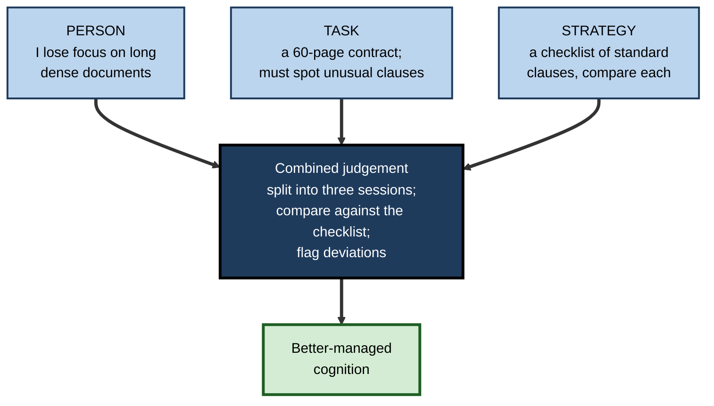
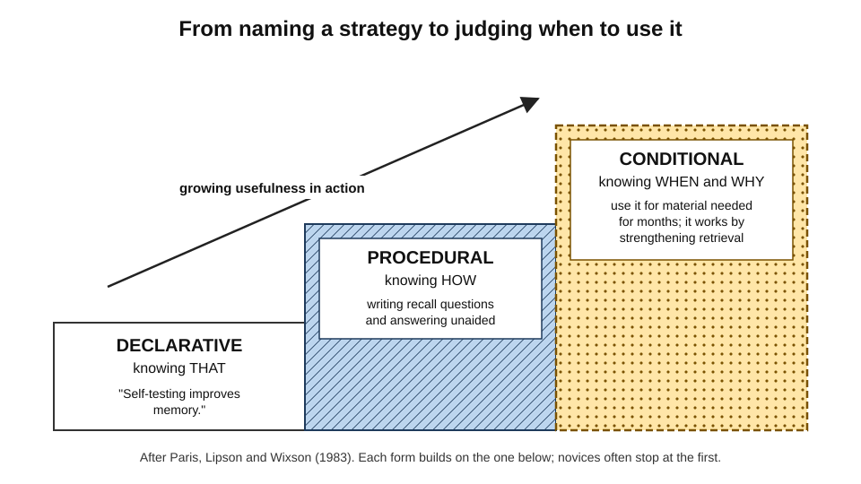
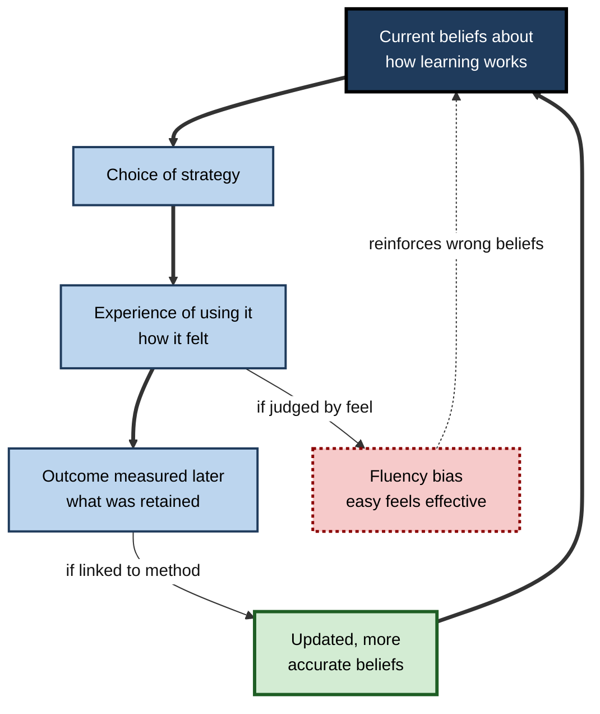
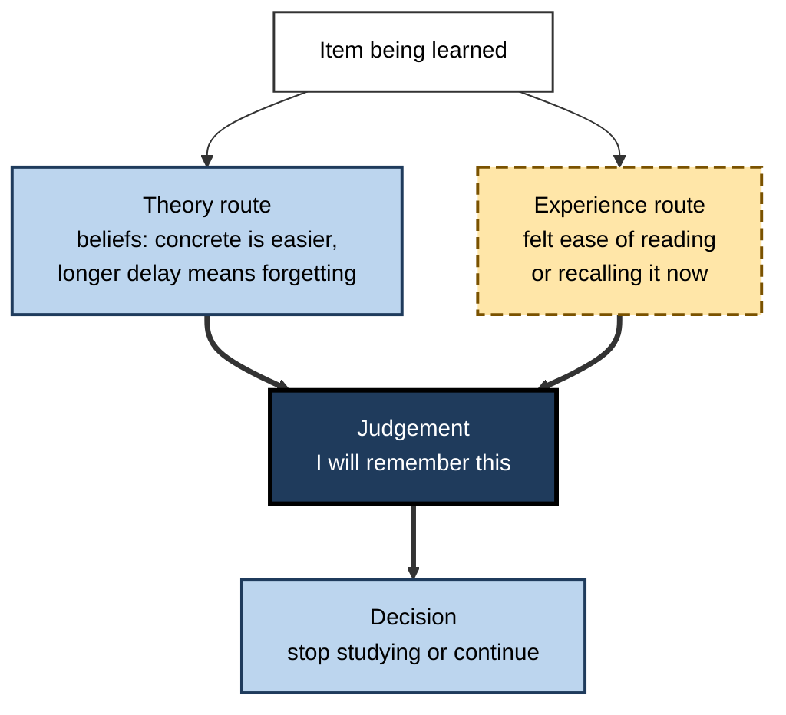
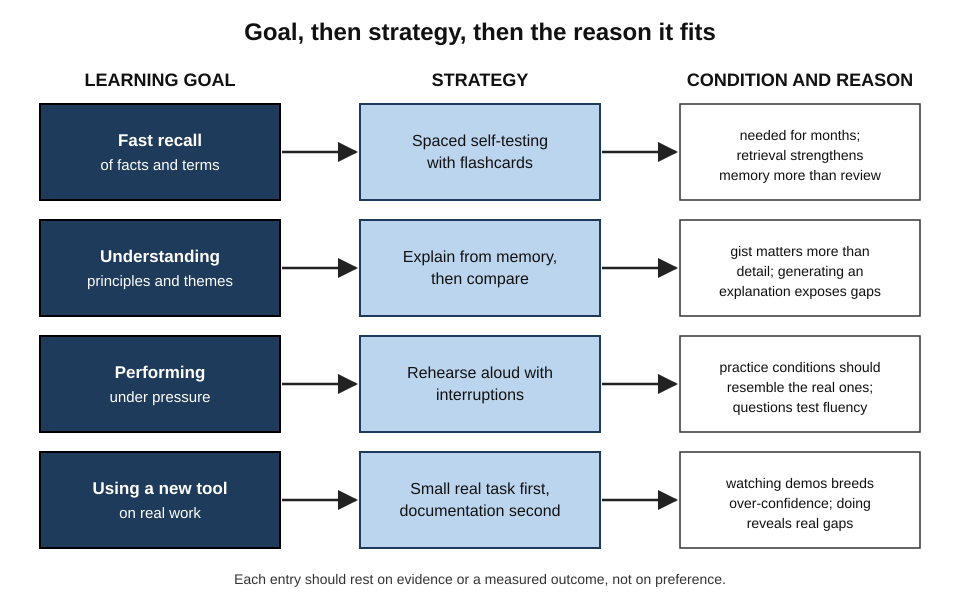

# B.2. Metacognitive Knowledge

A trainee solicitor prepares for an exam by reading her notes four times, convinced that repetition is how memory works. A colleague, equally able, spends the same hours testing herself because she knows that recall builds memory more than review. They have the same intelligence and the same materials; what differs is what each **believes about how minds learn** — and those beliefs decide their strategies before any studying begins.

> **Definition — Metacognitive knowledge:** the stored knowledge and beliefs a person holds about cognition — about themselves and other people as thinkers, about the demands of cognitive tasks, and about the strategies that suit them.

**Why it matters**

- It is the **starting point** for every self-managed piece of thinking: a person can only choose a strategy they know about and believe in.
- It is often **wrong** in systematic ways, and those errors produce systematic misuse of time.
- Unlike raw ability, it is **teachable**: beliefs can be corrected by evidence and experience.
- It shapes how professionals work with **colleagues and tools** — knowing who, or what, knows what.

---

## What Metacognitive Knowledge Contains

### Flavell's three variables

**John Flavell (1979)** sorted metacognitive knowledge into three kinds of "variables" that affect how cognition turns out.

- **Person variables** — beliefs about people as thinkers.
  - **Within a person** — "I understand spoken explanations better than written ones."
  - **Between people** — "My manager grasps financial arguments faster than I do."
  - **Universal** — "Everyone forgets most of a lecture within days unless it is revisited."
- **Task variables** — beliefs about what a task demands.
  - **The information** — "This report is dense and badly organised, so it will take longer."
  - **The goal** — "Remembering the gist is easier than remembering it word for word."
  - *e.g.* a candidate knows that an oral case interview needs fluent reasoning aloud, not just correct answers.
- **Strategy variables** — beliefs about methods and their effects.
  - **Cognitive strategies** — ways of doing the task (*e.g.* summarising, drawing a diagram).
  - **Metacognitive strategies** — ways of checking it (*e.g.* closing the book and trying to explain the chapter).
  - *e.g.* "Writing a test case before code makes me think about edge cases I would otherwise miss."

> **Key point:** the three variables **interact**. Useful knowledge is rarely "strategy X is good"; it is "for **me**, on **this kind of task**, strategy X works better than Y".

> **Mnemonic — "PTS" ("Person, Task, Strategy"):** who is thinking, what the thinking must achieve, and how it can be done.

**Figure 1.** Person, task and strategy knowledge combine into a judgement about how to proceed.

### Declarative, procedural and conditional knowledge

**Scott Paris, Marjorie Lipson and Karen Wixson (1983)**, studying how children become strategic readers, distinguished three forms. **Gregory Schraw** later made them standard in adult research.

- **Declarative knowledge** — knowing **that** a strategy exists and what it is.
  - *e.g.* "Spaced practice means spreading study sessions over time."
- **Procedural knowledge** — knowing **how** to carry it out.
  - *e.g.* scheduling reviews at widening intervals and actually doing them.
- **Conditional knowledge** — knowing **when and why** to use it.
  - *e.g.* "Spacing matters for material I must retain for months; for tomorrow's presentation, a focused rehearsal tonight is enough."

> **Definition — Conditional knowledge:** knowledge of the circumstances in which a strategy is appropriate and the reasons it works — the form that turns a repertoire into judgement.

| | Declarative | Procedural | Conditional |
|---|---|---|---|
| Question answered | What is it? | How do I do it? | When and why should I use it? |
| Example (self-explanation) | "Explaining each step to oneself aids understanding" | Pausing after each worked step to state why it follows | Use it for new principles; skip it for routine facts |
| Typical gap in novices | Never heard of the strategy | Knows it but executes it shallowly | Uses it everywhere, or nowhere, regardless of fit |
| How it is built | Instruction, reading | Practice with feedback | Varied practice plus reflection on outcomes |

> **Watch out:** knowing the name of a strategy is the weakest form. Many learners can define retrieval practice and still never use it, because they lack the **procedure** or the **conditions** that make it worthwhile.

**Figure 2.** Three forms of metacognitive knowledge, from naming a strategy to judging its use.

### The revised taxonomy's view

- **Lorin Anderson and David Krathwohl (2001)**, revising Bloom's taxonomy, added **metacognitive knowledge** as a fourth kind of knowledge beside factual, conceptual and procedural.
- They split it into:
  - **strategic knowledge** — general strategies for learning, thinking and problem solving;
  - **knowledge about cognitive tasks** — including contextual and conditional knowledge;
  - **self-knowledge** — one's own strengths, weaknesses and motivations.
- **Consequence for educators:** metacognitive knowledge became something that can be written into **learning objectives** and assessed.

---

## How Metacognitive Knowledge Develops

### Childhood and adolescence

**Study card — Kreutzer, Leonard and Flavell (1975)**

- **Design:** structured interviews with children from kindergarten to about age eleven about memory.
  - *e.g.* "If you wanted to remember a phone number, what would you do?" "Is it easier to learn a list a second time?"
- **Results:**
  - older children knew far more: that relearning is easier, that stories are easier to remember than lists, that one can plan retrieval (retracing steps to find a lost coat);
  - younger children often believed their memory was nearly perfect.
- **Conclusion:** knowledge about memory develops steadily through childhood and is learned from experience and instruction.

- **Overestimation in young children** — Flavell and colleagues (1970) found that young children predicted they could recall far more pictures than they actually could; older children's predictions were close to reality.
- **Adolescence** — knowledge becomes more abstract (understanding *why* strategies work) and more task-specific.
- **Adulthood** — knowledge continues to grow with **domain experience**, but many adults retain inaccurate general beliefs about learning.

### Adults' lay theories of learning

Adults' everyday beliefs about memory and learning are often systematically mistaken.

- **Memory as recording.**
  - **Daniel Simons and Christopher Chabris (2011)** surveyed a large sample of the US public; a majority agreed that memory works like a video camera, recording events accurately for later replay — a view contradicted by decades of research on reconstruction and distortion.
- **Massing feels better than spacing.**
  - **Nate Kornell and Robert Bjork (2008)** had people learn painters' styles from examples presented either blocked by artist or interleaved; most learned better from interleaving, yet most **judged** blocking more effective.
- **Re-reading feels like studying.**
  - **Jeffrey Karpicke, Andrew Butler and Henry Roediger (2009)** surveyed students: re-reading was the most common strategy; few used self-testing as a deliberate way to learn, as opposed to a way to check.
- **Effort feels like failure.**
  - **Afton Kirk-Johnson, Brian Galla and Scott Fraundorf (2019)** — the **misinterpreted-effort hypothesis**: learners read the effort of retrieval practice as a sign that it is not working, and so choose easier but weaker methods.

> **Definition — Misinterpreted-effort hypothesis:** the proposal that learners mistake the mental effort of effective strategies for evidence of poor learning, and so avoid those strategies.

> **Watch out:** "learning is about finding one's learning style" is another widespread lay belief. Matching teaching to a preferred style has repeatedly failed to improve learning; the belief survives because it fits people's intuitions about themselves.

**Study card — Koriat, Bjork, Sheffer and Bar (2004): predicting one's own forgetting**

- **Design:** people studied word pairs and predicted their recall after delays ranging from minutes to a week.
- **Results:**
  - predictions barely changed with the length of the delay, although actual recall fell sharply;
  - when asked instead how many items they would *forget*, people became more sensitive to delay.
- **Conclusion:** people **know** in the abstract that forgetting occurs, but this knowledge is not applied spontaneously when they judge their own learning — a gap between knowledge possessed and knowledge used.

> **Key point:** possessing correct metacognitive knowledge is not enough; it must be **activated** at the moment of judgement and choice.

### Where adults' knowledge comes from

- **Experience** — noticing what has worked before.
  - Distorted by **fluency**: methods that *feel* productive are remembered as productive.
- **Culture and schooling** — beliefs absorbed from teachers, parents and peers.
  - *e.g.* "Highlight the important parts" is taught widely, though highlighting alone does little for learning.
- **Explicit instruction** — being taught how memory and learning work.
  - **Kathleen McCabe (2011)** found that undergraduates without instruction rated poor strategies highly; those who had studied learning science in courses rated effective strategies more accurately.
- **Feedback from outcomes** — exam results, project reviews, performance data.
  - Effective only if the person links outcome to method — which rarely happens spontaneously.

**Figure 3.** How metacognitive knowledge is built and corrected.

---

## How Knowledge Enters Judgement

### Theory-based and experience-based judgements

**Asher Koriat (1997)** proposed that judgements about one's own learning draw on two bases.

- **Theory-based (information-based) judgements** — deliberate inferences from beliefs.
  - *e.g.* "Abstract words are harder to remember than concrete ones, so I will remember fewer of these."
  - Accuracy depends on whether the **belief is correct**.
- **Experience-based judgements** — inferences from the felt ease of processing.
  - *e.g.* "That came to mind easily, so I know it."
  - Accuracy depends on whether **ease is a valid cue** in this situation.
- **The two can conflict.** A person may believe that spaced study is better yet feel that massed study is working.

| | Theory-based judgement | Experience-based judgement |
|---|---|---|
| Source | Explicit beliefs about memory and tasks | Felt fluency, familiarity, ease |
| Speed | Slow, deliberate | Fast, automatic |
| Accurate when | The belief matches the evidence | Ease genuinely reflects learning |
| Typical error | Applying a folk myth | Mistaking recency or familiarity for mastery |
| How to improve | Teach accurate beliefs | Change *when* and *how* judgements are made |

> **Key point:** correcting beliefs improves **theory-based** judgements; it does not automatically fix **experience-based** ones, which are driven by feelings. Both must be addressed.

**Figure 4.** Two routes by which metacognitive knowledge and experience reach a judgement.

### Knowledge about other minds and about tools

- **Transactive memory** — **Daniel Wegner (1980s)** described how couples and teams store knowledge collectively: each member knows *who knows what* and directs questions accordingly.
  - *e.g.* "Ask Ravi about the billing system; ask Jo about the client's history."
  - Well-functioning teams have accurate, shared **meta-knowledge** of members' expertise.
- **Knowledge of others' reliability** — judging when a colleague's confident claim deserves trust.
- **Knowledge of tools as cognitive partners** — what a search engine, calculator or AI assistant does reliably and where it fails.
  - Professionals who use AI well know its **task-specific** strengths and weaknesses — *e.g.* fluent summarising but unreliable citation of sources.

> **Definition — Transactive memory:** a shared system in a group by which members know who holds which knowledge, so that the group can encode, store and retrieve more than any individual.

> **In practice:** a new team member's first task is often building transactive memory — learning who to ask — which is metacognitive knowledge about the team.

---

## Metacognitive Knowledge in Experts

### What experts know about their domain's thinking

- **Typical difficulty** — which problems take long, which are deceptively simple.
  - *e.g.* an experienced estimator knows that data migration is always harder than it looks.
- **Characteristic errors** — the mistakes practitioners in the field tend to make.
  - *e.g.* a pharmacist knows look-alike drug names are a common source of dispensing error; a programmer knows off-by-one errors cluster at loop boundaries.
- **Own error profile** — where *they* in particular slip.
  - *e.g.* "I under-check work I find boring."
- **A strategy repertoire with conditions** — many methods and an understanding of when each fits.
- **Limits of competence** — which questions lie outside their expertise.

> **Key point:** much expert advantage in self-management comes from **domain-specific** metacognitive knowledge, which is why general "thinking skills" courses add relatively little to experts in a field.

### Tacit and explicit forms

- Much expert metacognitive knowledge is **tacit** — used fluently, rarely stated.
  - *e.g.* a senior editor "just knows" which sections of a report need a second pass.
- **Making it explicit** helps:
  - teaching novices;
  - checking it for errors;
  - transferring it to new contexts.
- Methods: think-aloud while working, case reviews, writing down personal "rules of thumb", and asking "How did you know to check that?"

---

## Assessing Metacognitive Knowledge

- **Questionnaires**
  - The **Metacognitive Awareness Inventory** (Schraw and Dennison, 1994) has a 17-item knowledge-of-cognition scale covering declarative, procedural and conditional knowledge.
  - Limitation: measures what people *say* they know.
- **Scenario tests**
  - Present a learning situation and ask which strategy is best and why.
  - *e.g.* "A student has two weeks before an exam. Rank these plans."
  - Better, because they test knowledge rather than self-image.
- **Interviews and think-aloud**
  - Reveal reasons and conditions as well as names of strategies.
- **Behaviour**
  - What people actually choose when free to choose — the ultimate test of knowledge in use.

> **Watch out:** high questionnaire scores often coexist with poor strategy choices. Assess knowledge in a scenario that requires a decision.

### Worked example (illustrative): building a personal strategy map

- **Situation:** a data analyst moving into a product-management role wants to manage her own learning more deliberately.

1. **List recurring learning tasks** — learning a new domain's vocabulary; understanding user research; preparing for stakeholder presentations; picking up new analytics tools.
2. **For each, record task knowledge** — what success requires.
   - Vocabulary: rapid, accurate recall in conversation.
   - User research: grasping themes and implications, not detail.
   - Presentations: fluent delivery under questioning.
3. **Record person knowledge** — honest notes on her own patterns.
   - Learns tools fast by doing; loses detail from reading; becomes over-confident after watching a demonstration.
4. **Match strategies with conditions.**

| Task | Strategy | Condition and reason |
|---|---|---|
| Domain vocabulary | Flashcards with spaced self-testing | Needs fast recall; testing beats re-reading |
| User research | Write a one-page synthesis without notes, then compare | Gist and implications; generating reveals gaps |
| Presentations | Rehearse aloud to a colleague who interrupts with questions | Must perform under pressure; rehearse in similar conditions |
| New tools | Build a small real task first, read documentation second | Learns by doing; prevents demonstration-induced over-confidence |

5. **Schedule a check** — after six weeks, compare outcomes (recall in meetings, stakeholder feedback) with the expected effect of each strategy.

- **Conclusion:** the map turns vague self-knowledge into **conditional knowledge** that can be acted on and tested.

> **Watch out:** a personal map built only from preference ("I like flashcards") repeats lay-theory errors. Each entry should rest on a reason — evidence about learning, or a measured outcome.

**Figure 5.** A strategy map pairs kinds of learning task with suitable strategies and the conditions that justify them.

---

## Metacognitive Knowledge in Organisations

### Collective beliefs about learning

- Organisations hold **collective metacognitive knowledge** — shared assumptions about how people learn.
  - *e.g.* "Training is a two-day course"; "experts can just tell people what they know"; "if people liked it, it worked".
- These beliefs drive **budgets and designs** just as individual beliefs drive study habits.
- They are rarely tested; changing them requires evidence from **delayed, behavioural** outcomes.

### Case study (illustrative): correcting beliefs in a graduate accountancy programme

- **Situation:** a professional-services firm's graduate trainees sat a series of professional accountancy examinations during their first three years.
- **Problem:** pass rates on the first-attempt examinations were mediocre despite generous study leave.
- **Diagnosis:**
  - a survey and interviews showed most trainees spent study leave re-reading course manuals and highlighting;
  - few used question practice under timed conditions until the final week;
  - many described self-testing as "for checking at the end", not as a way to learn;
  - trainees who had tried mixed question practice reported it "felt harder", so stopped.
- **Actions:**
  1. A short induction session explained how memory works — retrieval, spacing, the misleading feel of re-reading — using a classroom demonstration in which trainees experienced the effect themselves.
  2. Study-leave timetables were redesigned around **spaced, mixed question practice** from the first week.
  3. Trainees logged predicted and actual scores on weekly practice papers.
  4. Senior colleagues who had passed recently described how the effortful methods felt — normalising difficulty.
- **Result:** over the following two exam sittings, first-attempt pass rates rose noticeably; the weekly logs showed predictions becoming more realistic.
- **Side effects:** some trainees resented the structured timetable; flexibility had to be returned for those already performing well.
- **Lesson:** the bottleneck was not effort or ability but **metacognitive knowledge** — and correcting it needed both explanation and an experience that contradicted the lay belief.

> **In practice:** telling people that a strategy works changes beliefs less than letting them **experience** a demonstration in which the counter-intuitive method wins.

---

## Knowledge About Knowing Itself

### Epistemological understanding

- Metacognitive knowledge includes beliefs about **knowledge itself** — what it is, how certain it can be and how claims are justified.
- **Deanna Kuhn (1990s–2000)** described a developmental sequence in how people understand knowing:
  - **Absolutist** — knowledge is certain; assertions are facts copied from reality; experts know the truth.
  - **Multiplist** — knowledge is opinion; everyone has a right to their view; no view is better than another.
  - **Evaluativist** — knowledge is uncertain but some claims are better supported than others; judgements are made by weighing evidence and argument.
- Many adults never fully reach the evaluativist level, even after higher education; reaching it depends on experience of reasoned argument about genuinely contested questions.

| | Absolutist | Multiplist | Evaluativist |
|---|---|---|---|
| View of knowledge | Certain, fixed facts | Personal opinions | Uncertain but evaluable claims |
| Role of evidence | Confirms the truth | Optional; any view is valid | Central for judging between claims |
| Response to expert disagreement | "One of them must be lying" | "They just have different opinions" | "Which argument is better supported, and why?" |
| Learning strategy it encourages | Memorise the right answers | Little need to evaluate | Compare, weigh, revise |

> **Example (illustrative):** two analysts read conflicting market reports. An absolutist picks the more authoritative-looking source; a multiplist shrugs that "forecasts are just opinions"; an evaluativist compares the reports' assumptions, data and track records before forming a view.

### Why it is metacognitive

- Beliefs about knowing shape **monitoring standards** — what counts as "understanding" or "enough evidence".
- They shape **strategy choice** — an absolutist memorises; an evaluativist questions and compares.
- They shape **reactions to uncertainty** — treating doubt as failure, as licence for any view, or as a reason to investigate.

> **Key point:** professional judgement requires the **evaluativist** stance: holding claims with confidence proportional to evidence and revising them as evidence changes.

---

## Open Questions

- **How can correct knowledge be made to act at the moment of choice?**
  - People often know that forgetting occurs or that testing helps, yet do not apply that knowledge; reliable ways of activating it are still being studied.
- **How far does metacognitive knowledge transfer across domains?**
  - General knowledge of learning principles may transfer; knowledge of a field's typical difficulties and errors may not.
- **How should knowledge about AI tools be taught?**
  - Tool capabilities change quickly, so durable knowledge may be about *how to probe* a tool's reliability rather than specific facts.
- **Why do some lay theories persist so strongly?**
  - The learning-styles belief and the video-camera view of memory resist correction; whether this reflects fluency, self-image or culture is unresolved.

---

## Summary

- **Metacognitive knowledge** is what a person knows and believes about cognition: their own and others' minds, tasks and strategies.
- **Flavell's variables:** **person** (within, between, universal), **task** (information, goal) and **strategy** (cognitive and metacognitive) — useful knowledge combines all three.
- **Declarative** (what), **procedural** (how) and **conditional** (when and why) forms; conditional knowledge turns a repertoire into judgement.
- Knowledge develops through childhood (**Kreutzer, Leonard and Flavell**), but many adults hold **lay theories** that are wrong: memory as recording, massing over spacing, re-reading over testing, effort as failure.
- Knowledge may be possessed but **not applied** when judging one's own learning (Koriat and colleagues on predicting forgetting).
- Judgements are **theory-based** (beliefs) or **experience-based** (felt ease); both need attention.
- Metacognitive knowledge extends to **other people** (transactive memory) and **tools**.
- Experts hold rich **domain-specific** knowledge of difficulties, errors and limits, much of it tacit.
- Assess it with **scenarios and behaviour**, not just questionnaires; correct it through explanation plus **direct experience**.
- Beliefs about **knowing itself** — **absolutist, multiplist, evaluativist** (Kuhn) — set the standards for monitoring and the response to uncertainty; professional judgement requires the evaluativist stance.

---

## Self-Check

1. Define metacognitive knowledge and name Flavell's three variables.
2. Give a workplace example of each kind of person variable.
3. Distinguish declarative, procedural and conditional knowledge, using one strategy as the example.
4. Why is conditional knowledge described as turning a repertoire into judgement?
5. What did Kreutzer, Leonard and Flavell find?
6. Describe two lay theories of learning that research contradicts, with the evidence for each.
7. What is the misinterpreted-effort hypothesis, and what behaviour does it predict?
8. What did Koriat and colleagues find about predicting one's own forgetting, and what does it show?
9. Distinguish theory-based from experience-based judgements.
10. What is transactive memory, and why is it metacognitive?
11. Why do generic thinking-skills courses add relatively little to experts?
12. Why are questionnaires a weak measure of metacognitive knowledge? Propose a better one.
13. A team believes "training is a two-day course". How would you test and correct this belief?
14. An engineer says, "I learn best by watching demos." Using the ideas above, explain how to turn this into useful conditional knowledge.

### Answer Key

1. Knowledge and beliefs about cognition — one's own and others' minds, tasks and strategies. Variables: person, task, strategy.
2. Within: "I make more errors after 6 p.m." Between: "My colleague is quicker at mental arithmetic." Universal: "Everyone forgets unrehearsed detail quickly."
3. Self-testing: declarative — knowing that testing aids memory; procedural — knowing how to write and answer recall questions; conditional — knowing to use it for material needed later, and why it works.
4. Knowing many strategies is useless without knowing which fits a given situation; conditional knowledge supplies the matching rules and reasons.
5. Older children knew far more about memory — that relearning is easier, that retrieval can be planned — while younger children overestimated their memory; knowledge of memory develops with age.
6. Memory as a video camera (most of a public sample agreed; research shows reconstruction). Blocking feels better than interleaving (Kornell and Bjork: most learned better interleaved but judged blocking more effective). Also re-reading over testing (Karpicke, Butler and Roediger survey).
7. Learners read the effort of good strategies as a sign they are not working, so choose easier, weaker methods such as re-reading.
8. Recall predictions hardly changed with delay though recall fell; framing in terms of forgetting improved sensitivity. People possess knowledge of forgetting but do not apply it spontaneously.
9. Theory-based judgements are deliberate inferences from beliefs; experience-based ones come from felt ease. The first fails when beliefs are wrong, the second when ease is not a valid cue.
10. A group system in which members know who knows what. It is knowledge about other people's knowledge — metacognitive knowledge at group level.
11. Their self-management advantage rests on domain-specific knowledge of typical difficulties, errors and limits, which general courses do not supply.
12. They capture self-description and self-image rather than knowledge in use. Better: scenario tests requiring a choice and justification, plus observing actual strategy choices.
13. Gather delayed behavioural evidence — on-the-job performance weeks after the course compared with a spaced, practice-based alternative — and let the team see the comparison; pilot a redesign.
14. Specify conditions: demos may help for seeing an overall workflow, but watching creates fluency and over-confidence. Pair demos with immediate hands-on attempts and unaided checks a few days later; record which combination produced real capability.

---

## Glossary

| Term | Meaning |
|---|---|
| Absolutist | Viewing knowledge as certain facts copied from reality. |
| Cognitive strategy | A method for performing a cognitive task, such as summarising. |
| Conditional knowledge | Knowing when and why a strategy is appropriate. |
| Declarative knowledge | Knowing that — facts about strategies and cognition. |
| Evaluativist | Viewing knowledge as uncertain but judgeable by evidence and argument. |
| Experience-based judgement | A judgement of one's learning inferred from felt ease of processing. |
| Lay theory of learning | An everyday belief about how learning and memory work. |
| Metacognitive knowledge | Knowledge and beliefs about cognition: persons, tasks and strategies. |
| Metacognitive strategy | A method for monitoring or controlling cognition, such as self-testing to check understanding. |
| Misinterpreted-effort hypothesis | The proposal that learners mistake effort for poor learning and avoid effective strategies. |
| Multiplist | Viewing knowledge as personal opinion, with no view better than another. |
| Person variable | Knowledge about people as thinkers: within, between and universal. |
| Procedural knowledge | Knowing how to carry out a strategy. |
| Self-knowledge | Knowledge of one's own cognitive strengths, weaknesses and motives. |
| Strategic knowledge | Knowledge of general strategies for learning, thinking and problem solving. |
| Strategy variable | Knowledge about strategies and their effects. |
| Task variable | Knowledge about how the nature and goal of a task affect cognition. |
| Theory-based judgement | A judgement of one's learning inferred from explicit beliefs. |
| Transactive memory | A group's shared knowledge of who knows what. |
