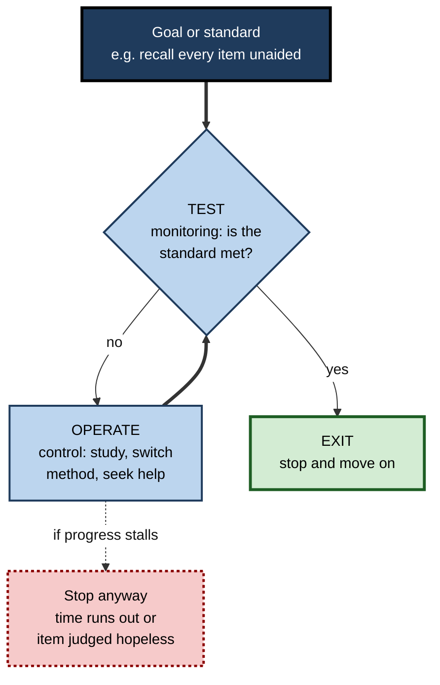
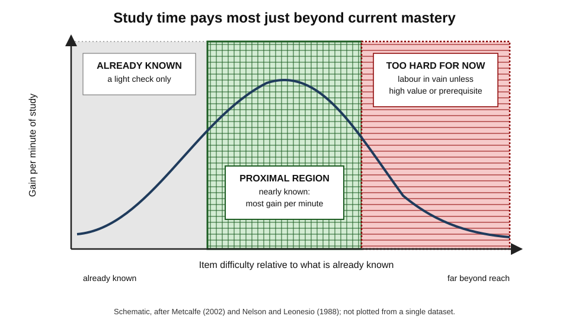
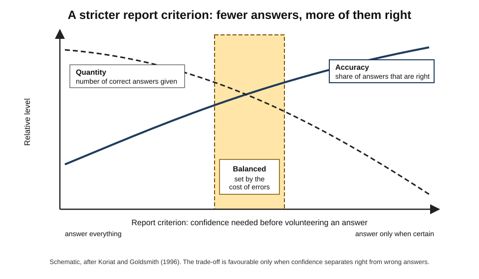
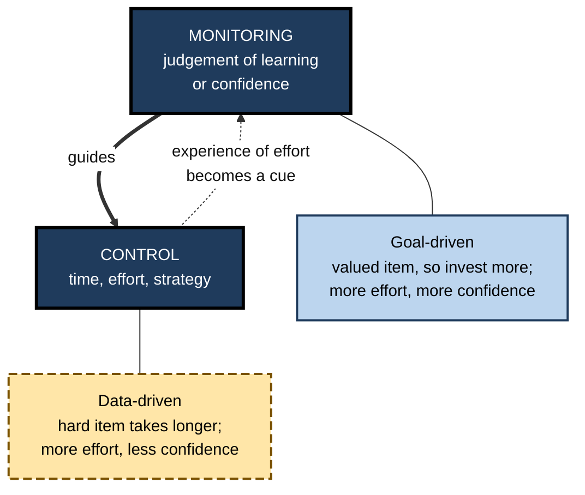
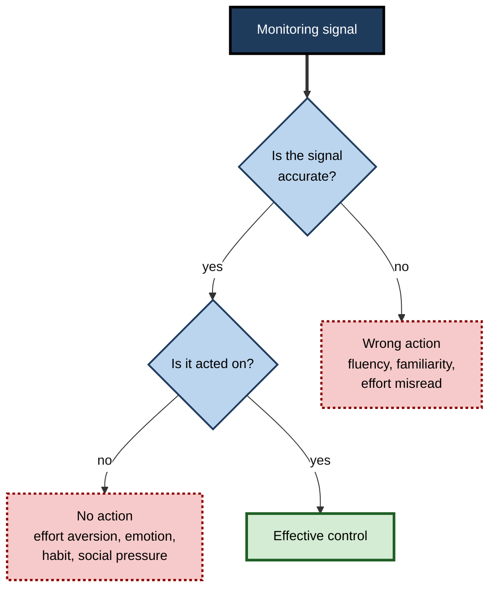

# B.4. Metacognitive Regulation and Control

Two candidates have the same three evenings before an exam and the same sense of which topics are weak. One polishes topics already understood, because it feels productive; the other moves straight to topics just beyond her reach. A barrister knows when to stop researching and write; a data scientist drops a failing approach after an hour, not a week. Each is acting on a judgement about their own mind — **control** — and the quality of that action decides how much the judgement is worth.

> **Definition — Metacognitive control:** the decisions and actions by which a person, on the basis of monitoring, starts, continues, changes or stops their own cognitive activity — what to study, how long, by what method, whether to seek help and what to report.

**Why it matters**

- Monitoring is useless unless it **changes behaviour**; control is where self-knowledge pays off.
- Most wasted study and work time comes from **poor control decisions**: studying the wrong items, persisting too long, stopping too soon, sticking with a failing method.
- Control determines the **accuracy of what people report** — in exams, witness statements, expert advice and client communications.
- Good control is **teachable** through explicit decision rules.

---

## From Monitoring to Action

### The control loop

- **Monitoring** produces a judgement — "I do not yet know this."
- **A goal or standard** sets what counts as enough — "I must recall all of these at the exam."
- **Control** compares the two and acts — "keep studying this item; drop that one".
- **The loop repeats** until the standard is met, time runs out or the person gives up.

**George Miller, Eugene Galanter and Karl Pribram (1960)** described this cycle as the **TOTE** unit — *Test, Operate, Test, Exit* — a general model of purposeful behaviour that maps neatly onto metacognitive control.

> **Definition — TOTE unit:** a feedback cycle in which a state is tested against a goal, an operation is performed if there is a mismatch, the state is tested again, and the cycle exits when the goal is met.

**Figure 1.** The control loop: test against a goal, act, test again, exit.

### Evidence that monitoring drives control

**Study card — Metcalfe and Finn (2008)**

- **Design:** people learned word pairs; some pairs were made to *feel* better learned (through earlier practice or cue familiarity) without being better recalled. Participants then chose which pairs to restudy.
- **Results:** people chose to restudy items with **lower judgements of learning**, even when actual recall of those items was equal to others.
- **Conclusion:** study choices follow **monitoring**, not memory itself — so inaccurate monitoring leads directly to poor choices.

**Study card — Thiede, Anderson and Therriault (2003)**

- **Design:** students read texts and judged their comprehension; some first wrote keywords after a delay, which made their judgements more accurate. All then chose texts to reread and took tests.
- **Results:** the group with more accurate monitoring chose **better texts to reread** and scored higher on the final comprehension test.
- **Conclusion:** improving monitoring improves **control decisions**, which improves learning — the full causal chain.

> **Key point:** control inherits every error in monitoring. A learner who believes they know something will not study it; a professional who believes their answer is right will not check it.

---

## The Main Control Decisions

### What to work on: item selection

- **Choosing which items, topics or problems to study or attempt.**
- *e.g.* a candidate choosing which past-paper questions to practise; an engineer choosing which failing tests to investigate first.
- Depends on **resolution** — the ability to tell weak items from strong ones.

### How long: allocation of time and effort

Three main accounts describe how people divide study time.

- **Discrepancy reduction** — study longest what is furthest from the goal.
  - Proposed in work by **Thomas Nelson**, **John Dunlosky** and **Christopher Hertzog** (1990s).
  - People keep working on an item until its JOL reaches a personal **norm of study**.
  - Predicts more time on harder items — often observed when time is plentiful.
- **Region of proximal learning** — study what is **almost** learned first.
  - **Janet Metcalfe (2002)** and **Metcalfe and Nate Kornell (2005)**.
  - Items already known need nothing; very hard items yield little per minute; items just beyond current mastery yield most.
  - People prefer **easier unlearned** items under **time pressure** (Lisa Son and Janet Metcalfe, 2000).
- **Agenda-based regulation** — study according to a plan built from **goals and item value**.
  - **Robert Ariel, John Dunlosky and Heather Bailey (2009)**.
  - When some items carry more reward, people prioritise those regardless of difficulty.

| | Discrepancy reduction | Region of proximal learning | Agenda-based regulation |
|---|---|---|---|
| Core rule | Work on what is furthest from the goal | Work on what is nearly learned | Work according to goals and value |
| Predicts most time on | Hardest items | Medium items, just beyond mastery | High-value items |
| Fits best when | Time is ample, goal is mastery of all | Time is short, goal is to maximise gains | Items differ in importance |
| Main risk | Labour in vain on hopeless items | Neglecting hard items that matter | Poor plan if values are misjudged |

> **Definition — Region of proximal learning:** the set of items just beyond a person's current mastery, where additional study yields the greatest gain per unit of effort.

**Figure 2.** Where study time pays off most: the region of proximal learning.

### When to stop: termination

- **The labour-in-vain effect** — **Thomas Nelson and Louis Leonesio (1988)**: extra study time on very hard items produced **little** additional recall, even when people were told accuracy mattered.
- **Stopping too early** — the most common failure.
  - Fluency during study makes material feel learned; people stop before it is.
- **Stopping too late** — persisting on hopeless items, polishing finished work.
- **Satisficing** — **Herbert Simon (1956)**: in a world of limited time and information, a sound strategy is often to stop at the first option that meets an adequate standard rather than search for the best.

> **Remember — three stopping signals:** the **standard is met** (verified, not felt); **gains per minute** have fallen sharply; or the **value** of further effort is lower than the value of other work.

### How: strategy selection and switching

- **Selecting** — choosing an approach before starting (draws on conditional knowledge).
- **Switching** — abandoning an approach that monitoring shows is failing.
  - *e.g.* a translator who keeps re-reading a dense paragraph switches to diagramming its clauses.
- **Robert Siegler's overlapping-waves model (1990s)** — children, and adults, hold several strategies at once and shift their frequency gradually as experience shows which works.
- **Failures:**
  - **perseveration** — continuing with a failing method because it is familiar;
  - **thrashing** — switching so often that no method is given a fair trial.

### Whether to get help: help-seeking

- **Instrumental (adaptive) help-seeking** — asking for hints, explanations or resources that build one's own capability.
- **Executive (expedient) help-seeking** — asking others to do the work.
- **Help avoidance** — not asking when help is needed, often to protect image.
- Research by **Stuart Karabenick, Richard Newman** and others links adaptive help-seeking to better learning and treats it as a self-regulatory skill, not dependence.

> **Watch out:** help-seeking is a **control decision**, so it depends on monitoring. People who do not know what they do not know cannot ask the right question.

### Whether to use the mind or a tool: offloading decisions

- Using a reminder, calculator, search or AI assistant is a **control decision**.
- **Sam Gilbert and colleagues (2010s–2020)** found that people's choices to set reminders depend on their **confidence in their memory** — and that many show a bias towards using reminders more than their actual memory would warrant, linked partly to **underconfidence**.
- **Good offloading** saves effort for what matters; **poor offloading** gives away the cognition one is meant to be building.

---

## Controlling What One Reports

### The report option

**Asher Koriat and Morris Goldsmith (1994, 1996)** showed that in real life people usually choose **whether** to answer — unlike forced-choice tests.

- **Free report** — the person may say "I don't know".
- **Mechanism:**
  1. retrieve a candidate answer;
  2. **monitor** its probability of being correct;
  3. **control:** volunteer it only if confidence exceeds a **report criterion**.
- **Trade-off:** a strict criterion raises **accuracy** (proportion of volunteered answers that are right) but lowers **quantity** (number of correct answers given).

> **Formula — Output-bound accuracy:** correct answers volunteered ÷ total answers volunteered. Example: a witness volunteers 20 details, 18 correct → accuracy **90%**. Forced to answer 30 questions, she gets 21 right → **70%** — more correct information in total, but less trustworthy per statement.

**Figure 3.** Raising the report criterion trades quantity of information for its accuracy.

### Grain size

- People also control **how precise** an answer to give.
  - *e.g.* "in 1962" vs "early in the 1960s" vs "after the war".
- **Morris Goldsmith, Asher Koriat and colleagues (2002 onwards)** — people choose a coarser grain when confidence in the fine answer is low, trading **informativeness** for **accuracy**.
- **In professional speech:**
  - an analyst says "revenue will be between 4 and 5 million" rather than "4.3 million";
  - a doctor says "probably a viral infection" rather than naming a specific virus.

> **In practice:** good expert advice combines a **sensible report criterion** (do not volunteer guesses as facts) with a **sensible grain size** (be as precise as the evidence allows and no more).

> **Watch out:** the trade-off depends on **monitoring resolution**. If confidence does not separate right from wrong answers, withholding low-confidence answers removes correct and incorrect ones alike, and accuracy does not improve.

---

## Two Directions Between Monitoring and Control

### Monitoring drives control — and control shapes monitoring

- **Monitoring → control (goal-driven regulation):** a person judges they do not know something and **chooses** to invest more effort.
  - Here, **more** effort on valued items goes with **higher** confidence.
- **Control → monitoring (data-driven regulation):** a person tries to learn or recall, and the effort it takes **becomes a cue** for the judgement.
  - Here, items needing **more** effort get **lower** confidence — "it took long, so I do not know it well".
- **Asher Koriat, Hilit Ma'ayan and Ravit Nussinson (2006)** demonstrated both relationships and showed that which one dominates depends on whether effort is **chosen** or **forced** by the material.

**Figure 4.** Monitoring shapes control, and the experience of control feeds back into monitoring.

> **Key point:** effort is ambiguous evidence. Effort a person **chose** to invest signals value; effort the **task imposed** signals difficulty. Interpreting it wrongly leads to the belief that effortful strategies are not working.

---

## Why Control Fails

### Knowing but not acting

- **Effort aversion** — the better strategy is more tiring; people choose the easier one despite knowing.
- **Short-term reward** — finishing many easy items feels like progress.
- **Emotion** — anxiety drives avoidance of weak topics; boredom drives premature stopping.
- **Habit** — routines persist after monitoring shows they fail.
- **Social pressure** — not asking for help to avoid looking incompetent.

### Acting on wrong signals

- **Fluency-driven stopping** — stopping because material feels easy now.
- **Familiarity-driven skipping** — skipping topics because the headings look familiar.
- **Effort misread as failure** — abandoning retrieval practice because it is hard.

### Constraints

- **Time pressure** — shifts allocation towards easy items and quick wins.
- **Fatigue and load** — reduce the capacity to monitor and override habits; executive functions such as inhibition and task switching are taxed.
- **Poor environment** — no feedback, no time for checking, no permission to say "I don't know".

**Figure 5.** Common breakdowns between knowing and acting.

---

## Control in Professional Practice

### Decision rules that make control explicit

- **Time boxes with review points** — "two hours on this approach, then reassess".
- **Escalation rules** — "if not resolved in 30 minutes, call the on-call lead".
- **Explicit report criteria** — "state a figure only if checked against the source; otherwise give a range".
- **Stop rules for research** — "stop when three independent sources agree, or after the time budget".
- **Help-seeking norms** — "ask after a genuine attempt, bringing what was tried".

> **In practice:** incident-response teams, surgical teams and air crews use explicit control rules — time limits, call-outs, mandatory escalation — because individual control decisions deteriorate under stress.

### Worked example (illustrative): allocating a limited revision budget

- **Situation:** an accountant has **six hours** to prepare 30 topics for a tax examination. A quick delayed self-test sorts them.

| Group | Topics | Self-test result | Allocation by RPL | Reason |
|---|---|---|---|---|
| Known | 10 | Answered fully, unaided | 0.5 hours — a single quick review | Little to gain; a light spaced check guards against forgetting |
| Nearly known | 14 | Partial answers | 4 hours — repeated retrieval with feedback | Highest gain per minute |
| Unknown | 6 | Little or nothing | 1.5 hours — the two highest-weighted topics only | Learning all six from scratch would be labour in vain |

*Illustrative figures.*

1. **Check value** — two of the six unknown topics carry many marks; agenda-based regulation overrides pure RPL for those.
2. **Set stopping criteria** — a topic leaves the "nearly known" group only after two correct **unaided** recalls on separate occasions.
3. **Re-test at the midpoint** — after three hours, re-sort; some topics will have moved.

- **Conclusion:** allocation follows **gain per minute and value**, verified by testing — not by which topics feel comfortable.

> **Watch out:** the instinct to start with the known topics "to build confidence" is a common misallocation. A brief check is enough; the time belongs to the nearly known.

### Case study (illustrative): time-boxing model experiments in a data-science team

- **Situation:** a retail bank's data-science team built credit-risk models; projects routinely overran by weeks.
- **Problem:** analysts persisted for days with modelling approaches that were not improving, and rarely asked colleagues for help.
- **Diagnosis:**
  - monitoring was adequate — analysts knew within a day when results were poor;
  - **control** failed: no stop rule, a culture in which abandoning an approach looked like failure, and help-seeking seen as weakness;
  - effort already invested made stopping feel wasteful.
- **Actions:**
  1. Each experiment began with a written **hypothesis, success threshold and time box** (usually one to two days).
  2. At the end of the time box, a five-minute stand-up decision: **continue, switch or stop**.
  3. A "stuck for half a day" norm: post what was tried in the team channel and ask.
  4. Stopped experiments were logged as **useful negative results**.
- **Result:** within two quarters, median project duration fell substantially; more approaches were tried per project; junior analysts' help requests rose and became more specific.
- **Side effects:** some promising slow-burn ideas were stopped too early; the team added an "extend once with justification" option.
- **Lesson:** good monitoring was wasted until **explicit control rules** and a culture that valued stopping and asking turned judgements into action.

---

## When Monitoring Gets in the Way

### Skilled performance and "choking"

- Monitoring and control are valuable for **learning** and for **novel** problems; for well-practised skills, too much deliberate monitoring can **harm** performance.
- **Sian Beilock and Thomas Carr (2001)** — experienced golfers putted worse when asked to attend to the details of their swing, and under pressure; novices were less affected or helped by attention to steps.
- **Explanation:** skills that have become **automatic** run best without step-by-step conscious control; pressure prompts **explicit monitoring**, which disrupts the automated routine.
- **A second route** — pressure-induced worry consumes **working memory** needed for reasoning tasks, harming performance on demanding problems.

> **Definition — Choking under pressure:** performing worse than one's skill would predict in a high-pressure situation, often because attention shifts to explicit control of an automated skill or worry consumes working memory.

### The speed–accuracy trade-off

- Every control decision about **how carefully** to work trades speed against accuracy.
- **Good control** sets the trade-off by the **cost of error**:
  - checking a draft email to a colleague briefly; checking a dosage calculation or a production database command thoroughly;
  - speeding up on familiar, low-stakes work so that time is available for high-stakes work.

| Situation | Best control strategy | Why |
|---|---|---|
| Learning a new skill | Deliberate step-by-step monitoring | Builds the representation of the skill |
| Performing a well-practised skill under pressure | Attend to the goal or a single cue, not the steps | Protects automated execution |
| Novel, high-stakes reasoning | Slow down; explicit checks; external review | Errors are costly and intuition untested |
| Routine, low-stakes tasks | Light monitoring; spot checks | Saves capacity for important work |

> **In practice:** experts often use **pre-performance routines** — a fixed sequence before a presentation, a surgical briefing — that settle control decisions in advance, so that attention during performance can stay on the task.

---

## Open Questions

- **Which allocation model describes real learners?**
  - Discrepancy reduction, RPL and agenda-based regulation each fit some conditions; how people switch between them is not fully understood.
- **How can the knowing–doing gap be closed?**
  - People often know that a strategy is better and still choose another; reliable interventions are limited.
- **How should control be shared between people and tools?**
  - AI agents increasingly decide when to stop, search or ask; how human and machine control should be divided is open.
- **Is good control a general skill?**
  - Stopping, switching and help-seeking may depend on domain knowledge and on emotion regulation as much as on metacognition itself.

---

## Summary

- **Control** turns monitoring into action: what to study, how long, by what method, whether to get help or use a tool, and what to report.
- It follows the **TOTE** logic — test, operate, test, exit — and inherits errors from monitoring (**Metcalfe and Finn, 2008**); better monitoring yields better choices and better learning (**Thiede and colleagues, 2003**).
- **Allocation** models: **discrepancy reduction** (hardest first), **region of proximal learning** (nearly known first, especially under time pressure) and **agenda-based regulation** (by value and goals).
- **Termination:** the **labour-in-vain effect** warns against persisting on hopeless items; **satisficing** is often sound; fluency causes premature stopping.
- **Strategy switching** avoids perseveration but should not become thrashing; **adaptive help-seeking** and **offloading** are control decisions.
- **Report control** (Koriat and Goldsmith): a **report criterion** trades quantity for accuracy; **grain size** trades informativeness for accuracy; both depend on resolution.
- Monitoring and control influence each other: chosen effort signals value, imposed effort signals difficulty.
- Control fails through **effort aversion, emotion, habit, social pressure, time pressure** and **wrong signals**; organisations counter this with **time boxes, escalation rules, report criteria and help-seeking norms**.
- Excessive explicit monitoring can disrupt automated skills (**choking**, Beilock and Carr, 2001); good control sets the **speed–accuracy trade-off** by the cost of error.

---

## Self-Check

1. Define metacognitive control and list five kinds of control decision.
2. Explain the TOTE unit and how it maps onto study.
3. What did Metcalfe and Finn's study show about the basis of study choices?
4. Describe the causal chain demonstrated by Thiede, Anderson and Therriault.
5. Compare discrepancy reduction, the region of proximal learning and agenda-based regulation.
6. What is the labour-in-vain effect and what control rule follows from it?
7. Distinguish perseveration from thrashing.
8. Distinguish instrumental from executive help-seeking.
9. Explain the report option and calculate output-bound accuracy for someone who volunteers 15 answers, 12 of them correct.
10. Why does withholding low-confidence answers fail to raise accuracy for someone with poor resolution?
11. What is grain-size control? Give a professional example.
12. Distinguish goal-driven from data-driven regulation and explain why effort is ambiguous evidence.
13. A student says, "I always start revision with topics I know to build confidence." Advise her.
14. A support team spends hours on tickets before escalating. Design control rules and explain the risks of your design.

### Answer Key

1. Acting on monitoring to start, continue, change or stop cognition. Decisions: item selection, time allocation, termination, strategy selection or switching, help-seeking, offloading, report and grain size.
2. Test the current state against a goal; operate if there is a mismatch; test again; exit when the goal is met. In study: self-test, restudy failed items, re-test, stop when items are recalled.
3. People restudied items with lower JOLs even when actual recall was equal — choices follow monitoring rather than memory, so monitoring errors become control errors.
4. Delayed keyword generation → more accurate comprehension monitoring → better choice of texts to reread → higher test scores.
5. Discrepancy reduction: hardest first, until a norm is reached; fits ample time. RPL: nearly known first; fits time pressure and maximising gains. Agenda-based: by goals and value; fits items of unequal importance.
6. Extra time on very hard items yields little recall. Rule: cap time on items that show no gain and redirect it to nearly known or high-value items.
7. Perseveration is continuing a failing method; thrashing is switching so often that no method gets a fair trial.
8. Instrumental help-seeking asks for hints or explanations that build capability; executive help-seeking asks others to do the work.
9. People choose whether to volunteer an answer, using a confidence criterion. Accuracy = 12 ÷ 15 = 80%.
10. If confidence does not separate right from wrong answers, the withheld low-confidence answers are as likely to be right as the volunteered ones, so the proportion correct among volunteered answers does not rise.
11. Choosing how precise an answer to give. *e.g.* an analyst giving a revenue range rather than a point estimate when uncertain.
12. Goal-driven: a person invests more effort in valued items, and confidence rises with effort. Data-driven: difficult items demand more effort, and confidence falls with effort. Effort therefore signals value in one case and difficulty in the other.
13. A brief check of known topics is enough; time should go to nearly known topics (highest gain per minute) and to high-value weak topics; confidence will come from successful retrieval on harder material.
14. *e.g.* a 20-minute time box per ticket before a structured check; escalation with a summary of what was tried; logging of escalations and outcomes. Risks: premature escalation overloading seniors, juniors not developing; mitigate with review and an "extend once" option.

---

## Glossary

| Term | Meaning |
|---|---|
| Agenda-based regulation | Allocating study by goals and item value. |
| Choking under pressure | Performing below one's skill under pressure, often through explicit monitoring of automated skills. |
| Discrepancy reduction | Allocating most study to items furthest from the learning goal. |
| Executive help-seeking | Asking others to do the work rather than to help one learn. |
| Grain size | The precision with which an answer is reported. |
| Help avoidance | Not seeking help when it is needed. |
| Instrumental help-seeking | Seeking hints or explanations that build one's own capability. |
| Labour-in-vain effect | Extra study time on very hard items producing little extra recall. |
| Metacognitive control | Decisions that start, continue, change or stop one's own cognition. |
| Norm of study | The level of judged learning at which a person stops studying an item. |
| Output-bound accuracy | The proportion of volunteered answers that are correct. |
| Perseveration | Continuing a failing strategy. |
| Region of proximal learning | Items just beyond mastery, where study yields most gain. |
| Report criterion | The confidence threshold above which a person volunteers an answer. |
| Report option | The freedom to answer or withhold an answer. |
| Satisficing | Stopping at the first option that meets an adequate standard. |
| Speed–accuracy trade-off | The balance between working quickly and working accurately. |
| Thrashing | Switching strategies too often for any to work. |
| TOTE unit | Test–Operate–Test–Exit: a feedback cycle for goal-directed behaviour. |
