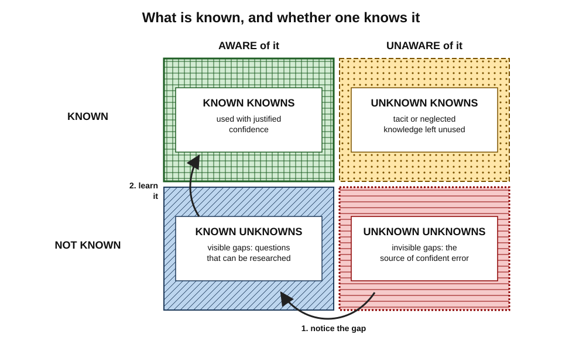
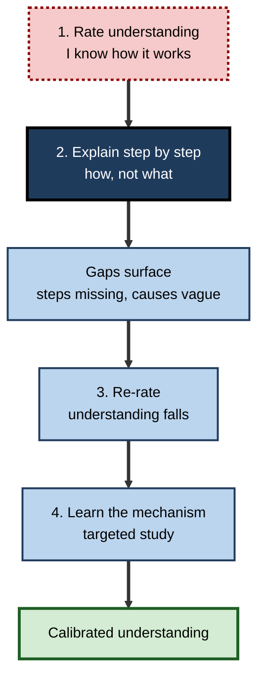
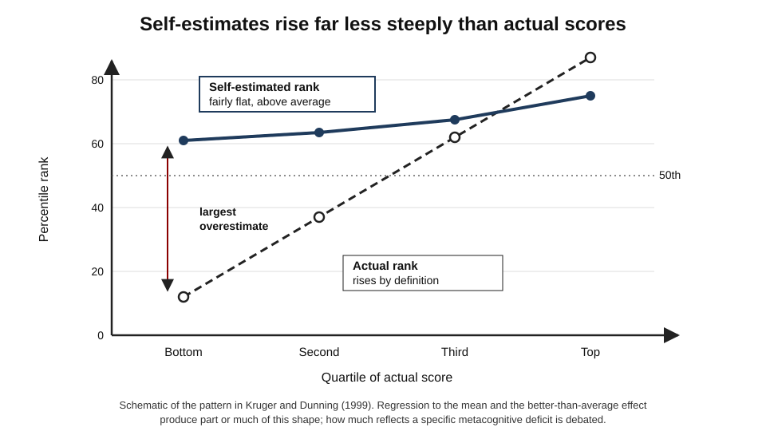
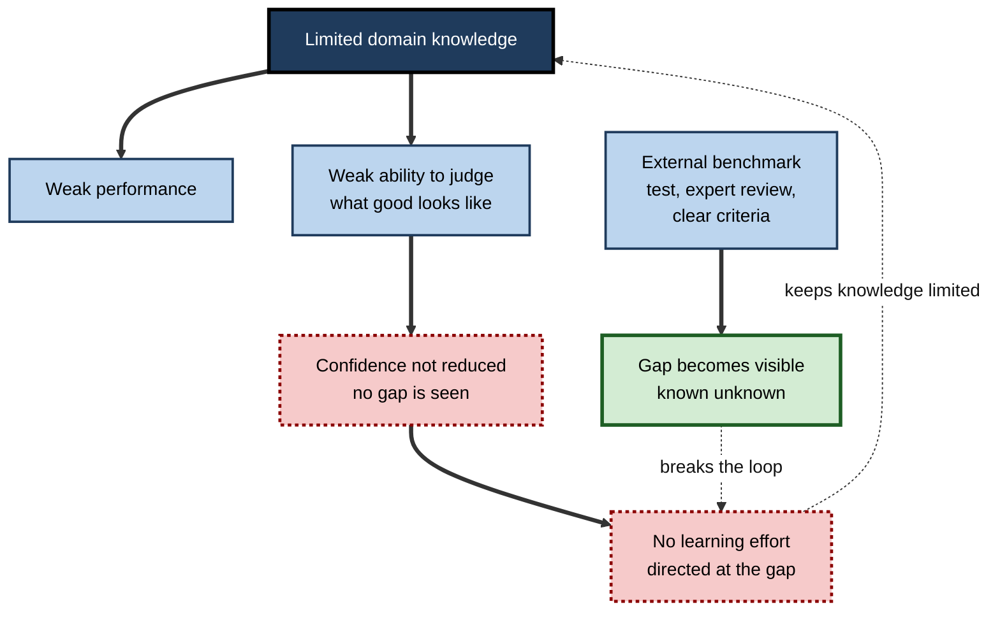
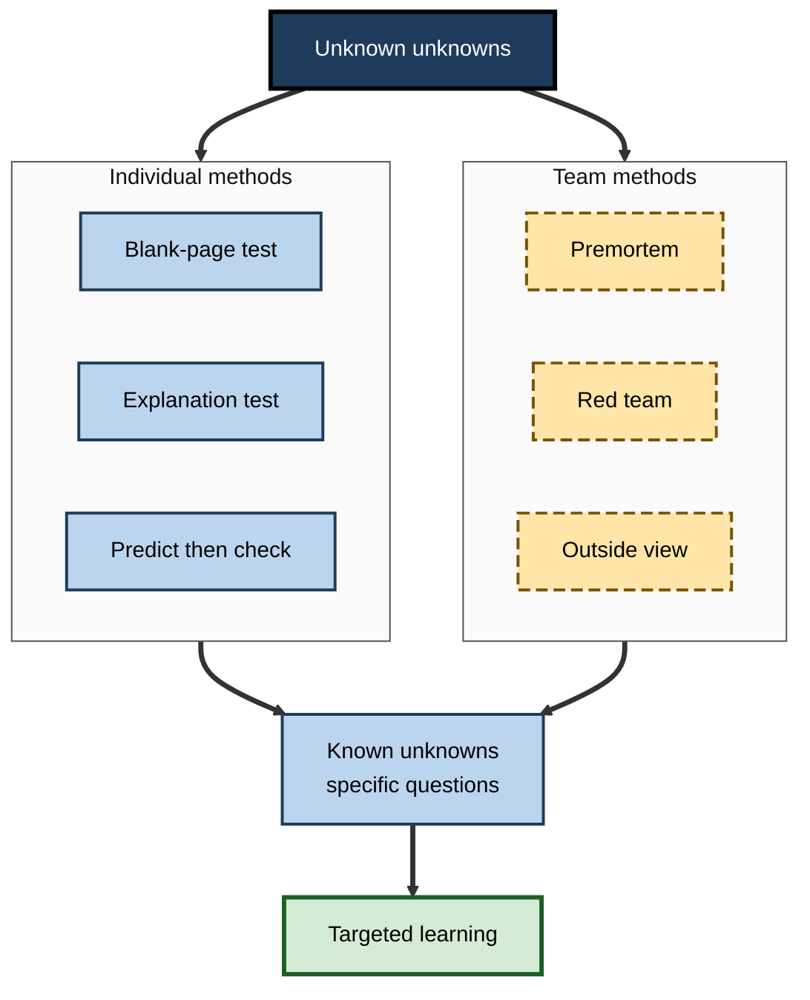

# B.5. Knowing What You Don't Know

Ask a room of adults whether they understand how a zip fastener works and most will say yes. Ask them to explain, step by step, how the teeth lock together, and confidence collapses. The same happens to a new manager who "knows" how budgeting works until the first quarterly forecast, and to a developer who "understands" the authentication flow until a security reviewer asks what happens when a token expires. The hardest gaps to fill are the ones a person **cannot see**.

> **Definition — Meta-ignorance:** ignorance of one's own ignorance — not knowing that one does not know something, so that the gap produces no doubt, no question and no effort to fill it.

**Why it matters**

- Every act of learning starts with **noticing a gap**; gaps that are not noticed are never filled.
- Unseen ignorance produces **confident error** — the most damaging kind in professional work.
- The skills needed to perform a task are often the same skills needed to **judge** performance at it, so weak performers can lack the means to see their weakness.
- Tools that produce fluent answers can **hide** gaps further, by making it unnecessary to discover them.

---

## The Shape of Ignorance

### Four kinds of knowing and not knowing

- **Known knowns** — things a person knows and knows they know.
  - *e.g.* a tax adviser's command of the standard income-tax bands.
- **Known unknowns** — gaps a person is aware of.
  - *e.g.* "I do not know the rules for this client's overseas trust — I must research them."
- **Unknown unknowns** — gaps a person is not aware of.
  - *e.g.* not realising that a particular transaction triggers a reporting obligation at all.
- **Unknown knowns** — knowledge a person has but does not realise, or does not bring to bear.
  - *e.g.* a nurse's tacit sense that a patient "looks wrong", dismissed because it cannot be articulated.

- **Origins:**
  - **Joseph Luft and Harrington Ingham (1955)** — the **Johari window**, a grid of what is known and unknown to oneself and to others, used in interpersonal awareness.
  - A 2002 press briefing by US Defence Secretary Donald Rumsfeld popularised the phrase "unknown unknowns" in public life; the idea is far older in engineering risk analysis.

> **Key point:** learning moves items **from unknown unknowns to known unknowns** — that is the metacognitive step — and then from known unknowns to known knowns — the cognitive step.

**Figure 1.** Four combinations of knowledge and awareness of that knowledge.

### Ignorance is structured, not random

- **Missing frames** — not knowing a whole area exists.
  - *e.g.* a start-up founder unaware of sector-specific data-protection rules.
- **Missing distinctions** — treating as one thing what experts treat as several.
  - *e.g.* "a database is a database" — not distinguishing transactional from analytical workloads.
- **Missing conditions** — knowing a rule but not its exceptions.
  - *e.g.* knowing a drug's standard dose but not its adjustment in kidney impairment.
- **Missing mechanisms** — knowing *that* without knowing *how*.
  - *e.g.* knowing interest rates affect inflation without knowing the channels.

> **Remember — FDCM:** missing **F**rames, **D**istinctions, **C**onditions, **M**echanisms — four places unseen gaps hide.

---

## The Illusion of Explanatory Depth

**Study card — Leonid Rozenblit and Frank Keil (2002)**

- **Design:**
  1. people rated how well they understood everyday devices — a zip, a flush toilet, a cylinder lock, a sewing machine;
  2. they wrote a detailed step-by-step explanation of how one worked;
  3. they re-rated their understanding;
  4. they answered a diagnostic question and read an expert explanation, then rated again.
- **Results:**
  - ratings **fell sharply** after trying to explain;
  - the illusion was strong for **devices and natural processes**, weaker for facts (capital cities), procedures and stories.
- **Explanation:**
  - visible parts of a device give a feeling of understanding the mechanism;
  - people confuse knowing **what** something does with knowing **how** it does it;
  - they rarely test their understanding by explaining, so the illusion is never corrected.

> **Definition — Illusion of explanatory depth:** the belief that one understands how something works in far more detail than one actually does, revealed when one tries to explain it.

**Study card — Fernbach, Rogers, Fox and Sloman (2013)**

- **Design:** people rated their understanding of, and position on, policy proposals (*e.g.* a cap-and-trade scheme for carbon emissions); they then explained **how** the policy would work, or listed **reasons** for their view.
- **Results:** explaining mechanisms **lowered** rated understanding and made positions **less extreme**; listing reasons did not.
- **Conclusion:** the demand for mechanistic explanation exposes the gap — and moderates confidence about matters people have not thought through.

- **Steven Sloman and Philip Fernbach** later argued that the illusion arises because people live in a **community of knowledge**: they rely on knowledge held by others and by artefacts, and mistake access to it for possession.

**Figure 2.** Explaining a mechanism reveals the illusion of explanatory depth.

### Worked example (illustrative): the explanation test on a work topic

- **Situation:** a product manager believes she understands how her company's recommendation engine works.

| Step | What she does | What happens |
|---|---|---|
| 1. Rate | Rates understanding 6/7 | Feels confident — she presents it to clients |
| 2. Explain | Writes how a recommendation is produced, from user click to displayed item | Stalls at "the model scores items"; cannot say what data the model uses, how often it is retrained, or why new products rarely appear |
| 3. Re-rate | Rates 3/7 | Gap now visible and specific |
| 4. List questions | Writes five precise questions for the engineering lead | Moves unknown unknowns to known unknowns |
| 5. Learn and re-explain | After a 30-minute session, writes the explanation again | Can now explain the cold-start problem to clients |

- **Conclusion:** the test converts a vague feeling into a **list of specific questions** — the raw material of efficient learning.

> **Watch out:** explaining **to oneself in one's head** is much weaker than writing or speaking. The mind skips steps silently; paper and listeners do not.

---

## Unskilled and Unaware?

### The Dunning–Kruger study

**Study card — Justin Kruger and David Dunning (1999)**

- **Design:** university students took tests of **logical reasoning, English grammar and humour judgement**, then estimated their score and their percentile rank among peers.
- **Results:**
  - the lowest-scoring quarter, who scored around the **12th percentile** on average, estimated themselves to be well **above the 50th**;
  - the top quarter slightly **underestimated** their rank;
  - in a follow-up, brief **training in logic** improved low scorers' ability to judge their own performance.
- **Their interpretation:** the **"double curse"** — the knowledge needed to perform well is the same knowledge needed to recognise good performance, so the unskilled lack both.

> **Definition — Dunning–Kruger effect:** the finding that people with low skill in a domain tend to overestimate their performance, and people with high skill tend slightly to underestimate their relative standing.

**Figure 3.** The classic pattern: perceived and actual performance by skill quartile.

### The statistical debate

The pattern is robust; its **interpretation** is contested.

- **Regression to the mean** — **Joachim Krueger and Ross Mueller (2002)** argued that when self-estimates and test scores are imperfectly correlated, the lowest scorers' estimates will inevitably sit above their scores, and the highest scorers' below, even without any special deficit.
- **The better-than-average effect** — most people rate themselves above the median on most skills; combined with regression, this alone produces much of the pattern.
  - *e.g.* Ola Svenson (1981) found large majorities of student drivers rated themselves safer and more skilful than the median driver.
- **Random-data demonstrations** — **Edward Nuhfer and colleagues (2016, 2017)** and **Gilles Gignac and Marcin Zajenkowski (2020)** showed that the classic quartile graph can be produced from random numbers, and found much weaker evidence of a special deficit with more appropriate statistics.
- **Rational-inference accounts** — **Rachel Jansen, Anna Rafferty and Thomas Griffiths (2021)** modelled people as estimating their performance from noisy self-perception; the model reproduced key features of the data, with the less skilled having less accurate information about their own performance.
- **Defenders** — Dunning and others reply that low performers' miscalibration remains in several designs and that training improves it, consistent with a real metacognitive component.

| Interpretation | Claim | Evidence for | Implication |
|---|---|---|---|
| Metacognitive deficit | The unskilled lack the knowledge to judge their own performance | Training improves self-judgement; low performers fail to recognise good answers | Teach the domain to improve self-assessment |
| Statistical artefact | Regression and above-average bias create the pattern | Random data reproduce the graph | Do not over-read the quartile chart |
| Noisy self-perception | Everyone infers performance from imperfect signals; low skill gives noisier signals | Rational models fit the data | Give clearer feedback and criteria |

> **Watch out:** the popular version — "the least competent are the most confident" or a curve with a "peak of Mount Stupid" — is **not** what the research shows. Low performers usually rate themselves **lower** than high performers do, just not as low as their scores warrant. The cartoon curve did not come from the original studies.

### What survives the debate

- **Self-assessment is weakly related to actual skill** — correlations are typically modest.
- **Low performers' self-estimates overshoot most** in absolute terms.
- **Domain knowledge improves self-assessment** — learning what good looks like is the most reliable cure.
- **External benchmarks beat introspection** — tests, feedback and comparison with criteria.

> **Key point:** whatever the mechanism, people cannot rely on **feeling** competent as evidence of competence, and novices least of all.

---

## Overconfidence in Its Three Forms

**Don Moore and Paul Healy (2008)** separated three forms that are often confused.

- **Overestimation** — believing one's performance is better than it is.
  - *e.g.* expecting to score 80% and scoring 60%.
- **Overplacement** — believing one is better than others when one is not.
  - *e.g.* believing one is among the best negotiators in the firm.
- **Overprecision** — excessive certainty about the accuracy of one's beliefs.
  - *e.g.* a "90% confident" range for next year's sales that the actual figure misses half the time.

| | Overestimation | Overplacement | Overprecision |
|---|---|---|---|
| Compared with | One's actual performance | Other people | The true uncertainty |
| Typical on hard tasks | Common | Often reversed (people think they are *worse* than others) | Common |
| Typical on easy tasks | Less common, sometimes underestimation | Common | Common |
| Most damaging in | Learning and preparation | Hiring, competition, delegation | Forecasting, planning, risk |

> **Key point:** **overprecision** is the most persistent of the three — it appears across tasks, cultures and expertise levels — and the most relevant to professional judgement about uncertain futures.

---

## The Expert's Blind Spot

### The curse of knowledge

- Experts can also misjudge — not their own competence, but what **others** know.
- **Colin Camerer, George Loewenstein and Martin Weber (1989)** — better-informed people could not ignore their knowledge when predicting the judgements of less-informed people; they named it the **curse of knowledge**.
- **Elizabeth Newton (1990)** — "tappers" tapped the rhythm of well-known songs and predicted listeners would identify about half; listeners identified only a tiny fraction. Tappers heard the tune in their heads; listeners heard only knocks.

> **Definition — Curse of knowledge:** the difficulty that knowledgeable people have in imagining what it is like not to know what they know.

> **Example (illustrative):** a senior engineer writes onboarding documentation that skips "obvious" steps; new joiners repeatedly fail at the same point, which the author cannot see because the step is automatic for her.

### Expertise and the limits of competence

- Experts usually have **better** self-assessment inside their domain.
- But expertise can create **over-extension** — confidence carried into neighbouring areas where it is not warranted.
  - *e.g.* an eminent physician pronouncing on economics.
- Expert knowledge of **what experts usually miss** is a valuable form of metacognitive knowledge, built through cases, errors and reviews.

**Figure 4.** Why poor performance can hide itself, and how external benchmarks break the loop.

---

## Methods for Surfacing What One Does Not Know

### Individual methods

- **The blank-page test** — write everything one knows about a topic without notes, then compare with a source.
  - Reveals missing frames and distinctions.
- **The explanation test** — explain *how* something works, step by step, to a real or imagined novice.
  - Reveals missing mechanisms.
- **Predict, then check** — before reading the answer, running the code or seeing the data, write the expected result.
  - Reveals mistaken models.
- **The "what would change my mind?" question** — name the evidence that would overturn a belief.
  - If nothing could, the belief is not being held on evidence.
- **Consider the opposite** — **Charles Lord, Mark Lepper and Elizabeth Preston (1984)** found that asking people to consider how they would have judged evidence pointing the other way reduced biased assimilation more than simply urging them to be fair.
- **Ask the expert's question** — "What do newcomers to this usually get wrong?"

### Team and organisational methods

- **The premortem** — **Gary Klein (2007)**: before a project starts, imagine it has failed and write down why.
  - Draws on **prospective hindsight**: imagining an outcome as already having happened makes people generate more, and more specific, reasons.
- **Red teams** — a group charged with finding the flaws in a plan.
- **Outside view** — compare with a reference class of similar cases rather than reasoning only from the inside.
- **Structured peer review** — reviewers are asked specifically for what is **missing**, not only what is wrong.
- **Lessons databases** — records of past surprises, searched before similar work.

| Method | Reveals | Cost | Works best when |
|---|---|---|---|
| Blank-page test | Missing frames, distinctions | Minutes | Checking study of a topic |
| Explanation test | Missing mechanisms | Minutes | Before presenting or relying on an understanding |
| Predict then check | Mistaken models | Seconds per prediction | Analysis, debugging, experiments |
| Premortem | Unseen risks in a plan | An hour, team | Before committing to a project |
| Red team | Weaknesses others can see | Days, specialist people | High-stakes plans and security |
| Outside view | Optimism about one's own case | Requires data on similar cases | Estimates and forecasts |

**Figure 5.** A toolkit for moving unknown unknowns into view.

---

## Not Knowing in the Age of AI

### How tools hide gaps

- **Answers without understanding** — a fluent answer removes the need to notice not knowing.
- **Borrowed confidence** — the tool's assured tone feeds the user's sense of knowing.
- **Inability to evaluate** — the user who most needs to check the output is least able to.

**Study card — Fernandes and colleagues (2025)**

- **Design:** participants solved logical-reasoning problems of the kind used in law-school admission tests, with access to a generative AI assistant, and estimated their performance; a comparison involved working without AI.
- **Results:**
  - performance improved with AI, but participants **overestimated** it substantially;
  - the usual Dunning–Kruger pattern largely **disappeared** — nearly everyone overestimated;
  - participants with higher self-rated **AI literacy** were more confident but **less accurate** in their self-assessment;
  - most interacted with the AI briefly, often with a single prompt per problem, accepting answers with little checking.
- **Conclusion:** AI assistance can **raise performance while lowering metacognitive accuracy** — people become, in the authors' phrase, smarter but none the wiser.

### Machines that do not know what they do not know

- Language models can produce confident, fluent and false statements — often called **hallucinations**.
- In metacognitive terms, the model's output does not carry a reliable signal of where its knowledge ends.
- **Implication:** users must supply the missing meta level — checking sources, asking for uncertainty, testing on known cases.

> **In practice:** before accepting an AI answer in an unfamiliar area, a professional writes down what they would **expect** the answer to contain and what would make them doubt it — a deliberate step from unknown unknowns to known unknowns.

---

## Case Study (illustrative): Mapping Unknowns in a Due-Diligence Team

- **Situation:** a consulting team had three weeks to assess an acquisition target in the medical-device industry, which no team member had worked in.
- **Problem:** on a previous engagement in an unfamiliar sector, the team had missed a regulatory issue that later cost the client heavily; the partner wanted to avoid a repeat.
- **Actions:**
  1. **Day one — blank-page test:** each consultant wrote what they knew about how medical devices reach market. The overlap revealed the team knew little beyond "it needs approval".
  2. **Unknowns register:** the team listed every question it could not answer, sorted into frames, distinctions, conditions and mechanisms.
  3. **Expert calls with a twist:** each interview with a former industry executive began, "What do outsiders typically fail to ask about a business like this?"
  4. **Premortem at the midpoint:** "It is a year after the deal and it has gone badly. Why?"
  5. **Predict-then-check:** before receiving data, consultants wrote expected figures for margins and recall rates; large surprises were investigated.
- **Result:**
  - the expert calls surfaced a distinction the team had not known existed — devices fall into **risk classes** with very different approval paths and post-market obligations;
  - the premortem produced a concern about a pending change in classification for one of the target's main products, which became the central issue in the final report;
  - the client renegotiated the price.
- **Side effects:** the unknowns register grew uncomfortably long in week one; the partner had to present it as progress, not weakness.
- **Lesson:** in an unfamiliar domain the first deliverable is a **map of what is not known**; asking experts what outsiders miss is the fastest way to find unknown unknowns.

---

## Open Questions

- **Is there a genuine metacognitive deficit among the least skilled?**
  - The statistical debate over the Dunning–Kruger effect is not settled; how much of the pattern reflects a special deficit, and how much general noise and bias, remains contested.
- **Can people become better at detecting their own unknown unknowns in general?**
  - Methods such as premortems work for specific plans; whether they build a lasting, transferable habit is less clear.
- **Does reliance on shared and tool-held knowledge make the illusion of understanding worse?**
  - The community-of-knowledge view suggests yes, but strong longitudinal evidence is lacking.
- **How can AI tools signal what they do not know?**
  - Reliable uncertainty signalling by models, and how users respond to it, is an active research area.

---

## Summary

- **Meta-ignorance** — not knowing what one does not know — blocks learning because unseen gaps prompt no effort.
- Knowledge and awareness combine into **known knowns, known unknowns, unknown unknowns** and **unknown knowns**; gaps hide as missing **frames, distinctions, conditions and mechanisms**.
- The **illusion of explanatory depth** (Rozenblit and Keil, 2002): people overrate their understanding of mechanisms until they try to explain; explaining policies also moderates extreme views (Fernbach and colleagues, 2013).
- **Kruger and Dunning (1999):** low performers overestimate, high performers slightly underestimate; the **double curse** explanation is contested by **regression, better-than-average** and **noisy-inference** accounts. The cartoon "peak" curve is a myth.
- Robust lessons: self-assessment is **weakly** related to skill; **domain knowledge** and **external benchmarks** improve it.
- Overconfidence has three forms: **overestimation, overplacement, overprecision** (Moore and Healy, 2008).
- Experts suffer the **curse of knowledge** and can **over-extend** beyond their domain.
- Surface gaps with **blank-page and explanation tests, predict-then-check, considering the opposite, premortems, red teams** and the **outside view**.
- AI can raise performance while **lowering metacognitive accuracy** (Fernandes and colleagues, 2025); users must supply the meta level.

---

## Self-Check

1. Define meta-ignorance and explain why it blocks learning.
2. Give a professional example of each of the four combinations of knowledge and awareness.
3. Name the four places where unseen gaps typically hide, with an example of each.
4. Describe Rozenblit and Keil's procedure and findings. For which kinds of knowledge was the illusion weakest?
5. What did Fernbach and colleagues find when people explained policy mechanisms?
6. Summarise Kruger and Dunning's 1999 findings and the "double curse" explanation.
7. Explain how regression to the mean can produce the Dunning–Kruger pattern.
8. Why is the popular "peak of Mount Stupid" curve misleading?
9. Distinguish overestimation, overplacement and overprecision.
10. What is the curse of knowledge? Describe Newton's tapping study.
11. Describe a premortem and explain why it works.
12. What did the 2025 study of AI-assisted reasoning find about self-assessment?
13. A new hire says, "I've got the hang of the billing system." Design a five-minute check that would reveal unseen gaps.
14. You lead a team entering an unfamiliar market. Outline a two-week plan to map what the team does not know.

### Answer Key

1. Ignorance of one's own ignorance. An unseen gap produces no doubt or question, so no learning effort is directed at it.
2. Known known: a lawyer's command of standard contract terms. Known unknown: "I need to check the rules on this jurisdiction." Unknown unknown: unaware a merger needs competition-authority notice. Unknown known: an engineer's unarticulated sense that a design is fragile, ignored.
3. Frames (an entire relevant area), distinctions (treating different things as one), conditions (exceptions to rules), mechanisms (how, not just that), with suitable examples.
4. Rate understanding of devices, explain how one works, re-rate, answer a diagnostic question. Ratings fell sharply after explaining. The illusion was weakest for facts, procedures and narratives.
5. Explaining how a policy would work lowered rated understanding and made positions less extreme; listing reasons did not.
6. The lowest quartile, scoring near the 12th percentile, estimated themselves well above average; the top quartile slightly underestimated their rank; training improved self-judgement. Double curse: the skills to perform are the skills to judge performance.
7. If self-estimates and scores correlate imperfectly, the estimates of those selected for extreme low scores will lie closer to the mean than their scores, and the reverse for high scorers, without any special deficit.
8. It implies the least competent are the most confident. Data show low performers rate themselves lower than high performers do, just not low enough; the curve was not in the original studies.
9. Overestimation: rating own performance above actual. Overplacement: rating self above others incorrectly. Overprecision: excessive certainty, such as too-narrow intervals.
10. Knowledgeable people find it hard to imagine not knowing. Tappers predicted listeners would identify about half the songs; listeners identified very few.
11. Imagine the project has already failed and list reasons. Prospective hindsight makes people generate more and more specific reasons, and legitimises raising doubts.
12. AI improved performance but people overestimated it substantially; the Dunning–Kruger pattern largely vanished as almost everyone overestimated; higher self-rated AI literacy went with lower self-assessment accuracy.
13. *e.g.* ask them to explain step by step what happens from order to invoice, including one exception (a partial refund); then have them predict the result of an unusual case before trying it in a test system.
14. *e.g.* day 1 blank-page test and unknowns register; days 2–6 expert interviews asking what outsiders miss; predict-then-check on key data; day 7 premortem; days 8–10 targeted research on the riskiest unknowns; final review of the register and outside-view comparison with similar market entries.

---

## Glossary

| Term | Meaning |
|---|---|
| Better-than-average effect | The tendency of most people to rate themselves above the median. |
| Community of knowledge | The view that individuals rely on knowledge held by others and artefacts, and mistake access for possession. |
| Consider the opposite | Imagining how one would judge evidence pointing the other way. |
| Curse of knowledge | Difficulty imagining the perspective of someone who lacks one's knowledge. |
| Double curse | The proposal that the skills to perform are the skills to judge performance. |
| Dunning–Kruger effect | Low performers overestimating and high performers slightly underestimating their standing. |
| Illusion of explanatory depth | Believing one understands a mechanism in more detail than one does. |
| Johari window | A grid of what is known and unknown to oneself and to others. |
| Known unknown | A gap of which one is aware. |
| Meta-ignorance | Not knowing that one does not know. |
| Outside view | Judging a case by comparison with a reference class of similar cases. |
| Overestimation | Believing one's performance is better than it is. |
| Overplacement | Believing one is better than others when one is not. |
| Overprecision | Excessive certainty about the accuracy of one's beliefs. |
| Premortem | Imagining a plan has failed and listing why, before starting. |
| Prospective hindsight | Imagining an event as already having happened to generate explanations. |
| Red team | A group tasked with finding flaws in a plan. |
| Regression to the mean | The tendency of extreme scores to be followed by, or paired with, less extreme ones. |
| Unknown known | Knowledge one has but does not realise or use. |
| Unknown unknown | A gap of which one is unaware. |
