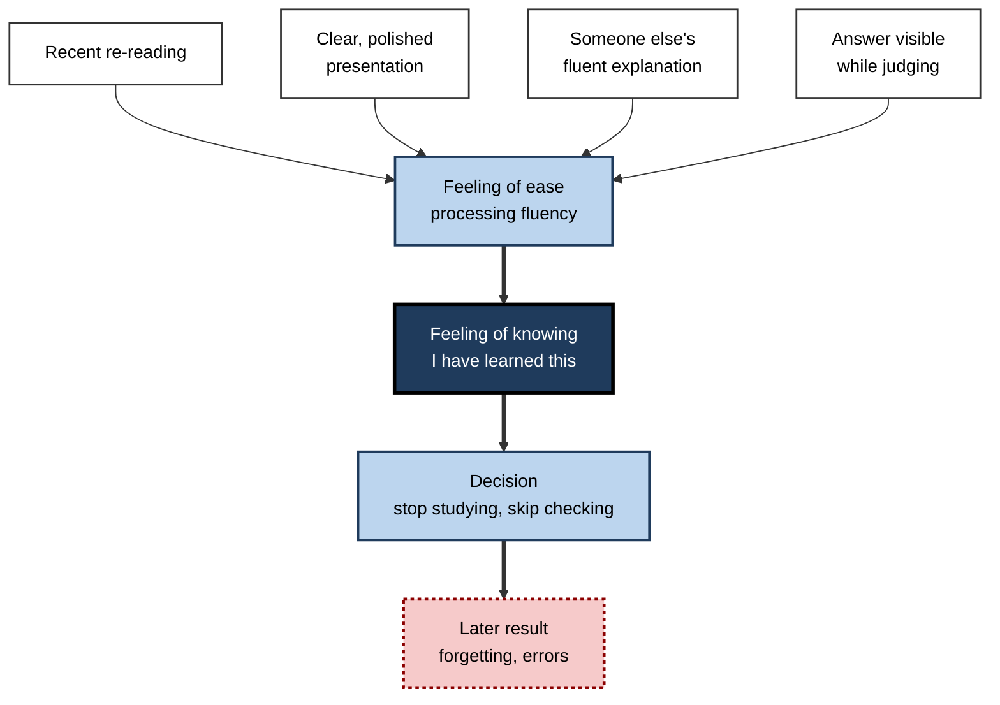
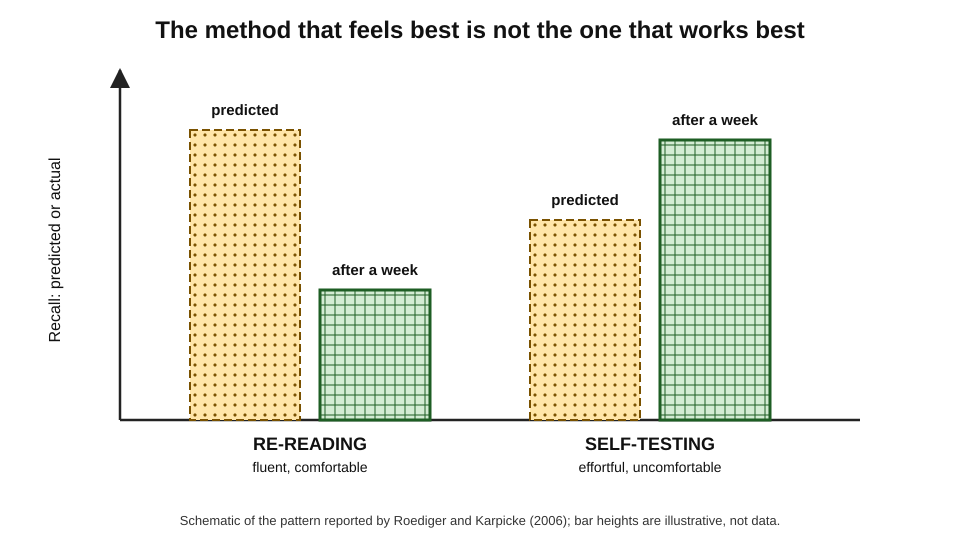
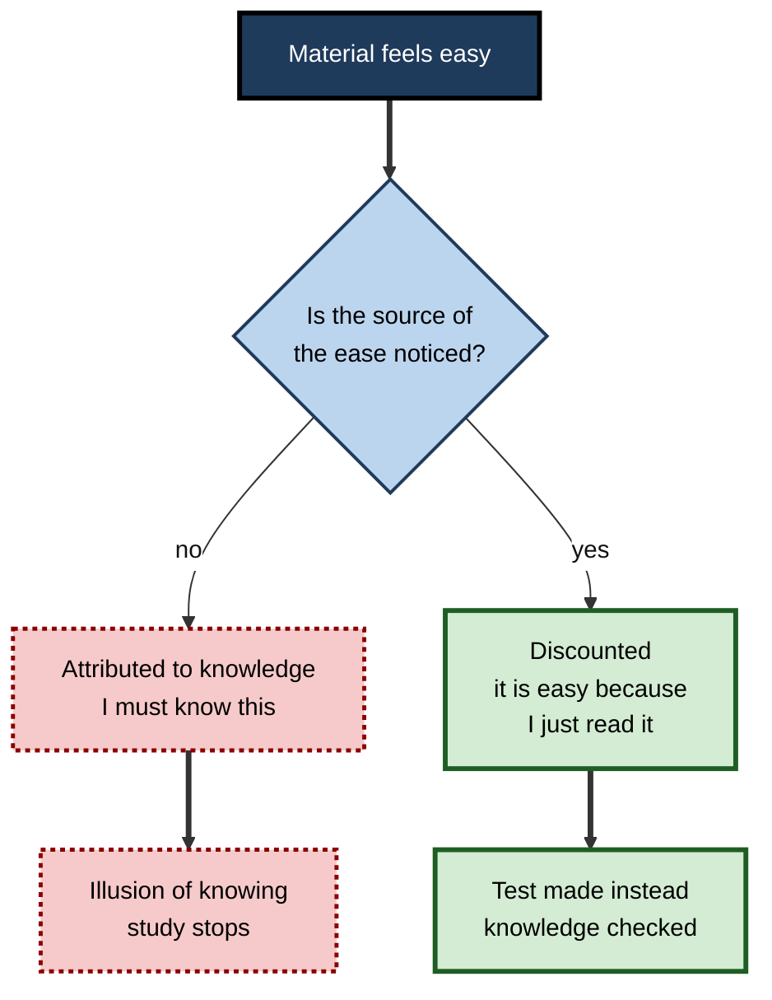
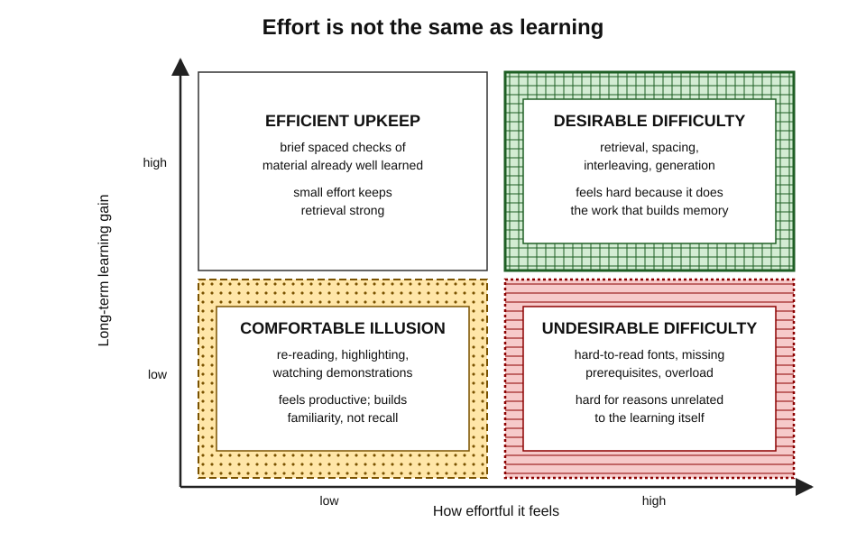
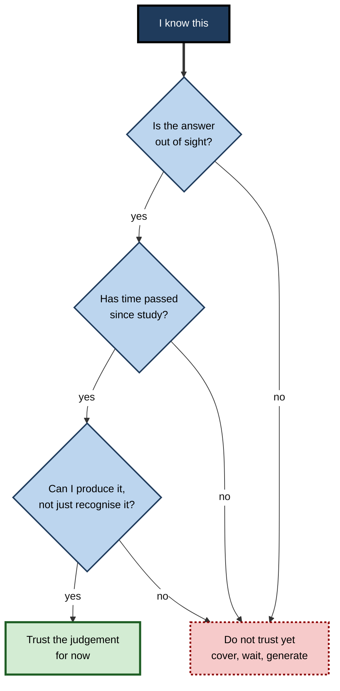

# B.6. Illusions of Knowing and Fluency

A student re-reads a chapter until every sentence feels familiar, and concludes she knows it. A team rates a polished training video excellent; a month later few can perform the procedure. A manager repeats a claim from a beautifully written AI briefing; it turns out to be wrong. In each case the **ease** of processing was taken as evidence of **knowledge** or **truth**. Usually that inference is sound; in learning, it is often badly wrong.

> **Definition — Processing fluency:** the subjective ease or difficulty with which information is perceived, understood or retrieved.

> **Definition — Illusion of knowing:** a mistaken feeling that something is known, understood or true, produced by cues — especially fluency — that do not reflect actual knowledge.

**Why it matters**

- Fluency is the most powerful single cue people use to judge their own learning.
- The most fluent study methods — re-reading, watching, highlighting — are among the **least effective**; the most effective feel **harder**.
- Fluency also makes claims feel **true**, which matters for misinformation and for trust in AI output.
- Learners, trainers and organisations that judge by feel systematically **choose and reward** the wrong methods.

---

## What Fluency Is

### Forms of fluency

- **Perceptual fluency** — ease of seeing or hearing.
  - *e.g.* a clear font, a large type size, a confident speaker, high-quality audio.
- **Conceptual fluency** — ease of grasping meaning.
  - *e.g.* a familiar example, a well-organised explanation, a predictable sentence.
- **Retrieval fluency** — ease with which something comes to mind.
  - *e.g.* an answer that pops up instantly; a term recently encountered.
- **Encoding fluency** — ease of processing material at study.
  - *e.g.* a passage that reads smoothly because it was read moments ago.

| | Perceptual | Conceptual | Retrieval |
|---|---|---|---|
| Arises from | Clarity of presentation | Familiarity and coherence of meaning | Recency, repetition, strength of memory |
| Workplace example | A slick slide deck | A colleague's lucid explanation | Recalling a figure just seen on screen |
| Valid cue when | Rarely, for learning | Understanding is genuinely the learner's own | Retrieval is delayed and unaided |
| Misleading when | It is mistaken for understanding | Another person did the explaining | Answer was seen seconds ago |

### Why people trust fluency

- **Fluency is usually informative.**
  - Things encountered often, learned well and understood deeply *do* tend to be processed easily.
  - **Daniel Oppenheimer (2008)** and **Adam Alter and Daniel Oppenheimer (2009)** reviewed how fluency is used across judgements of truth, liking, frequency, confidence and familiarity.
- **Norbert Schwarz's "feelings as information"** — people treat their feelings as data about the world unless they see a reason to discount them.
- **The problem in learning:** fluency during study is driven largely by **recency, repetition and presentation**, which predict long-term retention poorly.

> **Key point:** fluency is a **heuristic** — a fast rule that works in ordinary life because ease and familiarity usually go together. Study conditions break the link.

**Figure 1.** How sources of fluency become a feeling of knowing and a study decision.

---

## The Main Illusions in Learning

### Re-reading versus retrieval

**Study card — Henry Roediger and Jeffrey Karpicke (2006)**

- **Design:** students studied short prose passages, then either **re-read** them or took **free-recall tests** on them without feedback, and were tested after five minutes, two days or a week; in a second experiment, students who studied repeatedly or were tested repeatedly also **predicted** their later recall.
- **Results:**
  - after **five minutes**, re-reading gave slightly **better** recall;
  - after **two days and a week**, testing gave **much better** recall;
  - students who only re-read **predicted** they would remember more than students who were repeatedly tested.
- **Conclusion:** re-reading produces **fluency and short-term performance**; retrieval produces **durable memory** — and learners' predictions follow fluency.

**Figure 2.** What feels effective and what proves effective: re-reading compared with self-testing.

### Presentation illusions

**Study card — Matthew Rhodes and Alan Castel (2008): the font-size effect**

- **Design:** people studied words printed in large or small type and made a JOL for each, then took a recall test.
- **Results:** large-font words received **higher JOLs** but were **not** recalled better.
- **Conclusion:** a purely perceptual feature that does not affect memory inflates the **feeling** of learning.

**Study card — Shana Carpenter, Miko Wilford, Nate Kornell and Kellie Mullaney (2013): the fluent instructor**

- **Design:** students watched a short video lecture given either **fluently** (confident, eye contact, no notes) or **disfluently** (hesitant, reading from notes) with identical content, then predicted and took a test.
- **Results:** the fluent lecture produced **higher ratings and predictions** of learning; actual test scores were **about the same**.
- **Conclusion:** a speaker's polish inflates learners' sense of learning without changing learning.

- **The "Dr Fox" lecture** — in a 1973 study by **Donald Naftulin, John Ware and Frank Donnelly**, an actor gave a charismatic but content-free lecture to medical educators, who rated it highly.

> **Watch out:** "the trainer was excellent" and "I learned a lot" are mostly ratings of **fluency**. They are not evidence of learning.

### Active learning feels worse

**Study card — Louis Deslauriers and colleagues (2019)**

- **Design:** university physics students experienced matched lessons taught either by polished lecture or by **active learning** (working problems in groups with guidance), in a crossover design.
- **Results:**
  - students **learned more** in the active classes, measured by tests;
  - they **felt** they had learned **less**, and rated the lecture more highly;
  - the effort of active learning was interpreted as confusion and poor teaching.
- **Conclusion:** the feeling of learning can run **opposite** to actual learning; the authors recommended telling students early that effortful learning feels less productive.

### Answer-present illusions

- **Foresight bias** — **Asher Koriat and Robert Bjork (2005)**: when studying a cue with its answer in view, learners overestimate how easily the answer will come to mind later when only the cue is given.
  - *e.g.* reading "Capital of Australia — Canberra" feels like knowing; facing "Capital of Australia — ?" alone is different.
- **Worked-solution illusion** — reading a worked solution feels like being able to solve the problem.
  - *e.g.* following a colleague's spreadsheet model step by step vs building one from a blank sheet.
- **Code-reading illusion** — reading working code fluently is mistaken for the ability to write it.

> **Remember:** **"seeing it is not getting it"**. Judge knowledge with the answer **out of sight**.

### Knowing after the fact

- **Hindsight bias** — **Baruch Fischhoff (1975)**: once people know an outcome, they believe they would have predicted it, and overestimate how foreseeable it was.
  - The "knew-it-all-along" feeling is an illusion of past knowing.
  - *e.g.* after a project fails, reviewers feel the warning signs were "obvious".
- **Consequence for learning:** hindsight makes post-mortems less informative, because the lessons seem trivial once known.

### Illusions of truth

- **The illusory truth effect** — **Lynn Hasher, David Goldstein and Thomas Toppino (1977)**: statements repeated across sessions were rated **more likely true** than new ones.
- **Lisa Fazio and colleagues (2015)** — repetition increased belief even in statements that contradicted participants' own knowledge.
- **Mechanism:** repetition increases fluency; fluency is read as truth.

> **Definition — Illusory truth effect:** the tendency to rate repeated statements as more likely to be true than new statements.

### Borrowed knowledge

**Study card — Matthew Fisher, Mariel Goddu and Frank Keil (2015)**

- **Design:** people answered questions either by searching the internet or without it; then rated how well they could explain answers to **new, unrelated** questions — ones they would answer without searching.
- **Results:** those who had searched rated their **own** knowledge higher, even on unrelated topics and even when the searches had failed to find answers.
- **Conclusion:** access to external knowledge is mistaken for **personal** knowledge.

### Fluent machines

- **Mark Steyvers and colleagues (2025)** studied how people judge the reliability of answers from large language models.
  - People's confidence in the answers was **higher** than the models' actual accuracy — a **calibration gap**.
  - **Longer, more detailed explanations** raised people's confidence even when they did not make answers more accurate.
  - When explanations were adjusted to express the model's own uncertainty, people's confidence moved closer to actual accuracy.
- **Implication:** AI output is perhaps the most fluent text most people read; its fluency borrows the authority of knowledge it may not have.

| Illusion | What it feels like | What is actually true | Remedy |
|---|---|---|---|
| Re-reading | "It's all familiar now — I know it" | Familiarity, not recall | Test without notes after a delay |
| Fluent instructor | "That was clear — I learned a lot" | Polish raised ratings, not learning | Judge training by delayed performance |
| Active-learning penalty | "That was confusing — I learned little" | Effort produced more learning | Expect effortful learning to feel worse |
| Foresight bias | "I'll remember the answer" | Answer was in view | Cover the answer before judging |
| Hindsight bias | "I knew it all along" | Outcome knowledge rewrote memory | Record predictions beforehand |
| Illusory truth | "I've heard that — it's true" | Repetition breeds fluency | Check the source, not the familiarity |
| Borrowed knowledge | "I know a lot about this" | Search or AI did the knowing | Test unaided |

---

## How Fluency Is Interpreted

### Attribution and discounting

- Fluency itself is ambiguous; people **attribute** it to some cause.
- **Larry Jacoby and Kevin Whitehouse (1989)** — briefly flashing a word before a recognition test made new words feel "old"; the effect vanished when people **noticed** the flash, because they attributed the fluency to it.
- **Discounting:** when people know *why* something feels easy, they stop treating the ease as evidence.

> **Key point:** illusions of knowing are strongest when the source of fluency is **invisible**. Naming the source — "this feels familiar because I read it ten minutes ago" — weakens the illusion.

**Figure 3.** Whether fluency becomes an illusion depends on how its source is interpreted.

### Theory can override feeling — partly

- When people are told that effort is a sign of learning, or have experienced the benefit of testing themselves, they rely less on fluency.
- But **experience-based** feelings are fast and compelling; explicit beliefs override them only when a person **deliberately** stops to judge.

---

## Can Difficulty Be Engineered?

### Desirable and undesirable difficulty

- **Desirable difficulties** (Robert Bjork) — conditions that make learning feel harder **because** they require the processing that builds memory.
  - Retrieval, spacing, interleaving, generation, varied practice.
- **Undesirable difficulties** — conditions that are hard for reasons unrelated to learning.
  - Poor audio, confusing layout, missing prerequisites, overload.

| | Desirable difficulty | Merely perceptual difficulty | Undesirable difficulty |
|---|---|---|---|
| Example | Recalling instead of re-reading | Hard-to-read font | Missing prerequisite knowledge |
| Feels | Effortful | Effortful | Effortful, often frustrating |
| Engages the processing that builds memory? | Yes | Little or none | Blocks it |
| Effect on long-term learning | Positive | Not reliably positive | Negative |

**Figure 4.** Effort is not the same as learning: four combinations of effort and learning gain.

### The disfluent-font story

- **Connor Diemand-Yauman, Daniel Oppenheimer and Erikka Vaughan (2011)** reported that material in hard-to-read fonts was remembered better.
- **Andrew Meyer and colleagues (2015)** reported many experiments, with thousands of participants, finding **no reliable benefit** of disfluent fonts on reasoning; similar attempts to improve memory with specially designed "difficult" fonts in later studies also **failed to replicate**.

> **Watch out:** "make it hard to read and people will learn more" is **not** supported. Difficulty helps only when it forces the **right kind of processing** — usually retrieval or generation — not when it merely slows perception.

---

## Defences Against Illusions of Knowing

### For individuals

1. **Close the source, then judge** — never rate learning with the material in view.
2. **Delay the judgement** — wait at least minutes, ideally a day.
3. **Generate, don't recognise** — write, explain, solve or draw from memory.
4. **Predict, then check** — record a prediction and compare it with the result.
5. **Name the source of ease** — "familiar because recent", "clear because someone else explained it".
6. **Treat effort as information** — effortful recall that succeeds is strong evidence; effortless recognition is weak evidence.

> **Mnemonic — "CDG-PNT" ("Can Diligent Graduates Prove Nothing Twice?"):** Close the source, Delay, Generate, Predict, Name the source, Treat effort as information.

**Figure 5.** Testing a feeling of knowing before acting on it.

### Worked example (illustrative): two ways to prepare a client briefing

- **Situation:** a consultant has 90 minutes to prepare for a client meeting on a new regulation.

| | Approach A: re-read | Approach B: retrieve |
|---|---|---|
| Method | Reads the 20-page summary three times, highlighting | Reads once; closes it; writes the five key obligations and their deadlines from memory; checks; repeats for errors |
| Feeling at the end | Confident — "it all makes sense" | Less comfortable — two obligations were wrong at first |
| Judgement made | With the summary open | After closing it, by producing answers |
| Meeting the next day | Hesitates under questions; checks notes often | Answers most questions directly; notes the two areas that were weak |

- **Verdict:** Approach A produced **fluency**; Approach B produced **retrievable knowledge** and an accurate map of weak points.

> **Watch out:** the discomfort in Approach B is the **signal** that learning was happening, not a sign that it failed.

### For trainers and organisations

- **Measure learning after a delay and unaided**, not by end-of-session ratings.
- **Warn learners** that effective methods feel harder — and show them the evidence.
- **Build retrieval into training**: questions before explanations, quizzes at the start of later sessions.
- **Separate polish from content** when evaluating trainers and materials.
- **Design AI tools to show uncertainty** and to ask users to attempt answers first.

### Case study (illustrative): rethinking onboarding videos

- **Situation:** a software company onboarded customer-support staff with a library of polished product videos; new staff watched them during their first two weeks.
- **Problem:** viewers rated the videos highly and reported feeling well prepared; yet in their first month they escalated many routine queries and made frequent configuration errors.
- **Diagnosis:**
  - the videos produced **perceptual and conceptual fluency** — clear voice-over, smooth demonstrations;
  - staff judged readiness while watching, with every answer on screen (**foresight bias**);
  - no one attempted tasks unaided before going live.
- **Actions:**
  1. Each video was cut to a short demonstration followed by a **hands-on task** in a practice environment, attempted before the solution was shown.
  2. At the start of each day, new staff answered five questions from the **previous** day's material without notes.
  3. Readiness was certified by **unaided simulated tickets** at the end of week two, not by completion of the videos.
  4. Team leads told new joiners explicitly: "If this feels harder than the videos, it is working."
- **Result:** satisfaction with onboarding dipped slightly; first-month escalations of routine queries fell markedly and configuration errors dropped.
- **Side effects:** onboarding took slightly longer to design and needed a maintained practice environment.
- **Lesson:** the polish that made the videos popular was the source of an **illusion of readiness**; retrieval and unaided practice exposed and closed the gap.

---

## Illusions of Competence in AI-Assisted Work

**Study card — Neil Perry, Megha Srivastava, Deepak Kumar and Dan Boneh (2023)**

- **Design:** participants completed security-related programming tasks, some with an AI code assistant and some without, then rated the security of their solutions.
- **Results:**
  - participants with the AI assistant wrote **less secure** code on several tasks;
  - they were **more likely to believe** their code was secure;
  - participants who engaged more critically with the assistant — rephrasing prompts, questioning outputs — produced more secure code.
- **Conclusion:** AI assistance can lower quality and raise confidence at the same time — an illusion of competence in its modern form.

### Why AI output is a strong fluency source

- **Perceptual polish** — grammatical, well-formatted, confident text.
- **Conceptual coherence** — explanations that hang together even when wrong.
- **Effortless production** — the user did not struggle, so there is no felt difficulty to signal gaps.
- **Borrowed authority** — the system's general competence lends credibility to each specific claim.

> **Remember — before trusting fluent AI output:** predict the answer first; ask for assumptions and uncertainty; verify one key claim independently; and note whether the work would survive review **without** the tool.

---

## Open Questions

- **Can people learn to distrust fluency in general?**
  - Training helps in specific tasks; whether it produces a lasting, general habit is uncertain.
- **How do AI explanations affect learning and belief over time?**
  - Early evidence shows fluent explanations raise confidence; long-term effects on knowledge and trust are unknown.
- **When is fluency a valid cue?**
  - For experts recalling well-learned material, fluency may be informative; mapping its validity across conditions is incomplete.
- **How should organisations replace satisfaction ratings?**
  - Delayed, behavioural measures are better but costlier; affordable alternatives are still being developed.

---

## Summary

- **Processing fluency** — perceptual, conceptual, retrieval, encoding — is used as a cue to knowledge and truth; it is usually informative in daily life but **misleading in learning**.
- **Re-reading** beats testing at five minutes but loses badly after days; learners predict the opposite (**Roediger and Karpicke, 2006**).
- **Presentation illusions:** large fonts (**Rhodes and Castel, 2008**) and fluent lecturers (**Carpenter and colleagues, 2013**) raise judged learning without raising learning; **active learning** raises learning while lowering judged learning (**Deslauriers and colleagues, 2019**).
- **Answer-present illusions** (foresight bias, worked solutions, code reading), **hindsight bias** and the **illusory truth effect** extend the problem.
- **Searching** inflates estimates of personal knowledge (**Fisher, Goddu and Keil, 2015**); **AI explanations** raise confidence beyond accuracy, especially when long (**Steyvers and colleagues, 2025**).
- Illusions weaken when the **source of fluency is noticed** and discounted.
- **Desirable difficulties** help because they require retrieval and generation; **disfluent fonts** do not reliably help.
- Defences: **close the source, delay, generate, predict, name the source, treat effort as information**; organisations should measure learning **later and unaided**.
- AI assistance can lower quality while raising confidence (**Perry and colleagues, 2023**); predicting first and verifying independently counter the illusion.

---

## Self-Check

1. Define processing fluency and name four forms.
2. Why do people rely on fluency, and why does the reliance fail in learning?
3. Describe Roediger and Karpicke's 2006 study and its two key findings.
4. What did the font-size and fluent-instructor studies show?
5. Summarise the 2019 active-learning study and its practical recommendation.
6. What is foresight bias? Give a workplace example.
7. How does hindsight bias reduce the value of post-project reviews?
8. Explain the illusory truth effect and its mechanism.
9. What did Fisher, Goddu and Keil find about internet search?
10. What did the 2025 study of AI explanations find?
11. Explain attribution and discounting of fluency, with Jacoby and Whitehouse's finding.
12. Distinguish desirable from merely perceptual difficulty. What happened to the disfluent-font finding?
13. A colleague says, "I watched the course twice — I'm ready for the certification." Advise them.
14. You are asked to evaluate a highly rated sales-training programme. Explain why ratings may mislead and design a better evaluation.

### Answer Key

1. The subjective ease of perceiving, understanding or retrieving information. Perceptual, conceptual, retrieval and encoding fluency.
2. In ordinary life ease and familiarity usually reflect real knowledge or frequency, so fluency is a useful heuristic. In study, ease comes from recency, repetition and presentation, which predict long-term retention poorly.
3. Students re-read or recalled passages and predicted memory. Re-reading was slightly better at five minutes; testing was much better after two days and a week; re-readers predicted better memory.
4. Large fonts and fluent lecturers raised judgements of learning without changing recall — perceptual polish inflates the feeling of learning.
5. Physics students learned more from active learning but felt they learned less and preferred lectures. Recommendation: tell students early that effortful learning feels less productive.
6. Overestimating later recall when the answer is visible at study. *e.g.* reading a completed checklist and believing one could reproduce it.
7. Knowing the outcome makes warning signs seem obvious and lessons trivial, so reviewers underestimate how hard the situation was to read in advance.
8. Repeated statements are rated more likely true; repetition increases fluency, which is interpreted as truth — even for statements contradicting one's knowledge.
9. Searching inflated people's ratings of their own knowledge, even on unrelated topics and when searches failed.
10. People's confidence in LLM answers exceeded accuracy; longer explanations raised confidence regardless of accuracy; explanations conveying the model's uncertainty narrowed the gap.
11. Fluency is attributed to a cause; if the true source is noticed, it is discounted. A flashed word made new words feel old, but not when people noticed the flash.
12. Desirable difficulty requires processing that builds memory (retrieval, spacing, generation); perceptual difficulty merely slows reading. Disfluent-font benefits failed to replicate in large studies.
13. Watching produces fluency and foresight bias. Take an unaided practice exam after a delay; study the weak areas by retrieval; re-test before booking.
14. Ratings measure fluency and enjoyment. Measure delayed, unaided performance on simulated sales calls weeks later; compare with an untrained group; track behaviour and results such as conversion rates.

---

## Glossary

| Term | Meaning |
|---|---|
| Active learning | Instruction in which learners work on problems and explanations rather than only listening. |
| Calibration gap | The difference between people's confidence in an answer and its actual accuracy. |
| Conceptual fluency | Ease of understanding meaning. |
| Desirable difficulty | A condition that slows learning in the moment but improves long-term retention. |
| Discounting | Ceasing to treat a feeling as evidence once its true source is noticed. |
| Encoding fluency | Ease of processing material at study. |
| Feelings as information | The principle that people treat their feelings as data about the world. |
| Foresight bias | Overestimating later recall when the answer is present at study. |
| Hindsight bias | Believing, after the fact, that an outcome was predictable. |
| Illusion of knowing | A mistaken feeling of knowing produced by misleading cues. |
| Illusory truth effect | Rating repeated statements as more likely true. |
| Perceptual fluency | Ease of seeing or hearing information. |
| Processing fluency | Subjective ease of processing information. |
| Retrieval fluency | Ease with which information comes to mind. |
| Undesirable difficulty | Difficulty that blocks rather than drives useful processing. |
