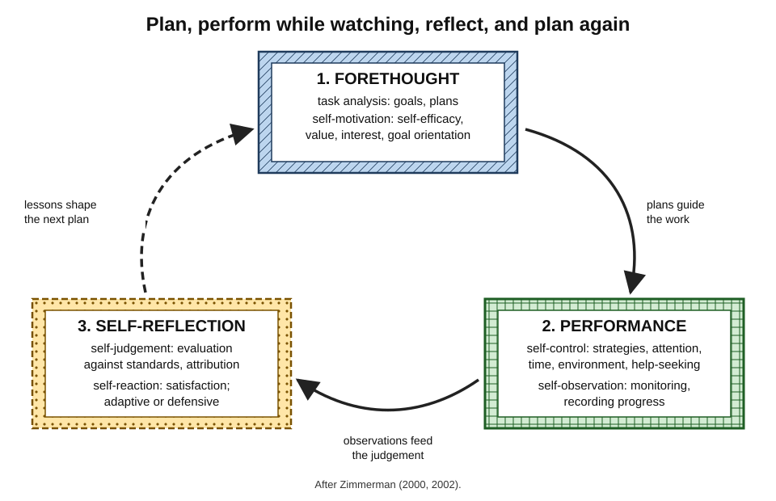
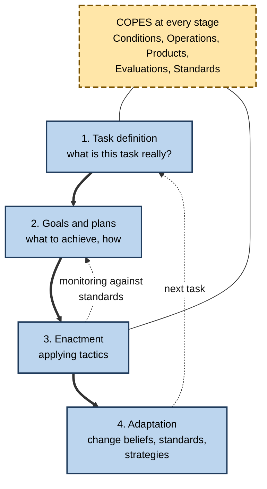
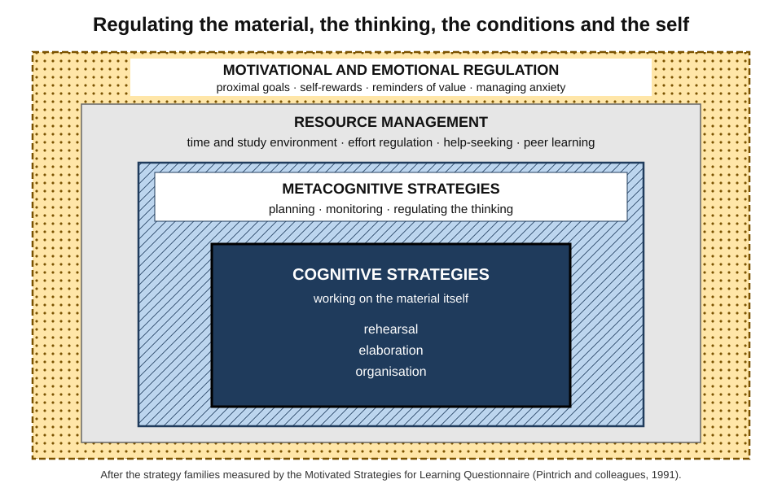
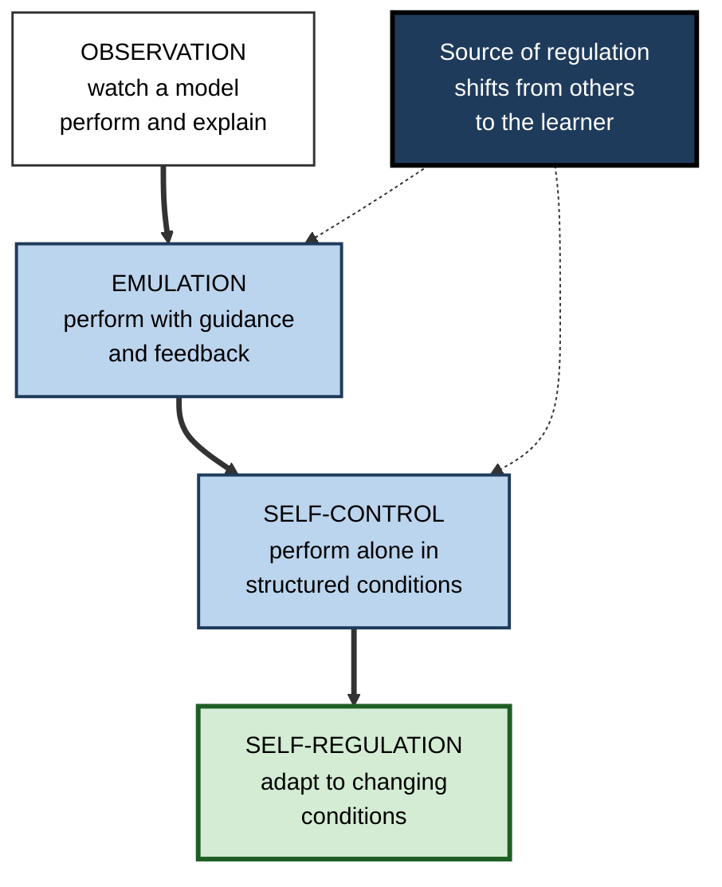
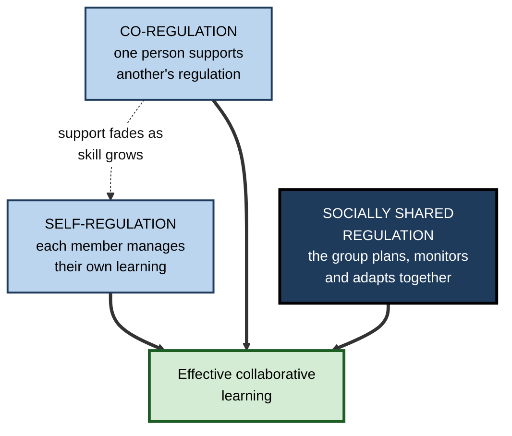

# B.7. Self-Regulated Learning

Two engineers enrol in the same self-paced cloud certification, with no teacher or timetable. One sets weekly goals, tests herself each Friday, notices that networking questions keep defeating her and changes how she studies them. The other watches videos when time allows and books the exam when the course says "100% complete". What differs is the capacity to **run one's own learning** — to set goals, choose methods, track progress, manage motivation and adapt.

> **Definition — Self-regulated learning (SRL):** the process by which learners plan, monitor, control and reflect on their own cognition, motivation, behaviour and environment in pursuit of learning goals, adapting cyclically in the light of results.

**Why it matters**

- Most adult and professional learning is **unsupervised**: self-paced courses, on-the-job learning, certification study, keeping up with a field.
- Without a teacher, every function a teacher performs — setting goals, pacing, checking, motivating, giving feedback — falls to the learner.
- SRL integrates **metacognition with motivation, emotion and action**: knowing what to do is not enough without the will and the habits to do it.
- It is **trainable**, and training improves achievement.

---

## From Metacognition to Self-Regulation

### What SRL adds

- **Metacognition** concerns knowledge, monitoring and control of **cognition**.
- **SRL** wraps metacognition in a wider system:
  - **motivation** — self-efficacy, interest, the value placed on the task;
  - **emotion** — anxiety, boredom, frustration and how they are managed;
  - **behaviour** — effort, persistence, time use, help-seeking;
  - **context** — the study environment, tools and other people.
- SRL is therefore **broader**; metacognition is its steering mechanism.

| | Metacognition | Self-regulated learning |
|---|---|---|
| Scope | Knowledge and regulation of cognition | Regulation of cognition, motivation, emotion, behaviour and context |
| Time-scale | Moments and tasks | Tasks, courses, projects |
| Central question | "Do I understand, and is this method working?" | "Am I running my learning well towards my goal?" |
| Typical failure | Misjudging what one knows | Procrastination, giving up, poor time use, as well as misjudgement |
| Origins | Developmental and cognitive psychology | Social cognitive theory and educational psychology |

### Origins

- **Albert Bandura's social cognitive theory (1970s–1980s)** — people regulate their behaviour through **self-observation, self-judgement and self-reaction**, and their beliefs about their capability (**self-efficacy**) shape what they attempt and how long they persist.
- **Barry Zimmerman and Dale Schunk (1980s onwards)** — applied these ideas to academic learning and built the first systematic models of SRL.
- **Paul Pintrich (1990s–2000)** — integrated cognitive, motivational and contextual regulation, and developed the most widely used questionnaire.
- **Philip Winne and Allyson Hadwin (1998)** — an information-processing model emphasising how learners define tasks and use standards.
- **Monique Boekaerts (1990s)** — emphasised emotion and the balance between learning goals and well-being goals.
- **Ernesto Panadero (2017)** — reviewed six major models, showing broad agreement on phases and differences in emphasis.

> **Definition — Self-efficacy:** a person's belief in their capability to organise and carry out the actions needed to achieve a particular outcome (Albert Bandura).

---

## Models of Self-Regulated Learning

### Zimmerman's cyclical phases

**Barry Zimmerman (2000, 2002)** described SRL as a repeating cycle of three phases.

- **Forethought** — before learning.
  - **Task analysis** — setting goals; strategic planning.
  - **Self-motivation beliefs** — self-efficacy, outcome expectations, interest, goal orientation.
- **Performance** — during learning.
  - **Self-control** — using strategies; self-instruction; imagery; managing attention, environment and time; seeking help.
  - **Self-observation** — **self-monitoring** and **self-recording** of progress.
- **Self-reflection** — after learning.
  - **Self-judgement** — evaluating performance against standards; attributing causes.
  - **Self-reaction** — satisfaction or dissatisfaction; **adaptive** responses (adjusting strategy) or **defensive** ones (avoidance, procrastination).
- **The cycle closes:** self-reflection shapes the next forethought — a learner who attributes failure to strategy, not ability, plans differently and keeps going.

**Figure 1.** Zimmerman's cyclical model of self-regulated learning.

> **Mnemonic — "FPR" ("Forethought, Performance, Reflection"):** plan it, do it while watching it, judge it and adjust.

### Winne and Hadwin: the learner as information processor

- **Four weakly sequenced stages:**
  1. **Task definition** — the learner's understanding of what the task is and requires.
  2. **Goals and plans** — what to achieve and how.
  3. **Enactment** — applying tactics and strategies.
  4. **Adaptation** — changing beliefs, standards or strategies for the future.
- **COPES** — at every stage the learner works with:
  - **Conditions** — resources, constraints, prior knowledge, motivation;
  - **Operations** — the cognitive processes used;
  - **Products** — what is produced;
  - **Evaluations** — feedback on products;
  - **Standards** — criteria against which products are judged.
- **Key insight:** many learning failures start at **task definition** — the learner works hard on a misunderstood task.
  - *e.g.* a trainee writes a thorough literature summary when the assignment asked for an argued recommendation.

> **Mnemonic — COPES:** Conditions, Operations, Products, Evaluations, Standards.

**Figure 2.** Winne and Hadwin's four stages, each working on conditions, operations, products, evaluations and standards.

### Pintrich: phases crossed with areas

- **Paul Pintrich (2000)** arranged SRL as a grid:
  - **four phases** — forethought and planning; monitoring; control; reaction and reflection;
  - **four areas** — cognition, motivation and affect, behaviour, context.
- *e.g.* in the **monitoring** phase a learner monitors **cognition** (do I understand?), **motivation** (am I losing interest?), **behaviour** (am I spending the time I planned?) and **context** (is this room too noisy?).

### Boekaerts and the role of emotion

- **Two pathways:**
  - the **growth pathway** — pursuing learning goals;
  - the **well-being pathway** — protecting oneself from threat, stress or loss of face.
- When a task feels threatening, learners switch to well-being goals — avoiding, procrastinating, choosing easy tasks.
- **Effective SRL** includes regulating emotion so that the growth pathway can be resumed.

| Model | Emphasis | Distinctive idea | Most useful for |
|---|---|---|---|
| Zimmerman | Social cognition, motivation | Forethought–performance–reflection cycle; self-efficacy | Coaching individuals; designing routines |
| Winne and Hadwin | Information processing | Task definition; COPES; standards | Diagnosing why effort goes astray; learning analytics |
| Pintrich | Integration | Phases × areas grid; questionnaire | Research and assessment |
| Boekaerts | Emotion and goals | Growth vs well-being pathways | Understanding avoidance and anxiety |
| Efklides | Metacognition and affect | A stable person level and a task-by-person level where metacognitive experiences arise | Linking feelings during tasks to regulation |

> **Key point:** the models agree on the essentials — a **cycle** of planning, enacting with monitoring, and reflecting, operating on **cognition, motivation, emotion, behaviour and context**. They differ in what they foreground.

---

## The Components of SRL

### Strategy families

- **Cognitive strategies** — working on the material.
  - **Rehearsal** — repeating, copying.
  - **Elaboration** — paraphrasing, relating to prior knowledge, generating examples.
  - **Organisation** — outlining, diagramming, grouping.
- **Metacognitive strategies** — managing the thinking.
  - Planning, monitoring, regulating (adjusting pace, rereading confusing parts, changing method).
- **Resource-management strategies** — managing the conditions.
  - **Time and study environment** — scheduling, choosing a place free of interruption.
  - **Effort regulation** — persisting when material is dull or difficult.
  - **Help-seeking** and **peer learning**.
- **Motivational regulation** — managing one's own motivation.
  - *e.g.* setting proximal goals, promising oneself a reward, reminding oneself why the learning matters, making a dull task into a challenge.

**Figure 3.** Layers of self-regulated learning, from strategies on the material to management of motivation and context.

### Measuring SRL

- **Motivated Strategies for Learning Questionnaire (MSLQ)** — **Pintrich, Smith, García and McKeachie (1991)**; 81 items covering motivation (value, expectancy, test anxiety) and strategies (cognitive, metacognitive, resource management).
- **Microanalytic interviews** — brief questions asked **during** a task about goals, strategies and attributions (Timothy Cleary and Zimmerman).
- **Think-aloud protocols** — verbalisation during learning, coded for SRL processes.
- **Trace data** — records of actions in digital environments: opening resources, re-reading, highlighting, taking quizzes, timing.
  - Winne argued traces capture SRL **as it happens**, avoiding the distortions of self-report.

> **Watch out:** self-report questionnaires and behavioural traces often **disagree**. Learners report planning and monitoring they do not actually perform; treat questionnaires as measures of beliefs and intentions.

---

## How SRL Develops

### Zimmerman's four levels of self-regulatory skill

- **Observation** — the learner watches a model perform and explain the skill.
- **Emulation** — the learner performs it with guidance and feedback, imitating the model's general pattern.
- **Self-control** — the learner performs it independently in structured conditions, matching an internalised standard.
- **Self-regulation** — the learner adapts it to changing personal and contextual conditions.
- Studies by **Dale Schunk and Barry Zimmerman (1990s)** showed that learners who progressed through these levels — especially from emulation to self-control — acquired skills such as writing revision more effectively than those who moved straight to independent practice.

**Figure 4.** Four levels in the development of self-regulatory skill.

### Age, expertise and context

- **Children** — SRL grows with schooling but depends heavily on how teachers model and scaffold it.
- **Novices in any field** — regulate poorly because they lack the **standards** to judge their products.
- **Experts** — regulate well within their domain because they have clear standards and rich strategy knowledge.
- **Context** — the same person may self-regulate well in a structured programme and poorly in an open-ended one.

---

## The Evidence

### Does SRL predict achievement?

- **Online higher education** — **Jaclyn Broadbent and Walter Poon (2015)** reviewed studies and found that **metacognition, time management, effort regulation and critical thinking** were associated with higher achievement, while rehearsal, elaboration and organisation showed weaker links.
- **Work-related training** — **Traci Sitzmann and Katherine Ely (2011)** meta-analysed SRL in workplace and educational settings; **goal level, persistence, effort and self-efficacy** had the strongest relationships with learning.
- **Massive open online courses** — **René Kizilcec, Mar Pérez-Sanagustín and Jorge Maldonado (2017)** found that learners who reported **goal setting and strategic planning** were more likely to attain their personal course goals.

### Does training SRL work?

- **Charlotte Dignath and Gerhard Büttner (2008)** — meta-analysis of SRL interventions in primary and secondary schools: positive effects on achievement, larger when programmes combined **strategy instruction with metacognitive reflection** and motivational elements.
- **Maria Theobald (2021)** — meta-analysis of SRL training for university students: moderate positive effects on **academic performance**, with somewhat larger effects on **metacognitive strategy use**.
- **Online and blended learning (2020s meta-analyses)** — SRL supports such as prompts, planning tools and dashboards show positive average effects with **wide variation** between designs.
- **Large education-evidence reviews in England** rate teaching metacognition and self-regulation among the most cost-effective school approaches; an updated guidance report in late 2025 gave greater prominence to **explicit metacognitive talk** modelled by teachers.

> **Watch out:** effect sizes vary widely by age, setting and design. Short, generic "study skills" sessions detached from subject content show small or no effects; benefits come from **embedded, sustained, practised** training.

### Online learning: SRL under stress

- **Completion in open online courses** is usually low — a small minority of enrolled learners finish.
- Online settings remove external structure (timetables, peers, a teacher's eye), so outcomes depend more on the learner's regulation.
- **Supports that help** include:
  - prompts to set goals and plan sessions;
  - regular low-stakes quizzes;
  - progress visualisations tied to **performance**, not just completion;
  - deadlines and commitment devices.

---

## Regulation Beyond the Individual

### Co-regulation and shared regulation

**Allyson Hadwin, Sanna Järvelä and Mariel Miller (2011, 2018)** distinguished three modes in collaborative learning.

- **Self-regulation** — each member regulates their own learning.
- **Co-regulation** — one person temporarily supports another's regulation.
  - *e.g.* a mentor asks, "What's your plan for the next hour?"; a colleague notices someone is stuck.
- **Socially shared regulation** — the group **jointly** plans, monitors and adjusts its work.
  - *e.g.* a project team agrees goals, checks progress together and changes approach as a group.

> **Definition — Socially shared regulation of learning:** the joint, negotiated regulation of a group's cognition, motivation, emotion and behaviour towards shared goals.

**Figure 5.** From one person's regulation to regulation shared by a group.

### Self-regulated learning at work

- Professionals rarely call it SRL, but they practise it in:
  - **certification study** — self-paced, deadline-driven;
  - **learning on the job** — picking up a new system, client sector or regulation;
  - **continuing professional development** — choosing what to learn and how.
- **Organisational supports:**
  - protected learning time with **defined goals**;
  - managers who act as **co-regulators** — asking about plans and progress, not just completion;
  - learning platforms that show **performance**, not just hours or modules completed;
  - peer study groups with shared regulation.
- **Malcolm Knowles's** work on **self-directed learning** in adults (1970s) is a related tradition, emphasising adults' responsibility for diagnosing needs, setting goals and evaluating outcomes.

---

## Self-Regulation When AI Is in the Loop

**Study card — Fan and colleagues (2024): "metacognitive laziness"**

- **Design:** a randomised laboratory study with 117 university students, who read texts, wrote an essay and then revised it with support from **ChatGPT**, a **human expert**, a **writing-analytics checklist** tool, or no extra support.
- **Results:**
  - the ChatGPT group improved their **essay scores** most in the revision task;
  - but they showed **no greater gains in knowledge** or transfer, and no difference in intrinsic motivation;
  - their trace data showed **less** of the self-regulatory activity — evaluating, monitoring, orienting to the task — that the other groups displayed.
- **Conclusion:** the authors warned of **metacognitive laziness**: learners may hand over the regulation of their learning to the AI, improving the product while doing less of the self-regulation that builds capability.

> **Key point:** AI can act as a **co-regulator** — prompting plans, asking for predictions, quizzing — or as a **substitute** that does the regulating. The design of the interaction decides which.

> **In practice:** before asking an AI assistant to improve a draft, write down what you think is weak in it and why; afterwards, compare your diagnosis with the tool's. The regulation stays with the learner, and the tool sharpens it.

---

## Worked Example (illustrative): One SRL Cycle for a New Skill

- **Situation:** a hospital pharmacist must learn to interpret a new type of pharmacogenomic test report within six weeks.

1. **Forethought — task analysis.**
   - **Task definition:** not "read the guidance" but "advise prescribers correctly on the five most common gene–drug pairs, unaided, in under five minutes per case".
   - **Goals:** weeks 1–2 — core concepts; weeks 3–4 — the five pairs; weeks 5–6 — mixed case practice.
   - **Plan:** three 40-minute sessions a week; retrieval practice on cards; one case per session.
2. **Forethought — motivation.**
   - Self-efficacy is moderate ("I struggle with genetics"); she arranges a weekly 15-minute check with a colleague who has done the training — a **co-regulator**.
3. **Performance — self-control.**
   - Studies in a quiet room before her shift; phone in a locker; begins each session by recalling the previous one.
4. **Performance — self-observation.**
   - Logs, for each practice case, her answer, confidence and time; marks errors by type.
5. **Self-reflection — self-judgement.**
   - At week 3 the log shows her errors cluster on one drug class; she attributes this to **strategy** (she has been memorising tables without understanding the metabolic pathway), not to ability.
6. **Self-reflection — self-reaction and adaptation.**
   - Switches to drawing the pathway and explaining each case aloud; adds two extra cases for that class.
7. **Outcome.**
   - At week 6 she completes ten unseen cases unaided, nine correctly, within time.

> **Watch out:** the step most often skipped is **task definition**. A vague goal ("understand the reports") makes monitoring impossible because there is no standard to monitor against.

---

## Case Study (illustrative): Rebuilding a Self-Paced Data Academy

- **Situation:** a telecoms company launched a self-paced online academy to retrain 400 network engineers in data analysis over six months.
- **Problem:** after three months, most learners had stalled at early modules; many who reported being "on track" failed the first practical assessment.
- **Diagnosis:**
  - the platform measured **completion**, so learners monitored progress by percentage of videos watched;
  - learners had no defined goals, deadlines or standards — **task definition** was weak;
  - managers asked only "Have you done your hours?";
  - learners working alone avoided the hardest modules — a **well-being** response to perceived threat.
- **Actions:**
  1. **Forethought support:** each learner set a goal tied to a real work problem, with a planned date for a working analysis.
  2. **Monitoring support:** every module ended with an unaided practical task and a confidence rating; dashboards showed **task performance**, not minutes watched.
  3. **Co-regulation:** fortnightly 20-minute check-ins with a data mentor focused on plans, obstacles and strategy changes.
  4. **Shared regulation:** cohorts of six met weekly to set group goals and review progress.
  5. **Manager briefing:** managers were given three questions — "What is your goal?", "What is getting in the way?", "What will you change?"
- **Result:** by the end of the programme, a much larger share of learners had produced a working analysis used in their team; first-attempt practical pass rates rose substantially compared with the first cohort.
- **Side effects:** mentor time was costly; the company trained graduates of the first cohort as peer mentors.
- **Lesson:** a self-paced programme succeeds when it supplies the **structures of regulation** — defined tasks, performance-based monitoring, co-regulators and shared goals — that learners cannot yet supply for themselves.

---

## Procrastination as a Failure of Self-Regulation

- **Procrastination** — voluntarily delaying an intended action despite expecting to be worse off for the delay.
- **Piers Steel (2007)** meta-analysed research on procrastination and proposed **temporal motivation theory**: the motivation to act on a task rises with **expectancy** of success and **value** of the outcome, and falls with **delay** of the reward and personal **impulsiveness**.
  - Strongest correlates: **task aversiveness**, **low self-efficacy**, **impulsiveness** and **distractibility**.
- **In SRL terms**, procrastination arises in every phase:
  - **forethought** — vague, distant goals; low self-efficacy;
  - **performance** — weak control of attention and environment;
  - **self-reflection** — defensive reactions to past setbacks.

> **Formula — Temporal motivation (schematic):** motivation ∝ (expectancy × value) ÷ (impulsiveness × delay). Example: if a certification reward is 12 weeks away, halving the effective delay by creating a fortnightly milestone with its own reward roughly **doubles** the schematic motivation term, other things equal.

| Lever | SRL phase | Example |
|---|---|---|
| Shorten the delay | Forethought | Proximal goals with visible progress |
| Raise expectancy | Forethought | Start with a manageable first step; recall past successes |
| Raise value | Forethought | Link the learning to a real work problem |
| Reduce impulsiveness | Performance | Remove distractions; commit to fixed study times |
| Repair reactions | Self-reflection | Treat a missed session as information, not failure |

> **Watch out:** procrastination is not simply laziness or poor time management; it is often an **emotion-regulation** strategy — avoiding the discomfort a task evokes. Effective remedies address the feeling as well as the schedule.

---

## Open Questions

- **How should SRL be measured?**
  - Self-report, think-aloud and trace data each capture different aspects; integrating them is an active research area.
- **How domain-general is SRL?**
  - Time management and effort regulation may transfer; monitoring accuracy depends on domain knowledge.
- **How should AI support self-regulation without replacing it?**
  - Evidence from 2024–2025 shows both risks and possibilities; design principles are still emerging.
- **What makes shared regulation work in teams?**
  - Group regulation predicts collaborative success, but how to cultivate it reliably in workplaces is under-studied.
- **Can SRL be taught to adults efficiently?**
  - Most intervention research involves school and university students; evidence for working professionals is thinner.

---

## Summary

- **SRL** is the cyclical planning, monitoring, control and reflection of one's **cognition, motivation, emotion, behaviour and context** in pursuit of learning goals; metacognition is its steering mechanism.
- Roots in **Bandura's** social cognitive theory and **self-efficacy**; models by **Zimmerman** (forethought–performance–self-reflection), **Winne and Hadwin** (four stages; **COPES**; task definition), **Pintrich** (phases × areas), **Boekaerts** (growth vs well-being) and **Efklides**.
- Strategies: **cognitive** (rehearsal, elaboration, organisation), **metacognitive**, **resource management** (time, environment, effort, help, peers) and **motivational regulation**.
- Measured by the **MSLQ**, microanalytic interviews, think-aloud and **trace data**; self-report and behaviour often disagree.
- Develops through **observation, emulation, self-control and self-regulation** (Zimmerman).
- Evidence: metacognition, time management and effort regulation predict online achievement; goal level, persistence, effort and self-efficacy predict workplace learning; **embedded, sustained** SRL training improves achievement, with wide variation.
- Regulation can be **co-regulated** and **socially shared** in groups.
- AI can induce **metacognitive laziness** (Fan and colleagues, 2024) or act as a co-regulator, depending on design.
- **Procrastination** is a self-regulation failure across all phases; **temporal motivation theory** (Steel, 2007) points to shortening delays, raising expectancy and value, and reducing impulsiveness.

---

## Self-Check

1. Define self-regulated learning and explain how it differs from metacognition.
2. Describe Zimmerman's three phases and their sub-processes.
3. What is COPES, and why does Winne and Hadwin's model stress task definition?
4. Explain Boekaerts's growth and well-being pathways with an example of avoidance.
5. Name four families of SRL strategies, with one example each.
6. Why do self-report questionnaires and trace data often disagree?
7. Describe Zimmerman's four levels of self-regulatory skill development.
8. Which SRL components were most associated with achievement in online higher education?
9. What did Sitzmann and Ely find about SRL in work-related training?
10. Under what conditions do SRL interventions work best?
11. Distinguish self-regulation, co-regulation and socially shared regulation.
12. Summarise the 2024 study on "metacognitive laziness".
13. An employee says, "I've completed 80% of the online course, so I'm nearly ready." Diagnose the self-regulation problem and suggest three changes.
14. Design the manager's role in supporting the SRL of a team member preparing for a professional exam.

### Answer Key

1. The cyclical planning, monitoring, control and reflection of cognition, motivation, emotion, behaviour and context towards learning goals. Metacognition covers cognition only; SRL also regulates motivation, emotion, behaviour and context.
2. Forethought (task analysis: goals, planning; self-motivation beliefs: efficacy, value, interest); performance (self-control: strategies, environment, time, help; self-observation: monitoring, recording); self-reflection (self-judgement: evaluation, attribution; self-reaction: satisfaction, adaptive or defensive response).
3. Conditions, Operations, Products, Evaluations, Standards. A misunderstood task makes all later effort misdirected and leaves no correct standard to monitor against.
4. Growth pathway pursues learning; the well-being pathway protects against threat. A learner anxious about statistics keeps reorganising notes instead of attempting problems.
5. Cognitive (elaboration — relating to prior knowledge); metacognitive (monitoring comprehension); resource management (scheduling study time); motivational regulation (setting a proximal goal with a reward).
6. Questionnaires capture beliefs and self-image; learners may report planning and monitoring they do not perform, which traces reveal.
7. Observation of a model; emulation with guidance; self-control in structured conditions; self-regulation adapting to changing conditions.
8. Metacognition, time management, effort regulation and critical thinking.
9. Goal level, persistence, effort and self-efficacy had the strongest relationships with learning.
10. When embedded in subject content, sustained, practised, and combining strategy instruction with metacognitive reflection and motivational support.
11. Self-regulation: each person regulates their own learning. Co-regulation: one person temporarily supports another's. Shared regulation: the group jointly plans, monitors and adapts.
12. Students revising essays with ChatGPT improved the essay most but gained no more knowledge or transfer and showed less self-regulatory activity than those with human or checklist support — they handed regulation to the tool.
13. Monitoring completion rather than capability; possibly weak task definition. Changes: define the target capability; take unaided practice tasks with confidence ratings; schedule spaced retrieval and a mock exam before booking.
14. Co-regulator: agree a specific goal and date; ask fortnightly about plan, obstacles and strategy changes; ask for practice scores rather than hours; protect study time; encourage a study group; fade support as the learner's regulation strengthens.

---

## Glossary

| Term | Meaning |
|---|---|
| Co-regulation | Temporary support of one person's regulation by another. |
| COPES | Conditions, Operations, Products, Evaluations, Standards (Winne and Hadwin). |
| Effort regulation | Persisting with learning when it is difficult or dull. |
| Elaboration | Relating new material to prior knowledge, paraphrasing, generating examples. |
| Emulation | Performing a skill with guidance, imitating a model's general pattern. |
| Forethought phase | The planning and motivational phase before learning. |
| Growth pathway | Pursuit of learning goals (Boekaerts). |
| Metacognitive laziness | Reduced self-regulation when a tool takes over planning, monitoring and evaluation. |
| MSLQ | Motivated Strategies for Learning Questionnaire. |
| Organisation strategy | Structuring material by outlining, diagramming or grouping. |
| Performance phase | The phase of carrying out learning while controlling and observing it. |
| Procrastination | Voluntarily delaying an intended action despite expecting to be worse off. |
| Resource management | Managing time, environment, effort, help and peers. |
| Self-efficacy | Belief in one's capability to achieve a specific outcome. |
| Self-reflection phase | The phase of judging outcomes and reacting to them. |
| Self-regulated learning | Cyclical regulation of cognition, motivation, emotion, behaviour and context towards learning goals. |
| Socially shared regulation | Joint regulation of learning by a group. |
| Task definition | The learner's understanding of what a task requires. |
| Temporal motivation theory | Motivation rises with expectancy and value and falls with delay and impulsiveness. |
| Trace data | Records of learners' actions in digital environments. |
| Well-being pathway | Protecting oneself from threat, often through avoidance (Boekaerts). |
