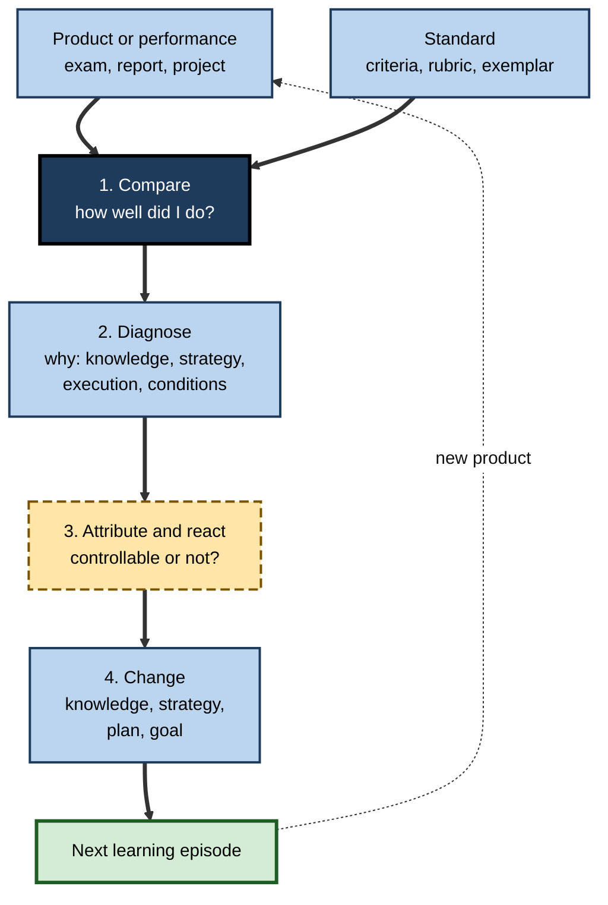
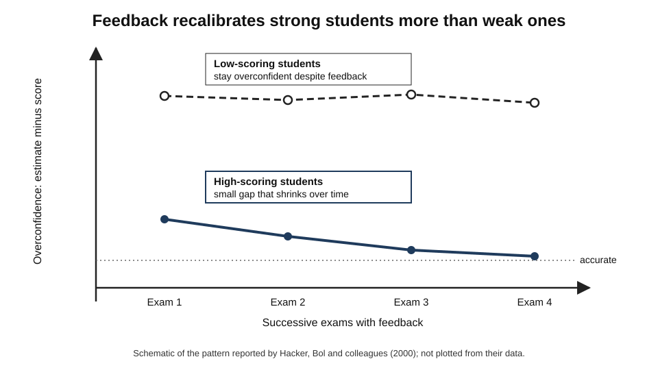
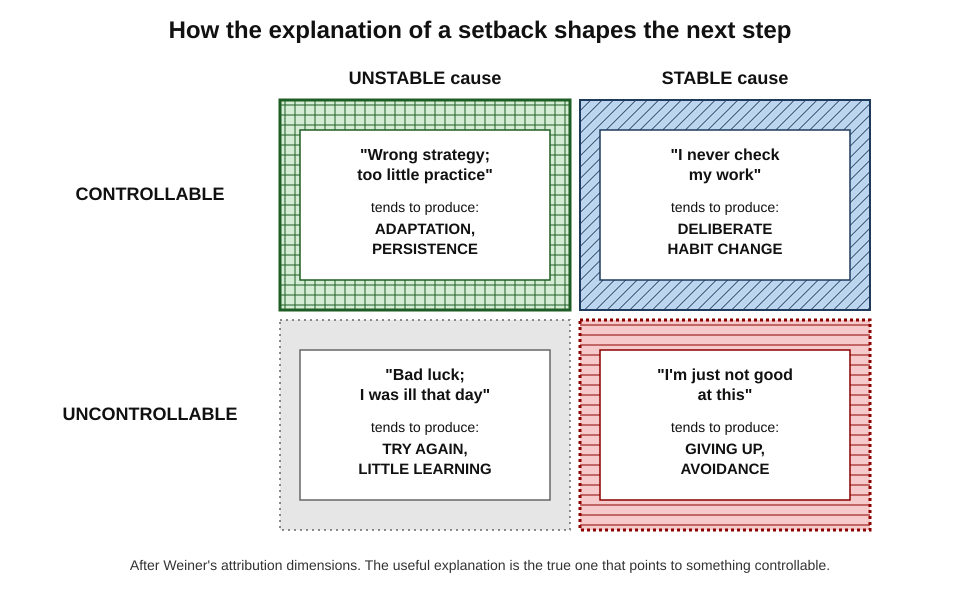
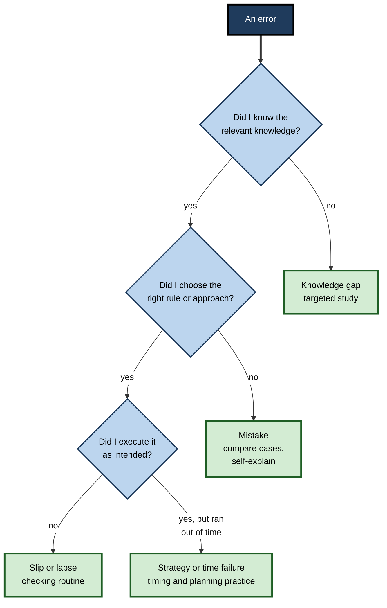
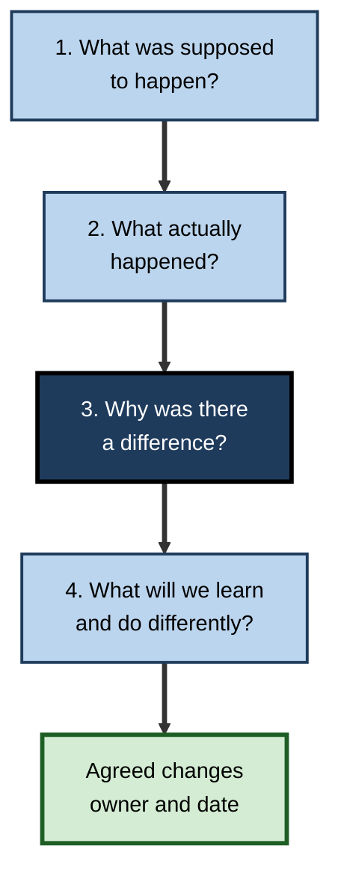

# K.9. Self-Evaluation After Learning

A candidate gets a mock exam back with 58% and thinks only, "I need to study harder." Another with the same score sorts every lost mark by cause, finds that a third went on misreading questions, and changes how she reads them. One late project team blames the client's changing scope; another asks what it could have done differently anyway. **What happens after a learning episode decides whether the next one is better.**

> **Definition — Self-evaluation:** the metacognitive process of judging, after a learning or performance episode, how well one did against a standard, why, and what should change — in knowledge, strategy or plan — as a result.

**Why it matters**

- Experience only becomes learning when it is **evaluated**; unexamined experience repeats itself.
- Self-evaluation closes the regulation cycle: its conclusions become the next **plan**.
- People's self-assessments are often **inaccurate**, especially where they are weakest, so evaluation needs method and external evidence.
- Its quality depends on how outcomes are **explained** — to ability, effort, strategy or luck — which shapes motivation as well as method.

---

## What Self-Evaluation Involves

### Four questions

- **How well did I do?** — compare the product or performance with a **standard**.
- **Why?** — diagnose **causes**: knowledge gaps, strategy choices, execution errors, conditions.
- **How do I feel about it, and what do I make of it?** — **attribution** and emotional reaction.
- **What will I change?** — **adaptation** of knowledge, strategy, plan or goal.

> **Mnemonic — "HWAC" ("How Well, Why, Attribution, Change"):** the four questions of self-evaluation.

**Figure 1.** The steps of self-evaluation, from comparing with a standard to changing the next plan.

### Standards: the precondition

- Evaluation requires knowing **what good looks like**.
- **Royce Sadler (1989)** argued that for learners to improve, they must:
  1. hold a concept of the **standard** being aimed for;
  2. compare their actual performance with it;
  3. act to close the gap.
- Sources of standards:
  - **criteria and rubrics** — explicit descriptions of quality levels;
  - **exemplars** — annotated examples of work at different levels;
  - **model answers** and **expert solutions**;
  - **outcomes** — the client's reaction, the system's behaviour, the exam result.

> **Key point:** novices evaluate poorly largely because they lack **standards**, not because they lack honesty. Showing them exemplars improves self-evaluation more than urging them to "be critical".

> **Definition — Evaluative judgement:** the capability to make decisions about the quality of one's own and others' work (Joanna Tai, Rola Ajjawi, David Boud and colleagues, 2018).

---

## How Accurate Is Self-Evaluation?

### Prediction and postdiction

- **Prediction** — a judgement of performance made **before** a test.
- **Postdiction** — a judgement made **after** taking it but before seeing results.
- Postdictions are usually **more accurate**, because the person has just experienced the questions.

**Study card — Douglas Hacker, Linda Bol and colleagues (2000)**

- **Design:** undergraduates in a psychology course predicted and postdicted their scores on each of several exams across a term.
- **Results:**
  - **high-scoring** students' predictions and postdictions were fairly accurate and **improved** over the term;
  - **low-scoring** students remained **overconfident** throughout and showed little improvement, despite repeated feedback.
- **Conclusion:** feedback alone does not guarantee better self-evaluation; those who most need to recalibrate are least likely to do so spontaneously.

**Figure 2.** Over repeated exams, high scorers' self-estimates converge on reality while low scorers' do not.

### Self-assessment in education and professions

- **Nancy Falchikov and David Boud (1989)** — meta-analysis of students' self-assessments compared with teachers' marks: agreement was **moderate** on average and better in **advanced** courses and when criteria were explicit.
- **David Dunning, Chip Heath and Jerry Suls (2004)** — reviewed evidence across health, education and work: self-assessments of ability correlate only **modestly** with objective performance.
- **David Davis and colleagues (2006)** — a systematic review of physicians' self-assessment found **weak or no** relationship with external measures in most comparisons; the **least skilled** and **most confident** were often the least accurate.

> **Watch out:** "I'm a good judge of my own work" is an empirical claim that usually fails when tested. Self-assessment should be **checked against external evidence**, not trusted on its own.

### From self-assessment to self-directed assessment seeking

- **Kevin Eva and Glenn Regehr (2005, 2008)** argued that asking professionals to rate their overall competence is the wrong goal.
- **Better targets:**
  - **self-monitoring in the moment** — "Am I out of my depth with this patient right now?";
  - **self-directed assessment seeking** — actively gathering feedback, data and comparisons from outside.
- **Implication:** good self-evaluation is less about introspection and more about **seeking the right external information** and interpreting it well.

| | Self-assessment | Self-directed assessment seeking |
|---|---|---|
| Question | "How good am I?" | "What evidence shows how I am doing?" |
| Main source | Introspection | Feedback, data, comparisons, outcomes |
| Accuracy | Often weak | Depends on quality of evidence sought |
| Main risk | Overconfidence, self-image bias | Seeking only flattering evidence |
| Professional form | Annual self-rating | Case audits, peer review, outcome tracking |

---

## Explaining Outcomes: Attribution

### Three dimensions

**Bernard Weiner (1980s)** analysed how people explain success and failure.

- **Locus** — internal (ability, effort, strategy) or external (task difficulty, luck, other people).
- **Stability** — stable (ability, task difficulty) or unstable (effort, strategy, luck).
- **Controllability** — controllable (effort, strategy) or uncontrollable (ability as fixed, luck).

### Why attributions matter for learning

- **Attributing failure to stable, uncontrollable causes** — "I'm just not good at numbers" — predicts giving up.
- **Attributing failure to controllable, unstable causes** — "I used the wrong strategy" — predicts **adaptation** and persistence.
- **Barry Zimmerman and Anastasia Kitsantas (1990s)** found that learners who attributed errors to **strategy** were more likely to adjust and to maintain self-efficacy than those who attributed them to ability.

> **Key point:** **strategy attributions** are the most useful for learning — they are internal (so the learner can act), unstable (so they can change) and controllable (so action is worthwhile).

**Figure 3.** Attributions for a disappointing result and the reactions they tend to produce.

> **Watch out:** strategy attributions should be **true**, not just encouraging. Sometimes the cause really is missing prerequisites or an impossible deadline; a useful evaluation names it.

### Outcome bias and hindsight

- **Outcome bias** — **Jonathan Baron and John Hershey (1988)**: people rate the same decision as better when it happened to turn out well.
  - *e.g.* a risky shortcut that worked is praised; the same shortcut that failed is condemned.
- **Hindsight bias** — once the outcome is known, it seems to have been predictable.
- **Consequence:** evaluations that look only at outcomes **reward luck** and punish sound decisions that met bad fortune.

| | Good outcome | Bad outcome |
|---|---|---|
| **Sound process** | Deserved success — keep the method | Bad luck — keep the method, check assumptions |
| **Poor process** | Dumb luck — change the method despite success | Deserved failure — change the method |

> **Remember:** **evaluate the process, not just the result.** Ask what was known at the time, what was decided, and whether a different decision would have been reasonable.

---

## Methods of Self-Evaluation

### Error analysis

- **Classify every error** rather than counting them.
- A useful classification, building on **James Reason's (1990)** work on human error:
  - **Knowledge gap** — did not know the fact or principle.
  - **Mistake** — knew the topic but applied the wrong rule or model.
  - **Slip** — knew what to do but executed it wrongly (misread, miscalculated).
  - **Lapse** — forgot a step.
  - **Strategy or time failure** — ran out of time, spent too long on one item, did not check.
- **Each type has a different remedy:**
  - knowledge gaps → targeted study;
  - mistakes → comparison of similar cases, self-explanation;
  - slips and lapses → checking routines, checklists;
  - strategy failures → planning and timing practice.

**Figure 4.** Classifying errors to choose the right remedy.

### Exam wrappers

- **Marsha Lovett (2013)** described **exam wrappers**: short structured reflections completed when a marked test is returned.
- Typical questions:
  1. How did you prepare, and for how long?
  2. What kinds of errors did you make? (classified)
  3. What will you do differently for the next test?
- Later, before the next test, learners revisit their answers to question 3.
- **Effect:** turns a score into **diagnostic information** and a **plan**; reported to improve students' study approaches over a course.

### Worked example: an exam wrapper on a mock exam

- **Situation:** a trainee actuary scores **58%** on a mock exam (pass mark 65%). She had predicted 70%.

| Error type | Marks lost | Example | Planned change |
|---|---|---|---|
| Knowledge gap | 12 | Did not know the formula for a reserve calculation | Spaced retrieval on six key formulas |
| Mistake | 10 | Applied the annual model to a monthly case | Compare three monthly and annual cases side by side; explain differences aloud |
| Slip | 6 | Arithmetic errors in two calculations | Two-minute recheck of every calculation |
| Lapse | 3 | Omitted a required assumption statement | Add "state assumptions" to her answer template |
| Time failure | 11 | Left the last question half done | Timed practice; move on after the allotted minutes |
| **Total** | **42** | | |

1. **Accuracy of prediction:** predicted 70%, scored 58% → overconfident by **12 points**; she notes that her confidence came from re-reading notes.
2. **Biggest lever:** knowledge gaps (12) and time (11) together account for over half the lost marks.
3. **Attribution:** strategy and preparation, not ability — specific, controllable causes.
4. **Plan:** retrieval practice on formulas; two timed half-papers a week; a calculation recheck routine.

- **Conclusion:** "study harder" would have spread effort evenly; the wrapper points to **five different remedies**, two of which matter most.

> **Watch out:** without classification, slips and time failures are often mistaken for knowledge gaps, sending learners back to re-read material they already know.

### Structured reflection

- **David Kolb (1984)** — experiential learning as a cycle: concrete experience → reflective observation → abstract conceptualisation → active experimentation.
- **Graham Gibbs (1988)** — a reflective cycle widely used in nursing and teaching: description, feelings, evaluation, analysis, conclusion, action plan.
- **Value:** structure prevents reflection from becoming either a narrative of events or an exercise in self-criticism.
- **Limit:** reflection on one's own perspective alone can confirm existing beliefs; it is strengthened by **external evidence** and others' views.

### After-action reviews and retrospectives

- **The after-action review** — developed by the **US Army** in the 1970s for training exercises; now used in many organisations. Four questions:
  1. What was supposed to happen?
  2. What actually happened?
  3. Why was there a difference?
  4. What can we learn and do differently?
- **Shmuel Ellis and Inbar Davidi (2005)** — in Israeli military navigation exercises, soldiers who reviewed **both successes and failures** improved more than those who reviewed only failures.
- **Retrospectives** — regular team reviews in software development; **blameless post-incident reviews** in reliability engineering focus on systems and decisions rather than culprits.

**Figure 5.** The four questions of an after-action review.

| Method | Unit of analysis | Strength | Common failure |
|---|---|---|---|
| Error analysis | Individual errors | Precise remedies | Done only after failures |
| Exam wrapper | A test | Turns scores into plans | Forms filled in and forgotten |
| Reflective cycle | An experience | Includes feelings and action | Becomes narrative or self-criticism |
| After-action review | A team event | Compares plan with reality | Turns into blame or box-ticking |
| Blameless post-incident review | A system failure | Finds systemic causes | Lessons recorded but not acted on |

---

## Using Feedback Well

### Feedback is not automatically helpful

- **Avraham Kluger and Angelo DeNisi (1996)** — meta-analysis of feedback interventions: on average they improved performance, but in **over a third** of cases they **reduced** it.
- Feedback harmed performance most when it directed attention to the **self** — praise or criticism of the person — rather than to the **task** and how to improve.

### Feedback literacy

**David Carless and David Boud (2018)** described feedback literacy as four capabilities.

- **Appreciating feedback** — understanding its purpose and the learner's active role.
- **Making judgements** — evaluating the quality of one's own and others' work.
- **Managing affect** — handling defensiveness and disappointment.
- **Taking action** — using feedback to change what one does.

> **In practice:** before reading a reviewer's comments, write your own evaluation of the work; then compare. The comparison calibrates your **evaluative judgement** as well as improving the piece.

---

## Self-Evaluation in Professional Life

### Building it into work

- **Prediction logs** — record expected outcomes of decisions, then compare.
- **Case audits** — compare one's decisions with guidelines or outcomes over a sample of cases.
- **Peer review** — structured review of one's work by colleagues, with criteria.
- **Learning logs** — brief weekly entries: what was learned, what went wrong, what will change.
- **Client and stakeholder feedback** — sought on specific questions, not general satisfaction.

### Self-evaluation and AI

- AI tools can **critique drafts**, compare work with exemplars and summarise feedback.
- **Risks:**
  - accepting the tool's evaluation without forming one's own, which weakens evaluative judgement;
  - fluent critique that misses domain-specific standards.
- **Good practice:** evaluate first, then ask the tool, then reconcile the two — and check the tool's judgements against real outcomes over time.

### Case study: win–loss reviews in a bid team

- **Situation:** an engineering consultancy bid for public infrastructure contracts; it won about one bid in four.
- **Problem:** reviews took place only after **losses**, concluded mostly that "price was too high" or "the client favoured the incumbent", and changed little.
- **Diagnosis:**
  - reviews were **outcome-driven**: wins were never examined, so lucky wins and sound losses were indistinguishable;
  - **external attributions** dominated — price, client politics — leaving nothing to act on;
  - no standard existed for a good bid apart from winning.
- **Actions:**
  1. Every bid, won or lost, received a 45-minute review using the four after-action questions.
  2. The team built a **bid-quality rubric** — understanding of client need, technical solution, risk treatment, evidence of past delivery, clarity — and scored each bid before submission and again after the client's debrief.
  3. Client debriefs were requested on every bid and compared with the team's own pre-submission scores.
  4. Each review ended with one **controllable** change, owned by a named person.
- **Result:**
  - the comparison showed the team consistently over-scored its **risk treatment** relative to client feedback;
  - two "wins" turned out to have been narrow escapes with weak proposals;
  - over the following year the win rate rose noticeably and debrief scores on risk treatment improved.
- **Side effects:** reviewing wins felt unnecessary at first; leaders had to model it by reviewing their own successful bids critically.
- **Lesson:** self-evaluation improves when it **examines process as well as outcome**, uses an explicit **standard**, compares self-scores with **external** judgements and ends in a **controllable** change.

---

## Training Self-Assessment

### What improves self-assessment

- **Ernesto Panadero, Anders Jonsson and Juan Botella (2017)** — meta-analysis of self-assessment interventions: training learners to self-assess improved their **self-regulated learning** and **self-efficacy**, especially when combined with feedback and explicit criteria.
- **Effective ingredients:**
  - **explicit criteria** — rubrics describing levels of quality;
  - **exemplars** — annotated work at different levels;
  - **practice with comparison** — self-assess, then compare with an expert's assessment and discuss differences;
  - **feedback on the self-assessment itself** — not just on the work.
- **Heidi Andrade** and colleagues showed that criteria-referenced self-assessment of drafts improved the quality of subsequent writing.

### Peer assessment as a route to self-assessment

- Judging **others'** work against criteria builds the evaluative judgement later applied to one's own.
- **Keith Topping** reviewed peer assessment in education and found generally positive effects on learning when it is structured and trained.
- **Advantages:**
  - others' errors are easier to see than one's own;
  - seeing several versions of the same task reveals the range of quality.

> **In practice:** a team can run "calibration sessions" — everyone scores the same three pieces of work against a rubric, compares scores and discusses the differences — before scoring their own work.

---

## Open Questions

- **Can self-assessment accuracy be trained durably?**
  - Training with criteria and exemplars helps in the short term; long-term, transferable gains are less certain.
- **Why do low performers benefit least from feedback on their self-estimates?**
  - Explanations include lack of standards, motivated reasoning and noisy self-knowledge; their relative weight is unclear.
- **How should organisations review success?**
  - Reviews of successes improve learning, but organisations rarely do them; how to make them routine is under-studied.
- **Will AI critique improve or erode evaluative judgement?**
  - Evidence on whether AI feedback builds learners' own judgement, or replaces it, is only beginning to appear.

---

## Summary

- **Self-evaluation** judges, after an episode, how well one did against a **standard**, **why**, how to **attribute** the result and what to **change**.
- It requires a concept of the standard (**Sadler**); novices lack it, so **exemplars and criteria** improve evaluation.
- **Postdictions** are more accurate than predictions; over a course, high scorers recalibrate and low scorers remain overconfident (**Hacker, Bol and colleagues, 2000**).
- Self-assessment correlates only **modestly** with external measures in education and professions (Falchikov and Boud; Dunning, Heath and Suls; Davis and colleagues); **self-directed assessment seeking** is the better aim (Eva and Regehr).
- **Attributions** (locus, stability, controllability; Weiner) shape persistence; **strategy attributions** support adaptation — when true.
- Avoid **outcome bias** and **hindsight bias**: evaluate process as well as result.
- Methods: **error analysis** (knowledge gap, mistake, slip, lapse, strategy or time failure), **exam wrappers**, structured **reflective cycles**, **after-action reviews** of successes and failures, **blameless post-incident reviews**.
- Feedback can harm when aimed at the self (**Kluger and DeNisi, 1996**); **feedback literacy** and **evaluative judgement** let learners use it.
- With AI: evaluate first, then compare with the tool's critique, then check against real outcomes.
- **Self-assessment can be trained** with criteria, exemplars, comparison with expert judgements and feedback on the self-assessment (Panadero and colleagues, 2017); **peer assessment** builds the same judgement.

---

## Self-Check

1. Define self-evaluation and name its four questions.
2. Why did Sadler argue that learners need a concept of the standard?
3. Distinguish prediction from postdiction. Which is usually more accurate, and why?
4. Summarise Hacker, Bol and colleagues' findings across repeated exams.
5. What does the evidence say about physicians' self-assessment?
6. Explain the shift from self-assessment to self-directed assessment seeking.
7. Describe Weiner's three dimensions and explain why strategy attributions are useful.
8. Give an example of outcome bias in a workplace evaluation.
9. Classify these errors: miscopying a figure; using the wrong statistical test; not knowing a regulation; forgetting to attach an appendix; running out of time.
10. What is an exam wrapper and how does it work?
11. Name the four after-action review questions. What did Ellis and Davidi find?
12. Why can feedback reduce performance, according to Kluger and DeNisi?
13. A colleague's self-review of a failed project says, "The client kept changing their mind." Improve the review.
14. Design a monthly self-evaluation routine for a junior lawyer drafting contracts.

### Answer Key

1. Judging after an episode how well one did against a standard, why, and what to change. How well did I do? Why? How do I attribute and react? What will I change?
2. Improvement requires knowing the target, comparing performance with it and acting to close the gap; without a concept of the standard no meaningful comparison is possible.
3. Prediction is made before a test, postdiction after it before results. Postdiction is usually more accurate because the person has just experienced the questions.
4. High scorers' predictions and postdictions were fairly accurate and improved over the term; low scorers stayed overconfident despite feedback.
5. A systematic review found weak or no relationships between physicians' self-assessments and external measures in most comparisons, with the least skilled and most confident often least accurate.
6. Instead of asking people to rate their competence, encourage self-monitoring in the moment and active seeking of external feedback, data and comparisons.
7. Locus (internal/external), stability, controllability. Strategy attributions are internal, unstable and controllable, so they invite action and sustain motivation.
8. *e.g.* praising a manager who skipped security testing because the launch went smoothly, and blaming one who followed procedure when an unforeseeable outage occurred.
9. Miscopying: slip. Wrong test: mistake. Not knowing the regulation: knowledge gap. Forgetting the appendix: lapse. Running out of time: strategy or time failure.
10. A short structured reflection on a returned test — preparation, classified errors, planned changes — revisited before the next test.
11. What was supposed to happen? What actually happened? Why the difference? What will we learn and change? Reviewing both successes and failures improved performance more than reviewing failures alone.
12. When feedback directs attention to the self rather than the task, it can provoke defensiveness or discouragement instead of improvement; over a third of interventions reduced performance.
13. Ask what was supposed to happen and what happened at each stage; what was known when; which decisions the team controlled — e.g. scope-change process, contract terms, early prototypes; name one controllable change with an owner.
14. *e.g.* each week record two drafting decisions and expected partner feedback; monthly compare with actual feedback and a firm checklist; classify errors; pick one controllable change; ask a senior to review one contract against an exemplar; review a well-received contract as well as a criticised one.

---

## Glossary

| Term | Meaning |
|---|---|
| After-action review | A structured review comparing what was intended with what happened, why, and what to change. |
| Attribution | A person's explanation for the cause of an outcome. |
| Blameless post-incident review | A review of a failure that focuses on systems and decisions rather than individual blame. |
| Calibration session | A meeting where people score the same work against criteria and discuss differences. |
| Evaluative judgement | The capability to judge the quality of one's own and others' work. |
| Exam wrapper | A structured reflection completed when a marked test is returned. |
| Exemplar | An example of work illustrating a level of quality. |
| Feedback literacy | The capabilities needed to understand and use feedback. |
| Hindsight bias | Believing after the fact that an outcome was predictable. |
| Knowledge gap | An error caused by not knowing the relevant fact or principle. |
| Lapse | An error of omitting a step. |
| Mistake | An error from choosing the wrong rule or approach. |
| Outcome bias | Judging a decision by its outcome rather than its quality when made. |
| Postdiction | A judgement of performance made after a test but before results. |
| Prediction | A judgement of performance made before a test. |
| Self-directed assessment seeking | Actively gathering external evidence about one's performance. |
| Self-evaluation | Judging one's performance after an episode and deciding what to change. |
| Slip | An error in executing an intended action. |
| Strategy attribution | Explaining an outcome by the strategy used. |
