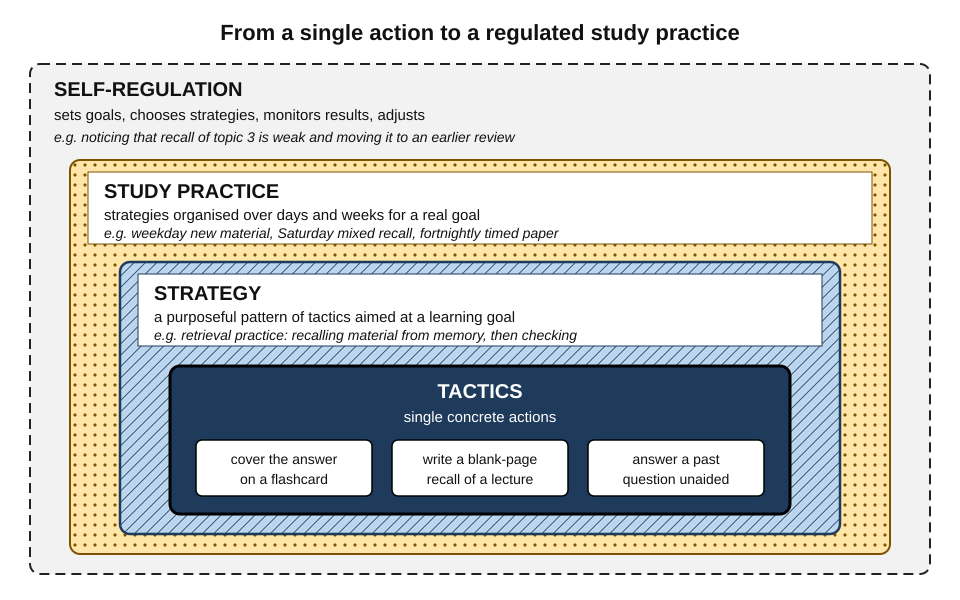
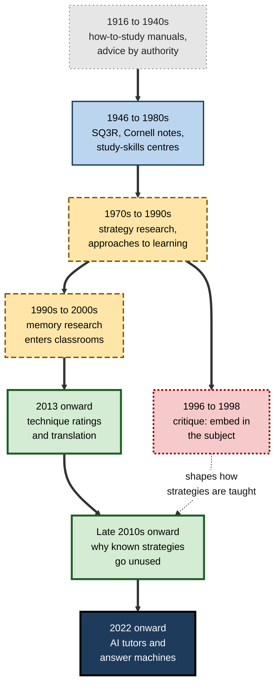
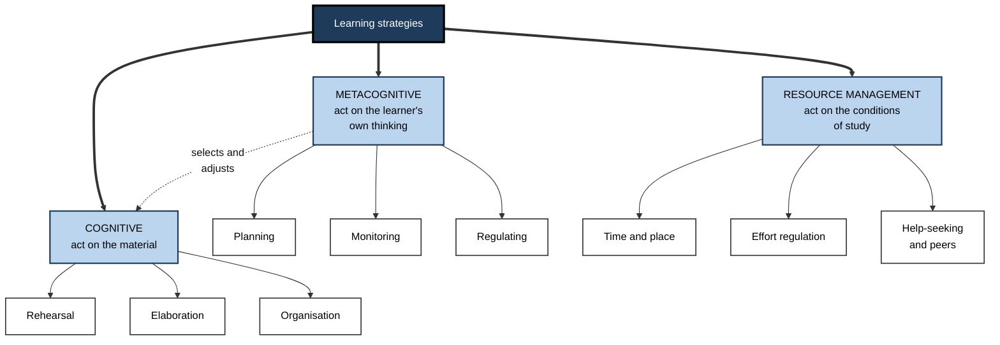
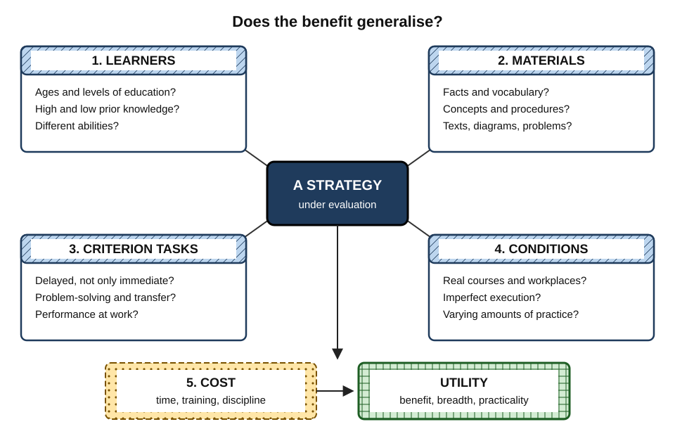
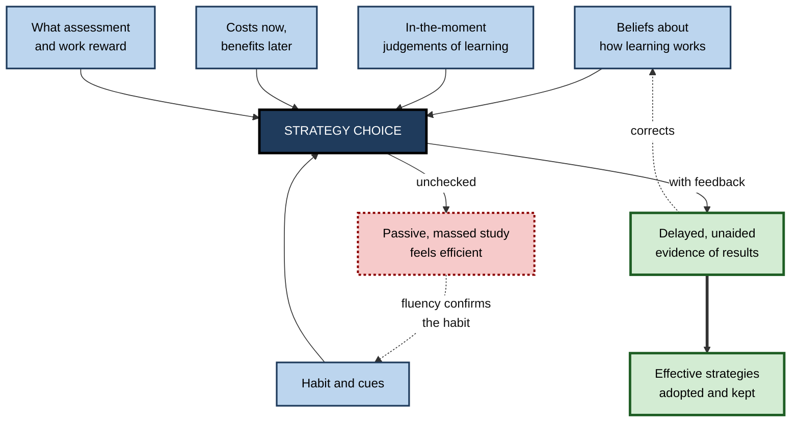
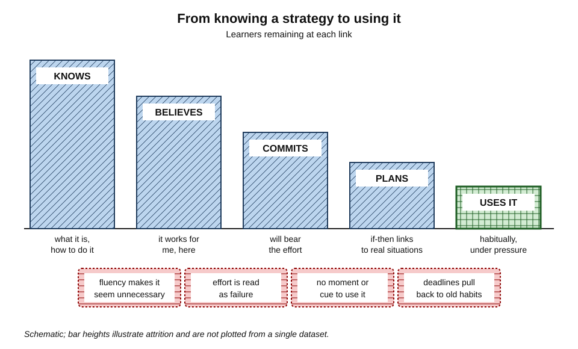
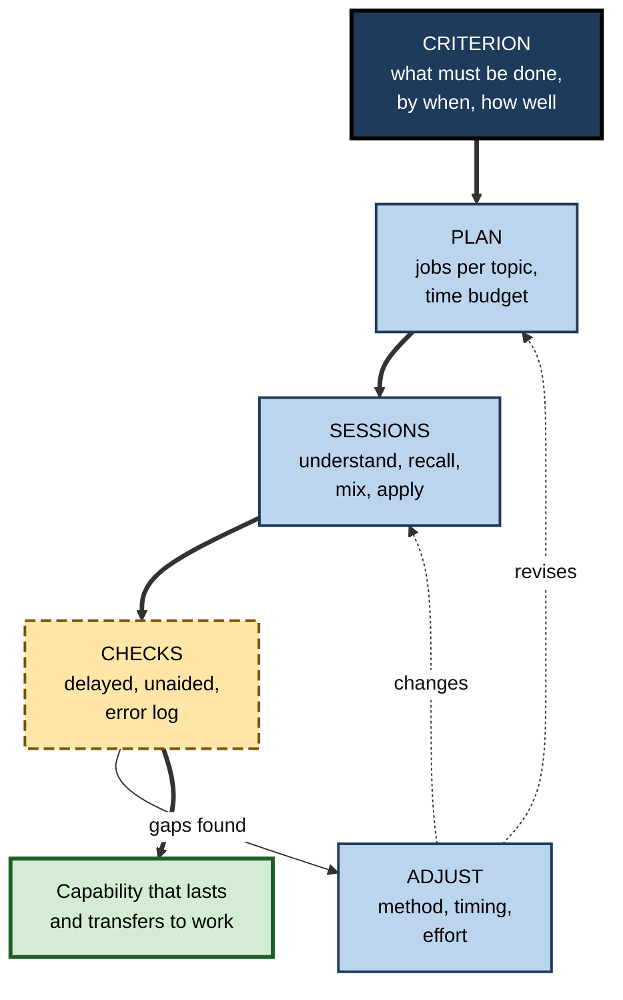

# 1.1.2. Learning Strategies & Study Skills

Two trainee accountants sit the same professional examination after the same tuition course. One spent the final month re-reading the manual and copying notes into a fresh notebook; the other spent it answering past questions from memory, checking every answer and returning to the errors a week later. They studied for the same number of hours. Only one passed, and the difference lay not in intelligence or effort but in **what they did with the hours**.

> **Definition — Learning strategy:** a set of mental and practical actions a learner deliberately chooses in order to acquire, understand, retain or apply knowledge or skill — for example, testing oneself, spacing review sessions or explaining an idea in one's own words.

> **Definition — Study skills:** the practical, learnable competence of organising and carrying out one's own study: choosing strategies, planning time, managing materials and attention, monitoring progress and adjusting when something is not working.

**Why it matters**

- **Hours are not learning.** Equal study time produces very unequal results depending on the strategies that fill it.
- **Most learners are never taught how to study.** They inherit habits from school and keep them for life.
- **The stakes rise with a career.** Examinations, new roles and new technologies demand fast, durable learning from people with little spare time.
- **Strategies are portable** — a capability that does not go out of date.

---

## What Strategies and Study Skills Are

### From tactic to study practice

The vocabulary of the field is used loosely, so it helps to separate four levels that sit inside one another.

- **Tactic** — a single concrete action.
  - *e.g.* covering the answer side of a flashcard; drawing a quick diagram of a process.
- **Strategy** — a purposeful pattern of tactics aimed at a learning goal.
  - *e.g.* retrieval practice — repeatedly recalling material from memory, using flashcards, blank-page recall or practice questions.
- **Study practice** — the coherent way a person organises strategies over days and weeks for a real goal.
  - *e.g.* a weekly routine for a certification course: new material on weekdays, mixed recall on Saturdays, a timed paper every fortnight.
- **Self-regulation** — the governing layer that sets goals, chooses strategies, watches whether they are working and changes them.

> **Definition — Study tactic:** a specific, observable study action that serves a strategy.

> **Definition — Self-regulated learning:** learning in which the learner actively sets goals, selects and monitors strategies, and adjusts effort and method in the light of results.

**Figure 1.** Tactics, strategies and study practices nested inside self-regulation.

> **Key point:** a technique that works in the laboratory only helps a real learner when it becomes part of a **study practice** — scheduled, sustained and matched to the goal.

### Strategies, skills and techniques

| | Learning strategy | Study skill | Learning technique |
|---|---|---|---|
| What it names | A purposeful pattern of mental activity | A competence in organising and executing study | A defined, testable procedure |
| Main question | *What* should the learner do with the material? | *How well* can the learner run their own study? | *Does* this procedure work? |
| Example | Elaborating new ideas by asking why | Planning a revision schedule and keeping to it | Practice testing as studied by researchers |
| Typical research tradition | Educational and cognitive psychology | Study-skills and learning-development teaching | Experimental cognitive psychology |
| Can be weak because | Chosen without regard to the goal | Executed inconsistently | Tested on narrow materials |

- **Strategies are chosen, not traits** — and their value depends on the material, prior knowledge and the task that follows.
- **Skills include execution.** Knowing that spaced review works is knowledge; arranging a month so that review happens is a skill.

> **Watch out:** "study skills" is sometimes taken to mean only formatting, referencing and note layout. The core of the subject is **what happens in the learner's mind** while studying and how that work is organised.

### Approaches to learning

- **Ference Marton and Roger Säljö (1976)** asked Swedish students to read an article and later describe how they had read it.
  - **Surface approach** — aiming to reproduce the text; attention on the words and facts.
  - **Deep approach** — aiming to understand the author's meaning; attention on the argument.
- **Noel Entwistle** in the UK and **John Biggs** in Australia added a **strategic (achieving) approach** — organising study to maximise marks.
- **The key insight:** approaches are **responses to context** — the same student studies deeply in one course and superficially in another, depending largely on what the assessment rewards.

> **Definition — Approach to learning:** the combination of a learner's intention (to reproduce, to understand or to achieve) and the strategies that follow from it in a given context.

---

## Origins and History

### Advice before evidence

- **Early how-to-study books** — among the first in the modern genre was **Guy Whipple's *How to Study Effectively* (1916)**, followed by a steady stream of manuals through the 1920s and 1930s.
  - Advice mixed sound points (recite, review regularly) with untested rules about posture, lighting and hours.
- **The problem:** advice rested on authority, not on comparisons of methods.

### The study-skills movement

**Study card — Francis Robinson, SQ3R (1946)**

- **Context:** developed at Ohio State University, partly for wartime military training.
- **Method:** **S**urvey the chapter → turn headings into **Q**uestions → **R**ead to answer them → **R**ecite answers from memory → **R**eview.
- **Strengths:** it built in purpose (questions), active processing and, in "Recite", retrieval.
- **Evidence:** surprisingly little controlled testing of the full method; studies that exist are mixed, and much of any benefit seems to come from the recall and question steps.
- **Legacy:** many variants (PQ4R, SQ4R) and the template for later study advice.

- **Expansion (1950s–1980s):**
  - **Walter Pauk's *How to Study in College* (1962)** spread the **Cornell note-taking** layout — a narrow cue column for questions beside the notes, and a summary strip at the bottom.
  - **Tony Buzan's *Use Your Head* (1974)** popularised **mind maps**; universities opened **study-skills centres**.
- **Measurement arrived:** the **Survey of Study Habits and Attitudes** (William Brown and Wayne Holtzman, 1950s) and, later, the **Learning and Study Strategies Inventory (LASSI)** of Claire Weinstein and colleagues (1987).

### The critique of generic study skills

- **Stand-alone courses** taught note-taking, timetabling and reading methods in isolation from the subjects students were learning.
- **Study card — John Hattie, John Biggs and Nola Purdie (1996):** a meta-analysis of learning-skills interventions.
  - **Finding:** programmes worked best when **embedded** in subject teaching, aimed at the task in hand and combined with metacognitive awareness; generic programmes taught out of context showed weak transfer.
- **Academic literacies (Mary Lea and Brian Street, 1998)** — ethnographic research in UK universities argued that the "study skills" model treated students as **deficient** and reduced learning to surface techniques.
  - Each discipline has its own ways of reading, arguing and writing; learning them is induction into a community, not repair of a defect. Many British universities moved towards **learning development** embedded in courses.

> **Key point:** two traditions converged on the same conclusion — strategies are learned best **inside the subject and the real task**, not as a separate skill set bolted on.

### Cognitive psychology's applied turn

- **Strategy research (1970s–1980s):**
  - **John Flavell** described the **production deficiency** — children who *can* rehearse do not do so spontaneously.
  - **Michael Pressley, John Borkowski and Wolfgang Schneider (1987)** described the **good strategy user**: a learner who knows many strategies, knows *when and why* each works, has relevant world knowledge and is motivated to use them.
  - **Claire Weinstein and Richard Mayer (1986)** classified strategies into rehearsal, elaboration, organisation, comprehension monitoring and affective strategies.
- **Memory research goes to the classroom (1990s–2000s):** spacing, testing and interleaving were tested with real course materials, and Robert Bjork's **desirable difficulties** (1994) explained why learners distrust the strategies that slow them down.

### The synthesis era

- **Dunlosky, Rawson, Marsh, Nathan and Willingham (2013)** reviewed ten common techniques and rated their utility.
  - Practice testing and distributed practice came out highest; re-reading and highlighting, the most popular, came out low.
  - Its lasting contribution to the field was its **method of evaluation** — judging each technique by how far its benefits generalise across learners, materials, tests and conditions.
- **Implementation (late 2010s onward):** attention shifted to *why learners who know effective strategies still do not use them*.
- **The AI era (2022 onward):** generative AI offers both a tireless tutor and a tireless answer-giver.

**Figure 2.** The development of study-skills advice and strategy research.

---

## How Strategies Are Classified

### Three families

The most widely used classification, from **Paul Pintrich** and colleagues around 1990, sorts strategies by what they act on.

- **Cognitive strategies** — act on the **material**.
  - **Rehearsal** — repeating or copying to hold information.
  - **Elaboration** — connecting new information to what is already known.
  - **Organisation** — structuring information into outlines, diagrams or categories.
- **Metacognitive strategies** — act on the **learner's own thinking**.
  - **Planning** — setting goals, choosing methods, estimating time.
  - **Monitoring** — checking understanding while studying.
  - **Regulating** — changing method when monitoring reveals a problem.
- **Resource-management strategies** — act on the **conditions of study**.
  - **Time and study environment** — scheduling, place, freedom from interruption.
  - **Effort regulation** — persisting through boring or difficult work.
  - **Help-seeking and peer learning** — knowing when and whom to ask.

> **Mnemonic — "Material, Mind, Means":** cognitive strategies work on the material, metacognitive on the mind, resource management on the means of study.

**Figure 3.** The three families of learning strategy and their members.

### Other ways of cutting the field

- **By goal** — facts, concepts, discrimination, procedures, transfer.
- **By phase of learning** — **John Hattie and Gregory Donoghue (2016)**: surface acquisition → surface consolidation → deep learning → **transfer**; a strategy excellent in one phase can be wasted in another.
- **By generative activity** — whether the learner merely receives information or **produces** something from it; such generative work is the common thread of active learning and explains why passive review disappoints.

> **Key point:** a learner who knows only *cognitive* strategies can still fail through poor planning, no monitoring or an exhausted schedule — the other two families are where many real failures lie.

### Measuring strategy use

| Instrument or method | What it captures | Strength | Weakness |
|---|---|---|---|
| **LASSI** (Weinstein, 1987 onward) | Ten scales such as time management, anxiety, concentration, selecting main ideas, self-testing | Practical; diagnostic profile for advising | Self-report; responses reflect beliefs as much as behaviour |
| **MSLQ** (Pintrich and colleagues, 1991) | Motivation plus cognitive, metacognitive and resource-management strategies, per course | Course-specific; widely researched | Self-report; long; some scales weakly related to grades |
| **Approaches inventories** (Biggs's SPQ; Entwistle's ASSIST) | Deep, surface and strategic approaches | Captures intention and context | Broad; approaches shift between courses |
| **Think-aloud protocols** | What learners actually do while studying | Rich, direct evidence | Slow; talking may alter the studying |
| **Trace data** (logs from learning platforms and flashcard apps) | Timing, spacing, retrieval attempts, errors | Objective; large scale | Shows actions, not intentions; misses offline study |

> **Watch out:** questionnaires measure what learners **say** they do; compared with diaries or platform logs the match is often loose, especially for effortful strategies such as self-testing.

---

## How Strategies Are Evaluated

### The four questions of generality

Dunlosky and colleagues judged each technique by asking how widely its benefits extend. The same four questions are a sound way to evaluate any strategy, including new AI-supported ones.

1. **Learners** — does it work across ages, abilities and levels of prior knowledge?
2. **Materials** — does it work for vocabulary, concepts, procedures, texts, diagrams?
3. **Criterion tasks** — does it improve the outcome that matters: delayed tests, problem-solving, transfer to work, not only immediate recall?
4. **Learning conditions** — does it survive real settings, with interruptions, varying amounts of practice and imperfect execution?

- A fifth question decides adoption: **cost** in time, training and discipline.

**Figure 4.** The questions used to judge how far a strategy's benefits generalise.

> **Definition — Criterion task:** the test or real-world performance used to judge whether learning has occurred; a strategy's value depends heavily on which criterion is chosen.

> **Definition — Utility (of a strategy):** an overall judgement of how much benefit a strategy brings, how widely the benefit generalises and how practical the strategy is to use.

### Why "evidence-based" is a graded claim

- **Laboratory evidence** shows a mechanism, usually with short delays and simple materials.
- **Classroom evidence** shows whether it survives real curricula and time pressure; effects are typically smaller.
- **Workplace evidence** is thinnest — few randomised studies, outcomes hard to measure.
- **Correlational surveys** cannot separate the strategy from the kind of student who chooses it.

**Study card — Marcus Credé and Nathan Kuncel (2008)**

- **Design:** a meta-analysis of 344 studies covering more than 72,000 college students, relating study habits, skills and attitudes to academic performance.
- **Results:**
  - **study motivation and study skills** had the strongest relationships with grades;
  - study-skill measures were **largely independent** of entrance-test scores and school grades;
  - they predicted performance **beyond** those traditional predictors;
  - academic anxiety was a notable negative predictor.
- **Conclusion:** the authors called study habits, skills and attitudes the **"third pillar"** of academic success, alongside ability and prior achievement.
- **Caveat:** the evidence is correlational — good study skills predict grades, but this design cannot show that teaching them raises grades.

> **Key point:** a strategy is "evidence-based" for a particular **learner, material, criterion and setting**. The strongest strategies are those whose benefits hold across all four.

---

## Why Learners Choose Ineffective Strategies

Strategy choice is a decision under uncertainty, and several forces push it the wrong way.

### The forces behind poor choices

- **Misleading feedback during study.**
  - Re-reading produces fluency; fluency feels like knowing.
  - Effortful strategies feel slow, and learners read the effort as failure.
- **Mistaken beliefs about learning.**
  - Learning seen as absorption (read it enough and it sinks in) rather than construction.
  - Testing seen only as measurement, not as a way to learn.
- **Costs that are immediate; benefits that are delayed.**
  - Spacing needs planning weeks ahead; its payoff comes on the day of the examination or the client meeting.
- **Habit.** Strategies are repeated in the same places, at the same times, with the same materials — conditions in which behaviour runs on cue rather than by decision.
- **Incentives and assessment.** Students adopt the approach the assessment rewards.
  - Karen Scouller (1998) found Australian students more likely to adopt surface strategies when preparing for multiple-choice examinations than when writing assignment essays.
  - In workplaces, completion of a module often counts; durable capability rarely does.
- **Time poverty.** Professionals study in tired fragments — conditions that favour passive review.

**Figure 5.** Forces that shape a learner's choice of strategy.

### The gap between intention and action

**Study card — Rachael Blasiman, John Dunlosky and Katherine Rawson (2017)**

- **Design:** university students reported at the start of term how they **intended** to study for their examinations; their **actual** study was then tracked through the term.
- **Results:**
  - students intended a mix of effective and ineffective strategies and planned to start early;
  - in practice they studied about **half as long** as intended, massed study into the day or two before each examination and relied on re-reading;
  - the gap between intention and action was **smallest for re-reading** and **largest for practice testing and flashcards**.
- **Conclusion:** many students know what they *should* do; the effective strategies are the first to be dropped under pressure.

- **Surveys** by **Nate Kornell and Robert Bjork (2007)** and **Marissa Hartwig and John Dunlosky (2012)** found most students had never been taught how to study and scheduled study by deadline; self-testing and planned scheduling went with higher grades, late-night cramming with lower ones.

> **Watch out:** poor strategy choice is not laziness. It follows from **misleading feedback, mistaken beliefs, habit and incentives** — all redesignable — so the commonest study mistakes, such as studying until material merely looks familiar, are predictable rather than personal failings.

---

## Teaching Strategies and Whether It Transfers

### Models of strategy instruction

- **Direct explanation** — the teacher names the strategy, explains when and why it works, models it aloud and gradually hands control to learners (Gerald Duffy, Laura Roehler and colleagues, 1980s).
- **Reciprocal teaching** — **Annemarie Palincsar and Ann Brown (1984)**: pupils take turns leading a group through predicting, questioning, clarifying and summarising a text. It remains one of the best-supported ways of teaching comprehension, and shows that reading strategies are learnable rather than innate.
- **Experiential demonstration** — learners compare re-reading with self-testing on a delayed test; experience persuades more than explanation.

> **Remember — instruction that transfers usually has five features:** it is **explicit** (named and explained), **conditional** (when and why, not only how), **embedded** in real subject work, **extended** over weeks rather than a single session, and **monitored** (learners see evidence of what works for them).

### The evidence on strategy instruction

**Study card — Anouk Donker and colleagues (2014)**

- **Design:** a meta-analysis of 95 interventions teaching learning strategies to primary and secondary pupils, with 180 effect sizes.
- **Results:**
  - an overall effect on academic performance of moderate size (Hedges' *g* about 0.66);
  - effects were largest in **writing**, then science and mathematics, and smaller in reading comprehension;
  - teaching **metacognitive knowledge** — when, why and for whom a strategy works — was valuable in every subject.
- **Conclusion:** strategy instruction works, especially when learners understand the **conditions** of use, not only the steps.
- **Caveat:** most outcomes were measured by researcher-designed tests soon after instruction; effects on standardised tests and after long delays are typically smaller.

- **Parallel syntheses:** **Charlotte Dignath and Gerhard Büttner (2008)** found self-regulated learning training improved achievement in primary and secondary schools; **Hester de Boer and colleagues (2018)** found effects of metacognitive strategy instruction persisted at follow-up.

> **Key point:** the answer to "does teaching strategies transfer?" is *yes, under conditions*: transfer to the subject in which strategies are taught is well supported; transfer to unrelated subjects and to self-directed study months later is weaker and less often measured.

### Knowing is not using

**Study card — Mark McDaniel and Gilles Einstein (2020)**

- **Argument:** knowledge-focused training — telling learners which strategies work — rarely changes what they do once the training ends.
- **The KBCP framework:** effective strategy training must build four things:
  1. **Knowledge** — what the strategy is and how to do it;
  2. **Belief** — conviction, ideally from personal experience, that it works;
  3. **Commitment** — a decision to use it despite the effort it demands;
  4. **Planning** — concrete *if–then* plans that link the strategy to situations ("when I finish a lecture, I will write a blank-page recall before checking my notes").

> **Mnemonic — KBCP, "Know it, Believe it, Commit to it, Plan it":** each step can fail independently, so each needs its own design.

**Figure 6.** The chain from knowing a strategy to using it habitually, with the losses at each link.

**Study card — Felicitas Biwer and colleagues, Study Smart (2020)**

- **Setting:** first-year students at Maastricht University, where problem-based learning places heavy demands on self-study.
- **Design:** a programme of three two-hour sessions building **awareness** of strategy research, **reflection** on students' own habits and guided **practice** with effective strategies.
- **Results:** students' knowledge of effective strategies improved and they rated practice testing and spacing as more effective; their intention to use them rose; changes in reported use were smaller.
- **Conclusion:** awareness and belief shift quickly; behaviour needs sustained support inside courses.

> **Watch out:** a common evaluation error is to measure a strategy programme by end-of-session satisfaction or stated intentions. The questions that matter are whether **use** changed weeks later and whether **delayed performance** improved.

---

## Combining Strategies into a Coherent Study Practice

A study practice is a system of goals, schedule, sessions, checks and adjustments that decides whether good strategies are actually used.

### Design principles

- **Start from the criterion.** Define what the learner must eventually be able to do — recall, explain, decide, calculate, perform — and in what conditions. Strategies are chosen backwards from it.
- **Separate the jobs.** Most material needs several jobs done to it:
  - **understand** — connecting ideas to what is already known, asking why, linking words to pictures where the content is spatial or procedural;
  - **consolidate** — recall from memory, spread over time;
  - **discriminate** — mixing similar problem types so that the learner must choose between them;
  - **apply** — solving genuine problems, where general problem-solving heuristics and domain knowledge meet.
- **Retrieval and spacing as the backbone.** Recall from memory, returning at growing intervals, carries the strongest evidence and protects everything else from forgetting.
- **Budget the resource layer.** A schedule that cannot survive a busy week is not a schedule. Time management for learning means protecting short, regular sessions rather than relying on rare long ones.
- **Close the loop.** Regular unaided, delayed checks show what has really been learned; self-testing turns monitoring from impression into evidence.
- **Measure output, not input.** Hours, pages and videos watched are inputs. Learning productivity is better judged by what can be done unaided per hour invested.

> **In practice:** experienced learners keep an **error log** — what was wrong, why, and when it will be retested — turning each mistake into a scheduled retrieval and revealing patterns re-reading never shows.

**Figure 7.** A study practice as a regulated system.

### Combining with judgement

- **Not everything belongs in memory.** Learn core concepts, key procedures and safety-critical facts to fluency; leave rarely used details in references.
- **Novices and experts need different mixes.** Beginners gain from worked examples before open problems; guidance should fade as knowledge grows.
- **Sustainability beats intensity** — a modest routine kept for months beats an ideal plan abandoned in week three.

> **Key point:** coherence matters more than any single strategy — average strategies used consistently against the right criterion usually beat excellent ones used sporadically.

### Worked example: designing a study practice for a role change

- **Situation:** an experienced ward nurse is moving into intensive care. She has ten weeks before working without close supervision, works rotating twelve-hour shifts, and can find about four hours a week to study.
- **Criterion tasks:** recognising early deterioration; calculating infusion doses accurately; following the unit's protocols; explaining decisions to doctors during rounds.

| | First instinct | Designed study practice |
|---|---|---|
| Starting point | Read the unit handbook cover to cover | List the criterion tasks; pretest herself on each to find the gaps |
| Protocols | Highlight the handbook | Short daily recall of each protocol's steps, checked against the source; protocols mixed once learned |
| Dose calculations | Re-work the handbook's examples | Two worked examples per drug type, then mixed calculation sets with answers checked; errors logged and retested |
| Recognising deterioration | Read case descriptions | Explain *why* each sign matters; compare similar presentations side by side; discuss cases with a senior nurse |
| Scheduling | Long sessions on days off | Fifteen-minute recall sets before shifts plus one longer session on a day off |
| Checking | "Feels ready" | Fortnightly unaided self-test; supervisor observation of real practice |

- **Reasoning steps:**
  1. Start from **criterion tasks**, not from the handbook's order.
  2. Assign each task the **job** it needs — recall, discrimination, application or explanation.
  3. Fit the plan to **shift patterns**, using short, frequent sessions.
  4. Use **delayed, unaided checks** and real observation, not confidence, to judge readiness.
- **Conclusion:** fewer hours than reading the handbook twice, aimed at what the bedside demands.

> **Watch out:** the designed practice will **feel** less reassuring than reading the whole handbook. The reassurance of coverage is not evidence of readiness.

---

## Strategy Use Across Levels

The same principles apply from school to the boardroom, but the goals, criteria and constraints change — and so does the most common failure.

| | School | University | Professional certification | Workplace learning |
|---|---|---|---|---|
| Typical goal | Pass externally set examinations | Understand a discipline; pass modules | Pass a high-stakes, defined syllabus | Do a job better, now |
| Criterion set by | Examination boards | Course assessments | Professional body | Real work outcomes |
| Time structure | Structured by school | Self-managed, deadline-driven | Self-managed beside a job | Fragmented, interrupted |
| Common failure | Re-reading revision guides; cramming | Massed study before examinations | Late start; practice questions saved for the end | Course completion mistaken for capability |
| Most valuable emphasis | Explicit strategy teaching in each subject | Spaced self-testing; planning | Early, mixed, timed practice with error logs | Learning tied to real tasks with feedback |

- **School** — strategy instruction has its strongest evidence here, especially for reading and writing; guidance in several countries now asks for metacognition to be taught within subjects.
- **University** — the first year is the critical transition: structure disappears, volume rises and school habits stop working.
- **Professional certification** — hundreds of hours of study beside full-time work.
  - **Medical students** are heavy users of spaced flashcard software; self-directed retrieval practice has been associated with better licensing-examination scores, though the evidence is correlational.
  - The decisive skills are often resource-management ones: starting early and practising questions long before the final weeks.
- **Workplace** — most learning happens in the flow of work; the question becomes **"what must I internalise, what can I look up, and how will I know I can do it?"** Continuing professional development schemes are moving from counting hours to evidence of outcomes.

> **In practice:** in the workplace, strategies hide inside routines — a post-incident review is elaborative reflection; a pre-meeting rehearsal of key figures is retrieval; a mentor's "talk me through your reasoning" is self-explanation. Recognising them as strategies lets a professional use them on purpose.

### Case study: an embedded strategy programme for trainee accountants

- **Situation:** a mid-sized accountancy firm sponsors about sixty graduate trainees a year through a multi-examination professional qualification, studied alongside client work.
- **Problem:** first-attempt pass rates were well below target; re-sits delayed qualification and cost fees and morale.
- **Diagnosis:**
  - a study-habits survey and interviews showed most trainees **re-read** course manuals and saved question practice for the last fortnight;
  - busy-season client work wiped out study for weeks at a time;
  - a one-hour induction talk on study skills had changed little.
- **Actions:**
  1. **Knowledge and belief:** induction included a short demonstration — trainees studied one topic by re-reading and another by recall, then took a surprise test a week later and compared their own results.
  2. **Commitment:** each trainee wrote a study plan with their tuition provider's dates and their own client calendar, reviewed with a qualified mentor.
  3. **Planning:** *if–then* routines — "after each tuition day, a twenty-minute closed-book recall that evening"; "every Saturday, one mixed question set covering all topics so far".
  4. **Resource design:** two protected half-days a month before examinations, published in the staffing system.
  5. **Monitoring:** mentors reviewed question-bank records rather than asking "how is it going?".
- **Result:** over the next two examination sittings, first-attempt pass rates rose and re-sits fell; trainees reported starting question practice much earlier.
- **Side effects / caveats:** some trainees found the monitoring intrusive; and with several changes made at once, the improvement cannot be attributed to any single element.
- **Lesson:** information about strategies was not enough. Change came from addressing **belief, commitment, planning and resources** together — and from treating study conditions as an organisational responsibility.

---

## Study Strategies in the AI Era

### What has changed

- **Instant answers.** Generative AI can explain, summarise, solve and write on demand — so the effortful processing that produces learning can be skipped entirely.
- **Instant materials.** AI generates quizzes, flashcards and worked examples in seconds, removing much of the cost of effective strategies.
- **Tutoring modes.** During 2025 the major AI providers released study or learning modes that ask questions, give hints and withhold full answers — an attempt to build strategy into the tool.

**Study card — Greg Kestin, Kelly Miller and colleagues (2025)**

- **Design:** a crossover randomised trial with about 194 Harvard physics undergraduates; each had one lesson in a well-run active-learning class and one at home with an AI tutor engineered to guide step by step rather than give answers.
- **Results:** learning gains on the post-test were substantially larger with the AI tutor, and students spent somewhat less time on task.
- **Caveats:** a single course and topic sequence, short-term outcomes, and a tutor carefully designed by experts — not a general-purpose chatbot used freely.

- **The other face:** field experiments, such as Hamsa Bastani and colleagues' study of school mathematics, found that unrestricted AI raised practice performance but **lowered** later unaided test performance; a 2025 randomised trial with university students found lower retention after several weeks among those who had studied with a general chatbot.

> **Watch out:** early meta-analyses of AI-supported learning report large positive effects, but most included studies are short and small and measure performance with or soon after AI help. The long-term effect of everyday AI use on durable, unaided learning is **not yet established**.

### What has not changed

- **Learning still happens in the learner's head**, and a clear AI explanation creates the same fluency illusion as re-reading.
- **Judgement requires internal knowledge** — checking AI output needs the very knowledge the learner might offload.

### New study skills

- **Attempt first, then consult** — make an unaided attempt before asking the tool, so that its answer becomes feedback on retrieval rather than a substitute for it.
- **Use AI to generate practice, not answers** — questions, varied examples, counter-examples, mixed problem sets.
- **Verify** generated material against authoritative sources.
- **Decide what to internalise** — the learn-versus-look-up decision becomes a deliberate strategy in its own right.

> **Key point:** AI lowers the cost of good strategies and of bad ones alike. The deciding study skill is **choosing which thinking to keep for oneself**.

---

## What Distinguishes Expert Learners

- Expert learners hold a **repertoire** with **conditional knowledge** of when each strategy works — Pressley's good strategy user — and run **robust routines** built from short, planned sessions.

| | Novice learner | Expert learner |
|---|---|---|
| Measure of progress | Hours spent, pages covered | What can be done unaided after a delay |
| Response to difficulty | Switches to easier method | Treats appropriate difficulty as a sign of learning |
| Planning | Deadline-driven | Criterion-driven, spaced, protected |
| Use of errors | Notes the right answer and moves on | Logs, explains and retests |
| Use of AI | Asks for the answer | Asks for questions, hints and checks |

---

## Open Questions

- **How durable is strategy change?**
  - Most programmes measure knowledge and intentions within weeks; few track whether learners still use the strategies a year later.
- **What turns a strategy into a habit?**
  - Researchers have begun to study strategy use through the lens of habit — cues, contexts and repetition — but little is known about how to build effective habits deliberately at scale.
- **Are study strategies universal?**
  - Most evidence comes from students in North America, Western Europe and Australia; researchers have called for more studies across cultures, languages and education systems.
- **How should strategy use be measured?**
  - Self-report is weak; trace data is narrow; neither captures quality of execution.
- **What works in workplace learning?**
  - Controlled studies of study strategies among working professionals remain scarce, and the outcomes that matter are hard to measure.
- **How will AI reshape strategy?**
  - Unclear whether AI tutors will build lasting self-regulation or create dependence on external regulation; and which knowledge professionals must still hold in memory when tools can supply it.

---

## Summary

- **Learning strategies** are deliberately chosen actions for acquiring, understanding, retaining and applying knowledge; **study skills** are the competence to organise and run one's own study. They nest from **tactic** to **strategy** to **study practice**, governed by **self-regulation**.
- **Approaches to learning** (deep, surface, strategic) are responses to context, shaped strongly by **assessment**.
- The field moved from **advice by authority** (how-to-study manuals, **SQ3R**, Cornell notes) through **strategy research** and the **critique of generic study skills** (embed in the subject; academic literacies) to **cognitive psychology's applied turn** and the **Dunlosky (2013)** synthesis.
- Strategies are classified as **cognitive, metacognitive and resource-management**; also by goal, phase of learning and generativity. Measurement relies on inventories such as **LASSI** and **MSLQ**, think-alouds and trace data — each with limits.
- Strategies are evaluated by how far their benefits generalise across **learners, materials, criterion tasks and conditions**, and by their **cost**. Study skills are a **"third pillar"** of academic success (Credé and Kuncel).
- Learners choose ineffective strategies because of **misleading fluency, mistaken beliefs, delayed benefits, habit, incentives and time poverty**; intentions and actions diverge most for effortful strategies.
- **Strategy instruction works** when explicit, conditional, embedded, extended and monitored; metacognitive knowledge matters across subjects. Changing behaviour needs **knowledge, belief, commitment and planning** (KBCP).
- A **coherent study practice** starts from the criterion, separates jobs, uses spaced retrieval as its backbone, budgets resources and closes the loop with delayed, unaided checks.
- **AI** lowers the cost of good and bad strategies alike; the key skill is choosing which thinking to keep for oneself.

---

## Self-Check

1. Distinguish a study tactic, a learning strategy and a study practice, with an example of each.
2. What did SQ3R contribute to study advice, and what is the status of its evidence?
3. What were the two main critiques of generic study-skills courses, and what did they recommend?
4. Name the three families of learning strategy and give two members of each.
5. What are the four questions of generality used to evaluate a strategy? Why is the choice of criterion task so important?
6. What did Credé and Kuncel mean by the "third pillar", and what can their evidence not show?
7. Give four reasons why learners choose ineffective strategies even when they work hard.
8. What did Blasiman, Dunlosky and Rawson find about intended and actual study, and what does it imply?
9. What features make strategy instruction most likely to transfer?
10. Explain the KBCP framework and use it to diagnose why a one-hour study-skills talk might change nothing.
11. A software engineer must learn a new cloud platform for a project starting in six weeks while working full time. Outline a coherent study practice.
12. A training manager proposes giving every employee a general-purpose AI chatbot "so they can study faster". What risks and safeguards would you raise?

### Answer Key

1. **Tactic:** a single action (covering a flashcard's answer). **Strategy:** a purposeful pattern of tactics (retrieval practice). **Study practice:** strategies organised over time for a goal (weekly new material, mixed recall, fortnightly timed papers).
2. SQ3R gave study advice a structure built on purpose (questions), active processing and recitation from memory. The full method has had limited controlled testing; much of its benefit probably comes from its question and recall steps.
3. Hattie, Biggs and Purdie showed generic, out-of-context programmes transfer weakly; Lea and Street's academic literacies argued that the study-skills model treats students as deficient and ignores disciplinary ways of knowing. Both recommended embedding strategy learning in subject teaching and real tasks.
4. Cognitive — rehearsal, elaboration, organisation. Metacognitive — planning, monitoring, regulating. Resource management — time and environment, effort regulation, help-seeking.
5. Does the benefit hold across learners, materials, criterion tasks and learning conditions? The criterion matters because a strategy can improve immediate recall yet do little for delayed retention or transfer; judging by the wrong criterion leads to the wrong strategy.
6. Study habits, skills and attitudes predict grades about as well as entrance tests and prior grades, and add to them — a third pillar alongside ability and prior achievement. The evidence is correlational, so it cannot show that teaching study skills raises grades.
7. Any four of: fluency feels like learning; effort is misread as failure; mistaken beliefs about learning; immediate costs and delayed benefits; habit; assessment or work rewarding surface learning; time poverty.
8. Students intended to start early and use a mix of strategies, but studied about half as long as planned, crammed and relied on re-reading; the gap was largest for practice testing. Knowing effective strategies is not enough; programmes must target commitment, planning and conditions.
9. Explicit naming and explanation; conditional knowledge of when and why; embedding in real subject work; extension over weeks; monitoring that lets learners see evidence of results.
10. Knowledge, belief, commitment and planning must all be built. A one-hour talk can supply knowledge but rarely belief (no personal experience of results), commitment (no decision to bear the effort) or planning (no *if–then* links to real situations), so behaviour reverts to habit.
11. Define criterion tasks (the services the project needs); pretest; for each service read once, then closed-book recall and a small hands-on build; short daily sessions plus a weekly mixed set; an error log with retests; readiness judged by an unaided build reviewed by a colleague; rare details kept as references.
12. Risks: answers replace the thinking that builds learning; fluency illusions; unchecked errors; loss of the unaided capability needed to verify output. Safeguards: tutoring rather than answering modes; attempt-first use; AI for generating practice; verification; delayed, unaided assessment.

---

## Glossary

| Term | Meaning |
|---|---|
| Academic literacies | A view that learning at university means acquiring a discipline's ways of reading, writing and arguing, rather than generic skills. |
| Approach to learning | A learner's intention (reproduce, understand, achieve) together with the strategies that follow in a given context. |
| Cognitive strategy | A strategy that acts on the material — rehearsal, elaboration or organisation. |
| Conditional knowledge | Knowing when, why and for whom a strategy works. |
| Criterion task | The test or real performance used to judge whether learning has occurred. |
| Deep approach | Studying with the intention of understanding meaning. |
| Desirable difficulty | A condition that slows practice but improves long-term retention or transfer. |
| Embedded instruction | Teaching strategies within subject teaching and real tasks rather than separately. |
| KBCP framework | Knowledge, belief, commitment and planning — the elements strategy training needs to change behaviour. |
| LASSI | The Learning and Study Strategies Inventory, a self-report diagnostic of study strategies and attitudes. |
| Learning strategy | A set of deliberately chosen actions for acquiring, understanding, retaining or applying knowledge. |
| Metacognitive strategy | A strategy that acts on one's own thinking — planning, monitoring and regulating. |
| MSLQ | The Motivated Strategies for Learning Questionnaire, measuring motivation and strategy use per course. |
| Production deficiency | Failing to use a strategy spontaneously despite being able to use it. |
| Reciprocal teaching | A method in which learners take turns leading predicting, questioning, clarifying and summarising. |
| Resource-management strategy | A strategy that acts on study conditions — time, place, effort and help. |
| Self-regulated learning | Learning in which the learner sets goals, selects and monitors strategies, and adjusts them. |
| SQ3R | Survey, Question, Read, Recite, Review — Francis Robinson's 1946 study method. |
| Study practice | The coherent organisation of strategies over time for a real goal. |
| Study skills | The competence of organising and carrying out one's own study. |
| Study tactic | A specific, observable study action that serves a strategy. |
| Surface approach | Studying with the intention of reproducing material. |
| Utility (of a strategy) | An overall judgement of a strategy's benefit, its generality and its practicality. |
