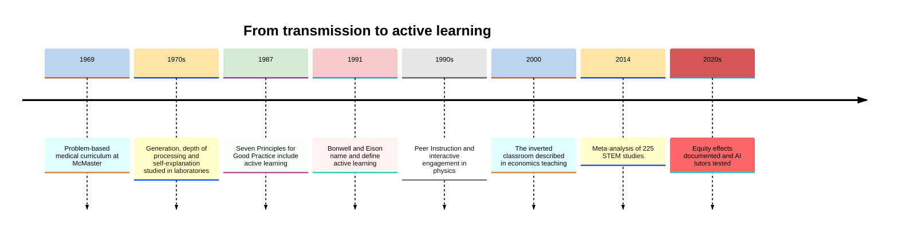
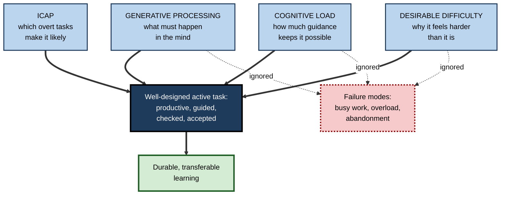
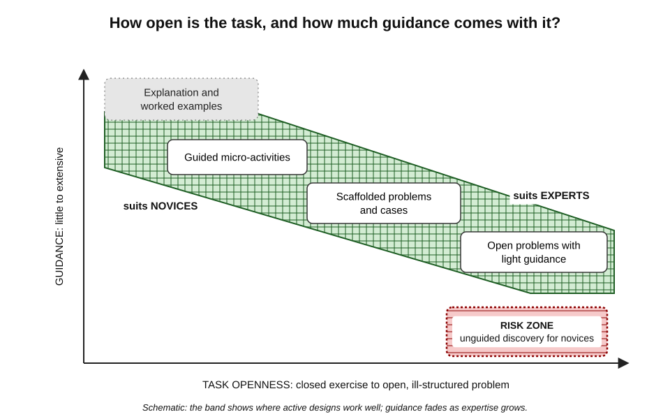
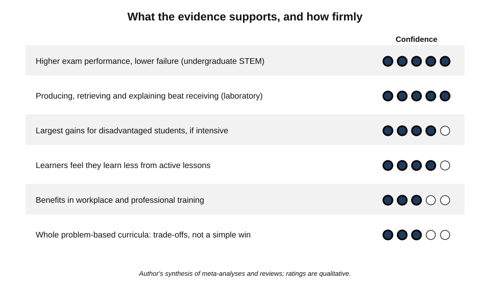
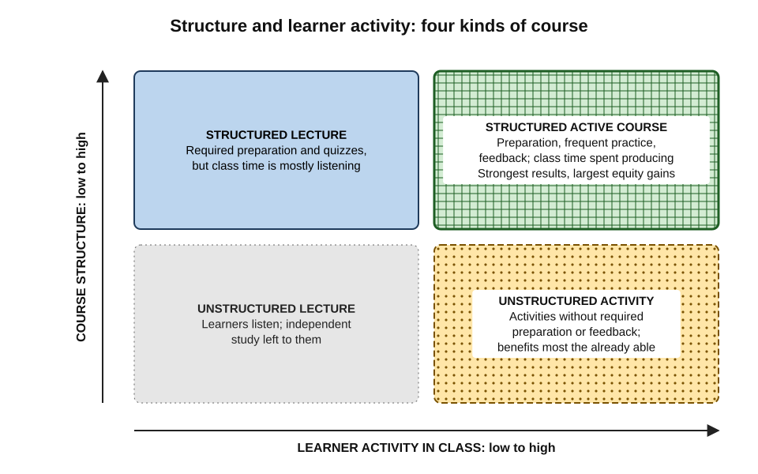
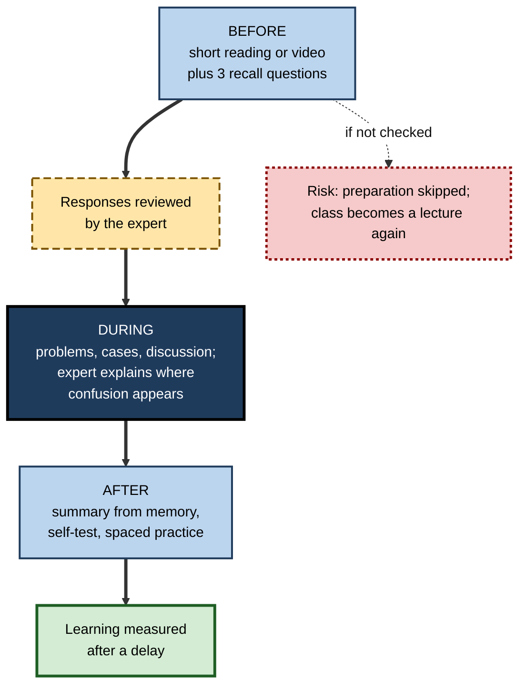

# A. Active Learning

For most of the history of formal education, learning was organised around a simple picture: an expert speaks, learners listen, and knowledge passes from one to the other. The picture survives in lecture halls, webinars, onboarding decks and conference keynotes.

Over the past half-century, research from cognitive psychology, physics and biology education, medical schools and workplace training has converged on a different picture — **knowledge is built by what the learner's own mind does**, and the most effective teaching and study arrange for learners to do the right kind of thinking, with feedback.

> **Definition — Active learning:** an approach to teaching and studying in which learners do more than receive information — they generate, apply, explain, question, organise and discuss it, and receive feedback on their thinking — so that their own cognitive work transforms the material into durable, usable knowledge.

**Why it matters**

- It is the most consistently supported large-scale change in how teaching is organised, with evidence from hundreds of controlled comparisons.
- It changes the **unit of design** from "what will be presented" to "what will learners do with it".
- It explains why equal hours of study or training produce very unequal results.
- It is as relevant to a professional reading a report alone as to a lecturer facing four hundred students or a firm designing a graduate academy.
- In the age of AI, which can do much of the thinking on a learner's behalf, deciding **who does the thinking** has become a central question of professional development.

---

## The Idea and Its Scope

### What makes learning "active"

- **The learner produces something** — a prediction, answer, explanation, question, summary, diagram, decision or solution.
- **What is produced goes beyond what was presented** — it is not a copy.
- **The production is about the content that matters** — not a decorative activity.
- **The thinking is checked** — by feedback from a teacher, peer, model answer, tool or reality.

> **Key point:** active learning is defined by **cognitive** activity, not physical activity. A silent reader who predicts and questions is learning actively; a workshop participant clicking through instructions is not.

### What it is not

- **Not the abolition of explanation** — clear exposition remains the efficient way to introduce new ideas, especially to novices; active learning changes what happens **around** it.
- **Not entertainment** — engagement matters only when it is engagement with the ideas being learned.
- **Not unguided discovery** — the evidence strongly favours activity with structure and guidance.
- **Not a single technique** — it is a design principle realised through many methods.

| | Transmission model | Active learning model |
|---|---|---|
| Picture of learning | Knowledge passes from expert to learner | Learners construct knowledge through their own processing |
| Unit of design | Content to be covered | Tasks learners will perform |
| Expert's main role | Presenter | Designer, explainer, questioner, giver of feedback |
| Learner's main role | Listener, note-taker | Producer of answers, explanations, decisions |
| When errors surface | Later, in tests or on the job | During learning, when they can be corrected |
| Typical measure of success | Coverage; satisfaction | Delayed, unaided performance; transfer |

---

## Origins and History

### Long roots

- **Socratic dialogue** — learning through questions that make learners articulate and test their beliefs.
- **Apprenticeship** — for most of history, crafts and professions were learned by doing under supervision.
- **John Dewey (late 19th to mid-20th century)** — education should grow from experience, inquiry and reflection on experience.
- **Jean Piaget** — children construct understanding by acting on the world and resolving conflicts between expectation and experience.
- **Lev Vygotsky** — learning develops through social interaction, especially with more capable others, within the learner's "zone of proximal development".
- **Jerome Bruner (1960s)** — learning by discovery and the "spiral curriculum"; later research qualified the role of unguided discovery.

### The modern movement

**Figure 1.** Milestones in the development of active learning as a research-based approach.

- **Arthur Chickering and Zelda Gamson (1987)** — the widely circulated "Seven Principles for Good Practice in Undergraduate Education" included **encouraging active learning**, alongside prompt feedback, time on task and contact between students and faculty.
- **Charles Bonwell and James Eison (1991)** — defined active learning as involving students "in doing things and thinking about the things they are doing", and gave the movement its name.
- **Physics education research (1990s)** — Eric Mazur's peer instruction and Richard Hake's survey of about 6,000 students produced the first large quantitative evidence that **interactive engagement** roughly doubled conceptual gains.
- **The inverted (flipped) classroom** — **Maureen Lage, Glenn Platt and Michael Treglia (2000)** described moving lecture content outside class so that class time could be used for activity; **Jonathan Bergmann and Aaron Sams** popularised the "flipped classroom" in schools in the late 2000s.
- **National reports** — in the United States, a National Research Council report on discipline-based education research (2012) and the President's Council of Advisors on Science and Technology report *Engage to Excel* (2012) urged universities to adopt evidence-based active methods.
- **Scott Freeman and colleagues (2014)** — a meta-analysis of 225 studies in undergraduate STEM found higher exam performance and markedly lower failure rates under active learning; later work by Elli Theobald and colleagues (2020) showed the largest benefits for students from under-represented groups when active learning was intensive.

> **Key point:** active learning moved from a philosophy of education to an **evidence-based design principle** when controlled comparisons — first in laboratories, then in physics and biology courses, then across disciplines — repeatedly showed it outperforming transmission.

---

## The Central Frameworks

Several frameworks explain active learning from different angles. They are complementary, and together they explain both its successes and its failures.

### Generative processing

- **Merlin Wittrock (1970s)** and later **Richard Mayer** and **Logan Fiorella** described learning as **generative**: learners **select** relevant information, **organise** it into a coherent model and **integrate** it with prior knowledge.
- Passive reception permits these processes; active tasks **require** them.
- The reasons this works — retrieval, error correction, calibration, attention and motivation working alongside generative processing — form a bundle that well-designed activities trigger together.

### Modes of engagement

- **Michelene Chi's ICAP framework** orders engagement as **Interactive > Constructive > Active > Passive**: co-constructing with others, producing beyond the material, manipulating it, receiving it.
- Its practical value is diagnostic — it lets a designer classify each minute of a session by what learners are doing.

### Cognitive load and guidance

- **John Sweller's cognitive load theory** emphasises the narrow capacity of working memory.
- Open-ended activity can overload novices, who lack the knowledge to organise new information; **guidance** — explanation, worked examples, prompts and structure — keeps load manageable.
- The same theory predicts that guidance should **fade** as expertise grows.

### Desirable difficulty

- **Robert Bjork**: conditions that make learning feel harder and slower — producing rather than reading, mixing, spacing — often improve long-term retention and transfer.
- Active learning is largely a family of desirable difficulties, which is why it so often **feels** less effective than it is.

**Figure 2.** How the main frameworks combine into a single design logic.

> **Remember:** a good active task answers four questions — **what thinking** it requires (generative processing), **what learners visibly do** (ICAP), **how much support** they need (cognitive load) and **how they will be helped to persist** through the difficulty (desirable difficulty).

---

## Methods and How They Fit Together

Active learning is realised through many methods, which differ mainly in **scale** (a minute, a session, a curriculum), **social form** (alone, in pairs, in groups) and **how open** the task is.

- **Micro-activities within any session** — a prediction before a demonstration, a question to answer on paper, a one-minute summary, an explanation to a neighbour. They cost minutes and can transform a lecture or meeting.
- **Activities that structure study** — questioning a text, condensing it in one's own words, mapping its structure, taking notes that transform rather than transcribe; the evidence repeatedly shows that these help when done **from memory** and **with transformation**, and help little when done mechanically.
- **Social structures** — explaining to and teaching others, which benefits the explainer as much as the listener, and structured discussion in which disagreement is resolved by reasons.
- **Whole designs** — inquiry, problem-based curricula and case-based teaching, in which realistic questions, problems and situations organise what is learned.

**Figure 3.** Active learning designs arranged by how open the task is and how much guidance accompanies it.

### Interaction between levels

- **Micro-activities make whole designs work.** A problem-based tutorial succeeds when members generate explanations, question each other and summarise; it fails when one member lectures the rest.
- **Habits make micro-activities persist.** Without routines, learners revert to passive study whenever time is short.
- **Whole designs supply purpose.** Realistic problems and cases give individual activities a reason, raising motivation and improving transfer.

> **Key point:** the methods are not rivals. Mature practice **layers** them — guided explanation, frequent micro-activities, realistic problems and cases, and durable personal habits — in proportions suited to the learners' expertise.

---

## The Evidence in Outline

### What is well established

- **Across undergraduate STEM**, active learning raises examination performance by about half a standard deviation on average and substantially reduces failure rates compared with traditional lecturing.
- **Benefits are largest for students with fewer educational advantages**, provided active learning is **high-intensity** and **highly structured**.
- **Laboratory research** robustly supports the underlying mechanisms: producing beats reading; retrieval beats re-study; explaining beats listening; comparing cases beats studying them singly.
- **Learners systematically underrate active learning**: in controlled comparisons, students learned more from active lessons but felt they learned less.

### What is qualified

- **Implementation quality matters** — surveys of typical courses have found that the **amount** of reported active learning does not by itself predict learning gains; well-designed questions, follow-up explanation and feedback do.
- **Guidance matters** — unguided discovery underperforms explicit instruction for novices; guided activity outperforms both.
- **Outside STEM higher education**, evidence is thinner, more varied and often less rigorous — especially in workplace training.
- **Whole-curriculum designs** such as problem-based learning show **trade-offs**: better application, retention and satisfaction; similar or slightly lower short-term knowledge scores; higher cost.

**Figure 4.** What the evidence supports, with what confidence.

> **Watch out:** "active learning" is sometimes defended with invented statistics — notably the "learning pyramid" claiming people remember 10% of what they read and 90% of what they teach. These numbers have no research source. The real evidence is strong enough not to need them.

---

## The Landmark Debates

### Guidance versus discovery

- **The critique — Paul Kirschner, John Sweller and Richard Clark (2006):** minimally guided instruction — pure discovery, unstructured inquiry and problem-solving — is ineffective for novices because it overloads working memory.
- **The response — Cindy Hmelo-Silver, Ravit Golan Duncan and Clark Chinn (2007):** well-designed inquiry and problem-based learning are heavily scaffolded; evidence against unguided discovery does not apply to them.
- **The convergence:** both sides accept that **novices need guidance** and that **experts benefit from open problems**; meta-analyses favour **guided** forms of active learning over both pure discovery and pure transmission.

| | Explicit-instruction position | Guided-inquiry position | Common ground |
|---|---|---|---|
| Starting point for novices | Clear explanation and worked examples | A well-designed problem with scaffolds | Novices need substantial support |
| Role of problem-solving | After instruction, as practice | Before or during instruction, to activate knowledge | Both use problems; they differ on timing |
| Evidence emphasised | Cognitive load experiments | Classroom and curriculum studies | Unguided discovery underperforms |
| Fading of guidance | Gradual, as expertise grows | Gradual, as inquiry skills grow | Guidance should fade |

> **Key point:** the most productive question is not "active or explicit?" but **"how much guidance, for whom, and when should it fade?"** Problem-first sequences can outperform instruction-first for older learners when followed by careful consolidation — a refinement, not a refutation, of the case for guidance.

### Learning versus liking

- Active methods often earn **lower satisfaction ratings** than polished lectures, especially early on.
- Organisations that judge teaching by satisfaction therefore discourage the methods that work best.
- **Resolution:** explain the effort–learning relationship to learners at the outset, show them evidence from their own delayed tests, and evaluate teaching by **delayed, unaided performance** rather than by comfort.

### Structure versus autonomy

- Highly structured active courses — required preparation, frequent low-stakes practice, regular feedback — produce the strongest results and the largest equity gains.
- Critics worry that structure reduces learner independence.
- **Resolution:** structure early, **transfer responsibility** progressively, and teach learners to build their own structures and habits.

**Figure 5.** Structure and learner activity: four kinds of course.

### Coverage versus depth

- Active sessions present less content in class.
- **Resolution:** move first exposure to preparation (readings, short videos), use contact time for processing, and accept that content presented but not processed was never really "covered".

---

## Active Learning at Scale

### The flipped design

- **Before the session** — learners meet new content through short readings or videos, with a few questions that require recall or prediction.
- **During the session** — time goes to application: problems, cases, discussion, explanation, with the expert circulating and explaining where confusion appears.
- **After the session** — consolidation: summaries, self-tests, spaced practice.

**Figure 6.** The flipped session sequence.

| | Traditional session | Flipped active session |
|---|---|---|
| First exposure to content | In the session | Before the session |
| Use of contact time | Presentation | Application, discussion, feedback |
| Expert's information about learners | Little until the test | Pre-session responses and in-session work |
| Main risk | Passive reception | Learners arrive unprepared |
| Essential safeguard | — | A short, required, checked preparation task |

### In large lectures and online

- **Large rooms** — response systems, think–pair–share and peer discussion work with hundreds of learners; the binding constraint is the instructor's design, not room size.
- **Online courses** — analyses of large online courses have found that the amount of interactive practice learners complete predicts learning far more strongly than the amount of video watched.
- **Video meetings** — breakout groups with a concrete task and a written product outperform open discussion in a large call.

### In organisations

- **Scenario-based training** — learners make decisions in realistic situations with consequences and feedback, rather than reading policy.
- **Simulations and drills** — incident response, clinical emergencies, negotiations.
- **Learning in the flow of work** — reviews, retrospectives and case conferences built into ordinary work cycles.
- **Measurement** — the persistent weakness: most organisations still measure attendance and satisfaction; active designs show their value only when **behaviour and results** are measured after a delay.

### Worked example: re-budgeting a three-day workshop

- **Situation:** a firm's three-day leadership workshop (18 contact hours) consists of 14 hours of presentation, 3 hours of group exercises and 1 hour of Q&A.
- **Step 1 — classify each hour** by what participants do:

| Activity | Hours now | Mode |
|---|---|---|
| Presentation | 14 | Passive |
| Group exercises (mostly discussion of slides) | 3 | Active to interactive, unstructured |
| Q&A | 1 | Mostly passive |

- **Step 2 — redesign the same 18 hours:**

| Activity | Hours after redesign | Mode |
|---|---|---|
| Short explanations, in 10–15 minute segments | 5 | Passive, but brief and targeted |
| Individual prediction, decision and reflection tasks | 3 | Constructive |
| Structured role-plays and case discussions with feedback | 8 | Interactive |
| Consolidation: summaries from memory, commitments, teach-back | 2 | Constructive |

- **Step 3 — move content:** two hours of pre-reading with short recall questions replace about eight hours of presentation.

> **Formula — Share of productive time:** constructive and interactive hours ÷ total contact hours. *Before:* about 3 ÷ 18 ≈ **17%**. *After:* (3 + 8 + 2) ÷ 18 = 13 ÷ 18 ≈ **72%**.

- **Step 4 — measure differently:** replace the end-of-workshop satisfaction survey as the main measure with a recorded role-play assessment six weeks later and manager observations at three months.
- **Conclusion:** the content is largely preserved; the **thinking** has moved from the presenter to the participants.

> **Watch out:** a redesign of this kind typically **lowers** first-day satisfaction scores and raises facilitator preparation time. Stakeholders should be told in advance — and shown delayed results later.

### Case study: an engineering academy adopts active learning

- **Situation:** a global engineering and consulting firm ran a six-week academy for about 300 graduates a year, built around lectures by senior engineers and an end-of-academy multiple-choice exam.
- **Problem:** project managers reported that graduates arrived on projects unable to apply core methods without supervision; exam scores were high and satisfaction excellent.
- **Diagnosis:**
  - about 80% of contact time was presentation;
  - the exam tested recognition, immediately;
  - graduates rarely explained, decided or solved anything realistic during the academy;
  - senior engineers were selected for expertise, not for designing learning.
- **Actions:**
  1. **Design standard:** every session plan had to show what learners would *produce* in each 15-minute block; at least half of contact time had to be constructive or interactive.
  2. **Flipped preparation** with short recall questions checked before each session.
  3. **Problem- and case-centred weeks** built from anonymised past projects, with experienced engineers as questioning tutors.
  4. **Micro-activities** in every remaining lecture: predictions, concept questions with peer discussion, one-minute summaries.
  5. **Instructor development:** senior engineers attended a two-day course on designing active sessions and observed each other teach.
  6. **Measurement:** the immediate exam was replaced by a **delayed, unaided design task** at the end of the first project month, assessed by project managers.
  7. **Expectation-setting:** on day one, graduates were told why the academy would feel harder than university lectures.
- **Result:** within two cohorts, project managers' ratings of graduates' independent capability rose markedly; delayed design-task scores identified weak topics, which were redesigned the following year.
- **Side effects / caveats:**
  - satisfaction scores fell in the first cohort and recovered in the second as instructors gained skill;
  - two senior engineers withdrew from teaching rather than redesign their sessions;
  - preparation time per session roughly doubled in the first year;
  - without a control group, improvements cannot be attributed with certainty to the redesign.
- **Lesson:** adoption succeeded because the firm changed the **design standard, the measurement and the instructors' skills** together. Changing any one alone would likely have failed.

---

## Barriers and How Organisations Overcome Them

- **Instructor beliefs and habits** — experts teach as they were taught.
  - Remedy: observation of peers, short design courses, evidence from their own learners.
- **Learner resistance** — effort is misread as failure.
  - Remedy: explain the reasons, start with low-stakes activities, show delayed results; research on reducing student resistance emphasises **explaining the purpose** and **facilitating** activities well.
- **Coverage anxiety** — fear of "not getting through the material".
  - Remedy: flipped preparation; ruthless prioritisation of key ideas.
- **Evaluation systems** — satisfaction-based ratings.
  - Remedy: delayed performance and behaviour measures.
- **Preparation cost** — designing good tasks takes time.
  - Remedy: shared libraries of questions, cases and problems; reuse across cohorts.
- **Physical and digital environments** — fixed seating, tools designed for broadcasting.
  - Remedy: response systems, breakout tools, movable furniture — or simply pairs turning to neighbours.

> **In practice:** studies of change in university teaching, such as reviews by **Charles Henderson, Andrea Beach and Noah Finkelstein (2011)**, found that disseminating "best practice" materials rarely changes teaching on its own; lasting change came from strategies that addressed instructors' beliefs and the surrounding environment over an extended period.

---

## Active Learning and Artificial Intelligence

- **The risk:** AI systems produce fluent explanations, summaries, code and analyses instantly. A learner who reads them receives information passively, however good it is; field studies have found that unrestricted AI help during practice can raise practice scores while **lowering** later unaided performance.
- **The opportunity:** AI can supply what active learning has always needed and rarely had enough of — questions, problems and cases on demand; immediate, individual feedback; simulated clients, patients and opponents; Socratic questioning.
- **The design principle:** the learner does the **generating, explaining and deciding**; the AI **prompts, challenges, checks and gives feedback**.
- **Practical rule for professionals:** **attempt first, then ask** — write one's own answer, plan or explanation before consulting the tool, then compare.

> **Key point:** AI does not change *why* active learning works. It makes the choice between active and passive learning **more consequential and more frequent** — every query is a small decision about who does the thinking.

---

## What Distinguishes Expert Practice

- **Designing backwards from performance** — starting from what learners must be able to do, unaided, after a delay, and designing tasks that practise it.
- **Diagnosing minute by minute** — knowing what learners are doing in each part of a session and what thinking it requires.
- **Calibrating guidance** — explaining enough for novices to succeed, then fading support.
- **Using errors** — eliciting misconceptions early, treating them as information, correcting them with explanation.
- **Managing the emotional side** — naming the difficulty, building safety for wrong answers, sustaining effort.
- **Measuring honestly** — delayed, unaided and transfer measures, not satisfaction alone.
- **Applying it to oneself** — the expert learner studies, reads, attends meetings and uses AI in the same way they would design for others.

---

## Open Questions

- **Which mechanisms carry most of the benefit?**
  - Real activities bundle generation, retrieval, feedback, attention and motivation; their separate contributions in complex settings are hard to isolate.
- **How well does the evidence generalise beyond STEM higher education?**
  - Workplace, humanities, school and professional settings have fewer rigorous studies.
- **How should guidance be personalised?**
  - Adaptive systems could adjust support to each learner's expertise; the best rules for fading guidance remain unsettled.
- **How can organisations measure learning affordably?**
  - Delayed, behaviour-based measures are expensive; without them, active designs struggle to show their value.
- **Will AI make learning more active or more passive?**
  - Tool design, defaults and professional norms will decide; long-term evidence is only beginning to appear.

---

## Summary

- **Active learning** makes learners generate, apply, explain, question, organise and discuss — with feedback — so that their own cognitive work builds durable, usable knowledge; it is defined by **cognitive**, not physical, activity.
- Its roots lie in Socratic dialogue, apprenticeship, **Dewey, Piaget, Vygotsky** and Bruner; it became a research-based movement through **Chickering and Gamson (1987)**, **Bonwell and Eison (1991)**, physics education research, the flipped classroom and **Freeman et al. (2014)**.
- Frameworks: **generative processing** (select, organise, integrate), **ICAP** modes of engagement, **cognitive load** and guidance, and **desirable difficulty** — together explaining both success and failure.
- Methods range from **micro-activities** to **study strategies**, **social structures** and **whole problem- and case-centred designs**, sustained by **habits**; mature practice layers them.
- Evidence: robust gains in exam performance and failure rates, largest for disadvantaged students under **high-intensity, structured** designs; learners **feel** they learn less; implementation quality and guidance are decisive; evidence outside STEM is thinner.
- Debates: **guidance versus discovery** (converging on guided activity with fading support), **learning versus liking**, **structure versus autonomy**, **coverage versus depth**.
- At scale: **flipped** designs with checked preparation, active large lectures, interactive online practice, scenario-based and work-embedded learning, measured by **delayed behaviour and results**.
- Barriers — instructor habits, learner resistance, coverage anxiety, satisfaction metrics, cost — require changing design standards, measurement and skills together.
- With AI: the learner generates and decides; the tool prompts and checks — **attempt first, then ask**.

---

## Self-Check

1. Define active learning and explain why it is defined by cognitive rather than physical activity.
2. Contrast the transmission and active learning models on design unit, roles and measures of success.
3. Trace the history of active learning from its long roots to the 2014 meta-analysis.
4. Explain how generative processing, ICAP, cognitive load theory and desirable difficulty each contribute to designing an active task.
5. Why are the different active learning methods described as layers rather than rivals?
6. Summarise what is well established and what is qualified in the evidence.
7. Explain the guidance-versus-discovery debate and the points of convergence.
8. Why do active methods often receive lower satisfaction ratings, and how should organisations respond?
9. Describe a flipped session and its most important safeguard.
10. A workshop has 2 constructive and 1 interactive hour out of 12 contact hours. Calculate its share of productive time and propose a target.
11. Name four barriers to adopting active learning and a remedy for each.
12. How does AI both threaten and strengthen active learning? State a practical rule.
13. A university department reports that adding "activities" to lectures produced no learning gains. Give three likely reasons.
14. Design an adoption plan for active learning in a company's 200-person sales onboarding programme, addressing design, instructors, learners and measurement.

### Answer Key

1. Learners do more than receive information — generating, applying, explaining, questioning, organising and discussing, with feedback — so their own cognitive work builds knowledge. Learning depends on selecting, organising and integrating; physical activity matters only if it triggers this thinking.
2. Transmission: the unit is content covered; the expert presents and learners listen; success is coverage and satisfaction. Active: the unit is tasks learners perform; the expert designs, explains, questions and gives feedback; learners produce; success is delayed, unaided performance and transfer.
3. Socratic dialogue and apprenticeship; Dewey, Piaget, Vygotsky and Bruner; McMaster PBL (1969); laboratory research on generation, depth of processing and self-explanation; Chickering and Gamson (1987); Bonwell and Eison (1991); physics interactive engagement (1990s); the inverted classroom (2000); national reports (2012); Freeman et al. (2014), followed by equity findings (2020).
4. Generative processing defines the thinking required; ICAP identifies overt tasks likely to produce it; cognitive load theory sets the guidance needed for the learners' expertise; desirable difficulty explains why the task feels hard and why learners must be helped to persist.
5. Micro-activities make whole designs work; habits make micro-activities persist; realistic problems and cases give activities purpose. Effective programmes combine them in proportions suited to learners.
6. Established: higher exam performance and lower failure in STEM; larger benefits for disadvantaged students with intensive, structured designs; robust laboratory mechanisms; learners underrate active learning. Qualified: implementation quality and guidance are decisive; evidence outside STEM higher education is thinner; whole-curriculum designs show trade-offs.
7. Kirschner, Sweller and Clark argued minimally guided instruction overloads novices; Hmelo-Silver and colleagues replied that good inquiry and PBL are scaffolded. Both agree novices need guidance, experts benefit from open problems, unguided discovery underperforms and guidance should fade.
8. Active learning requires effort, which learners misread as poor learning, while lectures feel fluent. Organisations should explain the effect, show delayed results and evaluate by delayed, unaided performance and behaviour.
9. Content is met before the session through short readings or videos with recall questions; session time goes to application and feedback; consolidation follows. Safeguard: a short, required, checked preparation task.
10. (2 + 1) ÷ 12 = 25%. A reasonable target is at least 50–70%, achieved by moving first exposure to preparation and converting presentation time into structured tasks.
11. Instructor habits — peer observation and design training; learner resistance — explain purpose, low-stakes start, show delayed results; coverage anxiety — flipped preparation and prioritisation; satisfaction metrics — delayed performance measures (also cost — shared task libraries).
12. Threat: reading AI output is passive, and unrestricted AI can lower unaided performance. Strength: AI supplies questions, cases, feedback and simulated stakeholders cheaply. Rule: attempt first, then ask — the learner generates and decides; the tool prompts and checks.
13. Activities may not have required reasoning about key concepts; there may have been no follow-up explanation or feedback; intensity may have been too low (token activities); learners may have lacked the prior knowledge or guidance needed.
14. Design: a standard requiring each session to show what learners produce, at least half of time constructive or interactive, flipped preparation with checks, scenario-based practice on real customer conversations. Instructors: training in active design, peer observation, a shared library of scenarios. Learners: day-one explanation of why it will feel harder; low-stakes early practice. Measurement: a recorded, unaided customer-conversation assessment 30 days later and behavioural indicators from managers, rather than immediate quizzes and satisfaction alone.

---

## Glossary

| Term | Meaning |
|---|---|
| Active learning | Learning in which learners generate, apply, explain, question, organise and discuss content, with feedback. |
| Cognitive load | The demand a task places on working memory. |
| Desirable difficulty | A condition that makes learning harder now but improves long-term retention or transfer. |
| Flipped classroom | A design in which first exposure to content occurs before sessions and session time is used for active work. |
| Generative processing | Selecting, organising and integrating information with prior knowledge. |
| Guidance (instructional) | Explanation, worked examples, prompts and structure that support learners during activity. |
| High-intensity active learning | Courses in which a substantial share of time is spent on active work. |
| ICAP framework | Engagement ordered as Interactive > Constructive > Active > Passive. |
| Interactive engagement | Teaching methods that make learners think about concepts in class with immediate feedback. |
| Micro-activity | A brief active task — a prediction, question or summary — within a larger session. |
| Scenario-based training | Training in which learners make decisions in realistic situations and receive feedback. |
| Structure (course) | Required preparation, frequent low-stakes practice and regular feedback. |
| Transmission model | The view of learning as knowledge passing from expert to listener. |
| Unguided discovery | Learning by exploration without guidance or feedback. |
| Zone of proximal development | Vygotsky's term for what a learner can do with help but not yet alone. |
