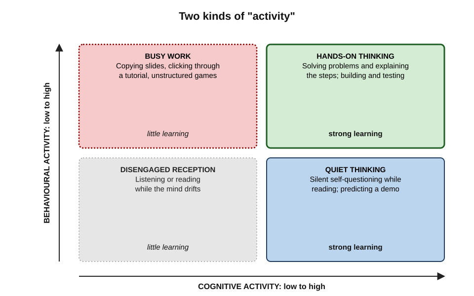
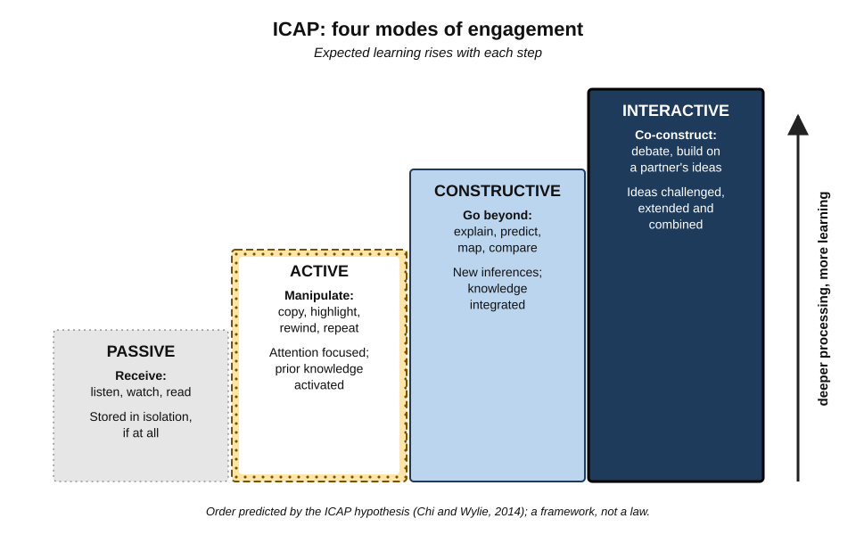
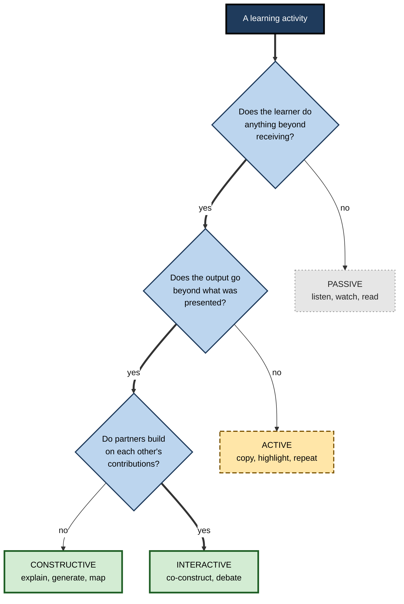
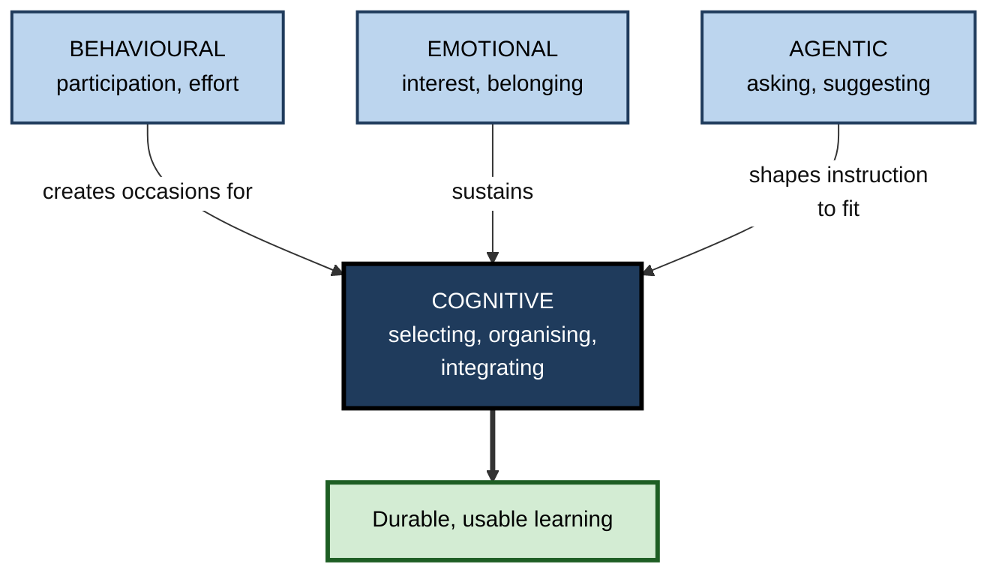
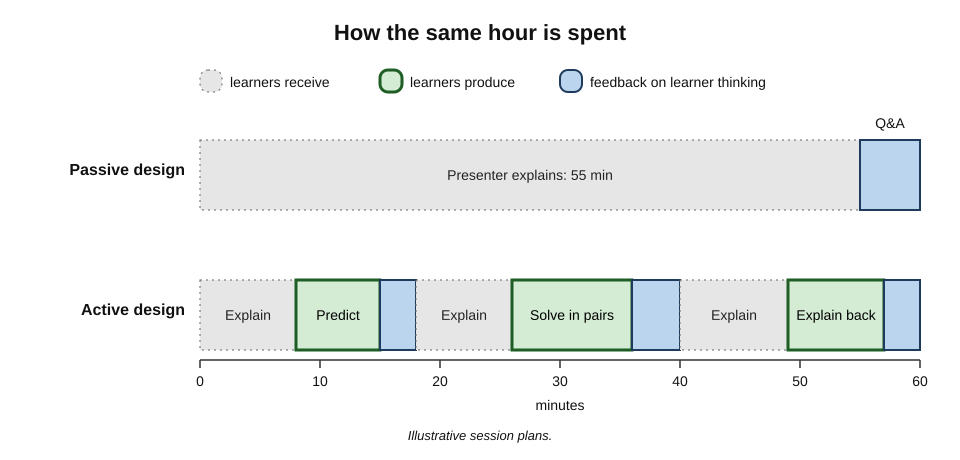

# A.1. Passive vs. Active Learning Defined

Two junior analysts attend the same hour-long briefing on a new pricing model. One listens attentively, nods and copies the slides. The other, at each pause, writes down what the model would predict for one of her own clients and notes where she is unsure. Both were "present"; both may say they "followed everything". A week later only one can apply the model unaided. The difference lies not in the speaker but in **what each listener's mind was doing**.

> **Definition — Active learning:** any approach in which learners do more than receive information — they generate, apply, explain, question, organise or discuss it — so that their own mental work, not the presenter's, transforms the material.

> **Definition — Passive learning:** learning in which the learner's main activity is receiving information as presented — listening, watching or reading — without producing anything beyond it.

**Why the distinction matters**

- It is the single most consequential choice in how a lecture, training session, meeting or study hour is designed.
- It explains why equal time and equal attention can produce very unequal learning.
- It exposes a common trap: activity that *looks* busy but involves little thinking.
- It gives teachers, trainers and learners a shared language for diagnosing why a session failed.

---

## The Everyday Picture

Most people already know the difference from experience, even if they lack the words.

**Passive situations**

- **Listening to a lecture or webinar** without responding.
- **Watching a demonstration** of software without touching the keyboard.
- **Reading a report** straight through, eyes moving over every line.
- **Sitting in a meeting** while a colleague walks through a slide deck.

**Active situations**

- **Predicting** what the demonstrator will click next, then checking.
- **Answering a question** posed to the room, even silently on paper.
- **Explaining** a section of the report to a colleague who missed it.
- **Working a problem** with the new tool before being shown the answer.
- **Debating** with a peer which of two options a policy actually implies.

> **Key point:** the setting does not decide whether learning is active. A lecture can be highly active if listeners are predicting, questioning and writing; a "hands-on" workshop can be passive if participants merely follow click-by-click instructions.

### Why "passive" is not an insult

- **Receiving information is necessary.** Nobody can generate knowledge they have never encountered; listening and reading are how new information first enters.
- **Good exposition is valuable.** A clear explanation by an expert can be the most efficient start for a novice.
- **The problem is *only* receiving.** Learning suffers when exposure is never followed by the learner doing something with what was received.

> **Watch out:** "active versus passive" is often presented as "good versus bad". The more accurate view is that **passive reception is a starting point** and active processing is what turns it into durable, usable knowledge.

---

## Defining Active Learning

### The classic definitions

- **Charles Bonwell and James Eison (1991)** — the report that popularised the term in higher education:
  - active learning is "anything that involves students in doing things and thinking about the things they are doing";
  - the second half matters as much as the first — *doing* without *thinking about it* does not qualify.
- **Michael Prince (2004)** — a review for engineering educators:
  - any instructional method that engages students in the learning process, requiring meaningful activities and reflection on them;
  - contrasted with "traditional" lecture, where students passively receive information.
- **Scott Freeman and colleagues (2014)** — the definition used in the largest meta-analysis of the subject:
  - active learning "engages students in the process of learning through activities and/or discussion in class, as opposed to passively listening to an expert";
  - emphasises higher-order thinking and often group work.

> **Remember:** every serious definition has two parts — **an activity** and **thinking about the content through that activity**.

### What active learning is not

- **Not merely physical movement** — standing up, moving sticky notes or clicking buttons can be done without thought.
- **Not merely enjoyment** — a lively game can entertain without engaging the ideas that matter.
- **Not merely group work** — sitting in a group while one person does the thinking leaves the others passive.
- **Not the absence of teaching** — the teacher still explains, models and corrects; what changes is that learners also do the work.
- **Not a single technique** — it is a family of methods: questioning, generating, explaining, discussing, solving problems, analysing cases, mapping and summarising.

> **Mnemonic — "DOTE":** active learning means learners **D**o something, **O**n the content, **T**hinking about it, and receive **E**valuation or feedback.

---

## Behavioural Activity and Cognitive Activity

The most important refinement of the definition came from researchers who noticed that "active" was being used for two different things.

> **Definition — Behavioural activity:** visible, physical engagement — writing, speaking, moving, clicking, manipulating objects.

> **Definition — Cognitive activity:** the mental work of selecting what matters, organising it into a coherent structure and integrating it with existing knowledge.

### Mayer's warning

- **Richard Mayer (2004)** argued that the theory behind active learning concerns **cognitive** activity.
- He called the assumption that behavioural activity guarantees learning the **constructivist teaching fallacy**.
  - *e.g.* students freely exploring a simulation may click constantly yet never form the intended understanding.
- Conversely, a learner reading a well-designed text and silently asking "why?" at each claim is **cognitively active while behaviourally still**.

**Figure 1.** Behavioural activity and cognitive activity are separate dimensions; only cognitive activity reliably produces learning.

| | Low cognitive activity | High cognitive activity |
|---|---|---|
| **High behavioural activity** | "Busy work": copying, clicking through a tutorial, unstructured games | Hands-on problem-solving with explanation; building and testing |
| **Low behavioural activity** | Passive listening or reading with mind drifting | Silent self-questioning during reading; mental prediction during a demonstration |

> **Key point:** the goal is the right-hand column. Behavioural activity is useful mainly as a **visible trigger and check** for cognitive activity — a teacher can see whether a learner wrote an explanation, but not whether the learner silently formed one.

---

## The ICAP Framework

### Four modes of engagement

**Michelene Chi (2009)** and **Chi and Ruth Wylie (2014)** proposed the most widely used classification of engagement. It classifies **what the learner overtly does**, on the assumption that each overt behaviour indicates a kind of underlying cognitive processing.

- **Passive** — receiving information without doing anything else with it.
  - *e.g.* listening to a lecture; reading a text once; watching a video.
  - Underlying process: information is stored in isolation, if at all.
- **Active** — doing something physical with the material, without going beyond it.
  - *e.g.* underlining, copying notes verbatim, pausing and rewinding a video, repeating a definition.
  - Underlying process: attention is focused; existing knowledge is activated.
- **Constructive** — producing something that goes **beyond** the material presented.
  - *e.g.* explaining in one's own words, drawing a concept map, generating questions, comparing two cases, predicting.
  - Underlying process: new knowledge is inferred and integrated.
- **Interactive** — two or more learners each make constructive contributions that build on one another.
  - *e.g.* debating a case, jointly solving a problem, asking and answering each other's questions.
  - Underlying process: each partner's ideas are extended, challenged and combined.

> **Definition — ICAP hypothesis:** learning outcomes improve in the order **Passive < Active < Constructive < Interactive**, because each mode includes the processes of the modes below it and adds more.

**Figure 2.** The four ICAP modes as a ladder of increasing cognitive engagement.

> **Mnemonic — "I Can Always Progress":** Interactive > Constructive > Active > Passive — read from the top down.

### One activity, four modes

The same material can be studied in any of the four modes. The table shows how.

| Material | Passive | Active | Constructive | Interactive |
|---|---|---|---|---|
| A lecture on data privacy | Listen | Copy slide bullets | Write how each rule applies to one's own project | Debate with a colleague which project feature breaches a rule |
| A software demonstration | Watch | Repeat the clicks exactly | Predict the next step and explain why | Pair: one drives, the other questions every step |
| A financial report | Read through | Highlight key figures | Write a three-sentence judgement of the firm's health | Defend the judgement against a peer's opposite view |
| A worked statistics example | Read it | Copy it out | Explain each step's purpose in writing | Take turns explaining steps and correcting each other |

> **Example (illustrative):** a sales team watching a recorded customer call can listen passively, take verbatim notes (active), list three moments where the representative could have asked a better question and draft those questions (constructive), or compare their lists in pairs and agree the single best rewrite (interactive).

### The evidence behind ICAP

- **Chi and Wylie (2014)** reviewed earlier studies and reclassified their conditions by mode; comparisons across many experiments generally fitted the predicted order.
- **Laboratory tests** comparing, for example, reading only, highlighting, writing explanations and explaining to a partner have usually — though not always — found the predicted ranking on deeper questions.
- **Classroom application:** teachers trained in ICAP can design more constructive and interactive tasks, but implementing the interactive mode well is harder than it looks.

> **Watch out:** ICAP is a **framework**, not a law. Its boundaries blur (is taking paraphrased notes active or constructive?), it classifies by overt behaviour while the real driver is covert thought, and "interactive" sessions can collapse into one person talking while others are passive. Its predictions are strongest when each mode is **genuinely carried out**.

### Classifying an activity

**Figure 3.** A decision sequence for classifying a learning activity by its ICAP mode.

---

## Dimensions of Engagement

"Active" also describes engagement in a broader sense. Researchers on student engagement, notably **Jennifer Fredricks, Phyllis Blumenfeld and Alison Paris (2004)**, distinguish several dimensions that interact.

- **Behavioural engagement** — participation, effort, persistence, attendance.
- **Cognitive engagement** — investment in understanding; use of deep rather than surface strategies.
- **Emotional (affective) engagement** — interest, curiosity, a sense of belonging; absence of boredom or anxiety.
- **Agentic engagement** — **Johnmarshall Reeve and Ching-Mei Tseng (2011)**: the learner's proactive contribution to the flow of instruction, such as asking for clarification or suggesting an approach.

**Figure 4.** Four dimensions of learner engagement and how they feed the cognitive work that produces learning.

> **Key point:** behavioural, emotional and agentic engagement matter mostly **because they make cognitive engagement more likely and longer-lasting**. A session that delights learners but never requires them to think has engaged the wrong dimension.

---

## Where the Idea Came From

Active learning is old as practice and young as a research label.

- **Socrates (5th century BCE)** — taught by questioning, making pupils articulate and test their own beliefs.
- **Apprenticeship** — for most of history, crafts and professions were learned by doing under supervision rather than by hearing about the work.
- **John Dewey (early 20th century)** — argued that education should grow from experience and inquiry; often summarised, loosely, as "learning by doing".
- **Jean Piaget and Lev Vygotsky** — learners **construct** knowledge rather than absorb it; Vygotsky stressed the social construction of understanding.
- **Arthur Chickering and Zelda Gamson (1987)** — "Seven Principles for Good Practice in Undergraduate Education" included "encourages active learning".
- **Bonwell and Eison (1991)** — gave the movement its name and its working definition.
- **Physics education research (1990s)** — Eric Mazur's peer instruction and Richard Hake's survey gave the first large-scale quantitative evidence.

**Study card — Richard Hake (1998)**

- **Design:** pre- and post-test data on a standard test of physics concepts (the Force Concept Inventory) from about 6,000 students in 62 introductory physics courses at schools, colleges and universities.
  - Courses classified as **traditional** (passive lectures, recipe laboratories) or **interactive engagement** (methods that make students think about concepts during class, with immediate feedback).
- **Results:** interactive-engagement courses achieved an average **normalised gain** of about **0.48**; traditional courses about **0.23** — roughly double.
- **Conclusion:** courses that required students to engage actively with concepts produced markedly better conceptual understanding.
- **Limits:** courses were not randomly assigned, and enthusiastic instructors may have chosen interactive methods.

> **Formula — Normalised gain:** g = (post − pre) ÷ (100 − pre), using percentage scores. A class moving from 40% to 70% achieves g = 30 ÷ 60 = **0.50** — it closed half the gap it could have closed.

### How much teaching is still passive

- **Marilyne Stains and colleagues (2018)** observed over 2,000 class sessions taught by more than 500 STEM instructors at North American universities using a structured observation protocol.
  - More than half the sessions were classified as **didactic** — predominantly lecturing, with little student activity.
- Workplace training shows the same pattern: much e-learning is click-through content followed by a recognition quiz — **active in behaviour, passive in thought**.

> **Watch out:** the claim that attention during lectures "drops after 10 to 15 minutes" is widely repeated. Reviews of the original sources, notably by **Karen Wilson and James Korn (2007)**, found the evidence weak and inconsistent. Attention does fluctuate and mind-wandering tends to increase over a long lecture, but there is no fixed ten-minute limit.

---

## The Learning Pyramid Myth

A popular graphic claims people remember 10% of what they read, 20% of what they hear, 30% of what they see, 50% of what they see and hear, 70% of what they say and 90% of what they do or teach.

- **No study produced these numbers.** Investigators tracing the figures — including **Will Thalheimer** and **Kåre Letrud** — found no research source; the percentages are suspiciously round and recycled across versions.
- **It is often wrongly attributed to Edgar Dale.** Dale's "cone of experience" (1946) arranged media from concrete to abstract and contained **no percentages**; Dale himself cautioned against reading it as a ranking of effectiveness.
- **Retention cannot be stated independent of material, test and delay.** Remembering "90%" depends entirely on what is learned and how memory is measured.

> **Watch out:** the pyramid's conclusion — doing and explaining usually beat listening — is broadly in line with research, but its **numbers are invented**. Citing it undermines an otherwise sound argument.

---

## Telling Active Learning When It Happens

### Observable signs

- **Learners produce something** — an answer, a prediction, an explanation, a question, a diagram, a decision.
- **What they produce is not a copy** of what was presented.
- **The product is checked** — by the teacher, a peer, a model answer or reality.
- **Errors surface during the session**, not first on the exam or in the job.

### Questions for diagnosing a session

- **Who is doing the thinking?** If the presenter does all the explaining, connecting and deciding, the learners are passive.
- **What fraction of time do learners produce?** High-intensity active classes typically give a substantial share of session time to learner work.
- **Could a learner complete the activity without understanding?** If yes, it is behavioural activity only.
- **Does anyone find out what learners got wrong?**

> **In practice:** many instructional designers use a simple ratio — count the minutes in which learners **produce** versus **receive**. A one-hour session with 55 minutes of slides and a 5-minute Q&A is passive whatever the slides contain.

### Worked example (illustrative): classifying a training morning

- **Situation:** a three-hour induction on a firm's information-security policy. The designer lists the activities and classifies each.

| Time | Activity | Mode | Why |
|---|---|---|---|
| 0:00–0:40 | Presenter walks through policy slides | Passive | Learners only receive |
| 0:40–0:50 | Participants highlight key rules in the handbook | Active | Attention focused, nothing new produced |
| 0:50–1:20 | Each participant writes how three rules apply to their own role | Constructive | Output goes beyond the policy text |
| 1:20–1:50 | Pairs review real (anonymised) phishing emails, argue which rule applies, agree a response | Interactive | Partners build on each other's reasoning |
| 1:50–2:20 | Video case of a data breach | Passive | Learners only watch |
| 2:20–3:00 | Multiple-choice quiz on rule wording | Active (recognition) | Selecting from options; little generation |

*Illustrative figures.*

- **Diagnosis:** 70 of 180 minutes are passive; the assessment is recognition-based and so cannot detect whether the constructive work succeeded.
- **Redesign:**
  1. Cut the slide walkthrough to 15 minutes; give the handbook as pre-reading.
  2. Before the video, ask each person to **predict** how the breach happened; after it, compare predictions.
  3. Replace the quiz with a **new scenario** to resolve in writing, unaided.
- **Result of the redesign:** constructive or interactive work rises from about 60 to about 120 minutes, without lengthening the morning.

> **Watch out:** the passive segments did not disappear entirely — a short, clear explanation remains the efficient way to introduce the policy. The error was letting it occupy most of the time.

---

## The Same Hour, Two Designs

**Figure 5.** How the minutes of a one-hour session are spent in a passive design and an active design.

| | Passive design | Active design |
|---|---|---|
| Presenter explanation | ~55 minutes | ~25 minutes, in short segments |
| Learner production | ~0–5 minutes | ~30 minutes: predictions, problems, explanations |
| Feedback on learner thinking | Rare | Several times per session |
| Errors discovered | Later, on the test or on the job | During the session, when they can be corrected |
| How it feels to learners | Smooth, clear, comfortable | Effortful, sometimes uncomfortable |
| Content "covered" | More | Somewhat less, often with pre-reading compensating |

*Illustrative figures.*

> **Key point:** active designs trade a little **coverage** for a great deal more **processing**. Content that is presented but not processed is coverage in name only.

---

## Active Learning in Professional Life

### Where professionals meet the distinction

- **Training and onboarding** — the choice between presentation-heavy induction and scenario-based practice.
- **Meetings and briefings** — a status meeting where people read updates aloud is passive; one where each attendee must state a decision or risk is active.
- **Self-study for certifications** — reading guides versus working problems and explaining answers.
- **Conferences** — listening to talks versus noting one change to make on Monday and discussing it with a peer.
- **Clinical and legal education** — ward rounds, moot courts and case conferences are long-standing active formats.

### Measuring it in organisations

- **Classroom observation protocols** — such as the **Classroom Observation Protocol for Undergraduate STEM (COPUS)**, which records at two-minute intervals what students and instructors are doing.
- **Session design audits** — classifying planned activities by ICAP mode before a programme runs.
- **Learning analytics** — in digital courses, the proportion of time spent on practice and responses rather than video and reading.

> **Example:** analyses of online courses at Carnegie Mellon University by **Kenneth Koedinger and colleagues (2015)** found that the amount of interactive practice students completed predicted their learning far more strongly than the amount of video watched or text read — a pattern they called the **doer effect**.

### The AI-era version of the distinction

- **AI can make learning more passive.** Asking a model to explain a topic and reading the answer is passive reception, however fluent the explanation.
- **AI can make learning more active.** A model can quiz, demand explanations, play a sceptical client or withhold answers until the learner has tried.
- **The question is unchanged:** after using the tool, who did the selecting, organising and explaining — the learner or the machine?

> **In practice:** a useful default is **"attempt first, then ask"** — write one's own answer, plan or explanation before consulting a colleague, a reference or an AI system, then compare.

### Case study (illustrative): converting a compliance webinar

- **Situation:** a bank delivered annual anti-money-laundering training as a 60-minute recorded webinar followed by a ten-question multiple-choice test.
- **Problem:**
  - pass rates exceeded 95%, yet internal audit kept finding the same failures — staff did not recognise suspicious transaction patterns in real accounts;
  - surveys showed most staff played the webinar in a background tab.
- **Diagnosis:**
  - entirely passive delivery;
  - recognition test of rule wording, taken immediately;
  - no requirement to apply rules to real-looking cases.
- **Actions:**
  1. Cut the video to 15 minutes of essential explanation in three short segments.
  2. After each segment, a **prediction question**: "Which of these three accounts would you escalate, and why?" — answered in free text before feedback.
  3. A set of **realistic transaction histories** to classify and justify, mixing suspicious and innocent cases.
  4. Optional live sessions where small groups debated borderline cases with a compliance officer.
  5. A **delayed scenario assessment** one month later.
- **Result:** completion time rose by about 20 minutes on average; the delayed scenario assessment revealed specific misunderstandings that were then taught directly; audit findings of the targeted type fell over the following year.
- **Side effects / caveats:** some staff complained the training "took longer and felt like an exam"; a simultaneous change to monitoring software makes the exact contribution of the training uncertain.
- **Lesson:** replacing reception with **production plus feedback** — not adding more content — was what changed behaviour.

---

## Open Questions

- **How should "active" be measured?**
  - Overt behaviour is easy to observe but is only a proxy for cognitive activity; direct measures of thinking (think-aloud protocols, eye-tracking, written explanations) are costly and imperfect.
- **Where exactly are the boundaries between ICAP modes?**
  - Paraphrased notes, partially guided activities and online discussion threads are hard to classify reliably.
- **How much passive exposure is optimal?**
  - Novices need some explanation before productive activity; how much, in what order and for which material is still debated.
- **Does "interactive" always beat "constructive"?**
  - Poorly run group work can be worse than individual constructive work; the conditions under which interaction adds value are only partly mapped.
- **What does AI change?**
  - Tools that explain anything instantly make passive reception effortless; whether they will be designed and used to provoke active learning instead is an open practical and commercial question.

---

## Summary

- **Passive learning** is receiving information without doing anything further with it; **active learning** requires learners to generate, apply, explain, question, organise or discuss — and to **think about the content** while doing so.
- Passive reception is a **necessary starting point**, not an error; the error is stopping there.
- Classic definitions — **Bonwell and Eison (1991)**, **Prince (2004)**, **Freeman et al. (2014)** — combine an **activity** with **thinking about it**.
- **Behavioural activity** (visible doing) differs from **cognitive activity** (selecting, organising, integrating); confusing them is Mayer's **constructivist teaching fallacy**.
- **ICAP** classifies engagement as **Passive < Active < Constructive < Interactive**, by whether learners receive, manipulate, go beyond, or co-construct; it is a useful framework, not a law.
- Engagement has **behavioural, cognitive, emotional and agentic** dimensions; the others matter mainly by enabling cognitive engagement.
- **Hake (1998)** found interactive-engagement physics courses roughly doubled conceptual gains; much university and workplace teaching remains predominantly passive.
- The **learning pyramid** percentages are invented and wrongly attributed to Edgar Dale; the "10-minute attention span" is poorly supported.
- Diagnose sessions by asking **who does the thinking**, what share of time learners **produce**, whether the task can be done **without understanding**, and whether **errors surface** during the session.
- With AI, reading a fluent explanation is passive; **attempt first, then ask**.

---

## Self-Check

1. Define active learning and passive learning, and explain why passive reception is not simply "bad".
2. What are the two components shared by the classic definitions of active learning?
3. Distinguish behavioural activity from cognitive activity, with one example of each occurring without the other.
4. What is the constructivist teaching fallacy?
5. Name and define the four ICAP modes, giving a workplace example of each.
6. Why does ICAP predict that interactive engagement is best, and under what conditions does the prediction fail?
7. Classify each as passive, active, constructive or interactive: copying a worked example; explaining each step of it in writing; watching a video at double speed; two colleagues arguing over which of two architectures suits a client.
8. Summarise Hake's 1998 study, its main finding and its main limitation.
9. A class rises from 30% to 65% on a concept test. Calculate the normalised gain.
10. What is wrong with the learning pyramid, and what part of its message survives?
11. Name four dimensions of engagement and explain why cognitive engagement is central.
12. Give three questions that diagnose whether a training session is genuinely active.
13. A manager says, "Our e-learning is interactive — learners click through every screen." Evaluate the claim.
14. Redesign a 45-minute product briefing for new sales staff so that at least half the time is constructive or interactive, without removing essential explanation.

### Answer Key

1. Active learning: learners do more than receive — they generate, apply, explain, question, organise or discuss, thinking about the content as they do so. Passive learning: receiving information as presented. Reception is needed to encounter new information and a clear explanation can be efficient for novices; the problem is never doing anything further with it.
2. An **activity** by the learner, and **thinking about the content** through that activity.
3. Behavioural: visible doing (clicking, writing). Cognitive: selecting, organising, integrating. Behavioural without cognitive: clicking through a tutorial on autopilot. Cognitive without behavioural: silently asking "why?" while reading.
4. The mistaken belief that visible, hands-on activity guarantees learning; in fact learning depends on cognitive activity, which behavioural activity may or may not trigger.
5. Passive — receiving (listening to a briefing). Active — manipulating without going beyond (copying slide bullets). Constructive — producing beyond the material (writing how a policy applies to one's own project). Interactive — partners build on each other's constructive contributions (debating a case and agreeing a joint answer).
6. Each mode includes the processes of the lower modes and adds more — interaction adds being challenged and extending others' ideas. It fails when interaction is not genuine: one person dominates, partners merely agree, or the group lacks the knowledge to build on.
7. Active; constructive; passive; interactive.
8. About 6,000 students in 62 physics courses took a concept test before and after; interactive-engagement courses averaged a normalised gain of about 0.48 versus about 0.23 for traditional courses. Courses were not randomly assigned, so instructor enthusiasm or other differences may contribute.
9. g = (65 − 30) ÷ (100 − 30) = 35 ÷ 70 = 0.50.
10. Its percentages have no research source and were wrongly attached to Dale's cone, which had no numbers; retention cannot be fixed independent of material, test and delay. The general idea that doing and explaining usually beat listening is broadly supported.
11. Behavioural, cognitive, emotional, agentic. Learning depends on the mental work of selecting, organising and integrating; the other dimensions matter mainly because they make that work more likely and sustained.
12. Who is doing the thinking? What share of time do learners produce rather than receive? Could the task be completed without understanding? Does anyone find out what learners got wrong?
13. Clicking is behavioural activity. If screens can be advanced without thinking, and the quiz tests recognition, the course is passive in the sense that matters. It becomes active only if learners must generate predictions, decisions or explanations that are checked.
14. One possible design: 10 minutes of essential explanation in two segments; 5 minutes in which each person predicts which customer type benefits most from each feature and writes why; 15 minutes of pairs role-playing a short discovery conversation, swapping roles, with a checklist-free debrief of what worked; 5 minutes explanation correcting common errors observed; 10 minutes in which each person writes a short unaided answer to a new customer question, then compares with a model answer. Constructive or interactive time: about 30 of 45 minutes.

---

## Glossary

| Term | Meaning |
|---|---|
| Active (ICAP mode) | Manipulating material physically or attentionally without going beyond it, e.g. highlighting or copying. |
| Active learning | Learning in which learners generate, apply, explain, question, organise or discuss content, thinking about it as they do so. |
| Agentic engagement | A learner's proactive contribution to the flow of instruction. |
| Behavioural activity | Visible physical engagement such as writing, speaking or clicking. |
| Cognitive activity | Selecting, organising and integrating information in the mind. |
| Cognitive engagement | Investment in understanding and use of deep strategies. |
| Cone of experience | Edgar Dale's 1946 arrangement of media from concrete to abstract; it contained no retention percentages. |
| Constructive (ICAP mode) | Producing output that goes beyond the material presented. |
| Constructivist teaching fallacy | The mistaken belief that behavioural activity guarantees learning. |
| COPUS | A classroom observation protocol recording student and instructor activity at two-minute intervals. |
| Didactic teaching | Teaching dominated by the instructor presenting information. |
| Doer effect | The finding that completing interactive practice predicts learning more strongly than watching or reading. |
| Emotional engagement | Interest, curiosity and belonging in learning. |
| ICAP framework | Chi's classification of engagement as Interactive, Constructive, Active or Passive. |
| Interactive (ICAP mode) | Two or more learners building on each other's constructive contributions. |
| Interactive engagement | Hake's term for teaching methods that make students think about concepts in class with immediate feedback. |
| Learning pyramid | A popular graphic of retention percentages by method, with no research basis. |
| Normalised gain | (post − pre) ÷ (maximum − pre): the share of possible improvement achieved. |
| Passive (ICAP mode) | Receiving information without doing anything further with it. |
| Passive learning | Learning by receiving information as presented. |
