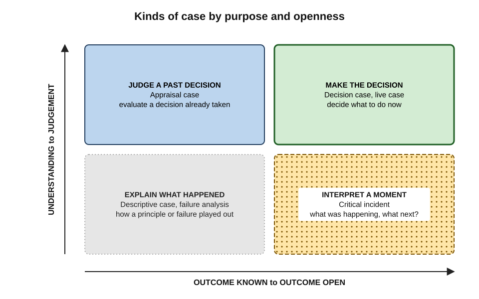
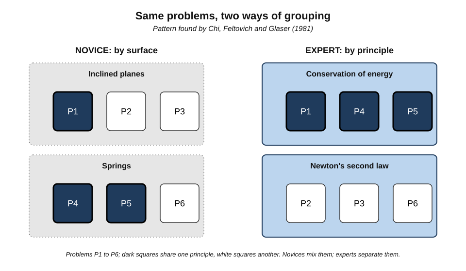
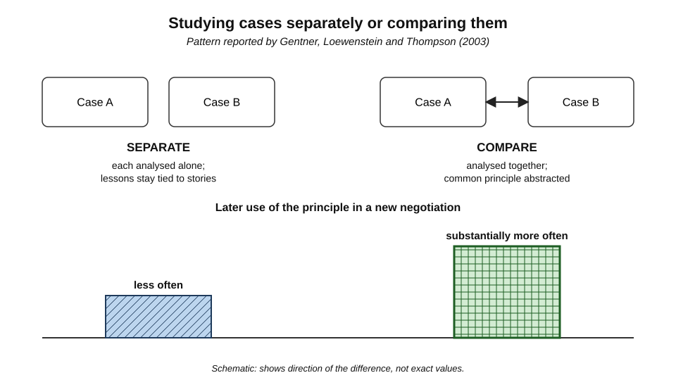
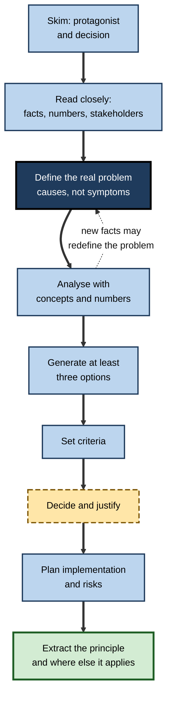
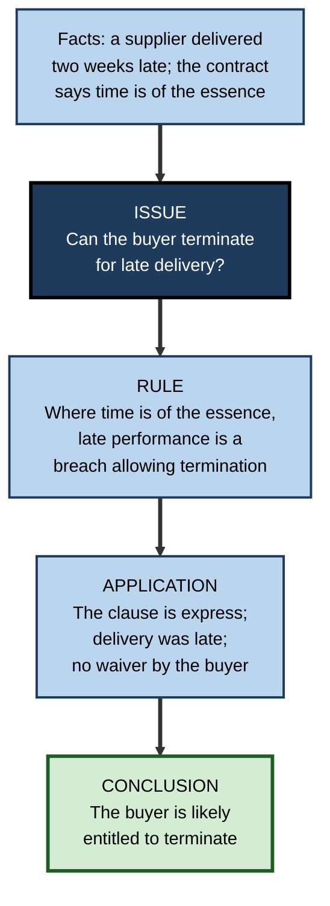
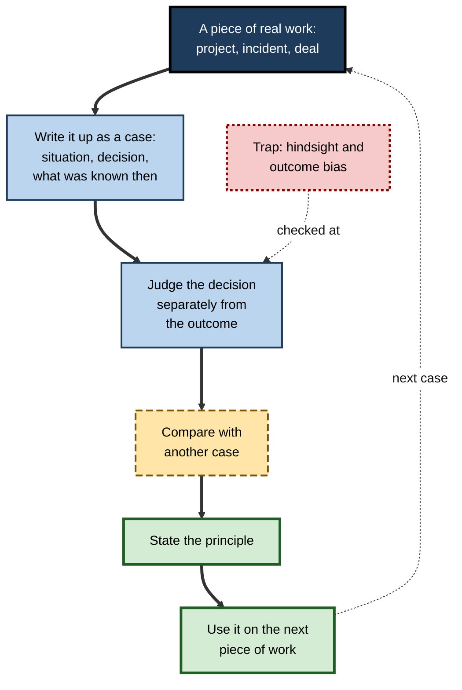

# A.10. Case Studies for Applied Learning

A management student reads twenty pages about a mid-sized airline whose chief executive must decide, by Monday, whether to buy a rival. The case gives incomplete data, conflicting advice from directors and a union threatening action. In class, eighty students argue about what she should do. Nobody will ever know the "right" answer — but everyone leaves having practised the thing the profession actually demands: **deciding well under uncertainty, with real constraints, and defending the decision**.

> **Definition — Case study (for learning):** a detailed account of a real or realistic situation — typically involving a problem, decision or outcome — used so that learners can analyse it, apply knowledge to it and draw transferable lessons.

> **Definition — Case method:** a teaching approach built around the discussion of cases, in which learners prepare individually, analyse in groups and debate in class, with the instructor guiding rather than lecturing.

**Why it matters**

- Professional knowledge is used **in situations**, not in chapters; cases supply situations.
- Cases build **judgement**: weighing incomplete evidence, competing interests and trade-offs.
- Experts reason largely from **remembered cases**; studying cases builds that library deliberately.
- The case method is central to law, business and medical education, and to how organisations learn from incidents and projects.

---

## Origins of the Case Method

- **Law — Christopher Columbus Langdell, Harvard Law School (1870s):**
  - replaced lectures on legal treatises with the study of **appellate court decisions**;
  - students derived legal principles from cases through questioning in class — the origin of the "Socratic method" of law schools.
- **Business — Harvard Business School (1920s):**
  - under Dean **Wallace Donham**, the school adopted business cases as its main teaching material;
  - unlike legal cases, business cases ended **before** the decision, asking students what they would do.
- **Medicine — clinical case presentations:**
  - case reports, ward rounds and grand rounds have long taught clinicians by analysing individual patients.
- **Discussion teaching — C. Roland Christensen (Harvard, from the 1950s onward)** developed the craft of leading case discussions and wrote extensively on it.
- **Today** — case collections and clearing houses supply many thousands of cases for business, public policy, engineering ethics, nursing and other fields.

---

## Kinds of Case

| Type | What the learner does | Typical question | Example |
|---|---|---|---|
| **Decision (dilemma) case** | Decides what a protagonist should do | "What should she do, and why?" | Whether to acquire a rival airline |
| **Appraisal case** | Evaluates a decision already taken | "Was this the right call?" | Reviewing a bank's decision to exit a market |
| **Descriptive (illustrative) case** | Analyses how a principle played out | "What does this show about…?" | How a hospital implemented a safety checklist |
| **Critical incident** | Analyses a short, pivotal event | "What happened here, and what would you have done?" | A tense two-minute exchange with an angry client |
| **Failure analysis** | Reconstructs causes of a failure | "Why did it fail, and how could it have been prevented?" | A bridge collapse; a failed software launch |
| **Live case** | Works on a current, unresolved situation with the organisation involved | "What do you recommend to us now?" | A start-up presents its pricing problem to a class |

**Figure 1.** Cases arranged by purpose and by how open their outcome is.

> **Key point:** the type of case decides the type of thinking. **Decision cases** build judgement; **illustrative cases** build understanding of principles; **failure cases** build diagnostic skill. A programme needs a mix.

---

## How Cases Produce Transfer

### Surface and structure

**Study card — Chi, Feltovich and Glaser (1981)**

- **Design:** physics novices and experts sorted textbook mechanics problems into groups of similar problems and explained their groupings.
- **Results:**
  - **novices** grouped by **surface features** — "these all involve inclined planes", "these have springs";
  - **experts** grouped by **underlying principles** — "these are all conservation of energy".
- **Conclusion:** expertise consists partly in seeing the **deep structure** of situations; novices see the surface.

> **Definition — Structural features:** the underlying principles or causal relations that determine how a situation works and what solves it.

> **Definition — Surface features:** the specific, visible details of a situation — industry, names, objects — that do not determine its solution.

**Figure 2.** Novices group cases by surface features; experts group them by underlying principles.

### The transfer problem

**Study card — Gick and Holyoak (1980, 1983)**

- **Design:** participants tried to solve Karl Duncker's "radiation problem": how to destroy a tumour with rays that would also destroy healthy tissue at full strength.
  - Beforehand, some read a story about a general who captured a fortress by splitting his army into small groups converging from all sides — an **analogue** with the same solution structure.
- **Results:**
  - few participants **spontaneously** used the story to solve the radiation problem;
  - when given a **hint** to use the story, most solved it;
  - in later experiments, participants who read **two** analogous stories and **compared** them were much more likely to transfer the solution spontaneously.
- **Conclusion:** people often fail to apply a relevant case unless prompted; **comparing cases** helps them extract the general principle — a **schema** — that transfers.

### Analogical encoding

**Study card — Gentner, Loewenstein and Thompson (2003)**

- **Design:** management students and professionals studied two negotiation cases illustrating the same principle (**contingent contracts** — resolving disagreements about the future by making terms depend on what happens).
  - **Separate** condition — read and analysed each case on its own.
  - **Compare** condition — analysed the two cases **together**, describing what they had in common.
- **Results:** those who compared the cases were **substantially more likely** to use a contingent contract in a later face-to-face negotiation, and wrote better descriptions of the principle.
- **Conclusion:** comparison during learning — **analogical encoding** — produces more transferable knowledge than studying cases one at a time.

**Figure 3.** Studying cases separately and comparing them, and the effect on later use of the principle.

> **Definition — Analogical encoding:** learning a principle by comparing two or more cases that share it, so that their common structure is abstracted from their differing surfaces.

> **Remember:** **one case teaches a story; two compared cases teach a principle.** Always ask, "What does this case have in common with another I know?"

### Building a case library

- **Janet Kolodner's case-based reasoning (1990s)** — experts solve new problems by **retrieving** similar past cases and **adapting** their solutions.
- **Gary Klein's recognition-primed decision model** — experienced firefighters, nurses and commanders recognise situations as instances of familiar types and act on that recognition.
- Studying cases deliberately builds a **library of patterns** that experience would otherwise supply slowly and unevenly.

---

## Analysing a Case

### A general procedure

1. **Skim** — read the opening and closing paragraphs and the exhibits; identify the protagonist and what must be decided.
2. **Read closely** — mark facts, numbers, constraints and stakeholders' positions.
3. **Define the problem** — distinguish symptoms from causes; state the real question.
4. **Analyse** — apply relevant concepts and frameworks; do the numbers.
5. **Generate options** — at least three, including "do nothing".
6. **Set criteria** — what makes an option good here: cost, risk, speed, values, feasibility.
7. **Decide and justify** — choose; explain why it beats the alternatives on the criteria.
8. **Plan implementation and risks** — who does what, what could go wrong, what would change the decision.
9. **Extract the lesson** — what principle does the case teach, and where else would it apply?

**Figure 4.** A procedure for analysing a decision case.

> **Mnemonic — "PROBLEM-SOLVED":** **P**rotagonist, **R**eal problem, **O**ptions, **B**asis for choosing (criteria), **L**ead recommendation, **E**xecution plan, **M**oral (the transferable lesson).

### Worked example (illustrative): a decision matrix for a case

- **Situation:** a case describes a regional hospital deciding how to reduce emergency-department waiting times. Three options are proposed.
- **Step 1 — criteria and weights** (agreed before scoring):

| Criterion | Weight | A: hire more doctors | B: nurse-led triage stream | C: divert minor cases to an urgent-care clinic |
|---|---|---|---|---|
| Impact on waiting times | 0.4 | 4 | 4 | 3 |
| Cost | 0.3 | 1 | 4 | 3 |
| Speed of implementation | 0.2 | 2 | 4 | 2 |
| Staff acceptance | 0.1 | 5 | 3 | 2 |
| **Weighted score** | | **2.8** | **3.9** | **2.7** |

*Illustrative figures.*

> **Formula — Weighted score:** Σ (weight × score). *Option B:* 0.4×4 + 0.3×4 + 0.2×4 + 0.1×3 = 1.6 + 1.2 + 0.8 + 0.3 = **3.9**.

- **Step 2 — test the decision:** would B still win if cost mattered less (weight 0.1) and impact more (0.6)? Recalculating: 0.6×4 + 0.1×4 + 0.2×4 + 0.1×3 = 3.9 for B and 0.6×4 + 0.1×1 + 0.2×2 + 0.1×5 = 3.4 for A — B still wins; the conclusion is **robust**.
- **Step 3 — implementation and risks:** nurse training, clinical governance for the triage protocol, monitoring of missed serious cases.
- **Step 4 — principle:** in capacity problems, **redesigning flow** often beats **adding capacity**; the same logic applies to call centres and software support queues.

> **Watch out:** a decision matrix organises judgement; it does not replace it. Weights and scores are themselves judgements — testing whether the decision survives reasonable changes (sensitivity analysis) matters more than the precise total.

### Professional analysis formats

- **IRAC** — the standard structure for legal problem analysis:
  - **I**ssue — what legal question arises?
  - **R**ule — what law governs it?
  - **A**pplication — how does the rule apply to these facts?
  - **C**onclusion — what is the likely outcome?
- **SOAP** — the clinical note structure: **S**ubjective (patient's account), **O**bjective (examination and tests), **A**ssessment (diagnosis), **P**lan.
- **Root-cause analysis** — in engineering and safety: timeline, causal factors, root causes, corrective actions.

**Figure 5.** IRAC analysis of a contract case.

---

## Leading Case Discussions

- **Preparation is non-negotiable** — learners read and analyse individually, then often in a small study group, before class.
- **Open with a decision or a vote** — "Should she buy the rival? Hands up." — so that everyone commits.
- **Plan the discussion in blocks** — diagnosis, options, decision, implementation, lessons — with a board plan recording contributions.
- **Probe rather than tell** — "What in the case supports that?" "Who disagrees?" "What would have to be true for that to work?"
- **Use role-play** — learners argue as the union leader, the chief financial officer, the regulator.
- **Close with generalisation** — the instructor or the class articulates the principle and compares it with other cases.

| | Weak case discussion | Strong case discussion |
|---|---|---|
| Preparation | Learners skim in class | Individual analysis and group preparation beforehand |
| Instructor role | Summarises the case, then gives the answer | Questions, records, connects, provokes disagreement |
| Participation | A few confident voices | Wide, prompted by votes, cold calls and small groups |
| Use of evidence | Opinion and anecdote | Claims tied to facts and numbers in the case |
| Ending | "Interesting discussion" | Explicit principle, compared with other cases |

---

## Limits and Biases of Learning From Cases

### What the evidence says

- **Engagement and satisfaction** with case methods are consistently high.
- **Rigorous evidence on learning outcomes is limited** — few controlled comparisons exist in business and law education.
- **In medicine**, a systematic review of case-based learning by **Jill Thistlethwaite and colleagues (2012)** found that learners and teachers enjoyed it and believed it improved learning, but evidence of effects on measured outcomes was mixed and often weak in design.
- **The strongest evidence** concerns specific mechanisms — **comparison** of cases and **prompting** to apply them — rather than the case method as a whole.

> **Watch out:** the management scholar **Henry Mintzberg** argued that the case method can train people to make confident decisions about organisations they have known for an evening, from twenty pages of selected facts. Cases simplify; real decisions involve far more context, ambiguity and politics than any case can carry.

### Biases that cases invite

- **Hindsight bias** — knowing the outcome makes it seem predictable.
  - Remedy: analyse decision cases **before** learning the outcome.
- **Outcome bias** — judging a decision by its result rather than by its quality given what was known (**Jonathan Baron and John Hershey, 1988**).
  - Remedy: ask "Was it a good decision given the information available?" separately from "Did it turn out well?"
- **Survivorship bias** — studying only successful firms or famous failures.
  - Remedy: include ordinary cases and counter-examples.
- **Narrative fallacy** — a coherent story feels like an explanation even when causes are uncertain.
  - Remedy: list alternative explanations and what evidence would distinguish them.
- **Single-case generalisation** — drawing a rule from one story.
  - Remedy: compare at least two cases before generalising.

**Figure 6.** Learning from one's own work as a cycle of cases.

---

## Cases in Professional Life

- **Learning from one's own cases** — writing up significant projects, deals or incidents in case form, recording **what was known at the time**, preserves lessons that memory distorts.
- **Decision journals** — recording a decision, the reasoning, the expected outcome and its probability before the result is known; reviewing later separates judgement from luck.
- **Incident and accident reports** — aviation investigation reports are among the richest case libraries in any profession, studied by pilots worldwide.
- **Engineering failure cases** — the Tacoma Narrows Bridge collapse (1940) and the Hyatt Regency walkway collapse in Kansas City (1981) are standard teaching cases in structural engineering and engineering ethics.
- **Consulting and law firms** — internal "case libraries" of past engagements and matters are reused to train and to start new work.
- **AI-generated cases and simulated stakeholders** — AI can produce realistic, varied cases on demand and play the roles of clients or regulators in discussion practice; the analysis, comparison and judgement must remain the learner's.

> **In practice:** a strong habit is to keep a short file of **"cases I learned from"** — one page each, with the situation, the decision, what was known, what happened, and the principle — and to reread related cases before facing a similar decision.

### Case study (illustrative): building judgement with paired cases in a consulting firm

- **Situation:** a consulting firm's new associates attended a week of training built around single, long business cases, one per day.
- **Problem:** associates could discuss each case fluently but, on client work months later, rarely recognised that a client's situation resembled one they had studied.
- **Diagnosis:**
  - each case was studied **alone**, so its lesson stayed attached to its surface — "the airline case", "the retailer case";
  - outcomes were revealed early, inviting **hindsight bias**;
  - nobody articulated the **principle** or asked where else it would apply.
- **Actions:**
  1. Replaced single long cases with **pairs of short cases** from different industries sharing one structural lesson — for example, a hospital and a software company both suffering from capacity bottlenecks.
  2. Associates first analysed each case individually, then wrote **what the two cases had in common** before discussion.
  3. Outcomes were revealed only **after** decisions were made and justified.
  4. Each session ended with associates writing the principle and **one current client situation** where it might apply.
  5. Three months later, a short follow-up asked associates to match new mini-cases to principles.
- **Result:** in the follow-up, associates who had trained with paired cases matched new situations to principles far more often than an earlier cohort trained with single cases; managers reported more frequent use of the principles in client problem-solving.
- **Side effects / caveats:** some associates missed the "rich story" of long cases; the firm kept one long integrative case at the end of the week. The comparison between cohorts was not randomised.
- **Lesson:** the improvement came from **comparison, delayed outcomes and explicit principles** — the mechanisms research identifies — not from more or longer cases.

---

## Open Questions

- **How effective is the case method itself?**
  - Its components are well supported; controlled evidence on whole case-based curricula is scarce.
- **What is the right mix of case types?**
  - How much time should go to decision, illustrative and failure cases at each career stage is unstudied.
- **How long should cases be?**
  - Long cases offer realism; short paired cases may transfer better. The trade-off has not been tested systematically.
- **Can AI-generated cases replace real ones?**
  - Synthetic cases are cheap and varied but may lack the messiness and authenticity that make real cases instructive.
- **How can organisations capture their own cases honestly?**
  - Internal case writing is vulnerable to blame-avoidance and to flattering narratives.

---

## Summary

- A **case study** is a detailed account of a real or realistic situation used for analysis and application; the **case method** builds learning around individual preparation and guided discussion.
- Origins: **Langdell** at Harvard Law (1870s); **Harvard Business School** under Donham (1920s), with cases ending before the decision; clinical case presentations; Christensen's discussion teaching.
- Types: **decision, appraisal, descriptive, critical incident, failure analysis, live** — each builds a different kind of thinking.
- Novices see **surface features**, experts **structure** (**Chi, Feltovich and Glaser, 1981**); people rarely transfer a single case spontaneously (**Gick and Holyoak**); **comparing cases** — **analogical encoding** — improves transfer (**Gentner, Loewenstein and Thompson, 2003**). One case teaches a story; two compared cases teach a principle.
- Experts reason from **case libraries** (Kolodner; Klein).
- Analyse cases by: protagonist, real problem, options, criteria, decision, implementation, principle (**PROBLEM-SOLVED**); use **decision matrices** with sensitivity checks; professional formats include **IRAC**, **SOAP** and root-cause analysis.
- Good discussions require preparation, commitment, probing, role-play and explicit generalisation.
- Limits: thin outcome evidence; oversimplification; **hindsight, outcome and survivorship bias**, narrative fallacy and single-case generalisation — each with remedies.
- At work: write up one's own cases, keep decision journals, study incident reports and use AI cases for practice while keeping the judgement.

---

## Self-Check

1. Define a case study for learning and the case method.
2. How did the Harvard Business School case differ from Langdell's legal cases?
3. Distinguish decision, appraisal, illustrative and failure cases, and state what each builds.
4. What did Chi, Feltovich and Glaser (1981) find, and what does it imply for learning from cases?
5. Describe the Gick and Holyoak radiation-problem studies and their main lessons.
6. What is analogical encoding, and what did Gentner, Loewenstein and Thompson (2003) show?
7. List the steps of a general case-analysis procedure.
8. Calculate the weighted score of an option scoring 3, 5, 2 and 4 on criteria weighted 0.4, 0.3, 0.2 and 0.1.
9. Why is sensitivity analysis important when using a decision matrix?
10. Apply IRAC to: "An employee posted confidential client data on social media; can the firm dismiss her?"
11. Explain hindsight bias and outcome bias, with a remedy for each.
12. What is Mintzberg's criticism of the case method, and how might a programme address it?
13. A training team uses one long case per day and reveals outcomes at the start. Propose three evidence-based changes.
14. Write a one-page outline for turning a recent project of one's own into a learning case.

### Answer Key

1. A case study is a detailed account of a real or realistic situation used to analyse, apply knowledge and draw transferable lessons. The case method is teaching built around case discussion — individual preparation, group analysis and guided class debate.
2. Langdell's legal cases were decided appellate judgments from which students derived principles; HBS cases ended before the decision and asked students what they would do.
3. Decision cases (what should be done) build judgement; appraisal cases (was it right) build evaluation; illustrative cases (how a principle played out) build understanding; failure cases (why it failed) build diagnostic skill.
4. Novices sorted physics problems by surface features, experts by underlying principles. Learning from cases must help learners see structure — for instance by comparison and explicit principles.
5. Participants rarely used a previously read analogous story (the fortress) to solve the radiation problem unless hinted; comparing two analogues improved spontaneous transfer. Lessons: transfer is not automatic; prompting and comparison help abstract a schema.
6. Learning a principle by comparing cases that share it. Comparing two negotiation cases made learners substantially more likely to use contingent contracts in a later negotiation than analysing the cases separately.
7. Skim; read closely; define the real problem; analyse; generate options; set criteria; decide and justify; plan implementation and risks; extract the principle.
8. 0.4×3 + 0.3×5 + 0.2×2 + 0.1×4 = 1.2 + 1.5 + 0.4 + 0.4 = 3.5.
9. Weights and scores are judgements; checking whether the choice survives reasonable changes shows whether the conclusion is robust or an artefact of arbitrary numbers.
10. Issue: is posting confidential data misconduct justifying dismissal? Rule: serious breaches of confidentiality or policy may amount to gross misconduct, subject to fair procedure. Application: the data were confidential; posting breaches policy and duty; the firm must investigate and follow a fair process. Conclusion: dismissal is likely justifiable if the facts are confirmed and procedure is fair (subject to the applicable jurisdiction's law).
11. Hindsight bias: outcomes seem predictable once known — remedy: decide before seeing the outcome. Outcome bias: judging decisions by results — remedy: evaluate the decision on information available at the time, separately from the result.
12. Cases train confident decisions from selected facts about organisations learners barely know. Remedies: include ambiguity and missing information, require stating what further information would be sought, combine cases with live projects and real stakeholder contact.
13. Use pairs of short cases sharing a principle and ask for comparison; reveal outcomes only after decisions are justified; end each session with an explicit principle and an application to current work.
14. Situation and context; the decision(s) faced and options considered; what was known and unknown at the time; the reasoning and criteria used; what happened; an evaluation of decision quality separate from outcome; comparison with another case; the principle and where it applies next.

---

## Glossary

| Term | Meaning |
|---|---|
| Analogical encoding | Learning a principle by comparing cases that share it. |
| Appraisal case | A case asking learners to evaluate a decision already taken. |
| Case-based reasoning | Solving new problems by retrieving and adapting similar past cases. |
| Case method | Teaching built around individual preparation and guided discussion of cases. |
| Case study (for learning) | A detailed account of a situation used for analysis and application. |
| Critical incident | A short, pivotal event used as a case. |
| Decision case | A case ending before a decision, asking what should be done. |
| Decision journal | A record of decisions, reasoning and expectations made before outcomes are known. |
| Decision matrix | A table scoring options against weighted criteria. |
| Hindsight bias | Seeing outcomes as more predictable once they are known. |
| IRAC | Issue, Rule, Application, Conclusion — a legal analysis structure. |
| Live case | A current, unresolved situation analysed with the organisation involved. |
| Narrative fallacy | Mistaking a coherent story for a reliable causal explanation. |
| Outcome bias | Judging a decision by its result rather than its quality. |
| Schema | A general mental structure capturing what similar situations have in common. |
| Sensitivity analysis | Testing whether a conclusion survives changes in assumptions. |
| SOAP | Subjective, Objective, Assessment, Plan — a clinical note structure. |
| Structural features | The underlying principles that determine how a situation works. |
| Surface features | Visible details of a situation that do not determine its solution. |
| Survivorship bias | Drawing conclusions only from cases that survived or became famous. |
