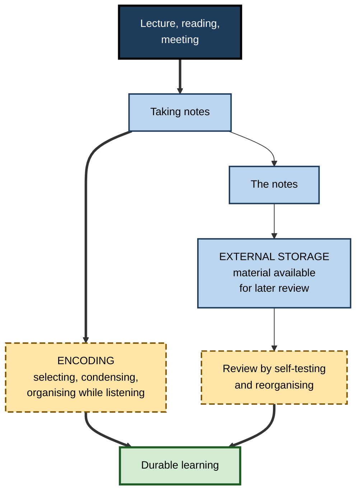
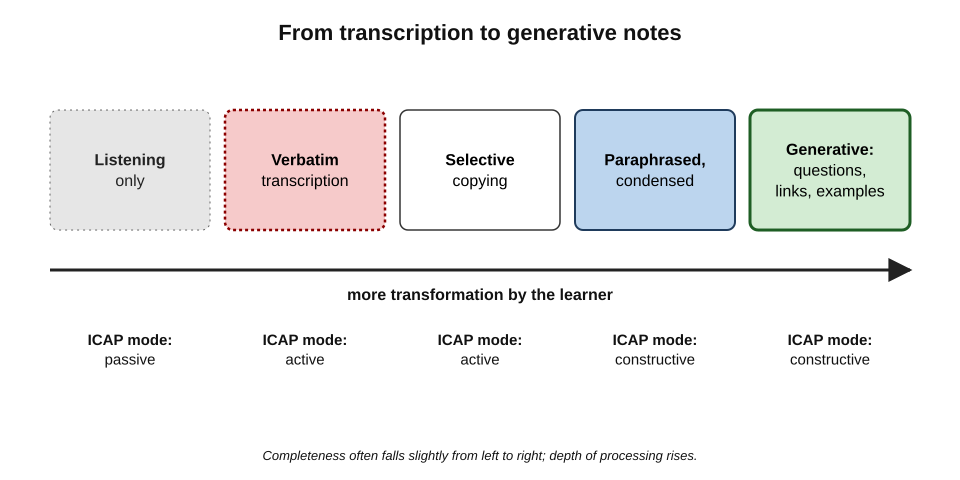
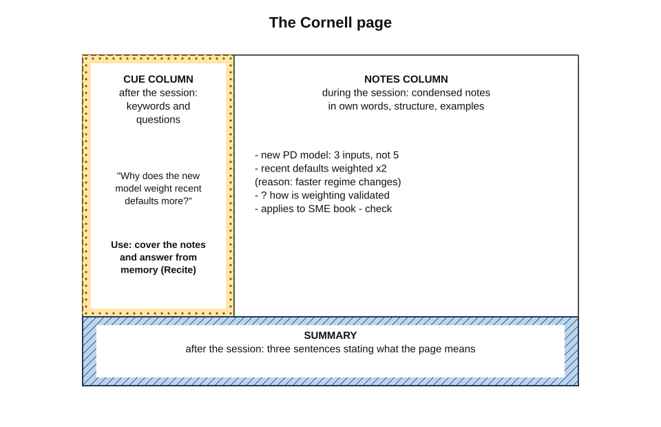
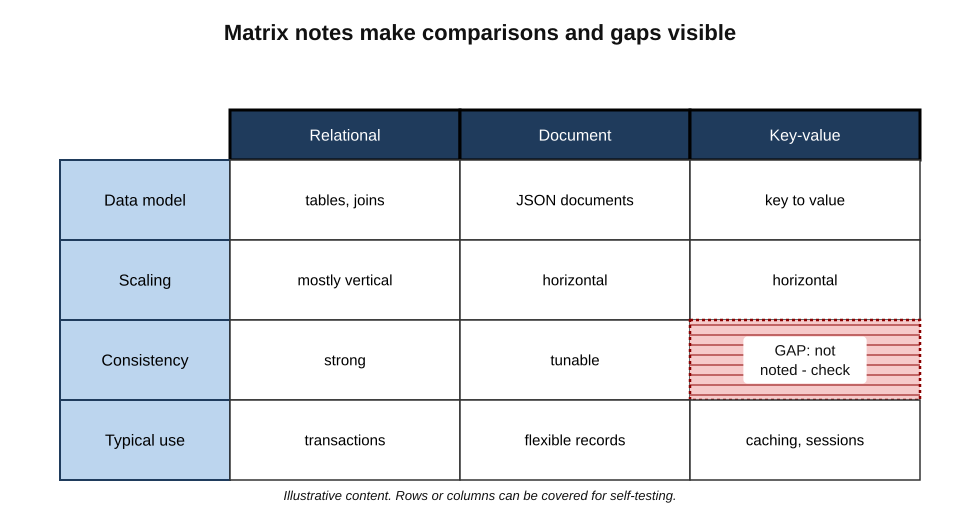
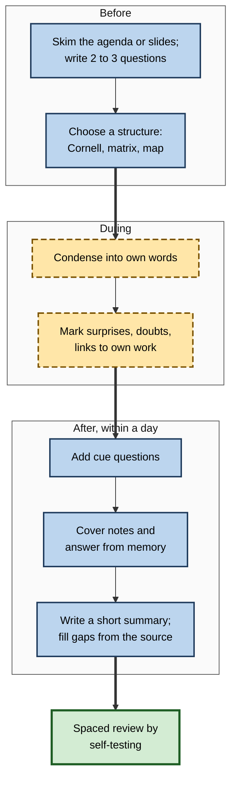

# A.11. Active Note-Taking During Study

Two analysts attend the same two-hour training on a new risk model. One types almost every word the trainer says and leaves with eleven pages. The other writes a page and a half: a few headings, the three ideas she found surprising, two questions and a small table comparing the old model with the new.

A month later the first analyst rereads eleven pages and recognises everything; the second covers her notes, answers her own questions and finds she still understands the model. **Notes can record learning or create it** — and most people take the kind that only records.

> **Definition — Active note-taking:** taking notes in a way that requires the learner to select, condense, organise and connect information in their own words, and later to use the notes for self-testing and review — rather than transcribing what is presented.

**Why it matters**

- Note-taking is the most common study activity in lectures, training, reading and meetings.
- How notes are taken changes what is **encoded** at the time; how they are used changes what is **retained**.
- Verbatim transcription — by hand, keyboard or now automatic transcription — can produce complete notes and little learning.
- Professionals' notes on meetings, interviews and research are the raw material of their later work.

---

## The Two Functions of Notes

**Francis Di Vesta and G. Susan Gray (1972)** distinguished two ways notes can help, a distinction developed by **Kenneth Kiewra** and others in later reviews.

- **The encoding function** — the act of taking notes improves learning **at the time**.
  - Requires attention, selection and, if done well, transformation into one's own words and structures.
- **The external-storage function** — the notes, once taken, provide material to **review** later.
  - Their value depends on their completeness, accuracy and organisation, and on **how** they are reviewed.

**Figure 1.** The encoding and external-storage functions of notes.

### What the evidence shows

- **Taking notes helps modestly.** **Kobayashi (2005)**, a meta-analysis of studies comparing note-taking with listening only, found a **small to modest** average benefit of note-taking itself.
- **Reviewing notes adds more.** **Kobayashi (2006)** found that **reviewing** notes produced further benefits, and that the combination of taking and reviewing was more effective than either alone.
- **Most learners' notes are incomplete.** Studies of lecture notes have repeatedly found that students record only a **fraction** of the important ideas presented, and that the more ideas notes contain, the better later performance tends to be.

> **Key point:** both functions matter. Good notes are taken in a way that **makes the learner think** and kept in a form that **supports self-testing later**.

---

## Verbatim and Generative Notes

### Two ways to fill a page

> **Definition — Verbatim notes:** notes that copy the speaker's or author's words as closely as possible.

> **Definition — Generative notes:** notes in which the learner condenses, paraphrases, organises, questions and connects ideas, producing content that is not a copy of the source.

| | Verbatim notes | Generative notes |
|---|---|---|
| What the learner does | Transcribes | Selects, condenses, paraphrases, organises, questions |
| ICAP mode | Active (manipulating) | Constructive |
| Completeness | Often high | Often lower, but focused |
| Processing during the session | Shallow — attention on keeping up | Deep — attention on meaning |
| Value for later review | Good as a record | Good for self-testing and understanding |
| Typical tool | Fast typing; automatic transcription | Pen, structured templates, or disciplined typing |

**Figure 2.** A spectrum of note-taking, from transcription to generative notes.

### The laptop debate

**Study card — Mueller and Oppenheimer (2014)**

- **Design:** students watched talks and took notes either on laptops or by hand, then answered factual and conceptual questions.
- **Results:**
  - laptop notes contained **more words** and more **verbatim overlap** with the talk;
  - laptop note-takers performed **worse on conceptual questions** in the original experiments;
  - instructing laptop users not to take verbatim notes did not eliminate the verbatim tendency.
- **Conclusion (original):** "the pen is mightier than the keyboard" — slower handwriting forces condensation and processing.

- **Replications:**
  - **Morehead, Dunlosky and Rawson (2019)** repeated the study and found **no reliable difference** between handwriting and laptop groups in test performance.
  - **Urry and colleagues (2021)**, a direct replication with mini meta-analyses, found that laptop users again took **more, and more verbatim**, notes — but there was **no significant effect** of the medium on memory or conceptual understanding.

> **Watch out:** the popular claim that handwriting is always better than typing is **not well supported**. The robust finding is narrower: fast typing **invites verbatim transcription**. What matters is whether the learner **transforms** the material — which a disciplined typist can do and a hurried handwriter may not.

- **Distraction is a separate problem.** **Faria Sana, Tina Weston and Nicholas Cepeda (2013)** found that students who multitasked on laptops during a lecture learned less — and so did **nearby students** who could see their screens.

| Question | What the evidence supports |
|---|---|
| Do laptop notes contain more verbatim text? | Yes — replicated |
| Is handwriting always better for learning? | No — replications found no reliable difference |
| Does multitasking on a device harm learning? | Yes — for the user and for those nearby |
| Does the medium matter less than the method? | Yes — transformation and later review matter most |

---

## Note-Taking Methods

### The Cornell system

- **Origin:** **Walter Pauk** at Cornell University, described in *How to Study in College* (1962).
- **Page layout:**
  - **notes column** (right, wide) — main notes during the session;
  - **cue column** (left, narrow) — added afterwards: keywords and **questions** that the notes answer;
  - **summary area** (bottom) — a few sentences summarising the page.
- **The five Rs:**
  1. **Record** — take condensed notes in the main column.
  2. **Reduce** — after the session, write cues and questions in the left column.
  3. **Recite** — cover the main column and answer the cue questions from memory.
  4. **Reflect** — consider how the ideas connect with others and with experience.
  5. **Review** — briefly repeat the recitation over following days.

**Figure 3.** The Cornell note page and how each part is used.

> **Key point:** the Cornell layout's value lies less in the page design than in what it **forces afterwards**: generating questions, answering them from memory and summarising. Controlled evidence for the layout itself is limited; the processes it builds in are well supported.

> **Mnemonic — "The five Rs":** Record, Reduce, Recite, Reflect, Review.

### Outline notes

- Hierarchical headings, sub-points and indentation.
- **Strengths:** shows structure; fast when the source is well organised.
- **Weaknesses:** struggles with comparisons and cross-links; easily becomes a transcription of the speaker's slide structure.

### Matrix notes

- A **table** with the items being compared as rows (or columns) and their attributes as columns (or rows).
- **Kiewra and colleagues (1991)** found that students using **matrix** notes learned relationships among ideas better than students using linear or outline notes.
- Especially suitable for material that compares several things on the same dimensions — products, theories, drugs, legal tests, frameworks.

**Figure 4.** A matrix note comparing three cloud database options.

### Guided notes

- **Instructor-prepared handouts** with the structure and key prompts given and blanks for learners to complete.
- A review by **Moira Konrad, Laurice Joseph and Elisa Eveleigh (2009)** found guided notes generally improved the accuracy of learners' notes and their quiz performance.
- **Design matters:** blanks should require meaning (a principle, an example, a reason), not just a missing word.

### Visual and connected notes

- **Concept maps and sketchnotes** — diagrams with words; good for relationships and processes.
- **Linked notes (the "slip-box")** — the sociologist **Niklas Luhmann** kept a card index of tens of thousands of notes, each a single idea **in his own words**, linked by reference numbers to related notes; he credited it with much of his prolific output.
  - Principle worth borrowing: write each important idea as a short note in one's own words and **link** it to related ideas.

| Method | Best for | Main strength | Main risk |
|---|---|---|---|
| Cornell | Lectures, reading, training | Built-in self-testing and summary | Skipping the after-session steps |
| Outline | Well-structured presentations | Clear hierarchy | Copying slide structure |
| Matrix | Comparisons across shared attributes | Shows relationships | Unsuitable for narrative material |
| Guided notes | Novices; complex content | Structure plus completion | Trivial blanks |
| Concept map or sketchnote | Processes, causes, systems | Explicit relationships | Time pressure in fast sessions |
| Linked single-idea notes | Long-term knowledge building | Integration across sources | Becoming a collection hobby |

---

## Taking Notes That Teach

### Before, during and after

**Figure 5.** An active note-taking workflow before, during and after a session.

**During the session**

- **Condense** — write ideas, not sentences; use abbreviations and symbols consistently.
- **Paraphrase** — own words wherever possible; quote only exact definitions or numbers that must be precise.
- **Capture structure** — headings, arrows, numbered steps, comparison tables.
- **Mark one's own thinking** — a symbol for "surprising", "disagree", "unclear", "applies to my project".
- **Write examples** — especially examples from one's own work.
- **Leave space** — for additions and cue questions afterwards.

**After the session**

- **Within a day**, add cue questions and test oneself on them.
- **Fill gaps** from slides, recordings or colleagues — after attempting recall, not before.
- **Summarise** each page or session in three sentences.
- **Connect** — add links to earlier notes or other sources.

> **Remember:** **condense during, question after, test later.**

> **Watch out:** "I'll get the slides afterwards" often becomes a reason to take no notes and do no processing. Slides are external storage; they do not do the encoding.

### Worked example: linear and matrix notes from the same lecture

- **Situation:** a pharmacology lecture compares three anticoagulant drugs on mechanism, monitoring, reversal agent and main risk.
- **Linear notes (excerpt):** "Warfarin — vit K antagonist — INR monitoring — reversed with vit K… Drug 2 — factor Xa inhibitor — no routine monitoring… Drug 3…"
- **Matrix notes:**

| | Warfarin | Factor Xa inhibitor | Direct thrombin inhibitor |
|---|---|---|---|
| Mechanism | Vitamin K antagonist | Blocks factor Xa | Blocks thrombin |
| Routine monitoring | Yes (INR) | No | No |
| Reversal | Vitamin K; clotting factors | Specific reversal agent | Specific reversal agent |
| Main practical issue | Many food and drug interactions | Dosing in kidney impairment | Dosing in kidney impairment |

- **Step 1 — compare:** the matrix makes **similarities** (no routine monitoring for the newer drugs) and **differences** (interactions) immediately visible.
- **Step 2 — test:** covering one column and recalling it, or covering a row ("monitoring") and recalling across drugs, are two different retrieval exercises.
- **Step 3 — gap detection:** an empty cell shows exactly what was missed.
- **Conclusion:** the matrix required **organising by attribute during the lecture** — a generative act — and produced a better tool for self-testing.

> **Watch out:** the content of the table is a simplified illustration of note structure, not clinical guidance.

---

## Notes in Professional Work

### Meetings

- **Most meeting notes record discussion; useful ones record outcomes.**
- **A practical structure:**
  - **decisions** — what was agreed;
  - **actions** — who will do what by when;
  - **open questions** — what remains unresolved and who owns it;
  - **insights** — anything learned that changes one's understanding.
- **Write the summary before leaving** — a two-minute closed-book summary immediately after a meeting both encodes it and catches misunderstandings while colleagues are still available.

### Interviews, research and client work

- **Separate observation from interpretation** — e.g. "Client said budget is fixed" versus "I think the real constraint is the CFO's approval".
- **Record exact words** only where they matter — quotations for reports, precise commitments, legal statements.
- **Tag** notes by theme for later synthesis.

### Automatic transcription and AI summaries

| | Automatic transcript or AI summary | Own active notes |
|---|---|---|
| Completeness | High | Selective |
| Encoding by the learner | None | Substantial |
| Attention during the session | Can drift — "it's being recorded" | Engaged — the learner must process |
| Errors | Mis-transcriptions; summaries may omit or invent | Gaps and misunderstandings — visible on review |
| Best use | External storage and checking | Understanding, memory, judgement |

> **In practice:** use transcripts and AI summaries as **external storage** — a reference to check against — while still taking brief notes of one's own. After the meeting, write a short summary from memory, then compare it with the transcript or AI summary to catch what was missed.

### Case study: rebuilding note-taking in a graduate programme

- **Situation:** an engineering consultancy's graduate programme ran weekly technical lectures; graduates typed notes on laptops and received slides afterwards.
- **Problem:** in quarterly technical assessments, graduates performed poorly on applied questions despite near-complete notes; many admitted they rarely reread them.
- **Diagnosis:**
  - notes were largely **verbatim** — encoding was shallow;
  - notes were **never used for self-testing** — external storage was wasted;
  - laptops invited messaging and email during lectures.
- **Actions:**
  1. Lecturers supplied **guided-note templates**: a Cornell layout with headings, key diagrams to complete and two blank comparison matrices.
  2. Laptops were closed during the first 40 minutes; tablets or paper were used for notes.
  3. Each lecture ended with **five minutes** in which graduates wrote cue questions and a three-sentence summary.
  4. The following week's lecture began with a **three-question quiz** drawn from graduates' own cue questions, answered from memory.
  5. Slides were released **after** the quiz.
- **Result:** applied-question scores in the next two quarterly assessments rose noticeably; graduates reported spending less total time on revision because their notes were usable.
- **Side effects / caveats:** some graduates with dyslexia or motor difficulties found handwriting harder; they were given typed templates with the same structure. The comparison was with earlier cohorts, not a randomised control.
- **Lesson:** the improvement came from **transforming during the session and testing afterwards** — not from the medium.

---

## Open Questions

- **What really matters in the handwriting-versus-typing debate?**
  - Replications suggest the medium matters less than strategy; the effect of new tools such as styluses with handwriting recognition is little studied.
- **How should notes be used with automatic transcription?**
  - Whether learners can stay engaged when complete records exist, and which hybrid practices work best, is an open, fast-moving question.
- **Which note formats work best for which material?**
  - Matrix notes for comparisons are well supported; evidence on many popular systems is anecdotal.
- **How much should instructors structure notes?**
  - Guided notes help, but too much structure may reduce learners' own organisation.
- **Do linked personal knowledge bases improve professional learning?**
  - Enthusiasm is high; systematic evidence is scarce.

---

## Summary

- **Active note-taking** selects, condenses, organises and connects in one's own words, then uses notes for self-testing.
- Notes serve two functions: **encoding** (learning while taking them) and **external storage** (material for review) (**Di Vesta and Gray, 1972**; Kiewra). Taking notes helps modestly; **reviewing** adds more (**Kobayashi, 2005, 2006**); most notes are incomplete.
- **Verbatim** notes are active but shallow; **generative** notes are constructive.
- **Mueller and Oppenheimer (2014)** reported handwriting beat laptops on conceptual questions; **replications (Morehead et al., 2019; Urry et al., 2021)** found more verbatim laptop notes but **no reliable learning difference**. Device **multitasking** harms users and neighbours (**Sana et al., 2013**).
- Methods: **Cornell** (record, reduce, recite, reflect, review), outline, **matrix** (best for comparisons — Kiewra et al., 1991), **guided notes**, maps and sketchnotes, **linked single-idea notes** (Luhmann).
- Workflow: questions before; condense and mark during; cue questions, recall, summary and gap-filling after; spaced self-testing later — **condense during, question after, test later**.
- At work: meeting notes record **decisions, actions, open questions, insights**; separate observation from interpretation; use transcripts and AI summaries as **external storage**, not as a substitute for one's own processing.

---

## Self-Check

1. Define active note-taking and distinguish it from transcription.
2. Explain the encoding and external-storage functions of notes.
3. What did Kobayashi's meta-analyses find about taking and reviewing notes?
4. Compare verbatim and generative notes on processing and later usefulness.
5. Summarise Mueller and Oppenheimer (2014) and what later replications found.
6. What did Sana, Weston and Cepeda (2013) show about laptop multitasking?
7. Describe the Cornell layout and the five Rs.
8. When are matrix notes particularly useful, and why?
9. What makes a good blank in guided notes?
10. What principle from Luhmann's slip-box is worth adopting, and what is its risk?
11. Outline a before–during–after workflow for a two-hour training session.
12. A colleague says, "I don't take notes; the meeting is recorded and the AI writes a summary." Evaluate this.
13. Convert these linear notes into a matrix: "Agile — iterative, flexible scope, frequent releases; Waterfall — sequential, fixed scope, single release; Hybrid — sequential planning, iterative build, staged releases."
14. A learner has 30 pages of verbatim lecture notes and an exam in three weeks. Design a plan to turn them into an active learning resource.

### Answer Key

1. Taking notes that require selecting, condensing, organising and connecting in one's own words, then using them for self-testing. Transcription copies the source with little transformation.
2. Encoding: taking notes improves learning at the time through attention and processing. External storage: the notes provide material for later review, whose value depends on quality and on how they are reviewed.
3. Note-taking itself gave a small to modest benefit over listening only; reviewing notes added further benefit; taking and reviewing combined worked best.
4. Verbatim notes involve shallow processing focused on keeping up; they are a good record but weak for understanding. Generative notes require deep processing and are better for self-testing, though sometimes less complete.
5. Laptop notes were longer and more verbatim, and laptop users did worse on conceptual questions. Replications confirmed more verbatim laptop notes but found no reliable difference in learning between media.
6. Students multitasking on laptops during a lecture learned less, and so did nearby students who could see their screens.
7. A wide notes column, a narrow cue column for keywords and questions added afterwards, and a summary area at the bottom. Record, Reduce, Recite, Reflect, Review.
8. When several items are compared on the same attributes; the table forces organisation by attribute and makes similarities, differences and gaps visible, and supports row or column self-testing.
9. One that requires meaning — a principle, reason, example or relationship — rather than a single copied word.
10. Write each important idea as a short note in one's own words and link it to related ideas. Risk: collecting notes becomes an end in itself, without use or review.
11. Before: skim the agenda, write two or three questions, choose a structure. During: condense into own words, capture structure, mark surprises, doubts and applications. After (within a day): add cue questions, answer from memory, summarise, fill gaps from slides; then spaced self-testing.
12. The record and summary provide external storage but no encoding; attention may drift; AI summaries can omit or distort. Better: brief own notes on decisions, actions and insights, and a short closed-book summary after the meeting compared with the AI version.
13. Rows: Agile, Waterfall, Hybrid; columns: process (iterative / sequential / sequential planning with iterative build), scope (flexible / fixed / partly fixed), releases (frequent / single / staged).
14. Week 1: for each lecture, write cue questions and a three-sentence summary; convert comparisons into matrices; draw one concept map per topic from memory. Week 2: self-test with cue questions and blank matrices, re-studying only gaps. Week 3: mixed self-tests across lectures, explaining answers aloud, with a final closed-book summary of each topic.

---

## Glossary

| Term | Meaning |
|---|---|
| Active note-taking | Notes taken by selecting, condensing, organising and connecting, then used for self-testing. |
| Cornell system | A note layout with notes, cue and summary areas, used with the five Rs. |
| Cue column | The narrow column of a Cornell page for keywords and questions. |
| Encoding function | The learning benefit of taking notes at the time. |
| External-storage function | The benefit of having notes available to review later. |
| Five Rs | Record, Reduce, Recite, Reflect, Review. |
| Generative notes | Notes that condense, paraphrase, organise and connect rather than copy. |
| Guided notes | Instructor-prepared notes with structure and blanks for learners to complete. |
| Matrix notes | Notes in a table comparing items across shared attributes. |
| Outline notes | Hierarchical notes with headings and indented sub-points. |
| Sketchnotes | Notes combining words and simple drawings. |
| Slip-box | A collection of linked single-idea notes, as kept by Niklas Luhmann. |
| Verbatim notes | Notes copying the source's words as closely as possible. |
