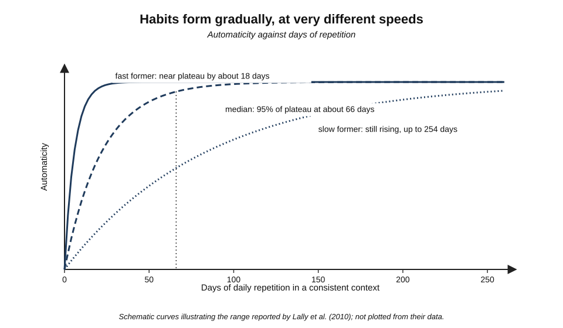
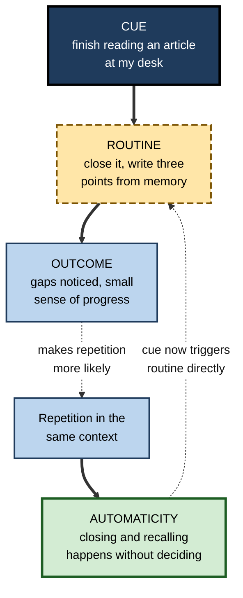
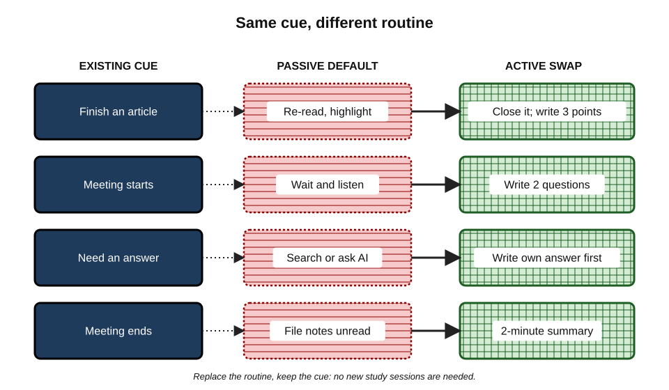
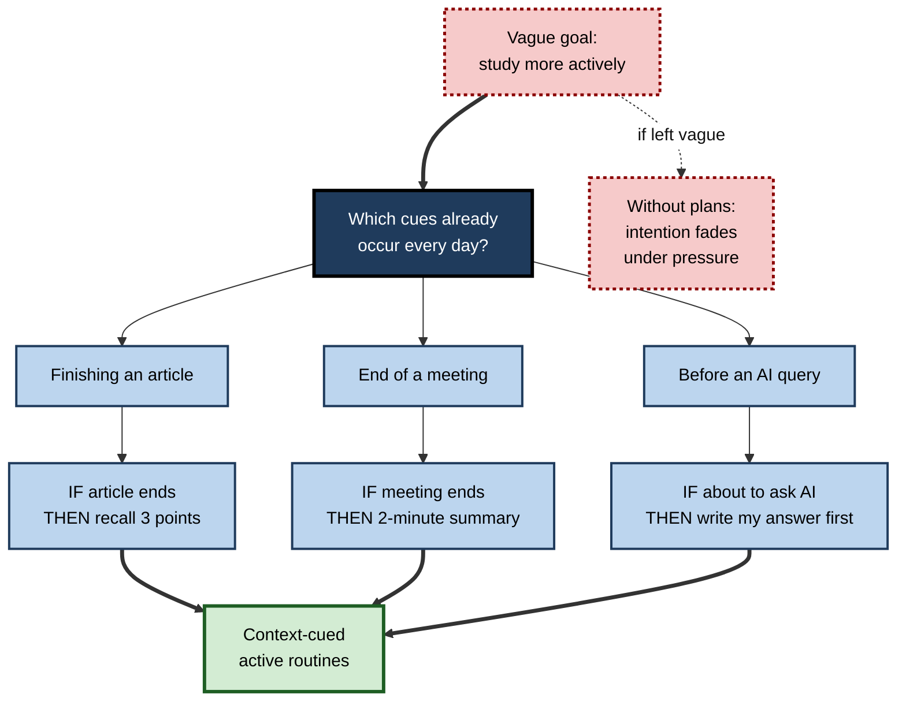
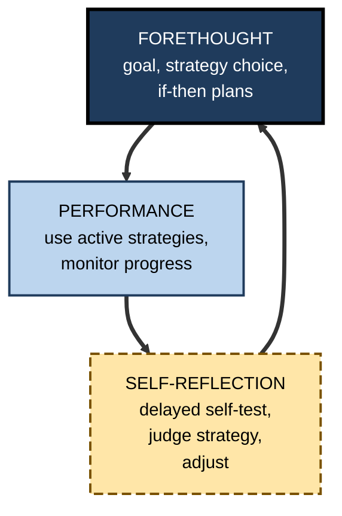
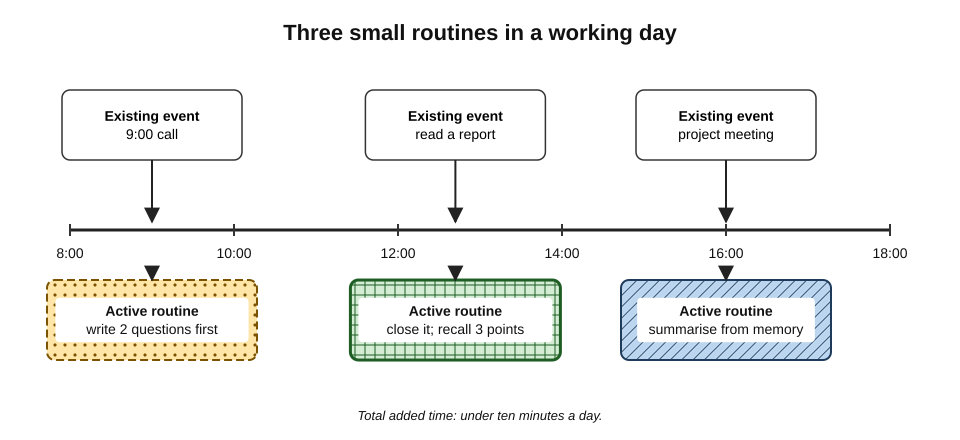

# A.12. Building Active Learning Habits

A software engineer reads about retrieval practice, self-explanation and generation, and is convinced. For two weeks she closes every article and writes down what she remembers. Then a deadline arrives, she slips back to skimming and highlighting, and a month later the new methods are a memory. Knowing which techniques work is the easy part. The hard part is making them **what one does by default**, without deciding afresh each time.

> **Definition — Habit:** a behaviour that is triggered automatically by a context cue, as a result of repeated performance in that context, with little conscious deliberation.

> **Definition — Active learning habit:** an automatic, context-triggered tendency to process material actively — to predict, recall, explain, question or summarise — rather than to receive it passively.

**Why it matters**

- Most daily behaviour runs on habit, not deliberate choice; study and work routines are no exception.
- Active techniques **feel** harder than passive ones, so without habit they lose to comfort whenever time or energy is short.
- A small number of reliable habits produces more learning over a career than occasional bursts of effortful technique.
- Teams and organisations have habits too; learning rituals built into work outlast training programmes.

---

## How Habits Form

### Context, repetition and automaticity

- **Wendy Wood and David Neal (2007)** describe habits as **context–response associations** learned through repetition: a cue in the environment (a time, place, preceding action, person or feeling) comes to trigger a behaviour directly.
- **Wood, Quinn and Kashy (2002)** — in diary studies, roughly **43%** of the behaviours people recorded were performed almost daily and usually in the same context, often while thinking about something else.
- **Rewards matter early** — a behaviour that is satisfying or useful is repeated; once habitual, it continues even when the reward is no longer salient.

> **Key point:** habits are **not** strong intentions. They are what happens **when intention is absent** — which is why they matter for behaviours, like active study, that intention alone struggles to sustain.

### How long it takes

**Study card — Lally, van Jaarsveld, Potts and Wardle (2010)**

- **Design:** 96 volunteers chose a new eating, drinking or exercise behaviour to perform daily in a consistent context (e.g. "drink a glass of water after breakfast") and rated its **automaticity** each day for 12 weeks.
- **Results:**
  - automaticity rose steeply at first, then levelled off — an **asymptotic** curve;
  - the median time to reach 95% of each person's plateau was **66 days**, with a range from **18 to 254 days**;
  - **missing a single day** did not materially affect the process;
  - more complex behaviours (exercise) took longer than simple ones (drinking water).
- **Conclusion:** habit formation takes **weeks to months**, varies hugely between people and behaviours, and is robust to occasional lapses.

- **Singh and colleagues (2024)**, a systematic review of 20 studies with over 2,600 participants, found median habit-formation times in the region of **two months**, with wide variation and longer times for many behaviours.

**Figure 1.** Automaticity rising with repetition towards a plateau.

> **Watch out:** the claim that a habit takes **21 days** to form is a myth, usually traced to a 1960s self-help book's observation about how long patients took to adjust to changes in their appearance. The research average is roughly three times longer, and individual variation is enormous.

### The habit loop, and its limits

- A popular simplification describes a **cue → routine → reward** loop.
  - Useful for design: identify the cue, specify the routine, make the outcome satisfying.
- **Limits:**
  - reward is important while the habit forms, but established habits are cued by context, not by expected reward;
  - the loop says little about **why** a cue becomes linked to a behaviour (consistent repetition in a stable context).

**Figure 2.** How a context cue becomes linked to an active learning routine.

---

## Why Active Learning Habits Are Hard

- **Effort feels like failure** — retrieval, generation and explanation feel harder and slower than rereading, so in-the-moment judgement favours passive methods.
- **Benefits are delayed** — the payoff appears weeks later; the discomfort is immediate.
- **The cue for passive study is everywhere** — an open document invites scrolling; a slide deck invites skimming.
- **Time pressure** — deadlines push people back to "just reading it quickly".
- **No feedback** — without testing, the learner never sees evidence that the active method is working.

| | Passive default | Active replacement | What it costs | What it buys |
|---|---|---|---|---|
| After reading | Re-read or highlight | Close and write three points from memory | 2–3 minutes; discomfort of gaps | Retrieval; visible gaps |
| Before a meeting or lecture | Nothing | Write two questions it should answer | 1 minute | Focused attention; generation |
| Before looking something up | Search immediately | Write one's best answer first | 1 minute | Generation; better memory of the answer |
| After a meeting | File notes unread | Two-minute closed-book summary | 2 minutes | Encoding; early detection of misunderstandings |
| After solving a problem | Move on | Explain the solution in two sentences | 1 minute | Self-explanation; principle extracted |
| Using AI for help | Ask for the answer | Attempt, then ask for critique | A few minutes | Generation retained; errors exposed |

**Figure 3.** Swapping passive defaults for small active routines at the same cues.

> **Key point:** the most effective strategy is usually not to add new study sessions but to **swap the default routine at cues that already occur** — the end of an article, the start of a meeting, the moment before a search.

---

## Tools for Building the Habit

### Implementation intentions

> **Definition — Implementation intention:** an if–then plan that links a specific situation to a specific response: "**If** situation X arises, **then** I will do Y" (Peter Gollwitzer, 1999).

**Study card — Gollwitzer and Sheeran (2006)**

- **Design:** a meta-analysis of 94 independent studies comparing people who formed implementation intentions with people who held only goal intentions ("I intend to…").
- **Results:** implementation intentions had a **medium-to-large** effect on goal attainment (d about **0.65**), helping people start, stay on track and resist distraction.
- **Conclusion:** specifying **when, where and how** delegates control of the behaviour to the situation — a step towards habit.

**Examples of if–then plans for active learning**

- **If** I finish a section of a report, **then** I will close it and write its main point in one sentence.
- **If** I am about to ask the AI assistant a technical question, **then** I will first write my own answer.
- **If** a meeting ends, **then** I will spend two minutes writing decisions and one insight before opening email.
- **If** I solve a tricky bug, **then** I will write a two-line explanation of the cause in my learning log.
- **If** I feel the urge to reread, **then** I will test myself instead.

**Figure 4.** Turning a vague goal into if–then plans tied to existing cues.

### Start tiny

- **Begin with a version so small it cannot fail** — "write one sentence from memory", not "write a full summary".
- **B. J. Fogg's "Tiny Habits" approach** (2019) — anchor a tiny behaviour to an existing routine and acknowledge it immediately; widely used, with limited controlled evidence, but consistent with habit research on context and repetition.
- **Grow the behaviour once it is automatic** — one sentence becomes three points, then a short summary.

### Shape the environment

- **Reduce friction for the active routine** — keep a notebook or a learning-log file open beside reading material; pin a template for meeting summaries.
- **Add friction for the passive routine** — turn off auto-highlighting; read on a device without notifications; close the source before writing.
- **Wood (2019)** argued that changing the forces in the environment — making desired behaviour easier and undesired behaviour harder — is more effective than relying on willpower.

### Track and review

- **Self-monitoring** — a meta-analysis by **Benjamin Harkin and colleagues (2016)** found that monitoring progress towards goals improved goal attainment, especially when progress was recorded or reported.
- **A simple habit log** — a tick for each day the routine happened; the aim is consistency, not perfection.
- **A weekly review** — what was learned, which routines held, which lapsed and why.

> **Remember — the four levers:** **plan** it (if–then), **shrink** it (tiny first), **shape** it (environment), **track** it (log and review).

### Pair with what is already enjoyed

- **Temptation bundling** — **Katherine Milkman, Julia Minson and Kevin Volpp (2014)** gave participants audiobooks they could listen to only at the gym; gym attendance rose, though the effect faded over time.
- **Fresh starts** — **Hengchen Dai, Milkman and Jason Riis (2014)** found people are more likely to begin new behaviours after temporal landmarks — a new week, month, year or job. A new role or project is a natural moment to install new learning routines.

> **Watch out:** large field "mega-studies" by Milkman and colleagues testing dozens of behaviour-change nudges found many effects were **small** and some faded. Single tricks rarely build lasting habits; **stable cues plus repetition** do.

---

## Self-Regulated Learning: The Habit Behind the Habits

> **Definition — Self-regulated learning:** the process by which learners plan, monitor and evaluate their own learning, adjusting strategies to reach their goals (Barry Zimmerman and others).

**Zimmerman's cyclical model**

- **Forethought** — set a goal, choose strategies, anticipate obstacles; motivation and self-efficacy enter here.
- **Performance** — use the strategies; **monitor** progress and attention.
- **Self-reflection** — evaluate results, attribute them to strategy rather than fixed ability, adjust for next time.

**Figure 5.** The cycle of self-regulated learning.

### Learning goals and performance goals

- **Performance goals** — achieve a particular result ("score 90% on the certification exam").
- **Learning goals** — master a strategy or understanding ("be able to explain each service's trade-offs without notes").
- **Gerard Seijts and Gary Latham (2001)** found that for **complex, novel tasks**, setting **learning goals** led to better performance than setting difficult performance goals, because learners searched for effective strategies.

| | Performance goal | Learning goal | Process (habit) goal |
|---|---|---|---|
| Example | "Pass the exam with 85%" | "Explain every topic without notes" | "Close-and-recall after every study block" |
| Focus | Outcome | Mastery | Routine |
| Best for | Simple, familiar tasks | Complex, novel learning | Building consistency |
| Risk | Encourages shortcuts, cramming | Can feel vague without measures | Mechanical if not reviewed |

### Judging one's own learning accurately

- **Immediate judgements mislead** — right after study, material feels known.
- **Delayed judgements are more accurate** — **Thomas Nelson and John Dunlosky (1991)** found that judgements of learning made after a delay, using only a cue, predicted later recall far better than judgements made immediately.
- **Habit implication:** build in **delayed self-tests** — the next morning, the next week — as the routine that tells the learner whether other routines are working.

> **In practice:** the most powerful motivator for maintaining active habits is **evidence**: a learner who sees that material studied by closing-and-recalling is remembered a week later, while reread material is not, rarely needs further persuasion.

---

## A Structure for Change

**The COM-B model** — **Susan Michie, Maartje van Stralen and Robert West (2011)** — states that behaviour (B) requires **capability** (C), **opportunity** (O) and **motivation** (M). It diagnoses why a learning habit is not happening.

- **Capability** — does the learner know *how* to self-test, explain or map? If not → instruction and practice.
- **Opportunity** — do time, tools and setting allow it? If not → redesign the environment or schedule.
- **Motivation** — does the learner believe it works and want to do it? If not → evidence of benefit; tie to goals; reduce the feeling of failure.

> **Mnemonic — "Can, Chance, Choose":** Capability, Opportunity (the chance), Motivation (choosing to).

### Worked example: a six-week habit plan

- **Situation:** a newly promoted finance manager must learn the firm's treasury operations while doing her job. She has about 30 minutes a day and tends to read reports passively.
- **Step 1 — diagnose (COM-B):**
  - capability: knows of retrieval practice but has never used it;
  - opportunity: reports arrive by email throughout the day; no dedicated time;
  - motivation: high, but sceptical that "testing herself" is efficient.
- **Step 2 — choose three cues and routines:**

| Cue (already occurs) | Tiny routine (weeks 1–2) | Grown routine (weeks 3–6) |
|---|---|---|
| Finishing a treasury report | Write one sentence from memory | Three points plus one question |
| Before the daily 9:00 call | Write one question the call should answer | Two questions; note answers after the call |
| Friday 16:30 | Tick the habit log | 15-minute self-test from the week's questions; one-paragraph reflection |

- **Step 3 — environment:** a "learning log" document pinned on the second monitor; reports printed or read in a reader without notifications.
- **Step 4 — evidence:** in week 2, she tests herself on two reports — one read normally, one studied with close-and-recall — and checks recall the following Friday.
- **Step 5 — review:** every Friday, she notes which routines held and redesigns those that failed (e.g. moving the Friday review to Thursday when Fridays proved chaotic).
- **Expected result:** by week 6, the post-report recall is close to automatic; the Friday review becomes the self-regulated-learning cycle in miniature.

> **Watch out:** six weeks is a planning horizon, not a guarantee. Automaticity often takes two months or longer; the plan should continue, and a missed day should be treated as a lapse, not a failure.

**Figure 6.** A day with three small active-learning routines attached to existing cues.

---

## Habits in Teams and Organisations

- **Learning rituals built into work:**
  - **pre-mortems** — before a project, imagining it has failed and listing why (Gary Klein);
  - **after-action reviews and retrospectives** — at the end of every sprint, incident or deal;
  - **"one thing I learned"** — a minute at the end of a weekly meeting;
  - **lunch-and-learn sessions** where members teach each other;
  - **design and code reviews** that ask "why" as well as "what".
- **Managers as cue-setters** — asking "What did you try before asking?" or "Explain your reasoning" creates active habits in the team.
- **Protected time** — some organisations reserve a regular slot for learning; without explicit protection, it is the first thing to go under pressure.
- **Measuring habits, not hours** — counting training hours rewards attendance; asking whether teams run reviews and use their lessons rewards learning.

> **In practice:** a team habit survives when it is **short, regular, tied to an existing meeting and visibly used** — a retrospective whose actions are reviewed at the next one persists; one whose actions vanish dies within months.

### Case study: installing active habits in a sales team

- **Situation:** a B2B software company introduced a new product line and required its 25 account executives to learn it while selling the existing range.
- **Problem:** the enablement team ran excellent webinars and published a detailed knowledge base. Six weeks later, executives still forwarded technical questions to pre-sales engineers; usage logs showed the knowledge base was skimmed but rarely returned to.
- **Diagnosis (COM-B):**
  - capability — executives had never been asked to explain the product;
  - opportunity — no time was allocated; learning competed with selling;
  - motivation — executives believed "the engineers will handle the technical side".
- **Actions:**
  1. **Cue 1 — Monday pipeline meeting:** each week, two executives gave a **three-minute explanation** of one product feature to the team, from memory, followed by one challenging question from a pre-sales engineer.
  2. **Cue 2 — after every customer call** involving the new product: a two-line note in the CRM — the customer's question and how the executive answered or would answer it.
  3. **Cue 3 — Friday:** a five-question quiz drawn from the week's real customer questions, answered without notes, with explanations.
  4. **Environment:** a one-page feature summary pinned in the CRM; the knowledge base reorganised around real customer questions.
  5. **Evidence:** the sales director shared monthly the fall in questions forwarded to engineers.
- **Result:** over a quarter, forwarded basic questions fell substantially; executives' Friday quiz scores rose steadily; several executives began volunteering for the Monday explanations.
- **Side effects / caveats:** the Monday explanations caused anxiety at first and were made lower-stakes by allowing a single prepared example; CRM notes lapsed whenever end-of-quarter pressure peaked and needed to be reinstated by the manager.
- **Lesson:** learning stuck when active routines — **explain, note, self-test** — were attached to **cues that already existed** in the working week, and when progress was **visible**.

---

## Open Questions

- **How long do learning habits, specifically, take to form?**
  - Most habit research uses health behaviours; cognitive habits such as self-testing may form differently.
- **Can habits of effortful thinking become automatic at all?**
  - The cue and the initiation can become automatic; the effort of retrieval or explanation may never feel easy — which may be part of why it works.
- **How should AI tools be designed to support active habits?**
  - Tools that prompt attempts before answering could cue active learning; default answer-first designs cue the opposite.
- **Which organisational rituals produce real learning?**
  - Many teams run retrospectives; evidence linking ritual quality to performance improvement is limited.
- **How durable are nudge-style interventions?**
  - Mega-studies show small, often fading effects; combining nudges with stable cues and repetition needs more long-term study.

---

## Summary

- A **habit** is a behaviour triggered automatically by a context cue after repeated performance in that context (**Wood and Neal**); much daily behaviour is habitual.
- Habit formation follows an **asymptotic automaticity curve**: median about **66 days**, range **18–254** (**Lally et al., 2010**); medians around two months across studies (**Singh et al., 2024**); the **21-day** rule is a myth; single lapses do little harm.
- Active learning habits are hard because effort feels like failure, benefits are delayed, passive cues are everywhere and feedback is absent. The best strategy is to **swap passive defaults at existing cues**.
- Tools: **implementation intentions** (if–then plans; d ≈ 0.65 — Gollwitzer and Sheeran, 2006), **tiny starts**, **environment design**, **tracking**, temptation bundling and **fresh starts** — remember **plan, shrink, shape, track**; single nudges are weak.
- **Self-regulated learning** (Zimmerman): forethought, performance, self-reflection; **learning goals** beat performance goals on complex tasks (Seijts and Latham); **delayed self-tests** give accurate feedback (Nelson and Dunlosky).
- **COM-B** diagnoses missing capability, opportunity or motivation.
- Teams build learning habits through **pre-mortems, retrospectives, teach-ins and manager questions**, kept short, regular, tied to existing meetings and visibly used.

---

## Self-Check

1. Define a habit and explain how it differs from an intention.
2. Summarise Lally et al. (2010), including the median, range and the effect of missed days.
3. Why is the "21 days" claim misleading?
4. Give four reasons why active learning habits are harder to form than passive ones.
5. What is an implementation intention, and what did Gollwitzer and Sheeran (2006) find?
6. Write three if–then plans for active learning in one's own work.
7. Explain how environment design and friction support habits, with an example of each.
8. What are temptation bundling and the fresh-start effect, and what limits apply to such techniques?
9. Describe Zimmerman's three phases of self-regulated learning.
10. Distinguish performance, learning and process goals, and say when learning goals work best.
11. Why are delayed judgements of learning more accurate, and what habit does this suggest?
12. Apply COM-B to a graduate who knows about self-testing but never does it.
13. A team's monthly "learning hour" is cancelled whenever deadlines loom. Propose a more durable design.
14. Design a four-week plan to make "attempt before asking AI" a habit for a junior analyst, including cue, tiny routine, environment and tracking.

### Answer Key

1. A behaviour cued automatically by context after repeated performance in that context, with little deliberation. An intention is a conscious plan; habits operate when intention is absent.
2. 96 people performed a new daily behaviour in a consistent context and rated automaticity for 12 weeks; automaticity rose asymptotically; median 66 days to 95% of plateau, range 18–254; missing one day did not materially affect the process.
3. It comes from an anecdotal self-help observation, not research; measured averages are about three times longer, with large variation by person and behaviour.
4. Effort feels like failure; benefits are delayed; cues for passive study are everywhere; time pressure; lack of feedback showing the method works.
5. An if–then plan linking a situation to a response. Across 94 studies, implementation intentions had a medium-to-large effect (d ≈ 0.65) on goal attainment.
6. E.g. "If I finish reading a contract, then I will write its three key obligations from memory." "If I start a new ticket, then I will write my hypothesis before searching." "If a client call ends, then I will write the client's main concern and one open question."
7. Reduce friction for the desired behaviour (a learning log always open) and increase it for the undesired one (close the source before writing; disable auto-highlighting).
8. Temptation bundling: pairing a desired behaviour with something enjoyed only during it. Fresh-start effect: greater readiness to begin new behaviours after temporal landmarks. Limits: mega-studies show many nudges have small, fading effects; stable cues and repetition are needed.
9. Forethought (goals, strategy choice, plans); performance (using strategies and monitoring); self-reflection (evaluating outcomes, attributing them to strategy, adjusting).
10. Performance: an outcome target; learning: mastering strategies or understanding; process: performing a routine. Learning goals work best for complex, novel tasks.
11. Immediate judgements reflect fluency from recent study; delayed judgements draw on what is actually retrievable. Habit: build in delayed self-tests (next day, next week).
12. Capability: may know but not know how — practise the method briefly. Opportunity: no cue or time — attach to an existing cue, prepare templates. Motivation: doubts about efficiency — run a small personal comparison and review results.
13. Replace the monthly hour with a short routine tied to an existing weekly meeting (e.g. five minutes of "one thing I learned" and a two-minute teach-back), protected by the manager, with actions reviewed the following week.
14. Cue: the moment before opening the AI assistant. Weeks 1–2 tiny routine: write one sentence of one's own answer. Weeks 3–4: write a short attempt, then ask the AI to critique it, and note one difference. Environment: a pinned "my attempt" text box beside the AI window. Tracking: a daily tick and a Friday review of two examples where the attempt changed what was learned.

---

## Glossary

| Term | Meaning |
|---|---|
| Automaticity | The degree to which a behaviour occurs without conscious deliberation. |
| COM-B model | Behaviour requires capability, opportunity and motivation. |
| Context cue | A time, place, action, person or feeling that triggers a habitual behaviour. |
| Fresh-start effect | Greater readiness to begin new behaviours after temporal landmarks. |
| Friction | Effort or obstacles that make a behaviour harder to perform. |
| Habit | A behaviour triggered automatically by context after repeated performance. |
| Implementation intention | An if–then plan linking a situation to a response. |
| Judgement of learning | A learner's prediction of how well they will remember something. |
| Learning goal | A goal of mastering a strategy or understanding. |
| Performance goal | A goal of achieving a particular result. |
| Pre-mortem | Imagining a project has failed and listing possible reasons in advance. |
| Process goal | A goal of performing a routine consistently. |
| Self-monitoring | Recording one's own behaviour or progress towards goals. |
| Self-regulated learning | Planning, monitoring and evaluating one's own learning. |
| Temptation bundling | Allowing an enjoyed activity only while doing a desired one. |
