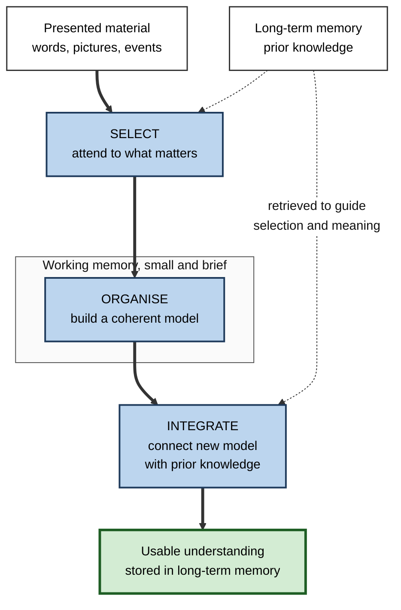
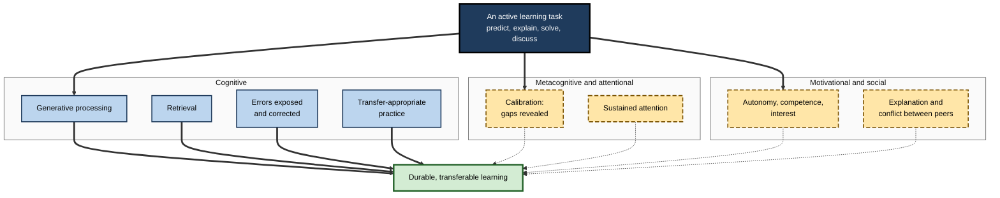
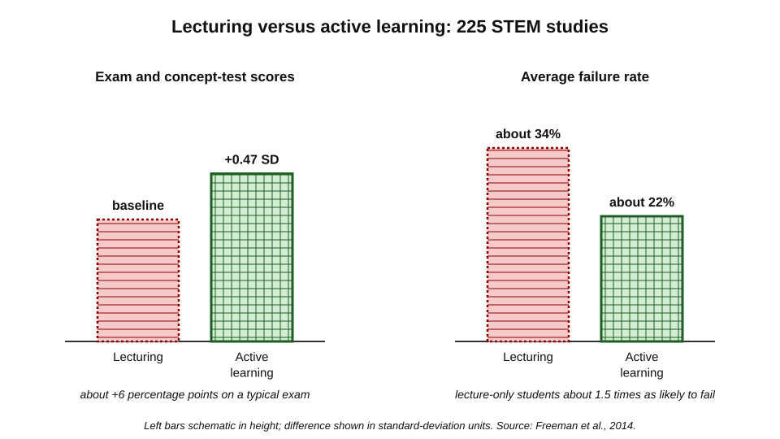
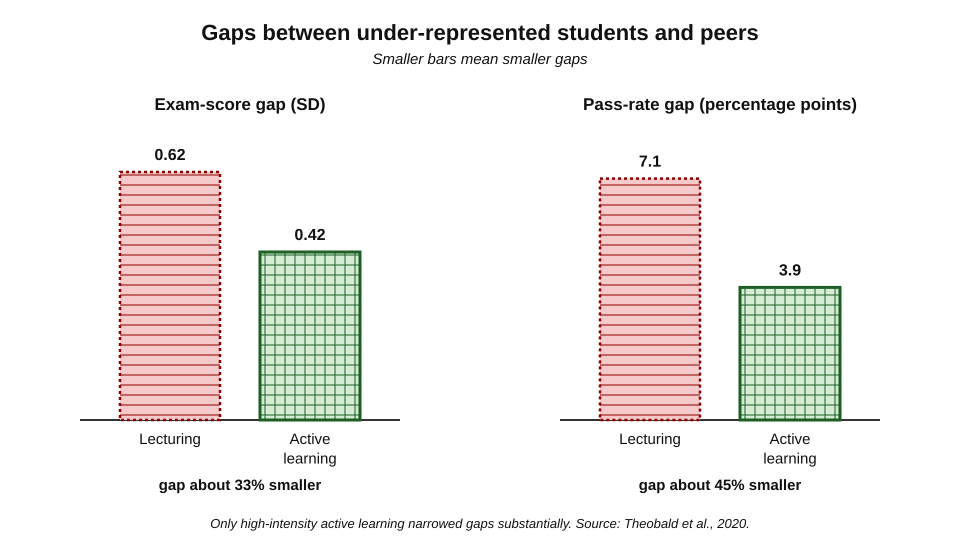
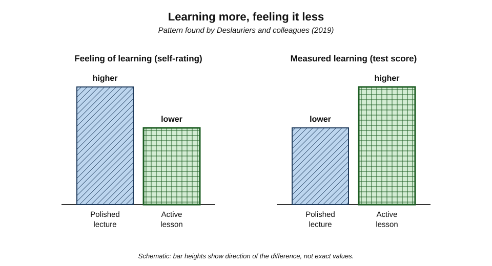
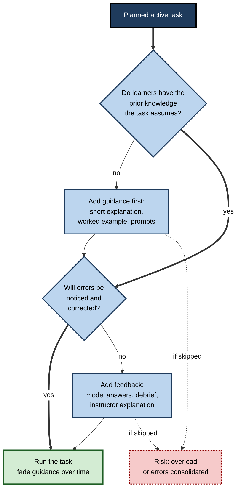

# A.2. Why Active Learning Works

A team lead explains a new incident-response procedure clearly, with excellent slides, and everyone nods.

A second team lead explains half as much, then asks each engineer to predict what they would do in three failure scenarios, shows who was wrong and why, and asks them to explain the procedure back to a partner. Three weeks later, during a real outage, the second team acts correctly and the first hesitates.

The second session did not contain more information. It made the engineers' minds **do more of the right work** — and the reasons why that matters are now well understood.

> **Definition — Mechanism of learning:** a cognitive, motivational or social process through which an activity changes what is stored in long-term memory and how readily it can be used.

**Why the mechanisms matter**

- Knowing *why* active learning works tells a designer **which features of an activity are essential** and which are decoration.
- It explains why some "active" sessions fail — they trigger the visible activity but not the mechanism.
- It explains the **paradox** that learners often feel they learn less from methods that teach them more.
- It allows sound judgement in new situations, such as learning with AI, where no study yet exists.

---

## The Core Idea: Learning Is Built by the Learner

Information presented to a learner is not copied into memory. It is **selected, interpreted and connected** to what the learner already knows. Whatever processing the learner performs is what gets stored.

> **Definition — Generative learning:** learning in which the learner actively makes sense of material by selecting relevant information, organising it into a coherent structure and integrating it with prior knowledge (Merlin Wittrock, 1974; developed by Richard Mayer and Logan Fiorella).

### The select–organise–integrate model

- **Selecting** — attending to the relevant words, images and events, and ignoring the rest.
  - Happens as information passes from the senses into **working memory**, the small, short-lived workspace of conscious thought.
- **Organising** — arranging selected elements into a coherent model: causes and effects, categories, sequences, comparisons.
  - Happens within working memory.
- **Integrating** — connecting the new model with relevant knowledge retrieved from **long-term memory**.
  - Produces understanding that can be used in new situations.

**Figure 1.** The select–organise–integrate model of how learners build knowledge.

> **Key point:** active learning works when it **prompts these three processes** — especially organising and integrating — that passive reception leaves to chance. Highlighting supports selecting at best; explaining, comparing and mapping force organising and integrating.

### Depth of processing

- **Fergus Craik and Robert Lockhart (1972)** proposed that memory depends on the **depth** at which information is processed.
  - **Shallow** — attending to surface features (what a word looks or sounds like).
  - **Deep** — attending to meaning, implications and connections.

**Study card — Craik and Tulving (1975)**

- **Design:** participants answered a question about each word in a list, without knowing a memory test would follow.
  - Shallow: "Is the word in capital letters?"
  - Intermediate: "Does the word rhyme with *weight*?"
  - Deep: "Would the word fit the sentence 'He met a ___ in the street'?"
- **Results:** recognition was far better for words processed for meaning than for words processed for appearance or sound.
- **Conclusion:** what is remembered depends on **what the mind did** with information, not on intention to learn or on time spent.

> **Watch out:** "depth" was criticised as hard to measure independently of the memory it is meant to explain. The lasting lesson is narrower and robust: **processing meaning** leaves stronger, more connected memories than processing surface form.

---

## Eight Mechanisms

Active learning is not one mechanism but a bundle. A well-designed activity triggers several at once.

**Figure 2.** The main mechanisms through which active learning improves learning.

### 1. Generative processing

- Producing an explanation, prediction, summary or diagram requires **organising and integrating** — the processes passive reception leaves optional.
- **Logan Fiorella and Richard Mayer (2016)** reviewed eight generative strategies (summarising, mapping, drawing, imagining, self-testing, self-explaining, teaching, enacting); most improved transfer test performance in a majority of experiments, with effects varying by learner and material.
- **Self-explanation** is a clear example: **Michelene Chi and colleagues (1989)** found that students who spontaneously explained the steps of worked physics examples to themselves learned far more than those who did not, even with equal time.

### 2. Retrieval

- Many active tasks — answering questions, solving problems, explaining from memory — require **retrieving** knowledge.
- Retrieval strengthens memory and makes it more accessible later, more than re-studying the same material.
- This is one reason a question asked *during* a lecture helps: it is a small retrieval event.

### 3. Errors exposed and corrected

- When learners commit to a prediction or answer, their **misconceptions become visible** — to the teacher, to peers and to themselves.
- A visible error can be corrected; an invisible one survives into the exam or the job.
- **Prediction error** — the gap between what one expected and what happened — is a powerful signal for updating knowledge.

> **Example:** physics students who first predict which of two balls lands first, then watch the demonstration, learn the concept better than students who simply watch; their wrong predictions mark exactly what needs revising. **Catherine Crouch, Eric Mazur and colleagues (2004)** found that students who merely observed classroom demonstrations scarcely outperformed those who never saw them, while those who predicted first did markedly better.

### 4. Transfer-appropriate practice

> **Definition — Transfer-appropriate processing:** the principle that memory performance is best when the processing at learning matches the processing required at test (C. Donald Morris, John Bransford and Jeffery Franks, 1977).

- Professionals must *use* knowledge — decide, diagnose, design, argue.
- Passive learning practises **recognising** information; active learning practises **using** it.
- The closer the practice task is to the real task, the more directly it prepares for it.

### 5. Calibration: discovering what one does not know

- **The illusion of explanatory depth** — **Leonid Rozenblit and Frank Keil (2002)** asked people to rate how well they understood everyday devices such as zips, flush toilets and cylinder locks, then to write step-by-step explanations.
  - After trying to explain, people's ratings of their own understanding **dropped sharply**.
- Passive reception leaves this illusion intact; explaining, predicting and answering puncture it.
- Better calibration lets the learner direct effort to genuine gaps.

> **Definition — Calibration:** the match between how well a learner thinks they know something and how well they actually know it.

### 6. Sustained attention

- During passive listening the mind wanders.
  - **Evan Risko and colleagues (2012)** found that mind-wandering **increased** over a one-hour video lecture and that more mind-wandering was associated with poorer retention.
- Short active episodes reset attention.

**Study card — Szpunar, Khan and Schacter (2013)**

- **Design:** students watched a video lecture in four segments.
  - Tested group: a short test after every segment.
  - Non-tested groups: re-studied or did unrelated tasks between segments.
- **Results:** the tested group mind-wandered **less** (measured by random probes), took more notes and performed better on a final test.
- **Conclusion:** interpolated active tasks keep attention on the material and reduce anxiety about the final test.

### 7. Motivation

- **Self-determination theory (Edward Deci and Richard Ryan)** identifies three psychological needs that support motivation:
  - **autonomy** — some choice and ownership;
  - **competence** — a sense of growing mastery;
  - **relatedness** — connection to others.
- Well-designed active tasks can meet all three; passive sessions meet few of them.
- **Situational interest** — triggered by puzzles, surprises and personal relevance — can grow into lasting individual interest (Suzanne Hidi and Ann Renninger, 2006).

> **Watch out:** motivation is a **helper, not a substitute**. A thrilling activity that does not require thinking about the target ideas motivates the wrong work.

### 8. Social mechanisms

- **Explaining to a peer** forces organisation and exposes gaps in the explainer's own knowledge.
- **Hearing alternative views** creates **socio-cognitive conflict** — disagreement that pushes both partners to re-examine their reasoning (a line of work associated with Willem Doise and Gabriel Mugny).
- **Peers' explanations** are sometimes easier to follow than an expert's, because the peer has only just overcome the same confusion.

> **Mnemonic — "GREAT CAMS":** **G**enerating, **R**etrieving, **E**rrors corrected, **A**pplying (transfer-appropriate practice), **T**hinking about one's own knowing (calibration), **C**oncentration (attention), **A**utonomy and interest (motivation), **M**ates — social explanation and conflict, and these work only when they **S**tick to the content.

---

## The Evidence

### The STEM meta-analysis

**Study card — Freeman, Eddy, McDonough, Smith, Okoroafor, Jordt and Wenderoth (2014)**

- **Design:** a meta-analysis of **225** studies comparing undergraduate STEM courses taught by traditional lecturing with courses using at least some active learning.
- **Results:**
  - examination and concept-inventory scores were higher under active learning by about **0.47 standard deviations** — roughly six percentage points on a typical exam;
  - students in lecture-only courses were about **1.5 times more likely to fail** — average failure rates of about **34%** under lecturing versus about **22%** under active learning.
- **Robustness:** effects appeared across disciplines, class sizes and course levels, and analyses suggested that unpublished null studies were unlikely to overturn the result.
- **Conclusion:** the authors argued that if the experiments had been medical trials, they might have been stopped early because the control condition was so clearly inferior.

**Figure 3.** Average outcomes under lecturing and active learning in undergraduate STEM courses.

> **Formula — What a failure-rate difference means:** expected failures avoided = class size × (lecture failure rate − active failure rate). For a cohort of 400 students: 400 × (0.34 − 0.22) = **48** fewer students failing.

### Who benefits most

**Study card — Theobald and colleagues (2020)**

- **Design:** a meta-analysis of studies reporting results separately for students from groups under-represented in STEM and for their peers.
- **Results:**
  - the exam-score gap between groups shrank by about **33%** under active learning (from about −0.62 to about −0.42 standard deviations);
  - the gap in pass rates shrank by about **45%** (from about 7.1 to about 3.9 percentage points);
  - only **high-intensity** active learning — courses where students spent a substantial share of class time on active work — narrowed the gaps substantially.
- **Conclusion:** active learning raises everyone's performance but helps students who start with fewer advantages the most — **provided it is done intensively**.

**Figure 4.** Achievement gaps between under-represented students and their peers under lecturing and active learning.

### Structure as a mechanism of equity

- **Haak, HilleRisLambers, Pitre and Freeman (2011)** — in a large biology course, adding **high structure** (daily preparatory reading quizzes, frequent in-class active exercises, weekly practice exams) reduced failure rates and narrowed the gap for educationally disadvantaged students.
- **Sarah Eddy and Kelly Hogan (2014)** — replicated the pattern at another university and found that structure especially helped Black and first-generation students; students reported doing more preparatory reading and feeling more part of a community.

> **Key point:** much of active learning's equity effect comes from **structure** — required preparation, frequent low-stakes practice and feedback — which reduces the advantage of students who already know how to study independently.

---

## The Paradox: Learning More, Feeling It Less

**Study card — Deslauriers, McCarty, Miller, Callaghan and Kestin (2019)**

- **Design:** in an introductory physics course at Harvard, students experienced matched lessons, one taught by a highly rated lecturer as a polished lecture and one taught actively (students worked problems in groups, with the instructor guiding and explaining afterwards). Content and handouts were identical; conditions were swapped between groups (a **crossover** design).
- **Results:**
  - students **scored higher** on tests after the active lessons;
  - students **rated their feeling of learning lower** after the active lessons and said they preferred the lectures.
- **Explanation offered:** the greater cognitive effort of active learning was misread as a sign of poor learning, and the fluency of a polished lecture was misread as understanding.
- **Follow-up:** a short early-term explanation of this effect to students improved their acceptance of active methods.

**Figure 5.** Measured learning and feeling of learning after active and passive lessons.

| | Polished lecture | Active lesson |
|---|---|---|
| Moment-to-moment experience | Smooth, clear, fluent | Effortful, sometimes confusing |
| Learner's judgement of learning | High | Lower |
| Measured learning | Lower | Higher |
| What the learner attributes the feeling to | "I understood everything" | "I'm struggling — this isn't working" |
| Risk | Overconfidence; under-preparation | Abandoning a method that works |

> **Definition — Fluency illusion:** mistaking the ease of processing information for the strength of one's learning.

> **In practice:** instructors and trainers who adopt active methods should **name the paradox at the start**: "This will feel harder than a lecture. Effort here is a sign of learning, not of failure." Showing learners their own delayed test results is the most convincing argument.

---

## Boundary Conditions

Active learning is not automatically effective. It works through mechanisms; if the design blocks the mechanisms, the activity fails.

### Prior knowledge and cognitive load

> **Definition — Cognitive load:** the demand that a task places on working memory. Load that serves learning is useful; load from confusing design or excessive search is wasted (John Sweller's cognitive load theory).

- **Novices** have little prior knowledge to organise new information with, so open-ended activity can overload working memory.
  - **Paul Kirschner, John Sweller and Richard Clark (2006)** argued that minimally guided instruction is less effective than guided instruction for novices.
- **Experts** benefit more from open problems and less from step-by-step guidance.
- **Resolution:** active learning for novices should be **guided** — short explanations, worked examples and well-structured tasks — with guidance fading as competence grows.

### Implementation quality

- **Andrews, Leonard, Colgrove and Kalinowski (2011)** sampled introductory biology courses at many US universities and found that the amount of active learning reported by typical instructors was **not associated** with students' learning gains.
  - Their interpretation: the large gains in the research literature came largely from instructors trained in education research; activities run without understanding of their purpose — poorly designed questions, no follow-up explanation — lose the benefit.
- **Intensity matters** — a few minutes of discussion in an otherwise passive hour produces little.
- **Feedback matters** — activity without correction can consolidate errors.

### Fit between activity and goal

- **Fact learning** — retrieval-based activities fit best.
- **Conceptual understanding** — prediction, explanation and discussion fit best.
- **Procedural skill** — worked examples followed by practice with feedback fit best.
- **Judgement in ambiguous situations** — cases, problems and debate fit best.

**Figure 6.** Deciding how much guidance an active learning task needs.

| Condition | Active learning tends to help most when… | It tends to disappoint when… |
|---|---|---|
| Prior knowledge | Learners have enough to make sense of the task, or are guided | Novices face open problems without support |
| Design | Tasks target the key concepts and require reasoning | Tasks are busy, decorative or answerable without understanding |
| Feedback | Answers are discussed and errors explained | Activities end without correction |
| Intensity | A large share of time is spent producing | A token exercise interrupts an otherwise passive session |
| Learner beliefs | Learners understand why effort is productive | Learners read effort as failure and disengage |

---

## Why Lecturing Persists

- **Coverage pressure** — presenting feels like progress through a syllabus.
- **Learner preference** — the feeling-of-learning paradox makes lectures popular.
- **Evaluation systems** — satisfaction ratings reward fluency.
- **Instructor comfort and identity** — many experts learned through lectures and teach as they were taught.
- **Cost of redesign** — active sessions take more preparation and skill to run.
- **Scale** — very large audiences seem to rule out interaction, although techniques such as response systems, think–pair–share and structured peer discussion work in rooms of hundreds.

> **Watch out:** "learners don't like it" is a weak argument against active learning when the dislike stems from effort rather than from poor design. It is a strong argument when the activities are confusing, repetitive or irrelevant — which is a design problem, not a refutation.

---

## Applying the Mechanisms

### Worked example: diagnosing a failed "active" session

- **Situation:** a data-governance trainer replaced a lecture with group work: teams of six received a poster sheet and were asked to "discuss data quality and present back". Delayed test results did not improve.
- **Step 1 — which mechanisms were triggered?**
  - Generative processing: weak — the task did not require any specific organising or integrating.
  - Retrieval: weak — notes and slides were available.
  - Errors exposed: no — teams presented generalities, none of which could be wrong.
  - Transfer-appropriate practice: no — learners never worked on a realistic dataset.
  - Calibration: no — nobody discovered what they did not know.
  - Attention, motivation, social: partly — groups were lively, but one or two people did most of the talking.
- **Step 2 — redesign around the mechanisms:**
  1. Give each learner a small, realistic dataset with five hidden quality problems.
  2. Ask each learner **individually** to find and classify as many problems as possible in ten minutes (generation, transfer-appropriate practice, calibration).
  3. In **pairs**, compare lists and explain each classification (social explanation, errors exposed).
  4. The trainer reveals the five problems and explains the two most commonly missed (feedback).
  5. A week later, a new dataset is assessed unaided (retrieval, delayed measurement).
- **Conclusion:** the original session had activity without mechanisms. The redesign uses the same time but makes every minute require reasoning about the target content.

> **Watch out:** groups larger than four or five and tasks without a concrete product invite **social loafing** — some members contribute little because their effort is not identifiable.

### Case study: an engineering school's first-year mathematics

- **Situation:** a university engineering faculty taught first-year calculus to about 600 students in traditional lectures; failure rates had been high for years, and they were highest for students from schools that sent few pupils to university.
- **Problem:** students attended lectures but arrived at weekly tutorials unable to start problems; many dropped out in the first term.
- **Diagnosis:**
  - almost all lecture time was passive;
  - students' first attempt at problems came days after the lecture, alone and without feedback;
  - students with strong school preparation coped; others fell behind invisibly.
- **Actions:**
  1. **Short pre-lecture readings** with a five-question online quiz (structure, preparation).
  2. Lectures restructured into **ten-minute explanation segments**, each followed by a concept question answered on phones, peer discussion and re-vote (generation, errors exposed, social explanation).
  3. A **worked example** before each problem type, then a similar problem attempted in class (guidance for novices).
  4. Weekly low-stakes problem sets with **rapid feedback**.
  5. A brief explanation in week one of why the lessons would feel harder (the feeling-of-learning paradox).
- **Result:** over two years, failure rates fell substantially, with the largest improvement among students from under-represented schools; mid-term student ratings dipped in the first year and recovered as lecturers became practised.
- **Side effects / caveats:** lecturers needed training and preparation time; one lecturer who ran the questions without discussion or follow-up explanation saw little improvement — the implementation-quality effect in miniature.
- **Lesson:** the gains came from **mechanisms** — structure, generation, feedback and guided practice — not from the label "active".

---

## Open Questions

- **Which mechanisms carry most of the effect?**
  - Real activities bundle several; separating generation, retrieval, feedback, attention and motivation experimentally is difficult.
- **How large are effects outside STEM higher education?**
  - The strongest meta-analyses come from undergraduate science; evidence in workplace learning, humanities and professional education is thinner and more varied.
- **How should guidance be calibrated?**
  - The "how much guidance, for whom, when" question that divides advocates of discovery and of explicit instruction is still unresolved in detail.
- **Can the feeling-of-learning paradox be reliably overcome?**
  - Brief explanations help, but whether learners maintain effortful methods without external structure is doubtful.
- **What happens when AI provides the explanation?**
  - Whether AI tutors trigger the mechanisms (prompting generation and feedback) or bypass them (supplying fluent answers) depends on design; long-term field evidence is limited.

---

## Summary

- Learning is **built by the learner**: what is stored depends on the processing performed — **selecting, organising and integrating** (generative learning) and processing **meaning** rather than surface.
- Active learning works through a bundle of mechanisms: **generative processing, retrieval, errors exposed and corrected, transfer-appropriate practice, calibration, sustained attention, motivation and social explanation** ("GREAT CAMS").
- **Freeman et al. (2014)**: across 225 STEM studies, active learning raised exam performance by about **0.47 SD** and lecture-only courses had about **1.5 times** the failure rate (about 34% vs 22%).
- **Theobald et al. (2020)**: active learning narrowed achievement gaps by about **33%** on exams and **45%** in pass rates — but only when **high-intensity**; **structure** drives much of the equity effect.
- **Deslauriers et al. (2019)**: students **learned more but felt they learned less** from active lessons — the **fluency illusion**; naming the paradox helps.
- Boundary conditions: **prior knowledge and cognitive load** (guide novices), **implementation quality** (typical implementations may lose the benefit), **intensity**, **feedback** and **fit to the goal**.
- Lecturing persists because of coverage pressure, learner preference, satisfaction metrics, habit and cost.
- Design and diagnose activities by asking **which mechanisms each step triggers**.

---

## Self-Check

1. Describe the select–organise–integrate model and explain which processes passive reception leaves to chance.
2. What did Craik and Tulving (1975) show, and what is the lasting lesson of levels-of-processing research?
3. Explain how prediction before a demonstration improves learning, citing the relevant finding.
4. What is the illusion of explanatory depth, and why does active learning reduce it?
5. Summarise the design and two main results of Freeman et al. (2014).
6. A department teaches 250 students a year; lecture-only failure rates are about 34% and active-learning rates about 22%. Estimate the annual number of failures avoided.
7. What did Theobald et al. (2020) find about equity, and what condition was essential?
8. Explain the Deslauriers et al. (2019) paradox and one practical response.
9. Why might typical instructors' active learning show no benefit, as in Andrews et al. (2011)?
10. How does prior knowledge change the kind of active learning that works?
11. Match an activity type to each goal: memorising terminology; understanding a causal concept; learning a new procedure; making judgements in ambiguous cases.
12. A trainer says, "Our workshop is active: people move around the room and vote with sticky dots." Which mechanisms may be missing?
13. Learners in a redesigned course give lower satisfaction ratings and higher delayed test scores. How should the course owner interpret and report this?
14. Design a 20-minute active segment for teaching a legal concept to trainee solicitors that deliberately triggers at least four mechanisms, naming each.

### Answer Key

1. Learners select relevant information into working memory, organise it into a coherent model and integrate it with prior knowledge from long-term memory. Passive reception may achieve selection but leaves organising and integrating optional; active tasks such as explaining or comparing require them.
2. Words processed for meaning were remembered far better than words processed for appearance or sound, without any intention to learn. Processing meaning leaves stronger, more connected memories; "depth" itself is hard to measure independently.
3. A prediction commits the learner to a model; a wrong prediction creates a prediction error that marks what must be revised. Crouch, Mazur and colleagues found observers of demonstrations barely outperformed students who never saw them, while those who predicted first learned markedly more.
4. People believe they understand how things work in more detail than they do; trying to explain step by step reveals the gaps. Active learning requires explanation and prediction, puncturing the illusion and improving calibration.
5. A meta-analysis of 225 studies comparing lecturing with active learning in undergraduate STEM. Active learning raised exam and concept-inventory scores by about 0.47 SD; lecture-only students were about 1.5 times as likely to fail (about 34% vs 22%).
6. 250 × (0.34 − 0.22) = 250 × 0.12 = 30 failures avoided per year.
7. Active learning shrank exam-score gaps for under-represented students by about a third and pass-rate gaps by almost half; only high-intensity active learning, with a substantial share of class time spent on active work, produced substantial narrowing.
8. Students learned more from active lessons but felt they learned less, misreading effort as poor learning and lecture fluency as understanding. Response: explain the effect at the start, and show learners their own delayed results.
9. Activities run without understanding of their purpose — weak questions, no follow-up explanation, little intensity, no feedback — trigger the visible activity but not the mechanisms; research results came largely from trained, research-informed instructors.
10. Novices lack knowledge to organise new information and are overloaded by open tasks; they need guided activities, worked examples and short explanations. As knowledge grows, guidance should fade and more open problems become productive.
11. Terminology — retrieval practice with feedback. Causal concept — prediction, explanation, discussion. Procedure — worked examples followed by practice with feedback. Judgement — cases, problems and debate.
12. Generative processing (does voting require explaining?), errors exposed (are wrong choices discussed?), feedback, transfer-appropriate practice (is the decision realistic?), calibration. Movement and voting supply behavioural activity and some motivation but may not require reasoning about content.
13. Lower satisfaction alongside better delayed learning matches the feeling-of-learning paradox; satisfaction measures comfort, not learning. Report the delayed learning and, ideally, behavioural outcomes as the primary measures, explain the paradox to stakeholders, and check satisfaction comments for genuine design problems.
14. Example: (1) 3-minute explanation of the doctrine (guidance); (2) each trainee individually predicts the outcome of two short fact patterns and writes one reason (generation, calibration); (3) pairs compare and argue (social explanation, errors exposed); (4) the trainer reveals outcomes and explains the common error (feedback); (5) each trainee drafts one paragraph of advice to a client on a third, realistic scenario (transfer-appropriate practice), checked against a model answer.

---

## Glossary

| Term | Meaning |
|---|---|
| Calibration | The match between how well a learner thinks they know something and how well they actually know it. |
| Cognitive load | The demand a task places on working memory. |
| Crossover design | An experiment in which each group experiences every condition in a different order. |
| Depth of processing | The degree to which information is processed for meaning rather than surface features. |
| Fluency illusion | Mistaking ease of processing for strength of learning. |
| Generative learning | Learning by selecting, organising and integrating information with prior knowledge. |
| High-intensity active learning | Courses in which a substantial share of class time is spent on active work. |
| Illusion of explanatory depth | Believing one understands how something works in more detail than one does. |
| Long-term memory | The durable store of knowledge and skills. |
| Mechanism of learning | A process through which an activity changes what is stored and how usable it is. |
| Mind-wandering | Attention drifting from the task to unrelated thoughts. |
| Prediction error | The gap between what one expected and what happened. |
| Self-determination theory | Theory that motivation depends on autonomy, competence and relatedness. |
| Self-explanation | Explaining to oneself how each step or statement fits together. |
| Situational interest | Interest triggered by features of a task or setting. |
| Social loafing | Reduced individual effort in a group when contributions are not identifiable. |
| Socio-cognitive conflict | Disagreement between learners that prompts re-examination of reasoning. |
| Structure (course) | Required preparation, frequent low-stakes practice and feedback built into a course. |
| Transfer-appropriate processing | Memory is best when processing at learning matches processing at test. |
| Working memory | The small, short-lived workspace of conscious thought. |
