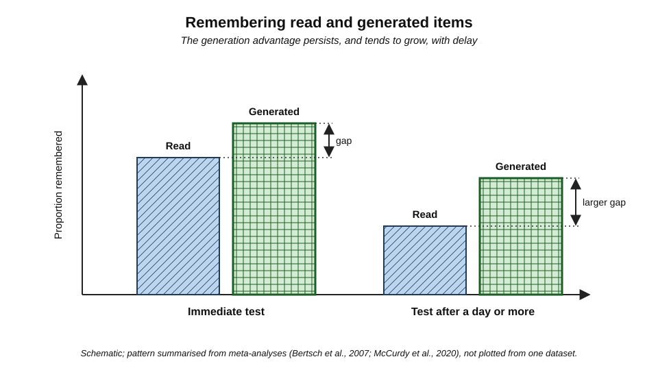
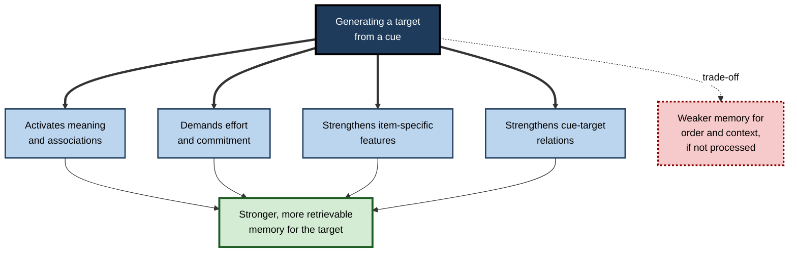
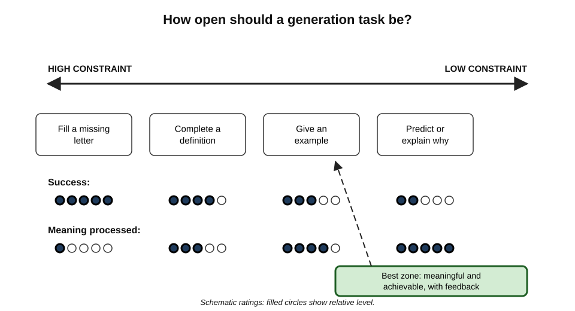
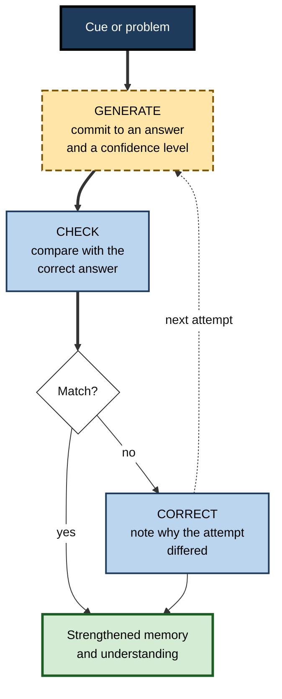

# A.3. The Generation Effect

Read the pair **hot – cold**. Now complete the pair **long – sh _ _ _**. A few minutes later, the second word pair is more likely to be remembered than the first, even though the reader spent barely a second longer on it. The small act of **producing** "short" rather than reading it leaves a stronger trace.

The same principle explains why a solicitor remembers the clause she drafted better than the one she skimmed, and why a programmer remembers the fix he worked out far longer than the one he copied.

> **Definition — Generation effect:** the finding that information people produce themselves, from a cue or rule, is remembered better than the same information when it is simply read or heard.

**Why it matters**

- It is one of the most reliable findings in memory research, replicated across hundreds of experiments.
- It explains, at the smallest scale, why active learning beats passive reception.
- It underlies many practical methods: fill-in notes, prediction before reading, attempting problems before instruction, deriving rather than memorising.
- It warns against a growing modern habit — letting a tool generate the answer before the learner has tried.

---

## The Basic Effect

### The original experiments

**Study card — Norman Slamecka and Peter Graf (1978)**

- **Design:** participants studied word pairs under two conditions.
  - **Read:** both words given — *rapid – fast*.
  - **Generate:** the second word had to be produced from a rule and its first letter — *rapid – f* _ _ _ (rule: synonym).
- **Rules tested:** associate, category, opposite, synonym and rhyme.
- **Results:** generated words were remembered better than read words across all five rules, on recognition and on cued recall.
- **Conclusion:** the act of producing an item, even trivially, improves memory for it. The authors named this the **generation effect**.

| | Read condition | Generate condition |
|---|---|---|
| What the learner sees | *rapid – fast* | *rapid – f* _ _ _ |
| What the learner does | Reads the target | Retrieves and produces the target from a cue |
| Effort | Minimal | Small but real |
| Error possible? | No | Yes, if the cue is ambiguous |
| Later memory for the target | Weaker | Stronger |

> **Key point:** the difference is not time or attention alone — generation involves **retrieving, choosing and committing** to an answer, which the read condition skips.

### How large and how general

**Study card — Bertsch, Pesta, Wiscott and McDaniel (2007)**

- **Design:** a meta-analysis of 86 studies and several hundred effect sizes.
- **Results:** an average advantage for generation of about **0.40 standard deviations**; the effect held across recognition, cued recall and free recall, and was **larger after longer delays**.
- **Conclusion:** a modest-to-moderate, robust effect that grows rather than fades with time.

**Study card — McCurdy, Viechtbauer, Sklenar, Frankenstein and Leshikar (2020)**

- **Design:** a larger meta-analysis of 126 articles and 310 experiments, designed to test competing theories.
- **Results:**
  - generation improved memory by **more than ten percentage points** in most conditions;
  - effects were larger in **cued recall** than in free recall;
  - effects were largest at **retention intervals longer than a day**;
  - the size of the effect depended on how constrained the generation task was and on design features that different theories predict should matter.
- **Conclusion:** the effect is real and substantial; no single simple theory explains all its moderators.

**Figure 1.** Memory for read and generated items, immediately and after a delay.

> **Watch out:** "more than ten percentage points" is an average over mostly laboratory word-list studies. Effects with complex material — texts, procedures, concepts — are real but more variable, and depend heavily on what is generated.

---

## Why Generation Works

Several theories compete. Most researchers now accept that more than one process contributes.

### The main accounts

- **Lexical activation (early account)**
  - Generating a word activates its meaning and connections in memory more than reading it.
  - **Support:** Douglas McElroy and Norman Slamecka (1982) found no generation effect for **nonwords**, which have no stored meaning to activate.
  - **Problem:** later studies (e.g. James Nairne and Robert Widner, 1987) found generation effects for nonwords under some conditions.
- **Effort**
  - Generation requires more cognitive effort, and effortful processing leaves stronger traces.
  - **Problem:** effort alone does not predict the effect reliably — some effortful tasks produce no benefit.
- **Item-specific and relational processing (multifactor accounts)**
  - **Elliot Hirshman and Robert Bjork (1988)** and **Mark McDaniel, Paula Waddill and Gilles Einstein (1988)** proposed that generation strengthens particular kinds of information.
    - **Item-specific** — distinctive features of each item.
    - **Relational** — links between the cue and the target, or among items.
  - Generation helps memory for whatever kind of information the generation task requires the learner to process.
- **Item–order trade-off**
  - **Nairne, Riegler and Serra (1991)** showed generation can **improve memory for items** while **impairing memory for their order**, because attention goes to each item rather than the sequence.
- **Transfer-appropriate processing**
  - Generation benefits a later test most when the test requires the same kind of processing that generation exercised.

**Figure 2.** How the main accounts explain the generation effect.

| Account | Core claim | Best evidence for | Main difficulty |
|---|---|---|---|
| Lexical activation | Generation activates stored meaning | No effect for nonwords in early studies | Later nonword effects |
| Effort | Effortful processing is better remembered | Harder generation often gives larger effects | Effort alone predicts poorly |
| Multifactor (item and relational) | Generation enhances whatever information it requires processing | Effects vary with test type and design as predicted | Harder to test decisively |
| Item–order trade-off | Generation boosts items at the cost of order | Order memory impaired after generation | Explains limits more than the effect itself |
| Transfer-appropriate processing | Benefit depends on match between generation and test | Larger effects when test matches the task | Partly restates the result |

> **Key point:** for practical design the multifactor view is the most useful: **learners remember what the generation task forces them to process**. Design the generation task around the knowledge that matters.

---

## When Generation Helps and When It Does Not

### Conditions that strengthen the effect

- **The learner can succeed** — or receives the correct answer promptly.
- **The cue and target are meaningfully related** — generating a synonym, a consequence, a cause or an example.
- **The test matches what was generated** — cued recall of generated items shows large effects.
- **A delay separates learning from testing** — the generation advantage tends to grow with time.
- **Generation targets the important information** — not trivial surface features.

### Conditions that weaken or reverse it

- **Generation fails and no feedback follows** — the learner may remember a wrong answer.
- **The material has no stored meaning** — random strings, unfamiliar codes.
- **Order or context matters at test** — generation can pull attention away from sequence and setting.
- **Generation is trivial or mechanical** — copying a word with one letter missing may not require meaning.
- **Some pure-list free-recall designs** — when every item in a list is generated, the advantage in free recall can shrink or disappear, because the benefit partly comes from generated items standing out against read ones.

> **Watch out:** "make learners generate everything" is a mistaken lesson. Generation that fails silently, or that targets the wrong features, can make learning **worse**, not better.

**Figure 3.** How the degree of constraint on generation affects success and memorability.

| Generation task | Constraint | Likely success | What is strengthened |
|---|---|---|---|
| Fill in a missing letter: *mem_ry* | Very high | Near certain | Surface form; little meaning |
| Complete a definition from its first words | High | High | The definition's key terms |
| Give an example of a concept | Moderate | Moderate | Concept–instance links |
| Predict the result of a policy change | Low | Uncertain | Causal reasoning, if followed by feedback |
| Explain why a method works, from memory | Low | Uncertain | Relational understanding |

---

## Generating Before Being Told

### Errorful generation

A surprising extension: guessing an answer **before** learning it can help, even when the guess is wrong — provided the correct answer follows.

**Study card — Kornell, Hays and Bjork (2009)**

- **Design:** participants learned weakly related word pairs (e.g. *whale – mammal*).
  - **Generate first:** participants guessed the target before seeing it; almost all guesses were wrong.
  - **Study only:** participants saw the complete pair for the whole time.
- **Results:** pairs that had been guessed first — wrongly — were **remembered better** on a later test.
- **Conclusion:** an unsuccessful retrieval attempt, followed by feedback, can enhance learning.

- **Boundary:** later work (e.g. Grimaldi and Karpicke, 2012) found that the benefit depends on the guess being **related** to the answer; guessing at unrelated material gave little benefit.
- **Learner beliefs:** **Barbie Huelser and Janet Metcalfe (2012)** found that learners who benefited from errorful generation nevertheless **believed** it had hurt them.

> **Definition — Pretesting:** testing learners on material before they have studied it, so that their attempts — mostly wrong — prepare them to notice and remember the answers when taught.

### The hypercorrection effect

- **Brady Butterfield and Janet Metcalfe (2001)** found that errors made **with high confidence** are corrected **more** readily than low-confidence errors once feedback is given.
- Explanation: the surprise of being confidently wrong focuses attention on the correction.
- **Practical implication:** asking learners to commit to an answer and rate their confidence makes feedback more powerful.

### Productive failure

> **Definition — Productive failure:** an instructional design in which learners first attempt to solve complex problems they cannot yet fully solve, and only then receive explicit instruction on the canonical solution (Manu Kapur).

- **Phase 1 — generation and exploration:** learners generate multiple representations and solution methods — most incomplete or wrong.
- **Phase 2 — consolidation and instruction:** the teacher compares students' attempts with the correct method, explaining what each attempt captured and missed.
- **Why it can work:**
  - attempts **activate prior knowledge** relevant to the problem;
  - learners notice the **critical features** the correct solution must handle;
  - failure creates **awareness of knowledge gaps**, so instruction is received with a purpose.

**Study card — Sinha and Kapur (2021)**

- **Design:** a meta-analysis of 53 studies (166 comparisons) of **problem solving followed by instruction** (PS-I) versus **instruction followed by problem solving** (I-PS).
- **Results:**
  - a moderate overall advantage for PS-I on conceptual knowledge and transfer (Hedges' g about **0.36**);
  - larger effects (up to about **0.58**) when designs followed productive-failure principles closely;
  - for **young primary-school children** and for some domain-general skills, the advantage reversed in favour of instruction first.
- **Conclusion:** generation before instruction helps older learners understand concepts, when the problem activates relevant prior knowledge and instruction then builds on the attempts.

**Figure 4.** Instruction-first and problem-first sequences.

```mermaid
%%{init: {'theme':'base','themeVariables':{'fontFamily':'Arial, Helvetica, sans-serif','fontSize':'15px','primaryColor':'#FFFFFF','primaryTextColor':'#111111','primaryBorderColor':'#222222','lineColor':'#333333','secondaryColor':'#F2F2F2','tertiaryColor':'#FFFFFF','clusterBkg':'#FAFAFA','clusterBorder':'#555555','edgeLabelBackground':'#FFFFFF','titleColor':'#111111'}}}%%
flowchart TD
    classDef key     fill:#BCD5EE,stroke:#1F3B5C,stroke-width:2px,color:#000000
    classDef accent  fill:#FFE6A8,stroke:#7A5200,stroke-width:2px,stroke-dasharray:8 4,color:#000000
    classDef good    fill:#D3ECD3,stroke:#1E5E24,stroke-width:3px,color:#000000
    classDef detail  fill:#FFFFFF,stroke:#333333,stroke-width:1.5px,color:#000000

    subgraph IPS["Instruction first, I-PS"]
        I1["Teacher explains<br/>the method"]
        I2["Learners practise<br/>the method"]
        I3["Fluent procedure;<br/>weaker grasp of why"]
        I1 --> I2 --> I3
    end
    subgraph PSI["Problem first, PS-I"]
        P1["Learners attempt a<br/>novel problem"]
        P2["Teacher compares<br/>attempts with the<br/>correct method"]
        P3["Learners practise"]
        P4["Deeper conceptual<br/>understanding<br/>and transfer"]
        P1 --> P2 --> P3 --> P4
    end

    class I1,I2 key
    class I3 detail
    class P1 accent
    class P2,P3 key
    class P4 good
```

| | Instruction first (I-PS) | Problem first (PS-I) |
|---|---|---|
| Early experience | Smooth; quick success | Struggle; many errors |
| Procedural fluency soon after | Often equal or better | Often equal |
| Conceptual understanding and transfer | Lower on average | Higher on average, for older learners |
| Risk | Superficial understanding | Frustration; errors entrenched if consolidation is weak |
| Essential ingredient | Clear explanation and practice | A well-chosen problem and careful consolidation |

> **Watch out:** productive failure is often misread as "let learners struggle". Its benefit depends on **the instruction that follows** — comparing failed attempts with the correct solution. Struggle without consolidation is merely failure.

---

## Generation in Study and Work

### Practical forms of generation

- **Predict before reading** — before opening a report, write what its conclusion will probably be and why.
- **Complete partial notes** — key terms, steps or conclusions left blank and filled in from reasoning or memory.
- **Derive rather than memorise** — work out a formula, rule or design from first principles before checking it.
- **Answer before searching** — write one's best answer to a technical question before consulting documentation, a colleague or an AI system.
- **Generate examples** — produce a new instance of each concept, preferably from one's own work.
- **Generate questions** — write the questions a section must be answering before reading it.
- **Draft before the template** — write a first version of a project plan, then compare it with the organisation's standard template.

> **Mnemonic — "TRY, THEN TELL":** the learner **tries** first — predicting, completing, deriving or drafting — and is **then told** the correct answer, comparing the two.

**Figure 5.** The generate–check–correct cycle.

### Worked example: learning medical terminology

- **Situation:** new hospital administrative staff must learn about 150 clinical abbreviations and terms. The induction team compares two designs, each taking 40 minutes.
- **Design A — read:** staff read a glossary twice.
- **Design B — generate:** staff see each term with a cue — the abbreviation and the first letters of its expansion, or a short case in which the term is needed — write their best answer, then check the glossary.

| | Design A: read twice | Design B: generate then check |
|---|---|---|
| Time | 40 minutes | 40 minutes |
| Items processed | All 150, twice | About 110 once, with checking |
| Errors during study | None visible | Many, each immediately corrected |
| Staff confidence at the end | High | Moderate |
| Unaided accuracy, two weeks later | 45% | 66% |

> **Formula — Relative generation advantage:** (generate score − read score) ÷ read score. With the illustrative figures above: (66 − 45) ÷ 45 ≈ **0.47** — a 47% relative improvement, or 21 percentage points in absolute terms.

- **Interpretation:** design B processed fewer items, yet produced more durable knowledge, because each generated item was processed for meaning and errors were corrected.
- **Design lesson:** keep cues **meaningful** (case-based cues, not missing-letter puzzles) and give feedback **immediately**.

> **Watch out:** the figures are illustrative of a typical pattern, not data from a specific study. Laboratory and classroom effects vary considerably.

---

## Generation in the Age of AI

- **The risk:** when a learner asks an AI system for an explanation, a draft or code *before* trying, the system does the generating — and the learner keeps only the weaker memory of having read the result.
- **The opportunity:** AI can supply ideal cues and immediate feedback:
  - generating partial problems, prediction prompts and cloze exercises from any material;
  - checking a learner's attempt and explaining the difference;
  - withholding answers until the learner has committed.
- **A professional rule of thumb:**
  1. Write a first attempt, however rough.
  2. Ask the tool for its answer or critique.
  3. Compare and note what was missed.
  4. Revise in one's own words.

> **In practice:** software teams that adopt AI coding assistants increasingly ask juniors to **sketch the approach or write the test first**, then use the assistant. The aim is to keep the generation that builds expertise while gaining the assistant's speed.

### Case study: onboarding analysts to a new forecasting method

- **Situation:** a retail company introduced a new demand-forecasting method and needed 40 analysts to understand when it would over- or under-forecast.
- **First approach:** two hours of slides explaining the method's assumptions, followed by worked examples. A month later, analysts applied the method mechanically and rarely spotted cases where its assumptions failed.
- **Diagnosis:** analysts had read the method's logic but never **generated** predictions from it; the assumptions remained abstract.
- **Actions:**
  1. Before any explanation, analysts were given five historical product series and asked to **predict** where a simple method would go wrong, writing a reason for each.
  2. The method was then explained by reference to their predictions — which failure modes they had anticipated and which they had missed.
  3. For each new assumption, analysts **generated** an example product from their own category that would violate it.
  4. Weekly, each analyst predicted one forecast's error direction **before** the actual sales arrived, recording confidence.
- **Result:** over the following quarter, analysts flagged significantly more forecasts for manual review in the categories where the method was known to struggle, and forecast-error reviews showed fewer unflagged large misses.
- **Side effects / caveats:** the first session was experienced as frustrating — several analysts asked why they had not simply been told; the confidence ratings revealed a few highly confident misconceptions that needed one-to-one correction.
- **Lesson:** making professionals **generate predictions and examples before and during instruction** turned abstract assumptions into usable judgement.

---

## Open Questions

- **What exactly is the mechanism?**
  - Activation, effort, item-specific and relational processing all have support; how they combine across materials is unresolved.
- **How well does the effect scale to complex knowledge?**
  - Most experiments use word pairs; evidence for long texts, professional procedures and conceptual understanding is thinner and more heterogeneous.
- **When does failed generation help and when does it harm?**
  - Errorful generation helps with related material and feedback; the boundaries for complex errors and for misconceptions that resist correction are not fully mapped.
- **How should productive failure be adapted for workplace learning?**
  - Most studies are in school and university mathematics and science; adults learning on the job under time pressure may react differently.
- **Will AI erode or enhance generation?**
  - The default design of most tools supplies answers immediately; whether "attempt first" designs will prevail is a practical and commercial question.

---

## Summary

- The **generation effect**: self-produced information is remembered better than read information (**Slamecka and Graf, 1978**).
- It is robust: about **0.40 SD** on average (**Bertsch et al., 2007**); more than **ten percentage points** in most conditions, larger in **cued recall** and at **longer delays** (**McCurdy et al., 2020**).
- Explanations include **lexical activation**, **effort**, **item-specific and relational processing**, an **item–order trade-off** and **transfer-appropriate processing**; learners remember what the generation task forces them to process.
- It helps most when generation **succeeds or receives prompt feedback**, uses **meaningful** cues and targets **important** information; it weakens for meaningless material, trivial tasks and unsupported failure.
- **Errorful generation** and **pretesting** help when the correct answer follows; **confident errors** are corrected most readily (**hypercorrection**).
- **Productive failure**: problem-first, then instruction, improves conceptual understanding and transfer for older learners (g about **0.36**, higher with good fidelity), but reverses for young children; **consolidation** is essential.
- In practice: **TRY, THEN TELL** — predict, complete, derive, draft, then check and correct.
- With AI: **attempt first, then consult**.

---

## Self-Check

1. Define the generation effect and describe the Slamecka and Graf (1978) procedure.
2. What did the 2007 and 2020 meta-analyses find about the size of the effect and its relation to delay?
3. Why did the absence of a generation effect for nonwords support the lexical activation account, and why is that support now weaker?
4. Explain the multifactor account and its practical implication for designing generation tasks.
5. What is the item–order trade-off, and when would it matter in professional learning?
6. Give three conditions under which generation may fail to help.
7. Describe Kornell, Hays and Bjork (2009) and its boundary condition.
8. What is the hypercorrection effect, and how can a trainer exploit it?
9. Distinguish PS-I from I-PS and summarise the Sinha and Kapur (2021) findings, including where the advantage reverses.
10. Why is consolidation essential in productive failure?
11. A generate group scores 72% and a read group 54% after two weeks. Calculate the relative and absolute advantages.
12. Rank these generation tasks from most to least constrained and say what each strengthens: giving an example of a concept; filling in a missing letter; predicting a policy's effect.
13. A junior developer always asks an AI assistant for code before attempting a task. Using the generation effect, explain the long-term risk and propose a better routine.
14. Design a 30-minute session that uses generation to teach a new pricing policy to sales staff, including how errors will be handled.

### Answer Key

1. Information produced by the learner from a cue or rule is remembered better than the same information read. Participants studied word pairs either fully presented (*rapid – fast*) or with the target to be generated from a rule and first letter (*rapid – f* _ _ _); generated targets were remembered better across five rules.
2. Bertsch et al. found an average advantage of about 0.40 SD, larger after longer delays; McCurdy et al. found more than ten percentage points in most conditions, larger in cued recall and largest at intervals beyond a day.
3. Nonwords have no stored meaning to activate, so the account predicted no benefit — as found by McElroy and Slamecka. Later studies found nonword generation effects under some conditions, so activation cannot be the only process.
4. Generation strengthens whichever information — item-specific or relational — the generation task requires processing. Designers should make learners generate the relationships and features that will matter later, not trivial surface details.
5. Generation can improve memory for individual items while weakening memory for their order. It matters when sequence is essential — e.g. the order of steps in a safety procedure — so order must also be practised.
6. When generation fails and no feedback follows; when material is meaningless; when the task is trivial or mechanical; when order or context is tested; in some pure-list free-recall designs.
7. Learners who guessed targets of weakly related pairs before seeing them — mostly wrongly — remembered the pairs better than learners who studied the complete pairs. The benefit depends on the guess being related to the answer and on feedback following.
8. High-confidence errors are corrected more readily than low-confidence ones after feedback. A trainer can ask learners to commit to answers and rate confidence before revealing answers, highlighting confident errors.
9. PS-I: learners attempt problems before instruction; I-PS: instruction then practice. Across 53 studies PS-I showed a moderate advantage (g ≈ 0.36), up to about 0.58 with high fidelity to productive-failure principles; the advantage reversed for young primary children and some domain-general skills.
10. The benefit comes from comparing learners' attempts with the correct solution, which reveals critical features and corrects errors; without consolidation, failure may entrench errors and cause frustration.
11. Relative: (72 − 54) ÷ 54 ≈ 0.33 (33%). Absolute: 18 percentage points.
12. Most constrained: missing letter (surface form); then example of a concept (concept–instance links); least constrained: predicting a policy's effect (causal reasoning, given feedback).
13. The assistant does the generating; the developer retains only memory of reading code, so independent problem-solving and the ability to judge AI output develop slowly. Better: sketch the approach or write a test first, then ask the assistant, compare and note differences, and periodically solve tasks unaided.
14. Example: (1) 5 minutes — each person predicts the price for three realistic deals under the new policy, with confidence ratings; (2) 10 minutes — the trainer explains the policy using the predictions, highlighting confident errors; (3) 10 minutes — pairs generate one example of an edge case and agree its price, then check against a worked answer; (4) 5 minutes — each person writes, unaided, the three rules that most changed, then compares with the policy summary.

---

## Glossary

| Term | Meaning |
|---|---|
| Consolidation (instructional) | The phase in which learners' attempts are compared with and corrected by the canonical solution. |
| Cued recall | Recalling a target when given a cue, such as the first word of a pair. |
| Errorful generation | Attempting an answer before learning it, usually wrongly, followed by feedback. |
| Free recall | Recalling studied items without cues. |
| Generation effect | Better memory for self-produced information than for read information. |
| Hypercorrection effect | High-confidence errors are corrected more readily than low-confidence errors. |
| I-PS | Instruction followed by problem solving. |
| Item-specific processing | Processing the distinctive features of an individual item. |
| Item–order trade-off | Generation improving memory for items while impairing memory for their order. |
| Lexical activation | Activation of a word's stored meaning and associations. |
| Meta-analysis | Statistical synthesis of results from many studies. |
| Pretesting | Testing learners before study so that their attempts prepare later learning. |
| Productive failure | Attempting complex problems before instruction, followed by consolidation. |
| PS-I | Problem solving followed by instruction. |
| Relational processing | Processing the links between items or between a cue and a target. |
| Retention interval | The delay between learning and testing. |
| Transfer-appropriate processing | Memory is best when processing at learning matches processing at test. |
