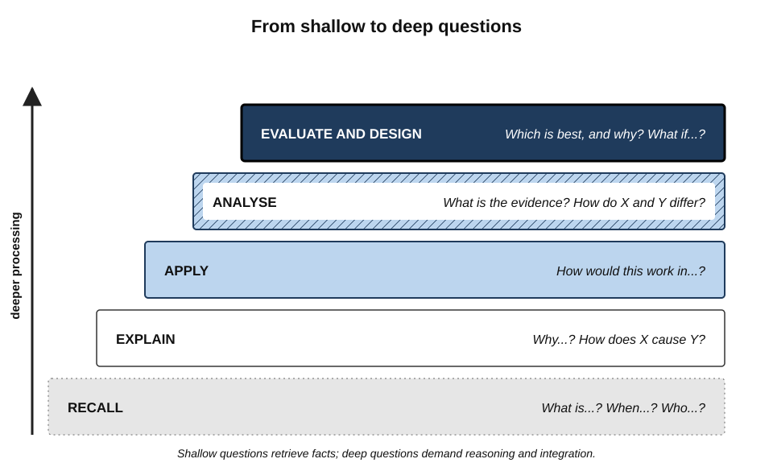
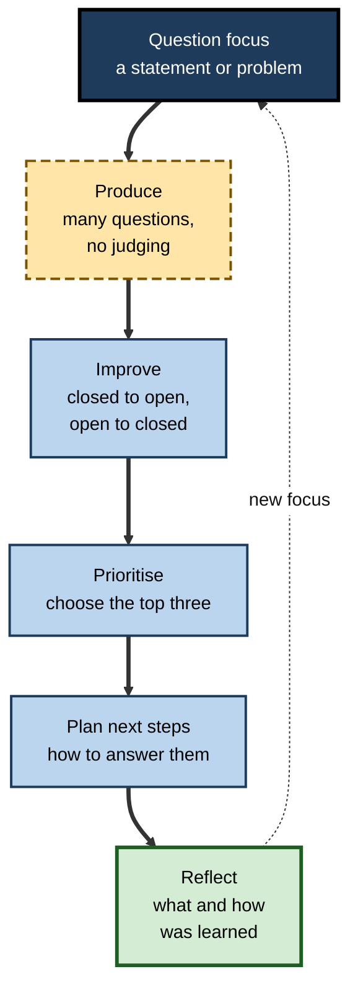
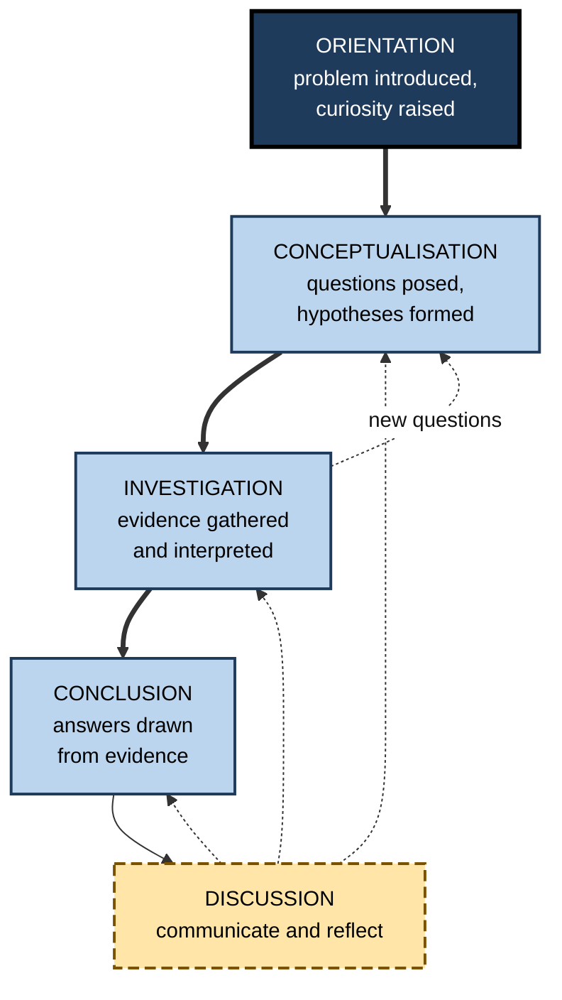
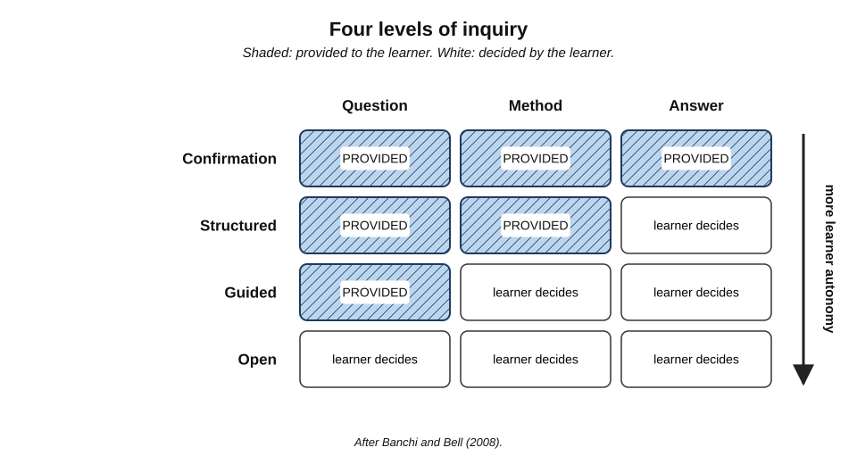
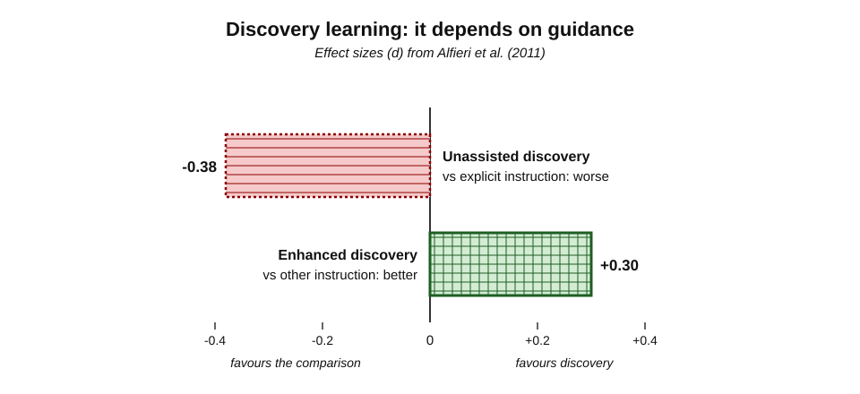
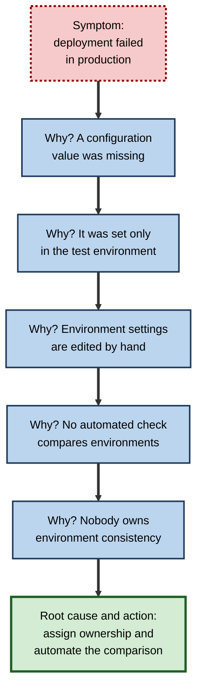

# A.4. Questioning and Inquiry-Based Learning

A new consultant reads a client's annual report and asks, "What were the revenues?" A senior partner reads the same report and asks, "Why did margins fall while revenues rose, and what would have to be true for that to continue?" The first question retrieves a fact; the second launches an investigation. The quality of a professional's learning is shaped, to a surprising degree, by **the quality of the questions they ask**.

> **Definition — Learner questioning:** the deliberate generation of questions by the learner — about meaning, causes, consequences, evidence and application — as a way of directing attention and building understanding.

> **Definition — Inquiry-based learning:** an approach in which learners acquire knowledge by investigating questions — posing them, gathering and interpreting evidence, and drawing and communicating conclusions — with varying degrees of guidance.

**Why it matters**

- Questions **direct attention**: a learner who asks "why?" processes meaning, not just wording.
- Generating a question requires noticing what one does not know — a core metacognitive skill.
- Inquiry mirrors professional work: diagnosis, research, analysis and investigation all begin with a question.
- The evidence on inquiry is genuinely mixed, so professionals need to know **which forms work and which do not**.

---

## Questions as a Learning Tool

### How rarely learners ask

- **Arthur Graesser and Natalie Person (1994)** studied question-asking in classrooms and in one-to-one tutoring.
  - In ordinary classrooms, individual students asked **very few** questions — far fewer than one per hour.
  - In tutoring, students asked **many times more**.
  - Most student questions were **shallow** — asking for facts or definitions.
  - Students who asked more **deep** questions tended to achieve higher examination scores.
- Reasons learners ask few questions:
  - **not knowing what they do not know** — a question needs a recognised gap;
  - **social cost** — fear of looking ignorant;
  - **pace** — no time is allowed for questions to form;
  - **habit** — schooling trains answering, not asking.

> **Key point:** learners rarely generate good questions **spontaneously**. The skill has to be prompted, structured and practised.

### Shallow and deep questions

Graesser and colleagues classified questions into categories, from simple verification to deep reasoning.

| | Shallow questions | Deep questions |
|---|---|---|
| Typical forms | Is it…? What is…? When…? Who…? | Why…? How does… cause…? What if…? What is the evidence…? |
| What they retrieve | Facts, definitions, verifications | Causes, consequences, mechanisms, justifications, comparisons |
| Cognitive process | Recall | Reasoning, explanation, integration |
| Example in finance | "What was the operating margin?" | "Why did the operating margin fall when sales grew?" |
| Example in software | "Which function throws the error?" | "Under what conditions does this function receive invalid input?" |

**Figure 1.** A ladder of question depth, from recall to evaluation and design.

> **Remember — deep question stems:** *Why…? How does X affect Y? What would happen if…? What is the evidence for…? How is X similar to or different from Y? What are the strengths and weaknesses of…? How could X be used to…?*

### Teaching learners to question

**Study card — Alison King (guided reciprocal peer questioning, 1989–1992)**

- **Design:** after lectures, students in pairs or small groups used **generic question stems** ("What is the main idea of…?", "How does … affect …?", "What is the difference between … and …?", "Why is … important?") to write questions about the content, then asked and answered each other's.
  - Compared with groups that discussed freely, or that wrote questions without stems.
- **Results:** students using guided stems showed **better comprehension** of the lectures and produced more elaborated explanations.
- **Conclusion:** structured prompts turn question-asking from a rare, shallow act into a productive learning activity.

**Study card — Rosenshine, Meister and Chapman (1996)**

- **Design:** a review of 26 intervention studies that taught students to **generate questions** while reading.
- **Results:**
  - substantial benefits on comprehension tests designed by the researchers (median effect size around **0.86**);
  - smaller benefits on standardised reading tests (median around **0.36**);
  - **signal words and generic question stems** were among the most effective prompts.
- **Conclusion:** question generation is teachable and improves comprehension, especially of the material practised.

> **Watch out:** larger effects on researcher-made tests than on standardised tests are common in education research. Researcher tests are closer to what was practised; standardised tests measure broader, harder-to-shift abilities. Both numbers are informative.

### The Question Formulation Technique

**Dan Rothstein and Luz Santana (2011)** of the Right Question Institute developed a structured method for generating questions, now used in schools, community organisations and professional training.

1. **A question focus** — a short statement, image or problem is presented.
2. **Produce questions** — as many as possible, following four rules:
   - ask as many questions as possible;
   - do not stop to discuss, judge or answer;
   - write every question exactly as stated;
   - change any statement into a question.
3. **Improve questions** — classify each as **closed** (yes/no or one word) or **open**, and convert some from one type to the other.
4. **Prioritise** — choose the three most important questions.
5. **Plan next steps** — decide how to answer the priority questions.
6. **Reflect** — what was learned, and how was it learned?

**Figure 2.** The Question Formulation Technique.

> **In practice:** the same method works in a project kick-off. Given the focus "Customer churn rose 4% this quarter", a team that spends ten minutes producing and prioritising questions before analysing data usually ends up investigating better hypotheses than one that starts querying immediately.

### Socratic questioning

- Named after Socrates, who taught by questioning pupils until they recognised contradictions in their own beliefs.
- **Richard Paul**, a scholar of critical thinking, described six common types of Socratic question:
  - **clarification** — "What exactly do you mean by…?"
  - **assumptions** — "What are we taking for granted here?"
  - **reasons and evidence** — "How do we know this?"
  - **viewpoints** — "How would a sceptic see this?"
  - **implications and consequences** — "If this is true, what follows?"
  - **questions about the question** — "Why is this the right question to ask?"

> **Mnemonic — "CARVIQ":** Clarification, Assumptions, Reasons, Viewpoints, Implications, Questions about the question.

### Questions asked by teachers

- **Wait time** — **Mary Budd Rowe** (1970s) found that teachers typically waited about **one second** after asking a question before answering it themselves or calling on someone.
  - When teachers waited **three seconds or more**, students gave longer, better-reasoned answers, more students responded, and students asked more questions.
- **Hinge questions** — a single, carefully designed question at a key point of a lesson, whose answers reveal whether the class has grasped the concept and can move on.
- **Cold calling with support** — asking any learner, not only volunteers, keeps everyone thinking; done kindly, with time to think, it raises participation.

> **Watch out:** questions that a teacher asks and immediately answers, or that only the fastest learner answers, make the session feel interactive while most learners remain passive.

---

## Inquiry-Based Learning

### What inquiry involves

**Margus Pedaste and colleagues (2015)** synthesised many inquiry models into five phases.

- **Orientation** — interest is stimulated and the problem is introduced.
- **Conceptualisation** — questions are posed and hypotheses formed.
- **Investigation** — evidence is gathered through exploration, experiment or data analysis, and interpreted.
- **Conclusion** — answers are drawn from the evidence.
- **Discussion** — findings are communicated and the process reflected on; this phase can occur throughout.

**Figure 3.** The phases of an inquiry cycle.

- **The 5E model** — developed by the Biological Sciences Curriculum Study team led by **Rodger Bybee** (late 1980s) and widely used in science teaching:
  - **Engage** → **Explore** → **Explain** → **Elaborate** → **Evaluate**.
  - Learners explore *before* the teacher explains, then apply the explanation to new situations.

> **Mnemonic — "5E":** Engage, Explore, Explain, Elaborate, Evaluate — explore first, then explain.

### Levels of inquiry

How much is left to the learner varies enormously. **Heather Banchi and Randy Bell (2008)**, building on earlier work, described four levels.

| Level | Question provided? | Method provided? | Answer known in advance? | Example |
|---|---|---|---|---|
| **Confirmation** | Yes | Yes | Yes | Repeat a standard calculation to verify a known result |
| **Structured** | Yes | Yes | No | Follow a given analysis plan on a new dataset |
| **Guided** | Yes | No | No | "Why did churn rise?" — learners design the analysis |
| **Open** | No | No | No | Learners choose what to investigate in the client's data |

**Figure 4.** Four levels of inquiry by how much the learner must decide.

> **Key point:** "inquiry" covers everything from following a recipe to independent research. Debates about whether inquiry "works" often talk past each other because they mean different levels.

---

## The Evidence on Inquiry

### The case against minimal guidance

- **Richard Mayer (2004)**, reviewing decades of research on discovering problem-solving rules, conservation in children and programming concepts, concluded that **pure discovery** was consistently less effective than **guided discovery**.
- **Paul Kirschner, John Sweller and Richard Clark (2006)** argued that **minimally guided** instruction — discovery, problem-based and inquiry learning without strong guidance — ignores the limits of novices' working memory.
  - Novices searching for solutions use working memory on search, leaving little for learning.
  - Experts can benefit from open problems; novices need explicit instruction and worked examples.

**Study card — Alfieri, Brooks, Aldrich and Tenenbaum (2011)**

- **Design:** two meta-analyses of 164 studies comparing discovery learning with other forms of instruction.
- **Results:**
  - **unassisted discovery** — learners left to discover on their own — performed **worse** than explicit instruction (d about **−0.38**);
  - **enhanced discovery** — with feedback, worked examples, scaffolding or prompts to explain — performed **better** than other forms of instruction (d about **0.30**).
- **Conclusion:** discovery helps when it is **guided** and when learners must explain their findings; unassisted discovery harms.

**Figure 5.** Unassisted and enhanced discovery compared with other forms of instruction.

### The case for guided inquiry

- **Cindy Hmelo-Silver, Ravit Golan Duncan and Clark Chinn (2007)** replied that well-designed inquiry and problem-based learning are **not** minimally guided — they include heavy scaffolding, and in that form produce good learning, especially of reasoning and transfer.
- **Erin Marie Furtak and colleagues (2012)** — a meta-analysis of inquiry-based science teaching found an overall positive effect (around half a standard deviation), with **larger effects when inquiry was teacher-guided** rather than student-led.
- **Ard Lazonder and Ruth Harmsen (2016)** — a meta-analysis of guidance in inquiry learning found that guidance improved learners' inquiry activities, their success during inquiry and their learning outcomes; more specific guidance helped younger and less experienced learners most.

> **Watch out:** the international PISA 2015 survey found that, across countries, students who reported more **enquiry-based** science teaching tended to score **lower** in science, while teacher-directed instruction was associated with higher scores. The finding is **correlational** — weaker classes may receive more enquiry activities, and survey items poorly distinguish guided from unguided inquiry — so it is contested. It nevertheless warns against inquiry without structure.

| | Unguided discovery | Guided inquiry | Explicit instruction |
|---|---|---|---|
| Who finds the key idea | Learner, alone | Learner, with prompts, feedback and timely explanation | Teacher presents it |
| Load on novices | Very high | Managed | Low |
| Effect on concept learning (novices) | Often negative | Positive | Positive |
| Effect on inquiry skills and transfer | Unreliable | Positive | Limited unless practised |
| Main risk | Misconceptions; wasted time | Poorly calibrated guidance | Passive reception; shallow processing |

> **Key point:** the research converges on **guided inquiry** — learners investigate genuine questions, but with structure, prompts, worked examples, feedback and explicit explanation at the right moments. Guidance should **fade** as competence grows.

---

## Questioning and Inquiry at Work

### Professional questioning frameworks

- **The 5 Whys** — associated with **Taiichi Ohno** and the Toyota Production System: ask "why?" repeatedly to move from a symptom to a root cause.
  - Strength: simple, forces causal thinking.
  - Weakness: tends to follow a single causal chain and stop at the asker's knowledge.
- **PICO** — used in evidence-based medicine to frame clinical questions: **P**atient or problem, **I**ntervention, **C**omparison, **O**utcome.
- **Hypothesis-driven problem-solving** — common in consulting: state an answer-shaped hypothesis early, then design analyses that could disprove it.
- **Question bursts** — **Hal Gregersen** of MIT popularised spending a few minutes generating only questions about a challenge, without answering, to reframe it.
- **After-action reviews** — four questions: What was supposed to happen? What actually happened? Why was there a difference? What will we do next time?

**Figure 6.** The 5 Whys applied to a failed software deployment.

### Worked example (illustrative): turning a vague brief into investigable questions

- **Situation:** a new analyst is told, "Find out what's going on with our customer satisfaction."
- **Step 1 — produce questions (five minutes, no judging):**
  - Has satisfaction actually fallen, or has the survey changed?
  - Which customer segments changed most?
  - When did the change start?
  - What else changed at that time — prices, staff, product, competitors?
  - Do satisfaction scores predict anything we care about, such as renewals?
  - Who responds to the survey, and has that changed?
- **Step 2 — improve:** convert "Has satisfaction fallen?" (closed) into "By how much, for whom and since when has satisfaction changed?" (open).
- **Step 3 — prioritise:** choose three:
  1. Is the change real or an artefact of who responds?
  2. Which segments and time periods account for most of the change?
  3. What operational changes coincided with it?
- **Step 4 — plan:** for each, name the data source and analysis — response-rate trends, segment breakdowns, a timeline of operational events.
- **Conclusion:** ten minutes of structured questioning converted an unanswerable brief into a focused investigation — and surfaced the possibility that the "problem" is a measurement artefact.

> **Watch out:** professionals under pressure often skip straight to the first analysis that comes to mind. The most expensive error in investigation is answering the **wrong question** precisely.

### Questioning with AI tools

- **Prompting is questioning.** The quality of what an AI system returns depends on the precision of the question — the same skill that drives human inquiry.
- **AI as a Socratic partner.** A learner can ask a model not to answer, but to pose increasingly deep questions about the learner's own explanation.
- **Risk:** AI makes it effortless to get answers to shallow questions, removing the friction that once pushed learners to formulate better ones.

> **In practice:** before asking an AI system or a colleague, write the question **twice** — first as it comes, then rewritten as a deep question (why, how, what if, what evidence). The rewriting is itself the learning.

### Case study (illustrative): an inquiry-based induction for data analysts

- **Situation:** a health-insurance company's analytics team onboarded six to ten graduate analysts a year with three weeks of tool training and data-dictionary lectures.
- **Problem:** after induction, analysts could write queries but struggled to scope ambiguous business requests; managers spent hours rewriting their analyses.
- **Diagnosis:**
  - induction was **confirmation-level**: every exercise gave the question, the method and the expected answer;
  - analysts had never practised **posing** or **refining** questions.
- **Actions:**
  1. Week 1 kept explicit instruction and worked examples of the main tables and tools.
  2. Week 2 used **structured** and then **guided** inquiry: real historical questions from managers ("Why did claims costs rise in the north-west?"), with analysts designing the analysis.
  3. Every inquiry began with a **15-minute question-formulation session** and ended with a presentation in which a senior analyst asked Socratic questions about assumptions and evidence.
  4. Seniors provided **hint cards** at predictable sticking points rather than solutions.
  5. Week 3 introduced one **open** inquiry, chosen by each analyst from a list of unresolved business questions.
- **Result:** managers reported that new analysts' first independent analyses needed far less rescoping; two open inquiries surfaced issues the business adopted as projects.
- **Side effects / caveats:** the guided week took more senior time than lectures had; one cohort with weaker SQL skills needed an extra day of explicit instruction before inquiry could work.
- **Lesson:** inquiry worked **because it was guided and sequenced** — explicit foundations first, then progressively more open questions, with expert questioning throughout.

---

## Open Questions

- **How much guidance, for whom, and when should it fade?**
  - Agreement that guidance helps novices leaves open how to calibrate and withdraw it for individual learners.
- **Does inquiry build general inquiry skills?**
  - Evidence that inquiry practice transfers to new domains, rather than improving inquiry within the practised domain, is limited.
- **How should the PISA correlations be interpreted?**
  - Disentangling the effects of guided and unguided inquiry in large surveys remains methodologically difficult.
- **Can question quality be taught at scale?**
  - Structured methods work in studies; embedding question-generation into ordinary courses and workplaces is less studied.
- **What will AI do to question-asking?**
  - Tools that answer anything might reduce or improve the quality of questions people learn to ask.

---

## Summary

- **Learner questioning** directs attention to meaning and reveals gaps; **inquiry-based learning** builds knowledge by investigating questions.
- Learners ask **few** and mostly **shallow** questions (**Graesser and Person, 1994**); **deep questions** — why, how, what if, what evidence — are associated with better learning.
- Question generation is **teachable**: **King's** guided question stems and the **Rosenshine et al. (1996)** review show clear comprehension gains; the **Question Formulation Technique** structures production, improvement and prioritisation.
- **Socratic questioning** (CARVIQ) probes clarification, assumptions, reasons, viewpoints, implications and the question itself; teachers' **wait time** raises answer quality.
- Inquiry phases: **orientation, conceptualisation, investigation, conclusion, discussion**; the **5E** model explores before explaining.
- Inquiry levels range from **confirmation** to **structured**, **guided** and **open**.
- Evidence: **unassisted discovery** underperforms explicit instruction (d ≈ −0.38), **enhanced discovery** outperforms (d ≈ 0.30) (**Alfieri et al., 2011**); **teacher-guided** inquiry works best; PISA correlations are a contested warning.
- At work: **5 Whys**, **PICO**, hypothesis-driven analysis, question bursts and after-action reviews; with AI, **rewrite shallow questions into deep ones** before asking.

---

## Self-Check

1. Define learner questioning and inquiry-based learning.
2. What did Graesser and Person (1994) find about student questions in classrooms and tutoring?
3. Distinguish shallow and deep questions, with an example of each from a professional field.
4. Describe King's guided reciprocal peer questioning and its result.
5. Why are effects of question-generation training larger on researcher-made tests than on standardised tests?
6. List the steps of the Question Formulation Technique and its four rules for producing questions.
7. Name the six types of Socratic question and give an example of one in a business setting.
8. What is wait time, and what happens when teachers extend it?
9. Distinguish the four levels of inquiry by what is provided to learners.
10. Summarise the argument of Kirschner, Sweller and Clark (2006) and the reply of Hmelo-Silver, Duncan and Chinn (2007).
11. What did Alfieri et al. (2011) find about unassisted and enhanced discovery?
12. Why is the PISA 2015 finding on enquiry-based teaching contested?
13. Apply the 5 Whys to "invoices were sent late this month" and identify one limitation of the method.
14. A manager asks a graduate to "look into why sales are down". Show how question formulation would improve the investigation.

### Answer Key

1. Learner questioning: deliberately generating questions about meaning, causes, consequences, evidence and application to direct attention and build understanding. Inquiry-based learning: acquiring knowledge by posing questions, gathering and interpreting evidence and drawing and communicating conclusions, with varying guidance.
2. Classroom students asked very few questions; in tutoring they asked many more; most were shallow; students asking more deep questions tended to score higher.
3. Shallow questions retrieve facts ("What was the operating margin?"); deep questions seek causes, mechanisms or justifications ("Why did margins fall while revenues grew?").
4. After lectures, students used generic stems to write questions, then asked and answered each other's. They comprehended lectures better than groups who discussed freely or questioned without stems.
5. Researcher-made tests are closer to the practised material; standardised tests measure broader abilities that change slowly. Both indicate real but differently generalisable gains.
6. Question focus; produce; improve (closed/open); prioritise; plan next steps; reflect. Rules: ask as many as possible; do not stop to discuss, judge or answer; write each exactly as stated; change statements into questions.
7. Clarification, assumptions, reasons and evidence, viewpoints, implications and consequences, questions about the question. E.g. assumptions: "What are we assuming about customers' willingness to switch suppliers?"
8. The pause after a question before anyone answers. Extending it from about one second to three or more produces longer, better-reasoned answers, more respondents and more student questions.
9. Confirmation: question, method and answer given. Structured: question and method given, answer unknown. Guided: question given, method designed by learners. Open: learners choose the question as well.
10. Kirschner et al.: minimally guided instruction overloads novices' working memory, so explicit instruction and worked examples are more effective. Hmelo-Silver et al.: well-designed inquiry and problem-based learning are heavily scaffolded, not minimal, and in that form are effective, especially for reasoning and transfer.
11. Unassisted discovery underperformed explicit instruction (d ≈ −0.38); discovery enhanced with feedback, worked examples, scaffolding or explanation prompts outperformed other instruction (d ≈ 0.30).
12. It is correlational; weaker classes may receive more enquiry activities; survey items do not separate guided from unguided inquiry. It warns against unstructured inquiry but cannot show inquiry itself causes lower scores.
13. E.g. late invoices → billing run delayed → waiting for timesheet approvals → managers approve late → no reminder and approval not tied to any deadline → nobody owns the approval schedule. Limitation: follows one causal chain, may miss multiple causes, and depends on the knowledge of those asking.
14. Spend a few minutes producing questions (Are sales down in all regions? Since when? Volume or price? Which customers? What changed internally and in the market? Is it seasonal?); convert closed questions into open ones; prioritise the three most diagnostic; plan the data and analyses for each. This prevents premature analysis and surfaces artefacts such as seasonality.

---

## Glossary

| Term | Meaning |
|---|---|
| 5E model | Engage, Explore, Explain, Elaborate, Evaluate — an inquiry teaching sequence. |
| 5 Whys | Repeatedly asking "why?" to trace a symptom to a root cause. |
| After-action review | A structured review comparing intended and actual outcomes and the reasons for the difference. |
| Closed question | A question answerable with yes, no or a single fact. |
| Confirmation inquiry | Inquiry in which question, method and answer are all provided. |
| Deep question | A question about causes, mechanisms, consequences, evidence or comparisons. |
| Enhanced discovery | Discovery learning supported by feedback, worked examples, scaffolding or explanation prompts. |
| Guided inquiry | Inquiry in which the question is given but learners design the method. |
| Hinge question | A diagnostic question at a key point of a lesson that shows whether to move on. |
| Inquiry-based learning | Learning by investigating questions with varying degrees of guidance. |
| Learner questioning | Deliberate generation of questions by the learner to build understanding. |
| Open inquiry | Inquiry in which learners choose the question, method and interpretation. |
| Open question | A question inviting explanation or elaboration. |
| PICO | Patient or problem, Intervention, Comparison, Outcome — a framework for clinical questions. |
| Question Formulation Technique | A structured method for producing, improving and prioritising questions. |
| Shallow question | A question asking for facts, definitions or verification. |
| Socratic questioning | Disciplined questioning that probes meaning, assumptions, evidence and implications. |
| Structured inquiry | Inquiry in which question and method are given but the answer is unknown. |
| Unassisted discovery | Discovery learning without guidance or feedback. |
| Wait time | The pause between asking a question and accepting or giving an answer. |
