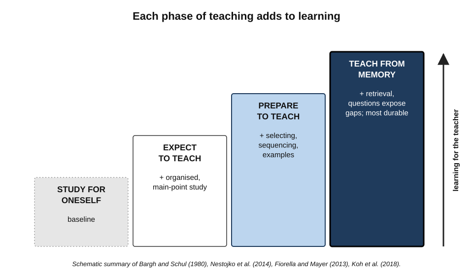
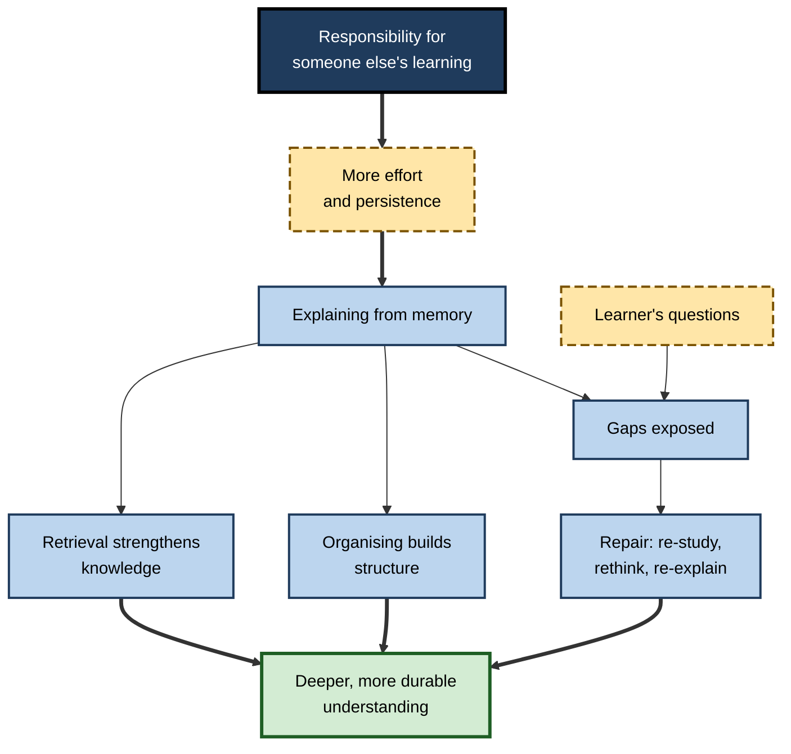
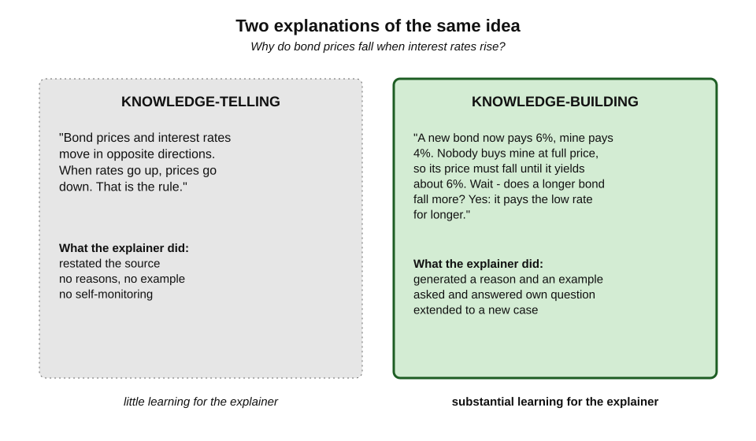
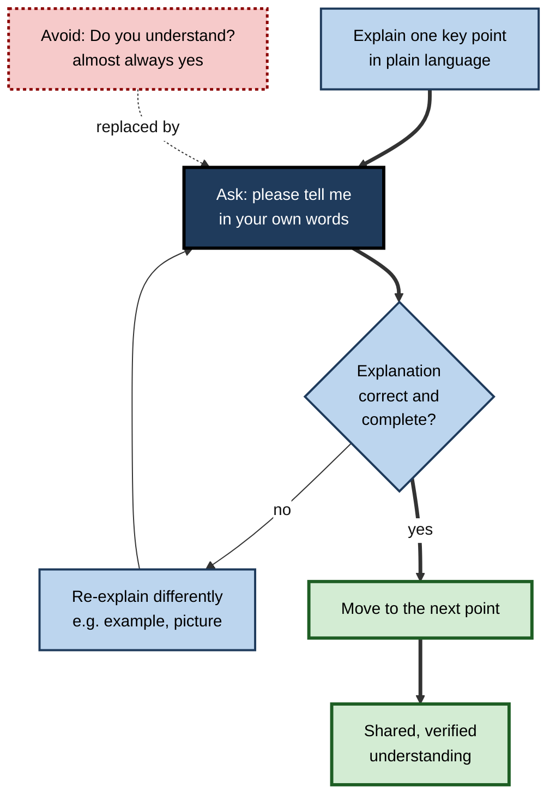
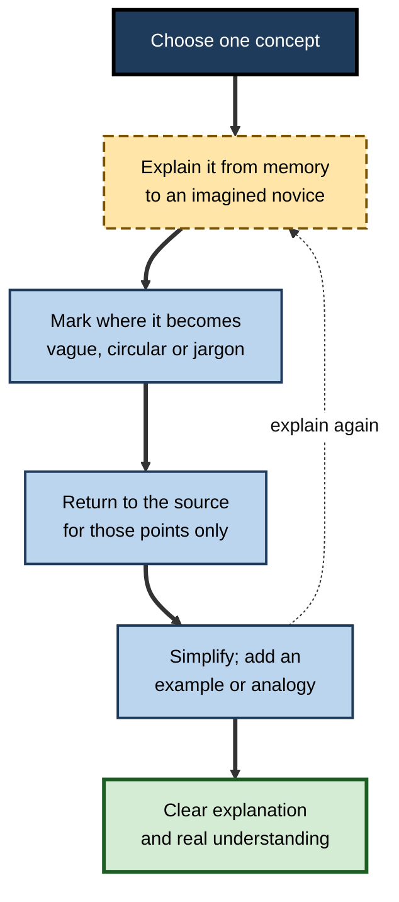

# A.5. Teach-Back and the Protégé Effect

A new engineer is asked to run next week's team session on the deployment pipeline she joined only a month ago. She reads the documentation with unusual care, draws the pipeline from memory, and discovers three steps she had never really understood. By the end of the session she knows the pipeline better than colleagues who have used it for a year. The Roman philosopher Seneca observed the same thing two thousand years ago: *homines dum docent discunt* — "people learn while they teach".

> **Definition — Learning by teaching:** the gain in a person's own understanding that results from preparing to teach, explaining to others and responding to their questions.

> **Definition — Protégé effect:** the tendency of learners to work harder and learn more when they are responsible for someone else's learning — a pupil, a colleague or a computer-simulated student — than when learning only for themselves.

> **Definition — Teach-back:** a communication method in which the person who has been told something explains it back in their own words, so that the explainer can check and correct their understanding.

**Why it matters**

- Explaining is one of the most powerful ways to discover what one does not understand.
- Teaching changes **how** a person studies: with more organisation, more attention to main ideas and more effort.
- Teach-back is a proven safety tool in healthcare, aviation and the military — anywhere misunderstanding is dangerous.
- Professionals spend much of their time explaining; used deliberately, that time becomes learning time.

---

## Three Things Teaching Involves

Teaching is not one act. Its learning benefits come from three distinct phases, each with its own mechanism.

- **Expecting to teach** — knowing in advance that one will have to explain the material.
  - Changes study behaviour: more organisation, focus on main points, more questions anticipated.
- **Preparing to teach** — organising material for an audience.
  - Requires selecting what matters, sequencing it, finding examples and anticipating confusion.
- **Actually teaching** — explaining aloud and answering questions.
  - Requires **retrieving** the material, often without notes, and **responding** to questions that expose gaps.

**Figure 1.** How expecting, preparing and actually teaching each add to learning.

### Expecting to teach

**Study card — Nestojko, Bui, Kornell and Bjork (2014)**

- **Design:** participants studied a passage for the same time, told either that they would be **tested** on it or that they would **teach** it to another student. In fact, everyone was tested; nobody taught.
- **Results:** those expecting to teach recalled **more** of the passage, recalled the **main points** better, organised their recall more coherently and answered questions about main points more accurately.
- **Conclusion:** the **expectation** of teaching alone changes how people study — they adopt strategies that teachers use, such as organising and prioritising.

- An earlier study by **John Bargh and Yaacov Schul (1980)** had found a similar benefit of studying in order to teach.

> **In practice:** before studying anything important, decide **whom** one would explain it to and **what** they would need to know first. Even if the explanation never happens, the material is studied differently.

### Preparing and actually teaching

**Study card — Fiorella and Mayer (2013)**

- **Design:** students studied a lesson on the Doppler effect.
  - Some studied normally; some prepared to teach; some prepared and then **actually taught** the material in a short video lecture.
- **Results:**
  - preparing to teach improved performance on an **immediate** test;
  - **actually teaching** produced benefits that **lasted** to a test a week later.
- **Conclusion:** expecting and preparing help in the short term; explaining aloud adds a more durable benefit.

**Study card — Koh, Lee and Lim (2018)**

- **Design:** after studying, participants either taught the material **with notes**, taught it **without notes**, retrieved it in a test without teaching, or did a control task.
- **Results:** teaching **without notes** improved later learning — about as much as simply retrieving the material; teaching **with notes** gave little benefit.
- **Conclusion:** much of the benefit of teaching comes from **retrieval** — having to produce the material from memory.

> **Key point:** the most valuable part of teaching is **explaining from memory**. Reading slides aloud to an audience is teaching in form but not in function.

| | Expecting to teach | Preparing to teach | Teaching from notes | Teaching from memory, with questions |
|---|---|---|---|---|
| Main mechanism | Changed study strategy | Organising and selecting | Explaining, but little retrieval | Retrieval, explanation, responding to gaps |
| Typical benefit | Better organised recall | Better immediate understanding | Small | Largest and most durable |
| Effort | Low | Moderate | Moderate | High |
| Professional example | Studying a contract knowing one will brief the team | Building a briefing deck | Reading slides to the team | Briefing without slides; taking questions |

---

## Why Explaining Teaches the Explainer

### Mechanisms

- **Retrieval** — explaining from memory strengthens and reorganises the knowledge retrieved.
- **Organisation** — an explanation must have a structure: a beginning, an order, connections between parts.
- **Gap detection** — trying to explain exposes points one cannot explain; the **illusion of explanatory depth** collapses.
- **Elaboration** — the explainer adds examples, analogies and reasons not present in the source.
- **Responding to questions** — a learner's question often targets precisely what the explainer has glossed over.
- **Motivation and responsibility** — knowing someone depends on one's explanation raises effort.

**Figure 2.** The mechanisms through which teaching improves the teacher's own learning.

### Knowledge-telling and knowledge-building

**Rod Roscoe and Michelene Chi (2007)** reviewed research on peer tutoring and asked why tutors sometimes learn a great deal and sometimes almost nothing.

- **Knowledge-telling** — the tutor summarises or repeats what the source said, with little monitoring of their own understanding.
  - Common; produces little tutor learning.
- **Knowledge-building** — the tutor generates new inferences, connects ideas, notices and repairs their own confusion and answers questions by reasoning.
  - Less common; produces substantial tutor learning.
- **Deep questions from the tutee** — "why?", "what if?" — are among the strongest triggers of knowledge-building.

**Figure 3.** Knowledge-telling and knowledge-building explanations of the same idea.

| | Knowledge-telling | Knowledge-building |
|---|---|---|
| What the explainer does | Restates the source | Generates inferences, examples and reasons |
| Self-monitoring | Rare | Frequent: "Wait — that doesn't follow…" |
| Typical trigger | Shallow questions or none | Deep questions, confusion, disagreement |
| Learning for the explainer | Small | Substantial |
| Example | "Interest-rate rises lower bond prices." | "When rates rise, new bonds pay more, so old bonds must fall in price to compete — which is why longer bonds fall more." |

> **Watch out:** being asked to teach does not guarantee learning. A tutor who reads out the textbook, or a senior who repeats a standard briefing, is knowledge-telling. The benefit requires **explaining beyond the source** and **responding to genuine questions**.

### Evidence from peer tutoring

- **Peter Cohen, James Kulik and Chen-Lin Kulik (1982)** — a meta-analysis of school tutoring programmes found that **tutors**, not only their tutees, gained in achievement, with modest average effects.
- **Larger tutor gains** appear when tutors must explain concepts rather than check answers, when tutees ask questions, and when tutors are trained to prompt deep thinking.

---

## The Protégé Effect

### Teachable agents

**Study card — Chase, Chin, Oppezzo and Schwartz (2009)**

- **Design:** school pupils used **Betty's Brain**, a computer environment developed by Daniel Schwartz, Gautam Biswas and colleagues, in which pupils teach a virtual student ("Betty") by building a concept map of a science topic; Betty then answers questions using the map.
  - One group believed they were teaching Betty; another group did the same activities for themselves.
- **Results:** pupils spent **more effort** learning for their virtual student — for example, more time reading and revising — than for themselves, and learned more.
- **Conclusion:** responsibility for a protégé — even a simulated one — increases effort; the authors named this the **protégé effect**.

- **Explanations offered:**
  - **Ego protection** — when the agent fails, the failure is partly the agent's, so pupils persist rather than giving up.
  - **Responsibility** — people care about the success of someone who depends on them.
  - **Distancing** — seeing one's knowledge in another's performance makes errors easier to recognise.

> **Example (illustrative):** a new manager preparing to coach a struggling team member on sales negotiation studies negotiation research more carefully than she ever did for her own deals — and changes her own practice as a result.

### Explaining to an imagined audience

- Explaining to an **imagined** or **recorded** audience — for example, making a short explanatory video — has produced learning benefits in several studies, though usually smaller than live teaching with questions.
- **Rubber-duck debugging** — described in *The Pragmatic Programmer* (Andrew Hunt and David Thomas, 1999): a programmer explains code line by line to a rubber duck; the act of explaining often reveals the bug.
- **Self-explanation** is the limiting case: explaining to oneself. It helps, but lacks the motivation and the external questions of a real audience.

---

## Teach-Back as a Safety Method

In some fields, misunderstanding kills. These fields developed teach-back not as a study technique but as a way to **check that a message was received as intended**.

### Teach-back in healthcare

- **The problem:** patients forget or misunderstand much of what clinicians tell them, especially about medicines and self-care; asking "Do you understand?" almost always produces "yes".
- **The method:**
  1. Explain one key point at a time in plain language (**chunk**).
  2. Ask the patient to explain it back in their own words (**check**) — "I want to be sure I explained this clearly. Can you tell me how you will take this medicine?"
  3. If the explanation is wrong or incomplete, **re-explain differently** and check again.
  4. Repeat until the patient's explanation is correct.
- **The responsibility shift:** the phrasing makes clear that the **explainer**, not the patient, is being tested.

**Study card — Schillinger and colleagues (2003)**

- **Setting:** consultations between primary-care physicians and patients with diabetes and limited health literacy in a US public hospital.
- **Finding:** physicians rarely checked patients' understanding by asking them to restate instructions; when they did, patients were more likely to have **good blood-glucose control**.
- **Conclusion:** closing the communication loop is associated with better outcomes, especially for patients with limited literacy.

- Later systematic reviews of teach-back in healthcare have generally found improvements in **patients' knowledge, adherence and self-care**, with more mixed evidence on hard clinical outcomes such as readmissions.

**Figure 4.** The teach-back loop used in clinical communication.

| | "Do you understand?" | Teach-back |
|---|---|---|
| What the listener does | Says yes or no | Explains in own words |
| What it reveals | Confidence and politeness | Actual understanding and specific errors |
| Who is being tested | The listener, implicitly | The explainer, explicitly |
| Typical result | False reassurance | Errors found and corrected |
| Learning for the listener | Little | Retrieval and organisation of the instructions |

### Read-back and brief-back elsewhere

- **Aviation** — pilots **read back** air-traffic-control clearances; controllers listen for errors (**hear-back**).
- **Military** — after receiving orders, subordinate leaders give a **back-brief** explaining how they will carry them out.
- **Surgery and anaesthesia** — closed-loop communication: an instruction is repeated back before it is executed.
- **Project management** — at kick-off, each workstream lead states back the scope, deadlines and dependencies in their own words.

> **Mnemonic — "TELL, ASK, FIX, REPEAT":** tell one point; ask for it back; fix what is wrong; repeat for the next point.

---

## Using Teaching to Learn

### Methods

- **Teach a colleague** — the most effective: live, with questions, without notes.
- **Run a team session** — volunteer to explain a new tool, regulation or technique to the team.
- **Write an explanation** for a newcomer — a short internal guide, a wiki page, a one-page primer.
- **Record a short explanation** — a five-minute video or voice note, without a script.
- **Explain to an AI system and ask it to question** — instruct it to act as a curious novice and ask "why?" at every step.
- **The "explain it simply" method** — often labelled the **Feynman technique**:
  1. choose a concept;
  2. explain it in plain language, as to someone with no background;
  3. note where the explanation becomes vague, jargon-laden or circular, and go back to the source for those points;
  4. simplify and use analogies until the whole explanation flows.

> **Watch out:** the "Feynman technique" is a modern popular label. The physicist Richard Feynman was famous for explaining ideas simply and valued understanding over memorised terms, but he did not devise or name a four-step study method. The method itself is sound because it combines explanation, gap detection and re-study.

**Figure 5.** The explain-it-simply cycle.

### Worked example (illustrative): a compliance officer learning a new regulation

- **Situation:** a compliance officer must master a new 80-page data-protection regulation in two weeks and brief 30 managers.
- **Plan built on the teaching phases:**
  1. **Expect** — before reading, list the five questions managers will certainly ask ("Does this apply to our customer database?").
  2. **Prepare** — read with those questions in mind; draft a one-page answer to each.
  3. **Teach from memory** — rehearse the briefing aloud to a colleague **without the draft**; the colleague asks "why?" and "what if?" at every claim.
  4. **Repair** — each point where the officer stalled goes back to the regulation.
  5. **Teach for real** — brief the managers, ending each section with teach-back: "What would you now do if a customer asked to have their data deleted?"
- **Outcome comparison:**

| | Read and summarise | Teaching-based plan |
|---|---|---|
| Officer's study time | About 12 hours | About 14 hours |
| Gaps found before briefing | Few | Eleven points needing re-study |
| Managers' errors found during briefing | Unknown | Four common misunderstandings caught and corrected |
| Officer's ability to answer novel questions a month later | Patchy | Strong |

*Illustrative figures.*

- **Conclusion:** two extra hours bought a much deeper understanding for the officer and verified understanding for the managers.

> **Watch out:** teach-back with managers can feel patronising if phrased as a test of them. Frame it as a check on **the briefing**: "Let me check I've explained this well — how would you handle…?"

### Case study (illustrative): teach-back in software onboarding

- **Situation:** a fintech company's engineering teams onboarded new developers by pairing them with a "buddy" who explained the codebase over the first two weeks.
- **Problem:** six months later, new developers still depended heavily on buddies for questions about system architecture; buddies complained of interruptions.
- **Diagnosis:**
  - buddies explained, new developers listened — passive for the newcomer;
  - nobody checked what newcomers had actually understood;
  - buddies themselves rarely gained from the explanations, which were repeated knowledge-telling.
- **Actions:**
  1. Each newcomer gave a **weekly 15-minute explanation** to their team of one part of the system they had explored — from memory, with a whiteboard, followed by questions.
  2. Buddies switched from explaining to **asking**: "Walk me through what happens when a payment fails."
  3. Each architecture explanation by a senior ended with **teach-back**: the newcomer explained the component back in two minutes.
  4. Newcomers' explanations were turned into short internal documents, reviewed by a senior.
- **Result:** within two quarters, the volume of basic architecture questions to seniors fell noticeably; several newcomer-written documents became standard onboarding material; seniors reported that newcomers' questions in sessions exposed outdated assumptions in the documentation.
- **Side effects / caveats:** some newcomers found presenting in week one stressful; teams that allowed newcomers to choose their first topic and present to a smaller group saw less anxiety.
- **Lesson:** making newcomers **teach** and seniors **ask** turned onboarding into active learning for both.

---

## Limits and Risks

- **Teaching errors spreads errors** — a confident but wrong explainer misleads the audience; review by someone more expert is needed when stakes are high.
- **Anxiety** — public explanation can overwhelm anxious or very new learners; smaller audiences and choice of topic help.
- **Time cost** — preparing to teach takes longer than reading; the gain must justify it.
- **Knowledge-telling drift** — repeated explanations of the same material become recitation, with diminishing learning.
- **Unequal benefit in groups** — when a group "teaches each other", the strongest member often explains and benefits most while others listen.

> **Remember:** teaching teaches the teacher when it is **from memory**, **beyond the source**, **to someone who asks real questions**, with **errors checked**.

---

## Open Questions

- **How much of the benefit is simply retrieval?**
  - Studies such as Koh, Lee and Lim (2018) suggest much of it; whether explanation and audience add distinct benefits for complex material is still being tested.
- **Does an AI "learner" produce the protégé effect?**
  - Teachable agents suggest it can; whether general-purpose AI systems acting as novices evoke the same responsibility and effort is untested at scale.
- **What makes teach-back work in practice?**
  - In healthcare, the method is effective in studies but often omitted under time pressure; how to make it routine is an implementation question.
- **Who benefits most?**
  - Effects of teaching on very low-knowledge learners, and on learners with high social anxiety, are not well understood.
- **How should organisations reward teaching?**
  - Internal teaching benefits the teacher and the organisation but rarely counts in performance reviews.

---

## Summary

- **Learning by teaching**: people learn while they teach; the **protégé effect** adds that responsibility for another's learning raises effort; **teach-back** verifies understanding by asking for an explanation in one's own words.
- Teaching has three phases: **expecting** (changes study strategy — Nestojko et al., 2014), **preparing** (organising — immediate benefit) and **actually teaching** (more durable benefit — Fiorella and Mayer, 2013).
- Much of the benefit comes from **retrieval**: teaching **without notes** helps; teaching **with notes** helps little (Koh, Lee and Lim, 2018).
- Tutors learn through **knowledge-building**, not **knowledge-telling** (Roscoe and Chi, 2007); deep questions from learners trigger it.
- **Teachable agents** such as Betty's Brain show the protégé effect (Chase et al., 2009).
- In healthcare, teach-back (**chunk and check**) replaces "Do you understand?" and is associated with better understanding and self-care; aviation **read-back**, military **back-briefs** and surgical closed-loop communication apply the same logic.
- Methods: teach a colleague, run a session, write a primer, record an explanation, ask an AI to question one's explanation, and the **explain-it-simply** cycle (the popular "Feynman technique").
- Limits: spreading errors, anxiety, time cost, knowledge-telling drift and unequal benefit in groups.

---

## Self-Check

1. Distinguish learning by teaching, the protégé effect and teach-back.
2. What did Nestojko et al. (2014) find, and why is it notable that nobody actually taught?
3. Summarise Fiorella and Mayer (2013) on preparing to teach versus actually teaching.
4. What did Koh, Lee and Lim (2018) conclude about teaching with and without notes?
5. Distinguish knowledge-telling from knowledge-building and give an example of each.
6. Describe the Betty's Brain studies and three explanations of the protégé effect.
7. Why is "Do you understand?" a poor check, and how does teach-back fix the problem?
8. Outline the four steps of clinical teach-back and the purpose of its phrasing.
9. Give three examples of read-back or back-brief practices outside healthcare.
10. What is wrong with calling the explain-it-simply method "Feynman's technique", and why is the method sound anyway?
11. Name four risks of using teaching as a learning method.
12. A senior engineer gives the same onboarding talk every month and says she "learns nothing new" from it. Explain why, and suggest a change.
13. Design a study plan for a learner who must understand a new accounting standard in one week, using all three phases of teaching.
14. A project manager ends kick-off meetings by asking "Any questions?" and later finds that teams misunderstood scope. Propose a teach-back procedure.

### Answer Key

1. Learning by teaching: the teacher's own gain from preparing, explaining and answering. Protégé effect: greater effort and learning when responsible for someone else's learning. Teach-back: the listener explains back in their own words so the explainer can check and correct understanding.
2. Expecting to teach improved recall, organisation and memory for main points compared with expecting a test. Because nobody taught, the benefit came purely from changed study strategies prompted by the expectation.
3. Preparing to teach improved immediate test performance; actually teaching in a video lecture produced benefits that lasted to a test a week later.
4. Teaching without notes improved learning about as much as retrieval practice; teaching with notes gave little benefit — so much of the teaching benefit is retrieval.
5. Knowledge-telling restates the source ("Interest-rate rises lower bond prices"); knowledge-building generates inferences and reasons ("New bonds pay more, so old ones must fall in price to compete, and longer bonds fall more"). Only the latter produces substantial tutor learning.
6. Pupils taught a virtual student by building a concept map it used to answer questions; they worked harder for the agent than for themselves and learned more. Explanations: ego protection, responsibility, and distancing that makes errors easier to see.
7. It invites a socially easy "yes" and reveals nothing about actual understanding. Teach-back asks for an explanation in the listener's words, exposing specific errors, and frames the check as testing the explainer.
8. Explain one point plainly; ask for it back in their own words; if wrong, re-explain differently and re-check; repeat for each point. The phrasing ("I want to be sure I explained clearly") puts responsibility on the explainer and reduces embarrassment.
9. Pilots reading back clearances; military back-briefs; surgical closed-loop repetition of instructions; workstream leads restating scope at project kick-off.
10. Feynman did not devise or name a four-step study method; the label is modern. The method works because it combines explanation from memory, gap detection, targeted re-study and simplification.
11. Spreading errors, anxiety, time cost, knowledge-telling drift, unequal benefit in groups (any four).
12. Repeating a familiar talk is knowledge-telling — recitation without new inference or gap detection. She could invite deep questions, change the format to answering newcomers' questions, or update the talk to explain recent changes and their reasons.
13. Day 1: list the questions colleagues will ask (expect). Days 2–4: study with those questions; draft short answers and examples (prepare). Day 5: explain the standard from memory to a colleague who asks "why?" (teach without notes). Day 6: re-study gaps. Day 7: brief the team, using teach-back on key points.
14. At the end of kick-off, each workstream lead states back in their own words their scope, out-of-scope items, deadlines and dependencies; the project manager corrects discrepancies and records the agreed version; repeat briefly at the first progress meeting.

---

## Glossary

| Term | Meaning |
|---|---|
| Back-brief | A military practice in which subordinates explain how they will carry out orders. |
| Chunk and check | Explaining one point at a time and checking each with teach-back. |
| Closed-loop communication | Repeating an instruction back before carrying it out. |
| Explain-it-simply method | Explaining a concept plainly, finding gaps, re-studying and simplifying; popularly called the Feynman technique. |
| Hear-back | The listener's check that a read-back matches the original instruction. |
| Knowledge-building | Explaining by generating new inferences, connections and repairs of one's own confusion. |
| Knowledge-telling | Explaining by restating source material with little self-monitoring. |
| Learning by teaching | The teacher's gain in understanding from preparing, explaining and answering questions. |
| Peer tutoring | Learners teaching other learners, usually of similar status. |
| Protégé effect | Greater effort and learning when responsible for another's learning. |
| Read-back | Repeating a received instruction aloud, as in aviation clearances. |
| Rubber-duck debugging | Explaining code aloud to an object to find errors. |
| Teach-back | Asking a listener to explain information back in their own words to verify understanding. |
| Teachable agent | A computer-simulated student that learners teach. |
