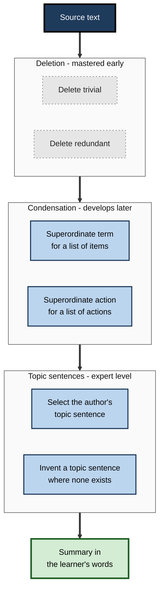
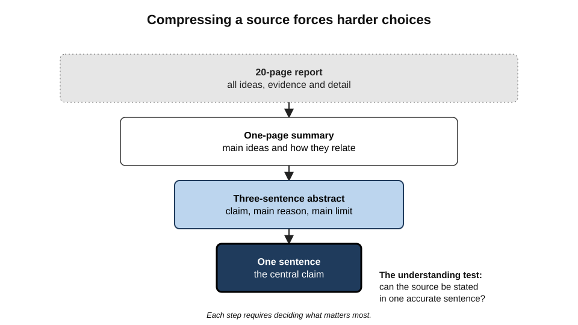
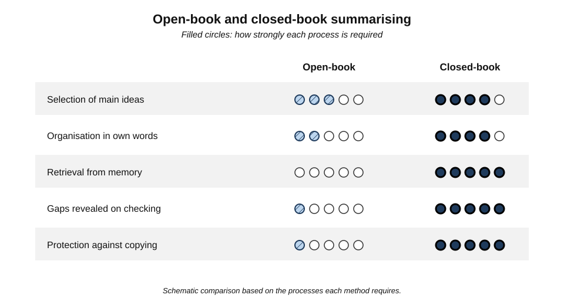
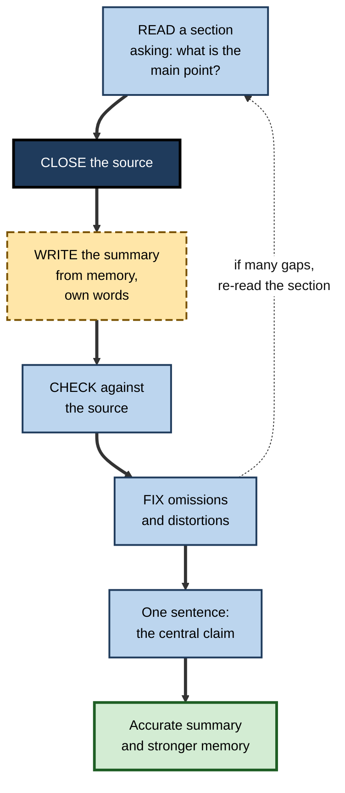
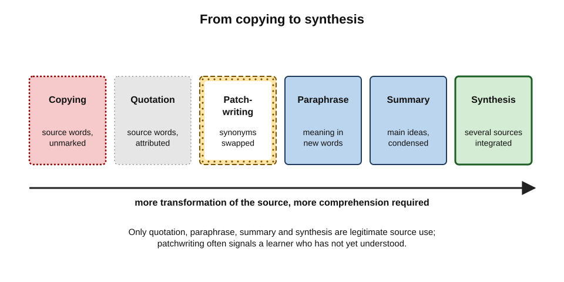
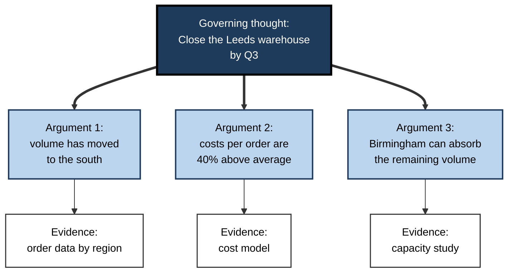

# A.6. Summarizing and Paraphrasing Content

A partner hands a trainee lawyer a 40-page judgment and says, "Tell me in two minutes what this means for our client." The trainee who can do that has understood the judgment; the trainee who reads out the headnote has not. Reducing a large body of information to its essential meaning, in one's own words, is one of the most demanding — and most revealing — things a learner can do.

> **Definition — Summarising:** producing a shorter version of a source that captures its main ideas and their relationships, in the summariser's own words, without adding new opinions.

> **Definition — Paraphrasing:** restating a specific passage in different words and structure while preserving its full meaning, at roughly the same level of detail.

**Why it matters**

- Summarising forces **selection** (what matters?) and **organisation** (how do the main ideas relate?) — two core processes of understanding.
- Paraphrasing tests whether a learner grasps meaning or merely recognises words.
- Both are among the most common tasks in professional life: briefings, executive summaries, handovers, case notes, minutes, reports.
- The evidence shows they can be powerful **or** nearly useless, depending on how they are done — so technique matters.

---

## Summary, Paraphrase and Their Relatives

| | Quotation | Paraphrase | Summary | Synthesis |
|---|---|---|---|---|
| Length relative to source | Same | About the same | Much shorter | Varies |
| Words | Source's own | Learner's own | Learner's own | Learner's own |
| Scope | A passage | A passage | A whole source | Several sources |
| What is kept | Exact wording | All ideas of the passage | Main ideas only | Themes, agreements, conflicts |
| Main cognitive demand | Selection | Comprehension, re-expression | Selection, condensation, organisation | Comparison, integration, judgement |

- **Précis** — a summary that preserves the original's order and proportions; a traditional exercise in English and French schooling.
- **Abstract** — a structured summary of a research paper: purpose, method, results, conclusion.
- **Executive summary** — a summary written for a decision-maker, leading with the conclusion and recommendation.
- **Gist** — the central meaning of a text, often in a single sentence.

> **Key point:** summarising and paraphrasing are not "writing tasks" separate from learning. Both are ways of **thinking about the content** whose output happens to be text.

---

## How Summarising Works in the Mind

### Macrostructure

- **Walter Kintsch and Teun van Dijk (1978)** proposed that readers understand a text by building two levels of representation:
  - the **microstructure** — the individual propositions (idea units) of each sentence;
  - the **macrostructure** — the overall gist, built by applying **macrorules** to the microstructure.
- **Three macrorules:**
  - **deletion** — drop propositions that are not needed to interpret others;
  - **generalisation** — replace a set of specific propositions with a more general one;
  - **construction** — replace a sequence of propositions with one that they jointly imply.
- **A summary is a written macrostructure.** Writing one forces the reader to build it, rather than assuming it has been built.

### The summarisation rules

**Study card — Ann Brown and Jeanne Day (1983)**

- **Design:** students from age about 10 to college age, plus experienced adult writers, summarised short texts; their summaries were analysed for the rules applied.
- **Six rules identified:**
  1. delete trivial material;
  2. delete redundant material;
  3. replace a list of items with a superordinate term (*cats, dogs, rabbits* → *pets*);
  4. replace a list of actions with a superordinate action (*packed, drove, checked in* → *travelled*);
  5. select a topic sentence where the author provides one;
  6. invent a topic sentence where none is given.
- **Results:**
  - even young students used **deletion** well;
  - **superordination** and especially **inventing topic sentences** developed late and were used reliably only by older and expert summarisers;
  - weaker summarisers often used a **copy–delete** strategy — copying sentences and dropping some.
- **Conclusion:** summarising well requires **transformation**, not just deletion; transformation is a learned skill and can be taught.

**Figure 1.** The summarisation rules, from deletion to invention.

> **Mnemonic — "Delete, Lump, Label":** **delete** what is trivial or repeated; **lump** lists into a general term; **label** each section with a topic sentence — invented if necessary.

### Compression as a test of understanding

**Figure 2.** Compressing a source step by step, from full text to a single idea.

- Each step of compression **forces harder choices**: a page can include most ideas; a sentence must state the central claim and its main qualification.
- **The one-sentence test** — if a learner cannot state the core of a source in one accurate sentence, the macrostructure has not been built.
- **GIST** — a classroom procedure (James Cunningham, 1982) in which students summarise successive sentences of a paragraph in a fixed number of words (often 20), forcing condensation.

---

## What the Evidence Shows

### Why summarising received a low rating

- **John Dunlosky and colleagues (2013)** rated summarisation as a technique of **low utility** for students studying alone.
  - Benefits were found mainly when learners had been **trained** to summarise well.
  - Untrained learners tended to **copy and delete**, which involves little transformation.
  - Summaries benefited some outcomes (memory for main ideas) more than others.
- **Writing-to-learn research** — **Robert Bangert-Drowns, Michael Hurley and Barbara Wilkinson (2004)** found a **small** average benefit of writing tasks in school and college courses, which was **larger** when tasks prompted learners to reflect on their own understanding and confusions.
- **Writing about reading** — **Steve Graham and Michael Hebert (2010)**, reviewing school studies, found that writing summaries of texts improved reading comprehension, with clearer benefits than simply reading or rereading.

> **Watch out:** "summarising is a weak technique" is often repeated in study-skills advice. The more accurate conclusion is: **summarising as most learners do it — open-book, copy-and-delete — is weak.** Trained, transformative summarising, especially from memory, involves exactly the selection and organisation that build understanding.

### Open-book and closed-book summarising

- **Open-book summarising** — writing a summary while looking at the source.
  - Easy to slip into copying; little retrieval; but accurate.
- **Closed-book summarising** — reading, closing the source, and writing a summary from memory, then checking.
  - Requires **retrieval** and **reconstruction** in one's own words; reveals gaps when checked.
- The closed-book form combines the selection and organisation of summarising with the strong memory benefits of retrieval, which is why it is generally recommended.

**Figure 3.** Open-book and closed-book summarising compared on the processes they require.

> **Remember:** **read → close → write → check → fix.** A summary written while looking at the source is a copy with gaps.

**Figure 4.** The closed-book summary procedure.

---

## Paraphrasing

### Why paraphrasing is hard

- It requires **comprehension** — one cannot re-express what one has not understood.
- It requires **vocabulary and syntactic flexibility** — alternative words and sentence structures.
- It requires **fidelity** — changing words without changing meaning, emphasis or certainty.

### From copying to synthesis

> **Definition — Patchwriting:** copying from a source while deleting some words, substituting synonyms or rearranging phrases — a term introduced by the writing scholar **Rebecca Moore Howard** (1990s) for an intermediate stage between copying and genuine paraphrase.

**Figure 5.** A spectrum of source use, from copying to synthesis.

- **Copying** — the source's words, unmarked.
- **Quotation** — the source's words, marked and attributed.
- **Patchwriting** — the source's structure with substituted words.
  - Common among learners struggling with difficult material; often a sign of incomplete comprehension rather than dishonesty.
- **Paraphrase** — the source's meaning in new words and structure.
- **Summary** — the source's main ideas, condensed.
- **Synthesis** — ideas from several sources integrated into a new structure.

> **Watch out:** synonym-swapping tools, including some AI "paraphrasers", produce patchwriting automatically. The output may evade plagiarism checks but involves **no comprehension by the learner** — and often subtly changes meaning.

### A paraphrasing method

- **The RAP strategy** — developed at the University of Kansas for students with learning difficulties (Jean Schumaker, Pegi Denton and Donald Deshler, 1984):
  - **R**ead a paragraph;
  - **A**sk oneself what the main idea and two details are;
  - **P**ut them into one's own words.
- **A professional version:**
  1. Read the passage until it can be explained without looking.
  2. Cover it.
  3. Write the meaning as one would explain it to a colleague.
  4. Compare with the original — check every claim, qualifier and number.
  5. Fix distortions; put any unavoidable technical terms in quotation marks with attribution.

### Worked example (illustrative): paraphrasing a policy clause

- **Original:** "Employees may, subject to prior written approval from their line manager, carry over a maximum of five days of unused annual leave into the following leave year, provided such days are taken by 31 March."

| Attempt | Text | Verdict |
|---|---|---|
| Patchwriting | "Staff can, subject to earlier written permission from their manager, transfer at most five days of unused yearly leave into the next leave year, as long as they are used by 31 March." | Same structure, synonyms swapped — no evidence of understanding |
| Distorted paraphrase | "You can carry over up to five days of leave if your manager agrees." | Omits "written", "prior" and the 31 March deadline — changes the obligation |
| Good paraphrase | "Up to five unused leave days can roll into the next year, but only if the line manager has approved this in writing beforehand, and those days must be used by the end of March." | New structure; all conditions preserved |
| One-line summary | "Limited leave carry-over is possible with prior written approval and a March deadline." | Condensed; acceptable as a summary, not as a paraphrase |

> **Key point:** in legal, financial, clinical and technical material, **qualifiers carry the meaning** — "may", "subject to", "provided", "at most", dates and numbers. A paraphrase that drops them is a different statement.

---

## Summarising in Professional Work

### Formats professionals use

- **BLUF — Bottom Line Up Front** — a military writing convention: state the conclusion and required action first, then supporting detail.
- **The Pyramid Principle** — **Barbara Minto**, developed at McKinsey from the 1970s: lead with the governing thought, support it with grouped arguments, each supported by evidence.
  - Introductions often follow **SCQA** — **S**ituation, **C**omplication, **Q**uestion, **A**nswer.
- **SBAR** — **S**ituation, **B**ackground, **A**ssessment, **R**ecommendation — a structured clinical handover format adapted from military communication and promoted in healthcare by Kaiser Permanente in the early 2000s.
- **Executive summary** — one page: the decision needed, the recommendation, the key reasons, the main risks.
- **Meeting summary** — decisions made, actions with owners and dates, open questions — not a record of who said what.

**Figure 6.** The Pyramid Principle structure for a summary written to a decision-maker.

> **In practice:** writing a professional summary in pyramid form is itself a learning act — it forces the writer to decide **what they actually conclude** and **which reasons truly support it**. Many analysts discover, while writing the governing thought, that their analysis does not yet support one.

### Judging summary quality

| Criterion | Weak summary | Strong summary |
|---|---|---|
| Accuracy | Distorts or omits qualifiers | Faithful to claims, numbers and certainty |
| Selection | Includes vivid but minor details | Includes the main ideas only |
| Proportion | Over-represents the opening pages | Reflects the weight of each part |
| Organisation | Follows source order mechanically | Shows how main ideas relate |
| Language | Copied phrases | Own words; key terms defined |
| Neutrality | Mixes in the summariser's opinions | Separates summary from comment |

> **Mnemonic — "A Summary Picks Only Load-bearing Notions":** Accuracy, Selection, Proportion, Organisation, Language, Neutrality.

---

## Summarising in the Age of AI

- **AI summaries are passive for the reader.** Reading a machine summary of a report involves none of the selection and organisation that writing one does.
- **AI summaries can be wrong in subtle ways** — omitting qualifiers, merging distinct claims, inventing details that sound plausible, or flattening disagreement.
- **The learner's own summary is the check.** A professional who has written their own summary can judge an AI summary; one who has not cannot.
- **Productive uses:**
  - write one's own summary first, then ask the AI for its version and compare;
  - ask the AI to critique one's summary for omissions and distortions;
  - ask the AI to generate questions that a good summary should be able to answer.

| | Reading an AI summary | Writing one's own, then comparing with AI |
|---|---|---|
| Time | Very short | Longer |
| Selection and organisation by the learner | None | Full |
| Retrieval | None | Yes, if closed-book |
| Ability to detect AI errors | Low | High |
| Resulting understanding | Shallow familiarity | Durable understanding |

> **Watch out:** in regulated work — law, audit, medicine — relying on an unchecked AI summary of a source document is a professional risk, not just a learning shortcut.

### Case study (illustrative): interview synthesis in a consulting team

- **Situation:** a strategy consulting team conducted 30 stakeholder interviews for a client's operating-model review. Junior consultants wrote up each interview.
- **Problem:** write-ups were long near-transcripts; the engagement manager could not see patterns, and juniors could not say what they had learned from the interviews.
- **Diagnosis:**
  - write-ups were **open-book copying** from recordings and notes — little selection;
  - no format demanded a conclusion;
  - synthesis across interviews was left to the manager.
- **Actions:**
  1. After each interview, the consultant wrote — **before** reviewing the recording — a five-line summary: the interviewee's main concern, two supporting points, one surprise and one open question.
  2. Only then was the recording checked to correct and fill gaps.
  3. Each week, consultants produced a one-page **synthesis** in pyramid form across all interviews so far: governing insight, three supporting themes, contrary evidence.
  4. In team meetings, each consultant **explained** their synthesis in two minutes without slides.
- **Result:** the manager received usable insights weeks earlier; juniors could articulate patterns in client meetings; final recommendations were tested against explicit contrary evidence.
- **Side effects / caveats:** the first closed-book summaries contained errors — two misattributed quotations reached a draft before checking caught them, which led the team to make the check step mandatory.
- **Lesson:** turning write-ups from **transcription** into **closed-book summary plus synthesis** converted administrative work into learning — and improved the work itself.

---

## Open Questions

- **How much of summarising's benefit is retrieval?**
  - Closed-book summarising combines retrieval and organisation; their separate contributions for complex texts are not well established.
- **Can summarisation training transfer?**
  - Training improves summaries of practised text types; whether it generalises to unfamiliar genres is less clear.
- **How should AI summaries be used in learning?**
  - Evidence on whether comparing one's own summary with an AI's builds skill, or encourages reliance, is only beginning to appear.
- **How should paraphrase be taught to second-language professionals?**
  - Patchwriting is common in multilingual workplaces; methods that build genuine paraphrase skill without excessive time cost are under-researched.

---

## Summary

- **Summarising** condenses a source's main ideas in one's own words; **paraphrasing** re-expresses a passage's full meaning in new words and structure; both are forms of thinking, not just writing.
- **Kintsch and van Dijk (1978)**: understanding builds a **macrostructure** through deletion, generalisation and construction; a summary is a written macrostructure.
- **Brown and Day (1983)**: six rules — delete trivial, delete redundant, superordinate items, superordinate actions, select topic sentence, invent topic sentence; weak summarisers **copy and delete**. Mnemonic: **Delete, Lump, Label**.
- Evidence: summarisation has **low utility when untrained** (Dunlosky et al., 2013); writing-to-learn has small average effects, larger with reflective prompts; writing summaries improves comprehension.
- **Closed-book summarising** — read, close, write, check, fix — adds retrieval and exposes gaps.
- Source use runs from **copying** to **quotation**, **patchwriting**, **paraphrase**, **summary** and **synthesis**; in technical material, **qualifiers carry meaning**.
- Professional formats: **BLUF**, the **Pyramid Principle** with **SCQA**, **SBAR**, executive and meeting summaries; judge quality by accuracy, selection, proportion, organisation, language and neutrality.
- With AI: **write first, then compare**; never rely on an unchecked machine summary in regulated work.

---

## Self-Check

1. Distinguish a summary, a paraphrase, a quotation and a synthesis.
2. Explain microstructure, macrostructure and the three macrorules of Kintsch and van Dijk.
3. List Brown and Day's six summarisation rules and state which develop late.
4. What is the copy–delete strategy, and why does it produce little learning?
5. Why did Dunlosky et al. (2013) rate summarisation low, and what is the more accurate conclusion?
6. Explain why closed-book summarising is generally recommended over open-book summarising.
7. Define patchwriting and explain why it often signals incomplete comprehension.
8. Paraphrase: "Refunds will be issued only for items returned unused, in original packaging, within 30 days of delivery." Then identify the qualifiers that must survive.
9. Describe the RAP strategy.
10. Explain BLUF, SCQA and SBAR, and name a setting for each.
11. Give the six criteria for judging summary quality.
12. Why is reading an AI summary a weak learning activity, and how can AI be used productively for summarising?
13. A junior analyst's interview write-ups are long and pattern-free. Diagnose the problem and redesign the process.
14. Write a three-sentence pyramid-style summary recommending whether a team should adopt a new project-management tool, given that it saves time, costs £20,000 a year and requires two weeks' training.

### Answer Key

1. Quotation: the source's exact words, attributed. Paraphrase: a passage's full meaning in new words and structure, similar length. Summary: main ideas of a whole source, condensed, in own words. Synthesis: ideas from several sources integrated into a new structure.
2. Microstructure: the propositions of each sentence. Macrostructure: the overall gist. Macrorules: deletion (drop unneeded propositions), generalisation (replace specifics with a general proposition), construction (replace a sequence with what it jointly implies).
3. Delete trivial; delete redundant; superordinate term for items; superordinate action for actions; select topic sentence; invent topic sentence. Superordination and especially inventing topic sentences develop late.
4. Copying sentences from the source and dropping some. It involves little transformation — no condensation, generalisation or invention — so little selection and organisation of meaning occurs.
5. Benefits appeared mainly when learners were trained; untrained learners copy and delete. More accurately: untrained, open-book summarising is weak; trained, transformative, closed-book summarising engages the processes that build understanding.
6. It requires retrieval and reconstruction in one's own words, and checking reveals gaps; open-book writing slips easily into copying.
7. Copying a source while substituting synonyms or rearranging phrases. A learner who cannot yet re-express the meaning keeps the source's structure as a scaffold, so patchwriting often reflects partial comprehension.
8. E.g. "You can get a refund only if you send the item back within 30 days of receiving it, unused and still in its original packaging." Qualifiers: "only", "unused", "original packaging", "within 30 days", "of delivery".
9. Read a paragraph; Ask what the main idea and two details are; Put them into one's own words.
10. BLUF: conclusion and action first (military and business emails). SCQA: Situation, Complication, Question, Answer — an introduction structure (consulting reports). SBAR: Situation, Background, Assessment, Recommendation (clinical handovers).
11. Accuracy, selection, proportion, organisation, language, neutrality.
12. The reader performs no selection, organisation or retrieval and cannot detect subtle errors. Productive: write one's own summary first, then compare with the AI's; ask the AI to critique one's summary or to generate questions a good summary should answer.
13. Write-ups are open-book transcription without selection or conclusions. Redesign: a closed-book five-line summary after each interview (main concern, two points, surprise, open question), then check against the recording; weekly cross-interview synthesis in pyramid form; brief oral explanation to the team.
14. E.g. "We should adopt the new tool from next quarter. It saves each team member about three hours a week, worth far more than its £20,000 annual cost. The two-week training period is the main risk, which we can manage by phasing roll-out team by team."

---

## Glossary

| Term | Meaning |
|---|---|
| Abstract | A structured summary of a research paper. |
| BLUF | Bottom Line Up Front: state the conclusion and action first. |
| Closed-book summarising | Writing a summary from memory after closing the source, then checking. |
| Copy–delete strategy | Producing a "summary" by copying sentences and dropping some. |
| Executive summary | A short summary for a decision-maker, leading with the recommendation. |
| Gist | The central meaning of a text. |
| GIST procedure | A classroom method of summarising in a fixed small number of words. |
| Macrorules | Deletion, generalisation and construction, used to build a text's gist. |
| Macrostructure | The overall gist representation of a text. |
| Microstructure | The propositions of individual sentences. |
| Paraphrasing | Restating a passage's full meaning in new words and structure. |
| Patchwriting | Copying a source with substituted words or rearranged phrases. |
| Précis | A summary preserving the original's order and proportions. |
| Pyramid Principle | Barbara Minto's structure: governing thought, supporting arguments, evidence. |
| RAP strategy | Read, Ask (main idea and details), Put in own words. |
| SBAR | Situation, Background, Assessment, Recommendation — a clinical handover format. |
| SCQA | Situation, Complication, Question, Answer — an introduction structure. |
| Summarising | Condensing a source's main ideas in one's own words without adding opinions. |
| Superordinate term | A general word that covers a list of specific items or actions. |
| Synthesis | Integrating ideas from several sources into a new structure. |
| Writing to learn | Using writing tasks to deepen understanding of content. |
