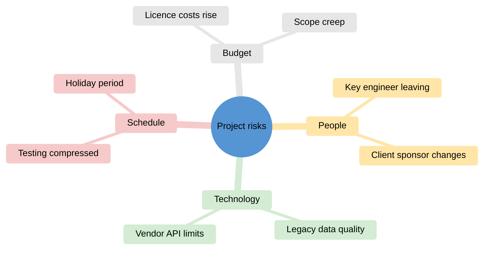
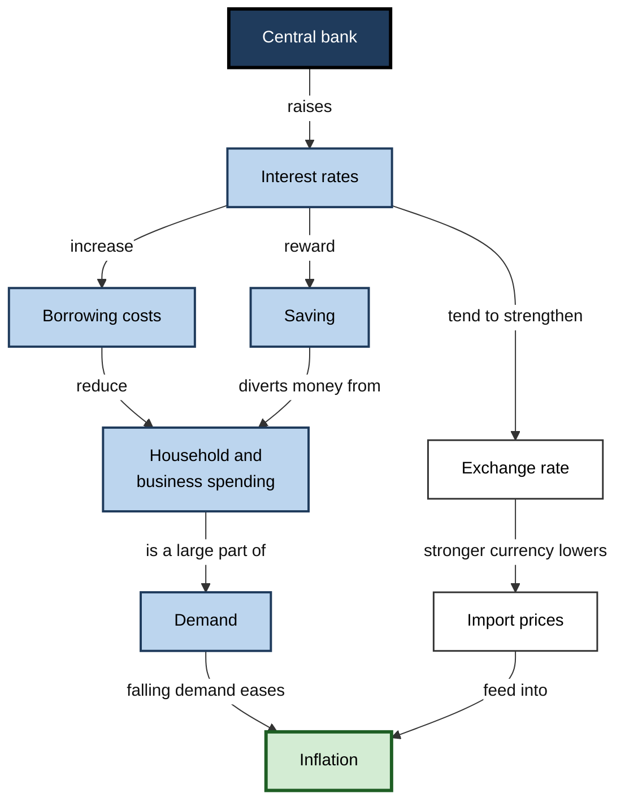
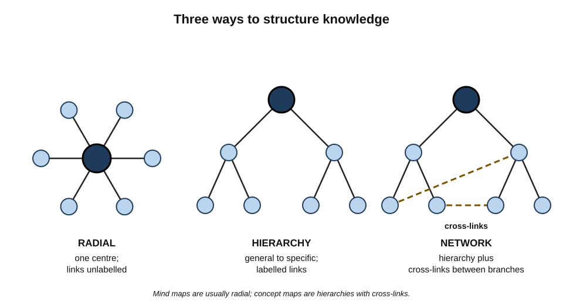
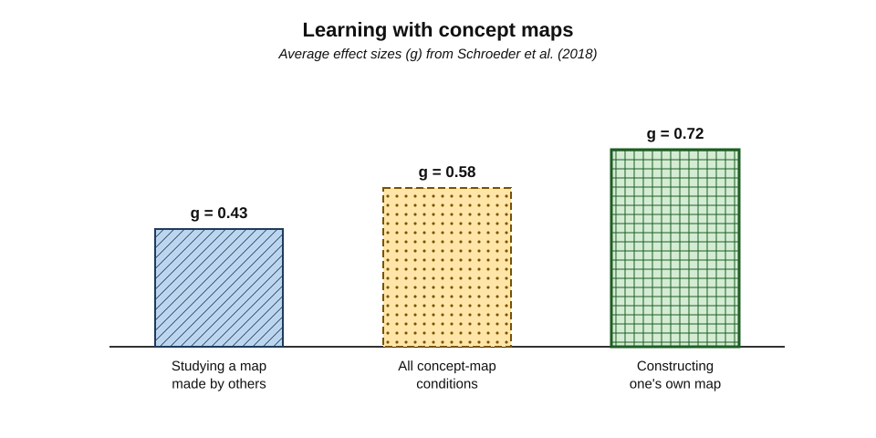
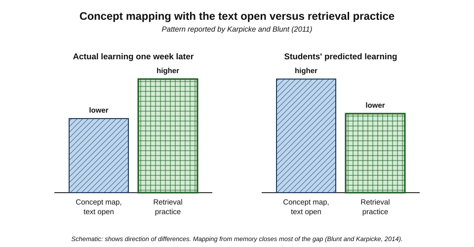
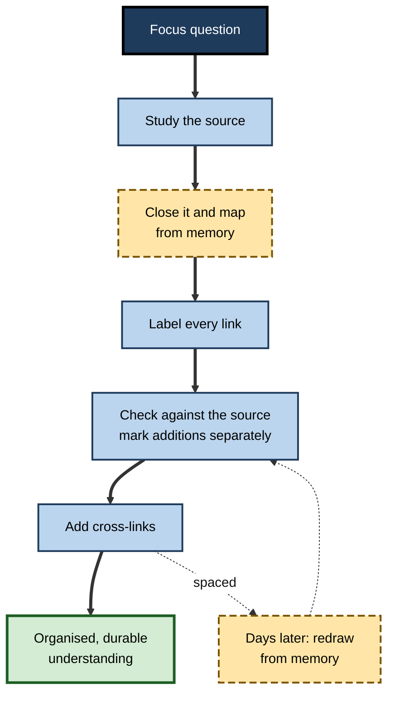

# A.7. Mind Mapping for Active Engagement

A product manager faces a 60-page market report and a blank sheet of paper. She writes "Mid-market churn" in the centre, draws branches for price, onboarding, support and competitors, and hangs facts from each. Within twenty minutes she can see that most of the report's evidence clusters on one branch — onboarding — and that the report says almost nothing about competitors. Drawing the structure of knowledge, rather than writing it in lines, made both its shape and its gaps **visible**.

> **Definition — Mind map:** a diagram that radiates from one central topic, with branches for main themes and sub-branches for details, usually using single keywords, images and colour (popularised by Tony Buzan).

> **Definition — Concept map:** a node-and-link diagram in which concepts are joined by **labelled links** that form meaningful statements (propositions), typically arranged from general to specific (developed by Joseph Novak and colleagues).

**Why it matters**

- Building a map forces learners to **select** key ideas and **organise** their relationships — the core work of understanding.
- Maps show **structure** at a glance: what is central, what connects, what is missing.
- Mapping is one of the better-supported ways of studying from text — **when the learner builds the map**.
- In professional work, maps underlie issue trees, stakeholder maps, system diagrams and architecture sketches.

---

## Kinds of Knowledge Map

### Mind maps

- **Origin:** Tony Buzan popularised mind maps in the BBC television series and book *Use Your Head* (1974); radial diagrams for organising ideas are much older.
- **Typical rules:**
  - a central image or word for the topic;
  - thick main branches radiating outward, thinner sub-branches;
  - **one keyword per branch**;
  - colours, images and symbols;
  - branches curved and connected, not boxed.
- **Strengths:** fast; good for brainstorming, planning, and an overview of one topic.
- **Weaknesses:** links are unlabelled, so relationships are **implicit**; strictly radial structure cannot show cross-connections well.

**Figure 1.** A mind map of a project risk review.

### Concept maps

- **Origin:** **Joseph Novak** and his research group at Cornell University (1970s), building on **David Ausubel's** theory that meaningful learning occurs when new knowledge is anchored to existing concepts.
  - Described for a wide audience in Novak and D. Bob Gowin's *Learning How to Learn* (1984).
- **Elements:**
  - **concepts** — usually nouns, in boxes or ovals;
  - **linking phrases** — verbs or prepositions on the arrows;
  - **propositions** — concept + link + concept, forming a statement that can be true or false;
  - **hierarchy** — general concepts at the top, specific below;
  - **cross-links** — links between different branches, showing integration;
  - **a focus question** — the question the map is built to answer.
- **Strengths:** relationships are **explicit** and checkable; cross-links show deep integration.
- **Weaknesses:** slower to build; needs practice.

**Figure 2.** A concept map answering the focus question "Why do rising interest rates slow inflation?".

> **Example:** reading the map aloud produces propositions — "The central bank raises interest rates", "Interest rates increase borrowing costs", "Borrowing costs reduce spending". Each can be checked for truth. The link from interest rates to the exchange rate and import prices is a **cross-link** to a second causal path — a sign of integrated understanding.

### Other professional maps

- **Argument maps** — claims, reasons and objections arranged as a tree; associated with Tim van Gelder's work on critical-thinking teaching.
- **Issue trees** — a question broken into sub-questions that are **mutually exclusive and collectively exhaustive** (MECE); standard in management consulting.
- **Affinity diagrams** — many observations grouped bottom-up into themes; derived from the **KJ method** of the Japanese anthropologist Jiro Kawakita; widely used in design and user research.
- **Fishbone (Ishikawa) diagrams** — causes of a problem grouped by category along the "bones" of a fish; used in quality management.
- **Causal loop diagrams** — variables linked by positive and negative influences forming feedback loops; used in system dynamics.

| | Mind map | Concept map | Argument map | Issue tree |
|---|---|---|---|---|
| Structure | Radial from one centre | Hierarchical network | Tree of claim, reasons, objections | Tree of question and sub-questions |
| Links | Unlabelled | Labelled propositions | Supports / opposes | "Is answered by" |
| Cross-links | Rare | Encouraged | Possible | Avoided (MECE) |
| Best for | Brainstorming, overview, planning | Understanding relationships and causes | Evaluating reasoning | Structuring an analysis |
| Main risk | Shallow keyword lists | Slow; can become cluttered | Over-simplifying nuance | False neatness |

**Figure 3.** Three structures for mapping knowledge: radial, hierarchical and network.

> **Key point:** choose the map to fit the **relationships** that matter. A list of features suits a mind map; causes and effects need labelled links; a decision needs an argument map or issue tree.

---

## Why Mapping Can Engage the Mind

- **Selection** — space on a page is limited; the mapper must choose key ideas.
- **Organisation** — each item must be placed **in relation to** others; hierarchy and grouping must be decided.
- **Explicit relationships** — in concept maps, each link must be named, so vague associations are exposed.
- **Integration** — cross-links connect parts of knowledge that were learned separately.
- **Gap detection** — empty branches and missing links reveal what the learner does not know.
- **Dual representation** — a spatial layout plus words can make structure easier to see and recall.

> **Watch out:** many claims made for mind mapping — that it uses "the whole brain", engages the "creative right hemisphere" or matches "how the brain naturally thinks" — rest on the discredited idea of left-brain and right-brain thinkers. The brain's hemispheres do specialise in some functions, but people are not left- or right-brained learners. Mapping helps for the cognitive reasons above, not because it is "brain-shaped".

---

## The Evidence

### Concept maps

**Study card — Nesbit and Adesope (2006)**

- **Design:** a meta-analysis of 55 studies in which learners constructed or studied concept or knowledge maps, compared with other activities such as reading text, attending lectures or discussion.
- **Results:** concept-map activities were associated with **better knowledge retention and transfer** than most comparison activities, across many subjects and levels.
- **Conclusion:** concept mapping is a generally effective learning activity, though benefits varied with how it was used.

**Study card — Schroeder, Nesbit, Anguiano and Adesope (2018)**

- **Design:** a meta-analysis of 142 effect sizes from studies of learning with concept maps.
- **Results:**
  - an overall moderate benefit (g about **0.58**) compared with other instructional conditions;
  - **creating** concept maps gave a larger benefit (g about **0.72**) than **studying** maps prepared by others (g about **0.43**);
  - benefits appeared in both STEM and non-STEM subjects.
- **Conclusion:** concept maps help, and the learner's **own construction** helps most.

**Figure 4.** Average benefits of studying and constructing concept maps.

### Mind maps

- Evidence on Buzan-style mind maps specifically is **thinner** than on concept maps.
- **Paul Farrand, Fearzana Hussain and Enid Hennessy (2002)** — medical students using mind maps to study a text showed modestly better recall of factual information a week later than students using their usual methods, but reported **lower motivation**, possibly because the technique was unfamiliar.
- Studies are often small and compare against weak alternatives.

> **Watch out:** the strong evidence comes mostly from **concept maps with labelled links**. Mind maps share some of the same mechanisms, but claims for them should be more cautious.

### Mapping versus retrieval

**Study card — Karpicke and Blunt (2011)**

- **Design:** university students studied a science text in one of several conditions, including:
  - **elaborative concept mapping** — building a concept map with the text available;
  - **retrieval practice** — reading, then writing down as much as they could remember, twice.
- **Results:**
  - one week later, the retrieval group outperformed the concept-mapping group on both **verbatim** and **inference** questions;
  - the advantage held even when the final test **required drawing a concept map**;
  - students **predicted** that concept mapping would produce better learning.
- **Conclusion:** building a map **while looking at the text** is less effective than retrieving the content from memory.

- **Follow-up — Blunt and Karpicke (2014):** when students built concept maps **from memory**, without the text, mapping worked about as well as retrieval by writing.
- **Criticism:** defenders of concept mapping argued that the students in the 2011 study had little training in mapping, so the comparison understated mapping's potential.

> **Key point:** the combination is stronger than either alone — **map from memory, then check against the source**. The map supplies organisation; recall supplies retrieval.

**Figure 5.** Concept mapping with the text open compared with retrieval practice, on a test one week later.

---

## Building Maps That Teach

### The map-from-memory method

1. **Set a focus question** — "How does our pricing model affect customer churn?"
2. **Study the source** with the question in mind.
3. **Close the source** and draw the map from memory: central concept, main branches, details, links.
4. **Label every link** with a verb phrase, so that each connection reads as a sentence.
5. **Check against the source** — add omissions in a different pen or colour; correct errors.
6. **Add cross-links** — look for connections between branches.
7. **Revisit later** — redraw the map from memory after a few days, rather than re-reading the old one.

**Figure 6.** The map-from-memory cycle.

> **Mnemonic — "Q-CLOSE":** set a **Q**uestion, **C**lose the source, **L**abel links, **O**rganise hierarchy, **S**can for gaps against the source, **E**xtend with cross-links.

### Judging a map's quality

- **Valid propositions** — does each concept–link–concept statement make sense and is it true?
- **Hierarchy** — are general concepts above specific ones, with sensible levels?
- **Cross-links** — are separate branches connected where they genuinely relate?
- **Examples** — are concepts anchored by specific instances?
- **Focus** — does the map answer the focus question?

> **In practice:** Novak's scoring approach awarded points for valid propositions, levels of hierarchy, cross-links (weighted heavily) and examples. Teachers and trainers still use simplified versions to assess understanding, because a map shows **how** a learner has organised knowledge, not just what they can recall.

### Worked example (illustrative): a weak and a strong map

- **Situation:** two new cloud engineers each map "What drives our monthly cloud bill?" after a briefing.

| | Engineer A | Engineer B |
|---|---|---|
| Built | With slides open | From memory, then checked |
| Structure | Radial keywords: compute, storage, network, licences | Hierarchy with labelled links: "compute cost **depends on** instance size **and** running hours" |
| Links labelled | None | All |
| Cross-links | None | "Data transfer **increases when** services sit in different regions", linking network to architecture |
| Gaps revealed | None noticed | Could not explain reserved-instance discounts — returned to the source |
| Follow-up recall a week later | Lists categories; cannot explain a cost spike | Explains a spike as untagged instances left running |

- **Conclusion:** B's map required more thinking — retrieval, explicit relationships and cross-links — and produced usable understanding; A's map was a decorated list.

> **Watch out:** a beautiful map can be shallow. Colour and images do little if the links are unlabelled and the content was copied.

---

## Mapping in Professional Work

### Uses

- **Learning a new domain** — concept-map the key concepts of a client's industry in the first week.
- **Planning** — mind-map a project's workstreams, deliverables and risks.
- **Analysis** — issue trees break a problem into testable sub-questions.
- **Synthesis** — affinity diagrams cluster research findings into themes.
- **Diagnosis** — fishbone diagrams organise possible causes before investigation.
- **Communication** — a single diagram often explains a system better than pages of text.
- **Meetings** — a shared map built live with a team makes disagreements about structure visible.

### Digital tools and AI

- **Digital mapping tools** make maps easy to edit, share and expand; they can also encourage sprawling, unfocused maps.
- **AI-generated maps** — tools can turn any document into a mind map instantly.
  - For learning, this is **passive**: the selection and organisation have been done by the machine.
  - Productive use: build one's own map first, then compare it with an AI-generated one to find omissions or alternative structures.

> **In practice:** in workshops, facilitators often ask each participant to sketch their own map of a problem **individually** before building a shared one. The individual maps reveal different mental models; the shared map is better for having integrated them.

### Case study (illustrative): concept maps in nursing education

- **Situation:** a nursing school found that second-year students could recite information about diseases and drugs but struggled to plan care for patients with several interacting conditions.
- **Problem:** traditional written care plans were long, linear documents that students often copied from templates.
- **Diagnosis:** linear plans hid the **relationships** between a patient's problems, interventions and outcomes; students rarely saw that one intervention could affect another problem.
- **Actions:**
  1. Students built **concept care maps** for each clinical placement patient: the main diagnosis at the centre, linked to problems, assessment data, interventions and expected outcomes, with **labelled links**.
  2. They were required to draw **cross-links** — for example, between a diuretic prescribed for heart failure and the patient's fall risk from dizziness and urgency.
  3. Maps were first drawn **from memory** after the shift, then checked against the patient record.
  4. Clinical tutors discussed maps one-to-one, asking "why is this linked to that?"
- **Result:** tutors reported that students identified interacting problems more often and could justify priorities more clearly; written assessment of care-planning reasoning improved over the year.
- **Side effects / caveats:** maps took time to learn to build; some students produced cluttered maps until shown how to focus on the most important relationships; improvement was judged by tutors rather than measured in a controlled comparison.
- **Lesson:** the value came from **explicit, labelled relationships and cross-links**, which linear documents had allowed students to skip.

---

## Open Questions

- **How much of mapping's benefit is retrieval and how much is organisation?**
  - Comparisons of mapping from memory with other retrieval formats suggest both contribute; their relative weight varies with material.
- **Does mind mapping work as well as concept mapping?**
  - Direct, well-controlled comparisons are few.
- **How much training is needed?**
  - Mapping requires skill; how quickly novices become effective mappers, and whether training costs outweigh benefits for short courses, is not settled.
- **Do AI-generated maps help or hinder?**
  - Studying a machine-built map resembles studying a provided map — useful but weaker than construction; whether comparing with one's own map adds value is untested.
- **How should maps be assessed reliably?**
  - Scoring schemes exist, but agreement between raters and links to later performance are uneven.

---

## Summary

- **Mind maps** radiate keywords from a centre (Buzan); **concept maps** link concepts with **labelled propositions** in a hierarchy with **cross-links** (Novak, building on Ausubel); argument maps, issue trees, affinity diagrams, fishbones and causal loops serve other purposes.
- Mapping engages learning through **selection, organisation, explicit relationships, integration and gap detection** — not through "whole-brain" effects, which are a myth.
- Evidence: concept maps improve retention and transfer (**Nesbit and Adesope, 2006**); overall g ≈ **0.58**, with **constructing (0.72) > studying (0.43)** (**Schroeder et al., 2018**); mind-map evidence is thinner.
- **Karpicke and Blunt (2011)**: retrieval beat concept mapping with the text open, even on a mapping test; **mapping from memory** works about as well as written retrieval (**Blunt and Karpicke, 2014**).
- Method: focus question → study → **map from memory** → label links → check → cross-link → redraw later (**Q-CLOSE**).
- Judge maps by valid propositions, hierarchy, cross-links, examples and focus; beautiful maps can be shallow.
- At work: domain learning, planning, analysis, synthesis, diagnosis and communication; AI-generated maps are passive unless compared with one's own.

---

## Self-Check

1. Distinguish a mind map from a concept map in structure, links and best use.
2. What is a proposition in a concept map, and why do labelled links matter?
3. What is a cross-link, and what does it indicate about understanding?
4. Name four other professional mapping formats and the purpose of each.
5. Explain five cognitive reasons why building a map can improve learning.
6. Why are "whole-brain" claims about mind maps misleading?
7. Summarise the findings of Schroeder et al. (2018).
8. Describe Karpicke and Blunt (2011), its result, and the follow-up that qualified it.
9. Describe the map-from-memory method step by step.
10. Give five criteria for judging the quality of a concept map.
11. A learner produces a colourful mind map by copying headings from slides. Explain why it may contribute little to learning and how to improve it.
12. When would an issue tree be preferable to a concept map?
13. A team uses an AI tool to turn every report into a mind map, which they then study. Evaluate the practice and propose an alternative.
14. Build (in words) a five-proposition concept map answering "Why does employee turnover raise costs?", including one cross-link.

### Answer Key

1. Mind map: radial from one centre, unlabelled links, keywords; best for brainstorming and overview. Concept map: hierarchical network, labelled links forming propositions, cross-links; best for understanding relationships and causes.
2. A concept–link–concept statement that can be true or false ("interest rates increase borrowing costs"). Labelled links make relationships explicit and checkable, exposing vague associations.
3. A link between concepts in different branches. It indicates integration — seeing how separately learned parts of knowledge relate.
4. Argument map (evaluate reasoning), issue tree (structure an analysis into MECE sub-questions), affinity diagram (cluster observations into themes), fishbone (organise possible causes), causal loop diagram (show feedback loops).
5. Selection of key ideas; organisation into hierarchy and groups; explicit naming of relationships; integration through cross-links; gap detection from empty branches or missing links (also dual verbal–spatial representation).
6. They rest on the discredited notion of left- and right-brained thinkers; hemispheric specialisation exists, but mapping helps for cognitive reasons such as organisation and selection.
7. Learning with concept maps gave a moderate overall benefit (g ≈ 0.58); constructing maps (g ≈ 0.72) beat studying provided maps (g ≈ 0.43); effects held in STEM and non-STEM subjects.
8. Students either built concept maps with the text open or practised free recall. A week later, retrieval outperformed mapping on verbatim and inference questions, even on a mapping test; students wrongly predicted mapping would be better. Blunt and Karpicke (2014) found that mapping from memory worked about as well as written retrieval.
9. Set a focus question; study the source; close it and map from memory; label every link; check against the source, marking additions; add cross-links; redraw from memory days later.
10. Valid propositions, sensible hierarchy, meaningful cross-links, examples, and focus on the question.
11. Copying headings involves little selection, no explicit relationships and no retrieval; colour adds little. Improve by closing the slides, mapping from memory, labelling links, checking and adding cross-links.
12. When the goal is to structure an analysis or investigation into non-overlapping, complete sub-questions that can each be answered with data.
13. Studying machine-built maps is passive — like studying provided maps, weaker than construction — and errors may go unnoticed. Alternative: each person maps from memory first, then compares with the AI map to find omissions and alternative structures.
14. E.g. "Turnover creates vacancies"; "vacancies require recruitment, which incurs fees and manager time"; "new hires need training, which reduces team productivity"; "lost employees take knowledge with them, which increases errors"; cross-link: "errors increase customer complaints, which raise remaining staff's workload, which increases further turnover".

---

## Glossary

| Term | Meaning |
|---|---|
| Affinity diagram | Observations grouped bottom-up into themes; derived from the KJ method. |
| Argument map | A diagram of a claim with its supporting reasons and objections. |
| Causal loop diagram | Variables linked by influences that form feedback loops. |
| Concept map | Concepts joined by labelled links forming propositions, arranged hierarchically. |
| Cross-link | A link between concepts in different branches of a map. |
| Fishbone diagram | Causes of a problem grouped by category; also called an Ishikawa diagram. |
| Focus question | The question a concept map is built to answer. |
| Issue tree | A question decomposed into mutually exclusive, collectively exhaustive sub-questions. |
| Linking phrase | The words on a link that state the relationship between two concepts. |
| Map from memory | Building a map without the source, then checking against it. |
| MECE | Mutually exclusive, collectively exhaustive. |
| Meaningful learning | Ausubel's term for anchoring new knowledge to existing concepts. |
| Mind map | A radial diagram of keywords branching from a central topic. |
| Proposition | A concept–link–concept statement that can be true or false. |
