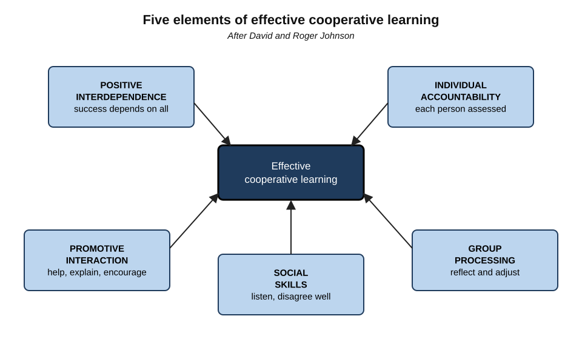
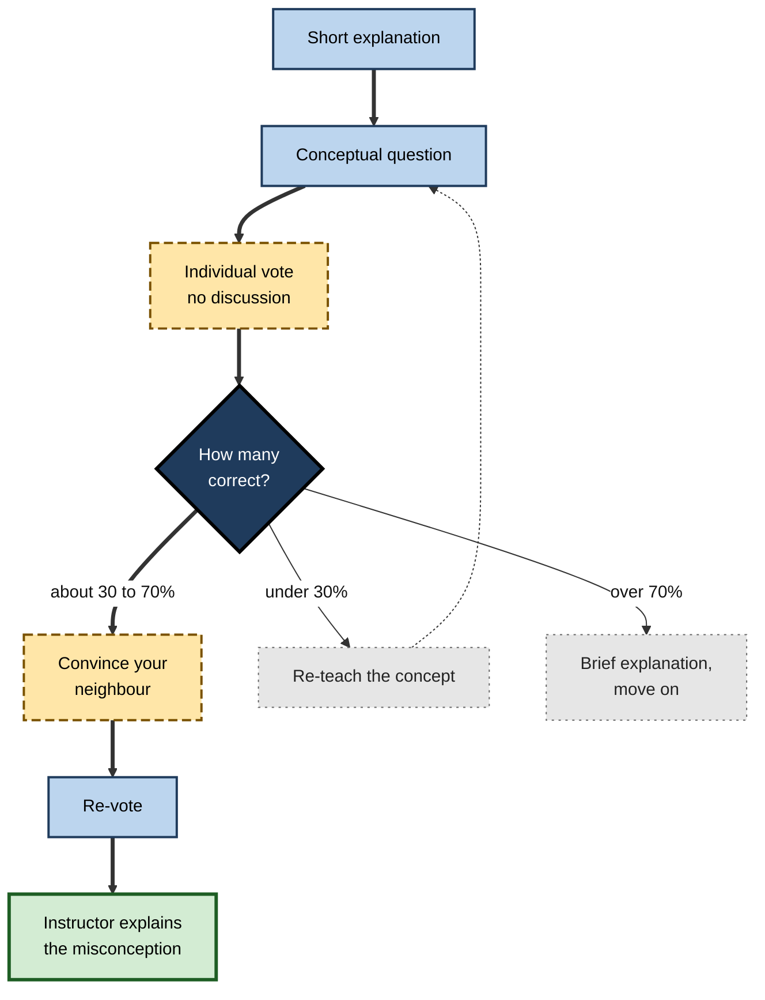
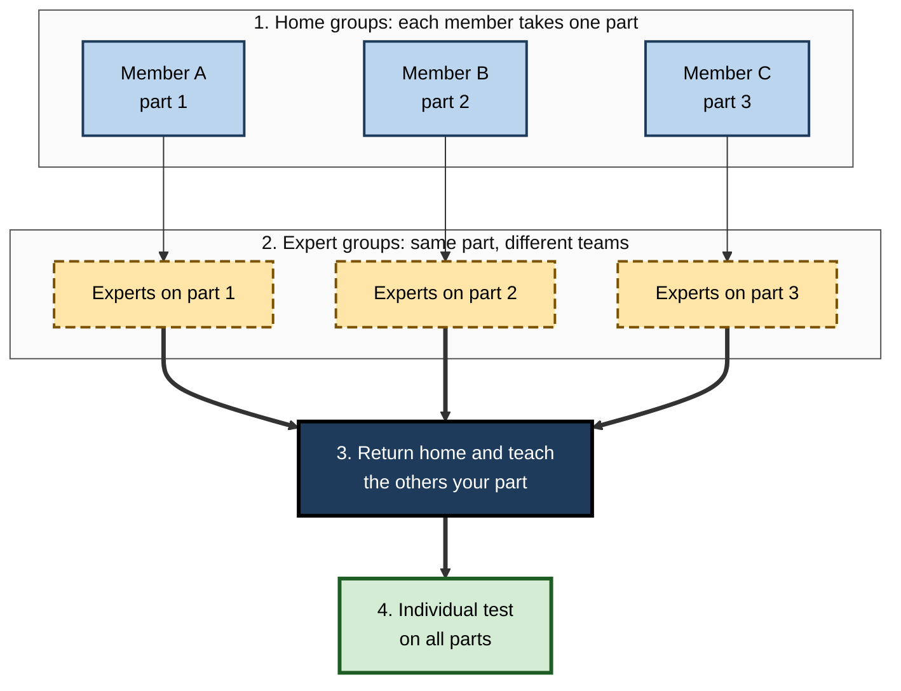
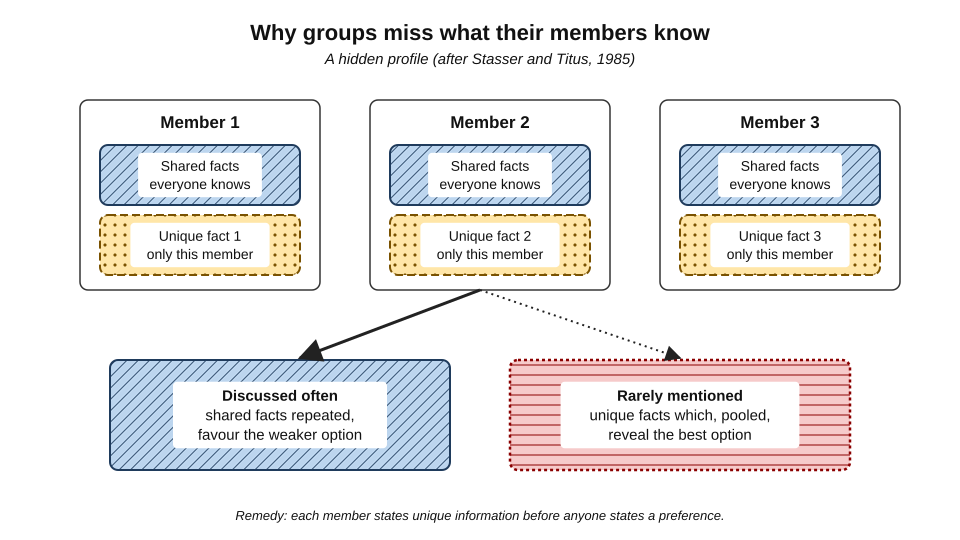
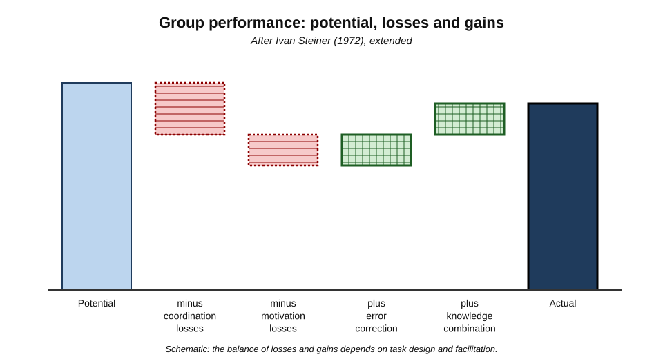

# A.8. Discussion and Collaborative Learning

In a large physics lecture, students vote on a conceptual question; only 40% choose the right answer. The lecturer does not explain. Instead she says, "Turn to your neighbour and convince them." Two minutes of noisy argument later, the class votes again and 75% are right. Nobody was told the answer; students taught each other. Yet everyone has also sat in group work where one person did everything, two chatted and nobody learned. **Learning with others can multiply learning or waste it** — and the difference lies in design.

> **Definition — Collaborative learning:** learning in which two or more people work together towards shared understanding, each contributing ideas that the others build on.

> **Definition — Cooperative learning:** a structured form of group learning in which tasks, roles and rewards are designed so that group members depend on one another and each is individually accountable.

> **Definition — Learning discussion:** structured conversation in which participants articulate, justify, question and revise ideas about the content.

**Why it matters**

- Explaining to peers, hearing alternatives and resolving disagreement trigger some of the most powerful learning mechanisms.
- Professional work is collaborative; learning to think with others is itself a professional capability.
- Group work is one of the most misused methods in education and training.
- Organisations depend on collective learning — reviews, retrospectives, case conferences — that follows the same principles.

---

## Forms of Learning Together

| | Cooperative learning | Collaborative learning | Whole-group discussion |
|---|---|---|---|
| Structure | High: roles, tasks, interdependence designed | Moderate to low: shared problem, open process | Facilitated by a leader |
| Typical size | 2–5 | 2–6 | 10–40 |
| Main mechanism | Mutual explanation, accountability | Co-construction of understanding | Exposure to many views; modelling of reasoning |
| Associated with | David and Roger Johnson; Robert Slavin | Kenneth Bruffee; Pierre Dillenbourg | Seminar and Socratic traditions |
| Main risk | Mechanical role-play | Unequal participation | A few voices dominate |

> **Key point:** the labels overlap and are used inconsistently. What matters is whether the arrangement makes each person **think, explain and respond** — the interactive mode of engagement.

---

## Why Learning With Others Works

- **Explaining** — articulating reasoning to a peer organises it and exposes gaps.
- **Hearing alternatives** — a peer's different answer forces one to re-examine one's own.
- **Socio-cognitive conflict** — disagreement that must be resolved by reasons, not authority.
- **Near-peer explanation** — a peer who has just understood often explains in terms closer to the learner's current thinking than an expert does.
- **Distributed knowledge** — group members hold different pieces; combining them produces understanding none had alone.
- **Motivation and belonging** — working with others can raise effort and commitment.

### Who benefits within a group

**Study card — Noreen Webb (1980s–1990s)**

- **Design:** analyses of the interactions of small groups of school students working on mathematics, linking what each student said and received to their later achievement.
- **Results:**
  - **giving elaborated explanations** was consistently associated with higher achievement for the explainer;
  - **receiving only answers** — without explanation — was not associated with learning, and was sometimes negatively related;
  - receiving explanations helped when the receiver **used** them to solve problems.
- **Conclusion:** the learning in groups flows through **explanation** — giving it and applying it — not through the exchange of answers.

> **Watch out:** "the strong students teach the weak ones" can mean the strong learn most (they explain) and the weak learn little (they receive answers). Design must make **everyone** explain.

### Peer discussion produces new understanding

**Study card — Smith, Wood, Adams, Wieman, Knight, Guild and Su (2009)**

- **Design:** in an undergraduate genetics course, students answered a conceptual question individually, discussed it with neighbours, re-answered, and then answered a **second, similar question** individually.
- **Results:**
  - performance rose after discussion;
  - students were more likely to answer the second question correctly — showing they had **understood**, not merely copied;
  - improvement occurred even in groups where **no member had initially answered correctly**.
- **Conclusion:** peer discussion does not just spread the right answer from those who know it; it can **construct** understanding.

---

## Kinds of Talk

**Neil Mercer** and colleagues at the Open University and Cambridge, studying classroom group talk, distinguished three types.

| | Disputational talk | Cumulative talk | Exploratory talk |
|---|---|---|---|
| Character | Disagreement, individual decisions, competition | Uncritical agreement, adding on | Critical but constructive engagement with each other's ideas |
| Typical phrases | "No it isn't." "Yes it is." | "Yes, and…" "Okay." | "Why do you think that?" "I agree because…" "But what if…?" |
| Reasons given | Few | Few | Many, made explicit |
| Learning value | Low | Moderate — shares knowledge | High — reasoning becomes visible and is tested |

- **Ground rules for exploratory talk** — Mercer's interventions taught groups to agree rules such as:
  - everyone is invited to contribute;
  - reasons are asked for and given;
  - challenges are accepted as normal;
  - the group seeks agreement before deciding.
- Groups taught these rules showed better group reasoning and individual reasoning-test performance than comparison groups.

> **Remember — exploratory talk:** **invite**, **reason**, **challenge**, **agree** — every view heard, every claim justified, every challenge welcome, every decision shared.

---

## Designing Cooperative Learning

### Five essential elements

**David and Roger Johnson**, building on **Morton Deutsch's** theory of social interdependence (1949), identified five elements that distinguish effective cooperative learning from merely putting people in groups.

- **Positive interdependence** — each member's success depends on the others'.
  - *e.g.* each holds a different piece of information needed for the solution.
- **Individual accountability** — each person's contribution and learning is assessed.
  - *e.g.* random selection of who presents; individual tests after group work.
- **Promotive (face-to-face) interaction** — members actively help, explain and encourage each other.
- **Interpersonal and small-group skills** — listening, turn-taking, constructive disagreement, decision-making — taught explicitly.
- **Group processing** — the group reflects on how well it is working and what to change.

**Figure 1.** The five elements of effective cooperative learning.

> **Mnemonic — "PIGS F":** **P**ositive interdependence, **I**ndividual accountability, **G**roup processing, **S**ocial skills, **F**ace-to-face promotive interaction.

- **Evidence:** the Johnsons' syntheses of several hundred studies found that cooperative arrangements generally produced higher achievement than competitive or individualistic ones.
- **Robert Slavin** — reviewing school studies, concluded that cooperative learning raised achievement reliably when it combined **group goals** with **individual accountability**; without both, effects were weak.
- **Springer, Stanne and Donovan (1999)** — a meta-analysis of small-group learning in undergraduate science, mathematics and engineering found benefits for **achievement**, **persistence** in courses and **attitudes**, of moderate size (around half a standard deviation).

### Proven structures

- **Think–pair–share** — Frank Lyman (1981): think alone → discuss with a partner → share with the larger group.
  - Individual thinking first prevents the quickest voice from deciding for everyone.
- **Peer Instruction** — Eric Mazur (Harvard, 1990s):
  1. a short explanation;
  2. a conceptual question (a "ConcepTest");
  3. individual vote, without discussion;
  4. discussion with neighbours — "convince your neighbour";
  5. re-vote;
  6. explanation by the instructor, focused on the misconception.
  - Mazur recommended discussion when roughly 30–70% answer correctly at first; above that, explain briefly and move on; below that, re-teach.
- **Jigsaw** — Elliot Aronson and colleagues, Austin, Texas (1971):
  - originally designed to reduce hostility in newly desegregated schools;
  - each member of a "home" group becomes an expert on one part, meets "expert" groups from other teams, then returns to teach the home group.
- **Team-based learning** — Larry Michaelsen (1970s onward):
  - individual readiness test → the same test as a team → application exercises in which all teams work on the **same significant problem**, make a **specific choice** and report **simultaneously**.
- **Structured academic controversy** — pairs argue one side of an issue, switch sides, then drop advocacy and seek the best-reasoned consensus.

**Figure 2.** The Peer Instruction cycle.

**Figure 3.** The jigsaw structure.

---

## When Groups Fail

### Process losses

- **Ivan Steiner (1972):** a group's actual productivity equals its **potential** productivity minus **process losses** — losses of coordination and motivation.
- **The Ringelmann effect** — in early 20th-century experiments by the French agricultural engineer Maximilien Ringelmann, individuals pulling on a rope exerted less force per person as group size grew.
- **Social loafing** — **Bibb Latané, Kipling Williams and Stephen Harkins (1979)** found people clapped and shouted less loudly per person in groups than alone, especially when individual output could not be identified.
- **Free riding** — contributing little because others will carry the work.
- **Production blocking** — **Michael Diehl and Wolfgang Stroebe (1987)** showed that in group brainstorming, people must wait their turn and forget or suppress ideas; **nominal groups** (individuals working separately, ideas pooled) usually generate more and better ideas than interacting groups.
- **Groupthink** — **Irving Janis (1972)**, studying policy fiascos such as the Bay of Pigs invasion: cohesive groups under pressure suppress dissent and reach poor decisions.
- **Hidden profiles** — groups failing to pool information that only individual members hold.

**Study card — Stasser and Titus (1985)**

- **Design:** groups chose among candidates. Information was distributed so that some facts were **shared** by all members and some were **unshared**, each known to only one member. Pooled together, the unshared facts pointed to the best candidate.
- **Results:** discussion focused on **shared** information; unshared information was mentioned less and given less weight; groups usually failed to identify the best candidate.
- **Conclusion:** groups do not automatically combine what their members know. They tend to discuss what everyone already knows.

**Figure 4.** A hidden profile: information that only individuals hold is often lost in discussion.

### Process gains

- Groups **can** exceed individuals:
  - **Error correction** — others catch mistakes.
  - **Knowledge combination** — when unshared information is surfaced.
  - **Collective working memory** — **Femke Kirschner, Fred Paas and Paul Kirschner (2009)** found that for **complex** tasks, groups learned more efficiently than individuals because the cognitive load could be distributed; for **simple** tasks, individuals did as well or better.
  - **Transactive memory** — **Daniel Wegner (1987)**: groups develop a shared awareness of who knows what, allowing members to specialise.

**Figure 5.** Actual group performance as potential, minus process losses, plus process gains.

> **Formula — Steiner's model, extended:** actual performance = potential performance − process losses + process gains. *Example:* five analysts could each find 6 of 10 data errors independently. If, working together, they find 9 — because one person's catch prompts another's — gains outweigh losses; if they find 5 because everyone assumed someone else had checked, losses dominate.

### Remedies

- **Social loafing** → individual accountability: individual tasks, named contributions, random reporters.
- **Production blocking** → think individually first; write ideas before speaking (**brainwriting**).
- **Hidden profiles** → ask each member to state their unique information first; assign a role to record unshared facts; delay preference statements.
- **Groupthink** → a designated devil's advocate; leader states views last; anonymous input.
- **Domination by a few** → structured turns; small groups of two to four; roles that rotate.
- **Unequal benefit** → require everyone to explain, not only to listen.

> **Key point:** almost every failure of group learning has a **known design fix**. Group work fails when people are simply told to "discuss".

---

## Leading Learning Discussions

- **Prepare a genuinely open question** — one with more than one defensible answer, or a hard problem whose answer must be reasoned.
- **Require individual thinking first** — a minute of writing before anyone speaks.
- **Use small groups before the whole group** — pairs and trios maximise the share of people talking.
- **Ask for reasons** — "What makes you say that?" "What evidence would change your mind?"
- **Map disagreements** — make competing positions explicit, then test them.
- **Avoid answering too soon** — the facilitator's early answer ends the thinking.
- **Close with consolidation** — state what was established, what remains open and what misconceptions were corrected.

> **In practice:** some organisations begin decision meetings with several minutes of **silent reading** of a written proposal, so that everyone has the same information and has formed views before discussion begins. The method reduces both hidden-profile losses and the advantage of the most confident speaker.

### Discussion online

- **Asynchronous forums** allow time to think and give quieter participants a voice, but often decay into "I agree" posts — cumulative talk.
- **Better designs:** require a position with reasons, a response that challenges or extends another's, and a final synthesis by each participant.
- **Video meetings** amplify domination by a few; breakout rooms with a clear task and a written product work better than open discussion in a large call.

---

## Collaborative Learning at Work

- **After-action reviews** — developed by the US Army in the 1970s and widely adopted in business and healthcare: What was supposed to happen? What happened? Why the difference? What will we do next time?
- **Blameless post-incident reviews** — standard in software operations; emphasise system causes over individual blame so that people share what really happened.
- **Pair programming** — two developers at one workstation, one writing code and one reviewing.
  - A meta-analysis by **Jo Hannay and colleagues (2009)** found small benefits for code quality, mixed effects on duration, and greater total effort; benefits were larger for complex tasks and less experienced programmers.
- **Journal clubs** — clinicians or researchers critically discuss a paper together.
- **Morbidity and mortality conferences** — clinicians review adverse outcomes to learn from them.
- **Communities of practice** — practitioners who share a craft and learn from one another through shared work.
- **Collaborating with AI** — an AI system can serve as a devil's advocate or a sceptical client in discussion practice; it cannot yet replace the accountability and social stakes that make human discussion effortful.

### Worked example: rescuing a failing group assignment

- **Situation:** in a management programme, teams of six write a joint strategy report. Feedback shows one or two people write most of each report; individual exam answers on strategy are weak.
- **Step 1 — diagnose with the five elements:**

| Element | Present? | Evidence |
|---|---|---|
| Positive interdependence | Weak | Any member could write the whole report |
| Individual accountability | Absent | One grade for all |
| Promotive interaction | Weak | Work divided and pasted together |
| Social skills | Not taught | Conflicts avoided, not resolved |
| Group processing | Absent | No reflection on how the team worked |

- **Step 2 — redesign:**
  1. Reduce teams to **four**.
  2. Give each member **unique information** — financial data, customer research, competitor analysis, operations — so the report needs all four (interdependence; jigsaw logic).
  3. Each member writes a **two-page individual memo** first; the team then meets to reconcile memos (think before group; individual accountability).
  4. Teach exploratory-talk ground rules and require a short record of **disagreements and how they were resolved**.
  5. One **randomly selected** member presents and answers questions on the whole report.
  6. A brief **team retrospective** halfway through.
- **Step 3 — predict the effect:** every member must understand the whole report; unique information must be surfaced; free riding becomes visible.
- **Conclusion:** the content of the assignment did not change; the **structure** did.

> **Watch out:** students sometimes resist random presenters as "unfair". Explaining that the purpose is to make sure **everyone** understands the whole report — the very learning the assignment exists for — usually resolves the objection.

### Case study: peer discussion in a bank's credit training

- **Situation:** a bank trained new credit analysts in lecture-style sessions on assessing small-business loan applications, followed by individual case exercises.
- **Problem:** analysts reached inconsistent decisions on similar applications; reviewers found that many missed warning signs that more experienced colleagues spotted immediately.
- **Diagnosis:** analysts never had to **explain** their reasoning to peers, so idiosyncratic rules of thumb went unchallenged; experienced analysts' tacit judgement was never made visible.
- **Actions:**
  1. Each session centred on **three real, anonymised applications**.
  2. Every analyst decided **individually** (approve, decline, refer) and wrote two reasons.
  3. Positions were revealed **simultaneously**; analysts with different decisions were paired to **convince each other**.
  4. A senior credit officer then explained how she read the case, focusing on the warning signs most often missed.
  5. Monthly, analysts brought one live case they were unsure about to a **case conference** run with exploratory-talk rules.
- **Result:** over two quarters, agreement between analysts and senior reviewers on test cases rose markedly; analysts reported that the discussions had taught them "what to look for" rather than "what the rules say".
- **Side effects / caveats:** some analysts deferred to the most senior person in pair discussions; the bank paired analysts of similar seniority and asked seniors to speak last.
- **Lesson:** structured disagreement — **individual commitment, simultaneous reveal, peer argument, expert consolidation** — surfaced and corrected reasoning that lectures never touched.

---

## Open Questions

- **When do groups outperform individuals in learning?**
  - The collective working-memory account suggests task complexity matters; other moderators — prior knowledge, group composition, task type — are not fully mapped.
- **How should group work be assessed fairly?**
  - Balancing group goals with individual accountability, and detecting free riding, remains practically difficult.
- **What makes online collaboration as productive as face-to-face?**
  - Evidence is mixed and technology changes faster than research.
- **What role should AI play in group learning?**
  - AI participants could surface hidden information or challenge consensus, but they may also become an authority that ends discussion.
- **How diverse should learning groups be?**
  - Diverse groups hold more unique information but may experience more process losses; the balance depends on task and facilitation.

---

## Summary

- **Collaborative** learning builds shared understanding; **cooperative** learning structures interdependence and accountability; **discussion** is structured conversation that articulates and tests ideas.
- Mechanisms: **explaining**, hearing alternatives, **socio-cognitive conflict**, near-peer explanation, combining distributed knowledge, motivation.
- **Webb**: giving **elaborated explanations** predicts learning; receiving bare answers does not. **Smith et al. (2009)**: peer discussion builds understanding even when no one initially knows the answer.
- **Mercer**: disputational, cumulative and **exploratory** talk; ground rules — invite, reason, challenge, agree.
- **Five elements** (Johnson and Johnson): positive interdependence, individual accountability, promotive interaction, social skills, group processing (**PIGS F**); cooperative learning outperforms competitive and individualistic arrangements; small-group learning in STEM raises achievement, persistence and attitudes.
- Structures: **think–pair–share**, **Peer Instruction**, **jigsaw**, **team-based learning**, structured academic controversy.
- **Process losses**: social loafing, free riding, production blocking, groupthink, **hidden profiles** (Stasser and Titus); **process gains**: error correction, knowledge combination, collective working memory, transactive memory — each loss has a design remedy.
- At work: after-action and blameless reviews, pair programming, journal clubs, case conferences; with AI as a challenger, not an authority.

---

## Self-Check

1. Distinguish cooperative from collaborative learning.
2. What did Webb's research show about who learns in groups?
3. Summarise Smith et al. (2009) and why the result for groups with no initially correct member matters.
4. Describe Mercer's three types of talk and the ground rules for exploratory talk.
5. List and explain the five elements of cooperative learning.
6. What two features did Slavin find essential for cooperative learning to raise achievement?
7. Outline the steps of Peer Instruction and the decision rule after the first vote.
8. Explain how jigsaw creates positive interdependence.
9. Define social loafing and production blocking, and give a remedy for each.
10. What is a hidden profile, and what did Stasser and Titus find?
11. Explain Steiner's model of group performance with a numerical example.
12. When are groups likely to learn more efficiently than individuals, according to the collective working-memory account?
13. A workshop leader asks a group of eight to "discuss the case and report back". Identify four likely problems and redesign the activity.
14. A team's retrospectives produce the same conclusions each time and no change. Using concepts from collaborative learning, diagnose and propose improvements.

### Answer Key

1. Cooperative learning is structured: roles, interdependence and individual accountability are designed. Collaborative learning is a looser shared effort to construct understanding. The terms overlap.
2. Students who gave elaborated explanations learned most; receiving only answers was not associated with learning; receiving explanations helped when the receiver applied them.
3. After peer discussion, students did better on a new, similar question, showing understanding rather than copying; because this happened even when no member initially knew the answer, discussion constructed understanding rather than merely transmitting it.
4. Disputational (competitive disagreement), cumulative (uncritical agreement), exploratory (critical, constructive, reasoned). Ground rules: invite everyone, give and ask for reasons, accept challenges, seek agreement.
5. Positive interdependence (success depends on all); individual accountability (each assessed); promotive interaction (helping and explaining); interpersonal and small-group skills (taught explicitly); group processing (reflecting on how the group works).
6. Group goals and individual accountability.
7. Short explanation; conceptual question; individual vote; peer discussion; re-vote; instructor explanation. If about 30–70% are correct initially, discuss; above, explain briefly and move on; below, re-teach.
8. Each member masters a different part, so the group needs every member's teaching to complete the task, and an individual test on all parts makes each member accountable.
9. Social loafing: less individual effort in groups when output is unidentifiable — remedy: individual accountability. Production blocking: ideas lost while waiting to speak — remedy: individual idea generation or brainwriting before discussion.
10. A situation where unshared information held by individuals, if pooled, would point to the best option. Groups discussed mostly shared information and usually failed to find the best option.
11. Actual = potential − losses + gains. E.g. five analysts each able to find 6 of 10 errors: finding 9 together shows gains (cross-prompting); finding 5 shows losses (diffusion of responsibility).
12. For complex tasks, where cognitive load can be shared across members' working memories; for simple tasks individuals do as well or better.
13. Problems: group too large; a few dominate; no individual thinking; no accountability; cumulative talk; hidden information lost. Redesign: individual written analysis first; pairs or trios; unique information or roles; exploratory-talk rules; random reporter; facilitator consolidation.
14. Likely cumulative talk, groupthink or psychological unsafety; shared information dominates; no individual accountability for actions; no group processing of whether past actions worked. Improvements: individual written input before discussion; blameless framing; a devil's advocate; review last retrospective's actions first; named owners and dates for actions.

---

## Glossary

| Term | Meaning |
|---|---|
| After-action review | A structured review comparing what was intended with what happened, and why. |
| Brainwriting | Generating ideas in writing individually before group discussion. |
| Collaborative learning | Learning together towards shared understanding, each building on others' ideas. |
| Collective working memory | The distribution of cognitive load across group members during complex tasks. |
| Cooperative learning | Structured group learning with designed interdependence and individual accountability. |
| Cumulative talk | Uncritical talk in which speakers add to each other's ideas without challenge. |
| Disputational talk | Competitive talk marked by disagreement without reasons. |
| Exploratory talk | Critical but constructive talk in which reasons are given and challenged. |
| Free riding | Contributing little because others will carry the work. |
| Groupthink | Suppression of dissent in a cohesive group, leading to poor decisions. |
| Hidden profile | A situation in which pooling members' unshared information would reveal the best option. |
| Individual accountability | Assessment of each member's contribution and learning. |
| Jigsaw | A structure in which members master different parts and teach them to their group. |
| Nominal group | Individuals working separately whose outputs are pooled. |
| Peer Instruction | Mazur's cycle of conceptual question, vote, peer discussion, re-vote and explanation. |
| Positive interdependence | Each member's success depending on the others'. |
| Process gains | Improvements in group performance arising from interaction. |
| Process losses | Losses of coordination and motivation that reduce group performance below its potential. |
| Production blocking | Ideas lost while group members wait their turn to speak. |
| Social loafing | Reduced individual effort in a group when contributions are not identifiable. |
| Team-based learning | Michaelsen's structure of readiness tests and team application exercises. |
| Think–pair–share | Thinking alone, discussing with a partner, then sharing with the group. |
| Transactive memory | A group's shared awareness of who knows what. |
