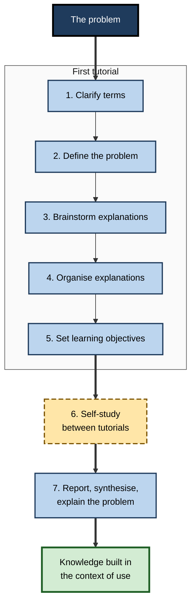
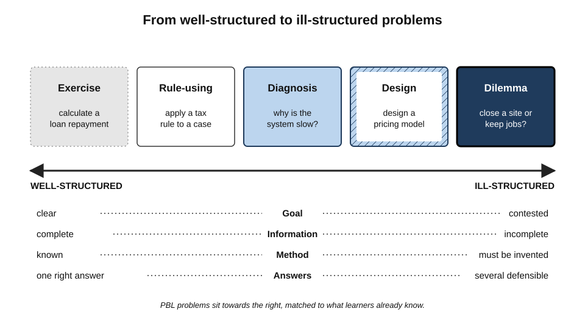
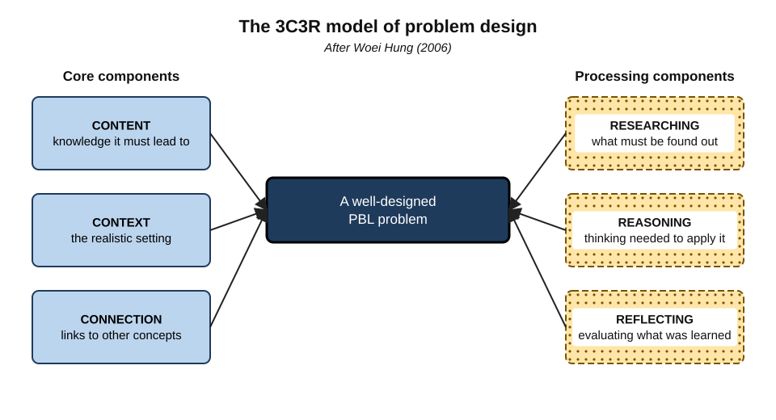
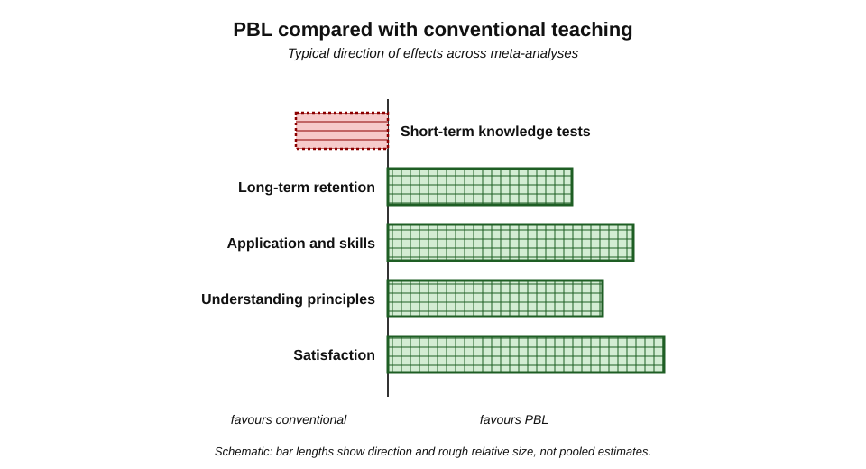
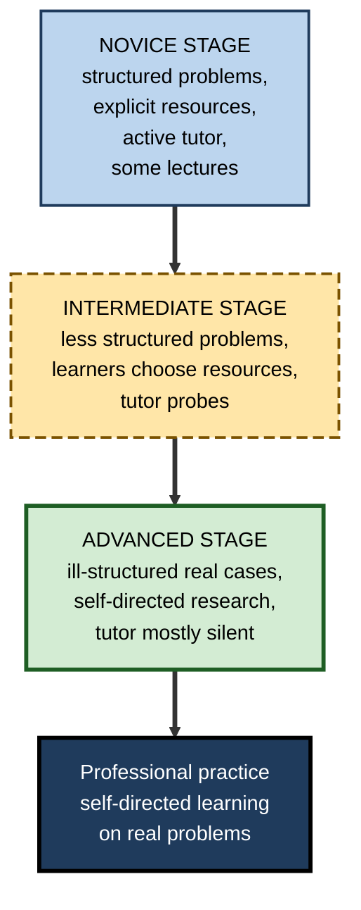
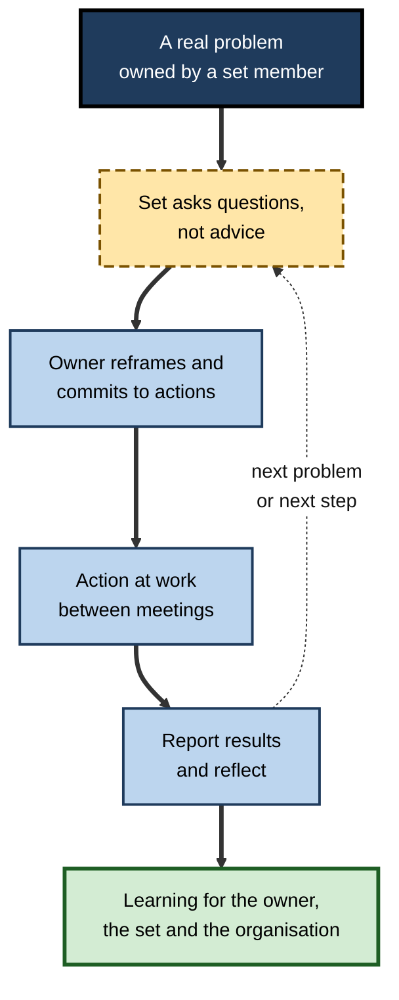

# A.9. Problem-Based Learning Approach

On the first morning of their medical course, a group of eight students is not given a lecture on cardiac physiology. They are given a patient: a 58-year-old man who becomes breathless climbing stairs and whose ankles swell by evening.

Their task is to work out what they would need to know to understand him. By the end of the week they have taught themselves — and each other — the physiology of the heart, because they needed it. This reversal of the usual order is the core of **problem-based learning**.

> **Definition — Problem-based learning (PBL):** an instructional approach in which learners, usually in small groups guided by a tutor, begin with a realistic, ill-structured problem; identify what they need to learn to understand it; study independently; and apply and discuss their new knowledge to explain or resolve the problem.

**Why it matters**

- PBL is one of the most widely adopted active-learning designs in professional education — medicine, nursing, law, engineering, business.
- It builds knowledge **in the context where it will be used**, along with self-directed learning and collaborative reasoning.
- The evidence on PBL is unusually rich and unusually mixed; understanding it protects against both uncritical enthusiasm and dismissal.
- Workplace methods such as action learning, incident simulations and hackathons share its logic.

---

## Origins

- **McMaster University, Canada (1969)** — a new medical school, led by figures including **Howard Barrows**, built its curriculum around patient problems in small tutorial groups.
  - Motivation: graduates of lecture-based programmes forgot much of their basic science and struggled to apply it to patients.
- **Barrows and Robyn Tamblyn, *Problem-Based Learning* (1980)** — set out the method for medical education.
- **Maastricht University, Netherlands (1974)** — adopted PBL across its new faculties; researchers there, notably **Henk Schmidt**, produced much of the research on how PBL works.
- **Aalborg University, Denmark (1974)** — developed problem-based, project-organised learning in engineering and science.
- **Spread** — to nursing, dentistry, law, architecture, business, engineering and school education from the 1980s onward.

---

## How PBL Works

### The seven-jump procedure

The **Maastricht seven-jump** is the best-known structure for a PBL tutorial.

1. **Clarify terms** — agree the meaning of unfamiliar words in the problem.
2. **Define the problem** — state what needs explaining.
3. **Brainstorm** — generate possible explanations using existing knowledge.
4. **Organise** — arrange the ideas into a structured set of tentative explanations.
5. **Formulate learning objectives** — what must the group find out?
6. **Self-study** — each member studies independently, using any resources.
7. **Report and synthesise** — the group reconvenes, shares findings and explains the problem.

**Figure 1.** The seven-jump procedure of a problem-based tutorial.

> **Remember — two sessions and a gap:** understand and plan in the first tutorial, study in the gap, explain in the second.

### The tutor

- **Not a lecturer** — the tutor rarely supplies answers.
- **A facilitator of reasoning** — asks questions that probe and extend:
  - "What do we mean by that?"
  - "What evidence supports that explanation?"
  - "How does this connect to what you found last week?"
  - "What else could explain it?"
- **A manager of process** — keeps the group on track, ensures everyone contributes, prompts reflection.
- **Expertise matters** — Schmidt and colleagues found that tutors with both **subject expertise** and **social congruence** (an informal, approachable manner) and **cognitive congruence** (the ability to explain at the students' level) were associated with better group functioning and learning.

| Tutor behaviour | Effect on learning | Better alternative |
|---|---|---|
| Lecturing on the problem | Group stops reasoning; becomes passive | Ask what the group already knows |
| Silent observation throughout | Errors and dead ends persist | Intervene with questions at key points |
| Accepting vague explanations | Shallow understanding | "Can you explain the mechanism step by step?" |
| Letting one student dominate | Others disengage | Direct questions to quieter members |
| Probing questions and summaries | Deeper reasoning, better self-study objectives | — |

### The problem

The problem is the curriculum. Its quality largely decides whether PBL works.

- **Realistic** — a situation professionals actually face.
- **Ill-structured** — no single right answer or path; information is incomplete; the problem must be defined before it can be solved.
- **Matched to prior knowledge** — learners can activate *some* relevant knowledge, so brainstorming is productive.
- **Targeted** — designed so that the learning objectives learners generate match the intended curriculum.
- **Engaging** — puzzling, personally relevant, discussable.

> **Definition — Ill-structured problem:** a problem with unclear goals, incomplete information, multiple possible solutions and no single correct method (a distinction developed by Herbert Simon and, for education, David Jonassen).

**Figure 2.** A spectrum of problem structure, from well-structured exercises to ill-structured dilemmas.

**Figure 3.** The 3C3R model of problem design.

- **Woei Hung's 3C3R model (2006)** describes what a well-designed PBL problem contains:
  - **core components**:
    - **content** — the knowledge the problem must lead to;
    - **context** — the realistic setting that gives it meaning;
    - **connection** — links to other concepts and problems;
  - **processing components**:
    - **researching** — what learners must find out;
    - **reasoning** — the thinking required to apply it;
    - **reflecting** — evaluation of what and how they learned.

---

## Why PBL Can Work

**Henk Schmidt** and colleagues proposed several cognitive mechanisms, supported by a series of experiments at Maastricht.

- **Activation of prior knowledge** — discussing the problem first activates what learners already know, which makes new information easier to integrate.
  - In studies, groups that discussed a problem before reading a related text recalled more of the text than groups that did not.
- **Elaboration** — explaining, questioning and arguing in the group connect new knowledge with old.
- **Situational interest** — a puzzling problem raises curiosity, which drives self-study.
- **Encoding specificity** — knowledge learned in a realistic problem context is more likely to be recalled in similar contexts later.
- **Self-directed learning** — deciding what to learn and finding resources builds skills professionals need throughout their careers.

> **Key point:** PBL's first tutorial is a structured **generation** phase — learners explain the problem with what they know *before* being taught — and its second tutorial is a **consolidation** phase. It is related to productive failure, extended over days.

---

## What the Evidence Shows

### The classic meta-analyses

**Study card — Albanese and Mitchell (1993)**

- **Design:** a review and meta-analysis of PBL in medical education compared with conventional curricula, 1972–1992.
- **Results:**
  - PBL students sometimes scored **slightly lower** on basic-science examinations;
  - they performed **as well or better** on clinical examinations and faculty assessments of clinical performance;
  - students and faculty found PBL **more enjoyable**;
  - PBL was **more costly** in faculty time with small groups.
- **Conclusion:** PBL has benefits for clinical functioning and satisfaction, at some cost in basic-science test performance and resources.

- **Vernon and Blake (1993)** — a parallel meta-analysis — reached a similar overall picture: PBL superior on students' attitudes and clinical functioning; conventional teaching similar or slightly better on factual knowledge tests.

**Study card — Dochy, Segers, Van den Bossche and Gijbels (2003)**

- **Design:** a meta-analysis of 43 studies of PBL in higher education, separating effects on **knowledge** and **skills**.
- **Results:**
  - a robust **positive effect on skills** — applying knowledge;
  - a slight, non-robust **negative tendency on knowledge** — but PBL students **retained** more of the knowledge they did acquire.
- **Conclusion:** PBL trades a little initial knowledge for better application and retention.

- **Gijbels and colleagues (2005)** — the effects of PBL were **largest** when assessments measured understanding of the **principles linking concepts**, rather than recall of isolated concepts.
- **Strobel and van Barneveld (2009)** — a synthesis of earlier meta-analyses concluded that PBL was superior for **long-term retention**, skill development and satisfaction, while conventional instruction was more effective for **short-term** knowledge retention on standard tests.

**Figure 4.** Typical pattern of PBL outcomes compared with conventional teaching, by type of measure.

| Outcome | PBL compared with conventional instruction |
|---|---|
| Short-term factual knowledge tests | Similar or slightly lower |
| Long-term retention | Higher |
| Application of knowledge, clinical reasoning | Higher |
| Understanding of principles | Higher |
| Self-directed learning and collaboration | Higher, though often self-reported |
| Learner and teacher satisfaction | Higher |
| Cost per learner | Higher (small groups, tutor time) |

### Graduates and long-term outcomes

- **Schmidt and colleagues (2009)**, comparing graduates of a PBL medical school with graduates of conventional Dutch schools, found that PBL graduates rated themselves — and were rated by supervisors — higher on several professional competencies, particularly interpersonal skills and practical aspects of medicine.
  - Caveat: graduate comparisons cannot fully rule out differences in who chose each school.

### The critique and its limits

- **Kirschner, Sweller and Clark (2006)** included PBL among "minimally guided" methods they argued were ineffective for novices.
- **Hmelo-Silver, Duncan and Chinn (2007)** replied that PBL, properly implemented, is heavily **scaffolded** — by the problem design, the seven-jump structure and the tutor.
- **Schmidt and colleagues** added that PBL students are not novices left to discover alone: they study texts and resources chosen with guidance.

> **Watch out:** PBL is often criticised on evidence from **unguided discovery**, and praised on evidence from **satisfaction surveys**. Neither represents well-implemented PBL fairly. The best evidence shows **trade-offs**, not a simple win or loss.

### Conditions for success

- **Prior knowledge** — beginners in an entirely new field may need some explicit instruction before problems become productive; many programmes are **hybrids**, combining PBL with lectures and skills teaching.
- **Problem quality** — problems that lead learners to the intended objectives.
- **Tutor quality** — expertise plus facilitation skill.
- **Assessment alignment** — if assessments test only isolated recall, PBL's strengths are invisible and its learners are disadvantaged.
- **Time** — self-study between tutorials must be protected.

**Figure 5.** Scaffolding in problem-based learning fades as learners gain expertise.

---

## PBL and Its Relatives

| | Problem-based learning | Project-based learning | Case-based learning | Inquiry-based learning |
|---|---|---|---|---|
| Starting point | An ill-structured problem to understand | A product to create | A documented real situation to analyse | A question to investigate |
| Main output | An explanation and learning objectives met | A product or artefact | A judgement or decision | A conclusion from evidence |
| Duration | Days to a week per problem | Weeks to months | One to several sessions | Varies |
| Role of new knowledge | Learned because the problem demands it | Applied and extended | Mostly applied | Generated from evidence |
| Typical fields | Medicine, nursing, law | Engineering, design, schools | Business, law, medicine | Science education |

> **Key point:** the distinguishing feature of PBL is that the problem comes **before** the knowledge it requires. In case-based teaching, learners usually bring knowledge to the case; in PBL, the problem sends them to find it.

---

## Problem-Based Learning at Work

### Action learning

> **Definition — Action learning:** a method, developed by **Reg Revans** from the 1940s, in which small groups ("sets") of managers work on real organisational problems, questioning each other's assumptions and taking action between meetings.

- **Revans's formula:** **L = P + Q** — learning equals **programmed knowledge** (what is already known and taught) plus **questioning insight** (fresh questions about the problem).
- **Origins:** Revans worked with coal-mine managers in Britain, who learned more from tackling each other's problems than from expert instruction.
- **Format:**
  1. Each set member brings a real problem they own.
  2. The set asks questions rather than giving advice.
  3. The problem owner commits to actions.
  4. At the next meeting, the owner reports results; the set reflects on what was learned.

**Figure 6.** An action-learning cycle.

### Other workplace forms

- **Simulation and incident drills** — teams respond to a realistic failure scenario before learning the formal procedure, then debrief.
- **Hackathons and innovation sprints** — teams tackle real problems under time pressure, learning new tools as needed.
- **Graduate challenges** — new hires work on a genuine business problem, with mentors acting as tutors.
- **Clinical case conferences** — practitioners reason together about a difficult patient before an expert summarises.

### Worked example (illustrative): writing a PBL problem for new analysts

- **Goal:** new financial analysts must learn working-capital concepts — receivables, inventory, payables and the cash conversion cycle.
- **Weak problem:** "Explain the cash conversion cycle." — well-structured, abstract, no reason to learn.
- **Draft PBL problem:**
  - *"A furniture manufacturer's revenue grew 30% last year and it reported record profit — yet it nearly missed payroll in December and its bank is asking questions. The finance director has given you last year's balance sheet and income statement. Before Thursday, she wants to understand what happened."*
- **Check against the criteria:**

| Criterion | How the problem meets it |
|---|---|
| Realistic | A common situation: profitable but short of cash |
| Ill-structured | Several possible explanations; the problem must be defined |
| Prior knowledge | Analysts know basic accounting, so they can brainstorm |
| Targets objectives | Explaining it requires receivables, inventory, payables and the cash cycle |
| Engaging | A puzzle: "profitable but nearly bankrupt?" |

- **Expected learning objectives generated by the group:** What is working capital? How do receivables and inventory tie up cash? How is the cash conversion cycle calculated? How does fast growth affect cash?
- **Conclusion:** the problem leads learners to the intended content, in a context where they will later use it.

> **Formula — Cash conversion cycle (the content the problem should lead to):** days inventory outstanding + days sales outstanding − days payables outstanding. *Example:* 75 + 60 − 40 = **95 days** between paying suppliers and collecting cash from customers — so rapid growth absorbs cash.

### Case study (illustrative): a hybrid PBL induction in a law firm

- **Situation:** a law firm trained first-year associates in commercial contracts through a three-week lecture course on contract law and firm precedents.
- **Problem:** associates passed the end-of-course test but, on client matters, failed to spot issues in draft agreements; partners spent long hours correcting basic errors.
- **Diagnosis:**
  - knowledge was learned **abstractly**, organised by doctrine rather than by the situations in which it is used;
  - assessment tested recall of doctrine, not issue-spotting;
  - associates had no practice in defining a client's problem.
- **Actions:**
  1. Kept a **short block of explicit instruction** on core doctrine (hybrid design, for prior knowledge).
  2. Replaced most lectures with **weekly problems** based on anonymised past matters: "A client has received this supply agreement from a much larger customer and signs on Friday. What should we tell them?"
  3. Groups of five followed a **seven-jump** structure, with a senior associate as tutor trained to question rather than explain.
  4. Self-study used firm precedents and practice notes.
  5. Each problem ended with each associate **individually** marking up a fresh agreement, compared with a partner's mark-up.
- **Result:** partners reported that first-year mark-ups needed substantially less correction; associates said they could "see why clauses matter".
- **Side effects / caveats:** the programme required twice as much senior time; one tutor who lectured during tutorials produced groups that performed no better than the old course; the firm had no controlled comparison, so cohort differences may contribute.
- **Lesson:** PBL worked as a **hybrid** — explicit foundations, then realistic problems, tutors who question, and individual application — and failed where the tutor reverted to lecturing.

### PBL and AI

- **Risk:** if learners ask an AI system to "solve the case", the generation and self-study phases — where PBL's learning happens — are skipped.
- **Opportunity:** AI can act as a **simulated client or patient** answering questions, as a **resource** during self-study, or as a **tutor** that asks probing questions rather than answering.
- **Design principle:** keep the **problem definition and explanation** with the learners; use AI for information and challenge.

---

## Open Questions

- **Is the knowledge trade-off real or an artefact?**
  - Lower short-term test scores may reflect assessments aligned with lecture courses rather than true knowledge deficits.
- **How much explicit instruction should hybrid programmes include?**
  - Optimal mixes for different fields and learner levels are not established.
- **Do PBL graduates become better practitioners?**
  - Long-term comparisons are confounded by self-selection and by differences between schools.
- **Is PBL worth its cost?**
  - Small-group tutoring is expensive; cost-effectiveness studies are rare.
- **How will AI change PBL?**
  - AI simulated patients and clients could make realistic problems cheap; AI answers could also hollow out the self-study phase.

---

## Summary

- **PBL**: learners start with a realistic, **ill-structured problem**, identify what they must learn, study independently and return to explain the problem — knowledge comes **after** the problem.
- Origins: **McMaster (1969)**, Barrows and Tamblyn (1980); developed at **Maastricht** (seven-jump) and **Aalborg**.
- The **seven-jump**: clarify, define, brainstorm, organise, set objectives, self-study, report — two sessions and a gap.
- The **tutor** questions rather than lectures; subject expertise plus social and cognitive congruence help. The **problem** is the curriculum; **3C3R** describes its design.
- Mechanisms: **prior-knowledge activation**, elaboration, situational interest, encoding in context, self-directed learning.
- Evidence: PBL tends to be similar or slightly lower on **short-term knowledge tests**, higher on **application, principles, long-term retention** and **satisfaction**, and more **costly** (Albanese and Mitchell; Vernon and Blake; Dochy et al.; Gijbels et al.; Strobel and van Barneveld).
- Success depends on prior knowledge, problem and tutor quality, assessment alignment and protected self-study time; **hybrids** are common.
- At work: **action learning** (Revans: L = P + Q), simulations, hackathons, graduate challenges; with AI, keep problem definition and explanation with the learners.

---

## Self-Check

1. Define problem-based learning and explain how it reverses the usual order of instruction.
2. Describe the seven-jump procedure.
3. What is the tutor's role in PBL, and why does tutor expertise still matter?
4. What makes a good PBL problem? Name five criteria.
5. Define an ill-structured problem and give a professional example.
6. Explain the 3C3R model.
7. Name four cognitive mechanisms that may explain PBL's benefits.
8. Summarise the findings of Albanese and Mitchell (1993) and Dochy et al. (2003).
9. Why might PBL's effects appear larger when assessments target principles?
10. How did Hmelo-Silver, Duncan and Chinn respond to the claim that PBL is minimally guided?
11. Distinguish PBL from project-based and case-based learning.
12. Explain Revans's formula L = P + Q and describe an action-learning set.
13. Calculate the cash conversion cycle for days inventory 50, days sales outstanding 45 and days payables 30, and explain why rapid growth can create a cash shortage.
14. A company wants to replace all onboarding lectures with PBL for new engineers who have never used its technology stack. Advise on the design.

### Answer Key

1. Learners begin with a realistic, ill-structured problem, identify what they need to learn, study independently and apply new knowledge to explain the problem. Conventional instruction teaches knowledge first and applies it later; PBL presents the problem first.
2. Clarify terms; define the problem; brainstorm explanations; organise them; formulate learning objectives; self-study; report and synthesise.
3. To facilitate reasoning and process — asking probing questions, ensuring participation, prompting reflection — rather than lecturing. Expertise lets the tutor recognise errors and ask the right questions; tutors combining expertise with social and cognitive congruence are associated with better learning.
4. Realistic; ill-structured; matched to prior knowledge; targeted at intended objectives; engaging.
5. Unclear goals, incomplete information, several possible solutions, no single method. E.g. "Our largest client is unhappy and may leave; decide what to do."
6. Core components — content, context, connection; processing components — researching, reasoning, reflecting. Together they describe what a problem must contain and what it must make learners do.
7. Prior-knowledge activation; elaboration through discussion; situational interest; encoding in a realistic context; development of self-directed learning.
8. Albanese and Mitchell: PBL students sometimes slightly lower on basic-science exams, as good or better clinically, more satisfied; PBL costlier. Dochy et al.: robust positive effect on skills, slight non-robust negative tendency on knowledge, better retention.
9. PBL organises learning around how concepts relate in explaining problems, so its strengths show most on assessments of principles linking concepts rather than recall of isolated facts.
10. They argued that well-implemented PBL is heavily scaffolded — through problem design, procedure and tutor questioning — and therefore not minimally guided; in that form it is effective.
11. PBL starts with a problem to understand, with knowledge acquired because the problem demands it; project-based learning centres on creating a product; case-based learning analyses a documented situation, usually applying knowledge learners already have.
12. Learning equals programmed knowledge plus questioning insight. A small set of managers each bring a real problem; members ask questions rather than advise; the owner commits to action, reports back and the set reflects.
13. 50 + 45 − 30 = 65 days. Cash is paid out for inventory and supplier costs 65 days before it is collected from customers, so growth increases the cash tied up before revenue arrives.
14. Novices with no knowledge of the stack would be overloaded by open problems. Use a hybrid: short explicit instruction and worked examples on core tools first; then structured, realistic problems drawn from past incidents and features; trained tutors who question; protected self-study; individual application tasks; and less structured problems as competence grows.

---

## Glossary

| Term | Meaning |
|---|---|
| 3C3R model | Hung's model of problem design: content, context, connection; researching, reasoning, reflecting. |
| Action learning | Small groups tackling real organisational problems through questioning, action and reflection. |
| Cash conversion cycle | Days inventory + days receivables − days payables. |
| Cognitive congruence | A tutor's ability to explain at the learners' level. |
| Encoding specificity | Recall is best when the retrieval context matches the learning context. |
| Hybrid curriculum | A programme combining PBL with lectures and explicit skills teaching. |
| Ill-structured problem | A problem with unclear goals, incomplete information and multiple solutions. |
| L = P + Q | Revans's formula: learning equals programmed knowledge plus questioning insight. |
| Problem-based learning | Learning that starts from a realistic problem, with knowledge acquired to understand it. |
| Project-based learning | Learning organised around creating a product or artefact. |
| Self-directed learning | Learners deciding what to learn and finding resources themselves. |
| Seven-jump | Maastricht's seven-step structure for a PBL tutorial. |
| Social congruence | A tutor's informal, approachable manner with learners. |
| Tutor (PBL) | A facilitator who guides group reasoning, mainly through questions. |
| Well-structured problem | A problem with clear goals, complete information and a known solution method. |
