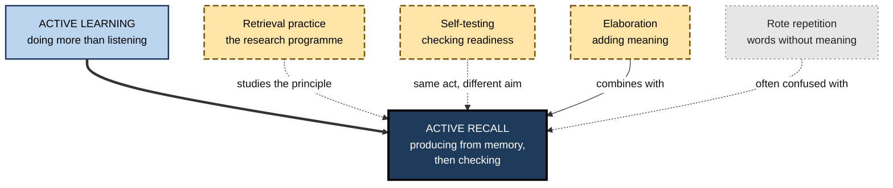
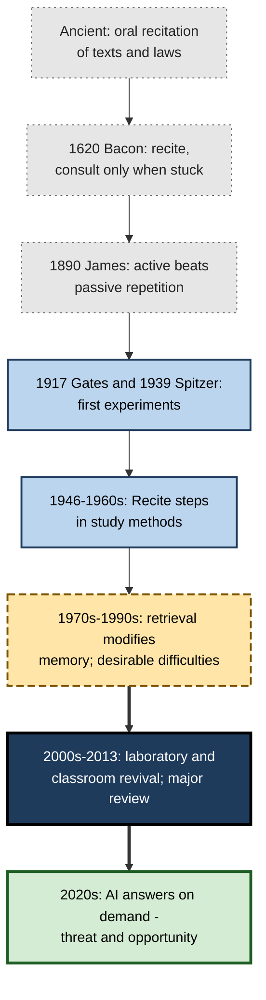
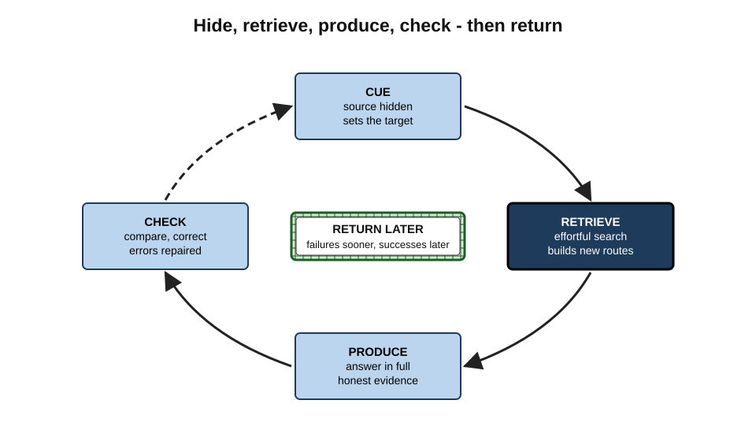
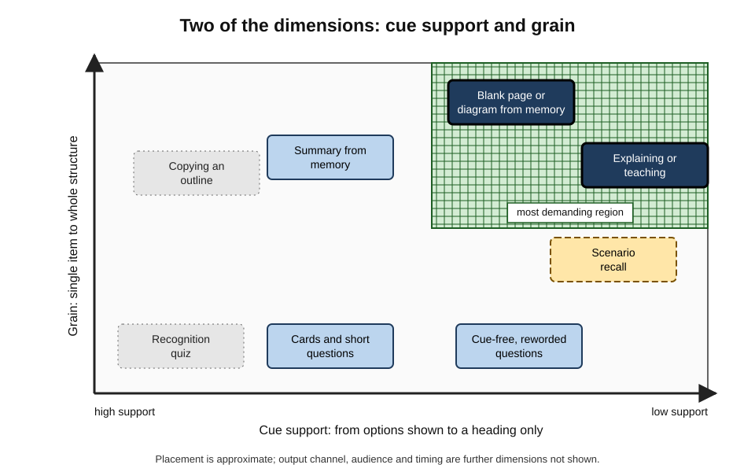
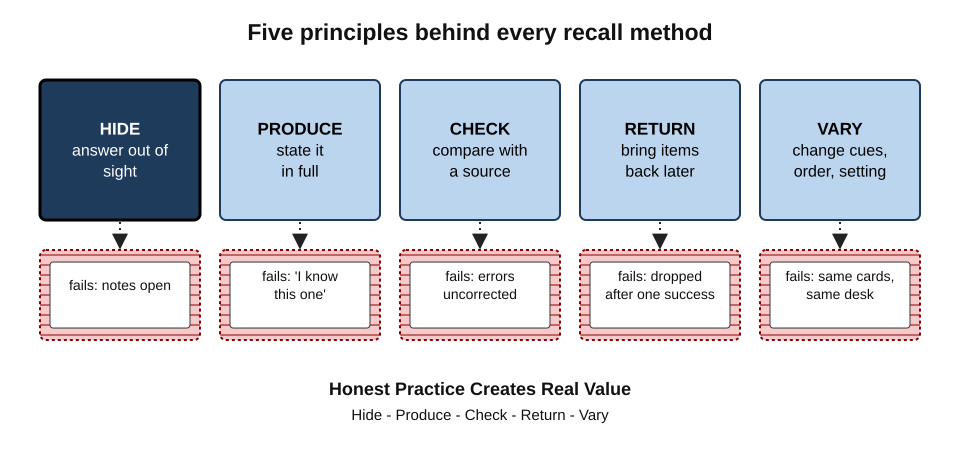
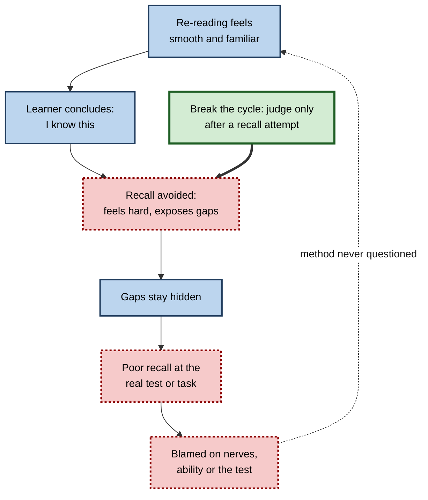
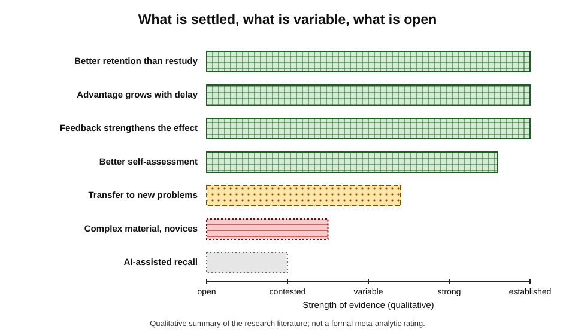
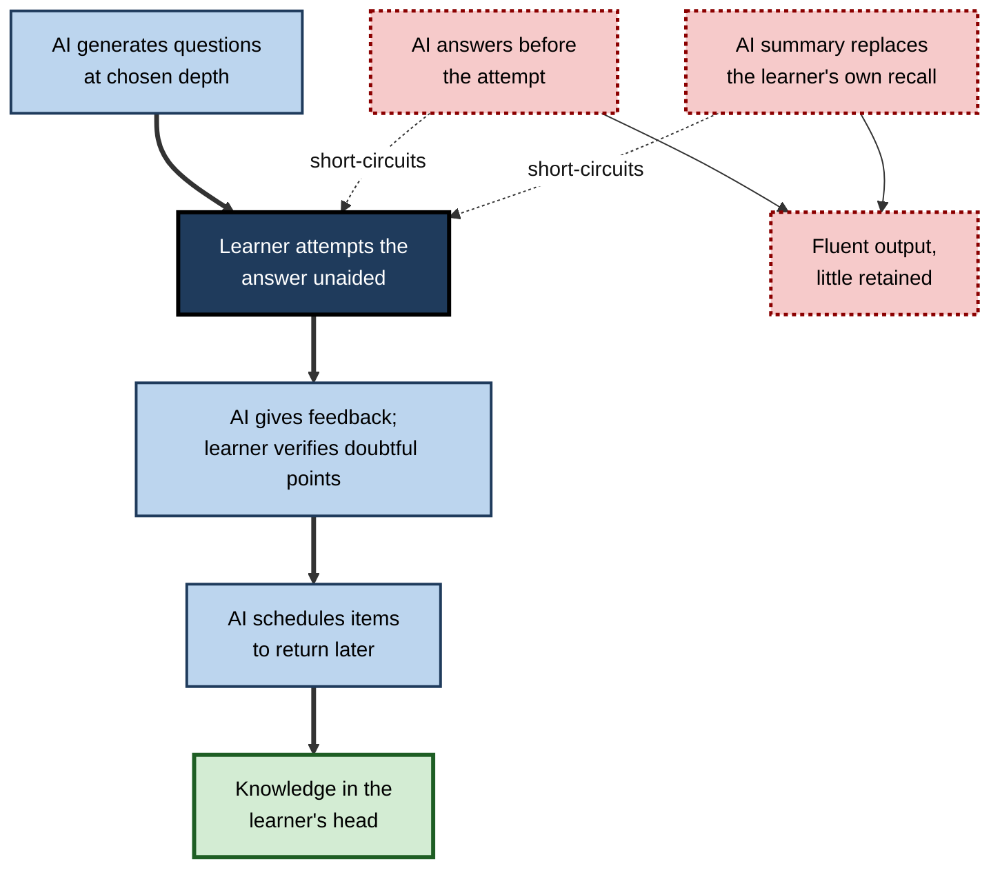

# B. Active Recall

Watch most people study and the information flows one way: from the page, the slide or the screen into the learner. Notes are re-read, chapters highlighted, recordings replayed. Active recall reverses the flow. The learner closes the source and tries to bring the knowledge out — onto a blank page, into words, into a diagram, into action — and only then checks what came out against what went in. It is one of the simplest changes a learner can make, and one of the best supported by evidence.

> **Definition — Active recall:** the practice of studying by deliberately retrieving information from memory — producing it without looking — and then checking the result against an authoritative source, so that the act of retrieval itself strengthens, organises and tests what is known.

**Why it matters**

- **It is among the most reliable ways to make learning last.** Retrieving knowledge produces more durable memory than spending the same time reviewing it.
- **It tells the truth.** Re-reading makes everything feel familiar; recall shows precisely what can and cannot be produced.
- **It rehearses real use.** Exams, interviews, client meetings, incidents and negotiations all demand knowledge produced on the spot, without a book.
- **It is universal and cheap.** It works across subjects, ages and professions, and needs nothing but the discipline to close the source.
- **It is badly under-used.** Most learners rely on the methods that feel productive and work least well.
- **It matters more as tools grow more capable.** When an assistant can answer any question instantly, the deliberate effort to retrieve is what keeps knowledge in the professional's own head.

---

## The Subject and Its Scope

### What active recall covers

- **A principle** — learning is strengthened when the learner produces knowledge rather than re-encounters it.
- **A family of methods** — every technique that applies the principle, from single-item cards to blank-page writing, explaining, teaching and performing procedures from memory.
- **A set of design decisions** — how much support to give, what form the output takes, when to recall, how to check and how often to return.
- **A habit** — the routines that make recall happen without a fresh decision each time.

> **Key point:** active recall is defined by **where the answer comes from** at the moment of responding — the learner's memory — not by any particular tool, format or app.

### Neighbouring ideas

Several closely related terms are often used interchangeably. They overlap but are not the same.

- **Active learning** — any instruction in which learners do something more than listen: discussion, problem-solving, hands-on work. Active recall is one form of it, but a lively, interactive class may involve no retrieval at all.
- **Retrieval practice** — the term researchers use for the experimental programme that studies how and why testing memory improves it; active recall is the learner's everyday practice of the same principle.
- **Self-testing** — testing oneself, often to **check** readiness; active recall uses the same act chiefly to **learn**.
- **Elaboration** — adding meaning and connections to what is being learned; recall can be combined with it, but elaboration done with the source open is not recall.
- **Rote learning** — mechanical repetition of words without attention to meaning; recall can target meaning, reasons and application, so it is not rote by nature.

| Term | Core act | Main purpose | Can happen with the source open? |
|---|---|---|---|
| Active recall | Producing knowledge from memory, then checking | Learning and diagnosis | No |
| Active learning | Doing something beyond listening | Engagement and processing | Yes |
| Retrieval practice | Retrieving from memory (studied experimentally) | Understanding and applying the testing effect | No |
| Self-testing | Answering questions about one's own knowledge | Mainly checking readiness | Sometimes |
| Elaboration | Adding meaning and connections | Understanding | Yes |
| Rote repetition | Repeating words mechanically | Verbatim memory | Yes |

**Figure 1.** Active recall among neighbouring ideas.

---

## Origins and History

Active recall is not a modern discovery. It is ancient practice, repeatedly rediscovered, that research has recently made precise.

### Oral and religious traditions

- **Recitation** — societies without widespread writing preserved epics, laws, genealogies and scriptures through repeated recitation; learners rehearsed by **reproducing**, not by reviewing.
  - *e.g.* the oral transmission of the Vedas in India, with elaborate recitation techniques designed to prevent error; the memorisation of the Qur'an by *huffaz*; rabbinic study in pairs (*chavruta*), in which partners question and explain texts to each other.
- **Catechisms** — from the sixteenth century, religious instruction in Europe was widely organised as fixed questions and answers to be recited from memory.

### Early modern and scientific observations

- **Francis Bacon (1620)** observed that a text read many times is learned less readily than one read fewer times with attempts to recite it, consulting the book only when memory fails.
- **William James (1890)** wrote that things are impressed better by **active** than by passive repetition.
- **Arthur Gates (1917)** showed experimentally that children who spent more of their study time **reciting** — trying to recall — remembered more than those who spent it reading.
- **Herbert Spitzer (1939)** found, with thousands of schoolchildren, that an early test after reading greatly reduced later forgetting.

### The study-skills era

- **Francis Robinson (1946)** included a *Recite* step in the SQ3R reading method.
- **Walter Pauk (1950s–1960s)** built covered-notes recitation into the Cornell note-taking system.
- **Recitation was a classroom staple** for generations, though often as rote repetition rather than meaningful recall.

### The cognitive science of retrieval

- **1970s–1990s** — psychologists, notably Robert Bjork, argued that retrieval **modifies** memory and that conditions which make retrieval effortful can make learning more durable — **desirable difficulties**.
- **2000s** — a series of laboratory and classroom studies by Henry Roediger, Jeffrey Karpicke and colleagues revived the subject, showing large advantages for retrieval over restudy after delays, and showing that learners do not notice them.
- **2013** — a major review of study techniques led by John Dunlosky rated practice testing among the two most useful techniques studied.

### Popular uptake and the AI era

- **2010s** — active recall became a central idea in popular study advice, in medical-school culture (where very large shared flashcard decks became common) and in professional certification preparation.
- **2020s** — generative AI made it trivially easy to get answers and summaries, which threatens the retrieval on which recall depends, while also offering tools that can ask questions, give feedback and play the role of a curious student.

**Figure 2.** Milestones in the history of active recall.

> **Watch out:** the long history of **recitation** includes a great deal of rote memorisation of words without understanding. Modern active recall keeps the act of retrieval but aims it at meaning — reasons, relationships, application — as well as at facts.

---

## How Active Recall Works

The mechanisms are a subject in their own right; the essentials can be stated briefly.

- **Retrieval changes memory.** Bringing a memory back reactivates and re-stores it, usually stronger and better connected; Robert and Elizabeth Bjork's distinction between **storage strength** and **retrieval strength** explains why effortful retrieval does most good.
- **Effort is the active ingredient.** Within limits, harder successful retrievals — after a delay, with fewer cues — produce more durable learning.
- **Production beats reception.** Generating an answer leaves a stronger trace than reading it.
- **Search builds routes.** Looking for an answer activates related knowledge, which becomes extra pathways to it.
- **Feedback makes failure useful.** A failed attempt followed by the correct answer can still improve learning; without feedback, errors may persist.
- **Recall improves judgement.** Learners who attempt retrieval before judging what they know judge far more accurately.

> **Definition — Desirable difficulty:** a condition that makes learning slower or harder now but improves long-term retention or transfer, provided the learner can succeed or recover with feedback.

**Figure 3.** The core cycle of active recall and what each stage contributes.

---

## The Design Space of Recall Methods

All recall methods share the same core act; they differ along a small number of dimensions. Understanding the dimensions matters more than memorising methods, because it allows any study situation to be turned into recall.

### Five dimensions

- **Cue support** — how much the prompt gives away.
  - From recognition (the answer among options) through cued recall (a specific question) to free recall (a topic heading only).
- **Grain** — the size of what is recalled.
  - From **single items** (a term, a figure) to **structures** (an argument, a system, a whole chapter).
- **Output channel** — the form the answer takes.
  - Written, spoken, drawn, performed or silent.
- **Audience** — who the recall is for.
  - Oneself, an imagined novice, a partner, a group being taught.
- **Timing** — when it happens.
  - Straight after input, later the same day, days later, or as part of a long-running routine.

**Figure 4.** The design space of recall methods by cue support and grain.

| Dimension | Low end | High end | Design question |
|---|---|---|---|
| Cue support | Free recall from a heading | Recognition among options | How much help will the real situation give? |
| Grain | Single facts and terms | Whole arguments and systems | Is the goal exact items or connected understanding? |
| Output channel | Silent | Written, drawn or performed | How precisely must the answer be checked? |
| Audience | Oneself | A real group being taught | Will explaining to others expose more gaps? |
| Timing | Immediately after input | Days later, as a routine | Is the goal to catch early forgetting or build durability? |

### Where familiar methods sit

Item-level, cued methods such as well-written cards are fast and precise, and suit facts and discriminations; structure-level, low-cue methods such as writing from memory expose missing connections in systems and arguments. Methods that require explaining or teaching add the demand to give reasons, so they test understanding as well as memory — and whichever method is used, its timing, its partners and the routines around it decide whether the effect lasts.

> **Key point:** any method can be made more or less demanding by moving along the dimensions — fewer cues, larger grain, a stricter output, a real audience, a longer delay.

---

## Matching Recall to Knowledge and Goal

Different kinds of knowledge need different recall tasks. A mismatch produces practice that feels productive but does not prepare for real use.

| Kind of knowledge | Example | Weak recall task | Strong recall task |
|---|---|---|---|
| Facts and terms | Statutory deadlines; drug doses | "Do I know this?" — a feeling | State the fact and its exceptions, unaided, then check |
| Concepts | Opportunity cost; latency | Recognise a definition | Define in own words with an example and a non-example |
| Structures and systems | Network architecture; organisation chart | Re-read a diagram | Redraw it from memory and explain each link |
| Procedures | Incident escalation; clinical examination | Read the runbook | Perform or write the steps from memory, in order |
| Arguments | A report's recommendation | Re-read the summary | Write the claim, reasons and evidence from memory |
| Judgement | When to escalate; which pricing approach | Re-read past cases | Decide an unseen case from memory, then compare with an expert's view |

> **In practice:** begin by asking how the knowledge will be **used** — instantly, exactly, flexibly, under pressure, in front of others — and choose recall tasks that resemble that use.

---

## Principles That Hold Across Every Method

Five principles apply to every recall method, whatever its format.

1. **Hide** — the answer must be out of sight while responding. No notes, no glancing, no autocomplete.
2. **Produce** — the answer must actually be stated in full — written, spoken, drawn or performed — not merely felt to be known.
3. **Check** — every attempt is compared with an authoritative source; errors are corrected and confident errors noted.
4. **Return** — what failed comes back later; what succeeded comes back after a longer gap.
5. **Vary** — cues, order, wording, format and context change, so that recall does not depend on any one set of props.

> **Mnemonic — "HPCRV" — "Hide, Produce, Check, Return, Vary":** "**H**onest **P**ractice **C**reates **R**eal **V**alue."

**Figure 5.** Five principles that make any study activity effective recall.

### Common failures, by principle

- **Hide fails** — notes are open "just in case"; the flashcard is turned after one second.
- **Produce fails** — "I know this one" replaces an actual answer.
- **Check fails** — wrong answers are recalled again and again, uncorrected.
- **Return fails** — items are dropped after one success, or recalled once and never again.
- **Vary fails** — the same cards in the same order at the same desk, so recall works only there.

---

## Why Recall Is So Often Avoided

### The metacognitive trap

- **Re-reading feels fluent**, and fluency is mistaken for knowledge.
- **Recall feels effortful and exposes failure**, and difficulty is mistaken for poor learning.
- **The benefit appears later**, after a delay, when the learner no longer connects it to the method.
- **Result:** learners rate recall as less effective than re-reading even when, in the same study, it produced better results.

**Figure 6.** The self-reinforcing cycle that keeps learners away from recall.

### Institutional reasons

- **Assessments that reward recognition** — open-book or multiple-choice checks taken straight after training.
- **Satisfaction as the success measure** — recall-heavy sessions feel harder and are sometimes rated lower.
- **Time pressure** — "covering" content seems more productive than retrieving it.
- **Tools that remove the need** — search, autocomplete and AI answers make retrieval optional.

### Knowing is not doing

- **Programmes that teach learners about effective strategies** reliably improve what learners **know** about learning; changes in what learners **do** are smaller and less certain.
- **Implication:** recall must be built into the design of courses, training and routines — not left to good intentions.

> **Watch out:** "I'll test myself once I know the material" is the most common misconception about recall. Recall is not only the check at the end of learning; it is **how** the learning happens.

---

## The Evidence Base and Its Limits

Active recall rests on one of the strongest evidence bases in applied learning science. That strength makes it important to be precise about what is established and what is not.

### What is well established

- **Retention** — recall produces better long-term retention than equivalent restudy, across hundreds of experiments, many kinds of material and learners of all ages.
- **Delay dependence** — the advantage grows with the delay before the final test; on immediate tests, restudy can look as good or better.
- **Feedback** — recall with feedback is more effective and more reliable than recall without it.
- **Metacognition** — recall improves learners' judgements of what they know.
- **Classroom effectiveness** — benefits have been found in real courses, not only in laboratories.

### What is supported but more variable

- **Transfer** — recall helps with new questions on the same content, and to some extent with applying knowledge to new problems, but the gains are smaller and depend on how closely practice resembles use.
- **Explanation-based and teaching formats** — strong component evidence, more variable direct evidence.
- **Stress resistance** — knowledge strengthened by recall appears more robust under acute stress, from a smaller number of studies.

### What is contested or open

- **Highly complex material** — whether recall helps as much when many elements must be understood together, especially for novices, is debated; worked examples before recall are a widely accepted compromise.
- **Optimal difficulty** — how hard recall should be for different learners and materials is not precisely known.
- **Individual differences** — whether some learners benefit more than others is unresolved.
- **AI-assisted recall** — the effects of AI-generated questions, feedback and tutoring on long-term learning are only beginning to be studied.

**Figure 7.** How firmly different claims about active recall are supported.

| Claim | Status | Practical consequence |
|---|---|---|
| Recall beats restudy for long-term retention | Well established | Replace much re-reading with recall |
| The advantage grows with delay | Well established | Judge methods by delayed, not immediate, results |
| Feedback improves recall's effects | Well established | Always check answers |
| Recall improves self-assessment | Well established | Judge readiness only after a recall attempt |
| Recall improves transfer to new problems | Supported, smaller and variable | Practise recall in forms that resemble real use |
| Recall works for complex material with novices | Contested | Use worked examples first, then recall |
| AI tools improve recall-based learning | Open | Use AI to ask and check, not to answer; verify outputs |

> **Watch out:** headline claims such as "active recall doubles learning" overstate the evidence. Effects vary widely with material, delay, feedback and design. The honest summary is that recall is **reliably better** than re-reading for durable learning, often by a substantial margin, and that its benefits depend on doing it well.

---

## Active Recall in Professional and Organisational Life

### Professions that already depend on it

- **Aviation** — pilots must perform certain emergency "memory items" from memory before using the checklist, and demonstrate them in recurrent simulator checks throughout their careers.
- **Medicine** — trainees present cases from memory on ward rounds and are questioned by seniors; licensing preparation relies heavily on question banks and cards.
- **Law** — advocates must answer judges' questions on the authorities without searching their files; moots rehearse this.
- **Emergency services and the military** — drills rehearse procedures until they can be performed under stress.
- **Software and operations** — incident "game days" rehearse responses from memory; engineers who can recall a system's architecture diagnose faster.
- **Sales and consulting** — representatives and consultants rehearse product knowledge, objection responses and storylines until they can produce them live.

> **Key point:** the professions with the highest stakes for forgetting — where errors cost lives or large sums — have long built **scheduled, realistic recall** into training and certification.

### What organisations can do

- **End every training session with recall**, not with "any questions?" or a satisfaction form.
- **Assess unaided and after a delay** — replace immediate, open-book quizzes with delayed, closed-book, scenario-based checks.
- **Build recall into workflows** — recall-first meeting recaps, closed-book case reviews, drills of critical procedures.
- **Make it safe to fail** — recall exercises are practice, never used in performance ratings.
- **Treat AI tools as questioners** — configure learning assistants to ask, wait and give feedback, rather than to answer first.

### Case study: redesigning graduate onboarding around recall

- **Situation:** a professional-services firm onboarded about two hundred graduates a year through a six-week programme of lectures, e-learning modules and readings on its methods, sectors and tools.
- **Problem:** satisfaction was high and end-of-module quiz scores averaged above 90 per cent, but project managers reported that graduates arrived on client work unable to explain the firm's core methods or recall basic sector facts without searching.
- **Diagnosis:**
  - almost all programme time was **input** — listening, watching, reading;
  - quizzes were multiple-choice, taken immediately after each module, with materials available;
  - no part of the programme required graduates to **produce** knowledge from memory, explain it to others or use it after a delay.
- **Actions:**
  1. **Recall built into every session** — each lecture split into segments with short free-text recall questions; every day ended with a ten-minute closed-book summary.
  2. **Weekly cumulative recall** — Friday mornings began with a mixed, cue-free quiz on everything covered so far, followed by feedback.
  3. **Teaching rotations** — each graduate taught one method to a small group without slides, answering questions from a senior consultant.
  4. **Worked examples before problems** — case exercises began with a worked example, followed by a similar case solved from memory.
  5. **Assessment redesigned** — the final assessment became a delayed, closed-book case interview in week eight.
- **Result:** in the next intake, project managers rated graduates' readiness markedly higher; graduates' unaided case-interview performance improved year on year; end-of-module quiz scores were no longer collected.
- **Side effects:** satisfaction ratings for the first two weeks fell slightly — graduates found the programme "harder" — before recovering as they saw their progress.
- **Lesson:** the same six weeks, redistributed from input towards **retrieval, explanation and delayed checking**, produced professionals who could use what they had been taught.

---

## Active Recall When Tools Can Answer Everything

### The new pressure

- **Answers on demand** — search engines and AI assistants make it unnecessary to retrieve anything from memory in the moment.
- **Summaries on demand** — transcripts and AI summaries remove the need to attend, recall or reconstruct.
- **Code and text completion** — autocomplete supplies names, syntax and phrasing before the user has to produce them.
- **Consequence:** without deliberate design, the act that builds memory disappears from daily work.

> **Definition — Cognitive offloading:** using external tools or actions to reduce the mental demands of a task, such as letting a device remember or compute something instead of doing it oneself.

### Why recall still matters

- **Judging AI output requires knowledge in the head** — spotting an error in a legal summary, a diagnosis or a piece of code depends on knowing the subject.
- **New learning builds on old** — prior knowledge in memory is the main foundation for learning more in a field.
- **Speed and presence** — meetings, negotiations, incidents and clinical encounters leave no time to look things up.

### Using AI to support recall

**Figure 8.** Where AI tools strengthen the recall cycle and where they short-circuit it.

- **Ask, don't tell** — configure the tool to pose questions one at a time and wait for an answer.
- **Attempt before help** — no hint or explanation until a genuine attempt has been made.
- **Verify** — generated questions, answers and feedback can be wrong; check doubtful points against authoritative sources.
- **Keep some recall tool-free** — schedule practice without search, autocomplete or assistants, so that knowledge is tested without props.

---

## Worked Example: Auditing a Week of Study

**Situation:** an accountant preparing for a professional examination logs one week of study and wants to know how much of it was active recall.

| Activity | Minutes | Answer hidden? | Produced? | Checked? | Active recall? |
|---|---|---|---|---|---|
| Re-reading the tax chapter | 120 | No | — | — | No |
| Watching recorded lectures | 150 | No | — | — | No |
| Highlighting the study manual | 60 | No | — | — | No |
| Question bank, answers revealed after each attempt | 90 | Yes | Yes | Yes | Yes |
| Flashcards, flipped after about one second | 40 | Partly | No | Yes | No — recognition |
| Explaining deferred tax to a colleague without notes | 20 | Yes | Yes | Partly | Yes |
| Total | 480 | | | | 110 |

> **Formula — Recall share:** minutes of genuine active recall ÷ total study minutes. Example: 110 ÷ 480 ≈ **23%**.

**Steps**

1. **Classify** each activity with the three questions — hidden, produced, checked.
2. **Find the near-misses** — the flashcards look like recall but are used as recognition.
3. **Redistribute** — next week she:
   - watches lectures with a two-minute recall after each segment;
   - replaces the second re-reading of the chapter with a closed-book summary and a check;
   - stops highlighting;
   - says each flashcard answer aloud before flipping.
4. **Re-audit** — her recall share rises to about **60%** with the same total time.

- **Conclusion:** the problem was not too little study but too little **retrieval**; most of her week was input.

> **Watch out:** a recall share near 100 per cent is not the goal either. New material must first be encountered and understood; recall works on what has been encoded. A high but not total share — often well over half of study time once initial learning is done — is a reasonable target.

---

## Open Questions

- **How far does recall transfer to complex professional judgement?**
  - Evidence for retention is strong; evidence that recall practice improves real-world decisions in complex domains is thinner and harder to gather.
- **What is the right balance between explanation, worked examples and recall for novices?**
  - The complexity debate is unresolved; practical guidance relies on sensible sequencing more than on precise evidence.
- **How should recall be adapted to each learner?**
  - Adaptive software can estimate difficulty for facts; extending this to meaning-rich material is an open problem.
- **What happens to recall habits in a world of always-available AI?**
  - Whether professionals will retrieve less, and what that does to expertise over a career, is unknown.
- **How can organisations change behaviour, not just knowledge?**
  - Teaching people about recall is easy; making it routine in courses, training and work is much harder and less studied.
- **Which recall formats suit which professions?**
  - Most evidence comes from students and texts; systematic comparisons in workplaces are rare.

---

## Summary

- **Active recall** = studying by producing knowledge from memory, without looking, then checking it; defined by **where the answer comes from**, not by tool or format.
- It is distinct from, though related to, **active learning**, the research programme on **retrieval practice**, **self-testing**, **elaboration** and **rote repetition**.
- **History:** oral recitation and catechisms; Bacon, James, Gates and Spitzer; recite steps in SQ3R and Cornell notes; Bjork's desirable difficulties; the 2000s revival and the 2013 review; popular uptake; the AI era.
- **Mechanisms in brief:** retrieval modifies memory; effort is the active ingredient; production beats reception; search builds routes; feedback makes failure useful; recall improves self-judgement.
- **Design space:** cue support, grain, output channel, audience, timing. Item-level cued methods suit facts; structure-level low-cue methods suit systems and arguments; explanation-based methods test understanding.
- **Match** recall tasks to the kind of knowledge and how it will be used.
- **Five principles:** Hide, Produce, Check, Return, Vary.
- **Avoidance** stems from fluency illusions, delayed benefits, institutional incentives and tools that remove the need; knowledge of the method rarely changes habits on its own.
- **Evidence:** retention, delay dependence, feedback and metacognitive benefits are well established; transfer is smaller and variable; complex material and AI-assisted recall are contested or open.
- **Professions** with high stakes already schedule realistic recall; organisations can end sessions with recall, assess unaided after a delay and make failure safe.
- **AI:** use tools to **ask and check**, not to answer first; keep some recall tool-free.

---

## Self-Check

1. Define active recall and explain why it is defined by where the answer comes from rather than by format.
2. Distinguish active recall from active learning, self-testing and rote repetition.
3. Summarise the contributions of Bacon, James, Gates and Spitzer.
4. State four mechanisms by which recall improves learning.
5. Describe the five dimensions of the recall design space and give an example of moving a method along two of them.
6. For each kind of knowledge — fact, concept, procedure, argument, judgement — propose a strong recall task.
7. State the five principles that apply to every recall method and give one common failure for each.
8. Explain the self-reinforcing cycle that keeps learners away from recall, and how it can be broken.
9. Which claims about active recall are well established, which are supported but variable, and which are contested?
10. Why do high-stakes professions schedule recall throughout careers? Give two examples.
11. An organisation measures training success by satisfaction and immediate open-book quizzes. Identify the problems and propose a recall-based alternative.
12. Explain why AI tools threaten active recall and how they can be used to support it.
13. Calculate the recall share for a week with 300 minutes of study, of which 45 minutes were genuine recall, and propose changes.
14. A colleague says, "Active recall is just rote memorisation with a new name." Respond.
15. Design a recall-centred plan for a new manager who must learn the company's financial reporting in a month.

### Answer Key

1. Studying by producing knowledge from memory without looking, then checking it. The same tool — a card, a question bank, an AI chat — can be used actively or passively; what makes the act recall is that the answer comes from memory at the moment of responding.
2. Active learning is any activity beyond listening, which may involve no retrieval. Self-testing uses the same act mainly to check readiness; active recall uses it mainly to learn. Rote repetition repeats words without meaning; recall can target reasons and application.
3. Bacon: reading with attempts to recite beats repeated reading. James: active repetition impresses memory better than passive. Gates: more time spent reciting gave better recall. Spitzer: an early test after reading greatly reduced later forgetting.
4. Retrieval re-stores memory stronger; effortful success builds more storage strength; production leaves a stronger trace than reading; search activates related knowledge; feedback makes failures useful; recall improves self-judgement (any four).
5. Cue support, grain, output channel, audience, timing. E.g. a flashcard set can be made more demanding by removing cues (from cloze to open question) and enlarging the grain (from definition to "explain how this fits the process").
6. Fact — state it and its exceptions unaided. Concept — define in own words with example and non-example. Procedure — perform or write the steps in order. Argument — write claim, reasons and evidence from memory. Judgement — decide an unseen case, then compare with an expert.
7. Hide (notes left open), Produce ("I know this one"), Check (errors uncorrected), Return (items dropped after one success), Vary (same order, same desk).
8. Re-reading feels fluent; the learner thinks the material is known; recall is avoided; gaps stay hidden; performance disappoints; the failure is blamed elsewhere; re-reading continues. Break it by judging knowledge only after a recall attempt and by building recall into routines.
9. Established: retention advantage over restudy, growth with delay, value of feedback, better self-assessment, classroom effectiveness. Supported but variable: transfer, explanation and teaching formats, stress resistance. Contested or open: complex material with novices, optimal difficulty, individual differences, AI-assisted recall.
10. Because forgetting critical knowledge has severe consequences and memory fades without retrieval. Examples: pilots' memory items and recurrent simulator checks; medical case presentations and drills; emergency-service drills.
11. Satisfaction measures reaction; immediate open-book quizzes measure recognition with help, not retention. Alternative: recall in every session; delayed, closed-book, scenario-based assessment; drills or case reviews on the job; compare with an untrained group where possible.
12. They supply answers, summaries and completions before the learner retrieves anything, removing the act that builds memory. Support recall by having tools ask questions and wait, give feedback after attempts, schedule returns, and by keeping some practice tool-free; verify outputs.
13. 45 ÷ 300 = **15%**. Replace re-reading with closed-book summaries; add recall after each lecture segment; answer cards aloud before flipping; add a weekly cumulative recall session.
14. Rote memorisation repeats words without meaning; active recall is a retrieval practice that can — and should — target explanations, relationships and application, and it is checked against sources. It can be used for rote material, but it is not rote by nature.
15. E.g. week 1: short explanations of the main statements with worked examples; daily closed-book summaries; cards for key definitions. Week 2: redraw how the statements link from memory; explain one statement weekly to a colleague. Weeks 3–4: mixed scenario questions ("revenue recognised early — effects?") with feedback; recall-first recaps after finance meetings; a cue-free audit at month's end.

---

## Glossary

| Term | Meaning |
|---|---|
| Active learning | Instruction in which learners do more than listen. |
| Active recall | Studying by producing knowledge from memory, then checking it. |
| Catechism | Instruction organised as fixed questions and answers recited from memory. |
| Cognitive offloading | Using tools or actions to reduce the mental demands of a task. |
| Cue support | How much a prompt reveals about the answer. |
| Cued recall | Producing an answer to a specific prompt. |
| Desirable difficulty | A condition that slows learning now but improves long-term retention or transfer. |
| Elaboration | Adding meaning and connections to what is learned. |
| Feedback | Information comparing an answer with the correct one. |
| Free recall | Producing as much as possible from a broad cue. |
| Grain | The size of the unit recalled, from single item to whole structure. |
| Memory item | A procedure professionals must perform from memory before using a checklist. |
| Recall share | Minutes of genuine recall divided by total study minutes. |
| Recitation | An older term for attempting to recall material during study. |
| Recognition | Identifying an answer among presented options. |
| Retrieval | Bringing information from long-term memory back into use. |
| Retrieval practice | The research programme studying how retrieval improves memory. |
| Retrieval strength | How accessible a memory is now. |
| Rote repetition | Repeating material mechanically without attention to meaning. |
| Self-testing | Testing oneself, often to check readiness. |
| Storage strength | How deeply a memory is established and interconnected. |
