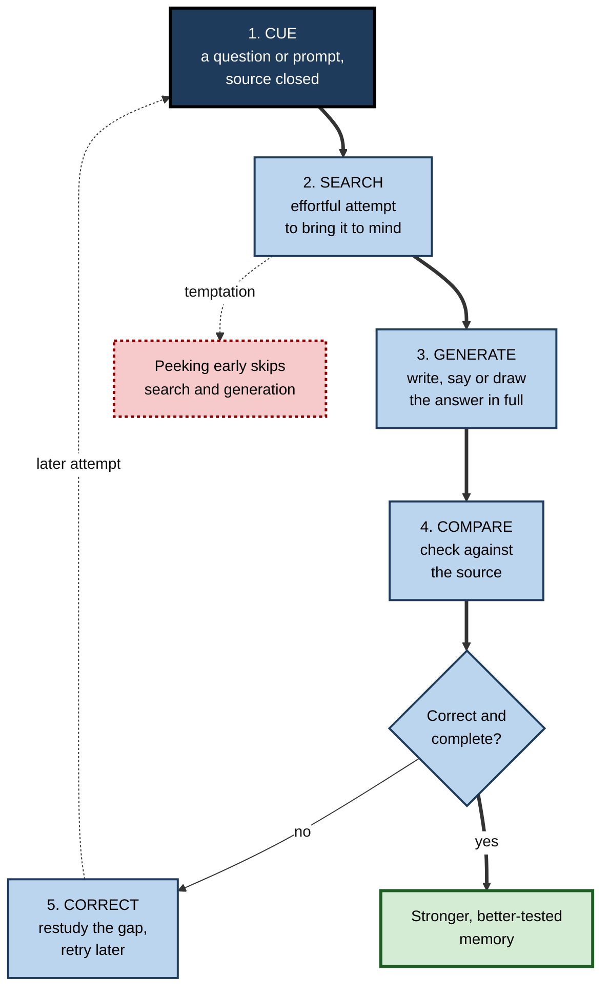
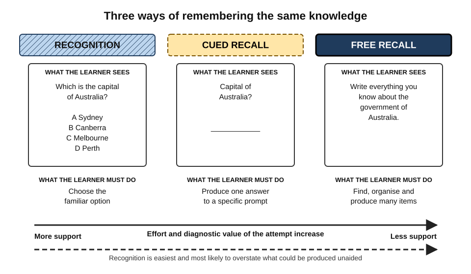
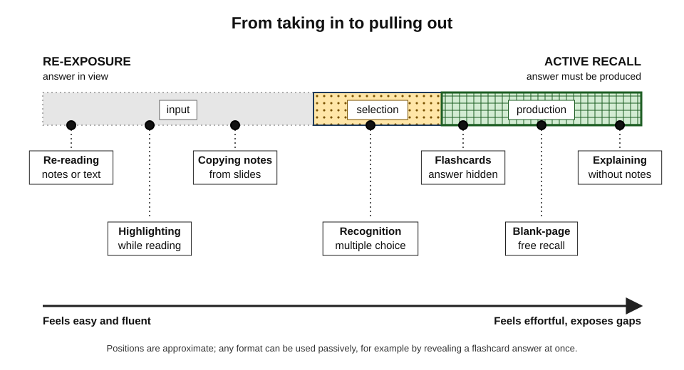
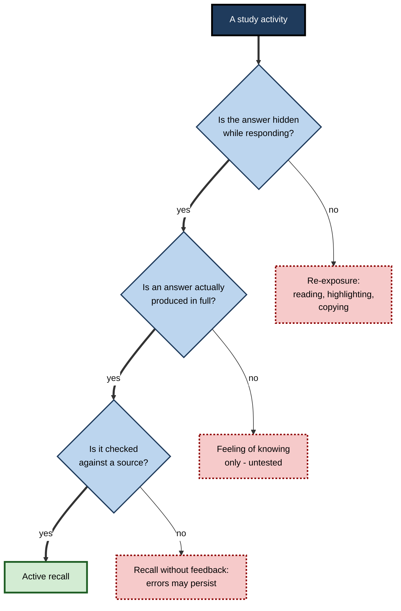
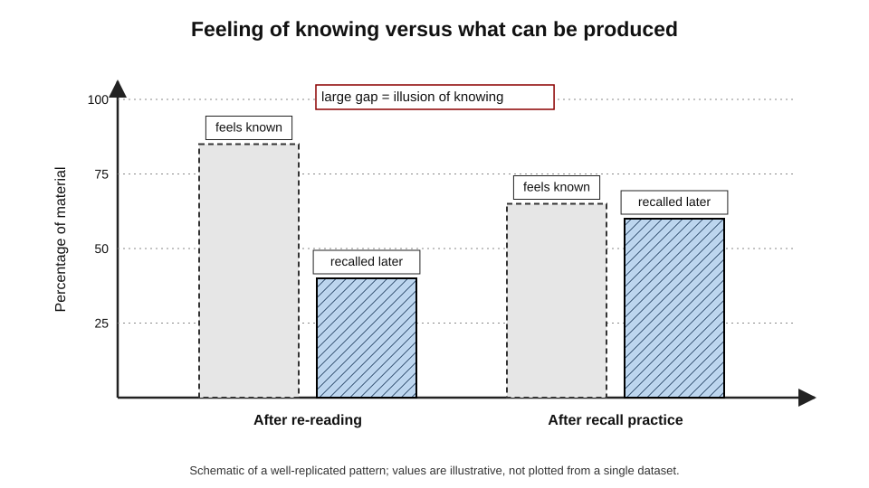

# B.1. What is Active Recall?

A student closes the textbook, takes a blank sheet and tries to write down the causes of the 2008 financial crisis. A junior doctor, walking to the ward, silently lists the contraindications of a drug before checking them. A new consultant, before a client meeting, tries to state the client's three strategic priorities without opening the briefing pack. In each case the person is not taking information in — they are **pulling it out**.

> **Definition — Active recall:** a way of studying in which the learner deliberately produces information from memory — without looking at it — and then checks what was produced against the source.

**Why it matters**

- It is one of the few study methods with strong, repeated evidence that it improves long-term retention compared with reviewing the same material again.
- It shows the learner, honestly and at once, what they know and what they do not.
- It practises the very act that exams, interviews, client meetings and real work demand: bringing knowledge to mind when it is needed.
- It is free, needs no equipment and works for almost any subject.
- Most learners rarely use it, preferring re-reading and highlighting, which *feel* productive but build far less durable memory.

---

## Recall in Everyday Life

Recall is not an exotic technique. Everybody does it many times a day; active recall simply turns it into a deliberate study habit.

**Ordinary recall**

- **Remembering a name** — meeting a colleague in the corridor and reaching for her name.
- **Giving directions** — describing the route to the station to a visitor.
- **Retelling** — explaining to a friend what happened in last night's match.
- **Doing sums in the head** — working out a tip without a calculator.
- **Answering a question at work** — "What was the churn rate last quarter?"

**What these share**

- **No answer in view** — the information is not on the page; it must come from memory.
- **A cue** — a face, a question, a situation that starts the search.
- **Effort** — a felt search, sometimes quick, sometimes slow and uncertain.
- **A result that can be checked** — the name is right or wrong; the route works or does not.

> **Key point:** active recall is ordinary remembering, done **on purpose**, **before** checking, as a way of **learning**, not just of using knowledge.

---

## The Core Distinction: Taking In Versus Pulling Out

### Two modes of study

Every study activity falls into one of two broad modes.

- **Input (re-exposure)** — information flows from the source into the learner.
  - *e.g.* re-reading notes; watching a lecture recording again; highlighting; copying out definitions; looking over flashcards with both sides showing.
- **Output (retrieval)** — information flows from the learner's memory onto the page, out of the mouth or into action.
  - *e.g.* writing what one remembers of a chapter; answering a question before looking at the answer; reciting a procedure; explaining an idea aloud with the book closed.

> **Definition — Re-exposure:** any study activity in which the learner re-encounters information already in view, such as re-reading or reviewing notes.

> **Definition — Retrieval:** the process of bringing information stored in long-term memory back into conscious use.

| | Input (re-exposure) | Output (active recall) |
|---|---|---|
| Where the answer is | In front of the learner | In the learner's memory — or missing |
| What the learner does | Reads, watches, recognises | Searches, generates, constructs |
| How it feels | Smooth, familiar, reassuring | Effortful, uncertain, sometimes uncomfortable |
| What it reveals | Little — familiarity hides gaps | Exactly what can and cannot be produced |
| Typical long-term retention | Lower | Higher, especially after days or weeks |

### Passive and active are not the same as lazy and busy

- **Passive study can be very busy.**
  - Rewriting notes neatly, colour-coding and making beautiful summaries from an open book all take effort.
  - But the effort goes into **copying and arranging**, not into **retrieving**.
- **Active recall can be very short.**
  - Thirty seconds spent trying to state the three conditions of a valid contract, with the book closed, is active recall.
- The test is not how hard the learner works but **where the information comes from** at the moment of answering.

> **Watch out:** "active learning" in a classroom sense (discussion, group work, hands-on tasks) is broader than active recall. An activity can be interactive and lively without anyone retrieving anything from memory.

---

## The Anatomy of a Recall Attempt

### Five steps

A complete recall attempt has five parts. Leaving out any one of them weakens it.

1. **Cue** — something that tells the learner what to retrieve.
   - A question, a heading, a term, a diagram with blanks, a case scenario.
2. **Search** — the mental effort of looking for the answer.
   - The learner tries related ideas, images and contexts; the search itself does useful work.
3. **Generation** — producing an answer in some outward or inward form.
   - Writing it, saying it, drawing it, or at minimum stating it fully in the mind.
4. **Comparison** — checking the answer against an authoritative source.
   - Textbook, notes, answer key, an expert, a working program.
5. **Correction** — repairing what was missing or wrong.
   - Re-studying the gap, then trying again later.

> **Mnemonic — "Clever Students Generate Correct Copies":** Cue, Search, Generate, Compare, Correct.

**Figure 1.** The five steps of a complete recall attempt.

### What happens when a step is skipped

- **No real cue** — "revise chapter 4" gives nothing to retrieve against; the learner drifts into re-reading.
- **No search** — glancing at the answer after two seconds turns recall into recognition.
- **No generation** — thinking "yes, I know that" without stating the answer leaves gaps hidden.
- **No comparison** — errors go uncorrected and may be strengthened by repetition.
- **No correction** — the gap is noticed but not repaired; the same failure recurs at the exam.

> **Key point:** the learning value lies mainly in steps 2 and 3 — **searching and generating**. The value of steps 4 and 5 lies in making sure what is strengthened is **correct**.

### The effort of the search

- **Some struggle is the point.**
  - An answer that pops up instantly gains less from being retrieved than one found after a genuine search.
- **Too much struggle is wasteful.**
  - If nothing at all comes after a real attempt, prolonged staring adds little; the learner should check, restudy and retry later.
- **A practical rule:** search for as long as useful fragments keep arriving; stop when the mind has gone blank for a while.

> **Remember:** **try first, then look.** The order — attempt before answer — is what makes recall active.

---

## Three Kinds of Remembering

Memory researchers distinguish three tasks by how much the learner must produce and how much support is given.

### Recognition

- **Task:** identify the correct item among options.
  - *e.g.* a multiple-choice question; "Have I seen this term before?"
- **Support:** very high — the answer is in view.
- **Demand:** judging familiarity, not producing the item.

### Cued recall

- **Task:** produce an item in response to a specific prompt.
  - *e.g.* "What does EBITDA stand for?"; the front of a flashcard; a fill-in-the-blank sentence.
- **Support:** moderate — the cue narrows the search.
- **Demand:** generating the target from a partial clue.

### Free recall

- **Task:** produce everything one can about a subject, in any order, with only a broad cue.
  - *e.g.* "Write everything you remember about the causes of inflation."
- **Support:** minimal.
- **Demand:** finding the items, organising them and noticing what is missing.

> **Definition — Recognition:** identifying information as previously encountered when it is presented.

> **Definition — Cued recall:** producing information from memory in response to a specific prompt.

> **Definition — Free recall:** producing as much information as possible from memory with only a broad cue and no item-by-item prompts.

**Figure 2.** Recognition, cued recall and free recall compared by what the learner sees and what the learner must produce.

| | Recognition | Cued recall | Free recall |
|---|---|---|---|
| What the learner is given | The answer among options | A specific prompt | A broad topic only |
| What the learner produces | A choice | A single answer | An organised set of answers |
| Typical difficulty | Lowest | Moderate | Highest |
| Exposes gaps? | Weakly — guessing and elimination hide them | Well, item by item | Very well, including gaps in structure |
| Study example | Answering a practice multiple-choice quiz | Flashcards; short-answer questions | Blank-page writing; retelling a chapter |

> **Watch out:** recognition is not worthless — well-designed multiple-choice questions with plausible alternatives can make learners retrieve. But recognising an answer on a page is **much easier** than producing it, so learners who study only by recognition routinely **overestimate** what they could recall unaided.

---

## Forms of Active Recall

Active recall can take many outward forms. The common thread is always the same: answer first, check second.

**By output channel**

- **Written** — writing answers, lists, explanations or diagrams on a blank page.
  - Slow, but leaves a record that can be checked precisely.
- **Spoken** — reciting, explaining aloud, answering a study partner's questions.
  - Fast; gaps are audible.
- **Drawn** — sketching a process, a map, an anatomy diagram or a system architecture from memory.
  - Reveals gaps in structure and relationships.
- **Performed** — carrying out a procedure without the manual.
  - *e.g.* configuring a server, suturing on a training pad, running a meeting script.
- **Covert (silent)** — answering in one's head.
  - Fast and portable; but vague answers ("I sort of know it") slip through unchecked.

> **Definition — Covert retrieval:** retrieving an answer silently in the mind without writing or saying it.

> **Watch out:** covert retrieval can work well for short, precise items such as vocabulary, but learners often stop at a vague sense of knowing. For anything longer than a few words — definitions, explanations, procedures — **writing or speaking the answer** keeps the attempt honest.

**By study format**

- **Flashcards** — a cue on one side, the answer on the other.
- **Blank-page recall** — writing everything remembered about a subject.
- **Question-and-answer notes** — questions in a margin, answers hidden.
- **Closed-book summaries** — summarising a text from memory after reading it.
- **Explaining simply** — explaining an idea in plain language to an imagined novice.
- **Teaching** — explaining to a real audience without notes.
- **Practice problems** — solving problems without worked examples in view.

> **Key point:** active recall is a **principle**, not a product. Flashcard apps, worksheets and question banks are just containers; any of them can be used actively or passively.

**Figure 3.** Study activities arranged from pure re-exposure to demanding recall.

---

## What Counts as Active Recall — and What Does Not

### Clear cases

- **Counts:** closing the notes and writing the five stages of the sales funnel, then checking.
- **Counts:** reading a case question, deciding the legal issue, then reading the model answer.
- **Counts:** covering the right-hand column of a vocabulary list and saying each translation.
- **Does not count:** reading the notes "carefully" a third time.
- **Does not count:** highlighting the textbook.
- **Does not count:** copying definitions from the slides onto cards.

### Grey cases

- **Flipping a flashcard after one second.**
  - Formally a recall format; in practice recognition, because the learner reads the answer instead of producing it.
- **"I know this one" and moving on.**
  - A feeling of knowing is a prediction, not a retrieval. Unless the answer was actually stated, nothing was tested.
- **Open-book practice questions.**
  - Retrieval is replaced by searching the book. Useful for building understanding, but not recall.
- **Asking an AI chatbot to explain a topic.**
  - The learner reads an explanation — re-exposure. Asking the chatbot to **ask questions** and withhold answers turns it into recall practice.
- **Group revision where one person answers.**
  - Only the person answering is retrieving; the others are listening.

**Figure 4.** Deciding whether a study activity is genuine active recall.

> **Remember:** three questions — **Hidden? Produced? Checked?** Three yeses mean active recall.

---

## Why Learners Avoid It

### It feels worse than re-reading

- **Fluency** — re-reading text one has seen before feels smooth; the smoothness is mistaken for knowledge.
- **Failure is visible** — recall shows what is missing; re-reading never does.
- **Effort feels inefficient** — slow, halting retrieval seems to waste time compared with sweeping through ten pages.

> **Definition — Fluency:** the subjective ease with which information is processed; ease of re-reading is easily mistaken for the ability to recall.

> **Definition — Foresight bias:** the tendency to judge, while the answer is in view, that it will be easy to recall later — a bias identified by Asher Koriat and Robert Bjork (2005).

### The illusion of knowing

- **When studying with the answer visible**, the cue and answer appear together, so the link between them seems obvious.
- **At the test**, only the cue appears, and the link that seemed obvious is often not there.
- **Result:** learners stop studying too early, convinced they "have it".

**Figure 5.** Schematic of the gap between how well material feels known after re-reading and how much can actually be recalled.

**Study card — Karpicke, Butler and Roediger (2009)**

- **Design:** university students were surveyed about the study strategies they used and, in a separate question, what they would do after reading a chapter.
- **Results:**
  - Re-reading was by far the most commonly reported strategy.
  - Only a small minority chose to recall the material as a way of studying.
  - Those who did self-test mostly did so **to check** knowledge rather than **to learn**.
- **Conclusion:** the most effective everyday technique was among the least used, and its learning value was largely unrecognised.

> **Watch out:** "I'll test myself once I know it" puts recall in the wrong place. Recall is not only the check at the end — it is **how** the material gets learned.

---

## A Short History of an Old Idea

Active recall is old advice that was repeatedly rediscovered.

- **Oral traditions** — societies without writing preserved epics, laws and genealogies through recitation; learners rehearsed by reproducing, not by reviewing.
- **Francis Bacon (1620), *Novum Organum*** — observed that a passage read twenty times is learned less easily than one read ten times with attempts to recite it, consulting the text only when memory fails.
- **William James (1890), *The Principles of Psychology*** — wrote that things are impressed better by **active than by passive repetition**, and that in learning by heart one should try to recall rather than look at the book again.
- **Arthur Gates (1917)** — children who spent a large share of study time **reciting** to themselves (trying to recall) remembered more than those who spent the whole time reading; the advantage grew as the share of recitation increased.
- **Francis Robinson (1946), SQ3R** — built a "Recite" step into a widely taught reading method for students.
- **Late twentieth and twenty-first centuries** — laboratory and classroom research established the benefits of retrieval in detail, and learning scientists began to promote it as a central study habit.

**Study card — Gates (1917)**

- **Design:** schoolchildren studied lists and short biographies for a fixed time, divided in different proportions between reading and **recitation** (attempting to recall, glancing back when stuck).
- **Results:** recall — immediately and some hours later — improved as more of the time was given to recitation, up to a large share of the session.
- **Conclusion:** time spent trying to produce material is more valuable than the same time spent re-reading it.

> **Key point:** what is new is not the advice but the **precision** — knowing when, how and why recall works, and for whom.

---

## What Can Be Recalled

Active recall is often pictured as memorising lists. It works on every kind of knowledge, but the recall task must match the knowledge.

- **Facts and terms** — short cued recall.
  - *e.g.* "What is the statutory notice period?" → answer.
- **Concepts** — definitions plus examples and non-examples.
  - *e.g.* "Define opportunity cost and give one example from pricing."
- **Relationships and structures** — free recall, diagrams from memory.
  - *e.g.* draw the layers of a network stack and what each does.
- **Procedures** — step sequences, performed or written.
  - *e.g.* list the steps of incident escalation in order; carry them out in a drill.
- **Arguments and explanations** — explaining why, with the source closed.
  - *e.g.* "Why does raising interest rates tend to reduce inflation?"
- **Cases and judgement** — recalling principles in response to a new scenario.
  - *e.g.* a short client situation → identify the issue, the rule and the likely risk.

| Knowledge type | Weak recall task | Strong recall task |
|---|---|---|
| Fact | "Do I know the notice period?" (feeling) | State the period and its exceptions in writing |
| Concept | Recognise the definition among options | Define in own words, give an example and a non-example |
| Procedure | Read the steps and nod | Write or perform the steps in order unaided |
| Argument | Re-read the model answer | Write the chain of reasoning from memory, then compare |
| Judgement | Re-read past cases | Apply principles to an unseen scenario, then check |

> **In practice:** professionals recall at the level the job demands. A pharmacist needs exact facts; a manager needs principles that can be applied to new situations. Design recall tasks to match the **kind** of use expected.

---

## Doing It Well

### Principles of good active recall

- **Close the source first** — physically: book shut, tab closed, notes turned over.
- **Make the answer complete** — write or say it in full; partial thoughts hide errors.
- **Check honestly** — mark against the source; count partially correct answers as not yet known.
- **Return to failures** — what was missed is the material that most needs another attempt later.
- **Keep it low-stakes** — it is practice, not judgement; failure during practice is information.
- **Prefer production over selection** — where possible, produce answers rather than choose among options.
- **Vary the cues** — ask the same idea in different ways so that recall does not depend on one exact wording.

> **Mnemonic — "CHECK":** **C**lose the source, **H**ave a full attempt, **E**valuate honestly, **C**orrect the gaps, **K**eep returning.

### Common errors

- **Peeking** — glancing at the answer before the search is finished.
- **Recalling only the easy items** — retrieving what is already known and skipping the hard parts.
- **Over-generous marking** — "that's basically what I said".
- **No feedback for mistakes** — recalling wrong answers repeatedly can fix them in memory.
- **Treating recall as the final exam** — postponing it until the night before, when gaps can no longer be repaired.

> **Watch out:** active recall is sometimes dismissed as "rote learning". Rote learning is mechanical repetition of words without meaning; active recall can — and should — target **meaning**: explanations, relationships and applications. Recalling *why* something is true is as much active recall as recalling *what* it is.

---

## Worked Example (illustrative): Converting a Passive Study Hour

**Situation:** a finance trainee has an hour to study a chapter on working capital before a qualification exam in three weeks. Her usual method is to re-read the chapter and her notes.

| | Usual hour | Converted hour |
|---|---|---|
| 0–20 min | Re-read the chapter | Read the chapter once, carefully, for understanding |
| 20–30 min | Re-read the notes | Close everything; write all she can recall about working capital on a blank page |
| 30–40 min | Highlight key formulas | Open the chapter; mark what was missing or wrong in a different pen |
| 40–55 min | Re-read the highlighted parts | Turn the gaps into eight short questions; answer them from memory; check |
| 55–60 min | Feel confident | Note the three questions she failed for the next session |
| What she knows at the end | Unclear — everything feels familiar | Precisely which parts she can and cannot produce |

**Steps in the converted hour**

1. **One careful reading** — to understand, not to memorise.
2. **Free recall** — ten minutes of blank-page writing; she recalls the definition, the cash conversion cycle and two of its three components, but not the formula for days payable outstanding.
3. **Comparison** — she discovers the missing component and a sign error in her formula.
4. **Targeted cued recall** — questions on exactly those gaps, answered closed-book.
5. **A record of failures** — the items to retrieve again in her next session.

- **Conclusion:** the converted hour contains **less reading** but **more learning**, and ends with an accurate picture of what still needs work.

> **Watch out:** the converted hour **feels** worse — she ends aware of her gaps instead of comfortably familiar with the text. That discomfort is a sign that the method is doing its job, not that it is failing.

---

## Active Recall in Professional Life

### Where professionals already use it

- **Aviation** — pilots learn certain emergency "memory items" that must be performed from memory before reaching for a checklist, and rehearse them in simulator checks.
- **Medicine** — case presentations on ward rounds require trainees to state history, findings and plans without reading from notes; consultants ask probing questions that demand recall.
- **Law** — advocates prepare to answer a judge's questions on the authorities without searching their files.
- **Sales** — representatives rehearse product facts and objection responses until they can produce them in live conversation.
- **Software engineering** — engineers who can recall the architecture of a system diagnose incidents faster than those who must look everything up.
- **Consulting** — consultants rehearse the "storyline" of a deck without slides so they can present when the projector fails or the client interrupts.

### When to rely on recall and when to look things up

- **Recall is essential when:**
  - there is no time to look up (a live negotiation, an incident, an emergency);
  - judgement depends on knowledge being in mind together (diagnosis, design);
  - new learning builds on it (core concepts of a field).
- **Looking up is fine when:**
  - the information is rarely used, changes often or must be exact (tax rates, configuration values);
  - errors from memory would be costly and a reliable reference exists.

> **In practice:** expert professionals keep the **frameworks, principles and frequently used facts** in memory through recall, and keep **volatile details** in references they know how to search.

### Recall in the age of AI assistants

- **The risk:** an assistant that answers every question instantly removes the need to retrieve — and so removes the practice that builds memory.
- **The opportunity:** the same assistant can generate practice questions, play the role of an examiner and check answers.
- **The design choice:** use AI to **ask**, not to **tell**, during study.
  - *e.g.* "Ask me five questions on the cash conversion cycle, one at a time; do not give the answers until I have replied."

> **Watch out:** AI-generated questions and answer keys can contain errors. A learner who cannot yet judge correctness should check generated answers against an authoritative source.

### Case study (illustrative): a support team that could not answer without the wiki

- **Situation:** a software company's first-line support team handled customer calls about a complex billing product.
- **Problem:** new agents took long pauses to search the internal wiki during calls; resolution times were high and customers noticed the hesitation.
- **Diagnosis:**
  - training consisted of reading wiki pages and watching recorded demonstrations;
  - agents had never been asked to **produce** answers without the wiki in front of them;
  - knowledge checks were open-book multiple-choice quizzes, which they passed easily.
- **Actions:**
  1. Team leads collected the thirty most frequent customer questions.
  2. Each day began with a ten-minute closed-book round: a lead read out five questions; every agent wrote an answer; the team then compared answers with the wiki.
  3. Questions answered wrongly by anyone came back the following week.
  4. The open-book quiz was replaced with a short spoken scenario test, without the wiki.
- **Result:** within a couple of months, agents answered most common questions without searching; they used the wiki for rare and exact details, as intended; resolution times fell.
- **Side effects:** the daily rounds were unpopular at first — agents disliked being wrong in front of colleagues — until leads made clear that rounds were practice and never recorded.
- **Lesson:** reading builds familiarity; **producing answers** builds the ability to use knowledge when it is needed.

---

## Open Questions

- **How much effort is the right amount?**
  - Some difficulty helps, but the point at which a recall attempt becomes too hard to be useful varies with the learner and the material, and is hard to judge in the moment.
- **How well does recall serve complex, highly connected material?**
  - Most evidence concerns facts, texts and concepts; for complex problem-solving the balance between recall, worked examples and guided practice is still debated.
- **Is silent recall as good as written or spoken recall?**
  - Results depend on the material and on whether learners actually complete the silent attempt; the conditions under which it is enough are not fully mapped.
- **How should AI tools be designed so they prompt recall rather than replace it?**
  - Early studies suggest design matters a great deal, but evidence on long-term effects is limited.
- **Why do so few learners adopt it, even after being told it works?**
  - Knowledge of the technique does not reliably change habits; the best ways to make it stick are not settled.

---

## Summary

- **Active recall** = deliberately producing information from memory, without looking, then checking it against the source.
- Study activities are either **input** (re-exposure: reading, highlighting, copying) or **output** (retrieval). Active recall is output.
- A complete attempt has five steps — **cue, search, generate, compare, correct**; the learning value lies mainly in **searching and generating**.
- Three kinds of remembering: **recognition** (choose), **cued recall** (produce to a prompt), **free recall** (produce with only a topic). Recognition is easiest and most likely to **overstate** knowledge.
- Recall can be **written, spoken, drawn, performed or covert**; covert recall is convenient but easily becomes vague.
- Test any activity with three questions: **Hidden? Produced? Checked?**
- Learners avoid recall because re-reading feels **fluent** and recall exposes gaps; the **illusion of knowing** and **foresight bias** make familiar material seem learned.
- The idea is old — **Bacon, James, Gates** — but research has made it precise.
- Recall works on **facts, concepts, procedures, arguments and judgement**; the task must match the kind of knowledge.
- Good practice: close the source, produce a full answer, check honestly, return to failures, keep it low-stakes.
- Professionals keep **frameworks and frequently used knowledge** in memory and **volatile details** in references; AI assistants should be used to **ask**, not to **tell**, while studying.

---

## Self-Check

1. Define active recall in one sentence and identify the two features that make an activity "active".
2. Classify each as re-exposure or active recall: highlighting a chapter; writing the steps of a procedure from memory; reading a flashcard's answer immediately; explaining an idea aloud with the book closed.
3. List the five steps of a complete recall attempt and explain which steps carry most of the learning value.
4. Distinguish recognition, cued recall and free recall, with a study example of each.
5. Why do learners who study by recognition tend to overestimate what they know?
6. What is foresight bias, and how does it lead learners to stop studying too early?
7. Summarise Gates's 1917 study and its main conclusion.
8. Give two situations where covert retrieval is adequate and two where written or spoken retrieval is better.
9. Why is "I know this one — next card" not active recall?
10. Explain why active recall is not the same as rote learning.
11. A colleague asks an AI assistant to explain a topic three times before an exam. Redesign the use of the assistant so that it supports active recall.
12. A team passes open-book multiple-choice quizzes easily but struggles to answer customers live. Diagnose the problem and propose two changes.
13. Design a recall task for each: a statutory deadline; the concept of a price elasticity; a deployment procedure; a judgement about whether a contract clause is enforceable.

### Answer Key

1. Active recall is deliberately producing information from memory without looking, then checking it. It is active because the answer is **hidden** while responding and the learner **produces** it rather than reading or recognising it.
2. Highlighting — re-exposure. Writing a procedure from memory — active recall. Reading a flashcard answer at once — re-exposure (recognition at best). Explaining aloud with the book closed — active recall.
3. Cue, search, generate, compare, correct. Searching and generating carry most of the learning value; comparing and correcting ensure what is strengthened is right.
4. Recognition — choosing the right answer among options (a multiple-choice quiz). Cued recall — producing an answer to a specific prompt (a flashcard). Free recall — producing everything known about a subject from a broad cue (blank-page writing on a chapter).
5. Recognition presents the answer, so only familiarity is needed; guessing and elimination hide gaps. Unaided recall at the real test demands production, which is much harder.
6. Foresight bias is judging, while the answer is visible, that it will be easy to recall later. Because cue and answer appear together, their link seems obvious, so learners judge material as learned and stop before they can actually recall it.
7. Children divided fixed study time between reading and recitation in different proportions. Recall improved as more time went to recitation. Time spent producing material is more valuable than the same time re-reading it.
8. Covert adequate: single vocabulary words; short numerical facts. Written or spoken better: multi-step procedures; explanations and definitions, where vague partial answers would otherwise pass unnoticed.
9. A feeling of knowing is a prediction, not a retrieval. No answer is produced or checked, so the learner may be wrong or incomplete without knowing.
10. Rote learning is mechanical repetition of words without meaning. Active recall is a way of practising retrieval that can target meaning — explanations, relationships and applications — as well as facts.
11. Ask the assistant to pose questions one at a time and withhold answers; answer each in writing; then ask for feedback and check doubtful answers against the textbook; repeat missed items in a later session.
12. The quizzes measure recognition with help available, so they never require unaided production. Changes: regular closed-book question rounds with feedback; a spoken scenario test without references; returning to items answered wrongly.
13. Deadline — cued recall: "What is the deadline and its exceptions?" written from memory. Elasticity — define in own words, give an example and a non-example, explain what a value of −2 means. Deployment — write or perform the steps in order without the runbook, then compare. Clause — given an unseen clause, state the relevant principle and decide with reasons before reading a model answer.

---

## Glossary

| Term | Meaning |
|---|---|
| Active recall | Deliberately producing information from memory without looking, then checking it. |
| Covert retrieval | Retrieving an answer silently in the mind without writing or saying it. |
| Cue | A prompt that indicates what is to be retrieved. |
| Cued recall | Producing information from memory in response to a specific prompt. |
| Feeling of knowing | A sense that one knows something, without having produced it. |
| Fluency | Subjective ease of processing information. |
| Foresight bias | Judging, with the answer in view, that it will be easy to recall later. |
| Free recall | Producing as much as possible from memory with only a broad cue. |
| Illusion of knowing | Believing material is learned because it feels familiar. |
| Memory item | A procedure professionals must perform from memory before consulting a checklist. |
| Recitation | An older term for attempting to recall material during study. |
| Recognition | Identifying information as previously encountered when it is presented. |
| Re-exposure | Re-encountering information already in view, such as by re-reading. |
| Retrieval | Bringing information from long-term memory back into use. |
| Rote learning | Mechanical repetition of material without attention to meaning. |
