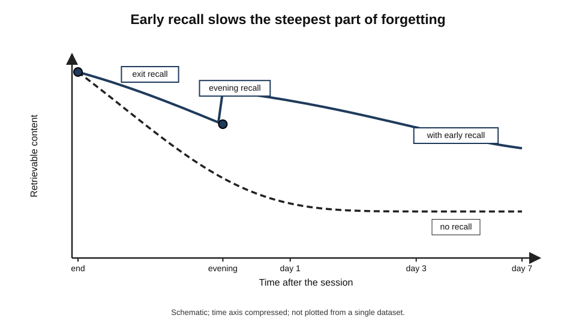
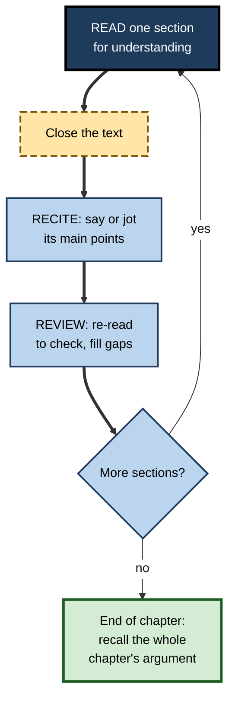
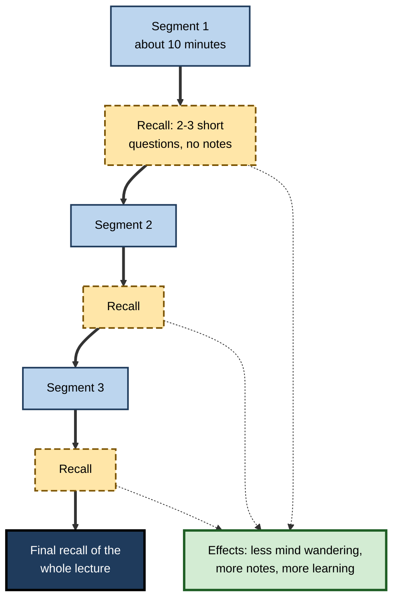
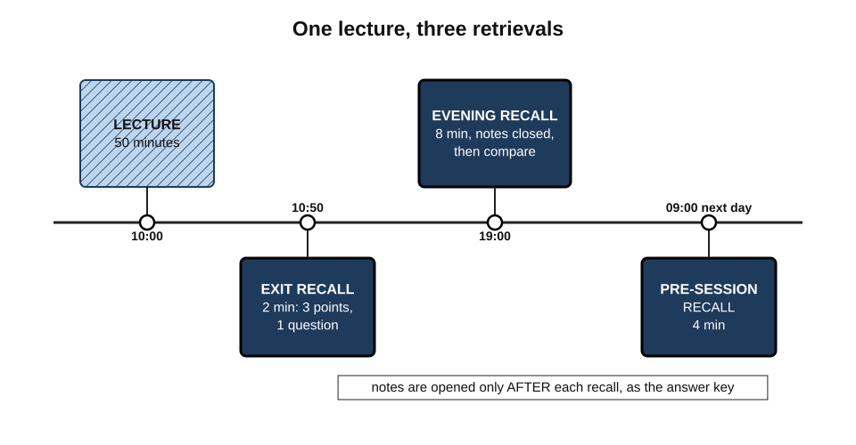
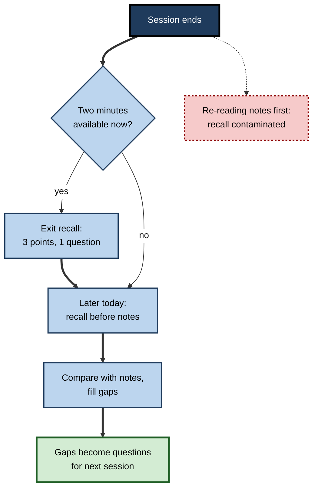

# B.10. Recall After Lecture or Reading

A one-hour lecture ends; students close their laptops and leave. By the next morning, most of what was said has become hard to retrieve, and much of what remains is a vague sense of having "covered" something. A few minutes spent recalling the lecture before walking out — or that evening, before opening the notes — would have changed what survived. The moments just after taking information in are among the most valuable and least used in all of learning.

> **Definition — Post-input recall:** deliberately retrieving the content of a lecture, reading, meeting or video soon after it ends, without looking at notes or the source, and then checking against them.

**Why it matters**

- **Forgetting is steepest early** — the first hours and days after input see the largest losses.
- **Early recall slows that loss** and gives each later review a stronger base.
- **It catches misunderstandings while the source is still fresh** and questions can still be asked.
- **It turns passive sessions into active ones** at the cost of a few minutes.
- **It applies to almost all professional input** — meetings, webinars, briefings, training days, reports, conference talks.

---

## What Happens After Input

### Forgetting after a session

- **The general shape** — since Hermann Ebbinghaus's experiments in 1885, the loss of retrievable material has been found to be rapid at first and slower later.
- **After lectures** — students typically retain the main topics but lose much of the detail, examples and reasoning within days unless the material is used again.
- **Why** — information that was attended to but never retrieved has weak, few retrieval routes; competing new experiences interfere.

**Figure 1.** Schematic of retrievable content after a session, with and without early recall.

### The study that showed early recall protects memory

**Study card — Herbert Spitzer (1939)**

- **Design:** more than three thousand sixth-grade pupils in Iowa read short factual articles. Different groups were tested at different times afterwards — some immediately or within a day, some only after weeks.
- **Results:** pupils who took an **early** test forgot far less by the time of later tests than pupils whose first test came late.
- **Conclusion:** an early recall attempt — even a single one — substantially reduces later forgetting; Spitzer recommended immediate recall as a routine part of learning from reading.

> **Key point:** the first recall attempt is unusually valuable because it intervenes **before** steep early forgetting has done its work.

---

## Recall After Reading

### Read, recite, review

**Study card — Mark McDaniel, Daniel Howard and Gilles Einstein (2009)**

- **Design:** students learned from technical texts using one of three strategies:
  - **re-reading** the text;
  - **note-taking** while reading;
  - **read–recite–review (3R)** — read the passage, put it aside and **recite** aloud everything remembered, then **re-read** to check.
- **Results:** 3R produced better free recall than re-reading, both immediately and a week later; it matched or exceeded note-taking on most measures while taking **less time**.
- **Conclusion:** adding a short recall step between reading and reviewing is a simple, efficient improvement on the way most students read.

> **Definition — Read–recite–review (3R):** read a section, recite from memory what it said, then re-read to check and fill gaps.

### Chunking the reading

- **Long texts are best recalled in sections** — after each section or chapter part, close the text and recall its main points.
- **Why** — recall after a whole chapter is often too broad to diagnose; recall after each section is targeted and keeps attention high.
- **Sign of a good chunk** — it has one main idea and can be recalled in under two minutes.

**Figure 2.** Reading in chunks with recall after each.

### Recall before notes

- **The tempting order:** finish reading → read one's notes → feel ready.
- **The better order:** finish reading → **recall** → then compare with notes and text.
- **Why:** once the notes are read, the recall attempt is contaminated — the learner reproduces the notes rather than retrieving from memory.

> **Remember:** **recall first, then notes.** Notes are the answer key, not the starting point.

---

## Recall After Lectures

### The last minutes of a lecture

**Study card — Keith Lyle and Nicole Crawford (2011)**

- **Design:** in an undergraduate statistics course, students spent the **last five to ten minutes of each lecture** answering two to four short questions about that lecture **from memory**, without notes. Their exam performance was compared with that of a previous cohort taught the same course without the end-of-lecture recall.
- **Results:** students who practised end-of-lecture recall scored **higher** on course exams.
- **Conclusion:** a short, regular recall exercise at the end of each class improved learning in a real course.
- **Caveat:** the comparison was between cohorts, not randomly assigned groups, so other differences may have contributed.

### Pauses during lectures

- **The pause procedure** — Kathy Ruhl, Charles Hughes and Patrick Schloss (1987) found that pausing a lecture for about two minutes at intervals, so that students could review and discuss their notes, improved students' later recall compared with an uninterrupted lecture.
- **Recall pauses** — a stronger version asks students to write what they remember of the last segment **before** consulting notes.

### Interpolated questions in video lectures

**Study card — Karl Szpunar, Novall Khan and Daniel Schacter (2013)**

- **Design:** students watched a recorded statistics lecture divided into segments. Between segments, one group answered short memory questions on the segment just watched; other groups did unrelated tasks or simply reviewed.
- **Results:**
  - interpolated tests roughly **halved** reported mind wandering;
  - students in the tested group took substantially more notes;
  - they learned more on a final cumulative test and reported less anxiety about it.
- **Conclusion:** recall during a long lecture keeps attention on it, as well as strengthening what has already been covered.

> **Definition — Interpolated testing:** short recall tests inserted between segments of a lecture or reading, rather than only at the end.

- **The forward testing effect** — recalling earlier material can improve learning of the **next** material, perhaps by resetting attention and reducing interference; Bernhard Pastötter, Karl-Heinz Bäuml and others have documented this pattern in laboratory studies.

**Figure 3.** A recorded lecture with interpolated recall between segments.

---

## Timing the Recall

### Immediate and delayed recall

- **Immediate recall (within minutes)**
  - **Strengths:** intervenes before steep forgetting; easy to fit in; catches misunderstandings while the lecturer is still available.
  - **Limits:** much is still in working memory, so recall is easy and the boost per attempt is smaller.
- **Delayed recall (hours to a day)**
  - **Strengths:** retrieval is effortful, so each success builds more durable memory; the attempt diagnoses what genuinely stuck.
  - **Limits:** some material may already be inaccessible; recall may fail more often.

| | Immediate recall | Same-day delayed recall | Next-day recall |
|---|---|---|---|
| Typical time after input | 0–10 minutes | A few hours | About 24 hours |
| Effort | Low | Moderate | Higher |
| Benefit per successful attempt | Smaller | Larger | Larger still |
| Diagnostic value | Low — much is still in mind | Good | Very good |
| Risk | False sense of mastery | Some items lost | More items lost; needs notes to repair |
| Best use | Exit recall; capture questions | Evening recall before notes | Morning recall before the next session |

> **In practice:** combine them — a **two-minute exit recall** to protect against the steepest early loss, then a **delayed recall** that evening or the next morning, **before** opening the notes. Further, longer-term reviews are a matter of scheduling and spacing.

### A day with a lecture

**Figure 4.** Recall moments around a single lecture.

---

## Procedures

### The two-minute exit recall

1. **At the end of the session**, before packing up or opening messages, take a blank sheet or note.
2. **Write the three most important points** in one line each.
3. **Write one thing that was unclear** — as a question.
4. **If possible, ask the question** before leaving, or note it for later.

> **Mnemonic — "3-2-1 exit":** **3** key points, **2** connections to what is already known, **1** question.

### The evening recall

1. **Before looking at notes**, spend five to ten minutes writing or sketching the session's content from memory.
2. **Compare with notes** — mark missing, wrong and vague points.
3. **Fill the gaps** using notes and the source.
4. **Turn the most important gaps into questions** for the next session's recall.

### The pre-session recall

- **At the start of the next session**, recall the previous one in two minutes before new material begins.
- **Effect:** links old to new, and provides another, more delayed retrieval.

### For meetings, webinars, podcasts and talks

- **Meetings** — after the meeting, write decisions, owners and reasons from memory before reading the minutes; compare.
- **Webinars and podcasts** — pause at natural breaks and recall the last segment aloud or in a note.
- **Conference talks** — after each talk, write the speaker's main claim and evidence in two sentences; at the day's end, recall all talks before looking at notes.
- **Training days** — trainers can end each module with a recall exercise rather than "any questions?".

**Figure 5.** Deciding what to do immediately after a lecture or reading.

---

## What Gets in the Way

### Notes as a crutch

- **Problem:** many learners treat notes and slides as a substitute for memory — "it's all in my notes".
- **Consequence:** the lecture is never retrieved; the notes are re-read later, which builds familiarity, not recall.
- **Remedy:** treat notes as the **answer key** for recall.

### The longhand-versus-laptop question

- **The claim:** Pam Mueller and Daniel Oppenheimer (2014) reported that students who took lecture notes by hand learned more conceptually than those who typed, because typists transcribed verbatim.
- **The replication:** Kayla Morehead, John Dunlosky and Katherine Rawson (2019) repeated the study and found **no reliable advantage** for longhand; a later large replication led by Heather Urry (2021) reached a similar conclusion.

> **Watch out:** the "handwriting beats laptops" claim is **not well supported** by replications. What matters more is whether the learner **processes and later retrieves** the material, whatever the note-taking medium.

### Transcripts and AI summaries

- **The new crutch:** automatic transcripts and AI summaries of lectures and meetings make it easy to skip both attention and recall — "I can always read the summary".
- **Better use:** recall first, then use the summary or transcript **as the check** — and verify any point that seems surprising, since automated summaries can omit or distort.

### Lack of encoding

- **If nothing comes**, the problem may lie earlier: the learner was not attending, or the material was not understood.
- **Remedy:** interpolated recall during the session, active note-taking, and asking questions at the time.

---

## Worked Example: A Student's Lecture Day

**Situation:** a first-year economics student attends a 50-minute lecture on price elasticity at 10:00.

| Time | Activity | Duration | Recall? |
|---|---|---|---|
| 10:50 | Exit recall: three key points, one question | 2 min | Yes — immediate |
| 10:53 | Asks the lecturer her question about cross-price elasticity | 2 min | — |
| 19:00 | Evening recall: writes and sketches the lecture before opening notes | 8 min | Yes — delayed |
| 19:08 | Compares with notes; marks two missing points and one error | 7 min | — (check) |
| 19:15 | Writes four questions on the gaps | 3 min | — |
| 09:00 next day | Pre-session recall: answers the four questions, then recalls the whole lecture in one minute | 4 min | Yes — next-day |
| Total | | 26 min | Three retrievals |

**What the recall revealed**

- **Exit recall:** she had the definition and the formula but was confused about cross-price elasticity — resolved on the spot.
- **Evening recall:** she had forgotten the determinants of elasticity (substitutes, necessity, time horizon) and had reversed the sign convention for inferior goods.
- **Next-day recall:** all four gap questions answered correctly.

- **Conclusion:** 26 minutes, three retrievals and one well-timed question produced a far more secure grasp than re-reading her notes for the same time would have.

> **Formula — Recall time ratio:** recall minutes ÷ input minutes. Example: 14 minutes of recall (2 + 8 + 4) ÷ 50 minutes of lecture ≈ **0.28** — roughly a quarter of the input time, a common and sustainable target.

---

## Professional Practice

### Where post-input recall matters at work

- **Meetings** — recall-first recaps catch misremembered decisions before they become disputes.
- **Training programmes** — modules ending with recall produce better retention than modules ending with satisfaction surveys.
- **Regulatory and policy updates** — reading a new rule, then stating its main obligations from memory, reveals misreadings early.
- **Clinical handovers and rounds** — trainees who summarise a ward round from memory afterwards consolidate both the cases and the reasoning they heard.
- **Conferences** — a short daily recall turns a week of talks into usable knowledge.

> **In practice:** an effective habit is to block **five minutes after every important meeting or session** — not for email, but for recall.

### Case study: a webinar series nobody remembered

- **Situation:** a professional-services firm ran a monthly series of one-hour webinars on regulatory change for 400 staff.
- **Problem:** follow-up surveys showed high satisfaction, but spot checks a month later found that most staff could not state the main changes covered.
- **Diagnosis:**
  - webinars were continuous one-hour presentations with questions only at the end;
  - attendees often had email open; no one was asked to retrieve anything;
  - recordings and AI summaries were available, so few people engaged during the session.
- **Actions:**
  1. Each webinar was split into four segments of about twelve minutes.
  2. After each segment, a two-question **recall poll** — short free-text answers, not multiple choice — appeared, with answers shown afterwards.
  3. The final five minutes became an **exit recall**: "Write the three changes that most affect your clients."
  4. One week later, attendees received three short recall questions by email, answered before any summary was shown.
- **Result:** in the next spot check, a much larger share of staff could state the main changes; chat questions during sessions increased; satisfaction stayed high.
- **Side effects:** some attendees disliked "being tested"; framing the polls as anonymous practice reduced complaints.
- **Lesson:** adding recall **during and after** sessions converted attendance into retained knowledge at almost no extra cost.

---

## Open Questions

- **What is the best delay for the first recall?**
  - Immediate recall protects against early loss; delayed recall is more potent; the best combination for different materials is not settled.
- **How long should segments be between interpolated recall?**
  - Studies use segments of roughly five to twenty minutes; optimal lengths for different audiences are unclear.
- **Does post-input recall help as much for complex, problem-based material?**
  - Most evidence uses factual or conceptual texts and lectures; evidence for problem-solving courses is thinner.
- **How do transcripts and AI summaries change learning from lectures and meetings?**
  - Their availability may reduce attention and recall; effects over time are not yet known.
- **Why do so few learners adopt post-session recall?**
  - It is cheap and effective, yet rarely habitual; the barriers are poorly understood.

---

## Summary

- **Post-input recall** = retrieving a lecture's, reading's or meeting's content soon after, without notes, then checking.
- **Forgetting is steepest early**; early recall slows it (**Spitzer, 1939**).
- After reading: **read–recite–review** beat re-reading and was efficient compared with note-taking (**McDaniel, Howard and Einstein, 2009**); recall in **chunks**; **recall before notes**.
- After and during lectures: end-of-lecture recall improved exam scores (**Lyle and Crawford, 2011**, cohort comparison); the **pause procedure**; **interpolated tests** halved mind wandering and improved learning (**Szpunar, Khan and Schacter, 2013**); the **forward testing effect**.
- **Timing:** immediate recall protects; delayed recall builds more and diagnoses better — combine an **exit recall** with an **evening or next-morning recall**.
- Procedures: **3-2-1 exit**, evening recall, pre-session recall; adapt to meetings, webinars, talks, training.
- Obstacles: notes as a crutch, transcripts and AI summaries, weak encoding. The longhand-beats-laptop claim **did not replicate** reliably.
- A recall time of roughly **a quarter of input time** is a sustainable target.

---

## Self-Check

1. Define post-input recall and explain why the period just after input is so valuable.
2. Describe Spitzer's 1939 study and its conclusion.
3. What is read–recite–review, and what did McDaniel, Howard and Einstein find?
4. Why should learners recall before reading their notes?
5. Summarise Lyle and Crawford (2011) and state its main limitation.
6. What did Szpunar, Khan and Schacter (2013) find about interpolated tests?
7. Explain the forward testing effect.
8. Compare immediate, same-day and next-day recall on effort, benefit and diagnostic value.
9. Describe the 3-2-1 exit recall.
10. What happened when the longhand-versus-laptop study was replicated?
11. A colleague says, "I don't need to recall meetings — the AI summary is emailed to me." Respond.
12. Calculate the recall time ratio for 12 minutes of recall after a 90-minute workshop and comment.
13. Redesign a two-hour induction session so that it includes recall during and after.
14. A learner tries evening recall but can produce almost nothing. Diagnose possible causes and suggest fixes.

### Answer Key

1. Retrieving the content of a session soon after it ends, without notes, then checking. Forgetting is steepest early; an early retrieval strengthens routes before they fade and catches misunderstandings while help is available.
2. Thousands of sixth-graders read articles and were tested at different delays; those tested early forgot much less by later tests. An early recall attempt sharply reduces later forgetting.
3. Read a section, recite from memory, then re-read to check. 3R produced better recall than re-reading and matched or exceeded note-taking on most measures in less time.
4. Reading notes first contaminates the attempt: the learner reproduces the notes rather than retrieving from memory, losing both the benefit and the diagnosis.
5. Statistics students answered a few questions from memory in the last minutes of each lecture and scored higher on exams than a previous cohort. Limitation: cohorts were not randomly assigned, so other differences may contribute.
6. Short recall tests between segments of a video lecture roughly halved mind wandering, increased note-taking, improved final test performance and reduced test anxiety.
7. Retrieving earlier material improves learning of subsequent new material, possibly by refreshing attention and reducing interference.
8. Immediate: low effort, smaller benefit, low diagnostic value. Same-day: moderate effort, larger benefit, good diagnosis. Next-day: higher effort, largest benefit per success, best diagnosis but more items lost.
9. At the session's end, write three key points, two connections to prior knowledge and one question.
10. Morehead, Dunlosky and Rawson (2019) and a larger later replication found no reliable advantage for longhand note-taking.
11. Reading a summary is re-exposure and does not build memory of the meeting; summaries may omit or distort. Recall the decisions and owners first, then use the summary as a check and query discrepancies.
12. 12 ÷ 90 ≈ **0.13** — lower than the quarter target; adding a short evening or next-day recall would strengthen retention.
13. E.g. split into 15–20-minute segments, each followed by a two-question free-text recall; end with a 3-2-1 exit recall; next morning, send three recall questions before any slides; week one, a short pair recall with a buddy.
14. Possible causes: poor attention or understanding during the session; too long a delay; no recall during the session. Fixes: add an exit recall; ask questions during the session; take active notes; use interpolated recall; shorten the delay; use generic self-prompts to restart recall.

---

## Glossary

| Term | Meaning |
|---|---|
| 3-2-1 exit | Three key points, two connections, one question, written at a session's end. |
| Delayed recall | Recall attempted hours or days after input. |
| Exit recall | A brief recall exercise at the end of a session. |
| Forward testing effect | Retrieval of earlier material improving learning of later material. |
| Immediate recall | Recall attempted within minutes of input. |
| Interpolated testing | Short recall tests between segments of a lecture or reading. |
| Pause procedure | Pausing a lecture at intervals for students to review notes. |
| Post-input recall | Retrieving a session's content soon after it ends, without notes. |
| Read–recite–review (3R) | Read a section, recite from memory, re-read to check. |
| Recall time ratio | Minutes spent recalling divided by minutes of input. |
