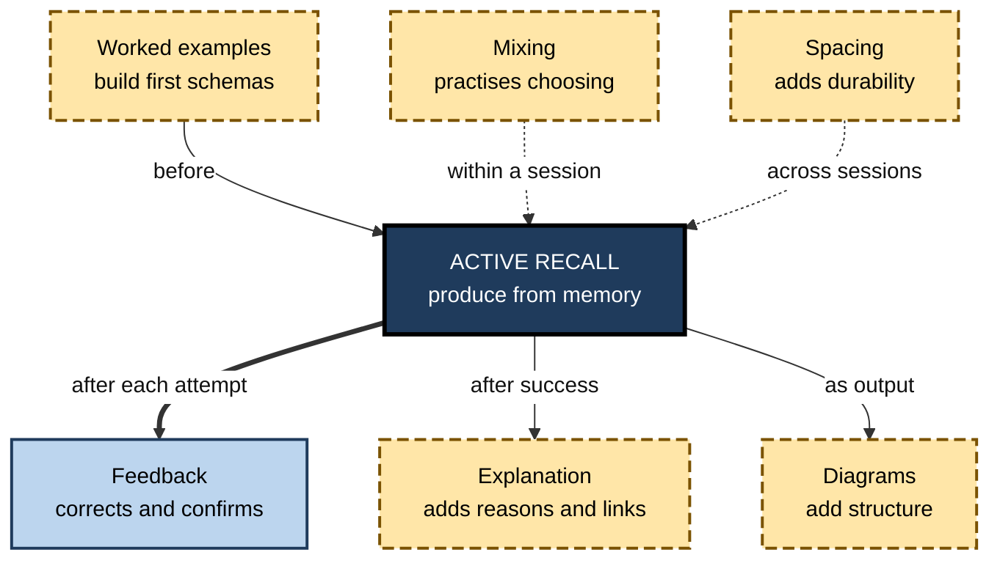
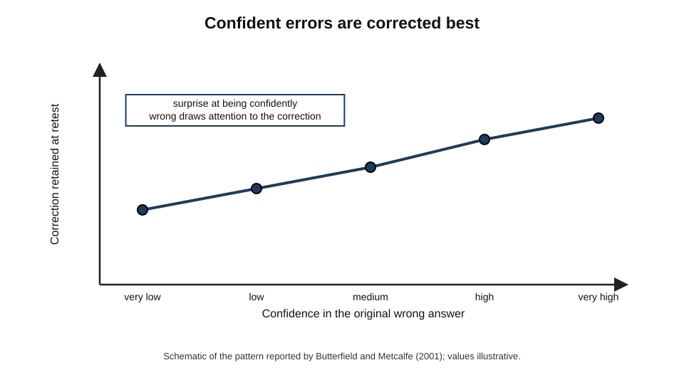
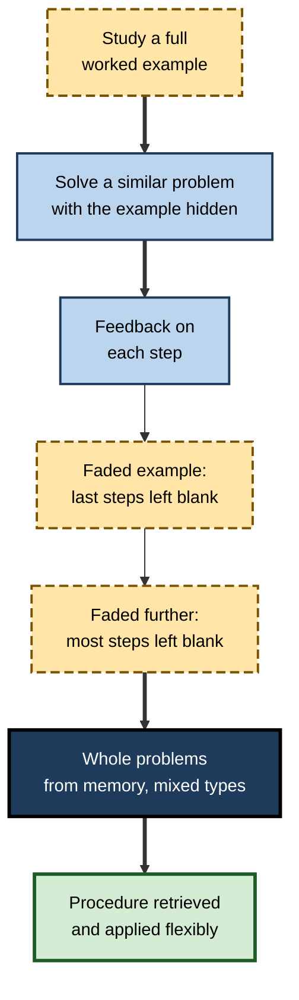
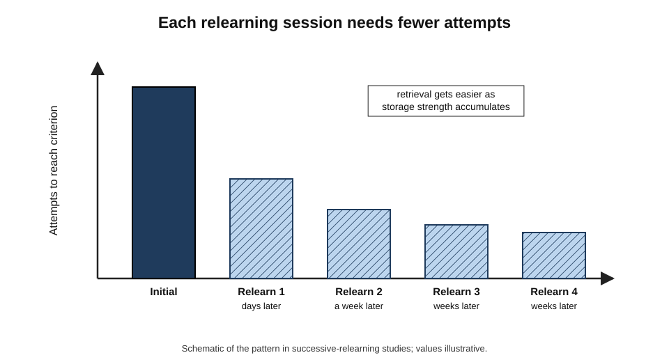
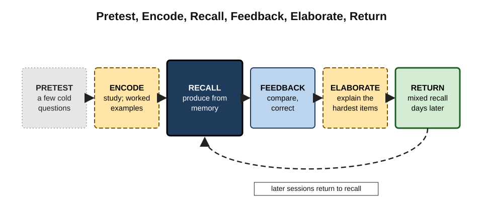
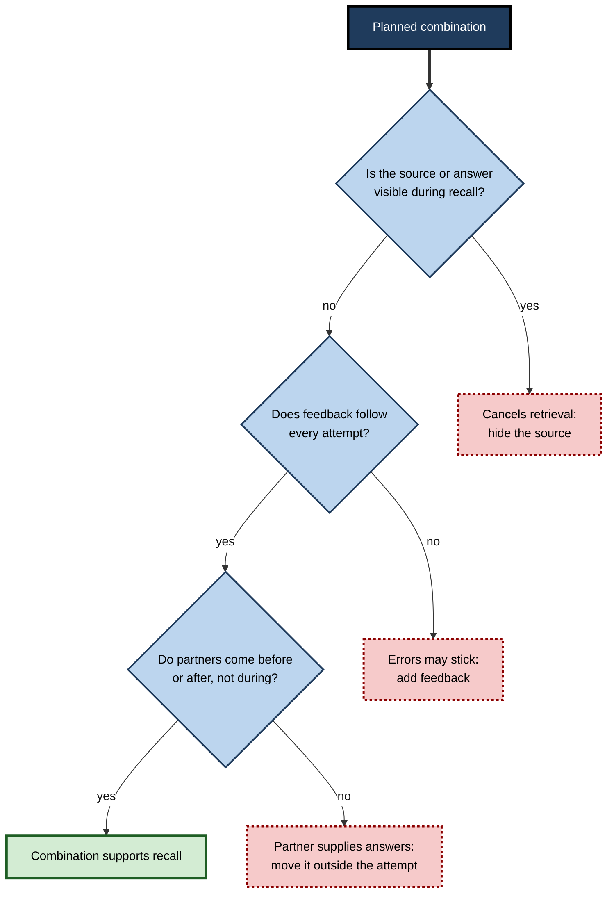

# B.11. Combining Recall with Other Strategies

Recall on its own strengthens what is already in memory. It cannot supply knowledge that was never learned, correct an error it does not detect, or turn a list of facts into understanding. Paired with the right partners — feedback, worked examples, explanation, diagrams, mixing and spacing — it becomes the centre of a complete study system. Paired with the wrong ones, such as notes left open or answers glanced at early, it quietly stops being recall at all.

> **Definition — Recall-centred combination:** a study design in which active recall is the core activity and other strategies are added before, during or after it to supply knowledge, correct errors, deepen understanding or extend retention.

**Why combinations matter**

- **Recall has blind spots** — it strengthens errors as well as truths and cannot create understanding from nothing.
- **Partners fill the gaps** — feedback corrects, examples build schemas, explanation adds meaning, diagrams add structure, timing adds durability.
- **Order matters** — the same activities in a different sequence can help or harm.
- **Some combinations cancel out** — adding a strategy that supplies the answer during recall removes the retrieval.
- **Real learning tasks are mixed** — professionals must remember facts, understand systems and solve problems, which no single strategy serves.

---

## Recall as the Hub

### What recall does and does not do

- **Does:** strengthens retrieval routes; reveals gaps; improves self-monitoring; organises knowledge.
- **Does not:** supply missing knowledge; reliably correct errors without feedback; build complex procedures in complete novices; guarantee transfer to unfamiliar problems.

### What each partner adds

| Partner | What it supplies that recall lacks | When it comes | Typical pairing |
|---|---|---|---|
| Feedback | Correction of errors and confirmation of shaky correct answers | Straight after, or shortly after, each attempt | Every recall format |
| Worked examples | Initial schemas for procedures and problem types | Before recall of procedures | Example then similar problem from memory |
| Elaboration and explanation | Meaning, reasons and connections | After a successful recall, or as part of it | "Recall it, then explain why" |
| Diagrams and visual structure | Spatial and relational organisation | As the output form of recall | Draw the system from memory |
| Mixing problem types | Practice in choosing what to retrieve | Across a recall session | Shuffled questions from several topics |
| Spacing over time | Durability through repeated effortful retrieval | Between sessions | Return to the same material days later |

**Figure 1.** Active recall at the centre of a study system, with partner strategies.

---

## Recall With Feedback

Feedback is the most important partner. Without it, recall can strengthen errors; with it, even failed attempts become learning.

### What feedback does

- **Corrects errors** — replaces a wrong answer with the right one.
- **Confirms low-confidence correct answers** — Andrew Butler, Jeffrey Karpicke and Henry Roediger (2008) found that feedback helped learners retain answers they had got right **but were unsure of**, which otherwise were often lost.
- **Makes failed attempts useful** — a failed search followed by the answer can produce better learning than simply studying the answer.

### Confidence and the hypercorrection effect

**Study card — Brady Butterfield and Janet Metcalfe (2001)**

- **Design:** participants answered general-knowledge questions, rated their **confidence** in each answer, received the correct answers, and were retested later.
- **Results:** errors made with **high confidence** were **more** likely to be corrected on the retest than errors made with low confidence.
- **Conclusion:** surprise at being confidently wrong appears to draw attention to the correction — the **hypercorrection effect**.

> **Definition — Hypercorrection effect:** the finding that errors made with high confidence are more likely to be corrected after feedback than errors made with low confidence.

**Figure 2.** Schematic of the hypercorrection effect: the more confident the error, the more likely the correction is retained.

> **In practice:** rating confidence **before** checking each answer adds almost no time, shows where self-assessment is poor, and may strengthen corrections where confidence was misplaced.

### When to give feedback

| | Immediate feedback | Delayed feedback |
|---|---|---|
| Timing | After each answer | After the whole set, or later the same day |
| Strength | Prevents errors from being rehearsed; easy to organise | Adds a second, spaced exposure to the correct answer |
| Risk | Can turn into peeking if the answer is too accessible | Errors may be repeated within the session |
| Evidence | Reliably helpful | Sometimes as good or better for retention in laboratory studies; mixed in classrooms |
| Practical default | Use for complex or error-prone material | Use for well-practised items or to add spacing |

> **Watch out:** "immediate feedback is always best" and "delayed feedback is always best" are both too strong. The evidence is mixed; what matters most is that feedback **arrives** and is **processed** — learners who glance at an answer key without comparing carefully gain little.

---

## Recall With Worked Examples

### The problem recall cannot solve alone

- **Novices facing a new procedure** have nothing useful to retrieve; asking them to solve problems from memory produces floundering, not learning.
- **The worked-example effect** — John Sweller and Graham Cooper (1985) found that novices learning algebra learned more from studying worked examples than from solving the equivalent problems.

> **Definition — Worked example:** a step-by-step demonstration of how to solve a problem, studied before the learner solves similar problems.

### The example–problem pair

- **Study one worked example**, then **solve a similar problem from memory**, without the example in view.
- **Tamara van Gog, Liesbeth Kester and Fred Paas (2011)** found that **example–problem pairs** and example-only study both outperformed problem-only practice for novices.
- **The recall element** — solving the second problem without the example requires retrieving the procedure just studied.

### Fading

- **Faded worked examples** — Alexander Renkl and colleagues developed sequences in which successive examples leave more steps for the learner to complete.
- **The progression:** full example → example with the last step missing → example with two steps missing → whole problem from memory.
- **Effect:** support is removed as competence grows, so recall gradually takes over.

**Figure 3.** From worked examples to recall: the example–problem pair and fading.

> **Key point:** worked examples answer the strongest objection to recall — that it fails for complex material novices do not yet understand. **Examples first, recall soon after** is the combination that handles complexity.

---

## Recall With Explanation

### Two orders

- **Recall, then explain** — retrieve the fact or step, then ask "why is this so?" and answer from memory.
  - Builds meaning around a memory that has just been strengthened.
- **Explain while recalling** — the recall task itself asks for reasons: "State the rule and explain why it exists."
  - Retrieval and elaboration happen together.

### Why the pair works

- **Recall alone** can produce correct but isolated answers.
- **Explanation alone**, done with the source open, can produce fluent paraphrase without memory.
- **Together**, they produce answers that are both **retrievable** and **connected**.

> **Watch out:** explanation done with the notes open is not recall. The partner strategy must not reintroduce the source.

### Recall with questions about meaning

- **After each recalled item**, add one of: *Why? How does it connect to…? What would change if…? Where would this not apply?*
- **Effect:** each recall attempt becomes an occasion to deepen understanding as well as memory.

---

## Recall With Visual Structure

- **Drawing from memory** — sketch a process, system, map or concept network with the source closed.
  - Combines retrieval with spatial organisation; reveals missing links directly.
- **Words and picture together** — recalling both the verbal explanation and the diagram of an idea gives two routes to it.
- **Check against the source diagram** — mark missing components and wrong connections.

> **In practice:** engineers, clinicians and analysts who can **redraw** the key diagrams of their field from memory — an architecture, an anatomical pathway, a process map — tend to reason more fluently with them than those who can only recognise them.

---

## Recall With Mixing and Spacing

- **Mixing** — combining questions from several topics in one recall session forces the learner to identify **which** knowledge each question needs, a skill blocked practice never exercises.
- **Spacing** — returning to recall the same material after a gap makes each retrieval more effortful and more durable; the design of gaps is a substantial subject of its own.

### Successive relearning

**Study card — Katherine Rawson, John Dunlosky and Sharon Sciartelli (2013)**

- **Design:** university students learned key concepts from their introductory psychology course by **recalling** each concept to a criterion — producing it correctly, with feedback after each attempt — and then **relearning** the concepts to criterion again in several later sessions spread over weeks.
- **Results:** compared with their usual study, successive relearning produced better performance on course exams and much better retention weeks to months later; each later session needed fewer attempts to reach criterion.
- **Conclusion:** combining recall **to a criterion** with **feedback** and **repetition across sessions** yields durable learning efficiently.

> **Definition — Successive relearning:** recalling material with feedback until a criterion is reached, then repeating the process in later sessions spread over time.

**Figure 4.** Schematic of successive relearning: fewer attempts are needed to reach criterion in each later session.

---

## Recall Before Study

- **Pretesting** — attempting questions **before** studying the material, usually failing, then studying.
  - Lindsey Richland, Nate Kornell and Liche Sean Kao (2009) found that students who tried to answer questions before reading a text learned the tested content better than students who simply read for longer.
- **Why it can help** — the failed attempt directs attention to what matters, raises curiosity and prepares a "slot" for the answer.
- **Combination:** pretest → study → recall → feedback.

> **Watch out:** pretesting helps mainly with content related to the pretest questions, and it can discourage learners if overused. It is a starter, not a substitute for later recall.

---

## Sequencing a Recall-Centred Study Block

### A general sequence

1. **Pretest** (optional) — a few questions attempted cold.
2. **Encode** — study the material for understanding; for procedures, study worked examples.
3. **Recall** — produce the material from memory: free recall, questions, problems, diagrams.
4. **Feedback** — compare, correct, note confidence errors.
5. **Elaborate** — explain the hardest items; connect to prior knowledge.
6. **Return later** — mixed recall of this and earlier material in a later session.

> **Mnemonic — "PERFER":** **P**retest, **E**ncode, **R**ecall, **F**eedback, **E**laborate, **R**eturn.

**Figure 5.** A recall-centred study block from first exposure to later return.

### Combinations that defeat recall

- **Recall with notes open** — becomes reading.
- **Recall with answers visible at a glance** — becomes recognition.
- **Recall followed by re-reading everything** — dilutes effort; targeted restudy of failures is better.
- **Highlighting as the "partner"** — adds no retrieval and little understanding.
- **AI explanation before every attempt** — removes the search.
- **Endless hints** — the learner never produces anything independently.

**Figure 6.** Checking a planned combination for features that cancel recall.

---

## Worked Example (illustrative): Planning a Week on a New Pharmacology Topic

**Situation:** a pharmacy student has a week to learn a new topic — anticoagulant drugs — for an exam in a month. She has six sessions of 40 minutes.

| Session | Main activity | Recall element | Partner strategy |
|---|---|---|---|
| 1 (Mon) | Pretest: five questions cold; then study the chapter and two worked dosing calculations | Pretest attempts | Worked examples |
| 2 (Tue) | Free recall of mechanisms; dosing problems with examples hidden | Free recall; problems from memory | Feedback after each problem; confidence ratings |
| 3 (Wed) | Draw the clotting cascade from memory and mark where each drug acts | Diagram from memory | Visual structure; explanation of each drug's site |
| 4 (Thu) | Mixed questions: anticoagulants plus last week's antiplatelet drugs | Short-answer recall | Mixing |
| 5 (Fri) | Clinical scenarios: choose a drug and dose for each patient, then explain why | Applied recall | Explanation; feedback from model answers |
| 6 (Sun) | Recall to criterion of every flagged item from the week | Recall until correct | Feedback; return to material across days |

**Steps**

1. **Start with examples** for the procedural part (dosing) — recall comes soon after.
2. **Use recall every session**, in varied forms — free recall, problems, diagrams, mixed questions, scenarios.
3. **Attach a partner** that fills recall's blind spot in each session — examples, feedback, structure, mixing, explanation.
4. **Close the week** by bringing every failure back to criterion.

- **Conclusion:** no session is "just reading" or "just recall"; each pairs retrieval with what it needs.

> **Watch out:** the plan looks elaborate on paper, but each session is simple to run. The common error is to replace sessions 2–6 with "go over the chapter again" — which feels efficient and would leave her recognising rather than recalling.

---

## Case Study (illustrative): Learning a New Programming Language as a Team

- **Situation:** a platform team of eight engineers had to adopt a new systems programming language for a performance-critical service.
- **Problem:** after an online course and a month of reading, the team's code reviews were slow; engineers repeatedly looked up the same rules about memory ownership and could not explain compiler errors to each other.
- **Diagnosis:**
  - learning had been almost entirely **input** — videos and documentation;
  - when engineers wrote code, they copied patterns from examples open in another window, so they never **retrieved** the rules;
  - errors were fixed by trial and error, without understanding.
- **Actions — a recall-centred combination:**
  1. **Worked examples then problems:** each week, a short worked example of one language concept, followed by two small exercises solved with the example closed.
  2. **Feedback:** the compiler gave immediate feedback; pairs then explained each error message **from memory** to each other before looking it up.
  3. **Explanation:** a ten-minute weekly session in which one engineer explained a concept without slides; others asked "why does the compiler require this?".
  4. **Mixing:** monthly exercises mixed all concepts learned so far.
  5. **Return:** each month began with a ten-question recall quiz on earlier concepts.
- **Result:** within three months, review times fell, engineers could explain the ownership rules unaided, and the team shipped the first version of the service on schedule.
- **Side effects:** the early weeks were slower than "just coding with the docs open"; the team lead protected time for the exercises.
- **Lesson:** recall built the knowledge in the head, worked examples made recall possible for novices, feedback and explanation turned errors into understanding, and mixing and return made it last.

---

## Open Questions

- **Do the benefits of combined strategies add up?**
  - Some pairs, such as recall with feedback, clearly complement each other; for others, overlapping mechanisms may limit gains.
- **What is the best order of recall and elaboration?**
  - Recall-then-explain and explain-while-recalling both have support; direct comparisons are few.
- **When should worked examples give way to recall?**
  - Fading works, but the right point to remove support for different learners and tasks is not settled.
- **How should feedback be timed in real courses?**
  - Laboratory and classroom findings diverge; practical guidelines remain approximate.
- **How should AI tools be combined with recall?**
  - Tools can provide examples, feedback and explanations on demand — but also answers; designs that preserve retrieval are still emerging.

---

## Summary

- **Recall-centred combination** = recall as the core activity, with partners before, during or after it.
- Recall strengthens and diagnoses but cannot supply knowledge, guarantee correction or build first schemas — partners fill these gaps.
- **Feedback** is essential: it corrects errors, confirms shaky correct answers (Butler, Karpicke and Roediger) and makes failures useful; confident errors are corrected best — the **hypercorrection effect** (Butterfield and Metcalfe). Timing evidence is mixed.
- **Worked examples** (Sweller and Cooper) and **example–problem pairs** (van Gog, Kester and Paas), with **fading** (Renkl), make recall possible for novices with complex procedures.
- **Explanation** adds meaning; **diagrams** add structure; **mixing** practises choosing; **spacing** adds durability — **successive relearning** (Rawson, Dunlosky and Sciartelli) combines recall to criterion, feedback and repetition across sessions.
- **Pretesting** (Richland, Kornell and Kao) can prepare study.
- Sequence: **PERFER** — pretest, encode, recall, feedback, elaborate, return.
- Combinations that **defeat** recall: source open, answers visible, re-reading everything, highlighting, AI explanations before attempts, endless hints.

---

## Self-Check

1. What can recall not do on its own, and which partners address each limitation?
2. Explain three functions of feedback after recall.
3. Describe the hypercorrection effect and how a learner could use it.
4. Compare immediate and delayed feedback.
5. Why do worked examples matter for recall of procedures, and what is an example–problem pair?
6. Describe fading and explain how it moves a learner towards recall.
7. Distinguish recall-then-explain from explain-while-recalling, and give an example of each.
8. Why is drawing a diagram from memory a useful combination?
9. Describe successive relearning and the findings of Rawson, Dunlosky and Sciartelli (2013).
10. What is pretesting, and what are its limits?
11. Explain PERFER.
12. Identify the problem in each: "I recall with the textbook open in case I get stuck"; "After recalling I re-read the whole chapter"; "I ask the AI to explain each topic before I quiz myself."
13. Design a recall-centred fortnight for a new manager learning employment law basics.
14. A trainer says, "Recall doesn't work for my complex software course — learners just get stuck." Respond with a combination design.

### Answer Key

1. It cannot supply missing knowledge (worked examples, study), reliably correct errors (feedback), build meaning (explanation), provide structure (diagrams), practise choosing among methods (mixing) or ensure durability (spacing).
2. It corrects errors; it confirms low-confidence correct answers that would otherwise be lost; it turns failed attempts into learning.
3. High-confidence errors are more likely to be corrected after feedback than low-confidence ones. Rate confidence before checking; pay special attention to confident errors when the correct answer is shown.
4. Immediate feedback prevents errors from being rehearsed and is simple; delayed feedback adds a spaced exposure and is sometimes as good or better for retention in laboratory studies. Evidence is mixed; ensuring feedback is received and processed matters most.
5. Novices have nothing to retrieve for a new procedure; worked examples build initial schemas. An example–problem pair is studying one example, then solving a similar problem with the example hidden.
6. Successive examples leave more steps for the learner, ending with whole problems from memory; support is gradually replaced by recall.
7. Recall-then-explain: state the formula for working capital, then explain why each component matters. Explain-while-recalling: "State the rule against penalties and explain why courts apply it."
8. It combines retrieval with spatial organisation, shows missing components and links, and gives a second, visual route to the knowledge.
9. Recall each concept with feedback until correct, then repeat in later sessions. Students using it performed better on course exams and retained much more weeks to months later; later sessions needed fewer attempts.
10. Attempting questions before studying; it improves learning of related content by directing attention and raising curiosity. Its benefit is mainly for tested content, and overuse can discourage learners.
11. Pretest, Encode, Recall, Feedback, Elaborate, Return.
12. Open textbook — retrieval becomes reading; close it and use graduated hints only after an attempt. Re-reading everything — dilutes effort; restudy only the failures. AI explanation first — removes the search; attempt first, then ask the AI for feedback or explanation of failures.
13. E.g. week 1: short explanations and two worked cases per topic (unfair dismissal, discrimination, contracts); next day, free recall and case questions with feedback and confidence ratings; diagram the dismissal procedure from memory. Week 2: mixed scenarios across topics; explain answers aloud; recall to criterion of flagged items at the end of each week; return monthly.
14. Learners get stuck because they are asked to recall before they have schemas. Start each topic with worked examples, then example–problem pairs with the example hidden, fade the examples, add immediate feedback and explanation of errors, then mixed problems from memory and later return.

---

## Glossary

| Term | Meaning |
|---|---|
| Delayed feedback | Correct answers provided after a set of attempts or later. |
| Example–problem pair | Studying a worked example, then solving a similar problem with it hidden. |
| Faded worked example | A worked example with some steps left for the learner to complete. |
| Hypercorrection effect | Greater correction of high-confidence errors after feedback. |
| Immediate feedback | Correct answer provided straight after each attempt. |
| Pretesting | Attempting questions before studying the material. |
| Recall-centred combination | A study design with recall at its core and other strategies around it. |
| Recall to criterion | Repeating recall with feedback until an item is produced correctly. |
| Successive relearning | Recall to criterion repeated in sessions spread over time. |
| Worked example | A step-by-step demonstration of how to solve a problem. |
| Worked-example effect | Novices learning more from studying examples than from solving problems. |
