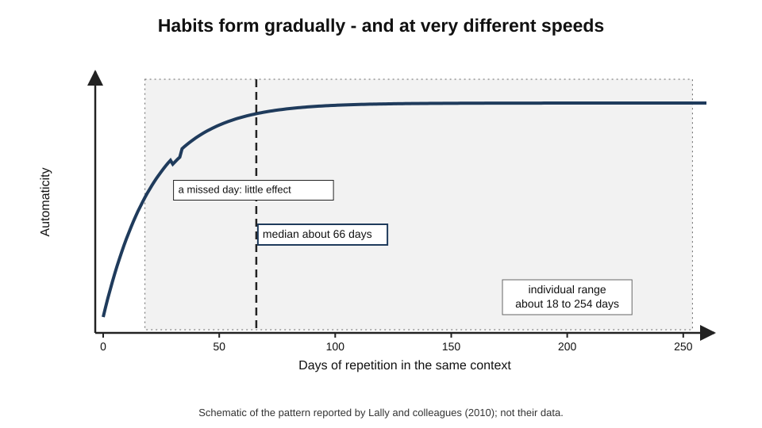
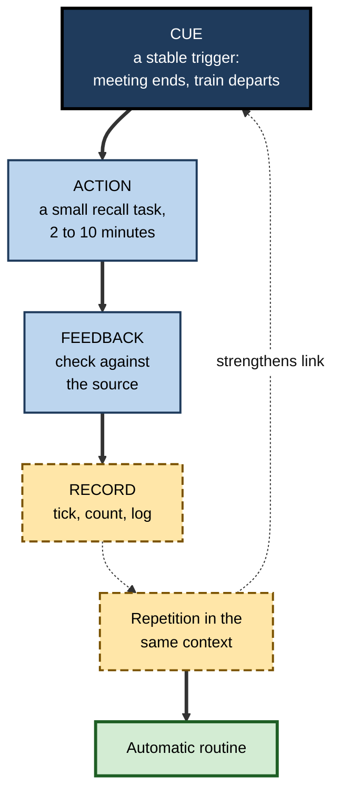
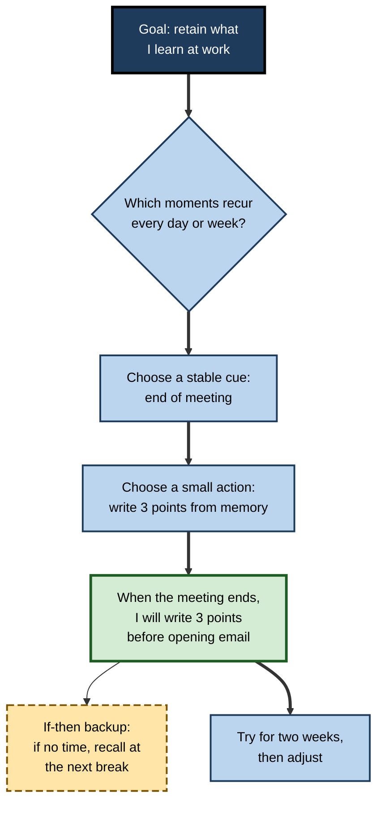
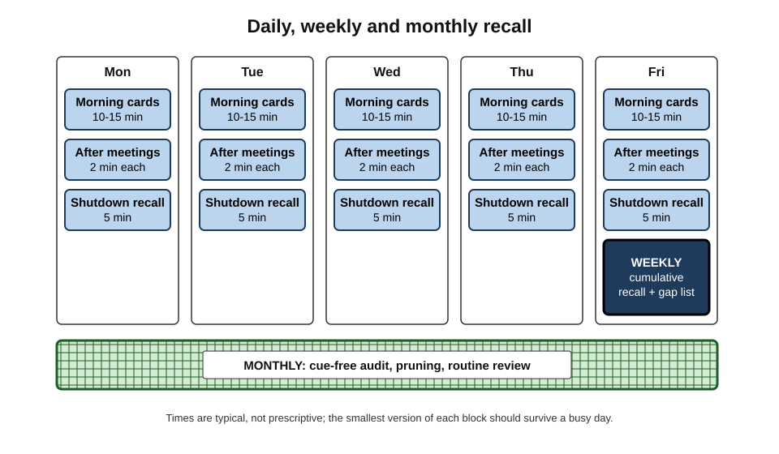
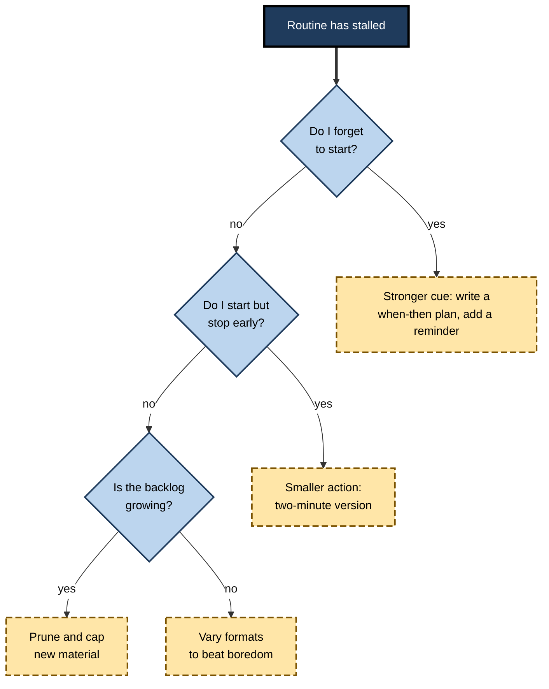
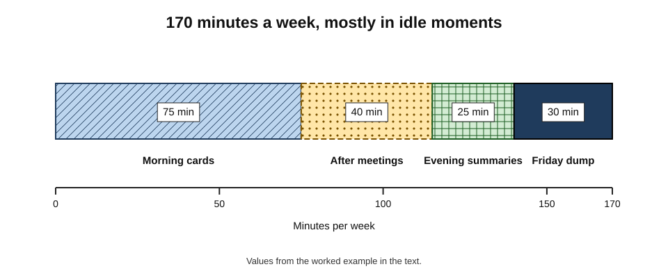

# B.12. Building Active Recall Into Routines

Almost everyone who learns about active recall agrees that it works. Far fewer are still doing it a month later. The method is not difficult; what is difficult is remembering to do it, at the right moments, when re-reading is easier and the inbox is waiting. The professionals who benefit most are not those who know the most about recall, but those who have turned it into something they do without deciding to — after every meeting, on every commute, at the end of every week.

> **Definition — Recall routine:** a recurring, cue-triggered pattern of active recall built into daily, weekly or longer cycles of work and study, so that retrieval happens by default rather than by repeated decision.

**Why routines matter**

- **Knowledge of a method does not produce use** — learners who are told about recall often revert to re-reading.
- **Recall must recur** — its benefits come from repeated retrieval over weeks and months.
- **Decisions are costly** — each "should I quiz myself now?" is a chance to choose the easier option.
- **Routines survive busy periods** — small, cue-linked habits persist when motivation falls.
- **Professional knowledge decays without use** — routines maintain it across a career.

---

## From Intention to Habit

### The intention–behaviour gap

- **People often fail to act on intentions** — reviews of health and study behaviour, such as Paschal Sheeran's (2002), found that intentions predict behaviour only moderately; many intenders do not act.
- **For study methods specifically** — students who rate recall as effective still report re-reading as their main strategy.
- **Reasons:**
  - recall feels harder and less fluent;
  - there is no obvious moment to do it;
  - its benefits are delayed and invisible, while its discomfort is immediate.

> **Key point:** the problem is rarely ignorance. It is the absence of a **cue**, a **small enough action** and a **visible reward**.

### What a habit is

> **Definition — Habit:** a behaviour triggered automatically by a context cue, as a result of repeating the behaviour in that context.

- **Wendy Wood and David Neal (2007)** described habits as learned associations between **contexts** and **responses**: once formed, the context triggers the response with little conscious intention.
- **Consequence for recall:** the aim is to link recall to stable cues — a place, a time, an event — so that the cue starts the behaviour.

**Study card — Phillippa Lally and colleagues (2010)**

- **Design:** 96 volunteers chose a simple daily behaviour (such as drinking water with lunch or doing sit-ups before breakfast) to perform in a consistent context, and reported each day how **automatic** it felt, for twelve weeks.
- **Results:**
  - automaticity rose steeply at first, then levelled off;
  - the **median** time to reach near-maximum automaticity was about **66 days**, with individual times ranging from **18 to 254 days**;
  - **missing one day** did not materially affect the habit's formation.
- **Conclusion:** habits form gradually and at very different speeds; consistency matters more than perfection.

**Figure 1.** Schematic of how automaticity grows with repetition.

> **Watch out:** the popular claim that a habit forms in **21 days** has no solid basis. Lally's study found a median of about 66 days, with very wide variation; more complex behaviours tended to take longer.

### The recall habit loop

1. **Cue** — a stable trigger: end of a meeting, boarding the train, the first coffee, Friday at 4 p.m.
2. **Action** — a small, specific recall task: "Write three points from the meeting before opening email."
3. **Feedback** — check against the source; see what was right.
4. **Record** — a tick, a count, a line in a log — visible progress.

**Figure 2.** The recall habit loop.

---

## Planning the Trigger: Implementation Intentions

> **Definition — Implementation intention:** a plan in the form "When situation X arises, I will perform behaviour Y", linking a specific cue to a specific action.

- **Peter Gollwitzer (1999)** introduced the concept; a meta-analysis by Gollwitzer and Paschal Sheeran (2006) of nearly a hundred studies found that forming implementation intentions had a **medium-to-large** effect on goal attainment.
- **Why they work:** the situation becomes a ready cue; the decision is made in advance, so it does not have to be made in the moment.

### Writing recall intentions

- **Weak:** "I'll use more active recall."
- **Better:** "I'll quiz myself on my notes this week."
- **Strong:** "**When** I sit down on the 8.10 train, **I will** open my flashcard app and review until the next stop."
- **Strong:** "**When** a client meeting ends, **I will** write the three decisions and one open question before I open email."
- **Strong:** "**When** I finish a chapter, **I will** close the book and write a one-paragraph summary from memory."

### If–then plans for obstacles

- "**If** I am too tired for flashcards on the train, **then** I will recall one thing from yesterday aloud in my head."
- "**If** a meeting runs into the next one, **then** I will do the recall at the next break."
- "**If** I miss a day, **then** I will do the shortest version the next day rather than catch up everything."

> **Remember:** **When [cue], I will [small recall action].** And for each likely obstacle: **If [obstacle], then [smaller action].**

**Figure 3.** Building an implementation intention for recall.

---

## Designing Routines That Last

### Principles

- **Start tiny** — a two-minute version that can be done on the worst day.
  - *e.g.* "one card", "one sentence from memory".
- **Anchor to existing routines** — attach recall to things already done daily: coffee, commute, the end of meetings, shutting down the laptop.
- **Reduce friction for recall** — cards already on the phone's home screen; a blank notebook on the desk; a recall template in the meeting-notes tool.
- **Add friction for the passive alternative** — notes in a folder, not open by default; recall first, notes second.
- **Make progress visible** — count recalls; mark a calendar; track the share of items recalled correctly.
- **Protect the minimum, not the maximum** — consistency matters more than session length.

> **Mnemonic — "TAPER":** **T**iny start, **A**nchor to an existing routine, **P**rogress made visible, **E**ase the path to recall, **R**aise the barrier to passive review.

### The progress principle

- **Teresa Amabile and Steven Kramer (2011)**, analysing nearly 12,000 diary entries from knowledge workers, found that **making progress in meaningful work** was the most powerful everyday boost to motivation and engagement.
- **For recall routines:** a log showing items mastered, coverage rising or a backlog falling provides exactly this sense of progress.

> **Watch out:** **streaks** — counts of consecutive days — can motivate, but they can also produce anxiety, and breaking one often leads people to give up entirely. Lally's finding that a missed day does not derail habit formation is a reason to track **totals** rather than unbroken runs.

---

## Routines at Three Time Scales

### Daily

- **Morning cards (5–15 minutes)** — review flashcards or questions due today, over the first coffee or on the commute.
- **After-meeting recall (2 minutes)** — decisions, owners, reasons, before email.
- **After-reading recall (2–5 minutes)** — a one-paragraph closed-book summary of anything important read today.
- **Shutdown recall (5 minutes)** — "What did I learn today?" written from memory before closing the laptop.

### Weekly

- **Friday cumulative recall (20–30 minutes)** — a brain dump or mixed quiz on the week's main topics, then a check against notes.
- **Gap list** — items that failed during the week become next week's first questions.
- **One teaching moment** — explain one thing learned this week to a colleague, without notes.

### Monthly and quarterly

- **Recall audit** — a cue-free quiz across the past month's material; anything forgotten returns to the daily cycle.
- **Prune** — delete obsolete cards and questions; rewrite those that repeatedly fail because they are badly written.
- **Review the routine itself** — which cues worked, which did not, what to change.

**Figure 4.** Recall routines at daily, weekly and monthly scales.

| | Daily | Weekly | Monthly |
|---|---|---|---|
| Typical time | 10–25 minutes in small blocks | 20–40 minutes | 30–60 minutes |
| Main formats | Flashcards, after-meeting and after-reading recall | Brain dump, mixed quiz, teaching a colleague | Cue-free audit, pruning |
| Main purpose | Keep new material from fading | Consolidate the week; find gaps | Maintain older knowledge; tune the system |
| Typical cue | Commute, coffee, end of a meeting | A fixed slot, e.g. Friday afternoon | First working day of the month |

---

## Team and Organisational Routines

Individuals sustain routines more easily when the environment builds them in.

- **Stand-up questions** — one quick recall question at the daily stand-up about a recent incident, release or customer issue.
- **Closed-book case conferences** — in medicine and law, presenting cases from memory before the file is opened.
- **Drills and game days** — operations teams rehearse incident responses from memory in simulated failures; emergency services and airlines run recurrent drills of critical procedures.
- **Learning retrospectives** — at the end of a project, team members write what they learned **individually, from memory**, before discussing.
- **"Question of the week"** — a short recall question sent to a team, with answers revealed later.
- **Onboarding** — new joiners explain systems back to their buddy at the end of each week.

> **In practice:** aviation's **recurrent training**, in which pilots periodically demonstrate emergency procedures in simulators, is the clearest example of an industry that schedules recall of critical knowledge for life rather than leaving it to individual motivation.

---

## Measuring Whether the Routine Works

- **Recall minutes per week** — is the routine actually happening?
- **Recall-to-input ratio** — recall minutes ÷ minutes of reading, lectures and meetings.
- **Success rate on delayed recall** — the share of items recalled correctly in weekly or monthly checks.
- **Backlog** — the number of overdue cards or open gap items; a steadily rising backlog signals an unsustainable routine.
- **Real-world signals** — fewer look-ups of the same thing; faster answers in meetings; fewer repeated errors.

> **Formula — Weekly recall-to-input ratio:** recall minutes ÷ input minutes. Example: 90 minutes of recall in a week with 360 minutes of reading, lectures and meetings → 90 ÷ 360 = **0.25**.

> **Watch out:** a high **success rate** is not always good news. If almost everything is recalled correctly, the material may be too easy or recalled too soon; a success rate well below 100 per cent on delayed checks is a sign that recall is doing real work.

---

## Common Obstacles and Fixes

| Obstacle | What it looks like | Fix |
|---|---|---|
| "No time" | Recall is the first thing dropped on busy days | Shrink to a two-minute version; anchor to unavoidable events such as commutes or meeting ends |
| Discomfort | Avoiding recall because failing feels bad | Treat errors as information; keep recall private and low-stakes |
| Forgetting to do it | Good intentions, no action | Write implementation intentions; add visible reminders at the cue |
| Card or question debt | Hundreds of overdue items | Pause new material; prune; set a daily cap |
| Boredom | The same cards in the same format | Vary formats — explain, draw, teach, scenario questions |
| Plateau | Recall rates stop rising | Change cue type, mix topics, add application questions |
| Life disruption | Travel, illness, deadlines | Keep the smallest version alive; restart without "catching up" |

**Figure 5.** Diagnosing a stalled recall routine.

---

## Worked Example (illustrative): A Routine for a Busy Consultant

**Situation:** a management consultant on a new client engagement must absorb the client's industry, organisation and data quickly, while working long days. She has no fixed study time.

**Step 1 — find recurring cues**

- Daily: 25-minute train journey each way; three to five meetings; lunch.
- Weekly: Friday afternoon is usually quieter.

**Step 2 — write implementation intentions**

1. "When I sit down on the morning train, I will review the day's due cards until my station."
2. "When a client meeting ends, I will write the three key facts and one question from memory before checking messages."
3. "When I sit down on the evening train, I will write a one-paragraph summary from memory of the most important thing I read today."
4. "On Friday at 3 p.m., I will do a 20-minute brain dump on the client's business, then check it against the engagement notes."

**Step 3 — budget the time**

| Routine | Frequency | Minutes each | Minutes per week |
|---|---|---|---|
| Morning cards | 5 × week | 15 | 75 |
| After-meeting recall | about 20 × week | 2 | 40 |
| Evening summary | 5 × week | 5 | 25 |
| Friday brain dump and check | 1 × week | 30 | 30 |
| Total | | | **170** |

*Illustrative figures.*

**Figure 6.** Weekly time budget for the consultant's recall routine. (illustrative)

**Step 4 — track and adjust**

- After two weeks, morning cards and the Friday dump are consistent; after-meeting recall happens after only about half of meetings.
- **Fix:** she adds a three-line recall template to the top of every meeting-notes page, so the cue is in front of her when the meeting ends.

- **Conclusion:** under three hours a week, almost all in time that was previously idle or spent re-reading, gives her a growing, retrievable model of the client — and shows within days which parts of it are still weak.

> **Watch out:** the routine relies on unusually stable cues such as train journeys. Someone without them needs different anchors — the first coffee, the end of the working day — rather than willpower.

---

## Case Study (illustrative): Exam Preparation on Shift Work

- **Situation:** a hospital registrar was preparing for a specialty examination while working rotating day and night shifts.
- **Problem:** her plan of "two hours of study on days off" kept collapsing; she would re-read textbooks when exhausted and remember little. Three months before the exam she felt she had made almost no progress.
- **Diagnosis:**
  - the plan depended on long, unpredictable blocks of free time and high energy;
  - study was almost entirely re-reading, so even completed sessions produced little retrievable knowledge;
  - there were no cues — every session needed a fresh decision.
- **Actions:**
  1. **Anchors that survived shift changes:** the walk from the car park to the ward (both directions), the first break of each shift, and the ten minutes after handover.
  2. **Small recall tasks for each anchor:** ten flashcards on the walk in; two exam-style questions from a question bank during the first break; a one-minute recall of an interesting case after handover.
  3. **A weekly anchor:** on the first day off each week, a 45-minute mixed, cue-free quiz on everything from the previous week, followed by restudy of failures only.
  4. **If–then plans:** "If I am on a night shift, then I will do the walk-in cards but skip the break questions."
  5. **Tracking totals,** not streaks, in a simple log on her phone.
- **Result:** she averaged around four hours of recall a week, almost none of it in her former "study blocks"; her scores on question-bank practice tests rose steadily, and she passed the examination.
- **Side effects:** recalling cases after handover also improved her clinical presentations; colleagues began to join the case recall informally.
- **Lesson:** a routine built from **small, cue-linked recall tasks** survived conditions that defeated a plan built on **time and willpower**.

---

## Open Questions

- **How long do recall habits take to form, and what speeds them up?**
  - Habit research suggests weeks to months with wide variation; studies of study-habit formation specifically are few.
- **Do routines maintain knowledge over years?**
  - Long-term evidence on professionals' self-directed recall routines is scarce.
- **Which cues work best for knowledge workers with unpredictable schedules?**
  - Event-based cues such as the end of meetings seem promising, but systematic comparisons are lacking.
- **How should organisations support recall routines without making them feel like surveillance?**
  - Team quizzes and drills help, but the line between practice and assessment matters and is little studied.
- **Can AI tools sustain routines?**
  - Scheduled prompts and adaptive questioning could help, or could become one more notification to ignore; evidence is early.

---

## Summary

- A **recall routine** = cue-triggered recall built into daily, weekly and monthly cycles, so retrieval happens by default.
- The barrier is the **intention–behaviour gap**, not ignorance: recall feels harder, lacks a natural moment and pays off later.
- **Habits** are context–response links (Wood and Neal); they form gradually — median about **66 days**, range **18–254** — and survive a missed day (**Lally and colleagues, 2010**). The "21 days" claim is unfounded.
- The **habit loop**: cue → small recall action → feedback → record.
- **Implementation intentions** — "When X, I will Y" — have medium-to-large effects (Gollwitzer and Sheeran, 2006); add **if–then** plans for obstacles.
- Design with **TAPER**: tiny start, anchor, progress visible, ease recall, raise the barrier to passive review; the **progress principle** (Amabile and Kramer) supports visible tracking; prefer **totals** to fragile **streaks**.
- Routines at three scales: **daily** (cards, after-meeting, after-reading, shutdown), **weekly** (cumulative recall, gap list, teaching), **monthly** (audit, pruning, routine review).
- Teams: stand-up questions, closed-book case conferences, drills, individual-first retrospectives, recurrent training.
- Measure minutes, recall-to-input ratio, delayed success rate, backlog and real-world signals; troubleshoot cues, size, backlog and boredom.

---

## Self-Check

1. Define a recall routine and explain why knowing about recall is not enough to use it.
2. What is the intention–behaviour gap, and why is it wide for recall in particular?
3. Describe the Lally and colleagues (2010) study and two of its practical lessons.
4. Why is the "21 days to form a habit" claim misleading?
5. Describe the four parts of the recall habit loop.
6. Write two implementation intentions and one if–then backup plan for your own recall routine.
7. What did Gollwitzer and Sheeran's meta-analysis find?
8. Explain TAPER with an example of each element.
9. Why might tracking totals be better than tracking streaks?
10. Describe one daily, one weekly and one monthly recall routine and the purpose of each.
11. Calculate the recall-to-input ratio for 60 minutes of recall in a week with 480 minutes of meetings and reading, and comment.
12. Why can a near-perfect recall success rate be a warning sign?
13. A team lead wants to build recall into team life without making it feel like assessment. Suggest three practices and safeguards.
14. A learner's routine collapsed after a holiday and she has 900 overdue flashcards. What should she do?

### Answer Key

1. A recurring, cue-triggered pattern of recall in daily, weekly or longer cycles. Knowing does not supply a moment, a small enough action or an immediate reward, so learners revert to easier re-reading.
2. The gap between intending to act and acting. For recall it is wide because recall feels harder than re-reading, has no natural trigger and pays off only later.
3. Volunteers performed a chosen daily behaviour in a consistent context and rated automaticity for twelve weeks; median time to near-maximum automaticity was about 66 days (range 18–254), and a missed day did not derail formation. Lessons: expect weeks to months; consistency matters more than perfection.
4. It has no solid evidential basis; measured times vary widely, with a median near 66 days, and complex behaviours take longer.
5. Cue — a stable trigger; Action — a small recall task; Feedback — checking against the source; Record — visible progress.
6. E.g. "When I close my laptop at the end of the day, I will write three things I learned from memory." "When a lecture ends, I will write three points and one question before leaving." Backup: "If I am rushing to another meeting, then I will say the three points to myself on the way."
7. Across many studies, forming implementation intentions had a medium-to-large effect on attaining goals.
8. Tiny start — one card a day; Anchor — attach to the first coffee; Progress visible — a weekly count of items mastered; Ease recall — cards on the phone's home screen; Raise the barrier to passive review — notes kept in a closed folder until after recall.
9. Missing a day does not damage habit formation, but breaking a streak often leads people to give up; totals reward consistency without punishing lapses.
10. Daily: morning flashcards — keep new material from fading. Weekly: Friday cumulative brain dump — consolidate and find gaps. Monthly: cue-free audit and pruning — maintain older knowledge and tune the system.
11. 60 ÷ 480 = **0.125** — low; adding short after-meeting or after-reading recalls would raise it towards a quarter.
12. It may mean recall happens too soon or the material is too easy, so retrieval is effortless and adds little; delayed checks with some failures show recall is doing work.
13. E.g. a weekly question of the week with anonymous answers; closed-book case or incident reviews; individual-first learning retrospectives. Safeguards: never used in performance reviews; "I don't know yet" accepted; leaders take part.
14. Do not try to catch up all at once. Pause new cards; set a daily cap (e.g. 50 reviews); prioritise recent and important cards; delete trivial or obsolete ones; restart the smallest version of the routine immediately.

---

## Glossary

| Term | Meaning |
|---|---|
| Anchor | An existing routine to which a new behaviour is attached. |
| Automaticity | The degree to which a behaviour occurs without conscious intention. |
| Backlog | Overdue recall items, such as flashcards not yet reviewed. |
| Habit | A behaviour triggered automatically by a context cue after repetition. |
| Habit loop | Cue, action, feedback and record repeated in the same context. |
| If–then plan | A plan specifying a backup action if an obstacle occurs. |
| Implementation intention | A plan of the form "When X, I will Y". |
| Intention–behaviour gap | The shortfall between what people intend and what they do. |
| Progress principle | The finding that progress in meaningful work boosts motivation. |
| Recall audit | A periodic cue-free quiz across older material. |
| Recall routine | Cue-triggered recall built into regular cycles. |
| Recall-to-input ratio | Recall minutes divided by input minutes. |
| Recurrent training | Periodic retraining and checking of critical procedures, as in aviation. |
| Streak | A count of consecutive days on which a behaviour was performed. |
