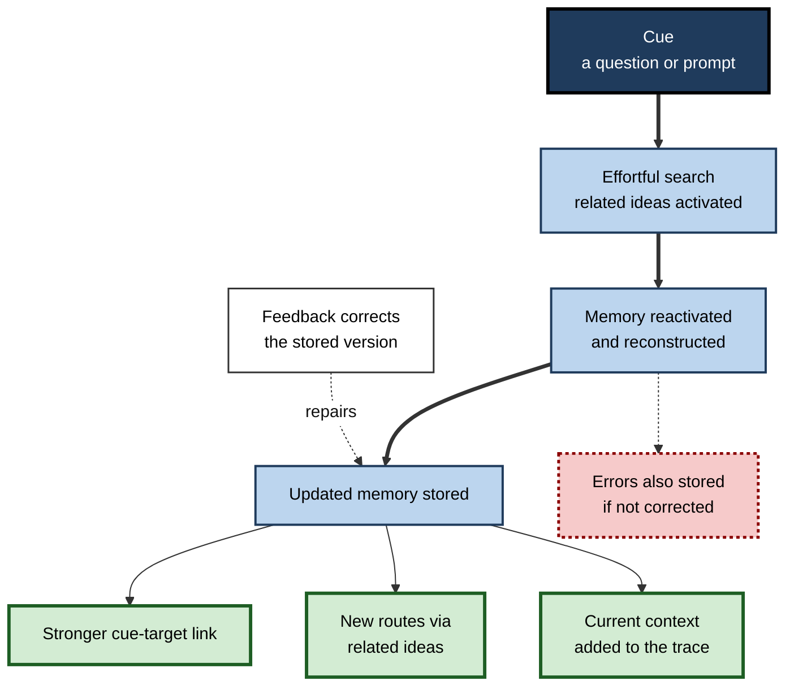
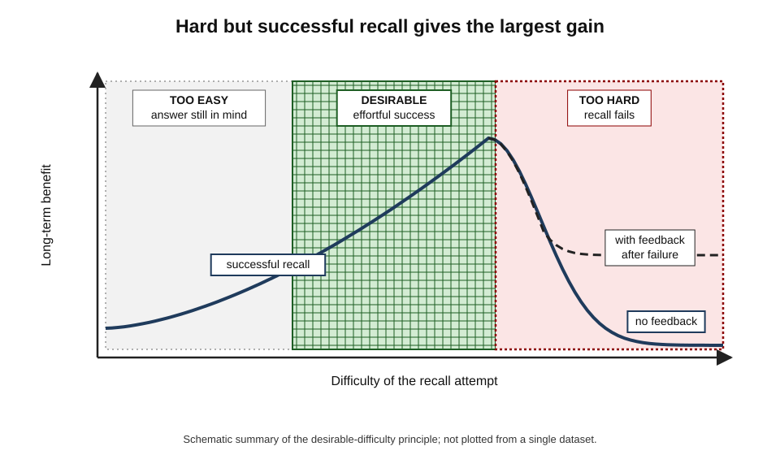
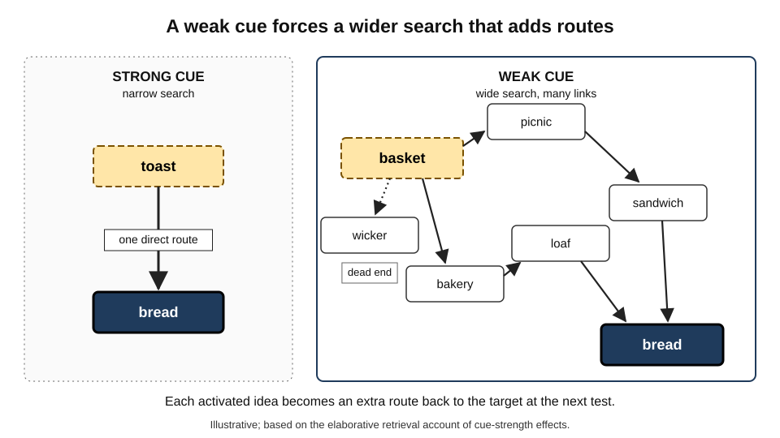
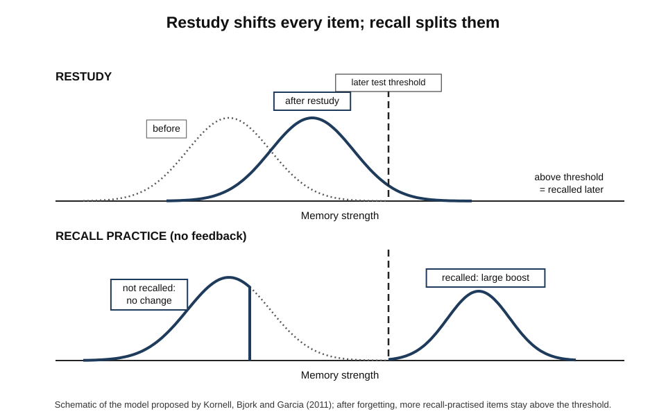
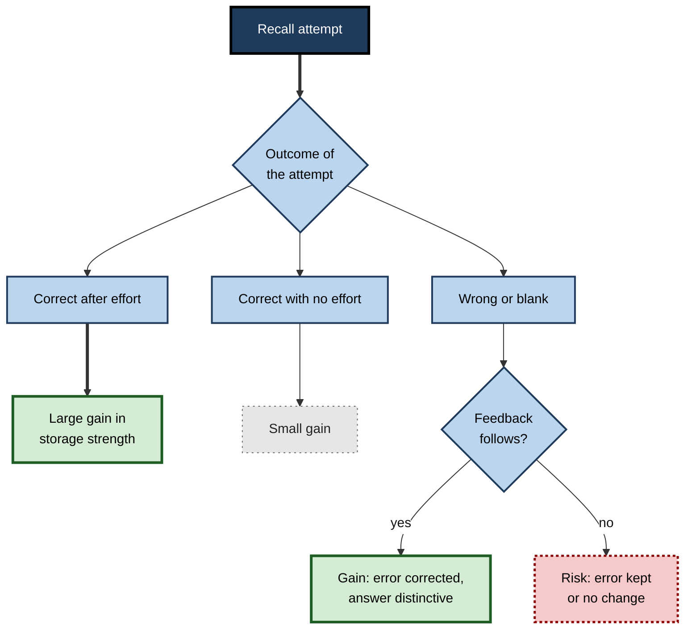
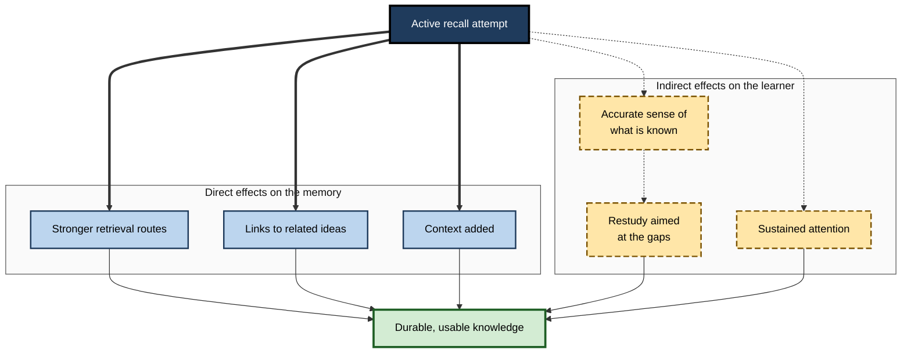
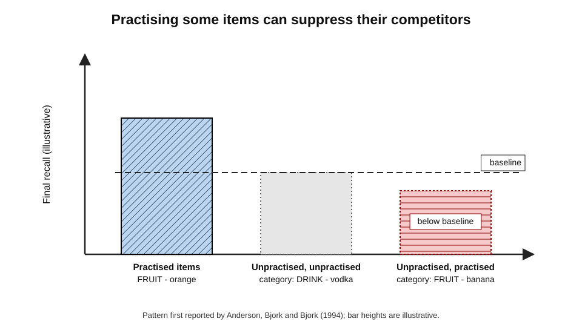

# B.2. Science Behind Active Recall

Reading a page puts information in front of the mind; recalling it forces the mind to go and find it. That search is not a neutral act of looking something up. Each time a memory is retrieved it is **reactivated, rebuilt and changed** — usually made stronger, sometimes linked to new ideas, occasionally distorted. The science of active recall is the science of what that search does to memory, and why the effort it costs is the source of its value.

> **Definition — Retrieval-based learning:** the strengthening and modification of memory that results from the act of retrieving information, as distinct from the learning that results from encountering it again.

**Why the science matters**

- **It explains the method.** Knowing *why* recall works tells a learner *how* to do it well — how hard to make it, when to check, what to recall.
- **It predicts the exceptions.** Mechanisms explain when recall helps little, or even harms.
- **It corrects intuition.** The most useful study conditions often feel the least productive; the science explains the mismatch.
- **It guides design.** Trainers, course designers and software builders who understand the mechanisms make better decisions than those copying a recipe.

---

## Memory Is Rebuilt, Not Replayed

### The recording myth

- **Common belief:** memory works like a video recorder — experiences are stored intact and played back on demand.
- **What research shows:** remembering is **reconstruction** — fragments are reassembled, gaps are filled with expectations, and the result is stored again.

**Study card — Frederic Bartlett (1932)**

- **Design:** English participants read an unfamiliar Native American folk tale, "The War of the Ghosts", and retold it repeatedly over intervals of minutes to years.
- **Results:**
  - Retellings became **shorter** and more **conventional**.
  - Unfamiliar details were dropped or changed to fit the participants' own culture — canoes became boats, puzzling supernatural elements were rationalised.
- **Conclusion:** remembering is an active construction shaped by existing knowledge, which Bartlett called **schemas**.

> **Definition — Schema:** an organised structure of knowledge about a type of thing or situation, used to interpret new information and to reconstruct memories.

> **Watch out:** reconstruction does not mean memory is unreliable in general. Well-learned knowledge is usually recalled accurately. It means **retrieval is an act that can change memory** — which is why recall can both strengthen and, without feedback, distort.

### Retrieval as a memory modifier

- **Robert Bjork (1975)** argued that retrieval is not a passive readout but an event that **modifies** the memory retrieved.
- **The modification is mostly beneficial:**
  - the retrieved memory becomes easier to retrieve again;
  - its links to the cue are strengthened;
  - it acquires new associations from the context of retrieval.
- **It is also selective:** related memories that compete but are not retrieved may become temporarily harder to access.

**Figure 1.** Retrieval reactivates a memory and stores an updated version.

---

## Two Strengths of Every Memory

Robert and Elizabeth Bjork's **new theory of disuse** (1992) gives the most widely used framework for why effortful recall is valuable.

- **Storage strength** — how deeply a memory is established and interconnected; it does not decay and only grows.
- **Retrieval strength** — how easily it can be accessed **now**; it rises with recent use and falls with disuse and interference.

> **Definition — Storage strength:** the degree to which a memory is entrenched and interconnected with other knowledge.

> **Definition — Retrieval strength:** the current ease of accessing a memory.

### The key prediction

- **Retrieving a memory raises both strengths.**
- **But the gain in storage strength is largest when retrieval strength is low** — that is, when the memory is hard, but still possible, to retrieve.
- **Consequence:** an item recalled effortlessly (because it was seen a moment ago) gains little; an item dragged back with difficulty after a delay gains a great deal.

> **Key point:** the **difficulty** of a successful retrieval is not a cost to be minimised — within limits, it is the **mechanism** of learning.

### Desirable difficulty

> **Definition — Desirable difficulty:** a condition that makes learning slower or harder in the moment but improves long-term retention or transfer, provided the learner can still succeed or recover with feedback.

- **Desirable** — effortful recall after a short delay; recall with a weak cue; recall in a different order.
- **Undesirable** — recall so far beyond current knowledge that nothing comes and no feedback follows; distraction; tiredness.

**Figure 2.** Schematic relationship between the difficulty of a recall attempt and its benefit to long-term memory.

**Study card — Mary Pyc and Katherine Rawson (2009): the retrieval effort hypothesis**

- **Design:** students learned Swahili–English word pairs by repeated cued recall until each pair had been correctly recalled a set number of times.
  - The **gap** between successive recall attempts of the same pair was either short (a few other items in between) or long (many items in between).
- **Results:** longer gaps made each correct recall **harder** — and produced **better** final recall days later, even with the same number of correct retrievals.
- **Conclusion:** correct retrievals that require more effort produce more learning — the **retrieval effort hypothesis**.

> **Watch out:** "harder is better" holds only for retrievals that **succeed**, or that fail and are followed by **feedback**. Difficulty that ends in silence and confusion is simply failure.

---

## Producing Versus Receiving: The Generation Effect

Long before recall was studied as a study method, researchers found that producing information oneself leaves a stronger trace than reading it.

**Study card — Norman Slamecka and Peter Graf (1978)**

- **Design:** participants either **read** word pairs (*rapid – fast*) or **generated** the second word from a rule and a first letter (*rapid – f___*, rule: synonym).
- **Results:** generated words were remembered better than read words, in both recall and recognition tests, across several kinds of rule.
- **Conclusion:** the act of generating an item strengthens memory for it — the **generation effect**.

> **Definition — Generation effect:** better memory for information the learner has produced than for information the learner has only read.

- **Robustness:** a meta-analysis by Sharon Bertsch and colleagues (2007) found the effect across many studies, of moderate average size, larger at longer retention intervals.
- **Generation versus retrieval:**
  - **Generation** constructs an answer from a rule or from reasoning (the answer may never have been studied).
  - **Retrieval** reconstructs an answer that was studied before.
  - Active recall usually involves **both** — retrieving fragments and generating the rest.

| | Restudy | Generation | Retrieval |
|---|---|---|---|
| Source of the answer | On the page | Produced from a rule, reasoning or prior knowledge | Produced from memory of earlier study |
| Mental work | Reading, recognising | Constructing | Searching and reconstructing |
| Typical effect on later memory | Baseline | Better than reading | Better than restudy, especially after a delay |
| Main risk | Illusion of knowing | Wrong constructions | Recalling errors without feedback |

---

## How Retrieval Strengthens Memory: Four Explanations

No single theory accounts for every finding. Four explanations, each with experimental support, are now commonly combined.

### Elaborative retrieval

- **Claim:** searching for a target activates **related knowledge** along the way; those related ideas become extra routes back to the target.
- **Prediction:** weak cues, which force a wider search, should produce more benefit than strong cues.

**Study card — Shana Carpenter (2009)**

- **Design:** participants learned cue–target word pairs that were either **strongly** associated (*toast – bread*) or **weakly** associated (*basket – bread*), then either restudied them or retrieved the target from the cue.
- **Results:** the benefit of retrieval over restudy was **greater for weakly associated pairs**, and participants who retrieved later recalled more related words, consistent with a wider search.
- **Conclusion:** retrieval strengthens memory partly by activating and linking related information — **elaborative retrieval**.

**Figure 3.** Elaborative retrieval: searching from a weak cue activates related ideas that become extra routes to the target.

### Episodic context

- **Claim (Jeffrey Karpicke, Melissa Lehman and William Aue, 2014):** each retrieval reinstates the context of earlier study and then **updates** the memory with the context of the current retrieval.
- **Result:** the memory becomes tied to **many contexts**, so later searches can find it from more starting points.
- **Prediction supported in experiments:** retrieval narrows later searches towards the target, making them faster and more accurate.

> **Definition — Episodic context:** the background of an experience — time, place, mental state and surrounding events — that becomes part of its memory.

### Mediators

- **Claim:** learners often link a cue and an answer with a **mediator** — a word, image or story in between. Retrieval makes good mediators more likely to be remembered and used.

**Study card — Pyc and Rawson (2010)**

- **Design:** participants learned Swahili–English pairs (*wingu – cloud*) and reported the keyword mediators they used (*wingu* sounds like "wing"; a wing flies through a cloud). Some pairs were tested with feedback; others were only restudied.
- **Results:** after retrieval practice, mediators were more often **remembered** at the final test and more often **led back** to the correct answer.
- **Conclusion:** retrieval improves the **effectiveness of mediators** — the **mediator effectiveness hypothesis**.

> **Definition — Mediator:** an intermediate idea, word or image that connects a cue to the information being remembered.

### Distribution and bifurcation

- **Claim (Nate Kornell, Robert Bjork and Michael Garcia, 2011):** items that are successfully retrieved receive a **large** boost; items that are not retrieved (without feedback) receive **none**. Restudy gives every item a **moderate** boost.
- **Consequence:** tested items split into two groups — strong and weak — while restudied items shift together.
- **Prediction:** testing wins at long delays (its strong items survive forgetting); restudy can win at short delays or when initial recall success is low.

**Figure 4.** The bifurcation model: restudy shifts all items moderately, while retrieval strongly boosts the items that are recalled.

| Explanation | What retrieval does | Key evidence | Practical implication |
|---|---|---|---|
| Elaborative retrieval | Activates related ideas, adding routes to the target | Larger benefit with weak cues | Use cues that force a wider search; ask *why* and *how* questions |
| Episodic context | Adds the retrieval context to the memory, narrowing later searches | Retrieval sharpens later search | Recall at different times and in different settings |
| Mediator effectiveness | Strengthens the links people build between cue and answer | Better recall and use of mediators after testing | Build meaningful links, then retrieve them |
| Bifurcation | Strongly boosts recalled items; leaves unrecalled items unchanged without feedback | Testing advantage grows with delay | Provide feedback for failures; aim for mostly successful recall |

> **Key point:** the explanations are **complementary**, not rivals. Recall works because it is an effortful search that links ideas, records context and strengthens the paths learners themselves have built.

### Transfer-appropriate processing

- **Claim (C. Donald Morris, John Bransford and Jeffery Franks, 1977):** memory performance is best when the processing at study **matches** the processing required at test.
- **Application:** if the final task requires producing information from memory, practising production is the closest match.
- **Limit:** recall practice on isolated facts may not match a final task that requires applying principles; the recall task should match the use.

> **Definition — Transfer-appropriate processing:** the principle that learning is best expressed when the mental operations at test resemble those carried out at study.

---

## Even Failed Recall Helps

### Errorful generation

**Study card — Nate Kornell, Matthew Hays and Robert Bjork (2009)**

- **Design:** participants learned weakly associated word pairs or answers to fictional trivia questions.
  - **Test-first condition:** they tried to produce the answer (almost always failing), then saw it.
  - **Study condition:** they saw the question and answer together for the full time.
- **Results:** the test-first condition produced **better** later recall, even though the initial attempts were wrong.
- **Conclusion:** an unsuccessful retrieval attempt, followed by the correct answer, can enhance learning.

- **Why it may work:**
  - the failed search activates related knowledge, preparing a place for the answer;
  - the attempt raises curiosity and attention to the feedback;
  - the error-plus-correction contrast makes the right answer distinctive.
- **Condition:** feedback must follow promptly. Without feedback, a wrong guess may be remembered instead.

> **Watch out:** the benefit of "trying before being told" is strongest when the learner has **some** relevant knowledge and the correct answer follows soon. Guessing wildly about material one has no basis for, and never checking, gains little.

**Figure 5.** What happens after a recall attempt, depending on success and feedback.

---

## Indirect Effects: Recall Improves the Rest of Studying

Retrieval strengthens what is retrieved — a **direct** effect. It also changes how the learner studies afterwards — **indirect** effects that may matter as much.

### Better self-monitoring

- **Problem:** learners judge how well they know something by how familiar it feels — a poor guide.
- **Recall supplies better evidence:** success or failure at retrieval is a far more accurate signal of later memory than familiarity.

**Study card — Thomas Nelson and John Dunlosky (1991): the delayed judgement-of-learning effect**

- **Design:** participants studied word pairs and predicted their chance of recalling each later — a **judgement of learning**. Some judged immediately after study; others judged after a delay, seeing only the cue.
- **Results:** delayed, cue-only judgements predicted later recall **far more accurately** than immediate judgements.
- **Conclusion:** when learners attempt retrieval before judging, they base the judgement on real evidence rather than on lingering familiarity.

> **Definition — Judgement of learning:** a learner's prediction of how likely they are to remember an item later.

### Better restudy

- **Targeting:** recall identifies what was not retrieved, so later study can concentrate there.
- **Test-potentiated learning:** a recall attempt makes the **next** study episode more effective, even for items not recalled — learners attend more closely and organise better.
- **Organisation:** free recall pushes learners to impose structure on material, which they then use in later study.

### Attention and anxiety

- **Mind wandering:** knowing that recall will be required keeps attention on the material.
- **Anxiety:** frequent low-stakes recall makes high-stakes tests more familiar; surveys of students in classrooms that use it report lower test anxiety, although such self-reports are weaker evidence than experiments.

| | Direct effects | Indirect effects |
|---|---|---|
| What changes | The memory that is retrieved | The learner's later study and judgement |
| Mechanism | Strengthening, elaboration, context updating | Better monitoring, targeting, attention |
| Needs feedback? | Not for successful items | Yes — to know what failed |
| Example | A recalled definition stays accessible for weeks | A failed recall sends the learner back to the chapter they thought they knew |

**Figure 6.** Direct and indirect routes by which active recall improves learning.

---

## The Brain During Retrieval

Neuroscience adds a biological picture that is consistent with the cognitive explanations, though still developing.

- **Reactivation** — neuroimaging studies show that recalling an experience partly **reinstates** the pattern of brain activity present when it was first encoded.
- **The hippocampus** — a structure in the medial temporal lobe, central to forming and retrieving memories of events and facts, is strongly engaged during effortful recall.
- **Consolidation** — the gradual stabilisation of memories, partly during sleep, in which they become less dependent on the hippocampus and more integrated with cortical knowledge.
- **Retrieval as fast consolidation** — James Antony, Catarina Ferreira, Kenneth Norman and Maria Wimber (2017) argued that each retrieval acts like a rapid, online version of consolidation: reactivating a memory and integrating it with existing knowledge.

> **Definition — Consolidation:** the process by which a newly formed memory becomes stable and integrated into long-term knowledge.

> **Definition — Reconsolidation:** the hypothesis that a retrieved memory becomes temporarily changeable and must be re-stabilised, giving an opportunity to strengthen or update it.

> **Watch out:** reconsolidation was demonstrated most clearly in animal studies of fear memory (Karim Nader, Glenn Schafe and Joseph LeDoux, 2000). How far it applies to human learning of facts and concepts is **debated**. It is a plausible biological account of "retrieval modifies memory", not an established explanation of study effects.

### Retrieval and stress

**Study card — Amy Smith, Victoria Floerke and Ayanna Thomas (2016)**

- **Design:** participants learned words and pictures by either restudy or retrieval practice. A day later, half experienced a laboratory stress procedure (public speaking and mental arithmetic before evaluators) before a recall test.
- **Results:** stress **impaired** recall in the restudy group but **not** in the retrieval-practice group.
- **Conclusion:** memories strengthened by retrieval appear more resistant to the disruptive effect of acute stress on recall.

> **In practice:** this is one reason professionals in high-pressure work — emergency medicine, aviation, crisis communication — rehearse critical knowledge by **recall under realistic conditions**, not by re-reading procedures.

---

## Costs, Side Effects and Boundary Conditions

### Retrieval-induced forgetting

**Study card — Michael Anderson, Robert Bjork and Elizabeth Bjork (1994)**

- **Design:** participants studied category–example pairs (*FRUIT – orange, FRUIT – banana, DRINK – vodka*). They then practised retrieving **half** the examples from **some** categories.
- **Three kinds of item at the final test:**
  - **practised** examples (*orange*);
  - **unpractised examples from practised categories** (*banana*);
  - **examples from unpractised categories** (*vodka*).
- **Results:** practised items were recalled best; unpractised examples from practised categories were recalled **worse** than items from unpractised categories.
- **Conclusion:** retrieving some memories can **suppress** competing related memories — **retrieval-induced forgetting**.

> **Definition — Retrieval-induced forgetting:** reduced later recall of information related to, but not included in, retrieval practice.

**Figure 7.** The retrieval-induced forgetting pattern.

- **How much it matters for study:**
  - with **coherent, connected material** such as prose passages, retrieving part of the material often **helps** recall of related parts — **retrieval-induced facilitation** (Jason Chan, Kathleen McDermott and Henry Roediger, 2006);
  - the forgetting effect is clearest for lists of competing items and often fades after a delay.
- **Practical rule:** recall the **whole** of a body of knowledge over time, not only a favourite subset.

### Learning errors

- **Recall can strengthen wrong answers** if they are produced and never corrected.
- **Multiple-choice lures can be learned** — Henry Roediger and Elizabeth Marsh (2005) found that after multiple-choice practice, some learners later gave the wrong options as answers, although the net effect of testing was still positive.
- **Remedy:** feedback, and production formats rather than selection where possible.

### Boundary conditions under debate

- **Complex material.**
  - Tamara van Gog and John Sweller (2015) argued that the benefits of retrieval shrink or vanish for highly complex material whose elements must be understood together.
  - Jeffrey Karpicke and William Aue (2015) replied that many studies show benefits with complex texts and concepts, and that apparent failures reflected weak designs.
  - The debate is **unresolved**; a widely shared middle position is that learners need enough understanding to retrieve something meaningful, often after worked examples or explanation.
- **Prior knowledge.**
  - Recall builds on what has been encoded; with no understanding, there is nothing useful to retrieve.
- **Low success rates.**
  - When initial recall mostly fails and no feedback follows, the benefit is small or absent — as the bifurcation model predicts.
- **Individual differences.**
  - Benefits appear across ages and ability levels; some studies suggest learners with lower working-memory capacity benefit at least as much as others, but findings are mixed.

| Condition | Effect on the benefit of recall | Reason |
|---|---|---|
| Delay before final test | Benefit grows with delay | Strongly retrieved items resist forgetting |
| Low initial success, no feedback | Benefit small or absent | Unrecalled items gain nothing |
| Feedback after attempts | Benefit larger and more reliable | Errors corrected; failures still useful |
| Weak or wide cues | Benefit often larger | More elaborative search |
| Coherent, connected material | Partial recall tends to help related content | Facilitation outweighs competition |
| Isolated competing items | Partial recall can suppress related items | Retrieval-induced forgetting |
| Very complex material without prior understanding | Benefit uncertain — debated | Learner may not have enough to retrieve |

---

## Applying the Science

### Design principles that follow from the mechanisms

- **Make retrieval effortful but successful.**
  - Mechanism: storage gains are greatest when retrieval strength is low but recall still succeeds.
  - Design: wait long enough for some forgetting; use cues that require search; aim for most attempts to succeed with effort.
- **Always close the loop with feedback.**
  - Mechanism: failed retrievals gain only when the answer follows; errors are otherwise strengthened.
- **Ask for meaning, not only labels.**
  - Mechanism: elaborative retrieval and mediators — retrieving *why* and *how* builds more routes.
- **Vary the cue and the context.**
  - Mechanism: episodic context and transfer-appropriate processing — memory accessible from many starting points and in the form it will be used.
- **Cover the whole body of knowledge over time.**
  - Mechanism: retrieval-induced forgetting for neglected competitors.
- **Judge learning only after a retrieval attempt.**
  - Mechanism: delayed, cue-only judgements are accurate; immediate ones are not.

> **Mnemonic — "EFFORT":** **E**ffortful but successful, **F**eedback always, **F**ocus on meaning, **O**ther cues and contexts, **R**ange over everything, **T**est before judging.

### Worked example: choosing among three recall designs

**Situation:** a hospital pharmacy team must learn the interactions of twenty high-risk drugs. A trainer proposes three daily ten-minute designs.

| | Design A | Design B | Design C |
|---|---|---|---|
| Activity | Read a laminated interaction chart | Answer "Drug X interacts with…?" immediately after reading the chart | Next morning, answer mixed cases ("Patient on X is prescribed Y — risk and action?"), then check against the chart |
| Retrieval effort | None | Very low — answers in short-term memory | Moderate to high, mostly successful |
| Cue type | — | The same fixed wording each time | Varied, case-based |
| Feedback | — | Immediate | After each answer |
| Matches real use? | No | Partly | Yes — mirrors prescription checking |

**Reasoning step by step**

1. **Design A** is re-exposure — no retrieval, so none of the direct mechanisms operate.
2. **Design B** retrieves, but retrieval strength is still high from the reading moments earlier, so storage gains are small; fixed cues build access from only one starting point.
3. **Design C** retrieves after a delay (low retrieval strength, effortful success), uses varied cues (elaboration, context), gives feedback (error repair) and matches the professional task (transfer-appropriate processing).

- **Conclusion:** Design C is predicted to produce the most durable, usable knowledge.

> **Watch out:** Design C will feel the hardest and produce the **lowest** scores during practice. A trainer judging by practice performance would wrongly choose Design B.

### Case study: incident playbooks that would not stick

- **Situation:** a cloud-services company required its on-call engineers to know six incident playbooks — steps for outages, data breaches and capacity failures.
- **Problem:** in post-incident reviews, engineers repeatedly skipped steps; most said they had "read the playbooks many times".
- **Diagnosis, in terms of mechanism:**
  - reading built familiarity but no retrieval routes;
  - knowledge checks were taken with the playbook open, so retrieval strength was never challenged;
  - under the stress of a live incident, access failed — the pattern the stress study predicts for restudied memories.
- **Actions:**
  1. Fortnightly **closed-book drills**: an engineer is given a scenario and must state the playbook steps aloud in order, with reasons.
  2. **Feedback** from a senior engineer immediately after each attempt, with missed steps explained.
  3. **Varied scenarios** for the same playbook, so steps were cued by situations rather than by the playbook's title.
  4. All six playbooks rotated, so none was neglected.
- **Result:** within two quarters, reviewers found far fewer skipped steps; engineers reported that steps "came to mind" during incidents.
- **Side effects:** drills took senior time; some engineers found speaking under observation stressful until drills became routine.
- **Lesson:** knowing *why* recall works pointed to the specific changes — delay, varied cues, feedback, full coverage, realistic conditions.

### AI tools and the mechanisms

- **Instant answers remove the search** — the step that carries most of the benefit.
- **Generous hints raise retrieval strength artificially** — success becomes easy and gains shrink.
- **Well-designed tutors** ask questions, wait for an attempt, give graded hints only after effort, and provide feedback — aligning with the mechanisms.

> **In practice:** when using an AI tool to study, require an attempt before any hint, and ask for feedback on the attempt rather than a model answer up front.

---

## Open Questions

- **Which mechanism matters most, and when?**
  - Elaboration, context and mediator accounts are all supported; how they combine across materials and learners is not settled.
- **How does retrieval work for highly complex material?**
  - The complexity debate remains open; carefully controlled studies with realistic professional material are few.
- **Is reconsolidation relevant to everyday learning?**
  - The link between animal reconsolidation research and human study effects is plausible but unproven.
- **How large are the indirect effects compared with the direct ones?**
  - Separating improved monitoring and restudy from strengthening is difficult in real courses.
- **When does retrieval-induced forgetting matter in practice?**
  - Its significance for connected, meaningful knowledge appears small, but the boundary is not mapped precisely.
- **How should adaptive software set difficulty?**
  - Tools can estimate when an item is "hard but retrievable", but how to tune this for meaning-rich material is an active research problem.

---

## Summary

- Memory is **reconstructed**, not replayed (Bartlett); retrieval **modifies** what it retrieves (Bjork).
- Every memory has **storage strength** and **retrieval strength**; retrieval raises storage strength most when retrieval is **hard but successful** — a **desirable difficulty** (retrieval effort hypothesis: Pyc and Rawson).
- **Generation effect** (Slamecka and Graf): producing information beats reading it; recall combines retrieving and generating.
- Four complementary explanations: **elaborative retrieval** (Carpenter), **episodic context** (Karpicke and colleagues), **mediator effectiveness** (Pyc and Rawson), **bifurcation** (Kornell, Bjork and Garcia); plus **transfer-appropriate processing**.
- **Failed attempts followed by feedback** still help (Kornell, Hays and Bjork); without feedback, errors may stick.
- **Indirect effects**: accurate self-monitoring (delayed judgement-of-learning effect), targeted restudy, attention, reduced anxiety.
- The brain **reinstates** encoding patterns during recall; retrieval may act as **fast consolidation**; retrieval-strengthened memories resist **stress**. Reconsolidation in human learning is debated.
- Side effects: **retrieval-induced forgetting** (mostly for competing lists), learning **errors** and **lures**. Boundary debates concern **complex material** and **prior knowledge**.
- Design: effortful but successful, feedback always, meaning-focused, varied cues and contexts, full coverage, judge after recall — **EFFORT**.

---

## Self-Check

1. What did Bartlett's "War of the Ghosts" study show about remembering, and why does it matter for active recall?
2. Explain storage strength and retrieval strength, and why an effortful successful retrieval benefits memory more than an easy one.
3. Describe Pyc and Rawson's retrieval effort study and its conclusion.
4. Distinguish the generation effect from the benefit of retrieval.
5. Explain the elaborative retrieval account and describe the evidence from Carpenter's weak-cue study.
6. What does the episodic context account propose, and what practical advice follows from it?
7. Explain the mediator effectiveness hypothesis with an example.
8. How does the bifurcation model explain why restudy can win on an immediate test while recall wins after a delay?
9. Why can an unsuccessful recall attempt still improve learning, and what condition must be met?
10. Describe the delayed judgement-of-learning effect and explain why recall improves self-monitoring.
11. Summarise the 2016 stress study and its implication for professional training.
12. Describe retrieval-induced forgetting and explain why it is less of a concern for connected prose.
13. Outline both sides of the debate about retrieval practice and complex material.
14. A manager wants staff to "do flashcards straight after reading the policy, with the answer visible after two seconds". Using at least three mechanisms, explain what is wrong and propose a better design.
15. An AI study tool gives a full worked answer whenever a learner hesitates for five seconds. Predict its effect on learning and suggest changes.

### Answer Key

1. Retellings became shorter and more conventional, with unfamiliar details changed to fit the participants' schemas. Remembering is reconstruction, so each retrieval rebuilds and re-stores the memory — the basis for both strengthening and, without feedback, distortion.
2. Storage strength is how deeply a memory is established; retrieval strength is how accessible it is now. Gains in storage strength are greatest when retrieval strength is low, so a hard but successful retrieval builds more lasting memory than an easy one made moments after study.
3. Students recalled Swahili–English pairs to a criterion, with short or long gaps between attempts. Longer gaps made correct recall harder and produced better final recall — more effortful correct retrievals produce more learning.
4. The generation effect is better memory for information produced from a rule or reasoning than for information read. Retrieval reconstructs previously studied information. Active recall usually combines both.
5. Searching from a cue activates related knowledge, which becomes extra routes to the target. Carpenter found larger retrieval benefits for weakly associated pairs, which force a wider search, and more recall of related words.
6. Each retrieval reinstates earlier study context and adds the current context, so later searches can start from more points and are narrowed towards the target. Advice: recall at different times and in different settings and formats.
7. Learners link cue and answer through an intermediate idea; retrieval makes those mediators more likely to be remembered and used. *Wingu – cloud* via "wing flies through a cloud": after testing, the "wing" link is more often recalled and leads to "cloud".
8. Restudy gives all items a moderate boost; retrieval gives recalled items a large boost and unrecalled items none. Immediately, restudy's moderate boost across all items may give more correct answers; after a delay, the strongly boosted recalled items survive while moderately boosted items are forgotten.
9. The failed search activates related knowledge, raises attention and makes the answer distinctive. The correct answer must follow promptly as feedback; otherwise the wrong guess may be retained.
10. Predictions of later recall made after a delay with only the cue are far more accurate than predictions made immediately after study. Recall gives real evidence of accessibility instead of lingering familiarity.
11. Participants who learned by retrieval practice kept their recall under acute stress; those who restudied did not. Critical professional knowledge should be rehearsed by recall, ideally under realistic conditions.
12. Retrieving some items from a category can suppress recall of unpractised related items. With coherent prose, retrieving part of the material often helps related parts (retrieval-induced facilitation), and the effect fades with delay.
13. Van Gog and Sweller argued benefits shrink for complex, highly interactive material; Karpicke and Aue replied that many studies show benefits with complex materials and failures reflect weak designs. The question is open; learners need sufficient understanding to retrieve meaningfully.
14. Immediate recall happens while retrieval strength is high, so storage gains are small; two seconds stops the search (no elaborative retrieval) and turns recall into recognition; fixed cards give one cue, limiting context and transfer. Better: wait a day; require a full answer before revealing; use varied, scenario-based prompts; give feedback; rotate all policy areas.
15. It removes the search and makes "success" effortless, sharply reducing the direct benefits, and learners will feel competent without being able to recall. Changes: require an attempt before help; give graded hints rather than full answers; provide feedback after the attempt; schedule later recall of the same items.

---

## Glossary

| Term | Meaning |
|---|---|
| Bifurcation model | Account in which retrieval strongly boosts recalled items and leaves unrecalled items unchanged, while restudy boosts all items moderately. |
| Consolidation | Stabilisation and integration of a new memory into long-term knowledge. |
| Delayed judgement-of-learning effect | Greater accuracy of recall predictions made after a delay with only the cue. |
| Desirable difficulty | A condition that slows learning now but improves long-term retention or transfer. |
| Elaborative retrieval | Account in which searching memory activates related ideas that become routes to the target. |
| Episodic context | The time, place and mental state that become part of a memory. |
| Errorful generation | Attempting an answer, usually wrongly, before being shown it. |
| Generation effect | Better memory for self-produced than for read information. |
| Judgement of learning | A learner's prediction of later recall. |
| Mediator | An intermediate idea linking a cue to the remembered information. |
| Reconsolidation | Hypothesis that retrieved memories become temporarily changeable before re-stabilising. |
| Retrieval effort hypothesis | More effortful correct retrievals produce more learning. |
| Retrieval strength | Current accessibility of a memory. |
| Retrieval-based learning | Memory change caused by the act of retrieving. |
| Retrieval-induced facilitation | Improved recall of related material after retrieving part of a coherent text. |
| Retrieval-induced forgetting | Reduced recall of related but unpractised items after retrieval practice. |
| Schema | An organised knowledge structure used to interpret and reconstruct experience. |
| Storage strength | How deeply a memory is established and interconnected. |
| Test-potentiated learning | Improved effectiveness of study that follows a recall attempt. |
| Transfer-appropriate processing | Memory is best when processing at test matches processing at study. |
