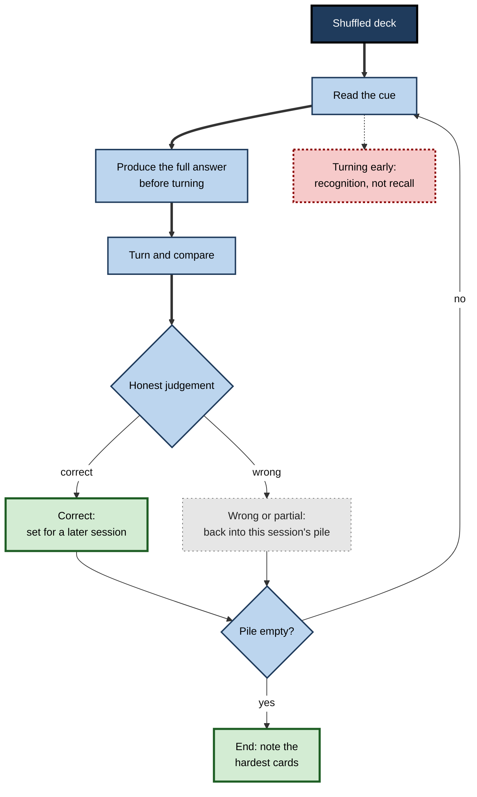
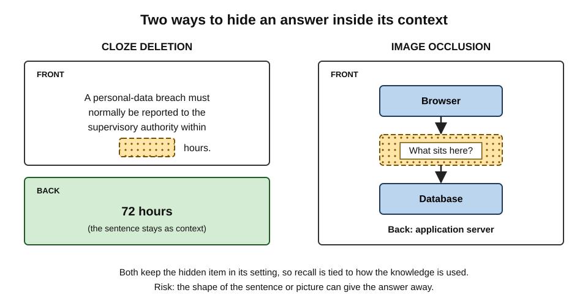
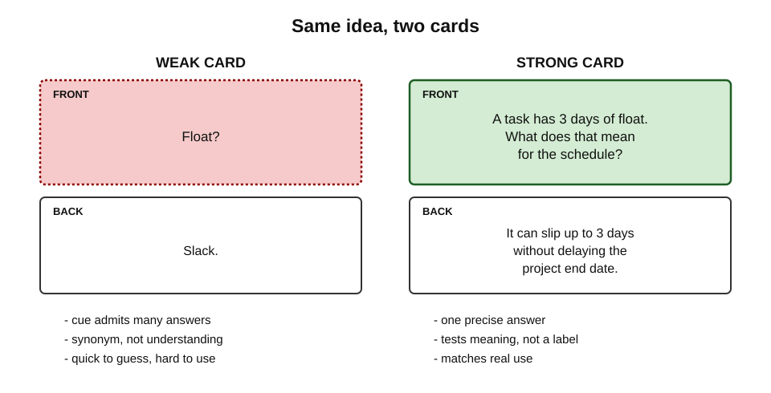
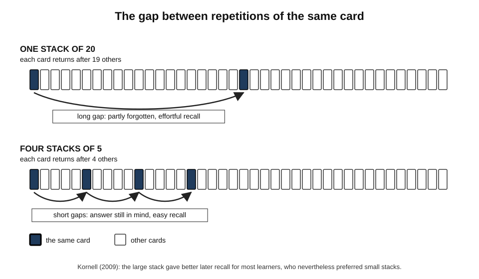
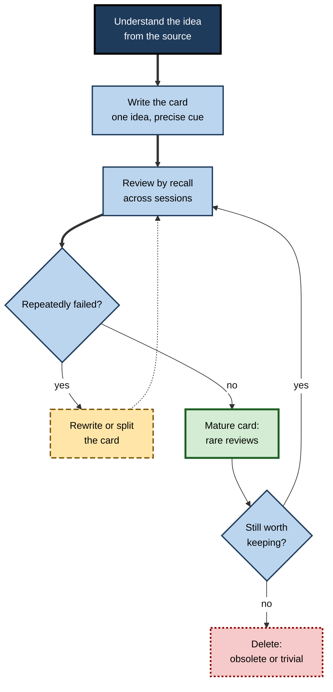

# B.3. Flashcards as Recall Tools

A medical student reviews two hundred digital cards on the bus each morning. A language learner keeps a box of handwritten cards beside the kettle. A new analyst writes the twenty SQL functions she keeps forgetting on index cards and flips through them before lunch. The flashcard is the simplest and most widely used recall tool there is — and one of the most widely misused.

> **Definition — Flashcard:** a study card that presents a **cue** on one side and the **answer** on the other, so that the learner can attempt recall before checking.

**Why flashcards matter**

- **They force the right order** — prompt first, answer hidden — which is the heart of active recall.
- **They break knowledge into checkable units**, so failures are precise and visible.
- **They are portable and cheap** — paper or phone, a few minutes at a time.
- **They scale** — a professional can maintain thousands of facts and concepts over years.
- **They are easy to use badly** — flipping too soon, writing vague cards, memorising card wording instead of ideas, or drowning in an ever-growing pile.

---

## How a Flashcard Works

### The two sides

- **Front (cue)** — a question, term, image, sentence with a gap, or scenario.
  - Its job is to trigger **one specific retrieval**.
- **Back (answer)** — the information to be produced.
  - Its job is to allow a **fast, unambiguous check**.

> **Key point:** a flashcard is not a summary on two sides of a card. It is a **question with its answer hidden**.

### Using a card correctly

1. **Read the cue.**
2. **Produce the answer** — say it aloud, write it, or state it fully in the mind.
3. **Only then turn the card.**
4. **Judge honestly** — correct, partly correct, wrong.
5. **Act on the judgement** — a wrong or partial answer goes back into the pile to be tried again later.

**Figure 1.** One pass through a flashcard session.

### Why the format works

- **Production before checking** — retrieval strengthens memory more than re-reading the same pair.
- **Item-level feedback** — each card gives an immediate, specific verdict.
- **Easy reordering** — cards can be shuffled, so retrieval does not lean on the order of a list.
- **Natural spacing within a session** — in a large pile, the gap between successive sight of the same card lets it be partly forgotten, which makes the next retrieval harder and more useful.
- **Easy scheduling across sessions** — cards can be sorted by how well they are known and reviewed at increasing intervals; the timing of those reviews is a large subject in its own right.

---

## Kinds of Card

### Basic and reversed cards

- **Basic** — one direction.
  - *e.g.* Front: "Term for revenue minus cost of goods sold?" Back: "Gross profit."
- **Reversed** — both directions as separate cards.
  - *e.g.* "Gross profit — definition?" and "Revenue minus cost of goods sold — term?"
- **Why both:** knowing A → B does not guarantee B → A. Vocabulary learners who only practise foreign → native often struggle to produce the foreign word.

### Cloze cards

> **Definition — Cloze deletion:** a card made by removing a key word or phrase from a sentence, which the learner must supply.

- *e.g.* "Under the GDPR, a personal-data breach must normally be reported to the supervisory authority within **[...]** hours." → 72.
- **Strength:** keeps the fact inside its context.
- **Weakness:** the rest of the sentence can give the answer away; learners may recognise the sentence shape rather than know the fact.

### Image cards

- **Image occlusion** — part of a diagram is hidden; the learner names or describes it.
  - *e.g.* a network diagram with one component masked; an anatomy plate with a labelled structure blanked.
- **Picture-to-name** — a photograph cue.
  - *e.g.* a rash, a circuit component, a landmark.

### Concept, application and "why" cards

- **Concept card** — "Define X in your own words and give one example and one non-example."
- **Application card** — a short scenario with a question.
  - *e.g.* "A customer pays 60 days after invoice; supplier terms are 30 days. What is happening to working capital?"
- **"Why" card** — asks for a reason, not a label.
  - *e.g.* "Why does an index speed up reads but slow down writes?"

**Figure 2.** Cloze deletion and image occlusion keep the recalled item inside its context.

| Card type | Best for | Main risk | Example cue |
|---|---|---|---|
| Basic | Single facts, terms, translations | Learning only one direction | "Capital of Kenya?" |
| Reversed | Vocabulary, symbols, abbreviations | Doubling the review load | "EBITDA stands for…?" and the reverse |
| Cloze | Facts best kept in a sentence | Sentence shape gives the answer away | "Breach notice within [...] hours" |
| Image occlusion | Diagrams, anatomy, interfaces | Remembering the picture, not the idea | Masked label on a diagram |
| Concept | Definitions with understanding | Long, vague answers that are hard to check | "Define opportunity cost; give an example" |
| Application | Using knowledge in situations | Few cases; answers depend on detail | Short client or patient scenario |

---

## Writing Good Cards

Most flashcard failures begin at the moment of writing. A poorly written card can be reviewed a hundred times and still not produce usable knowledge.

### Principles

- **Understand first, then make cards.**
  - Cards preserve knowledge; they do not create understanding. A card on something not yet understood produces memorised words.
- **One idea per card** — the **minimum information principle**, set out by Piotr Woźniak, creator of the SuperMemo software, in his 1999 rules for formulating knowledge.
  - Long answers are judged loosely ("roughly right") and parts are silently forgotten.
- **Precise cue, single answer.**
  - The cue should admit **one** correct answer; vague cues ("Tell me about inflation") cannot be checked quickly.
- **Avoid sets and long lists.**
  - "Name the seven layers of the OSI model" is one big, hard-to-judge card. Break it into ordered cards, or use a mnemonic plus cards for each layer's role.
- **Add context to the cue where needed.**
  - "Notice period?" is ambiguous; "Notice period for terminating an employee with 3–5 years' service (UK statutory minimum)?" is not.
- **Write in one's own words.**
  - Paraphrasing at the writing stage is itself processing; copied text encourages surface memorising.
- **Use examples, images and personal links.**
  - *e.g.* a card on "sunk cost" referring to the abandoned project the learner worked on last year.
- **Guard against interference.**
  - Similar cards ("Section 21" vs "Section 8") need cues that force the learner to discriminate.

> **Mnemonic — "OPEN CARD":** **O**ne idea, **P**recise cue, **E**xamples, **N**o long lists — **C**ontext in the cue, **A**ttempt before turning, **R**eview honestly, **D**elete or rewrite what fails repeatedly.

**Figure 3.** A weak card and a strong card for the same idea.

### Worked example (illustrative): rewriting weak cards

**Situation:** a project-management trainee wrote these cards from a textbook chapter.

| Weak card (front → back) | Problem | Rewritten card(s) |
|---|---|---|
| "Critical path" → three sentences copied from the book | Vague cue; long copied answer | "Define *critical path* in one sentence." / "If a critical-path task slips two days, what happens to the end date?" |
| "List the five process groups" → five names | A set: hard to check, parts forgotten | "Which process group comes after Planning?" / "In which process group is the project charter produced?" |
| "Float?" → "Slack" | Answer is a synonym, not understanding | "A task has 3 days of float. What does that mean for the schedule?" |
| "Is scope creep bad?" → "Yes" | Yes/no: guessable | "Give two common causes of scope creep and one control for each." |
| "Earned value formula" → "EV = % complete × BAC" | Formula without use | "Budget £200k, 40% complete. Earned value?" → £80k |

**Steps followed**

1. **Shrink** each card to one idea.
2. **Sharpen** the cue so it has one correct answer.
3. **Shift** at least some cards from "what is it?" to "what does it mean / what happens if?".
4. **Split** sets into individual, checkable questions.

> **Watch out:** the rewrite produced **more** cards from the same chapter. That is normal — but the learner should still ask whether every card is worth years of review. Not everything in a chapter deserves a card.

---

## Using Flashcards Well

### Produce, do not peek

- **The flip-too-soon problem:** looking at the back after a second turns recall into recognition — and the learner rates the card "known" because the answer looked familiar.
- **Remedy:** say or write the answer **in full** before turning; for longer answers, jot key words.

### Keep cards in play: the case against dropping

**Study card — Nate Kornell and Robert Bjork (2008)**

- **Design:** participants studied flashcards of word pairs and, in some conditions, were allowed to **drop** cards they believed they knew; in others, all cards stayed in the stack.
- **Results:** being allowed to drop cards produced **small but consistently negative** effects on later recall.
- **Why:** learners dropped cards after too few correct recalls, trusting their sense of knowing, and lost the extra practice those cards still needed.
- **Conclusion:** the near-universal habit of setting aside "known" cards early is risky; one correct recall is not enough.

> **Remember:** a card is not "known" after one correct answer in one session. Bring it back **across several sessions** before treating it as learned.

### Big stacks beat small ones

**Study card — Nate Kornell (2009)**

- **Design:** participants learned vocabulary with flashcards, either in **one large stack** (all words together, so repetitions of each card were spread apart) or in **several small stacks** (each studied repeatedly before moving on, so repetitions came close together).
- **Results:** the large stack produced better recall for the great majority of participants — yet most participants **believed** the small stacks had worked better.
- **Conclusion:** spreading repetitions within a session helps, and learners misjudge it because close repetitions feel easier.

**Figure 4.** The same twenty cards studied as one stack or as four small stacks.

### Shuffle and vary

- **Order effects** — studying cards in a fixed order lets each card cue the next; the learner learns the sequence, not the items.
- **Wording effects** — repeated exposure to one exact cue can produce recall that works only for that wording.
  - *e.g.* a learner who answers "Capital of Burkina Faso?" instantly may fail "Ouagadougou is the capital of which country?".
- **Remedies:** shuffle; add reversed and rephrased versions for important items; include application cards that use the idea in a new form.

### Mix in cards that demand meaning

- A deck made only of definitions builds **isolated facts**.
- Adding "why", "what if" and scenario cards builds **connected, usable knowledge**.

> **Watch out:** flashcards are sometimes dismissed as "only for memorising facts". That is true of badly written decks. Well-designed cards can target reasons, relationships and decisions — though for long chains of reasoning, blank-page recall or explanation usually works better.

---

## What Research and Experience Show About Real Use

**Study card — Kathryn Wissman, Katherine Rawson and Mary Pyc (2012)**

- **Design:** surveys of university students about **how and when** they used flashcards.
- **Results:**
  - Flashcards were widely used, mostly for **vocabulary and definitions**.
  - Many students **dropped** cards after a single correct recall.
  - Many used them mainly in the **days just before an exam**.
- **Conclusion:** students choose a good tool but often use it in ways that limit its value — too little repetition, too late, too narrowly.

### Self-made or ready-made cards?

- **For self-made cards:**
  - Writing cards forces selection, paraphrase and organisation — processing that aids memory.
  - Cards match the learner's own gaps and words.
  - A study of digital flashcards by Steven Pan and colleagues (2023) found that students who created their own cards learned more than those given premade cards.
- **For ready-made cards:**
  - They save time, which can go into reviewing.
  - Expert-written cards are usually more accurate and better targeted than a novice's.
  - Shared decks in some fields are refined by thousands of users over years.
- **Practical resolution:** use good ready-made cards for broad, stable content; **edit** them into one's own words where they matter; write one's own cards for personal gaps and difficult ideas.

> **Watch out:** the advantage of self-made cards is not guaranteed. A learner who writes inaccurate or vague cards gains less than one who uses a well-made deck. The evidence on this comparison is still limited.

### Paper or app?

| | Paper cards | Digital apps |
|---|---|---|
| Making cards | Slower; handwriting encourages paraphrase | Faster; images, audio and cloze easy to add |
| Scheduling | Manual sorting into boxes | Automatic scheduling of reviews |
| Honest recall | Must be enforced by the learner | Can require typing before revealing, but often lets learners flip freely |
| Portability | Bulky for large decks | Thousands of cards on a phone |
| Main risk | Forgetting to review old cards | Card bloat; tapping "good" without real recall |

- **Evidence:** no strong evidence favours the medium itself. What matters is **answer-before-reveal**, honest grading and reviews spread over time.

---

## Flashcards at Scale

### The workload arithmetic

Every card added today creates future reviews. Large decks fail not because cards stop working but because review time grows beyond what the learner can sustain.

> **Formula — Daily review workload (rough estimate):** daily review time ≈ new cards per day × reviews per card in its first month ÷ 30 days × seconds per review, summed over recently added cards. Example: 20 new cards a day × about 6 reviews in the first month ÷ 30 × 10 seconds ≈ **40 seconds per day for each day's batch**; after a month of adding cards, around **20 minutes a day**, before counting older cards that still return occasionally.

- **Card debt** — the backlog of overdue reviews that builds when a learner adds cards faster than they can review.
  - *e.g.* a student adds 80 cards a day during a busy month, then faces several hundred reviews a day and abandons the deck.
- **Remedies:**
  - add cards at a sustainable rate;
  - prune cards that are trivial, obsolete or repeatedly failed because they are badly written;
  - prefer fewer, better cards.

> **Definition — Card debt:** the accumulated backlog of reviews that results from adding cards faster than they can be reviewed.

**Figure 5.** The life cycle of a well-managed card.

### Professional uses

- **Medicine** — very large shared digital decks are widely used by medical students preparing for licensing exams.
  - Surveys have found that heavier users tend to score higher, but such studies are **correlational**: motivated students may both use the decks more and study more in general.
- **Languages** — vocabulary, grammar patterns, phrases in context.
- **Law** — elements of offences, limitation periods, leading cases and their principles.
- **Finance and accounting** — standards, ratios, tax thresholds (with care: thresholds change).
- **Software and data** — command syntax, shortcuts, error messages and their usual causes, design principles.
- **Sales and customer roles** — product facts, competitor differences, objection responses.

> **In practice:** experienced professionals keep decks **small and current**. They card what they need instantly and what changes rarely, and they delete cards when the underlying facts change.

### Flashcards and AI

- **What AI can do well:** draft cards quickly from notes or a text; suggest cloze deletions; propose application questions; generate reversed and rephrased versions.
- **What can go wrong:**
  - **errors** — generated cards may contain wrong facts or misleading simplifications;
  - **lost processing** — the learner skips the selection and paraphrase that writing cards demands;
  - **over-production** — hundreds of cards in seconds lead straight to card debt.
- **Sensible workflow:** let AI **draft**, then the learner **selects, edits and rewrites** a smaller set in their own words, checking accuracy against the source.

> **Watch out:** claims that AI-generated cards produce large learning gains come mostly from small or commercial studies. Evidence comparing AI-drafted, learner-edited and fully self-made cards is still thin.

### Case study (illustrative): a trainee solicitor's deck collapse

- **Situation:** a trainee preparing for a professional qualifying exam downloaded a shared deck of several thousand cards and added her own from every lecture.
- **Problem:** after two months she faced over 600 reviews a day, began tapping "good" without real recall to clear the queue, and failed a mock exam on problem questions.
- **Diagnosis:**
  - **card debt** — new cards added far faster than they could be reviewed;
  - **fake recall** — flipping quickly to keep up turned recall into recognition;
  - **wrong card type** — almost all cards asked for rules in isolation, while the exam asked her to **apply** rules to facts.
- **Actions:**
  1. Suspended all new cards for three weeks.
  2. Deleted cards on topics outside the syllabus and merged duplicates.
  3. Rewrote high-yield areas as **application cards**: short facts, "issue and rule?" on the front.
  4. Adopted a rule: **say the answer aloud before revealing**, even on the bus — in a whisper.
  5. Added weekly blank-page practice on whole problem questions alongside the cards.
- **Result:** daily reviews fell to a manageable level; mock-exam performance on problem questions rose steadily.
- **Lesson:** a deck is only as good as the **recall it forces**, the **match between cards and real use**, and the **workload** the learner can sustain.

---

## Open Questions

- **When do self-made cards beat expert-made ones?**
  - The trade-off between processing during card creation and the higher quality of expert cards is not fully mapped.
- **How should AI-drafted cards be used?**
  - Whether editing AI drafts preserves the benefits of making one's own cards has little direct evidence.
- **How well do flashcards support complex reasoning?**
  - Application and "why" cards help, but how far card-based practice transfers to long problem-solving is unclear.
- **Does associative direction matter for professional knowledge?**
  - Two-directional practice clearly matters for vocabulary; its importance for concepts and procedures is less studied.
- **How can apps enforce honest recall without becoming tedious?**
  - Typing answers keeps recall honest but slows review; the best balance is an open design question.

---

## Summary

- A **flashcard** = cue on one side, answer hidden on the other; its value lies in **producing the answer before turning**.
- Card types: **basic, reversed, cloze, image occlusion, concept, application, "why"** — each with strengths and risks.
- Good cards: understand first; **one idea per card** (Woźniak's minimum information principle); precise cue with one answer; no long sets; context in the cue; own words; examples; guard against interference — **OPEN CARD**.
- Use: produce the full answer, judge honestly, **do not drop cards early** (Kornell and Bjork), prefer **large shuffled stacks** (Kornell), vary wording, include meaning-demanding cards.
- Real use is often narrow and late (Wissman, Rawson and Pyc); **self-made** cards can beat premade ones, but quality matters; the **medium** matters less than honest recall and spread-out reviews.
- At scale, beware **card debt**: estimate workload, add cards sustainably, prune ruthlessly.
- AI can **draft** cards; the learner should **select, edit and check** them.

---

## Self-Check

1. What makes a flashcard an active recall tool rather than a summary?
2. List the five steps of using a card correctly and explain the danger of turning the card too soon.
3. Distinguish basic, reversed and cloze cards, and give one risk of each.
4. State the minimum information principle and explain why long answers weaken flashcard practice.
5. Rewrite the card "Marketing mix?" → "Product, price, place, promotion" into better cards.
6. Describe Kornell and Bjork's study on dropping cards and its practical lesson.
7. Why does one large stack usually beat several small stacks, and why do learners believe the opposite?
8. How can a learner avoid learning the card's wording rather than the idea?
9. What did Wissman, Rawson and Pyc find about how students use flashcards?
10. Give arguments for self-made and for ready-made cards, and a sensible compromise.
11. A learner adds 50 cards a day. Explain what will happen to the workload and what to do about it.
12. Why is the correlation between flashcard-app use and medical exam scores weak evidence that the app causes higher scores?
13. Design an AI-assisted workflow for creating cards from a 30-page regulatory document.
14. A sales team uses a shared deck of product facts but still struggles in customer conversations. Diagnose and propose changes.

### Answer Key

1. The answer is hidden and must be produced from the cue before checking; a summary presents information to be read.
2. Read the cue; produce the full answer; turn; judge honestly; act on the judgement. Turning early replaces recall with recognition, and the familiar-looking answer makes the learner rate the card as known.
3. Basic: one direction — risk of learning only that direction. Reversed: both directions — risk of doubling the workload. Cloze: a gap in a sentence — risk that the sentence shape gives the answer away.
4. Each card should test one small idea. Long answers are judged loosely, parts are forgotten unnoticed and reviews become slow and vague.
5. E.g. "In the marketing mix, which P covers distribution channels?"; "Which P is changed by a discount campaign?"; "Give one example of a *promotion* decision for a new app." Plus a mnemonic card if the list itself must be known.
6. Allowing learners to drop "known" cards slightly but consistently reduced later recall, because they dropped cards after too few correct recalls. Keep cards in play across several sessions.
7. In a large stack, repetitions of each card are spread out, so each retrieval follows some forgetting and is more effortful and more beneficial. Close repetitions in small stacks feel easier, which learners mistake for better learning.
8. Shuffle; add reversed and rephrased versions; include application cards that use the idea in a new form; answer in own words.
9. Students used flashcards mainly for vocabulary and definitions, often dropped cards after one correct recall, and used them mostly just before exams.
10. Self-made: processing during creation, matched to personal gaps. Ready-made: time saved, expert accuracy, refined coverage. Compromise: use good decks for broad stable content, edit key cards into own words, write own cards for gaps and hard ideas.
11. Each day's cards create reviews over following weeks, so daily reviews accumulate to an unsustainable level (card debt). Reduce the rate of new cards, prune trivial and obsolete cards, write fewer and better ones.
12. Students who choose to use the app heavily may differ — more motivated, more organised, studying more overall — so the association may reflect those differences rather than an effect of the app.
13. Read and understand each section first; ask the AI to draft candidate cards per section; select the important ones; rewrite them in own words with precise cues; check each against the document; add a few application cards; add cards gradually; review with answer-before-reveal.
14. The deck likely has isolated fact cards practised by recognition, while conversations require producing and applying facts to customer needs. Add scenario cards ("Customer says X — response?"), practise aloud before revealing, add role-play recall sessions, prune trivial facts.

---

## Glossary

| Term | Meaning |
|---|---|
| Application card | A card presenting a short scenario that requires using knowledge. |
| Card debt | Backlog of reviews caused by adding cards faster than they can be reviewed. |
| Cloze deletion | A card made by removing a key word from a sentence. |
| Concept card | A card asking for a definition in own words plus examples. |
| Cue | The prompt on the front of a card. |
| Dropping | Removing a card from study because it is believed to be known. |
| Flashcard | A card with a cue on one side and the answer on the other. |
| Image occlusion | A card in which part of an image is hidden for the learner to identify. |
| Interference | Confusion between similar items that impairs recall. |
| Minimum information principle | The rule that each card should test one small idea. |
| Reversed card | A second card testing the same pair in the opposite direction. |
| Stack | The set of cards studied together in a session. |
