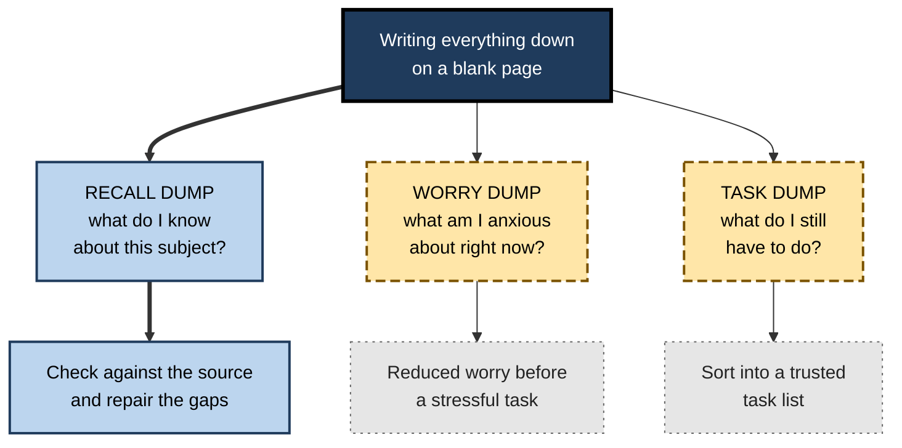
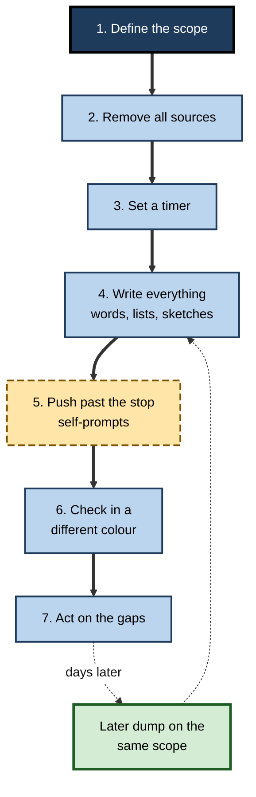
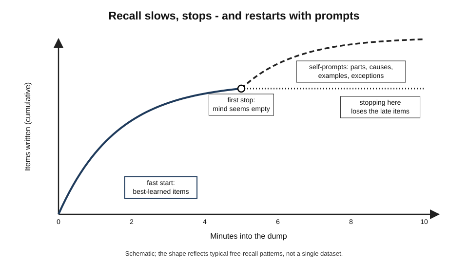
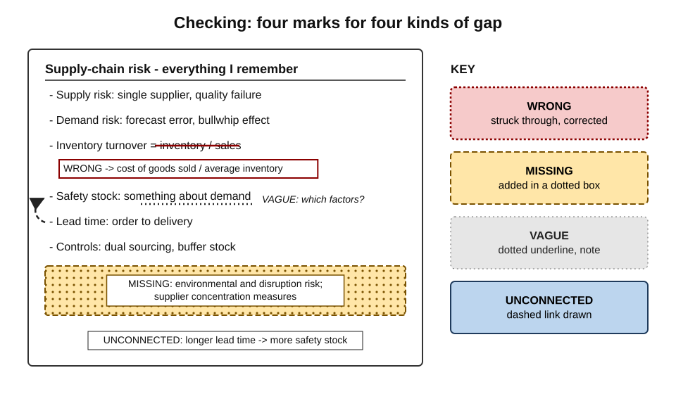
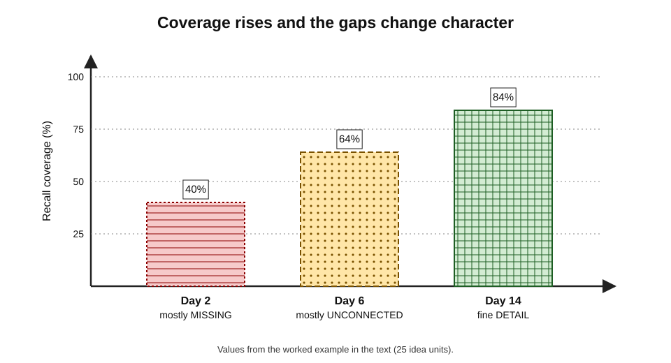

# B.4. Brain Dump Technique

A blank sheet of paper, a timer and a heading — "Everything I know about cash-flow forecasting" — are all a brain dump needs. For ten minutes the learner writes whatever comes to mind: terms, formulas, arrows, half-remembered examples, questions. Then the notes come out and the gaps become visible in a way no amount of re-reading could reveal. It is the simplest form of free recall, and one of the most revealing.

> **Definition — Brain dump (recall dump):** a timed free-recall exercise in which the learner writes, draws or says everything they can remember about a defined subject, without any source, and then checks the result against the source.

**Why it matters**

- **Minimal cues, maximal effort** — with only a heading to go on, the learner must find, organise and produce knowledge unaided.
- **It exposes structure, not just facts** — what is missing, what is wrong and what is unconnected all show up on one page.
- **It needs almost no preparation** — no cards or questions have to be written first.
- **It scales from five minutes to a whole course** — one lecture, one chapter or an entire syllabus.
- **It works in teams and classrooms** — everyone retrieves at once, rather than one person answering while others listen.

---

## Three Things Called a "Brain Dump"

The phrase is used for three quite different practices. Mixing them up leads to the wrong technique for the wrong goal.

- **Recall dump** — writing everything one knows about a subject, to **learn and diagnose**.
  - The subject of these notes.
- **Worry dump (expressive writing)** — writing about one's anxieties before a stressful task, to **reduce their interference**.
  - Gerardo Ramirez and Sian Beilock (2011) found that students who spent ten minutes writing about their worries immediately before a high-stakes test performed better than those who did not, particularly students prone to test anxiety.
- **Task dump (mind sweep)** — listing every open commitment and idea, to **clear the mind and organise work**.
  - Popularised by David Allen's *Getting Things Done* (2001) as a "mind sweep" into a trusted system.

| | Recall dump | Worry dump | Task dump |
|---|---|---|---|
| Goal | Strengthen and diagnose knowledge | Reduce anxiety before a task | Capture commitments to free attention |
| Content | Facts, concepts, links about a subject | Thoughts and feelings about the task | To-dos, ideas, open loops |
| Checked against a source? | Yes — essential | No | No — processed into lists |
| When | During study, after a delay | Minutes before a stressful event | Regularly, e.g. weekly |

**Figure 1.** Three different practices that share the name "brain dump".

> **Watch out:** a worry dump is not a study method and a recall dump is not anxiety treatment. The worry-writing finding comes mainly from a small number of studies; later research has given mixed results, so its size and reliability are **uncertain**.

---

## The Basic Procedure

### Seven steps

1. **Define the scope.**
   - One lecture, chapter, process or system — narrow enough to finish, broad enough to need organising.
   - *e.g.* "Supply-chain risk: types, causes, controls."
2. **Remove every source.**
   - Notes away, browser tabs closed, phone face down.
3. **Set a timer.**
   - Five to fifteen minutes for a lecture or chapter; longer for a whole module.
4. **Write everything.**
   - Words, lists, formulas, diagrams, arrows, examples, half-remembered fragments, even questions ("something about lead times?").
5. **Push past the first stop.**
   - When the flow dries up, wait, then prompt oneself: *what are the parts? causes? consequences? examples? exceptions? how does it connect to…?*
6. **Check against the source in a different colour.**
   - Mark what was **missing**, **wrong**, **vague** and **unconnected**.
7. **Act on the gaps.**
   - Restudy the missing parts; turn them into questions; schedule another dump later.

> **Mnemonic — "SCOPE, then DIG":** **S**cope it, **C**lear sources, **O**n the clock, **P**ut it all down, **E**xtend past the stop — then **D**ifferent-colour check, **I**dentify gaps, **G**o again later.

**Figure 2.** The brain dump procedure.

### The self-prompts

When recall stops, generic prompts restart the search without giving answers away.

- **Parts** — what are its components, stages or types?
- **Purpose** — what is it for; what problem does it solve?
- **Causes and effects** — what drives it; what follows from it?
- **Examples** — where have I seen it; which case illustrates it?
- **Exceptions and limits** — when does it not apply?
- **Comparisons** — what is it like or unlike?
- **Numbers** — any formulas, thresholds, dates?
- **Connections** — how does it link to what I learned last week?

> **Key point:** self-prompts are **cues the learner supplies**, not cues from the source. They widen the search without revealing the content.

---

## What Happens During a Dump

### The shape of recall over time

- **Fast start** — the most accessible, best-learned items come first.
- **Slowing** — each further item takes longer.
- **Apparent exhaustion** — the mind seems empty.
- **Recovery** — after a pause or a new prompt, more items often appear.

**Figure 3.** Schematic of items recalled over the minutes of a brain dump, with and without self-prompts after the first stop.

### Why pushing on pays off

- **Reminiscence and hypermnesia** — repeated recall attempts on the same material often recover items missed earlier.
  - Matthew Erdelyi and Jeffrey Becker (1974) found that repeated recall tests of pictures, without further study, produced **increasing** total recall across attempts.
- **Different prompts reach different memories** — a "causes" prompt finds different items from an "examples" prompt.
- **Late items are often the weakly stored ones** — retrieving them is effortful and therefore particularly valuable.

> **Definition — Hypermnesia:** an increase in the total amount recalled across repeated recall attempts without further study.

> **Watch out:** pushing on does not mean staring at a blank page for half an hour. When several prompts in a row produce nothing, the useful search is over; check the source.

### Why free recall is demanding — and useful

- **Minimal cues** — the learner must generate the retrieval routes, not follow those on a card.
- **Organisation** — writing everything forces the learner to impose an order, revealing whether they hold the material as a structure or as scattered fragments.
- **Breadth** — a single page covers a whole subject, showing the shape of what is known.
- **Honest diagnosis** — there is no answer key to glance at mid-attempt.

| | Brain dump (free recall) | Flashcards (cued recall) |
|---|---|---|
| Cue | A broad heading | A specific prompt per item |
| What is practised | Finding, organising and producing a body of knowledge | Producing specific items on demand |
| Preparation needed | None | Writing cards |
| Reveals | Missing structure and connections, as well as items | Missing items |
| Checking | Slower — compare a page with a source | Fast — one answer per card |
| Best for | Lectures, chapters, systems, arguments | Facts, terms, formulas, discriminations |

---

## Checking the Dump

### Four kinds of gap

- **Missing** — in the source, not on the page.
  - *e.g.* forgot one of three types of supply-chain risk entirely.
- **Wrong** — on the page, but incorrect.
  - *e.g.* reversed the formula for inventory turnover.
- **Vague** — present, but too imprecise to use.
  - *e.g.* "something about safety stock and demand".
- **Unconnected** — correct items, but no link between them.
  - *e.g.* listed lead time and safety stock without seeing that longer lead times require more safety stock.

> **Definition — Idea unit:** a single, separately scorable piece of meaning — a fact, relationship or step — used to measure how much of a text or subject has been recalled.

**Figure 4.** A checked brain dump page, with each kind of gap marked differently.

### Scoring and tracking

> **Formula — Recall coverage:** idea units correctly recalled ÷ idea units in the source. Example: a chapter has 30 key idea units; the dump contains 21, of which 3 are wrong → (21 − 3) ÷ 30 = **60%**.

- **Track the same scope over time** — coverage on repeated dumps days apart shows whether learning is consolidating.
- **Track the kinds of gap** — many "unconnected" marks suggest the need for explanation and diagramming, not more fact drilling.
- **Do not over-engineer** — a rough count is enough; the value lies in the attempt and the targeted repair, not in precise scores.

| Gap type | What it signals | Best repair |
|---|---|---|
| Missing | Not encoded, or no retrieval route | Restudy the part; add a question or card for it |
| Wrong | Misunderstanding or confusion with something similar | Correct explicitly; contrast with the look-alike |
| Vague | Shallow encoding | Restudy for precision; define it in own words |
| Unconnected | Knowledge held as fragments | Draw the relationships; explain *why* items link |

---

## Variations

### Format variations

- **List dump** — bullet points; fastest to write and score.
- **Mind-map or concept-map dump** — a central idea with branches and labelled links; shows structure directly.
- **Diagram dump** — draw the system, process or anatomy from memory.
  - *e.g.* an engineer sketches the data flow of a service; a nurse draws the cardiac conduction pathway.
- **Spoken dump** — talk for five minutes into a recorder, then listen against the source; useful on the move.
- **Two-column dump** — left column: what is remembered; right column, filled during checking: what was missing.

**Study card — Janell Blunt and Jeffrey Karpicke (2014)**

- **Design:** students read science texts and then practised either by writing paragraphs from memory or by building **concept maps from memory** (retrieval-based concept mapping), each without the text.
- **Results:** the two closed-book formats produced similar benefits on a later test; drawing a map from memory was as effective as writing prose from memory.
- **Conclusion:** what matters is **retrieval**, not the format of the output; a map drawn from memory is as useful as prose written from memory.

> **Key point:** a concept map made **with the text open** is an elaboration exercise; the same map drawn **from memory** is a brain dump.

### Scope variations

- **Micro-dump** — two minutes after each section of a lecture or chapter.
- **Session dump** — ten minutes at the start of a study session on the previous session's material.
- **Cumulative dump** — a whole module or course, by headings, before an exam.
- **Comparative dump** — two related subjects side by side.
  - *e.g.* "debt financing vs equity financing" — forcing discrimination.

### Social variations

- **Pair dump** — two learners dump independently, then compare pages before checking the source; each sees what the other remembered and missed.
- **Classroom dump** — a teacher pauses and asks everyone to write what they remember; no marks, just comparison with the material.
- **Team dump** — after a project or incident, each person writes what they recall before discussion, so memories are not shaped by the first speaker.

> **In practice:** in team settings, **individual writing before group discussion** matters. When people recall together from the start, the group tends to recall less in total than the same people working separately and then pooling — an effect known as **collaborative inhibition**.

> **Definition — Collaborative inhibition:** the finding that groups recalling together typically produce less than the pooled, non-overlapping output of the same individuals recalling alone.

---

## Getting the Timing Right

- **Not immediately after reading** — the material is still in working memory; the dump feels easy and gives a misleadingly high score.
- **After a short delay** — later the same day, or the next morning; recall becomes effortful and more informative.
- **Again days later** — repeated dumps on the same scope, separated by days, both strengthen memory and track it.
- **Before new material** — a quick dump on yesterday's content at the start of a session links old and new.

> **Remember:** **read → wait → dump → check → repair → dump again later.**

---

## Common Errors

- **Peeking to get started** — glancing at the notes "just for the headings" turns free recall into cued recall and hides structural gaps.
- **No time limit** — the dump drifts into reconstruction from inference and guesswork.
- **Never checking** — errors are rehearsed and remain uncorrected.
- **Writing only what is easy** — the learner stops at the first pause, missing the most valuable effortful items.
- **Copying neatly afterwards** — rewriting the checked dump into tidy notes becomes re-exposure; better to turn gaps into questions.
- **Dumping too broad a scope** — "everything in economics" produces a few generalities and no diagnosis.

> **Watch out:** a brain dump that feels **easy and complete** is often a sign it was done too soon after study, or the scope was too narrow — not that the material is mastered.

---

## Worked Example: Three Dumps on Pricing Strategy

**Situation:** a product manager is learning pricing strategy from a course module of 25 key idea units, before leading a pricing review in three weeks.

| | Dump 1 (day 2) | Dump 2 (day 6) | Dump 3 (day 14) |
|---|---|---|---|
| Time spent | 10 min | 10 min | 8 min |
| Idea units correct | 10 | 16 | 21 |
| Coverage | 40% | 64% | 84% |
| Main gaps | Missing value-based pricing; confused price skimming with penetration | Vague on price elasticity; unconnected: discounting and brand positioning | Two exceptions in bundling |
| Repair | Restudied two sections; wrote contrast cards for skimming vs penetration | Worked two elasticity examples; drew a link map | Short review only |

**Steps in each cycle**

1. **Dump** without notes for a fixed time.
2. **Check** in a different colour, classifying gaps.
3. **Repair** — restudy and rework only the gaps.
4. **Wait** several days, then dump the same scope again.

- **Conclusion:** coverage more than doubled with about 30 minutes of dumping and targeted repair, and the gaps shifted from **missing** to **unconnected** to **fine detail** — the normal progression as knowledge matures.

**Figure 5.** Recall coverage across the three dumps in the worked example.

> **Watch out:** improving coverage on the **same** dump partly reflects practice with that exact scope and order. Before the pricing review, the manager should also test application — "What pricing approach suits this new product, and why?" — not only recall.

---

## Brain Dumps in Professional Practice

### Uses beyond the classroom

- **After training** — a ten-minute dump the next day turns a passive workshop into active learning.
- **After meetings** — writing what was decided and why, before reading the minutes, both strengthens memory and checks the minutes.
- **Before client work** — consultants dump their knowledge of a client's industry before a meeting to find gaps to fill.
- **Incident reviews** — each responder writes their own timeline from memory before the joint review, preserving independent accounts.
- **Certification preparation** — domain-by-domain dumps map strengths and weaknesses across a syllabus.
- **Handover** — a departing employee dumps what they know about a system, then the team checks it against documentation, finding both undocumented knowledge and errors.

> **In practice:** the handover use is **knowledge elicitation** — getting knowledge out of an expert's head for others — rather than learning. The same method serves both: free recall surfaces what would never be found by reading documents.

### Exam-start dumps

- **The practice:** at the start of an exam, writing down formulas or frameworks one fears forgetting.
- **Possible benefit:** reduces the load on working memory and anxiety about forgetting.
- **Cautions:**
  - some exams forbid writing before a set time;
  - it consumes exam time;
  - evidence for its benefit is **limited**, largely anecdotal.

### AI and brain dumps

- **Useful:** after the dump, an AI tool can compare the dump with the source text and list missing or incorrect points — speeding up checking.
- **Risky:** asking an AI to "fill in" the dump before the learner has pushed past the first stop removes the most valuable retrieval.
- **Accuracy:** the comparison should be checked; AI tools may miss subtle errors or invent "missing" points not in the source.

### Case study: a cloud certification candidate

- **Situation:** an infrastructure engineer was preparing for a professional cloud-architecture certification covering six domains.
- **Problem:** after weeks of video courses and practice multiple-choice questions, his practice scores plateaued at a level just below the pass mark, with no clear pattern of weakness.
- **Diagnosis:**
  - multiple-choice practice allowed recognition and elimination, hiding what he could not produce;
  - he had never tried to state, unaided, how the services in each domain fitted together.
- **Actions:**
  1. Twelve-minute **diagram dumps** per domain: sketch a reference architecture from memory and annotate it.
  2. Checked against official documentation; classified gaps.
  3. Found that two domains — networking and identity — were almost entirely **unconnected** fragments; he knew service names but not how traffic and permissions flowed.
  4. Spent the next fortnight on those two domains with explanation and worked designs, then repeated the dumps.
- **Result:** the second round of dumps showed connected diagrams in all six domains; practice scores rose above the pass mark and he passed at the first attempt.
- **Lesson:** free recall diagnosed a **structural** weakness that thousands of recognition questions had concealed.

---

## Open Questions

- **How large is the benefit of free recall compared with cued recall for professional material?**
  - Both help; which yields more per minute likely depends on the material and the final use, and direct comparisons in workplaces are rare.
- **How long should a dump last?**
  - Practice varies from two to twenty minutes; there is little evidence on the best length for different scopes.
- **Does the output format matter for complex knowledge?**
  - Prose and concept maps from memory performed similarly in laboratory texts; for highly visual or procedural fields, diagrams or performance may matter more.
- **How reliable is worry writing?**
  - Early striking results have been followed by mixed replications.
- **Can AI checking preserve the benefits?**
  - Faster feedback is helpful, but whether learners still engage with their gaps when a tool lists them is unknown.

---

## Summary

- A **brain dump** (recall dump) = timed free recall on a blank page about a defined scope, then checking against the source.
- Do not confuse it with the **worry dump** (expressive writing before a stressful task) or the **task dump** (mind sweep of commitments).
- Procedure: **scope, clear sources, timer, write everything, push past the stop, check in a different colour, act on gaps** — then dump again days later.
- Recall slows and stops, but **self-prompts** and repeated attempts recover more (**hypermnesia**); late items are particularly valuable.
- Check for four gaps — **missing, wrong, vague, unconnected** — and repair each differently; track **recall coverage** roughly.
- Variations: list, concept map, diagram, spoken, two-column; micro, session, cumulative, comparative; pair, classroom, team. A map **from memory** is retrieval (Blunt and Karpicke); write individually before group discussion to avoid **collaborative inhibition**.
- Timing: **not straight after reading**; after a delay; repeated over days.
- Professional uses: after training and meetings, before client work, in incident reviews, certification preparation and handover.

---

## Self-Check

1. Define a recall dump and explain how it differs from a worry dump and a task dump.
2. List the seven steps of the basic procedure.
3. Why should a learner push past the first stop, and how should they do it without opening the source?
4. What is hypermnesia, and what did Erdelyi and Becker find?
5. Name the four kinds of gap found when checking a dump, and give the best repair for each.
6. A chapter has 40 idea units; a dump contains 26, of which 4 are wrong. Calculate recall coverage.
7. Compare brain dumps and flashcards on cue, preparation, what they reveal and best use.
8. What did Blunt and Karpicke (2014) show about concept maps?
9. Why is a dump done immediately after reading misleading?
10. Why should team members write individually before discussing an incident?
11. A student's dumps are long and complete, but she struggles with exam problem questions. What might be wrong, and what should she add?
12. Design a brain-dump routine for a new manager attending a two-day leadership course.
13. How could an AI tool help with brain dumps without undermining them?

### Answer Key

1. A recall dump is timed free recall of everything known about a subject, checked against the source, to strengthen and diagnose knowledge. A worry dump is writing about anxieties before a stressful task to reduce their interference. A task dump captures commitments and ideas into a task system. Only the recall dump is checked against a source.
2. Define the scope; remove sources; set a timer; write everything; push past the first stop; check in a different colour; act on the gaps (and repeat later).
3. Late, effortful items are weakly stored and gain most from retrieval, and new prompts reach different memories. Use generic self-prompts — parts, purpose, causes, examples, exceptions, comparisons, numbers, connections.
4. Hypermnesia is an increase in total recall across repeated attempts without further study. Erdelyi and Becker found that repeated recall of pictures produced increasing total recall across attempts.
5. Missing — restudy and add a question. Wrong — correct explicitly and contrast with the look-alike. Vague — restudy for precision and define in own words. Unconnected — draw relationships and explain why items link.
6. (26 − 4) ÷ 40 = 22 ÷ 40 = **55%**.
7. Dumps use a broad heading, need no preparation, reveal missing structure and connections and suit chapters, systems and arguments. Flashcards use specific prompts, need cards written first, reveal missing items quickly and suit facts, terms and discriminations.
8. Concept maps drawn from memory were as effective as paragraphs written from memory — the benefit comes from retrieval, not from the output format.
9. The material is still in working memory, so recall is easy, gives little benefit and overstates what will be retained.
10. Group recall from the start reduces total output (collaborative inhibition) and lets the first speaker shape others' memories; individual accounts are more complete and independent.
11. Her dumps may test recall of content but not application; repeated dumps on the same scope also inflate coverage. She should add problem-based recall — applying principles to unseen scenarios from memory, then checking model answers.
12. E.g. evening of each day: ten-minute dump on the day's frameworks; next morning: check against the materials and mark gaps; one week later: cumulative dump of both days plus "how will I use this with my team?"; one month later: a further dump before a review with a mentor.
13. After the learner has finished the dump unaided, the tool compares it with the source and lists possible omissions and errors, which the learner verifies; it should not be used to fill the dump during the attempt.

---

## Glossary

| Term | Meaning |
|---|---|
| Brain dump (recall dump) | Timed free recall of everything known about a subject, checked against the source. |
| Collaborative inhibition | Lower total recall by groups recalling together than by the same individuals recalling separately. |
| Concept-map dump | A concept map drawn from memory rather than from the text. |
| Cumulative dump | A brain dump covering a whole module or course. |
| Expressive writing | Writing about thoughts and feelings, e.g. worries before a test. |
| Free recall | Producing as much as possible from memory with only a broad cue. |
| Hypermnesia | Rising total recall across repeated attempts without further study. |
| Idea unit | A single scorable piece of meaning in a text or subject. |
| Knowledge elicitation | Drawing out an expert's knowledge so others can use it. |
| Mind sweep | Listing all open commitments and ideas to clear the mind. |
| Recall coverage | Correctly recalled idea units divided by idea units in the source. |
| Reminiscence | Recalling items on a later attempt that were missed on an earlier one. |
| Self-prompt | A generic cue supplied by the learner to restart recall. |
