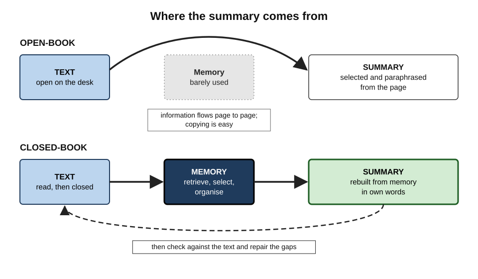
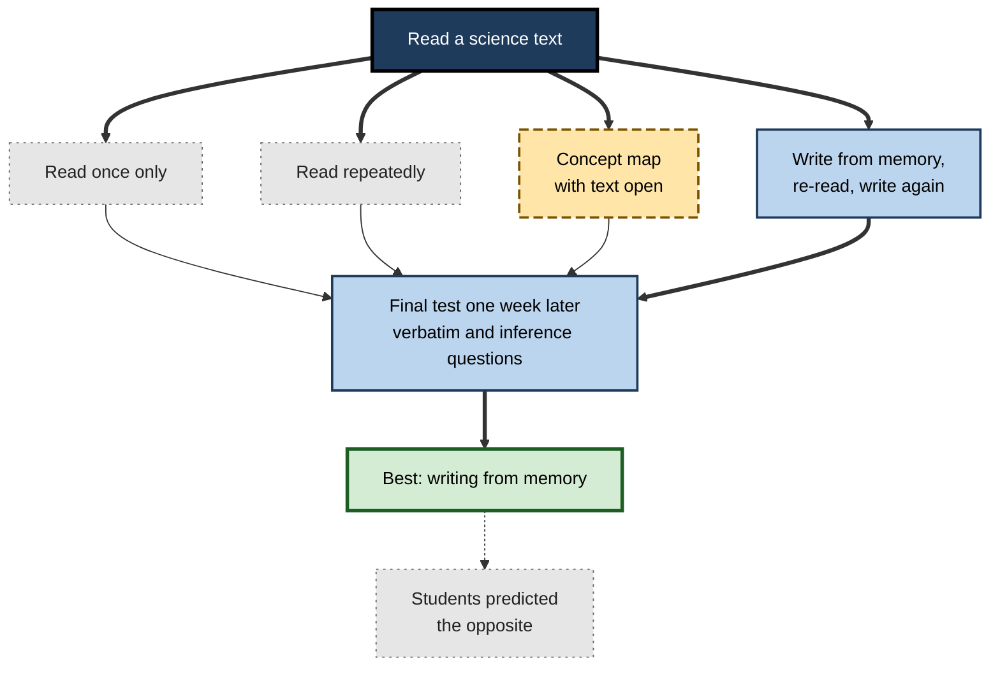
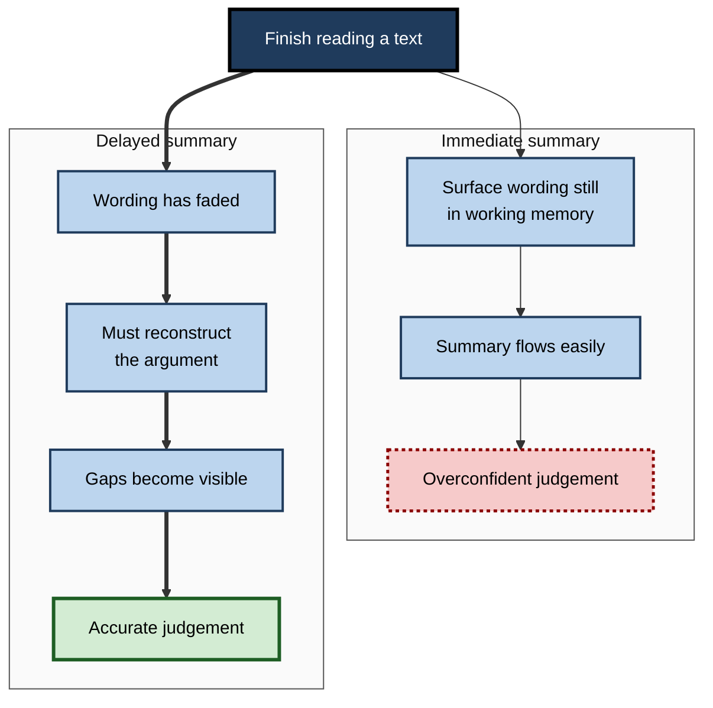
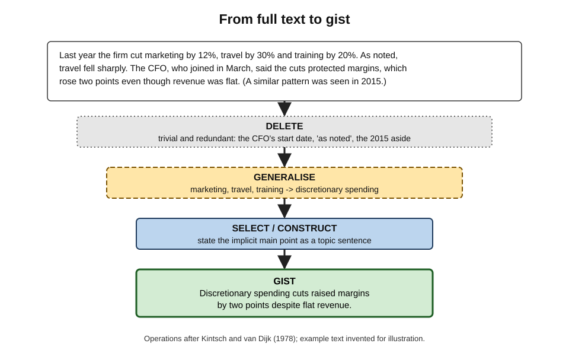
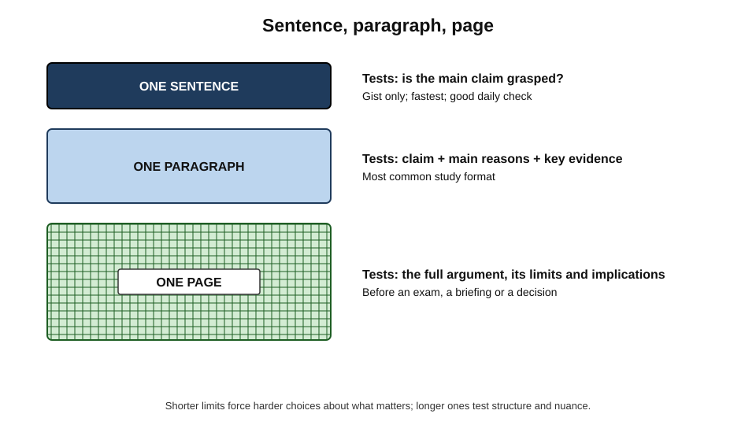
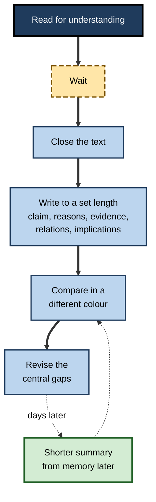

# B.5. Closed-Book Summarization

An analyst finishes a thirty-page market report, closes it and writes, from memory, a half-page account of its argument: what it claims, why, on what evidence and with what consequences. Then she opens the report again and compares. In one exercise she has retrieved the content, condensed it, organised it and discovered which parts she had understood only vaguely. Most people summarise with the text open beside them; closing it changes the exercise completely.

> **Definition — Closed-book summarisation:** writing a condensed account of a text's main ideas and how they relate, in one's own words and from memory, after reading it — and then checking the summary against the text.

**Why it matters**

- **It combines retrieval with selection and organisation** — three kinds of processing in one task.
- **It targets understanding, not just recall** — a good summary requires knowing what matters and how the parts fit.
- **It exposes the illusion of comprehension** — readers often feel they understood a text until they try to state its argument unaided.
- **It mirrors professional work** — executive summaries, briefings, handovers and case notes are all summaries produced from what one knows.
- **It needs no preparation** — only a text, a blank page and the discipline to close the source.

---

## Open-Book and Closed-Book Summaries

### The same word, two different tasks

- **Open-book summary** — the learner condenses the text while looking at it.
  - The main work is **selection and paraphrase**; information comes from the page.
  - Easily drifts into **copying** sentences with small changes.
- **Closed-book summary** — the learner writes after the text is put away.
  - The main work is **retrieval and reconstruction**, plus selection and organisation.
  - Copying is impossible; whatever is written must come from memory.

**Figure 1.** Where the information comes from in an open-book and a closed-book summary.

> **Watch out:** in the influential 2013 review of study techniques by John Dunlosky and colleagues, **summarisation** was rated of **low utility** — because most learners summarise open-book and lack the skill to do it well. That rating applies to the ordinary practice; it does not show that **closed-book** summarising is weak.

| | Open-book summary | Closed-book summary | Brain dump |
|---|---|---|---|
| Source during writing | Open | Closed | Closed |
| Main mental work | Selecting and paraphrasing | Retrieving, selecting, organising | Retrieving everything possible |
| Output | Condensed prose | Condensed, organised prose | Exhaustive list or sketch |
| What it reveals | Little about memory | Gaps in memory and in understanding of the argument | Gaps in memory and structure |
| Typical length | Variable, often long | Constrained — sentence, paragraph or page | Unconstrained |

### Why condensing matters

- A brain dump asks "What do I remember?"
- A closed-book summary asks "What **matters**, and how does it **fit together**?"
- **Condensing** forces judgement about importance — which ideas are central, which are support, which are illustration.
- **Organising** forces a structure — claim, reasons, evidence, implications.

> **Key point:** a closed-book summary is **retrieval in the shape of understanding** — the learner must reproduce not just the pieces but the argument.

---

## The Evidence

**Study card — Jeffrey Karpicke and Janell Blunt (2011)**

- **Design:** university students read short science texts and then studied them in one of four ways:
  - read once only;
  - read repeatedly;
  - **elaborative concept mapping** with the text open;
  - **retrieval practice** — two rounds of writing, in paragraphs and from memory, everything they could recall, with a re-reading in between.
- **Results (final test one week later):**
  - retrieval practice produced the best performance on both **verbatim** questions and **inference** questions requiring connections across the text;
  - it also beat concept mapping when the final test itself required drawing a concept map;
  - students **predicted** that concept mapping and repeated reading would serve them better than retrieval.
- **Conclusion:** writing about a text from memory produced more learning — including more meaningful, connected learning — than a highly regarded elaborative activity done with the text open.

- **Follow-up studies:**
  - **Lechuga and colleagues (2015)** largely replicated the advantage of retrieval over concept mapping, but found it smaller on inference questions for students already **experienced** in concept mapping.
  - **O'Day and Karpicke (2021)** reproduced the original pattern with the same methods.

> **Watch out:** the comparison is **contested** in its details. Some researchers have argued that the retrieval advantage partly reflects how the conditions and final tests were set up — for instance, how much time and training concept mapping received. The broad conclusion — closed-book writing about a text is a powerful way to learn it — is well supported; whether retrieval is *always* better than skilled concept mapping is not settled.

**Figure 2.** The design of the Karpicke and Blunt (2011) comparison.

### Why it works

- **Retrieval** — the direct strengthening of what is recalled.
- **Organisation** — writing connected prose from memory forces the learner to rebuild the text's structure, strengthening links between ideas.
- **Generation** — paraphrasing in one's own words is self-produced, not copied.
- **Selection** — deciding what is central deepens processing of the main ideas.
- **Monitoring** — the gap between the summary and the text is a precise map of what was not understood.

---

## Seeing Through the Illusion of Comprehension

### Readers misjudge their understanding

- **Illusion of comprehension** — the feeling of having understood a text that one could not, in fact, explain.
  - Arthur Glenberg, Alex Wilkinson and William Epstein (1982) found that readers often failed to notice outright contradictions in short texts yet rated their understanding as high.
- **Metacomprehension** — the ability to judge how well one has understood a text — is, in general, **poor**: the correlation between how well readers think they understood and how well they actually perform is often weak.

> **Definition — Metacomprehension:** a reader's monitoring and judgement of their own understanding of a text.

### Delayed summaries improve judgement

**Study card — Keith Thiede and Mary Anderson (2003)**

- **Design:** students read several texts, wrote summaries either **immediately** after each text or **after a delay**, or wrote none, then rated their understanding of each text and took comprehension tests.
- **Results:** students who wrote **delayed** summaries judged their comprehension much more accurately — their ratings tracked their test scores more closely — than those who summarised immediately or not at all.
- **Conclusion:** summarising after a delay forces readers to confront what they can actually reconstruct, giving better evidence about their understanding.

- **Related finding:** Thiede, Anderson and Therriault (2003) found a similar improvement when readers generated a few **keywords** for each text after a delay.

**Figure 3.** Why a delayed summary gives a truer picture of understanding than an immediate one.

> **Key point:** the delay is what makes a summary informative. Immediately after reading, the text's surface is still in mind; later, only what was understood remains.

---

## How Good Summaries Are Built

### Macrorules: the operations of summarising

Walter Kintsch and Teun van Dijk (1978) proposed that readers reduce a text to its **gist** using a small set of operations. Ann Brown and Jeanne Day (1983) studied how these develop with skill.

- **Delete** trivial material — examples, asides, repetitions.
- **Delete** redundant material — points made twice.
- **Generalise** — replace a list with a category.
  - *e.g.* "cuts to marketing, travel and training" → "discretionary spending cuts".
- **Select** a topic sentence where the text provides one.
- **Construct** a topic sentence where it does not — stating the implicit main point.

> **Definition — Gist:** the essential meaning of a text, without its detail.

> **Definition — Macrorules:** operations — deletion, generalisation and construction — by which readers reduce a text to its main ideas.

- **Skill differences (Brown and Day):** younger and less skilled students mostly **deleted** and **copied**; expert summarisers **generalised** and **constructed** topic statements in their own words.

**Figure 4.** Condensing a text into its gist with macrorules.

### The anatomy of a strong summary

- **Main claim** — what the text argues or reports, in one sentence.
- **Structure** — the main reasons, steps or sections, in their logical order.
- **Key evidence** — the most important data, cases or studies, briefly.
- **Relations** — *because*, *therefore*, *despite*, *unless*: the connectives that turn a list into an argument.
- **Implications or limits** — what follows, and where the argument stops.

> **Mnemonic — "CRISP":** **C**laim, **R**easons, **I**mportant evidence, **S**tructure through connectives, **P**ractical implications.

### Choosing the length

- **One sentence** — the gist; tests whether the main claim was grasped.
- **One paragraph** — claim plus reasons and evidence; the most common study format.
- **One page** — the full argument, including limits and implications.

> **In practice:** a length constraint is not a nuisance; it is the **mechanism**. Without one, a closed-book summary becomes a brain dump. A widely taught classroom method, **GIST** (James Cunningham, 1982), asks students to summarise each paragraph in about twenty words, forcing them to choose.

**Figure 5.** Three lengths of closed-book summary and what each tests.

---

## The Procedure

1. **Read for understanding.**
   - Note the headings, the thesis and the structure; mark nothing for copying.
2. **Wait.**
   - At least a few minutes; better, an hour or the next day.
3. **Close the text** and remove notes.
4. **Write the summary** to a set length, in own words, using CRISP.
5. **Compare with the text**, in a different colour:
   - Is the claim right?
   - Are the main reasons present and in the right order?
   - Are relations correct, or is it a list?
   - Are there distortions — things the text did not say?
6. **Revise** — correct errors and add missing central points (not every detail).
7. **Summarise again later**, shorter, from memory.

**Figure 6.** The closed-book summarising cycle.

### Scoring a summary

| Criterion | Strong | Weak |
|---|---|---|
| Main claim | Correct, stated first, in one sentence | Missing, wrong or buried |
| Coverage of central points | All main reasons present | Several missing; details instead of points |
| Relations | Connectives show the logic | A list of facts with no links |
| Accuracy | Nothing the text did not say | Distortions or the reader's own opinions presented as the author's |
| Own words | Paraphrased; generalised | Remembered phrases strung together |
| Length discipline | Within the limit | Over-long or too thin to use |

---

## Common Errors

- **Summarising immediately** — feels easy; tells little; strengthens little.
- **Peeking for the structure** — opening the text "just to see the headings" removes the reconstruction of the argument.
- **Listing instead of arguing** — "it talks about A, B and C" without how they connect.
- **Recalling examples, forgetting points** — vivid stories are remembered, the principles they illustrated are not.
- **Confusing one's view with the author's** — the summary should report the text; critique belongs in a separate section.
- **Correcting by copying** — pasting the missing parts in the author's words, which turns the repair into re-reading.

> **Watch out:** a summary that is **long and detailed** can be a worse sign than a short one. It may show recall of surface content without grasp of what matters.

---

## Worked Example: Summarising a Policy Report

**Situation:** an HR business partner reads a 12-page internal report on hybrid working and must brief the leadership team next week. The next morning, without the report, she writes a one-paragraph summary.

**Her first summary (closed-book):**
"The report looks at hybrid working. It says productivity has stayed roughly the same. Employees like flexibility. There were some problems with onboarding and with team communication. It recommends some changes to office days."

**Comparison with the report:**

| CRISP element | In her summary | In the report | Gap type |
|---|---|---|---|
| Claim | "Productivity stayed the same" | Output held steady overall, but **fell for teams under six months old** | Vague — central qualification missing |
| Reasons | Not given | Fewer chances for informal learning; slower feedback for new staff | Missing |
| Important evidence | None | Two internal surveys; project-cycle-time data | Missing |
| Structure / relations | A list | Problems arise **because** new staff lack informal contact | Unconnected |
| Implications | "Some changes to office days" | Anchor days for new teams; structured mentoring in the first six months | Vague |

**Her revised summary, written from memory two days later:**
"Hybrid working has kept overall output steady, but new teams and recent hires have suffered, because they lose the informal contact through which people learn how work is done and get quick feedback. Survey and cycle-time data both show the effect. The report therefore recommends fixed anchor days for new teams and structured mentoring for each hire's first six months."

- **Conclusion:** the first summary showed she had retained the **topic** but not the **argument**; the comparison and second attempt produced a summary she could present and defend.

> **Watch out:** her first summary *felt* complete when she wrote it. Only the comparison revealed that the report's central qualification — the very point leadership needed — was missing.

---

## Closed-Book Summaries at Work

### Professional summary formats

Many professions have standard summary structures; producing them from memory is both a study method and a professional skill.

| Format | Field | Structure | Recall value |
|---|---|---|---|
| Executive summary / bottom line up front | Business, government, military | Conclusion first, then key reasons and the decision required | Forces the main claim to be stated before detail |
| SBAR | Healthcare handovers | Situation, Background, Assessment, Recommendation | Structured recall of a patient's state for the next clinician |
| Case brief | Law | Facts, issue, holding, reasoning | Reconstructs the logic of a judgment |
| Post-incident summary | Engineering, operations | What happened, impact, cause, actions | Retrieves and orders a sequence of events |
| Paper précis | Research | Question, method, finding, limitation | Tests grasp of what a study actually showed |

> **In practice:** a strong habit is to write the summary of any important document **from memory first**, then check it, before sending it to anyone. It catches misunderstandings before they spread.

### Journal clubs and reading groups

- **Closed-book presenting** — the presenter explains the paper without slides or the text, then the group checks details against the paper.
- **Benefit:** the presenter's misunderstanding surfaces in discussion, not after a decision is made on a misread finding.

### AI summaries and the loss of processing

- **The temptation:** an AI tool can summarise any document in seconds.
- **The cost:** the reader who only reads the AI summary has done none of the retrieving, selecting or organising — and may not notice what the summary omitted or distorted.
- **A better use:** write one's own closed-book summary first, then ask the tool to compare it with the source and list possible omissions — checking each against the text.

> **Watch out:** AI summaries can omit qualifications, merge separate points or introduce claims the text did not make. A professional who relies on them without reading needs some independent way to verify the key points.

### Case study: junior consultants who could not tell the story

- **Situation:** a strategy consultancy found that junior consultants, after reading long research packs, wrote client briefs that were accurate in detail but lacked a clear argument.
- **Problem:** senior partners spent hours rewriting briefs; clients complained that "the point" was hard to find.
- **Diagnosis:**
  - juniors summarised **open-book**, working through the pack page by page and condensing each section;
  - they never had to state the overall argument unaided, so the structure of their briefs followed the structure of the pack, not the logic of the problem.
- **Actions:**
  1. Introduced a **"tell me the story"** step: after reading, each junior wrote, without the pack, a one-sentence answer and a five-sentence storyline.
  2. A manager compared the storyline with the evidence in the pack and questioned gaps.
  3. Only then did the junior draft the brief, starting from the storyline.
- **Result:** briefs became shorter and clearer; partner rewriting time fell markedly; juniors reported that the exercise showed them where they had not understood the research.
- **Side effects:** the closed-book step felt uncomfortable at first and occasionally produced confident but wrong storylines — which is why the manager's check was essential.
- **Lesson:** closing the source forces the move from **content** to **argument**.

---

## Open Questions

- **Is retrieval always better than skilled elaborative activities such as concept mapping?**
  - Replications support an advantage, but the role of training and test design is debated.
- **How long should the delay be before summarising?**
  - Delayed summaries improve judgement and memory, but the best delay for different texts is not established.
- **Can closed-book summarising be taught efficiently?**
  - Summarising is a skill; how much training learners need before it pays off — and whether macrorule training transfers — remains open.
- **How should AI summaries be integrated into professional reading?**
  - Their effect on comprehension and judgement over time is largely unstudied.
- **How well do findings from short science texts extend to long, technical professional documents?**
  - Most experiments use texts of a few pages; evidence with long reports, contracts or codebases is scarce.

---

## Summary

- **Closed-book summarisation** = writing a condensed, organised account of a text's main ideas from memory, then checking it.
- It differs from **open-book summarising** (selection and paraphrase, often copying) and from a **brain dump** (exhaustive, unconstrained). Dunlosky's low rating for summarisation concerns ordinary open-book practice.
- **Karpicke and Blunt (2011):** writing from memory beat concept mapping and re-reading on verbatim and inference questions a week later; replications broadly agree; details are **contested**.
- It works through **retrieval, organisation, generation, selection and monitoring**.
- Readers suffer an **illusion of comprehension** and poor **metacomprehension**; **delayed** summaries make judgements far more accurate (Thiede and Anderson).
- Build summaries with **macrorules** — delete, generalise, select or construct topic sentences — and the **CRISP** anatomy: claim, reasons, important evidence, structure through connectives, practical implications.
- Use a **length constraint** — sentence, paragraph, page.
- Procedure: read, **wait**, close, write, compare in a different colour, revise, re-summarise later.
- Professional formats — **executive summary, SBAR, case brief, post-incident summary, précis** — are natural closed-book exercises; AI summaries should be checked against one's own.

---

## Self-Check

1. Define closed-book summarisation and explain how it differs from open-book summarising and from a brain dump.
2. Why does the low utility rating for summarisation in the 2013 review not settle the value of closed-book summarising?
3. Describe the design and main findings of Karpicke and Blunt (2011).
4. What did later studies add, and why is the comparison with concept mapping contested?
5. Name five processes through which closed-book summarising aids learning.
6. What is the illusion of comprehension, and what did Glenberg and colleagues find?
7. Why do delayed summaries improve metacomprehension more than immediate ones?
8. List the macrorules and explain how expert and novice summarisers differ in using them.
9. Explain CRISP and why connectives matter.
10. Why is a length constraint essential?
11. A learner writes a two-page closed-book summary full of examples and statistics. What may be wrong?
12. Write a one-sentence closed-book summary of any article read recently, then list what you would check.
13. Design a closed-book summary routine for a junior lawyer reading three judgments a week.
14. A manager relies on AI summaries of all reports. Identify two risks and propose a safer workflow.

### Answer Key

1. Writing a condensed, organised account of a text from memory, then checking it. Open-book summarising is done with the text visible — selection and paraphrase, often copying. A brain dump is exhaustive and unconstrained recall; a closed-book summary is selective, organised and length-limited.
2. The rating reflected ordinary practice — open-book and dependent on summarising skill many learners lack. It did not test closed-book summaries, which add retrieval.
3. Students read science texts and either read once, read repeatedly, made concept maps with the text open, or wrote from memory twice with re-reading between. A week later, writing from memory produced the best performance on verbatim and inference questions, even on a concept-map test, though students predicted otherwise.
4. Lechuga and colleagues largely replicated the advantage but found it smaller on inference questions for experienced concept mappers; O'Day and Karpicke replicated the original. Critics argue that training, time and test design may favour retrieval; the broad benefit of closed-book writing is secure, its superiority over skilled mapping less so.
5. Retrieval, organisation, generation (own words), selection of main ideas, and monitoring of understanding.
6. The feeling of having understood a text that one cannot actually explain. Readers often failed to notice contradictions in texts yet rated their understanding highly.
7. Immediately after reading, surface wording is still in working memory, so summaries flow easily and confidence is inflated. After a delay, only what was understood can be reconstructed, so gaps become visible and judgements track real comprehension.
8. Delete trivial and redundant material; generalise lists into categories; select an explicit topic sentence; construct an implicit one. Novices mostly delete and copy; experts generalise and construct in their own words.
9. Claim, Reasons, Important evidence, Structure through connectives, Practical implications. Connectives such as *because* and *therefore* turn a list of facts into an argument, showing the logic was understood.
10. Without a limit, the summary becomes a brain dump; the limit forces judgement about what matters most.
11. It may be recall of surface detail without grasp of the argument; the main claim and relations may be missing. She should shorten it to a paragraph, lead with the claim and reasons, and check relations against the text.
12. Check: is the claim correct; are the main reasons present; are the relations right; is anything distorted; are qualifications missing?
13. E.g. read each judgment; next morning write a closed-book case brief (facts, issue, holding, reasoning) in under 200 words; compare with the judgment, marking gaps; at week's end write one-sentence holdings for all three from memory; monthly, compare cases on the same issue from memory.
14. Risks: omitted qualifications or invented claims go unnoticed; the manager's own understanding and judgement weaken. Safer: read key reports, write a short closed-book summary, then use AI to list possible omissions, verifying each against the source; for critical decisions, read the relevant sections directly.

---

## Glossary

| Term | Meaning |
|---|---|
| Bottom line up front | A summary format that states the conclusion before the supporting detail. |
| Case brief | A legal summary of facts, issue, holding and reasoning. |
| Closed-book summarisation | Writing a condensed account of a text from memory, then checking it. |
| CRISP | Claim, Reasons, Important evidence, Structure through connectives, Practical implications. |
| Elaborative concept mapping | Building a diagram of a text's concepts and links with the text open. |
| Gist | The essential meaning of a text without its detail. |
| GIST technique | A classroom method of summarising each paragraph in about twenty words. |
| Illusion of comprehension | Feeling that a text was understood when it cannot be explained. |
| Macrorules | Deletion, generalisation and construction operations used to reduce a text to its gist. |
| Metacomprehension | Monitoring and judgement of one's own understanding of a text. |
| Open-book summarisation | Condensing a text while it remains visible. |
| SBAR | Situation, Background, Assessment, Recommendation — a clinical handover structure. |
| Topic sentence | A sentence stating the main point of a passage. |
