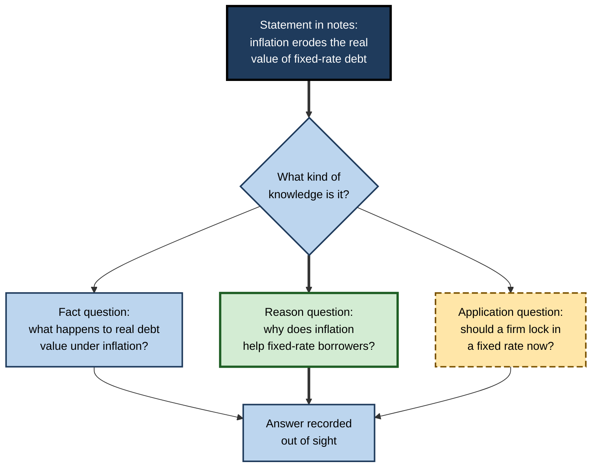
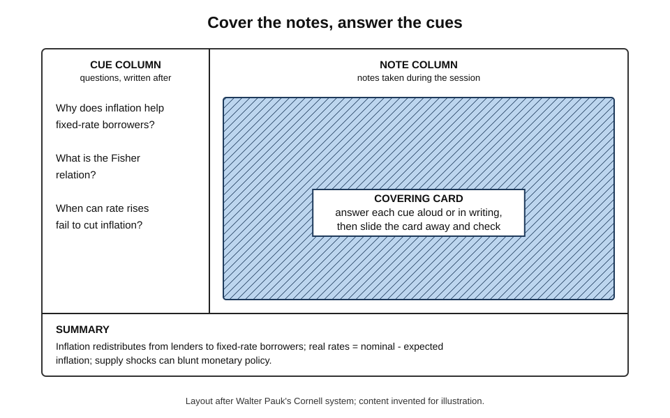
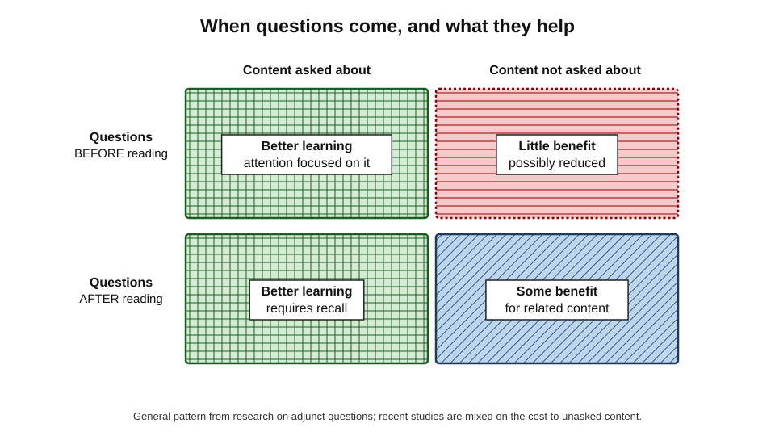
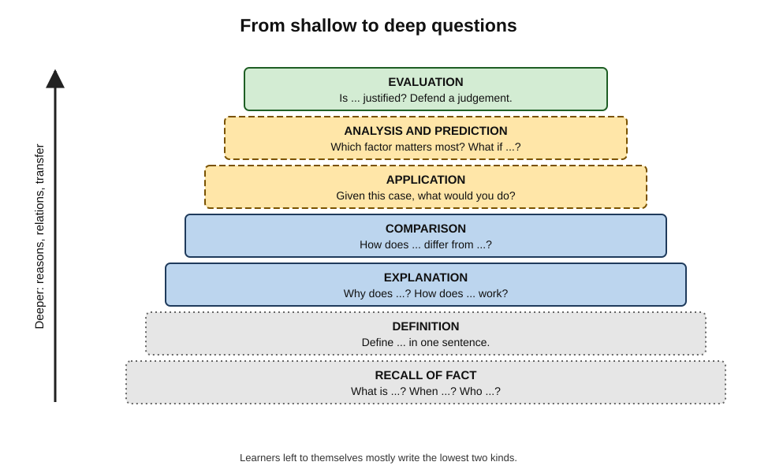
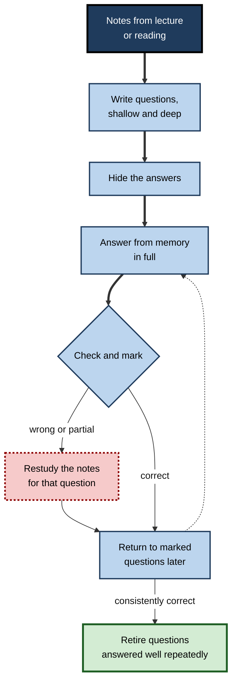
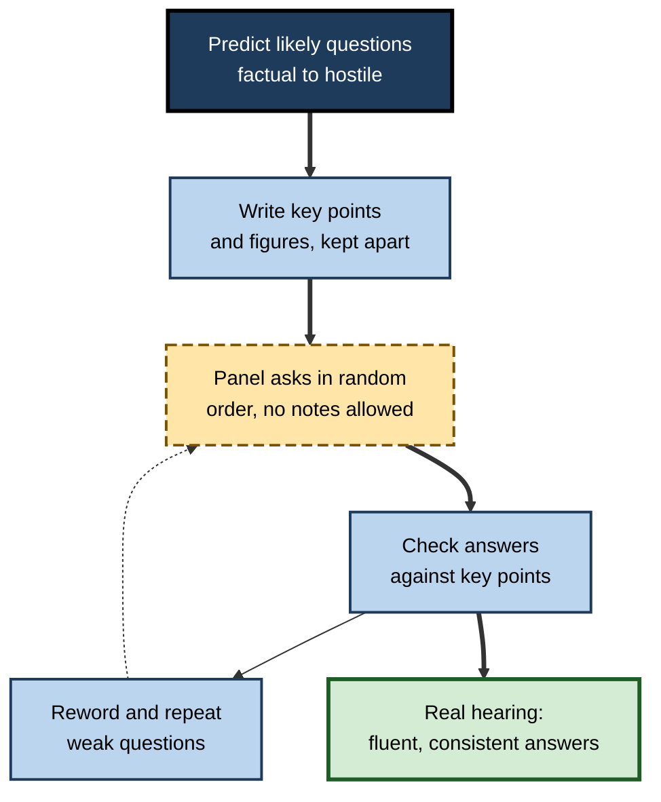

# B.6. Question-Answer Format Study

A page of notes says: "Inflation erodes the real value of fixed-rate debt." The same page, rewritten, asks: "Why might a borrower with a fixed-rate mortgage gain from unexpected inflation?" The first sentence can be read and nodded at; the second must be answered. Turning material into questions, then answering them with the answers hidden, is one of the oldest and most adaptable ways of building active recall into everyday study.

> **Definition — Question-answer format study:** organising study material as questions with separately recorded answers, so that the learner can answer each question from memory before checking.

**Why it matters**

- **Notes become a self-test** — the same document is used both to learn and to check learning.
- **Questions can target any level** — facts, concepts, reasons, applications, judgements.
- **Writing questions is itself processing** — deciding what to ask requires understanding what matters.
- **It matches how knowledge is used** — work is a stream of questions from clients, colleagues, examiners and problems.
- **It turns passive note-taking into a retrieval system** at almost no extra cost.

---

## From Statements to Questions

### Why the question form matters

- **Statements invite reading.** A sentence presents both the topic and the answer; the eye passes over it.
- **Questions demand production.** A question presents the topic and **withholds** the answer; the mind must find it.
- **Questions direct attention.** A good question tells the learner exactly what kind of answer is needed — a definition, a cause, a comparison, a decision.

> **Key point:** converting a statement into a question changes the learner's task from **recognising** information to **retrieving** it.

### The transformation

1. **Find the idea** in a sentence or paragraph.
2. **Decide what kind of knowledge it is** — fact, concept, cause, procedure, comparison, judgement.
3. **Write a question** whose answer is that idea.
4. **Record the answer separately** — on the other side of a page, in a hidden column, in an answer key.

**Figure 1.** Turning a statement in notes into a question and a hidden answer.

---

## Classic Question-Answer Systems

### The Cornell note-taking system

- **Origin:** devised by Walter Pauk at Cornell University in the 1950s and described in his book *How to Study in College* (first published 1962).
- **Page layout:**
  - **Note column** (right, wide) — notes taken during the lecture or reading.
  - **Cue column** (left, narrow) — questions or key words written **after** the session, one beside each block of notes.
  - **Summary strip** (bottom) — a few sentences summarising the page.
- **The recall step:** cover the note column, read each cue, answer aloud or in writing, uncover and check.
- **Pauk's stages:** record, reduce (write cues), recite (answer from cues), reflect, review.

> **Definition — Cue column:** the narrow left-hand column of a Cornell page, holding questions or prompts that are answered with the notes covered.

**Figure 2.** A Cornell page used for question-answer recall.

### SQ3R and PQ4R

- **SQ3R — Francis Robinson (1946):** **S**urvey, **Q**uestion, **R**ead, **R**ecite, **R**eview.
  - Turn headings into questions before reading; read to answer them; recite answers without looking; review later.
- **PQ4R — Ellen Thomas and H. Alan Robinson (1972):** **P**review, **Q**uestion, **R**ead, **R**eflect, **R**ecite, **R**eview.
- **What these systems share:** a **question stage** that sets the purpose and a **recite stage** that is active recall.

> **Watch out:** these methods are often taught and then used without the recite step — learners write questions, read, and skip straight to review. Without answering from memory, they become elaborate reading methods with no recall in them.

### Other formats

- **Two-column notes** — any page split into questions and answers.
- **Question books** — a notebook of questions only, with answers referenced to notes.
- **FAQ notes** — notes written as frequently asked questions, common in professional knowledge bases.
- **Question banks** — large sets of practice questions, often with explanations, used for licensing and certification exams.

| | Cornell notes | SQ3R | Question bank | Self-written Q&A list |
|---|---|---|---|---|
| Who writes the questions | The learner, after the session | The learner, from headings, before reading | Experts or examiners | The learner |
| When questions are answered | Repeatedly, notes covered | During and after reading | During practice sessions | Any time |
| Strength | Notes and self-test in one document | Reading becomes purposeful | Exam-like, expert-checked | Tailored to own gaps |
| Main risk | Cue column left blank | Recite step skipped | Recognition-format questions; memorising answers | Shallow, factual questions only |

---

## The Evidence

### Answering and generating questions both beat re-reading

**Study card — Yana Weinstein, Kathleen McDermott and Henry Roediger (2010)**

- **Design:** students read short passages and then either **re-read** them, **answered** questions about them, or **generated and answered** their own questions; later, all took a test.
- **Results:** answering questions and generating questions both produced **better** final performance than re-reading, and did not differ much from each other.
- **Conclusion:** learners who write and answer their own questions can gain benefits similar to those from answering questions provided for them — a practical option when no question set exists.

### Teaching learners to ask questions

- **Barak Rosenshine, Carla Meister and Saul Chapman (1996)** — a review and meta-analysis of studies that taught students to generate questions while reading:
  - question-generation training **improved comprehension**;
  - effects were **larger on tests written by the researchers** than on standardised reading tests;
  - training worked best when it gave students **procedural prompts** — signal words ("who, what, why, how") or **generic question stems**.

### Guided questioning with question stems

- **Alison King (early 1990s)** — students were given generic question stems and used them to ask each other questions about lectures:
  - "What is the difference between … and …?"
  - "How does … affect …?"
  - "Why is … important?"
  - "What would happen if …?"
  - "How is … similar to …?"
  - "What is a new example of …?"
- **Findings:** students using guided stems asked more **thought-provoking** questions and showed better comprehension than students who discussed or asked unguided questions.

> **Key point:** the benefit depends heavily on the **quality** of the questions. Generic stems are a simple, well-tested way to push learners beyond "What is…?".

### Questions before or after reading

- **Adjunct questions** — questions inserted into text.
  - Ernst Rothkopf's research in the 1960s introduced the study of how such questions shape what readers learn.
- **Pattern found across many studies:**
  - **questions before reading** focus attention on the questioned content — learners remember it better — but may slightly reduce learning of other content;
  - **questions after reading** require recall and tend to help both the questioned material and, to a smaller extent, related material.

> **Definition — Adjunct question:** a question placed before, within or after a text to influence how readers process it.

**Figure 3.** How the timing of questions shapes what is learned.

> **Watch out:** the "pre-questions only help asked content" pattern is a tendency, not a law; in some recent studies pre-questions also helped related content. The safe practice is to use pre-questions to set purpose and **post-questions for recall**.

---

## Kinds of Question

### From shallow to deep

Learners left to themselves ask mostly **shallow** questions — who, what, when — that test isolated facts. Arthur Graesser and Natalie Person (1994), studying tutoring sessions, found that students asked few questions and that deep questions — why, how, what if — were the ones associated with better understanding.

- **Recall of fact** — "What is the statutory limit for…?"
- **Definition** — "Define *liquidity* in one sentence."
- **Explanation** — "Why does a stronger currency make exports less competitive?"
- **Comparison** — "How does a merger differ from an acquisition in control and accounting?"
- **Application** — "A client's current ratio is 0.8. What does this suggest, and what would you check next?"
- **Analysis** — "Which assumption in this forecast matters most, and why?"
- **Evaluation** — "Is this pricing strategy appropriate for a market leader? Justify."
- **Prediction** — "What would happen to demand if the price rose 10% and the product had many substitutes?"
- **Error-spotting** — "What is wrong with this statement: 'Correlation implies the treatment works'?"

**Figure 4.** Question types arranged from shallow to deep.

> **Mnemonic — "Every Clever Analyst Predicts Judiciously":** Explain, Compare, Apply, Predict, Judge — five families of deep question.

| | Shallow question | Deep question |
|---|---|---|
| Typical stem | Who, what, when, where | Why, how, what if, what is the difference |
| What it tests | An isolated fact | Reasons, relations, transfer |
| Ease of writing | Easy | Harder — needs understanding |
| Ease of checking | Very easy | Needs a model answer or criteria |
| Use | Foundation facts that must be exact | Understanding and professional judgement |

### Mixing levels

- **A balanced set** contains enough fact questions to secure the foundations and enough deep questions to build understanding.
- **A useful ratio** in practice: for each factual question, write at least one "why" or "how" question about the same idea.

---

## Writing and Using Good Questions

### Principles of question writing

- **Write after understanding** — questions on material not yet understood produce memorised answers.
- **One target per question** — compound questions ("What are X and Y and why?") are hard to check.
- **Reword, do not copy** — a question that repeats the textbook sentence with a word missing is easily answered by pattern-matching.
- **Make answers checkable** — record a brief model answer or the key points it must contain.
- **Vary the form** — ask the same idea in different ways so recall does not depend on one wording.
- **Prefer production to selection** — open questions require more retrieval than multiple-choice.
- **Include "what would I need to know to do this?" questions** — linking knowledge to use.

> **Remember:** **understand → ask → hide → answer → check → return.**

### The study procedure

1. **After a lecture or reading,** write questions beside each section of notes (or in a separate list).
2. **Hide the answers** — fold the page, cover the column, or use a separate answer key.
3. **Answer each question from memory** — aloud or in writing, in full.
4. **Check and mark** — correct, partly correct, wrong.
5. **Repair** — for partly correct and wrong answers, restudy the relevant notes.
6. **Return** — answer the marked questions again in later sessions; retire questions that are consistently answered well.

**Figure 5.** The question-answer study cycle.

### Common errors

- **Only "what" questions** — builds a list of facts, not understanding.
- **Questions with the answer in them** — "Is the critical path the longest path through the network?" is answered by reading the question.
- **Yes/no questions** — guessable; replace with "explain whether…".
- **Answers visible** — the learner reads question and answer together, which is re-reading in a new layout.
- **Writing questions but never answering them** — the most common failure of Cornell notes and SQ3R.
- **Memorising model answers word for word** — reciting a stored paragraph is not the same as understanding it; vary the questions.

---

## Worked Example (illustrative): Turning a Page of Notes Into Questions

**Situation:** a data analyst has a page of notes on A/B testing and wants to study it in question-answer form.

| Note (statement) | Shallow question | Deep question |
|---|---|---|
| A/B tests randomly assign users to a control or a variant | What is randomly assigned in an A/B test? | Why does random assignment allow causal conclusions that comparing existing user groups does not? |
| Sample size depends on the minimum detectable effect | What does sample size depend on? | If the team wants to detect a smaller improvement, what happens to the required sample size, and why? |
| Peeking at results repeatedly inflates false positives | What is "peeking"? | A manager checks the dashboard daily and stops when p < 0.05. What is wrong, and what should be done instead? |
| Novelty effects can make early results misleading | What is a novelty effect? | Give an example of a product change where a novelty effect is likely, and how to detect it. |

**Steps**

1. **Write one shallow and one deep question** per idea.
2. **Record brief model answers** on a separate sheet.
3. **Answer all eight** the next day, from memory, in writing.
4. **Mark** — she answers all four shallow questions but only one deep question well; her answer on peeking states the rule without explaining why repeated checks inflate false positives.
5. **Repair** — she restudies the reasoning and writes a second deep question on the same idea in different words.

- **Conclusion:** the shallow questions alone would have told her she "knew" the page; the deep questions showed that she could not yet **reason** with it.

> **Watch out:** deep questions need a **model answer or criteria** to be checked against. Without them, learners tend to mark their own vague answers as correct.

---

## Question-Answer Study in Professional Practice

### Professional uses

- **Interview preparation** — candidates list likely questions and practise answering aloud, without notes, often using the **STAR** structure (Situation, Task, Action, Result).
- **Certification and licensing** — question banks are central to preparation in medicine, accounting, law and IT.
- **Client meetings** — consultants list the questions a sceptical client is likely to ask and rehearse answers.
- **Expert testimony and hearings** — witnesses, officials and executives prepare with **murder boards**: panels that fire hard questions at them under realistic conditions.
- **Product launches** — teams write internal FAQs and rehearse answering the hardest questions before the press does.
- **Sales** — objection-handling: each likely objection becomes a question to answer fluently.

> **Definition — Murder board:** a rehearsal panel that asks a person the hardest likely questions before a high-stakes hearing, defence or presentation.

> **In practice:** the professional version of question-answer study is **anticipation** — predicting the questions that real audiences will ask and practising answers from memory until they are fluent and accurate.

### AI as a question generator

- **Strengths:** AI tools can produce many questions quickly, at chosen levels, and can act as a Socratic partner that keeps asking "why?".
- **Weaknesses:** generated questions are often shallow unless explicitly requested otherwise; model answers may be wrong; learners lose the processing involved in writing questions.
- **Good practice:**
  - ask for **mixed levels** and specify "why", "how", "what if" and application questions;
  - require the tool to **wait for an answer** before giving feedback;
  - check doubtful answers against the source;
  - continue writing some questions oneself.

### Case study (illustrative): preparing executives for a regulatory hearing

- **Situation:** a utility company's chief executive and finance director were called to give evidence to a parliamentary committee about a billing failure that affected thousands of customers.
- **Problem:** in the first internal rehearsal, both executives read prepared statements well but stumbled on follow-up questions — giving inconsistent figures and pausing to look for briefing notes.
- **Diagnosis:**
  - preparation had consisted of reading a long briefing pack;
  - the executives had never been asked to **produce** answers to unseen questions from memory;
  - the pack was organised by topic, not by the questions the committee was likely to ask.
- **Actions:**
  1. The communications and legal teams wrote around eighty likely questions, from factual ("How many customers were overcharged?") to hostile and evaluative ("Why should customers trust your systems now?").
  2. Answers were reduced to **key points and figures**, held in a separate document.
  3. Three **murder-board** sessions: a panel of colleagues and an external adviser asked questions in random order; the executives answered without notes; answers were checked against the key points.
  4. Questions answered badly were repeated in the next session, often reworded.
- **Result:** at the hearing, both executives gave consistent figures and handled follow-up questions without notes; commentators described their evidence as clear and well-prepared.
- **Side effects:** the sessions were demanding and uncomfortable — deliberately so; one adviser noted that the hardest real question had been rehearsed in three different forms.
- **Lesson:** reading a briefing builds familiarity; answering **anticipated questions from memory**, under pressure and in varied forms, builds the ability to respond.

**Figure 6.** The murder-board preparation cycle.

---

## Open Questions

- **How should self-generated and provided questions be combined?**
  - Both help; whether writing questions adds to the benefit of answering expert questions, given its time cost, is not settled.
- **How can learners be trained to ask deep questions efficiently?**
  - Question stems help, but how training transfers across subjects is unclear.
- **Do pre-questions harm learning of unasked content?**
  - Older research suggested they could; more recent findings are mixed.
- **How well does practice on question banks transfer to real professional judgement?**
  - High scores on banks predict exam success, but their link to performance in practice is less studied.
- **What makes AI-generated questions good questions?**
  - Criteria for depth, accuracy and alignment with real use are still being developed.

---

## Summary

- **Question-answer format study** = material organised as questions with hidden answers, answered from memory before checking.
- Questions turn **recognition into retrieval** and direct attention to the kind of answer needed.
- Classic systems: **Cornell notes** (Pauk: cue column, notes, summary; recite with notes covered), **SQ3R** (Robinson, 1946) and **PQ4R**. Their recall value lies in the **recite** step, often skipped.
- Evidence: answering and generating questions both beat re-reading (**Weinstein, McDermott and Roediger, 2010**); question-generation training improves comprehension, especially with **procedural prompts** (**Rosenshine, Meister and Chapman, 1996**); **question stems** (**King**) produce deeper questions.
- **Timing:** pre-questions focus attention; post-questions require recall.
- Question types run from **fact and definition** to **explanation, comparison, application, analysis, evaluation, prediction and error-spotting**; learners ask too few deep questions (**Graesser and Person**).
- Write questions after understanding, one target each, reworded, checkable, varied; hide answers; answer in full; check; return.
- Professionals use the method as **anticipation**: interview preparation, question banks, client rehearsals, **murder boards**, FAQs, objection-handling.

---

## Self-Check

1. Define question-answer format study and explain why turning statements into questions aids learning.
2. Describe the layout of a Cornell page and where active recall occurs in the system.
3. What do SQ3R and PQ4R stand for, and which step is most often skipped?
4. Summarise the findings of Weinstein, McDermott and Roediger (2010).
5. What did Rosenshine, Meister and Chapman conclude about teaching question generation?
6. Give four of King's question stems and explain why stems help.
7. How does the timing of adjunct questions influence what is learned?
8. Distinguish shallow and deep questions with examples from a subject you know.
9. Rewrite these weak questions: "Is diversification good?"; "What is Section 4 about?"; "Does the critical path determine project length?"
10. Why do deep questions need model answers or criteria?
11. A student's Cornell cue columns are full but her exam scores have not improved. What is the likely problem?
12. Design a question-answer routine to prepare for a job interview for a project-manager role.
13. Explain what a murder board is and why it works.
14. Propose rules for using an AI tool to generate study questions for a technical certification.

### Answer Key

1. Organising material as questions with hidden answers, answered from memory before checking. A statement shows the answer; a question withholds it, so the learner must retrieve rather than recognise, and it specifies the kind of answer needed.
2. A wide note column on the right, a narrow cue column on the left for questions written after the session, and a summary strip at the bottom. Recall occurs when the notes are covered and the cues are answered aloud or in writing.
3. SQ3R: Survey, Question, Read, Recite, Review. PQ4R: Preview, Question, Read, Reflect, Recite, Review. The **recite** step is most often skipped.
4. Answering questions and generating one's own questions both produced better later performance than re-reading, with little difference between them.
5. Teaching students to generate questions improves comprehension, especially on researcher-made tests and when training provides procedural prompts such as signal words or question stems.
6. "What is the difference between … and …?"; "How does … affect …?"; "Why is … important?"; "What would happen if …?" Stems give learners a ready structure for deeper, relational questions they would not otherwise think to ask.
7. Pre-questions focus attention on questioned content, improving its learning but possibly reducing learning of other content; post-questions require recall and tend to help questioned and, to a lesser degree, related content.
8. Shallow: "What is a bond's coupon?" Deep: "Why do bond prices fall when interest rates rise?" Shallow tests isolated facts; deep tests reasons and relations.
9. "Explain when diversification reduces portfolio risk and when it does not." "State the main obligation Section 4 imposes and one exception." "What determines the minimum duration of a project, and why does delay on that path matter more than elsewhere?"
10. Their answers are long and variable; without criteria learners tend to mark vague answers as correct.
11. She writes cues but probably never answers them with the notes covered, or reads question and answer together; the cues may also be shallow. She needs to cover the notes, answer in full, check and return to failures, and add deep questions.
12. E.g. list 25 likely questions (competency, technical, situational); write key points for each in STAR form on a separate sheet; answer aloud without notes daily in random order; record and check; rework weak answers; final rehearsal with a friend asking unseen variants.
13. A panel that asks a person the hardest likely questions under realistic conditions before a high-stakes event. It works through retrieval under pressure, varied wording, feedback and anticipation of real use.
14. E.g. request mixed levels with at least half "why/how/what if" and scenario questions; have the tool ask one at a time and wait; answer in writing before feedback; verify answers against official documentation; keep a log of missed questions for later sessions; write some questions oneself.

---

## Glossary

| Term | Meaning |
|---|---|
| Adjunct question | A question placed before, within or after a text to shape processing. |
| Cornell note-taking system | Notes, a cue column of questions and a summary strip, used for covered-notes recall. |
| Cue column | The left-hand Cornell column holding questions or prompts. |
| Deep question | A question about reasons, relations, application or judgement. |
| Murder board | A panel that rehearses a person with the hardest likely questions. |
| PQ4R | Preview, Question, Read, Reflect, Recite, Review. |
| Question bank | A large set of practice questions, often for licensing or certification. |
| Question stem | A generic question frame, e.g. "How does … affect …?". |
| Question-answer format study | Studying from questions with hidden answers, answered from memory. |
| Recite | To answer from memory with the source covered. |
| Shallow question | A question about an isolated fact: who, what, when, where. |
| SQ3R | Survey, Question, Read, Recite, Review. |
| STAR | Situation, Task, Action, Result — a structure for interview answers. |
