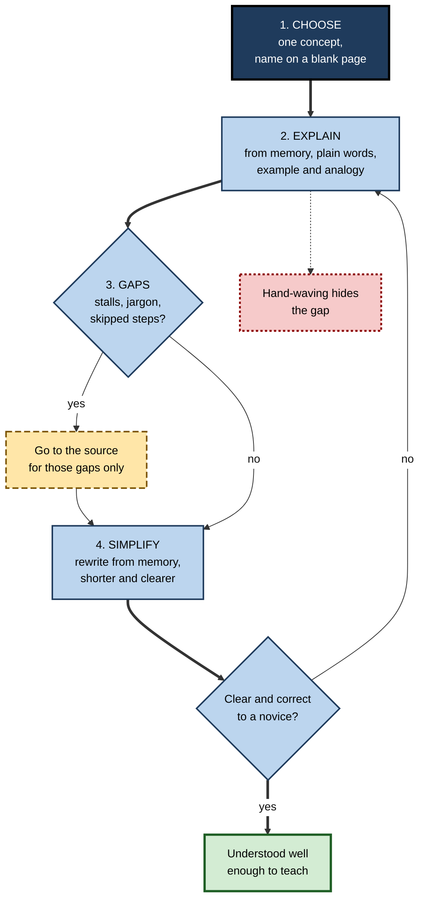
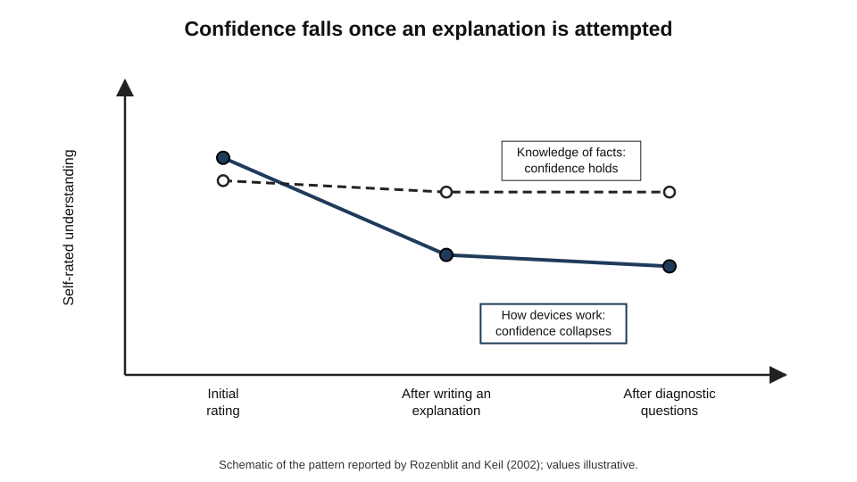
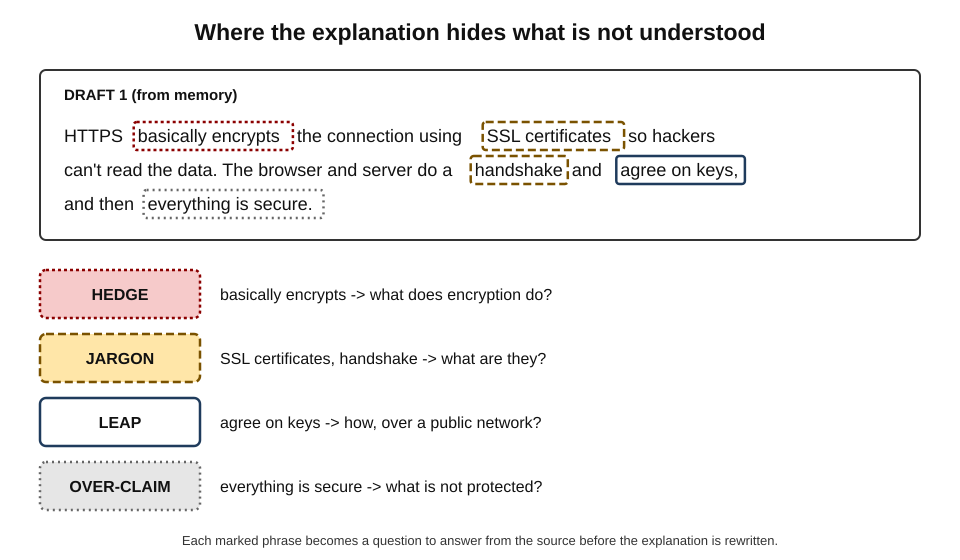
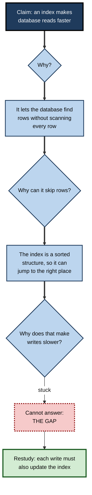
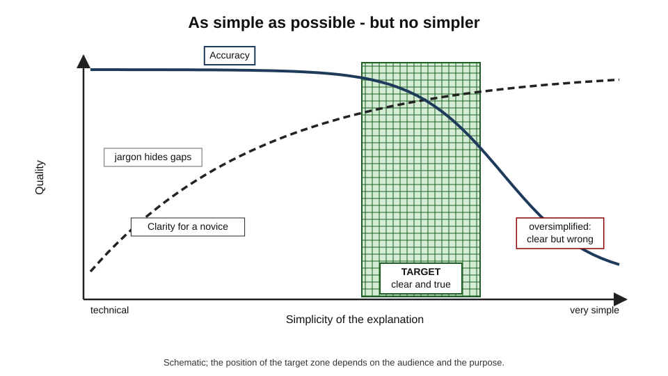
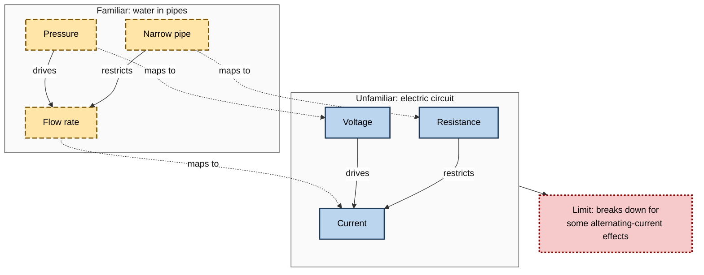

# B.7. The Feynman Technique

The physicist Richard Feynman was once asked to prepare a lecture for first-year students explaining why particles with half-integer spin obey a particular statistical rule. After some days he returned and admitted that he could not reduce the explanation to a first-year level. "That means," he said, "we really don't understand it."

His colleague David Goodstein told the story to show Feynman's conviction that an idea one cannot explain simply has not been fully grasped. The study method that carries his name turns that conviction into a routine.

> **Definition — The Feynman technique:** a study method in which the learner explains a concept from memory, in plain language, as if to a novice; notices where the explanation breaks down; returns to the source to repair those gaps; and simplifies the explanation until it is clear and correct.

**Why it matters**

- **It tests understanding, not just recall** — producing an explanation requires knowing how and why, not only what.
- **It exposes hidden gaps** — vague words and jargon that hide incomprehension cannot survive a plain-language explanation.
- **It combines recall with explanation** — the learner retrieves the idea and reconstructs its logic in one act.
- **It builds a professional skill** — explaining complex ideas simply to clients, patients, executives and juries.
- **It is quick** — a single concept can be worked through in fifteen to thirty minutes.

---

## The Man and the Myth

### What Feynman actually did

- **Feynman (1918–1988)** — American theoretical physicist, joint winner of the 1965 Nobel Prize in Physics for work on quantum electrodynamics, and famous as a teacher; his *Feynman Lectures on Physics* (1963–1965) began as an introductory undergraduate course.
- **Habits recorded by those who knew him:**
  - **Rebuilding ideas himself** — he preferred to work out results from first principles rather than accept them on authority.
  - **A notebook of ignorance** — as a graduate student he kept a notebook he titled, according to his biographer James Gleick, *Notebook of Things I Don't Know About*, in which he took apart and reassembled each branch of physics.
  - **Distrust of mere naming** — he recalled his father pointing out that one could know the name of a bird in many languages and still know nothing about the bird.
  - **Self-honesty** — in a 1974 address at Caltech, known as "Cargo Cult Science", he said that the first principle is that you must not fool yourself, and you are the easiest person to fool.

### The Brazilian students

- **The episode:** in his memoir *Surely You're Joking, Mr. Feynman!* (1985), Feynman described teaching in Brazil in the early 1950s.
- **What he found:** students could recite definitions perfectly but could not apply them.
  - Asked about a phenomenon they had just defined, they did not recognise it in a simple real example.
- **His diagnosis:** they had memorised **words** without understanding **what the words referred to**.

> **Key point:** Feynman's complaint was not about memory but about **memorising labels in place of understanding**. The technique attacks that failure directly.

### Where the four steps come from

> **Watch out:** Feynman never published a "Feynman technique". The familiar four-step recipe was assembled by later writers and teachers of study skills, drawing on his habits and anecdotes. It is a useful method **inspired by** Feynman, not a procedure he designed — and it has not itself been tested as a package in controlled experiments.

---

## The Four Steps

1. **Choose a concept** and write its name at the top of a blank page.
2. **Explain it from memory, in plain language,** as if to someone with no background — often described as a bright twelve-year-old or an intelligent outsider.
   - Use simple words, a concrete example and, where helpful, an analogy.
   - No notes, no source.
3. **Find the gaps.**
   - Mark every place where the explanation stalls, becomes vague, relies on jargon or skips a step.
   - Go back to the source **only** for those gaps; restudy until each can be explained.
4. **Simplify and refine.**
   - Rewrite the explanation from memory, shorter and clearer, with the gaps repaired.
   - Test it — read it aloud, or give it to a real novice — and repeat if needed.

> **Mnemonic — "CEGS" — "Choose, Explain, Gaps, Simplify":** **C**hoose the concept, **E**xplain simply from memory, find the **G**aps and repair them, **S**implify and test.

**Figure 1.** The Feynman technique as a cycle.

---

## Why It Works

### Retrieval

- The explanation is produced **from memory**, so every principle of active recall applies: effortful retrieval strengthens what is retrieved and reveals what is missing.
- Unlike a list of facts, an explanation requires retrieving **relations** — cause, mechanism, consequence.

### The illusion of explanatory depth

**Study card — Leonid Rozenblit and Frank Keil (2002)**

- **Design:** participants rated how well they understood how everyday devices work — a zip, a flush toilet, a cylinder lock. They then wrote detailed, step-by-step explanations of how each worked, answered diagnostic questions, and rated their understanding again.
- **Results:** ratings **fell** sharply after attempting the explanations. Participants had believed they understood mechanisms they could not explain.
- **Further finding:** the overconfidence was much larger for **explanatory** knowledge — how things work — than for facts, procedures or stories.
- **Conclusion:** people routinely overestimate how well they understand causal mechanisms; attempting an explanation is what punctures the illusion.

> **Definition — Illusion of explanatory depth:** the tendency to believe one understands how something works in far more detail than one actually does.

**Figure 2.** Schematic of the illusion of explanatory depth: self-rated understanding before and after trying to explain.

### Self-explanation

- **Michelene Chi and colleagues (1989)** found that the physics students who learned most from worked examples were those who explained each step to themselves — why it followed, what principle it used.
- **The Feynman technique** is a disciplined form of self-explanation: the learner must state each step and its justification in words.

> **Definition — Self-explanation:** generating explanations to oneself of why steps, facts or statements are true, while studying.

### Explaining to an imagined audience

- **Expecting to explain** to someone else changes how learners organise material.
- **Explaining to an imagined novice** — studies by Vincent Hoogerheide, Tamara van Gog and colleagues found that students who explained material on video to a fictitious peer often learned more than those who simply restudied or wrote explanations for themselves.
- **Why an audience helps:** imagining a novice forces the explainer to define terms, supply steps and choose examples — exactly where gaps hide.

> **Watch out:** the evidence for explaining to imagined others is **promising but uneven** — some studies find clear benefits, others small or none, and the effect may depend on whether explanations are spoken or written and on prior knowledge. Combined with retrieval and self-explanation evidence, the case for the technique's components is strong; the package itself is untested.

### Plain language as a lie detector

- **Jargon can hide ignorance** — a technical term can be used correctly in a sentence without the user knowing what it means.
  - *e.g.* "The model overfits because of high variance" can be said by someone who could not explain either term.
- **Plain language forces substitution** — every term must be replaced by what it refers to, which requires knowing it.

> **Key point:** the requirement to explain **simply** is not about the audience; it is a test the explainer applies to themselves.

---

## Finding the Gaps

### Signs of hand-waving

- **Hedge words** — "basically", "sort of", "kind of", "somehow", "it just…".
- **Undefined jargon** — technical terms left unexplained.
- **Circular definitions** — "liquidity is how liquid an asset is".
- **Missing agents** — passive sentences that hide what causes what: "the rate is adjusted".
- **Leaps** — "and so the price falls" without the reason.
- **Borrowed phrases** — sentences recalled word for word from the source, which the learner could not rephrase.
- **No example** — inability to give a concrete instance.

> **Remember:** wherever the explanation contains **"basically"**, an **undefined term** or a **leap**, there is probably a gap.

**Figure 3.** A first-draft explanation with its gaps marked.

### The "why" drill

- **Ask "why?" of each claim** in the explanation, and answer from memory.
- **Continue** until the answer reaches a principle the learner can state confidently, or until the learner cannot answer.
- **The point of failure** is the gap to repair.

**Figure 4.** Drilling down with repeated "why?" questions until the explanation fails.

---

## Simplifying Without Distorting

### The trade-off

- **Too technical** — accurate but unintelligible to the audience; gaps hide behind jargon.
- **Too simple** — clear but wrong; the explanation teaches a misconception.
- **The target** — the simplest explanation that remains **true at the level stated**, with known simplifications flagged.

**Figure 5.** Schematic trade-off between simplicity and accuracy.

> **Watch out:** the saying "everything should be made as simple as possible, but not simpler" is widely attributed to Albert Einstein, but no exact source has been found; it is probably a later paraphrase. The idea, however, is the right one.

### Choosing the audience level

| | Novice | Intelligent outsider | Colleague |
|---|---|---|---|
| Who | A child, a new starter, a patient | An executive, a client, a professional in another field | Someone in the same discipline |
| Vocabulary | Everyday words only | Everyday words plus a few defined terms | Technical terms allowed |
| What must be shown | The basic idea and one example | The idea, why it matters and its main trade-off | Mechanism, evidence and edge cases |
| What it tests | Whether the core is grasped | Whether the learner understands implications | Whether the learner has full depth |

- **Practice:** explain at the **novice** level first, then at the **colleague** level — the first finds conceptual gaps, the second finds gaps in detail.

### Analogies

- **What a good analogy does:** maps the **relations** of a familiar thing onto an unfamiliar one.
  - Dedre Gentner's **structure-mapping theory** (1983) holds that analogies work by aligning relational structure — what causes what — rather than surface features.
- **Example:** "Voltage is like water pressure; current is like the flow rate; resistance is like a narrow pipe."
- **Danger:** every analogy breaks somewhere; the explainer must know where.
  - *e.g.* the water analogy fails for some properties of alternating current.

> **In practice:** after giving an analogy, add one sentence on **where it stops working**. Being able to say where an analogy breaks is itself a strong test of understanding.

**Figure 6.** An analogy maps relations, not surface features.

---

## Worked Example (illustrative): Explaining How HTTPS Keeps Data Private

**Situation:** a junior developer wants to understand how HTTPS protects data, because she will soon review security settings.

**Draft 1 — from memory, plain language intended**

"HTTPS basically encrypts the connection using SSL certificates so hackers can't read the data. The browser and server do a handshake and agree on keys, and then everything is secure."

**Gap marking**

| Phrase | Problem | Question to answer |
|---|---|---|
| "basically encrypts" | Hedge; no mechanism | What does encryption actually do to the data? |
| "SSL certificates" | Undefined jargon; outdated name | What is a certificate, and what does it prove? |
| "do a handshake" | Undefined jargon | What happens in the handshake? |
| "agree on keys" | Leap | How can two parties agree on a secret over a public network without others learning it? |
| "everything is secure" | Over-claim | What does HTTPS *not* protect? |

**Repair:** she restudies only these points — certificates, key exchange, symmetric versus public-key encryption, and limits.

**Draft 2 — from memory, after repair**

> **Example:** "When your browser connects to a site over HTTPS, it first checks the site's **certificate** — a digital document, signed by an organisation the browser already trusts, that confirms the site's public key belongs to that domain. Then the browser and the server use a **key-exchange** method that lets them each calculate the same secret key without ever sending it across the network, so an eavesdropper cannot work it out. From then on, they use that shared key to scramble every message in a way only they can unscramble. HTTPS protects data **in transit**; it does not stop a site that is itself malicious, and it does not protect data once it is stored on the server."

- **Conclusion:** draft 1 used every right word and contained almost no understanding; draft 2 is longer than the slogan but simpler in vocabulary and much more accurate.

> **Watch out:** draft 2 still simplifies — for instance, it omits how session keys are derived and how certificate chains work. That is acceptable **if** she knows the simplification is there. A good explainer can say what was left out.

---

## The Feynman Technique at Work

### Professional settings

- **Client and executive communication** — consultants and analysts who cannot explain a recommendation in plain language often have not fully worked it out.
- **Software engineering** — **rubber-duck debugging**, named in *The Pragmatic Programmer* (Andrew Hunt and David Thomas, 1999): explaining code line by line to an inanimate duck frequently reveals the bug, because the programmer must state what each line actually does.
- **Medicine** — explaining a diagnosis to a patient in everyday words tests the clinician's grasp; the related **teach-back method** asks patients to explain back what they understood, revealing gaps in the clinician's explanation.
- **Law** — barristers prepare to explain technical evidence to juries; drafting in plain language exposes ambiguity.
- **Research and data science** — explaining a model or study design in plain terms reveals unexamined assumptions.

> **Definition — Rubber-duck debugging:** explaining a program line by line to an inanimate listener in order to find errors.

> **In practice:** many technical teams require a short **plain-language summary** at the top of design documents. Writing it is a Feynman exercise: if the author cannot write it, the design is usually not yet clear.

### The technique and AI tools

- **Weak use:** asking an AI tool to "explain X like I'm twelve" — the learner reads an explanation, which is re-exposure, and gains none of the testing value.
- **Strong use:** the learner explains first; then asks the tool to play a curious novice who asks "why?" and "what do you mean by…?" at each step; then asks it to identify errors or omissions, checking any correction against a reliable source.

> **Watch out:** an AI tool's explanation can be fluent and wrong. A learner who has done the Feynman technique is better placed to notice — which is one more reason to explain first and read second.

### Case study (illustrative): explaining a churn model to the board

- **Situation:** a data scientist built a model predicting which subscription customers would cancel. She was asked to explain it to the board before it was used to target retention offers.
- **Problem:** in a rehearsal with her manager, her explanation consisted of model names, accuracy figures and feature-importance charts. Asked "Why does the model think this customer will leave?", she answered with another chart.
- **Diagnosis:**
  - she could **operate** the model but had not worked out how to state, in plain terms, what drove its predictions;
  - she had not examined whether the top features were causes or symptoms of cancellation.
- **Actions — the four steps:**
  1. **Choose:** "What makes the model predict that a customer will cancel?"
  2. **Explain** from memory, in plain words, to an imagined board member.
  3. **Gaps found:** she could not explain why "number of support tickets" increased predicted risk, nor whether reducing tickets would reduce cancellations.
  4. **Repair and simplify:** she analysed the cases, found that tickets were a **symptom** of product problems, and rewrote the explanation: "Customers who hit product problems contact support more and are more likely to leave; the model spots that pattern. Offering discounts to these customers is unlikely to help unless the product problem is fixed."
- **Result:** the board redirected part of the retention budget from discounts to fixing the most common product issues; her explanation became the standard description of the model.
- **Lesson:** the attempt to explain simply revealed not just a communication problem but a **gap in understanding** that would have led to a poor business decision.

---

## Common Errors

- **Reading, then "explaining" with the source open** — becomes paraphrasing.
- **Explaining only the easy parts** — skipping the step that is actually not understood.
- **Accepting one's own hedge words** — "basically" is the signal to stop and repair.
- **Oversimplifying into falsehood** — a clear but wrong explanation is worse than a halting correct one.
- **Never testing on a real listener** — the imagined novice is generous; a real one asks the awkward question.
- **Using it for everything** — explaining is slow; it suits concepts and mechanisms, not lists of facts.

| | Suits the Feynman technique | Better served by other recall formats |
|---|---|---|
| Kind of knowledge | Mechanisms, causes, principles, models, arguments | Isolated facts, terms, numbers, sequences |
| Example | Why compound interest grows faster over time | The current base rate |
| Typical time | 15–30 minutes per concept | Seconds per item |
| Best alternative for the other column | — | Flashcards, question-answer notes |

---

## Open Questions

- **Does the package outperform its parts?**
  - The technique combines retrieval, self-explanation and explaining to an imagined audience; no controlled study has tested it as a whole.
- **Spoken or written explanations?**
  - Some studies suggest speaking an explanation produces more elaboration than writing it, others find little difference; the conditions are not mapped.
- **How should learners know when their explanation is correct?**
  - Self-judged explanations can be confidently wrong; how much external checking is needed is unclear.
- **How simple is too simple?**
  - The boundary between useful simplification and misleading distortion depends on purpose and audience, and lacks clear criteria.
- **What happens when AI does the explaining?**
  - Whether AI-generated explanations weaken learners' own explanatory skill over time is not yet known.

---

## Summary

- **Feynman technique** = explain a concept **from memory, in plain language**, as if to a novice; find the gaps; repair them from the source; simplify and test — **Choose, Explain, Gaps, Simplify**.
- Inspired by Feynman's habits — rebuilding ideas, a *Notebook of Things I Don't Know About*, distrust of naming, "you must not fool yourself" — but the four-step recipe was **codified by later writers** and is **untested as a package**.
- It works through **retrieval**, puncturing the **illusion of explanatory depth** (Rozenblit and Keil), **self-explanation** (Chi) and **explaining to an imagined audience** (evidence promising but uneven).
- Gaps show as **hedge words, undefined jargon, circular definitions, missing agents, leaps, borrowed phrases and no example**; the **"why" drill** finds the failure point.
- Simplify **without distorting**: choose the audience level, flag simplifications, map **relations** in analogies (Gentner) and know where they break.
- Professional echoes: plain-language summaries, **rubber-duck debugging**, **teach-back**, jury explanations.
- Use AI as a **questioning novice**, not as the explainer.

---

## Self-Check

1. State the four steps of the Feynman technique.
2. What evidence links the technique to Feynman, and what part of it did he not create?
3. Describe the Rozenblit and Keil study and the illusion it revealed.
4. Why is overconfidence larger for explanatory knowledge than for facts?
5. How does self-explanation relate to the Feynman technique?
6. List five signs of hand-waving and explain why plain language exposes gaps.
7. Apply the "why" drill to the claim "Diversification reduces risk" until you reach a gap or a principle.
8. Distinguish useful simplification from distortion with an example.
9. What does structure-mapping theory say about good analogies, and why should an explainer state where an analogy breaks?
10. Which kinds of knowledge suit the technique, and which are better handled with flashcards?
11. Explain rubber-duck debugging and the teach-back method.
12. Critique this explanation: "Machine learning basically means the computer learns patterns from data using algorithms, so it can predict things."
13. Design a Feynman session for a new finance analyst learning discounted cash flow.
14. A colleague asks an AI tool to "explain blockchain simply" and says she now understands it. What would you advise?

### Answer Key

1. Choose a concept; explain it from memory in plain language as to a novice; find the gaps and repair them from the source; simplify, rewrite from memory and test.
2. Biographical accounts and his own writings record his habits — rebuilding ideas from first principles, a notebook of things he did not know, distrust of naming, insistence on not fooling oneself, and the freshman-lecture anecdote. The four-step recipe was assembled by later writers.
3. Participants rated their understanding of devices, then wrote step-by-step explanations and answered diagnostic questions; their ratings dropped sharply afterwards. People overestimate their understanding of mechanisms until they try to explain them.
4. Explanations involve hidden causal steps that people never have to produce in daily life; familiarity with the device's appearance and use is mistaken for knowledge of how it works, whereas facts and procedures are more easily checked.
5. Self-explanation is explaining to oneself why steps or statements hold; the Feynman technique is a structured, written or spoken form of it, done from memory and aimed at a novice.
6. Hedge words, undefined jargon, circular definitions, missing agents, leaps, borrowed phrases, no example. Plain language forces every term to be replaced by what it refers to, which requires actually knowing it.
7. E.g. "Why?" — combining assets means losses in one may be offset by gains in another. "Why would they offset?" — because their returns do not move perfectly together. "Why does that reduce overall variability?" — the learner may be stuck on how correlation enters the calculation: that is the gap.
8. Useful: "A vaccine trains the immune system to recognise a germ" — true at the stated level. Distortion: "Antibiotics kill viruses" — clear but false.
9. Good analogies map relational structure — what causes or constrains what — rather than surface features. Every analogy fails somewhere; stating where shows understanding and prevents misconceptions.
10. Suits: mechanisms, causes, principles, models, arguments. Flashcards: isolated facts, terms, numbers, sequences.
11. Rubber-duck debugging: explaining code line by line to an inanimate listener to find errors. Teach-back: asking a patient to explain back what they were told, revealing gaps in the explanation.
12. "Basically" hedges; "learns", "patterns" and "algorithms" are undefined; no mechanism of how learning occurs; no example; no limit. A better version describes adjusting a model's settings to reduce its errors on examples with known answers, gives an example such as spam filtering, and notes that predictions fail on data unlike the training examples.
13. E.g. Choose "Why is a pound received in five years worth less than a pound today, and how does DCF use that?"; explain from memory to an imagined client; mark gaps (discount rate choice, terminal value); restudy only those; rewrite simply with a numerical example; explain to a colleague at colleague level and note what was simplified.
14. Reading an explanation is re-exposure and may create an illusion of understanding. She should close the explanation and try to explain blockchain herself from memory, mark gaps, ask the tool to question her as a novice, verify corrections against a reliable source, and rewrite.

---

## Glossary

| Term | Meaning |
|---|---|
| Analogy | An explanation that maps the relations of a familiar thing onto an unfamiliar one. |
| Feynman technique | Explaining a concept simply from memory, finding gaps, repairing them and simplifying. |
| Hand-waving | Vague explanation that hides missing understanding. |
| Hedge word | A word such as "basically" or "somehow" that masks a gap. |
| Illusion of explanatory depth | Overestimating one's understanding of how something works. |
| Plain language | Wording that uses everyday terms and defines any technical ones. |
| Rubber-duck debugging | Explaining code line by line to an inanimate listener to find errors. |
| Self-explanation | Explaining to oneself why steps or statements are true. |
| Structure-mapping theory | Gentner's account of analogy as alignment of relational structure. |
| Teach-back | A clinical method in which patients explain back what they were told. |
| "Why" drill | Repeatedly asking "why?" of each claim until the explanation fails or reaches a principle. |
