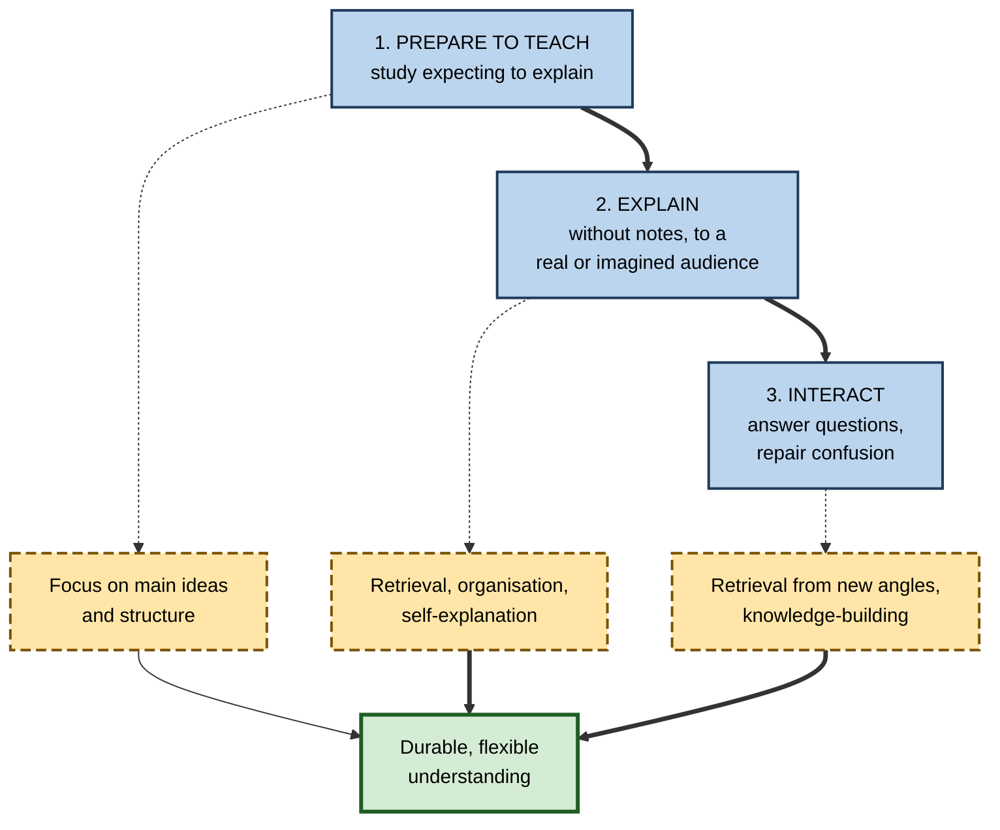
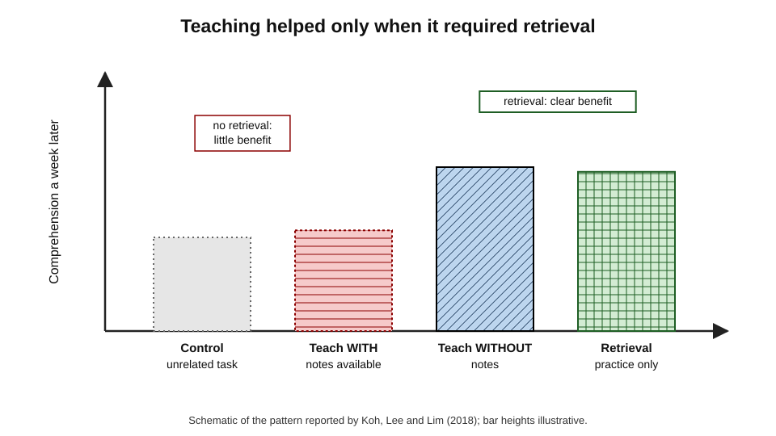
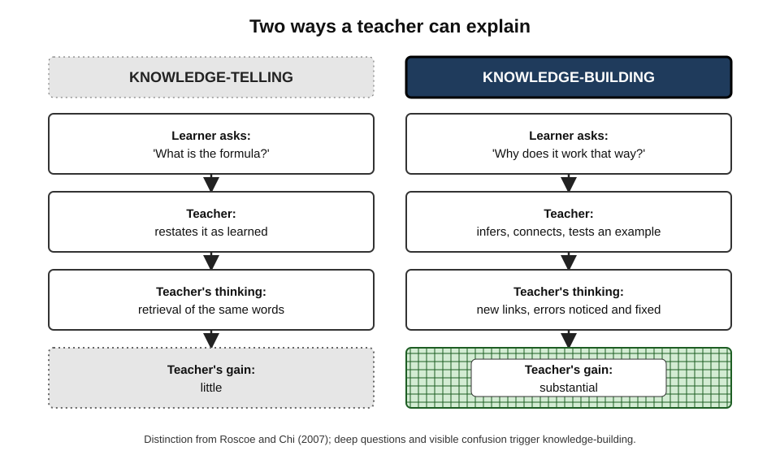
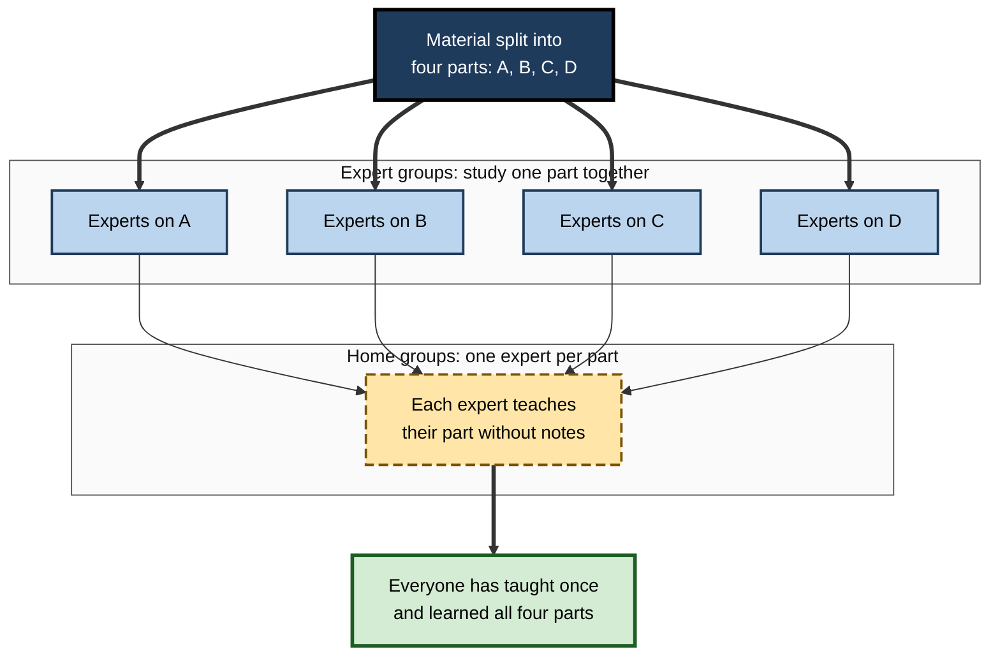
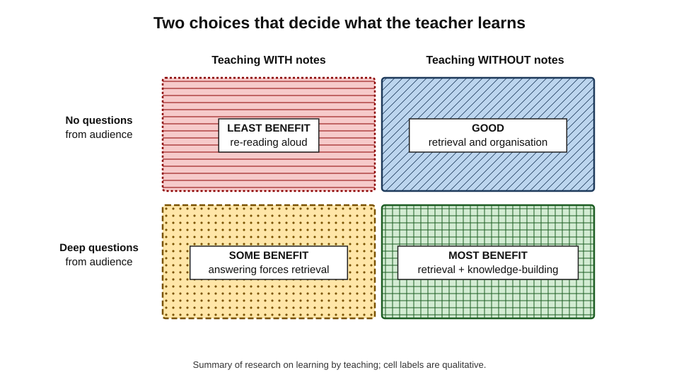
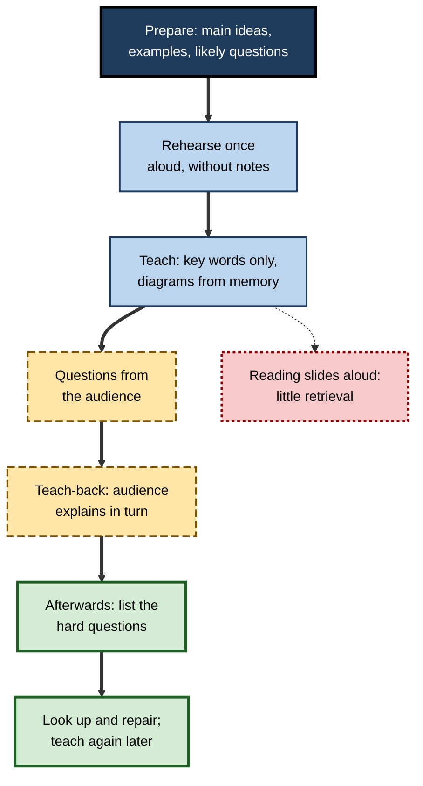

# B.8. Teaching Others for Recall

Many professionals say they only truly understood their subject the first time they had to teach it. A junior engineer asked to run the team's session on the deployment pipeline discovers, in front of colleagues, the two steps she had always copied without understanding. A nurse who explains a new protocol to students finds herself answering questions she had never asked herself. Teaching forces the teacher to retrieve, organise and explain — and to do it for someone who will ask "why?".

> **Definition — Learning by teaching:** the gains in the teacher's own knowledge that result from preparing to teach, explaining material to others and responding to their questions.

**Why it matters**

- **It is recall under the most demanding conditions** — unaided, organised, explained and questioned.
- **It reveals gaps publicly**, so they cannot be ignored.
- **It motivates** — people often prepare more carefully for others than for themselves.
- **It multiplies value** — the learner learns and the audience learns.
- **It is part of professional life** — mentoring, onboarding, client education, conference talks and internal knowledge sharing all involve teaching.

---

## An Old Idea

- **Seneca (first century CE)**, in his letters to Lucilius: *homines dum docent discunt* — "people learn while they teach", later shortened to *docendo discimus*.
- **Monitorial schools (early nineteenth century)** — Andrew Bell and Joseph Lancaster organised schools in which older pupils taught younger ones, partly for economy, partly in the belief that monitors learned by teaching.
- **Lernen durch Lehren (1980s)** — the German educator Jean-Pol Martin developed a method in which school students taught new material to their classmates.
- **Modern research** — from the 1980s onward, psychologists tested which parts of teaching produce learning for the teacher, and why.

> **Key point:** the old intuition is broadly right, but research shows the benefit is **not automatic**. It depends on how teaching is done — and, above all, on whether the teacher has to **retrieve**.

---

## The Three Phases of Teaching

Teaching is not one activity. Each phase contributes differently to the teacher's learning.

### Preparing to teach

- **What happens:** the learner studies **expecting** to explain the material to others.
- **Effect:** more attention to main ideas, structure and possible questions.

**Study card — John Bargh and Yaacov Schul (1980)**

- **Design:** participants studied material either expecting to **teach** it to someone else or expecting to be **tested** on it.
- **Results:** those expecting to teach performed better on a later retention test — even though they never actually taught.
- **Conclusion:** the **expectation** of teaching alone can change how material is studied.

**Study card — John Nestojko, Dung Bui, Nate Kornell and Elizabeth Bjork (2014)**

- **Design:** participants read a passage expecting either to teach it or to take a test, then — without teaching — took a free-recall and short-answer test.
- **Results:** those expecting to teach recalled more, recalled more of the **main points**, and organised their recall better.
- **Conclusion:** a teaching mindset encourages learners to organise material around its key ideas.

> **Definition — Teaching expectancy:** the belief, during study, that one will later have to teach the material.

### Explaining

- **What happens:** the teacher produces an explanation for an audience — ideally without reading from notes.
- **Effect:** retrieval, organisation and self-explanation all occur at once.

### Interacting

- **What happens:** the audience asks questions, misunderstands, objects or needs examples.
- **Effect:** questions force retrieval from new angles and push the teacher beyond what was prepared.

**Figure 1.** The three phases of teaching and what each contributes to the teacher's learning.

---

## What Actually Produces the Benefit

### Teaching versus expecting to teach

**Study card — Logan Fiorella and Richard Mayer (2013)**

- **Design:** students studied a lesson on the Doppler effect expecting either a test or to teach. Some of those expecting to teach then **actually taught** — recording a short video lecture explaining the material.
- **Results:**
  - **expecting to teach** improved performance on an **immediate** test;
  - **actually teaching** produced the advantage on a **delayed** test about a week later.
- **Conclusion:** expectation helps study; the act of explaining is what produces durable learning.

- **Meta-analytic picture:** reviews by Keiichi Kobayashi (2019, and an updated analysis in 2024) concluded that preparing to teach on its own gives at most a **small** benefit, while preparing **and then actually teaching** gives a clearer one.

### The retrieval hypothesis

**Study card — Aloysius Koh, Sze Chi Lee and Stephen Lim (2018)**

- **Design:** after studying a text, participants did one of four things:
  - solved unrelated arithmetic problems (control);
  - taught the material on video **without** notes;
  - taught the material on video **with** their notes available;
  - spent the time on **retrieval practice** alone (writing what they remembered).
- **Results (comprehension test one week later):**
  - teaching **without** notes and retrieval practice both outperformed the control;
  - teaching **with** notes did **not** — it was no better than the control.
- **Conclusion:** much of the benefit of teaching comes from the **retrieval** it requires. Teaching from notes removes the retrieval and with it most of the benefit.

**Figure 2.** Schematic of the Koh, Lee and Lim (2018) pattern: teaching helped only when it required retrieval.

> **Watch out:** the retrieval hypothesis is **strong but not complete**. Some researchers argue that explaining and answering questions add benefits beyond retrieval, especially for deep understanding; the relative weight of each is still debated.

> **Remember:** **teach without notes.** Reading from slides or a script turns teaching into re-reading aloud.

### Knowledge-telling and knowledge-building

**Rod Roscoe and Michelene Chi (2007)** reviewed research on peer tutors and distinguished two ways of explaining.

- **Knowledge-telling** — restating content as learned, summarising the textbook, giving answers.
  - Common; produces little new learning for the tutor.
- **Knowledge-building** — generating new inferences, connecting ideas, monitoring one's own understanding, repairing errors.
  - Less common; produces most of the tutor's learning.
- **What triggers knowledge-building:** deep questions from tutees — especially "why?" and "how?" — and confusions the tutor must work out how to resolve.

> **Definition — Knowledge-telling:** explaining by restating information as learned, without generating new understanding.

> **Definition — Knowledge-building:** explaining by generating new inferences and connections and monitoring one's own understanding.

**Figure 3.** Knowledge-telling compared with knowledge-building.

| | Knowledge-telling | Knowledge-building |
|---|---|---|
| What the teacher does | Restates, summarises, gives answers | Infers, connects, reflects, repairs errors |
| Typical trigger | Shallow questions; no questions | Deep questions; visible confusion |
| Teacher's own learning | Little | Substantial |
| Sign in practice | "As the slide says…" | "Hmm — why *does* that happen? Let me think…" |

### The protégé effect

- **Catherine Chase, Doris Chin, Marily Oppezzo and Daniel Schwartz (2009)** studied students teaching a computer character — a **teachable agent** — about science.
- **Finding:** students spent more effort learning material **for their agent** than for themselves, and learned more.
- **Name:** the **protégé effect** — people work harder to learn on behalf of someone they are responsible for teaching.
- **Possible reasons:** responsibility, a sense of a shared failure being less threatening, and a clear purpose for learning.

> **Definition — Protégé effect:** the tendency to work harder and learn more when preparing to teach someone else than when learning for oneself.

---

## Forms of Teaching for Recall

### Real audiences

- **Peer teaching in pairs** — each person teaches a section to the other, without notes, then they swap.
- **Study-group rotation** — each member owns one topic and teaches it to the group each week.
- **Jigsaw method** — developed by Elliot Aronson in the early 1970s: each student becomes the "expert" on one piece of the material, meets with other experts on the same piece, then returns to teach it to their home group.
- **Mentoring and onboarding** — explaining systems and practices to new colleagues.
- **Brown-bag talks and internal presentations** — short sessions sharing expertise.
- **Client and patient education** — explaining options, risks and plans.

**Figure 4.** The jigsaw method: every student both learns and teaches.

### Imagined and artificial audiences

- **Explaining to an imagined student** — speaking or recording an explanation as if teaching someone.
  - Studies by Vincent Hoogerheide and colleagues found that explaining on video to a fictitious peer often helped learning, sometimes as much as teaching a live audience.
- **Teachable agents** — software characters that "learn" from what the student teaches them, as in the protégé-effect research.
- **AI tools as students** — an AI can be instructed to play a confused novice who asks questions; the learner must explain until the "student" understands.

> **Watch out:** an imagined audience never asks the unexpected question. Real audiences are better at triggering **knowledge-building**; imagined ones are convenient for practising **retrieval and organisation**.

### Writing for others

- **Tutorials, explainers and internal wiki articles** — written teaching.
- **Answering questions on internal forums** — each answer is retrieval cued by someone else's question.
- **Risk:** writing is usually done with sources open, which reduces retrieval. Drafting the core explanation from memory first, then checking, restores it.

---

## Designing a Teaching Session That Teaches the Teacher

### Principles

- **Prepare for explanation, not recitation** — organise around main ideas, causes and examples; anticipate questions.
- **Deliver without notes** — at most a few key words or a diagram drawn from memory.
- **Invite questions, especially "why" and "what if"** — they trigger knowledge-building.
- **Ask the audience to explain back** — their errors show where the explanation was unclear, and repairing them requires further retrieval.
- **Reflect afterwards** — write down the questions that were hard to answer and look them up.
- **Teach again later** — a second session on the same topic, weeks later, is spaced retrieval.

> **Mnemonic — "TEACH":** **T**hink about main ideas while preparing, **E**xplain without notes, **A**sk for questions, **C**heck understanding by teach-back, **H**unt down what you could not answer.

**Figure 5.** How notes and questions shape the teacher's benefit.

**Figure 6.** A teaching session designed for the teacher's learning.

### Common errors

- **Teaching from a script** — the most common way to lose the benefit.
- **Avoiding questions** — "We're short of time" removes the phase that drives knowledge-building.
- **Over-preparing slides, under-preparing understanding** — polishing visuals instead of rehearsing the explanation.
- **Teaching too soon** — before basic understanding, the teacher may spread errors confidently.
- **Treating the audience as passive** — without teach-back, the teacher does not learn where the explanation failed.

---

## Limits and Risks

- **Time cost** — preparing to teach takes longer than studying alone; it is best reserved for central topics.
- **Errors spread** — a teacher's misconception can be learned by the audience; expert review or source checking matters when stakes are high.
- **Anxiety** — some learners find teaching stressful enough to impair performance, especially early on.
- **Uneven benefits** — in peer tutoring the tutor may gain more than the tutee, or vice versa, depending on design.
- **The evidence base is mixed** — many studies are short laboratory experiments with simple texts; classroom and workplace studies are fewer and more varied in results.

> **Watch out:** the surgical maxim "see one, do one, teach one", often attributed to the training system of William Halsted in the late nineteenth century, captures the idea that teaching consolidates skill. It is now widely criticised as a training standard: seeing a procedure once is not enough to do it safely, let alone to teach it. Teaching consolidates knowledge **that has been built**; it does not replace building it.

---

## Worked Example: A Fifteen-Minute Internal Talk

**Situation:** a compliance analyst must brief colleagues on a new anti-money-laundering rule. She considers two ways of preparing.

| | Design A: read-out briefing | Design B: teaching for recall |
|---|---|---|
| Preparation | Copies key paragraphs onto twelve slides | Writes a one-page outline of main ideas and three examples; lists five likely questions |
| Rehearsal | Reads slides silently | Explains aloud twice from the outline, then once with no notes |
| Delivery | Reads each slide | Uses four slides with diagrams only; explains from memory |
| Questions | Two minutes at the end, if time | Pauses twice for questions; ends by asking two colleagues to explain the main change back |
| Afterwards | — | Notes the two questions she could not fully answer; looks them up; emails the answers |
| Her retrieval during the session | Almost none | Continuous |

**Steps in Design B**

1. **Outline main ideas**, not content to be read.
2. **Rehearse without notes** to find the parts she cannot explain.
3. **Deliver from memory**, using diagrams she can redraw.
4. **Invite and answer questions**; use teach-back.
5. **Close the gaps** revealed by hard questions.

- **Conclusion:** Design B takes about the same total time but turns the briefing into deep recall practice for the presenter, and the audience understands more because the explanation is organised around ideas, not paragraphs.

> **Watch out:** in Design B, if she cannot answer a question, the right response is "I'm not sure — I'll check and come back to you", not a confident guess. Accurate teaching protects both the audience and the teacher's own memory from errors.

---

## Teaching in Professional Practice

### Where teaching builds expertise

- **Medicine** — trainees present cases and teach more junior colleagues; questioning on ward rounds triggers knowledge-building.
- **Software engineering** — engineers run "lunch and learn" sessions and onboard new hires; explaining a system's design often reveals undocumented assumptions.
- **Consulting** — consultants who must teach clients a new method understand it more deeply than those who only apply it.
- **Law** — senior associates train trainees; explaining a judgment's reasoning tests their own grasp.
- **Sales** — experienced sellers coaching new ones refine their own product knowledge.

> **In practice:** organisations that ask experts to teach — through internal academies, mentoring or knowledge-sharing rotas — gain twice: the audience learns, and the experts' knowledge is consolidated and made explicit.

### Case study: a knowledge-sharing rota for a legacy system

- **Situation:** a bank's payments team relied on a twenty-year-old system that only three senior engineers fully understood.
- **Problem:** documentation was outdated; when one senior engineer left, a production incident took days to resolve.
- **Diagnosis:**
  - knowledge of the system was concentrated and largely tacit;
  - junior engineers read code and documentation but rarely had to explain the system to anyone, so their understanding stayed shallow.
- **Actions:**
  1. A fortnightly **teaching rota**: each session, a **junior** engineer taught one subsystem to the team for twenty minutes, without slides, drawing the architecture from memory on a whiteboard.
  2. A senior engineer attended each session and asked "why" and "what happens if" questions.
  3. Questions the teacher could not answer were logged; the teacher researched them and reported back at the next session.
  4. Each session's whiteboard drawing, corrected, became part of updated documentation.
- **Result:** within a year every subsystem had been taught at least twice by different people; documentation was rebuilt; incident resolution no longer depended on the remaining senior engineers.
- **Side effects:** early sessions were stressful for juniors; the team agreed that "I don't know yet" was an acceptable answer and that sessions were never used in performance reviews.
- **Lesson:** making juniors **teach** — rather than read — turned shallow familiarity into explainable knowledge and spread it across the team.

---

## Open Questions

- **How much does teaching add beyond retrieval?**
  - Retrieval explains much of the benefit; whether explaining and interaction add substantially more, and for which kinds of knowledge, is debated.
- **Are imagined audiences as good as real ones?**
  - Video explanations to fictitious peers often help, but real questions may matter for deep understanding; direct comparisons are limited.
- **How should AI "students" be designed?**
  - An AI that asks good questions could trigger knowledge-building; whether it does so as well as human learners is unknown.
- **Who benefits most from teaching?**
  - Prior knowledge, anxiety and communication skill may change the benefit; individual differences are under-studied.
- **How can workplaces measure the teacher's learning?**
  - Organisations track whether audiences learned, rarely whether the teachers did.

---

## Summary

- **Learning by teaching** = gains for the teacher from preparing, explaining and answering questions; an old idea (*docendo discimus*) confirmed with qualifications.
- **Three phases:** preparing to teach (**teaching expectancy** — Bargh and Schul; Nestojko and colleagues: better organisation of main points), **explaining** and **interacting**.
- **Fiorella and Mayer (2013):** expecting to teach helped immediately; **actually teaching** produced the delayed benefit. Meta-analyses: preparing alone small, preparing and teaching clearer.
- **Koh, Lee and Lim (2018):** teaching **without notes** helped; teaching **with notes** did not — much of the benefit is **retrieval**.
- **Roscoe and Chi (2007):** **knowledge-telling** gives little; **knowledge-building**, triggered by deep questions, gives most.
- **Protégé effect** (Chase and colleagues, 2009): people work harder to learn for someone they teach.
- Forms: pairs, rotations, **jigsaw**, mentoring, talks, imagined audiences, teachable agents, AI "students", written teaching from memory.
- Design with **TEACH**: think main ideas, explain without notes, ask for questions, check by teach-back, hunt down unanswered questions.
- Limits: time, spreading errors, anxiety, mixed evidence; "see one, do one, teach one" is no substitute for building competence first.

---

## Self-Check

1. Define learning by teaching and name its three phases.
2. What did Bargh and Schul (1980) and Nestojko and colleagues (2014) find about teaching expectancy?
3. Distinguish the immediate and delayed effects found by Fiorella and Mayer (2013).
4. Describe the Koh, Lee and Lim (2018) study and what it implies for how to teach.
5. Distinguish knowledge-telling from knowledge-building and explain what triggers the latter.
6. What is the protégé effect, and what are possible reasons for it?
7. Explain how the jigsaw method makes every student a teacher.
8. Compare real, imagined and AI audiences for teaching as recall practice.
9. Why does writing a tutorial often give less recall benefit than teaching aloud, and how can this be fixed?
10. List the TEACH principles.
11. A manager says "I've presented this deck twenty times, so I know it inside out." What might be wrong?
12. Why is "see one, do one, teach one" criticised as a training standard?
13. Redesign a weekly team meeting so that it also serves as teaching-for-recall practice.
14. A study group's members each read their section aloud to the others. Diagnose and improve the method.

### Answer Key

1. The teacher's own learning from preparing to teach, explaining and answering questions. Phases: preparing to teach, explaining, interacting.
2. Learners who expected to teach performed better on later tests than those expecting a test, even without teaching; they recalled more main points and organised recall better.
3. Expecting to teach improved an immediate test; actually teaching (explaining on video) produced the advantage on a test a week later.
4. After studying, participants did arithmetic, taught without notes, taught with notes, or practised retrieval. A week later, teaching without notes and retrieval practice beat the control, but teaching with notes did not. Teach without notes so that teaching involves retrieval.
5. Knowledge-telling restates content as learned; knowledge-building generates inferences, connections and repairs. Deep questions and visible confusion from learners trigger knowledge-building.
6. The tendency to work harder and learn more when preparing to teach someone else. Possible reasons: responsibility for the learner, a clear purpose, and failure feeling less threatening when shared.
7. Material is split into parts; each student masters one part in an expert group, then teaches it to a home group containing experts on the other parts, so everyone teaches once and learns all parts.
8. Real audiences ask unexpected deep questions and trigger knowledge-building but are less available. Imagined audiences are convenient for retrieval and organisation but never interrupt. AI audiences can ask questions on demand, but their questioning quality and effects are not yet well established.
9. Tutorials are usually written with sources open, so little is retrieved. Draft the core explanation from memory first, then check and revise.
10. Think about main ideas while preparing; Explain without notes; Ask for questions; Check by teach-back; Hunt down what could not be answered.
11. Presenting from a deck may be reading aloud with little retrieval and little questioning; familiarity with slides is not the same as being able to explain or answer novel questions without them.
12. Seeing a procedure once is far from sufficient to perform it safely, let alone teach it; teaching consolidates competence that has been built, it does not create it.
13. E.g. rotate a ten-minute "teach the team" slot in which one member explains, without slides, a recent problem or a part of the system; others ask "why" and "what if"; one listener explains it back; unanswered questions are logged and answered next week.
14. Reading aloud is re-exposure, not retrieval, and listeners are passive. Each member should teach their section from memory with a single diagram, answer questions, and ask another member to explain back; sections should rotate across weeks.

---

## Glossary

| Term | Meaning |
|---|---|
| Docendo discimus | "By teaching, we learn" — a Latin maxim derived from Seneca. |
| Jigsaw method | Each learner masters one part of the material and teaches it to a group. |
| Knowledge-building | Explaining by generating new inferences and connections. |
| Knowledge-telling | Explaining by restating information as learned. |
| Learning by teaching | Gains for the teacher from preparing, explaining and answering questions. |
| Monitorial system | Nineteenth-century schooling in which older pupils taught younger ones. |
| Peer tutoring | Learners teaching other learners of similar standing. |
| Protégé effect | Working harder and learning more when preparing to teach someone else. |
| Retrieval hypothesis (of teaching) | The claim that much of teaching's benefit comes from the retrieval it requires. |
| Teach-back | Asking listeners to explain back what they understood. |
| Teachable agent | A software character that "learns" from what a student teaches it. |
| Teaching expectancy | The belief during study that one will later teach the material. |
