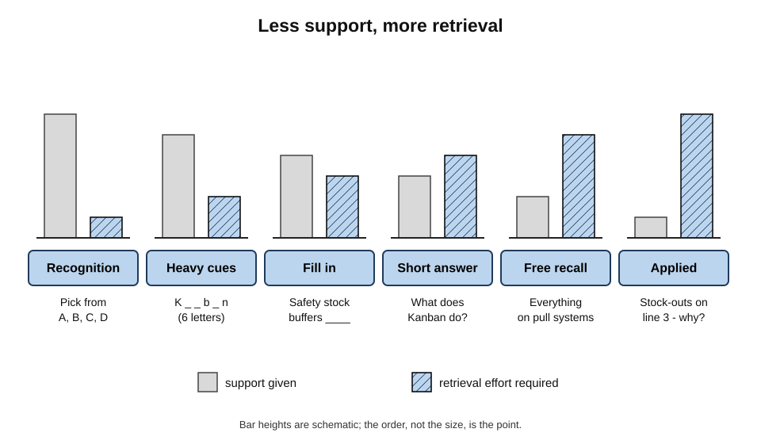
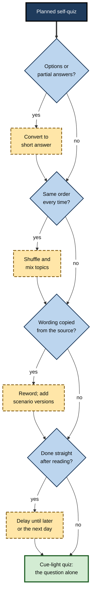
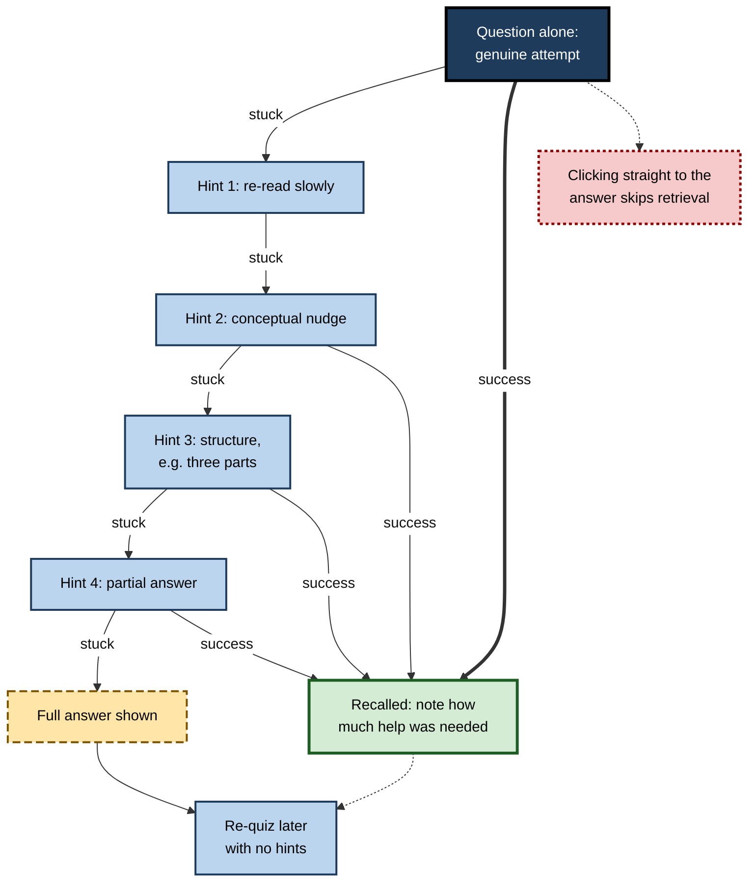
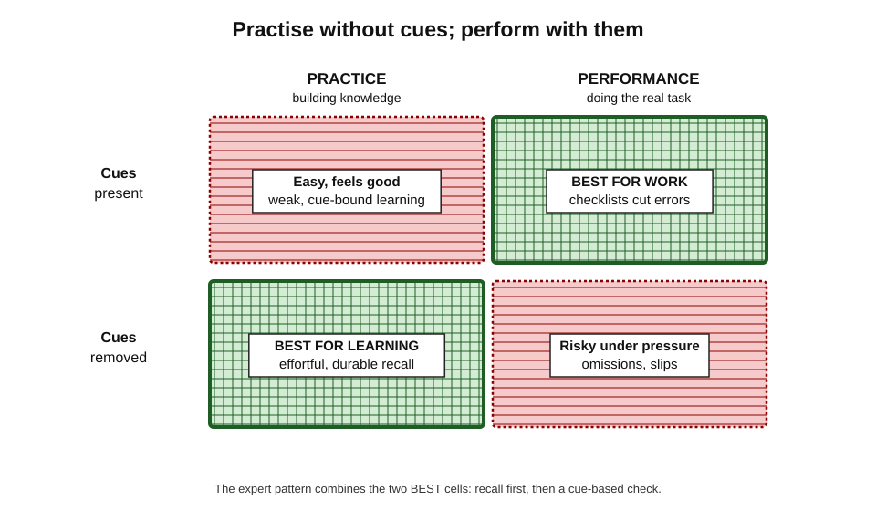
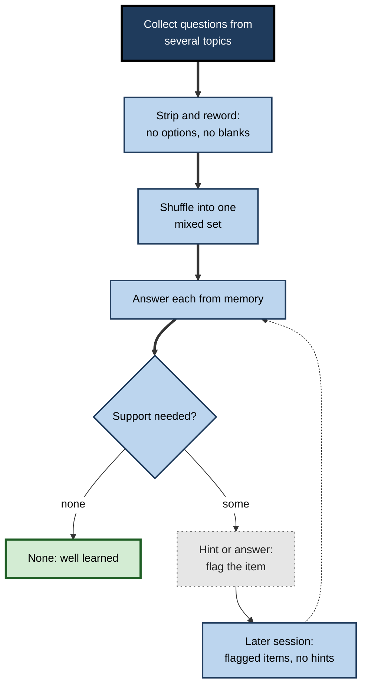

# B.9. Self-Quizzing Without Cues

A learner answers every card in her deck correctly — in order, at her desk, with the chapter title at the top of the app. In the exam, the same facts arrive in a different order, in different words, mixed with other topics, and half of them will not come. She had been quizzing herself, but with **cues** she never noticed: the order of the cards, the wording, the setting, the chapter. Removing those hidden props is what turns self-quizzing into recall that survives the real world.

> **Definition — Cue-free self-quizzing:** testing oneself in a way that removes, as far as possible, every prompt, hint, option and contextual clue that is not part of the question itself, so that the answer must be produced from memory alone.

**Why it matters**

- **Support at practice is borrowed strength** — every cue does part of the retrieval for the learner.
- **Real use rarely provides the same cues** — customers, examiners and problems ask in their own words and their own order.
- **Less support means more effortful retrieval**, which generally builds more durable memory.
- **Hidden cues create false confidence** — the learner believes she knows what she can only recall with the props in place.
- **It is a matter of design, not effort** — the same study time can be made far more demanding simply by stripping cues.

---

## What a Cue Is

> **Definition — Retrieval cue:** any information present at the moment of recall that helps bring a memory to mind.

### Intended cues

- **The question itself** — "What is the capital of Kenya?"
- **A term to define** — "Amortisation?"
- **A scenario** — "A patient on warfarin is prescribed an antibiotic. What is the risk?"

### Extra cues that do part of the work

- **Options** — multiple-choice alternatives; the answer is on the page.
- **Partial answers** — first letters, word lengths, blanks inside a familiar sentence.
- **Hints** — "it starts with…", "think about the second step".
- **Wording copied from the source** — the question repeats the textbook sentence, which primes the answer.

### Hidden cues

- **Order** — cards or questions always met in the same sequence; each answer cues the next.
- **Position and layout** — remembering where on the page or slide the answer was.
- **Topic context** — knowing the quiz is "Chapter 6: Tax" narrows the search before the question is read.
- **Physical setting** — the same desk, the same time, the same music.
- **Recency** — quizzing straight after reading, while the material is still in working memory.

> **Key point:** most learners remove the obvious cue — the answer — but leave the hidden ones in place. Each hidden cue makes practice easier and the memory more dependent on conditions that will not be present later.

---

## The Spectrum of Cue Support

Recall tasks can be arranged by how much support they provide.

1. **Recognition** — pick the answer from options.
2. **Heavily cued recall** — first letters, word count or a nearly complete sentence.
3. **Fill in the blank** — one key term missing from a familiar sentence.
4. **Short answer** — a direct question with no hints.
5. **Free recall** — "Write everything you know about…"
6. **Applied recall in a new context** — the knowledge must be retrieved because a novel situation calls for it, without being named.

**Figure 1.** The spectrum of cue support, from recognition to applied recall.

| Format | Support given | What the learner must do | Typical risk |
|---|---|---|---|
| Recognition | The answer among options | Discriminate | Overestimates knowledge; learns wrong options |
| Heavily cued recall | Part of the answer | Complete it | Recall depends on the cue |
| Fill in the blank | The sentence around the answer | Supply one term | Sentence shape gives the answer away |
| Short answer | The question only | Produce the answer | Wording can become a cue if never varied |
| Free recall | A topic | Find, organise and produce | Slower to check |
| Applied recall | A novel situation | Recognise what is relevant and produce it | Needs realistic cases to practise |

---

## The Evidence for Fewer Cues

### Less support at practice, better retention later

**Study card — Shana Carpenter and Edward DeLosh (2006)**

- **Design:** participants studied word lists, then practised with one of three test types — **free recall**, **cued recall** or **recognition** — and later took a final test that could itself be any of the three.
- **Results:** practising with **free recall** — the least supported test — produced the best final performance, **whatever** the format of the final test.
- **Conclusion:** the less support a practice test provides, the more it benefits later memory — consistent with the idea that harder, wider searches build more routes to the target.

### Short answer versus multiple choice

**Study card — Sean Kang, Kathleen McDermott and Henry Roediger (2007)**

- **Design:** students read short articles, then took either a **short-answer** or a **multiple-choice** practice test, with or without feedback; a final test followed days later.
- **Results:**
  - **with feedback**, short-answer practice produced better final performance than multiple-choice practice — on both short-answer and multiple-choice final tests;
  - **without feedback**, the advantage could reverse, because learners failed many short-answer questions and had no way to learn the answers.
- **Conclusion:** production with feedback beats selection; when production mostly fails, feedback is essential.

> **Watch out:** "fewer cues is always better" is too strong. When unaided recall **mostly fails** and no feedback follows, learners gain little. The rule is: **as little support as possible, as much as necessary — and always feedback.**

### Context and order

- **Order effects** — practising items in a fixed order lets each item cue the next; shuffling removes the crutch.
- **Context effects** — memories can become tied to the setting in which they were learned; Steven Smith, Arthur Glenberg and Robert Bjork (1978) found that studying the same material in **two different rooms** led to better later recall than studying it twice in one room.
- **Implication:** varying the setting, time and order of self-quizzing makes recall less dependent on any one context.

> **Definition — Context-dependent memory:** better recall when the conditions at retrieval match those at learning.

---

## Auditing Hidden Cues

Before starting a quiz, a learner can check which supports are present and remove those that will not exist at the real test.

**Figure 2.** Auditing a self-quiz for hidden cues.

### Six ways to strip cues

- **Hide the options** — answer multiple-choice questions before looking at the choices; only then check whether the produced answer is among them.
- **Shuffle** — randomise card and question order every session.
- **Mix topics** — combine questions from several chapters so the topic does not announce itself.
- **Reword** — ask the same idea in new words, from the other direction, or as a scenario.
- **Delay** — quiz later the same day or the next day, not straight after reading.
- **Change the setting** — quiz on a walk, on the train, at a different desk; occasionally aloud to a partner who asks in their own words.

> **Mnemonic — "HSMRDC" — "Hide, Shuffle, Mix, Reword, Delay, Change":** six ways to make the question the only cue.

---

## When Unaided Recall Fails: Graduated Hints

Removing cues sometimes leaves the learner with nothing. Rather than turning straight to the answer, graduated hints provide the **minimum** help needed, so that most of the retrieval is still the learner's own.

### The hint ladder of increasing support

1. **Re-read the question slowly** — sometimes a misread word is the problem.
2. **A conceptual nudge** — "Think about what happens to cash, not profit."
3. **A structural hint** — "There are three components."
4. **A partial answer** — the first component, or the first letter of the term.
5. **The full answer** — then re-attempt the item later without help.

**Figure 3.** Graduated hints: give the least help that lets recall succeed.

### What research says about hints and fading cues

- **Fading cues** — practice that begins with substantial cues (several letters of the answer) and removes them over successive attempts.
  - Research by Jason Finley and colleagues (2011) and by Kathryn Fiechter and Aaron Benjamin (2018) suggests that graduated cues can **rescue learning when unaided recall mostly fails**, by allowing successful but still effortful retrievals.
  - Where unaided recall with feedback is already possible, fading cues are **not reliably better**.
- **Hint abuse in tutoring software** — Vincent Aleven and Kenneth Koedinger, studying computer tutors in the early 2000s, found that many students clicked rapidly through hints to reach the final "bottom-out" hint that gave the answer, bypassing the thinking the hints were meant to prompt.

> **Watch out:** findings on graduated cues are **mixed** and depend on how often unaided recall succeeds. The safest rule is to use hints only after a genuine attempt, and to take the **smallest** hint that works.

> **Definition — Bottom-out hint:** the final hint in a sequence, which gives the answer outright.

---

## Cues in Practice Versus Cues in Performance

Removing cues during **practice** is not the same as refusing them during **work**. Many professions deliberately supply cues at the point of performance — and should.

- **Checklists in surgery and aviation** — the surgeon Atul Gawande, in *The Checklist Manifesto* (2009), described how short checklists reduce errors in complex, high-stakes work.
- **Decision aids in medicine**, **runbooks in operations**, **templates in law** — all provide cues so that experts do not rely on memory alone under pressure.

**Figure 4.** Cues during practice and during performance serve different purposes.

| | During practice | During performance |
|---|---|---|
| Purpose of the activity | Build durable, flexible memory | Get the task right now |
| Effect of extra cues | Reduce retrieval effort and learning | Reduce errors and omissions |
| Best default | Remove cues the real situation will not provide | Provide well-designed cues where errors are costly |
| Example | Rehearse the emergency procedure without the card | Use the card during the real emergency, after memory items |

> **Key point:** experts practise **without** cues so that knowledge is in the head, and work **with** cues so that nothing is missed. The two are complementary.

> **In practice:** pilots perform certain memory items unaided and then confirm them against the checklist. That design — recall first, then a cue-based check — is a good model for professional knowledge generally.

---

## Building Cue-Free Self-Quizzing Into Study

### Session design

1. **Collect questions** across several topics studied over the past week or more.
2. **Strip them** — no options, no partial answers, reworded where possible.
3. **Shuffle** into a single mixed set.
4. **Answer each from memory** in writing or aloud, with no hints.
5. **For failures, use the smallest hint** that allows success, or the full answer.
6. **Mark how much support each item needed** — none, hint, answer.
7. **Return later** to every item that needed help, with no hints.

**Figure 5.** A cue-free self-quizzing session.

### Professional examples of cue-free practice

- **Software** — writing a query or function without autocomplete or an AI assistant, then comparing with documentation.
- **Medicine** — calculating a paediatric dose on paper before checking the electronic calculator.
- **Law** — stating the elements of a cause of action before opening the practitioner text.
- **Finance** — estimating the effect of a rate change on a bond's price by reasoning before running the model.
- **Languages** — speaking without a phrasebook or translation app.

> **Watch out:** autocomplete, search and AI assistants are **permanent cues**. They are excellent for performance and poor for practice. A professional who never works without them may discover — in an interview, an outage or a negotiation — how much of their skill was the tool's.

---

## Worked Example: Stripping the Cues From a Quiz

**Situation:** a supply-chain trainee has a 20-question practice quiz from her course. She scores 18 out of 20, but scores 11 out of 20 on a mixed, open-answer mock exam.

| Original question | Hidden or extra cue | Cue-free version |
|---|---|---|
| "Which of these is a pull system? (a) MRP (b) Kanban (c) EOQ (d) DRP" | Options | "Name a pull-based inventory method and explain what makes it 'pull'." |
| "Safety stock protects against variability in ______ and lead time." | Sentence frame | "What two sources of uncertainty does safety stock buffer, and how does each affect its size?" |
| Questions 1–10 all from Chapter 3, in chapter order | Topic and order | Mixed with questions from Chapters 2, 4 and 5, shuffled |
| "Define the bullwhip effect." (after reading the bullwhip section) | Recency | Asked the next day, as: "A retailer's orders swing far more than customer demand. What is happening and why?" |

**Steps**

1. **Identify** the support each question gives beyond the question itself.
2. **Rewrite** to remove it — no options, no frames, scenario wording.
3. **Mix and delay** the quiz.
4. **Re-take** — she scores 12 out of 20 on the stripped quiz, close to her mock exam score.
5. **Target** — the eight failures become her study list; two weeks later she scores 17 on a new stripped quiz.

- **Conclusion:** her original 18/20 measured recall **with props**; the stripped quiz measured recall **without** them — and predicted her exam performance far better.

> **Formula — Cue dependence (rough check):** score with cues − score without cues. Example: 18 − 12 = **6** questions that were being answered by the cues rather than by memory.

---

## Case Study: The Autocomplete Generation

- **Situation:** a software consultancy found that recently hired developers performed well on day-to-day tickets but struggled during on-site client workshops and production incidents, where they had to reason about code on a whiteboard or in an unfamiliar environment.
- **Problem:** juniors could not recall common library functions, basic query syntax or the structure of the company's main framework without their IDE's autocomplete and an AI assistant.
- **Diagnosis:**
  - all practice had been **cue-rich** — the tools suggested names, signatures and patterns as they typed;
  - the developers had rarely retrieved anything unaided, so their knowledge was largely **recognition**;
  - internal quizzes were multiple-choice and taken in the IDE.
- **Actions:**
  1. Weekly 30-minute **"unplugged" katas**: small problems solved in a plain text editor, without autocomplete, search or AI.
  2. Solutions were then run and compared with idiomatic versions, with feedback from a senior developer.
  3. Internal quizzes were rewritten as short-answer and scenario questions, shuffled across topics.
  4. Tools remained fully available for normal work — the change was confined to practice.
- **Result:** within a few months, juniors' whiteboard sessions and incident contributions improved markedly; several said they now used the AI assistant to check their own ideas rather than to generate them.
- **Side effects:** the katas were initially unpopular and felt "artificially hard"; managers framed them as training, not assessment.
- **Lesson:** cue-rich tools are excellent for **performance** but hide gaps in **knowledge**; regular cue-free practice keeps the knowledge in the head.

---

## Open Questions

- **When do fading cues beat unaided recall with feedback?**
  - Evidence suggests they help when unaided success is low, but the boundary is not precise.
- **How much context variation is optimal?**
  - Varying settings can help, but most studies are short and use simple materials.
- **How should AI assistants be throttled during practice?**
  - Tools that offer graduated hints rather than answers seem promising; design principles are still being worked out.
- **Can learners judge their own cue dependence?**
  - Learners rarely notice hidden cues; methods for making them visible are little studied.
- **How should professions balance memory and cues?**
  - Checklists and decision aids are valuable, but how much must still be recalled unaided varies by field and is rarely specified.

---

## Summary

- **Cue-free self-quizzing** = testing oneself with the question as the only cue, so the answer comes from memory alone.
- **Retrieval cues** can be intended (the question), extra (options, partial answers, hints, copied wording) or hidden (order, layout, topic, setting, recency).
- **Cue spectrum:** recognition → heavily cued → fill-in → short answer → free recall → applied recall.
- **Evidence:** free-recall practice beat cued recall and recognition on every final test (**Carpenter and DeLosh, 2006**); short answer with feedback beat multiple choice (**Kang, McDermott and Roediger, 2007**); studying in varied rooms helped (**Smith, Glenberg and Bjork, 1978**).
- Rule: **as little support as possible, as much as necessary — and always feedback.**
- Strip cues: **Hide, Shuffle, Mix, Reword, Delay, Change**.
- When stuck, use **graduated hints** — the smallest that works; avoid racing to the **bottom-out hint**. Evidence on fading cues is mixed.
- **Practice without cues; perform with cues** — checklists and decision aids belong in real work.
- Tools such as autocomplete and AI assistants are **permanent cues**; schedule cue-free practice.

---

## Self-Check

1. Define cue-free self-quizzing and distinguish intended, extra and hidden cues.
2. Arrange these from most to least support: free recall, multiple choice, fill-in-the-blank, applied recall, short answer.
3. Describe the Carpenter and DeLosh (2006) study and its conclusion.
4. What did Kang, McDermott and Roediger (2007) find, and why did feedback matter?
5. Why can studying in two rooms improve later recall?
6. List the six ways to strip cues from a self-quiz.
7. Describe a hint ladder and explain why the smallest effective hint is best.
8. What is hint abuse, and how can it be prevented?
9. Why is it sensible to practise without a checklist but use one during real work?
10. A learner scores 19/20 on chapter-end multiple-choice questions and 9/20 on a mixed open-answer test. Calculate cue dependence and explain the gap.
11. Rewrite this question cue-free: "The ______ ratio compares current assets to current liabilities."
12. Design a weekly cue-free practice for a nurse learning drug interactions.
13. A team relies on an AI assistant for all coding. Propose a policy that preserves productivity and builds knowledge.

### Answer Key

1. Testing oneself so that only the question cues the answer. Intended cues are the question, term or scenario; extra cues are options, partial answers, hints and copied wording; hidden cues are order, layout, topic context, setting and recency.
2. Multiple choice → fill-in-the-blank → short answer → free recall → applied recall.
3. Participants practised with free recall, cued recall or recognition and took final tests of each type. Free-recall practice gave the best final performance on all final formats — less support at practice produced better retention.
4. With feedback, short-answer practice beat multiple choice on both final formats; without feedback, it could lose because many short-answer attempts failed and learners never learned the answers. Feedback allows failed production attempts to become learning.
5. Memory becomes tied to multiple contexts, so recall depends less on any one setting and is more accessible in a new one.
6. Hide the options; Shuffle; Mix topics; Reword; Delay; Change the setting.
7. A sequence from re-reading the question, to a conceptual nudge, to a structural hint, to a partial answer, to the full answer. The smallest effective hint leaves most of the retrieval to the learner, preserving its benefit.
8. Clicking rapidly through hints to reach the bottom-out answer, skipping the thinking. Prevent it by requiring a genuine attempt before each hint, delaying hints, or limiting their number.
9. Practice without cues builds durable knowledge in memory; checklists in real work catch errors and omissions under pressure. The combination — recall, then check — gives both capability and safety.
10. 19 − 9 = **10**. Ten answers depended on options, topic context, order or recency rather than unaided memory.
11. "Which liquidity ratio compares current assets with current liabilities, and what does a value below 1 suggest?" — or as a scenario.
12. E.g. three times a week, ten mixed scenario questions on interactions, shuffled, answered in writing without the formulary; smallest hint if stuck; check; flag items needing help; flagged items return two days later without hints; the formulary is still used on the ward for every real decision.
13. E.g. keep the assistant for production work; schedule a weekly unplugged session solving problems without it; require developers to outline their approach before invoking the assistant; use the assistant to review human-written code; rotate whiteboard design discussions without tools.

---

## Glossary

| Term | Meaning |
|---|---|
| Applied recall | Retrieving knowledge because a new situation requires it, without its being named. |
| Bottom-out hint | The final hint in a sequence, which gives the answer. |
| Context-dependent memory | Better recall when retrieval conditions match learning conditions. |
| Cue dependence | The extent to which recall relies on cues absent from the real test. |
| Cue-free self-quizzing | Self-testing in which the question is the only cue. |
| Fading cues | Practice that begins with substantial cues and removes them over attempts. |
| Graduated hints | A sequence of increasingly informative hints. |
| Hidden cue | An unnoticed prompt such as order, layout, topic or setting. |
| Hint abuse | Racing through hints to reach the answer without thinking. |
| Retrieval cue | Information present at recall that helps bring a memory to mind. |
| Short-answer question | A question requiring the answer to be produced, without options. |
