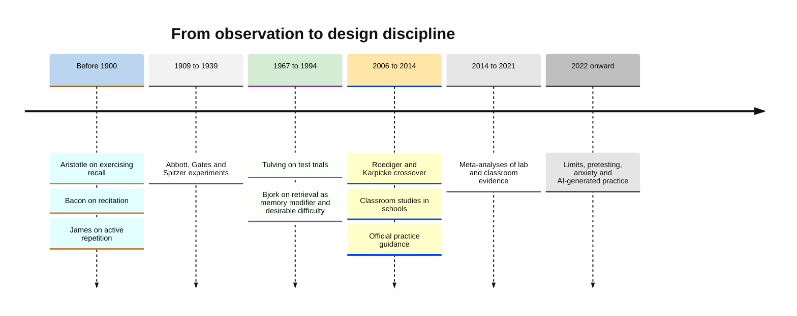
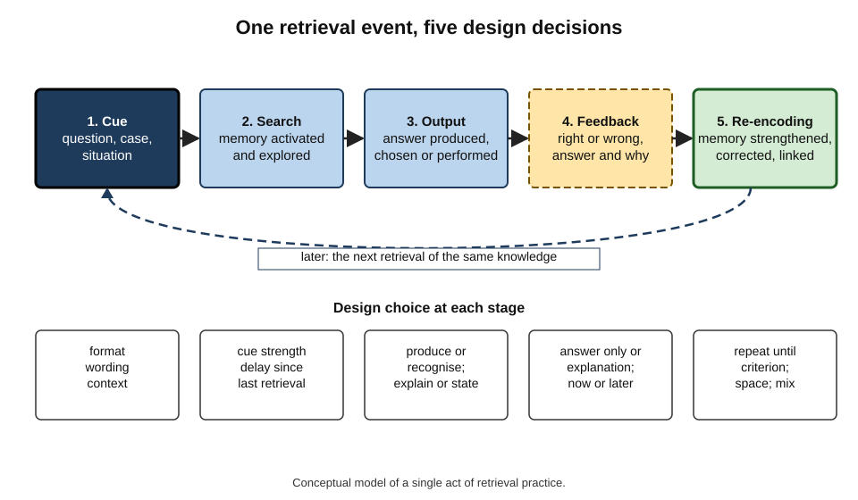
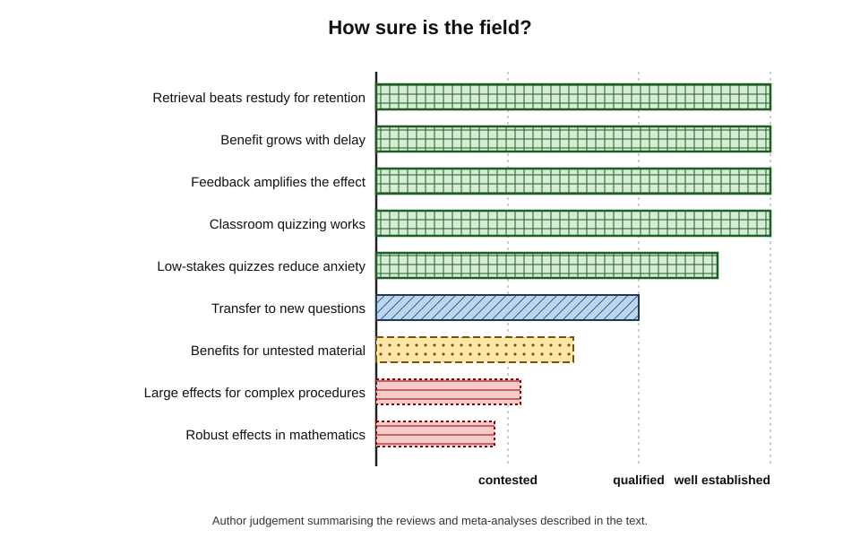
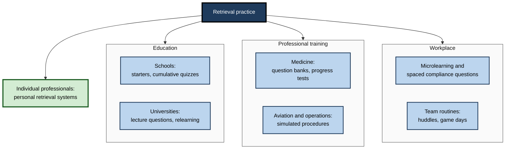

# C. Retrieval Practice

For most of the history of education, tests were treated as the end of learning: knowledge was taught, then measured, and the measurement changed nothing. A century of experiments has overturned that picture. **Bringing knowledge back out of memory is itself one of the most powerful ways of putting it there** — more powerful, in most comparisons, than studying it again.

Retrieval practice is the deliberate use of that fact: by learners revising for exams, by teachers designing lessons, by medical schools, airlines, software teams and regulators designing training, and increasingly by software that decides which question to ask next.

> **Definition — Retrieval practice:** the deliberate use of retrieval — recalling, reconstructing or applying knowledge from memory, as on a quiz, test or task — as a learning activity, designed so that the act of retrieval strengthens, organises and corrects what is known.

**Why it matters**

- It is among the **best-replicated** findings in the science of learning, with evidence from laboratories, schools, universities, medical training and workplaces.
- It **costs almost nothing** — a question, a moment of effort and an answer — yet changes how long knowledge lasts.
- It **reveals the truth** about what is known, to the learner and to the teacher, while also improving it.
- It is **systematically under-used**, because it feels harder and less productive than re-reading.
- When AI tools can answer almost any question instantly, deliberate retrieval is what keeps essential knowledge **in the professional's own head**, where judgement needs it.

---

## The Subject and Its Scope

### Three things the term names

- **A finding** — the **testing effect**: retrieval improves long-term retention more than equivalent restudy.
- **A research programme** — a century of experiments on when, why and for whom retrieval helps, and how it should be designed.
- **A design discipline** — the practice of building retrieval into study, teaching, training and tools: choosing formats, timing, feedback, difficulty, stakes and maintenance.

> **Key point:** retrieval practice is defined by its **purpose**. The same quiz can be an assessment (to measure) or retrieval practice (to teach); what differs is how it is designed and used.

### Neighbouring ideas

- **Active recall** — the everyday name for the learner's personal habit of studying by recalling; retrieval practice is the wider research field and design discipline of which that habit is one application.
- **Assessment** — measurement of learning; overlaps with retrieval practice when assessments are frequent, low-stakes and followed by feedback.
- **Spacing** — distributing study over time; spaced retrieval combines the two, and spacing has its own large literature on scheduling.
- **Interleaving** — mixing types of material or problems; it adds a discrimination step to retrieval and is studied in its own right.
- **Generation** — producing rather than reading information (*e.g.* completing a word fragment); retrieval is a special case in which the generated information comes from memory of earlier study.

| | Retrieval practice | Restudy | Assessment for grading |
|---|---|---|---|
| Purpose | Strengthen and correct memory | Re-expose to material | Measure and certify |
| Learner's activity | Produce from memory | Read, watch, listen | Produce or select, under consequence |
| Typical stakes | None or low | None | Medium to high |
| Feedback | Central | Not applicable | Often delayed or absent |
| Feels | Effortful; reveals gaps | Fluent; reassuring | Stressful |
| Long-term effect | Strong | Weak | Variable; often dominated by cramming |

---

## Origins and History

### Long roots

- **Aristotle**, in *On Memory and Reminiscence*, observed that exercising recall strengthens memory.
- **Francis Bacon** (*Novum Organum*, 1620) noted that a text read through twenty times is learned less readily than one read ten times with attempts to recite it from memory in between.
- **William James** (*The Principles of Psychology*, 1890) wrote that things are impressed better by **active** than by **passive** repetition — that in learning by heart, it pays to try to recall rather than to look again.

### Early experiments

- **Edwina Abbott (1909)** — school pupils who attempted recall retained more than those who only read.
- **Arthur Gates (1917)** — children who spent more of a fixed study period **reciting** from memory recalled more later.
- **Herbert Spitzer (1939)** — thousands of Iowa schoolchildren who were tested soon after reading forgot much less over weeks than those tested later or not at all.

### Neglect and rediscovery

- **Mid-century** — memory research focused on encoding and storage; tests were treated chiefly as **measuring instruments**, and the learning produced by tests was often seen as a nuisance to be controlled.
- **Endel Tulving (1967)** — showed that test trials produce learning about as effectively as study trials, a finding that sat uneasily with then-current theory.
- **Robert Bjork (1975 onwards)** — argued that retrieval is a "memory modifier" and later framed testing as a **desirable difficulty**.
- **Henry Roediger and Jeffrey Karpicke (2006)** — the decisive modern demonstration: restudy won at five minutes; testing won after two days and a week; learners predicted the opposite.

### The applied era

- **2007** — a practice guide for the US Institute of Education Sciences, led by Harold Pashler, recommended quizzing to promote learning — one of the first official endorsements.
- **2006–2014** — the **Columbia Middle School** studies in Illinois, by Mark McDaniel, Pooja Agarwal, Kathleen McDermott, Henry Roediger and colleagues, showed durable gains from classroom quizzing.
- **2013** — a widely cited review by John Dunlosky and colleagues rated practice testing among the two highest-utility study techniques.
- **2014–2021** — meta-analyses (Rowland, 2014; Adesope and colleagues, 2017; Yang and colleagues, 2021) estimated medium average effects in laboratories and classrooms.
- **2020s** — attention turns to **limits** (mathematics, complex procedures, transfer), to **pretesting**, to **anxiety**, and to **AI** that writes, delivers and marks questions.

**Figure 1.** The development of retrieval practice as a field.

> **Watch out:** the history is sometimes told as if retrieval practice were a modern discovery. The basic effect was well documented before 1940; what is new is the **understanding of conditions** and the **scale of application**.

---

## What Happens in a Retrieval Event

### Anatomy of a single retrieval

Every act of retrieval practice, from a flashcard to a simulated emergency, follows the same sequence.

1. **Cue** — a question, prompt, case or situation.
2. **Search** — the learner uses the cue to search memory, activating related knowledge.
3. **Output** — an answer is produced, selected or performed — or the search fails.
4. **Feedback** — the learner learns whether the output was right and, ideally, why.
5. **Re-encoding** — the memory is updated: strengthened if successful, corrected if wrong, linked to new context.

**Figure 2.** The anatomy of a retrieval event and the design choices at each stage.

### Why it works: the main frameworks

- **Storage and retrieval strength** — Robert and Elizabeth Bjork's **new theory of disuse**: retrieving a memory that has become hard to access produces larger gains in its underlying strength than re-exposure does.
- **Elaborative retrieval** — the search activates related information, building additional routes to the target.
- **Episodic context** — each retrieval adds the context of the attempt to the memory, making it easier to find in future.
- **Transfer-appropriate processing** — retrieval practises the very operation later use requires.
- **Bifurcation** — successful retrievals strengthen items greatly, unsuccessful ones (without feedback) not at all, which explains why testing can lose at short delays but win at long ones.
- **Metacognition** — retrieval shows learners what they do not know, improving later study choices.

> **Definition — Testing effect:** the finding that retrieving information improves its long-term retention more than an equivalent period of restudy.

> **Definition — Desirable difficulty:** a condition that makes learning slower or harder in the moment but improves long-term retention or transfer, provided the learner can overcome it.

> **Key point:** these accounts are **complementary**. Retrieval works through several mechanisms at once, which is one reason the effect is so robust across materials and settings.

### Direct and indirect benefits

- **Direct** — the memory itself is changed by being retrieved.
- **Indirect** — learners and teachers change what they do next: gaps are revealed, study becomes more regular, attention improves, misconceptions are corrected in time.
- **In real courses**, the indirect benefits are often as large as the direct one.

---

## The Design Space

Practitioners design retrieval along a small number of dimensions; together they form the core model of the field.

**Figure 3.** The design dimensions of retrieval practice.

```mermaid
%%{init: {'theme':'base','themeVariables':{'fontFamily':'Arial, Helvetica, sans-serif','fontSize':'15px','primaryColor':'#FFFFFF','primaryTextColor':'#111111','primaryBorderColor':'#222222','lineColor':'#333333','secondaryColor':'#F2F2F2','tertiaryColor':'#FFFFFF','clusterBkg':'#FAFAFA','clusterBorder':'#555555','edgeLabelBackground':'#FFFFFF','titleColor':'#111111'}}}%%
flowchart TD
    classDef core    fill:#1F3B5C,stroke:#000000,stroke-width:3px,color:#FFFFFF
    classDef key     fill:#BCD5EE,stroke:#1F3B5C,stroke-width:2px,color:#000000
    classDef detail  fill:#FFFFFF,stroke:#333333,stroke-width:1.5px,color:#000000

    R["A retrieval<br/>practice design"]
    F["FORMAT<br/>free recall, cued recall,<br/>recognition, performance"]
    T["TIMING<br/>before study, soon after,<br/>spaced over time"]
    B["FEEDBACK<br/>none, answer, explanation;<br/>immediate or delayed"]
    D["DIFFICULTY<br/>cues, delay,<br/>variation"]
    M["MIX<br/>blocked or interleaved;<br/>cumulative or not"]
    S["STAKES<br/>none, low, high"]
    C["CRITERION<br/>how many correct recalls,<br/>how many sessions"]
    TG["TARGET<br/>facts, concepts,<br/>reasoning, skills"]

    R --> F
    R --> T
    R --> B
    R --> D
    R --> M
    R --> S
    R --> C
    R --> TG

    class R core
    class F,T,B,D,M,S,C,TG key
```

| Dimension | Weaker setting | Stronger setting (usually) | Main caveat |
|---|---|---|---|
| Format | Recognition with weak lures | Production; well-written multiple choice with feedback | Production needs feedback and adequate success |
| Timing | One test, immediately | Early first test, then repeated and spaced | Very long first delays can mean little success |
| Feedback | None or score only | Correct answer with explanation | Feedback must actually be processed |
| Difficulty | Heavy cues, trivial items | Minimal cues, effortful but mostly successful | Too hard without feedback is wasted |
| Mix | Blocked by topic; only latest unit | Interleaved; cumulative | Very new, very different topics may need blocking first |
| Stakes | High, graded | None or low | Some incentive may be needed for participation |
| Criterion | Stop after first correct | Several correct recalls, several sessions | Workload must stay sustainable |
| Target | Isolated facts only | Facts plus explanation, conditions and application | Complex targets need a foundation first |

### How the dimensions interact

- **Format and feedback** — recognition formats are safe as practice only with feedback, because exposure to plausible wrong options can plant errors; free and cued recall reveal different gaps and build different structure.
- **Difficulty and feedback** — difficulty is desirable when retrieval succeeds or when feedback rescues failure; without feedback, hard retrieval simply fails.
- **Stakes and difficulty** — low stakes let learners attempt hard retrieval without fear; high stakes push them towards safe, easy strategies and can remove the benefit for understanding.
- **Mix and target** — interleaving matters most when the target includes choosing which principle applies, as in mathematics, diagnosis and law.
- **Criterion and workload** — every extra recall required adds future reviews; systems succeed only if the load stays within the time learners actually have.

> **Remember:** the strongest default is **early, repeated, spaced, mostly successful, production-based retrieval at low stakes, with explanatory feedback, mixing old and new, targeting the knowledge as it will be used**.

---

## The Evidence in Outline

### What is well established

- **Retrieval beats restudy** for long-term retention of facts, vocabulary, concepts and meaningful prose, across ages from childhood to older adulthood.
- **The benefit appears with delay** and is often invisible, or reversed, immediately after practice.
- **Feedback amplifies it**, especially after errors.
- **Repeated retrieval over time** produces large, durable gains; **successive relearning** — retrieving to criterion in several spaced sessions — produces some of the largest effects recorded in real courses.
- **Classroom quizzing works** — about half a standard deviation on average across hundreds of classroom studies.
- **Low-stakes quizzing reduces test anxiety** on average rather than increasing it.

### What is qualified

- **Transfer** — retrieval improves performance on new, related questions, but by less than on practised items; transfer grows with elaborative feedback, high initial success and alignment between practice and use.
- **Untested material** — benefits for related content that was not itself retrieved are smaller and inconsistent; retrieval can even suppress competing related items temporarily.
- **Individual differences** — learners differing in working memory, prior knowledge and anxiety mostly all benefit; claims that particular groups benefit much more or less are mixed.

### What is contested

- **Complex, high-interactivity material** — one position holds that the effect fades as complexity rises; the other that it remains robust; a working synthesis is that retrieval helps once learners have a foundation, especially when it targets structure and reasoning.
- **Mathematics** — a 2025 meta-analysis found small and uncertain benefits of testing over restudy, while spacing helped; why is not settled.
- **Expanding versus equal schedules** — results differ across studies.
- **Publication bias** — pooled effects shrink somewhat after correction, though they remain substantial.

**Figure 4.** Confidence in the main claims about retrieval practice.

> **Watch out:** retrieval practice is sometimes marketed as a cure-all. It is the best-supported study strategy for **retaining** knowledge; it does not by itself create **understanding** where none was taught, nor substitute for practice of **skills** under realistic conditions.

---

## How the Field Studies Retrieval

Claims about retrieval practice are only as good as the designs behind them. Knowing the standard methods makes it possible to judge new claims — including vendors' claims about tools.

### The standard experiment

- **Study phase** — all participants study the same material.
- **Practice phase** — one group retrieves (test), the comparison group **restudies** for the same time; sometimes a third group does nothing, to estimate the effect of any extra exposure.
- **Retention interval** — minutes, days or weeks with no further practice.
- **Final test** — the same for all groups, often including new questions to measure transfer.

### Design features that make results trustworthy

- **Equated time** — retrieval is compared with restudy of the same duration.
- **Delayed final tests** — the effect is often absent, or reversed, at very short delays.
- **Within-subject designs** — each learner experiences both conditions on different material, removing differences between people.
- **Counterbalancing** — which material is tested and which restudied is rotated across learners, so material difficulty cannot explain the result.
- **New items at test** — distinguishes knowledge from memory of the practice questions.
- **Pre-registration** — stating hypotheses and analyses in advance reduces selective reporting; increasingly common in recent work.

| Design feature | Protects against | Common weakness when missing |
|---|---|---|
| Equated-time restudy control | "It was just more exposure" | Effects inflated by comparison with no activity |
| Delayed final test | Measuring recency | Effects understated or reversed |
| Within-subject comparison | Differences between learners | Motivated volunteers make tools look good |
| Counterbalanced materials | Some material being easier | Effects driven by item difficulty |
| New items at test | Memorised questions | Item memory mistaken for knowledge |
| Pre-registration | Selective reporting | Publication of only favourable results |

### Classroom and workplace designs

- **Quizzed versus unquizzed content** in the same course, for the same learners — the classroom version of the within-subject design.
- **Cohort comparisons** — this year versus last year; weak, because cohorts differ.
- **Randomised classes or teams** — stronger, but rare in organisations.
- **Held-out items** — in ongoing retrieval systems, deliberately not practising a sample of low-risk items to provide a comparison.

> **Watch out:** most published workplace case studies, including those in training-industry reports, are **cohort comparisons** without a restudy control or delayed test. They are suggestive; they are not evidence of the size of the effect.

---

## The Landmark Debates

### Memory or understanding?

- **The critique** — frequent quizzing produces rote memorisation of isolated facts and "teaching to the test".
- **The evidence** — retrieval of explanations, inferences and applications improves understanding and transfer; Jeffrey Karpicke and Janell Blunt (2011) found retrieval beat elaborative concept mapping even on inference questions.
- **The resolution** — retrieval strengthens **what it exercises**. Fact quizzes build facts; quizzes that require explanation and application build those. The critique applies to poorly designed retrieval, not to retrieval as such.

### Laboratory versus classroom

- **The worry** — laboratory word-list effects might not survive real teaching.
- **The evidence** — within-class experiments in schools and universities, comparing quizzed with unquizzed content for the same pupils, show durable effects; reviews find that most classroom experiments show medium or large benefits.
- **What remains** — evidence on ordinary implementation at scale, without researchers' support, is thinner, and "lethal mutations" that remove the active ingredients are common.

### Testing culture and anxiety

- **The worry** — more testing means more pressure, more anxiety and a narrower curriculum.
- **The evidence** — **low-stakes** quizzing reduces test anxiety on average; **high-stakes** testing regimes are a different thing, with well-known costs.
- **The resolution** — separate **retrieval** (frequent, formative, low-stakes) from **accountability testing** (infrequent, high-stakes). The arguments against the second do not apply to the first.

### Retrieval versus worked examples

- **The tension** — for novices learning complex procedures, studying worked examples often beats early problem-solving.
- **The resolution** — sequence them: **examples first, retrieval after**; example–problem pairs and fading bridge the two; retrieval gains its advantage as schemas form and as the delay before the final test grows.

> **Key point:** most debates in the field have converged on **conditions**, not winners. The question is no longer "does retrieval practice work?" but "for which knowledge, at what point, in what form, with what feedback?"

---

## Retrieval Practice at Scale

### Where it is used

- **Schools** — starters, mini whiteboards, exit tickets, cumulative quizzes and retrieval homework.
- **Universities** — interpolated lecture questions, weekly online quizzes, successive relearning of key concepts, practice exams.
- **Medicine and health professions** — question banks, progress testing across whole programmes, case-based retrieval, simulation with debriefing.
- **Aviation and high-reliability industries** — recurrent training in which procedures are retrieved and performed under realistic, sometimes unannounced, conditions.
- **Software and operations** — game days and incident simulations that require runbooks to be recalled and applied.
- **Corporate learning** — microlearning question sets, spaced compliance questions, product-knowledge quizzes.
- **Individuals** — flashcard systems, self-quizzing, blank-page recall and question banks for professional examinations.

**Figure 5.** Retrieval practice across settings.

### Digital delivery and AI

- **Software has removed most practical barriers** — writing, delivering, marking and scheduling questions — so retrieval can happen between lessons and meetings, where most forgetting occurs.
- **Adaptive scheduling** decides when each item returns; it optimises timing, not the choice or quality of items.
- **Generative AI** drafts questions, marks open answers and acts as a quizzing partner; early studies suggest AI-generated questions can support retention when **experts check them**.
- **The risk** — AI tutors that supply answers can **replace** retrieval; in a 2025 field experiment in mathematics, an unrestricted assistant raised practice scores but lowered later unaided performance, while a hint-giving design largely avoided the harm.

> **In practice:** the most important question about any learning technology is not what it can do, but **who does the retrieving** — the learner or the machine.

### Worked example: re-budgeting a product-training programme

A software vendor trains 200 customer-success managers on each quarterly release: a two-hour webinar and a 15-question end-of-session quiz (average 92%).

| | Current design | Retrieval-based design |
|---|---|---|
| Live time | 2-hour webinar | 75-minute webinar with 6 interpolated questions |
| End of session | 15 recognition items | 5 short-answer items on core changes, answers explained |
| Weeks 1–6 | Nothing | 3 questions a week in the team chat tool, mixing this release and the last two |
| Stakes | Score reported to managers | Individual results private; team-level accuracy to product managers |
| Total learner time | About 2 hours 10 minutes | About 2 hours |
| Measured outcome | End-of-session score | Accuracy on unannounced questions at 8 weeks; support escalations on new features |

1. **Cut presentation time** by 45 minutes; use 10 of those minutes for interpolated questions.
2. **Change the end-of-session quiz** from recognition to short answer with feedback.
3. **Add spaced, cumulative questions** for six weeks in the tool staff already use.
4. **Lower stakes** — keep individual results private.
5. **Measure later** — unannounced questions at eight weeks and support data.

- **Conclusion:** for the same time, learners retrieve the release content about 25 times instead of once, with feedback and spacing; the programme is judged on retention and behaviour rather than an immediate score.

> **Watch out:** the redesigned programme's end-of-session scores will be **lower** than 92%, because short answers are harder than recognition. Report this to stakeholders in advance as a change in measurement, not a decline in learning.

### Case study: on-call readiness in a payments company

- **Situation:** a payments company ran quarterly incident-response training for 150 engineers: a lecture on runbooks and an open-book quiz.
- **Problem:** in real incidents, engineers frequently searched for runbooks under pressure, escalated basic steps, and missed early containment actions; post-incident reviews repeatedly cited "unfamiliarity with procedure".
- **Diagnosis:**
  - knowledge was **recognised**, not **retrieved** — the quiz was open-book and immediate;
  - critical procedures were **rarely used**, so they faded between incidents;
  - training never reproduced the **conditions of use**: time pressure, ambiguity, partial information.
- **Actions:**
  1. **Inventory** — incident leads identified 20 critical first actions and 10 diagnostic distinctions (*e.g.* degraded dependency versus regional outage).
  2. **Retrieval items** — short scenarios requiring the first three actions from memory; contrast pairs for commonly confused incident types.
  3. **Spaced delivery** — two scenarios a week in the on-call tool, recurring until answered correctly three times across separate weeks.
  4. **Feedback** — correct actions with a one-line reason and a link to the relevant step in the runbook.
  5. **Game days** — monthly simulated incidents in which teams had to act before opening runbooks, followed by a debrief.
  6. **Stakes** — results private to engineers; aggregated accuracy by scenario used only to improve runbooks and training.
- **Result:** over the following year, time to first containment action in real incidents fell, escalations for basic steps declined, and post-incident reviews cited procedural unfamiliarity far less often.
- **Side effects:** several runbooks were rewritten after scenario data showed that most engineers misunderstood the same step — the retrieval data improved the **documentation** as well as the people.
- **Caveat:** no randomised comparison; tooling changes during the year also contributed.
- **Lesson:** critical but rarely used knowledge must be **retrieved regularly under realistic conditions**, with feedback and at low stakes — or it will not be there when it is needed.

---

## Barriers and How Organisations Overcome Them

- **"It feels like testing."**
  - Learners and staff associate questions with judgement.
  - Overcome by keeping stakes low, results private, and explaining the purpose.
- **"It feels less productive."**
  - Retrieval is effortful and exposes gaps; satisfaction may dip.
  - Overcome by explaining desirable difficulty in advance and reporting **delayed** outcomes.
- **"There is no time."**
  - Retrieval appears to compete with new content.
  - Overcome by replacing re-presentation with retrieval, not adding it on top; two to five minutes per session is enough to start.
- **"Writing questions is hard."**
  - Good items take expertise.
  - Overcome with item banks, peer review, AI-drafted items checked by experts, and retiring weak items.
- **"Marking takes too long."**
  - Overcome with self-marking against idea-unit standards, automated short-answer marking for exact answers, and whole-class response tools.
- **"The data will be used against us."**
  - Overcome by a firewall between learning data and performance appraisal, stated before launch.

> **Remember:** each common objection — fear of testing, the feeling of slowness, time, question writing, marking and monitoring — has a known design answer.

---

## Retrieval Across a Career

The uses of retrieval practice change as a professional's career develops.

- **Student and trainee** — retrieval builds the foundation for examinations and qualification: facts, concepts and procedures retrieved repeatedly, with feedback, over months.
- **Early career** — the challenge shifts to **transfer**: retrieving principles in the messy, unlabelled situations of real work; scenario and case retrieval dominate.
- **Experienced professional** — much knowledge is maintained by daily use; deliberate retrieval matters most for **rare but critical** knowledge, for **changes** in rules and technology, and for knowledge that must be **taught** to others.
- **Senior and expert** — retrieval supports keeping knowledge **current** across a widening field, and **explaining** judgement — experts who must justify their reasoning to clients, courts or regulators benefit from retrieving its structure, not only its conclusion.
- **Career changes** — moving to a new field restarts the cycle; experienced professionals often under-use retrieval because they rely on fluency built in their old domain.

| Career stage | Main retrieval target | Typical form | Common failure |
|---|---|---|---|
| Student or trainee | Foundations for qualification | Quizzes, flashcards, past papers | Re-reading instead of retrieving |
| Early career | Transfer to real cases | Scenarios, case retrieval, mixed quizzes | Knowing rules but not when they apply |
| Experienced | Rare critical knowledge; changes | Spaced drills, short refreshers | Assuming daily use maintains everything |
| Senior | Currency; explanation of judgement | Explaining from memory; teaching | Relying on reputation rather than up-to-date knowledge |

> **Key point:** professional bodies increasingly treat **continuing competence** as something maintained by regular, low-stakes retrieval across the career, rather than certified once by a single examination.

---

## What Distinguishes Expert Practice

- **Starting from use** — designing retrieval that resembles how knowledge will be needed: unaided, after a delay, under realistic conditions.
- **Choosing what not to practise** — reserving retrieval for critical, foundational or rarely used knowledge, and letting the rest be looked up.
- **Writing excellent prompts** — one idea per item, no hidden cues, production over recognition, scenarios and contrast pairs for judgement.
- **Calibrating difficulty** — mostly successful after effort; cues added or removed as performance shows.
- **Never omitting feedback** — answers and reasons, processed by the learner.
- **Coming back** — repeated, spaced, cumulative retrieval, with items kept in circulation after the first correct answer.
- **Protecting low stakes** — keeping retrieval formative, private and separate from appraisal.
- **Measuring honestly** — delayed, unaided and transfer measures, and real behavioural outcomes.
- **Practising it personally** — the expert retrieves their own critical knowledge, and uses AI as a question-setter rather than an answer-giver.

---

## Open Questions

- **Where are the true boundaries of the testing effect?**
  - Mathematics and complex procedures show weaker effects; whether this reflects the knowledge, the comparison conditions or the test formats is unresolved.
- **How should retrieval of reasoning be scaled?**
  - Explanations and applications build understanding but are costly to mark; AI-assisted marking is promising but largely unvalidated.
- **What does ordinary implementation achieve?**
  - Most strong evidence involved researchers working with teachers; the effect of routine, unsupported adoption across whole systems is less known.
- **How do retrieval, spacing, interleaving and feedback combine?**
  - Effects may add, overlap or interact; optimal combined designs for professional knowledge are not established.
- **What will AI do to everyday retrieval?**
  - Tools that answer instantly may weaken habits of recall, while tools that question may strengthen them; evidence is only beginning to accumulate.
- **How should organisations govern learning data?**
  - Retrieval systems produce detailed records of what individuals do not know; norms for their use are still forming.

---

## Summary

- **Retrieval practice** is the deliberate use of retrieval as a learning activity; it rests on the **testing effect** — retrieval improves long-term retention more than equivalent restudy.
- The idea is old (Aristotle, Bacon, James) and was demonstrated experimentally before 1940 (Abbott, Gates, Spitzer); it was revived by Tulving, Bjork, and **Roediger and Karpicke (2006)**, and applied in schools, universities, medicine and workplaces.
- A **retrieval event** runs cue → search → output → feedback → re-encoding; it works through storage and retrieval strength, elaboration, episodic context, transfer-appropriate processing, bifurcation and metacognition, with **direct and indirect** benefits.
- The **design space**: format, timing, feedback, difficulty, mix, stakes, criterion and target. The strongest default is early, repeated, spaced, mostly successful, production-based, low-stakes retrieval with explanatory feedback, cumulative and matched to use.
- **Evidence:** robust for retention; medium average effects in classrooms; qualified for transfer and untested material; contested for complex procedures and mathematics.
- **Debates** have converged on conditions: retrieval builds what it exercises; classroom effects hold; low-stakes retrieval differs from high-stakes testing; worked examples come first for novices.
- **At scale**, digital tools and AI make retrieval cheap; the key question is who does the retrieving.
- **Expert practice** starts from use, chooses what to practise, writes excellent prompts, calibrates difficulty, never omits feedback, comes back, protects low stakes and measures honestly.

---

## Self-Check

1. Define retrieval practice and distinguish it from assessment for grading.
2. What is the testing effect, and why must it be compared with restudy rather than no activity?
3. Outline the history of retrieval practice from Bacon to the 2020s.
4. Describe the stages of a retrieval event and one design choice at each.
5. Name four mechanisms proposed to explain why retrieval strengthens memory.
6. Distinguish direct from indirect benefits of retrieval, with an example of each.
7. List the eight design dimensions and the usually stronger setting for each.
8. Explain how stakes and difficulty interact.
9. Which claims about retrieval practice are well established, which qualified, and which contested?
10. Respond to the criticism that retrieval practice produces only rote memorisation.
11. Why is low-stakes quizzing not subject to the main criticisms of high-stakes testing?
12. A team's training ends with an open-book quiz averaging 95%. Identify the weaknesses and redesign it.
13. What risk do AI tutors pose to retrieval practice, and how can design avoid it?
14. Describe four features that distinguish expert practice in retrieval design.
15. Name four design features that make a retrieval-practice study trustworthy, and explain what each protects against.
16. How do the targets of retrieval practice change across a career?

### Answer Key

1. The deliberate use of retrieval as a learning activity, designed so that retrieval strengthens and corrects memory. Assessment for grading aims to measure and certify, usually at higher stakes and with less emphasis on feedback; the same questions can serve either purpose depending on design and use.
2. Retrieval improves long-term retention more than equivalent restudy. Comparing with no activity shows only that extra exposure helps; the claim is that retrieval beats the same time spent restudying.
3. Bacon (1620) and James (1890) observed that recitation beats re-reading; Abbott (1909), Gates (1917) and Spitzer (1939) demonstrated it; mid-century research neglected it; Tulving (1967) and Bjork revived theoretical interest; Roediger and Karpicke (2006) produced the decisive modern demonstration; classroom studies, official guidance and meta-analyses followed; the 2020s focus on limits, pretesting, anxiety and AI.
4. Cue (question format), search (cue strength), output (production or recognition), feedback (answer and explanation; timing), re-encoding (repetition and spacing).
5. Any four: storage/retrieval strength (new theory of disuse); elaborative retrieval; episodic context; transfer-appropriate processing; bifurcation; metacognitive benefits.
6. Direct: retrieval itself strengthens the memory — a recalled procedure stays accessible. Indirect: retrieval changes later behaviour — a failed question prompts targeted restudy, or a teacher re-teaches a common error.
7. Format (production; good MCQ with feedback); timing (early, repeated, spaced); feedback (answer and explanation); difficulty (minimal cues, mostly successful); mix (interleaved, cumulative); stakes (none or low); criterion (several correct recalls across sessions); target (facts plus explanation and application).
8. Low stakes let learners attempt hard retrieval without fear of consequences; high stakes push them to easy, safe strategies and pressure can remove the benefits of difficult retrieval for understanding.
9. Established: retrieval beats restudy for retention; benefits emerge with delay; feedback amplifies; repeated spaced retrieval and successive relearning are powerful; classroom quizzing works; low-stakes quizzes reduce anxiety. Qualified: transfer; untested material; individual differences. Contested: complex procedures; mathematics; expanding schedules; size after publication-bias correction.
10. Retrieval strengthens what it exercises; retrieval of explanations, inferences and applications improves understanding and transfer (e.g. Karpicke and Blunt, 2011). Rote outcomes reflect poorly designed retrieval of isolated facts.
11. Low-stakes quizzes are frequent, formative and without serious consequences; they reduce anxiety on average, do not encourage cramming or cheating, and provide feedback. High-stakes accountability tests are infrequent and consequential, with different effects.
12. Weaknesses: open-book (no retrieval), immediate (measures recency), likely recognition, no spacing, possibly no feedback. Redesign: closed-book short-answer and scenario items with explanations; spaced, cumulative follow-up questions over weeks; low stakes; delayed, unaided measurement and behavioural indicators.
13. AI tutors that supply answers let the learner skip retrieval, raising assisted performance while lowering independent capability. Design tutors to ask questions, give hints and require attempts before revealing answers.
14. Any four: designing from use; choosing what not to practise; writing excellent prompts; calibrating difficulty; never omitting feedback; repeated spaced return; protecting low stakes; measuring honestly; practising it personally.
15. Equated-time restudy control (extra exposure); delayed final test (recency); within-subject comparison (differences between learners); counterbalanced materials (item difficulty); new items at test (memorised questions); pre-registration (selective reporting).
16. Trainees retrieve foundations for qualification; early-career professionals retrieve principles in realistic cases (transfer); experienced professionals focus on rare critical knowledge and changes; senior professionals retrieve to stay current and to explain the structure of their judgement.

---

## Glossary

| Term | Meaning |
|---|---|
| Active recall | The learner's personal practice of studying by retrieving information from memory. |
| Bifurcation | Splitting of item strengths after testing, explaining short- and long-term reversals. |
| Counterbalancing | Rotating which material appears in which condition across learners, so material differences cannot explain results. |
| Criterion | The number of correct recalls required before an item is considered learned. |
| Cumulative quiz | A quiz drawing on all material covered so far. |
| Desirable difficulty | A condition that slows learning now but improves long-term retention or transfer. |
| Direct effect | The improvement in memory caused by the act of retrieval itself. |
| Elaborative retrieval | Account in which memory search activates related knowledge and adds retrieval routes. |
| Episodic context account | Account in which each retrieval links the memory to the context of the attempt. |
| Equated-time comparison | Comparing retrieval with restudy for the same total time. |
| Feedback | Information after a retrieval attempt about correctness, the answer or its reasons. |
| Indirect effect | Benefit arising from what retrieval leads learners or teachers to do next. |
| Interleaving | Mixing different types of material or problems within practice. |
| Lethal mutation | An implementation change that removes a practice's active ingredient. |
| New theory of disuse | Theory distinguishing storage strength from retrieval strength. |
| Pre-registration | Publicly stating hypotheses and analyses before collecting data. |
| Pretesting | Attempting questions before studying the material. |
| Restudy | Re-exposure to material presented in full. |
| Retrieval | Bringing stored information back into use. |
| Retrieval practice | Deliberate use of retrieval as a learning activity. |
| Spacing | Distributing study or retrieval over time. |
| Stakes | Consequences of a test result for the learner. |
| Successive relearning | Retrieving items to criterion in an initial session and in later relearning sessions. |
| Testing effect | Retrieval improves long-term retention more than equivalent restudy. |
| Transfer-appropriate processing | Memory is best when learning and test processes match. |
| Within-subject design | A design in which every learner experiences all conditions. |
