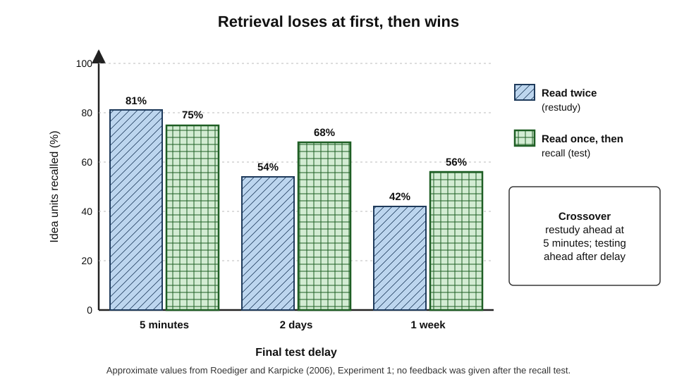
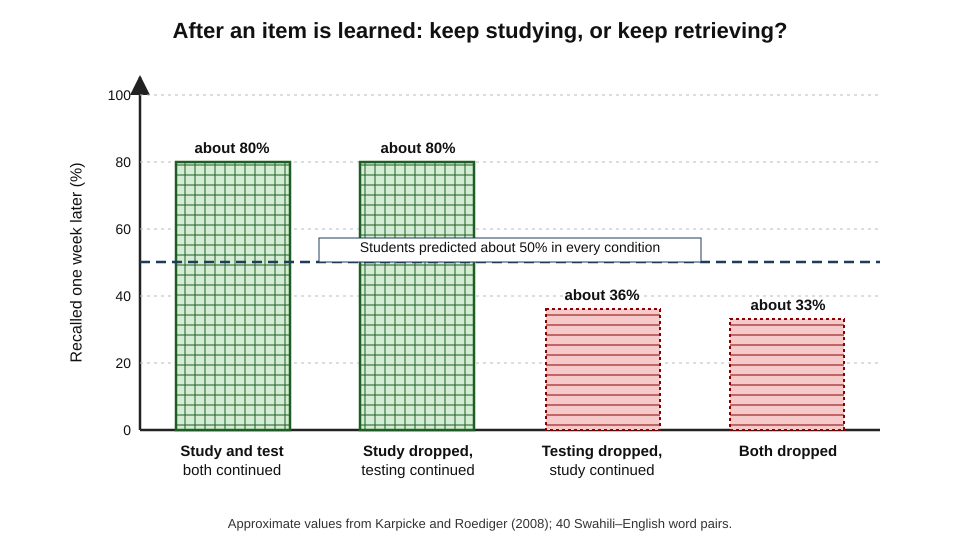
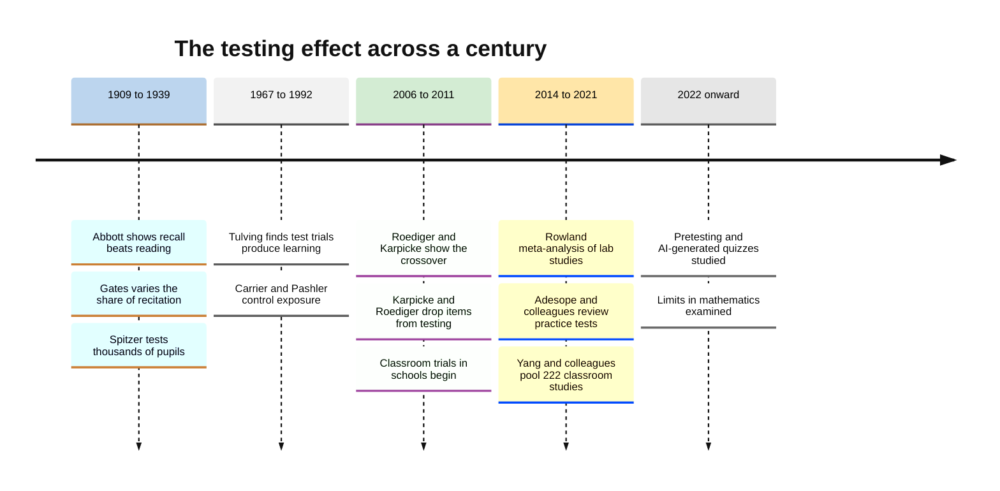
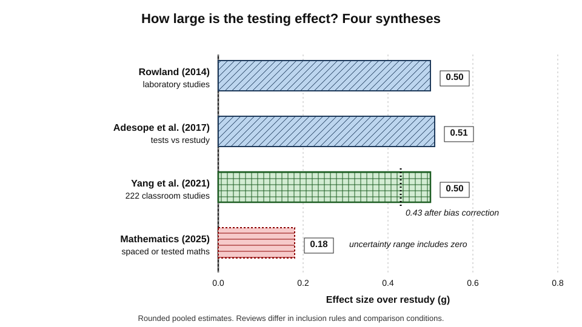
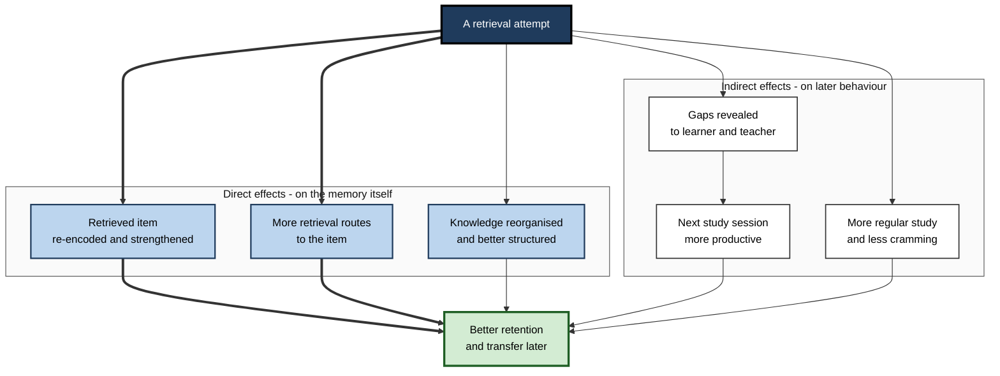

# C.1. The Testing Effect Explained

Two analysts prepare for the same certification. One reads the study guide three times; the other reads it once and spends the remaining time answering questions from memory. At the end of the week the first feels far more confident. A month later, sitting the exam, the second remembers considerably more. The act of **pulling knowledge out of memory changed the memory itself** — and that is the testing effect.

> **Definition — Testing effect:** the finding that retrieving information from memory, as on a test, improves its long-term retention more than spending the same time restudying it. Also called the **retrieval practice effect** or **test-enhanced learning**.

**Why it matters**

- It overturns the everyday assumption that a test only **measures** learning; a test also **causes** learning.
- It is one of the most replicated findings in the psychology of memory — demonstrated with word lists, foreign vocabulary, prose, lectures, diagrams, maps, medical procedures and university courses.
- It explains why the study methods that feel most productive — re-reading, reviewing notes, watching again — are among the least durable.
- It underpins quiz design, revision schedules, onboarding programmes and continuing professional education.

---

## Tests as Learning Events

### The measuring-stick view and why it fails

- **The common model:** knowledge is poured in by study; a test then reads off how much is there, like a dipstick in a fuel tank.
- **The problem:** a dipstick does not change the fuel level. A test does change memory.
  - Successful retrieval makes the retrieved information **easier to retrieve again** later.
  - The gain is often larger than the gain from an extra study opportunity of equal length.
- **Consequence:** the decision to test is a decision about **how to teach**, not merely about how to grade.

> **Key point:** every act of retrieval is also an act of re-encoding. The question is never only "what does the learner know?" but also "what will this test do to what they know?"

### Everyday and workplace instances

- **Remembering a new colleague's name** after being forced to use it in a meeting, rather than after reading it on an organisation chart.
- **A nurse** who has rehearsed the steps of a resuscitation protocol aloud from memory, compared with one who has read the laminated card many times.
- **A software engineer** who explains a system's architecture to a new joiner without the diagram and afterwards remembers it better.
- **A barrister** who rehearses the chronology of a case without the bundle, then finds the facts readily available under cross-examination.

### Vocabulary

> **Definition — Retrieval:** the process of bringing stored information back into conscious use.

> **Definition — Restudy:** re-exposure to material that is already presented in full — re-reading, re-listening, re-watching.

> **Definition — Retention interval:** the delay between the last practice and the final test.

> **Definition — Final test (criterial test):** the later test that measures what was retained; it is distinct from the **practice test** that is the learning activity.

- **Direct effect of testing** — the improvement in memory caused by the retrieval itself.
- **Indirect (mediated) effects** — the improvements that come from what testing leads the learner to do next: study more, study differently, attend better.
- **Equated-time comparison** — the fair control: testing is compared with **restudy for the same time**, not with doing nothing.

> **Watch out:** an experiment that compares "test" with "nothing" shows only that extra exposure helps. The testing effect is the claim that retrieval beats an **equal amount of extra study**.

---

## A Century of Evidence

### The early demonstrations

**Study card — Edwina Abbott (1909)**

- **Design:** school pupils learned material and then either re-read it or spent part of the time attempting to recall it.
- **Result:** recalling produced better retention than reading alone.
- **Significance:** among the earliest documented demonstrations; largely forgotten for decades.

**Study card — Arthur Gates (1917)**

- **Design:** children learned short biographies or nonsense syllables; they spent varying proportions of a fixed study period **reciting** from memory rather than reading.
- **Result:** the more of the period spent reciting, the better the later recall — up to a large share of the time spent in recitation.
- **Significance:** first systematic demonstration that the **proportion** of retrieval within a fixed time matters.

**Study card — Herbert Spitzer (1939)**

- **Design:** more than three thousand Iowa schoolchildren read short articles; groups were given tests at different delays, or none, before a final test weeks later.
- **Result:** pupils who were tested soon after reading forgot far less than those tested later or not at all.
- **Significance:** an unusually large field study showing that an early test **slows forgetting**.

### Mid-century: tests inside learning theory

- **Endel Tulving (1967)** — showed that learners given repeated tests on a word list improved about as much as those given repeated study.
  - At the time, this was surprising: a test trial presents **no new information**, yet it produced learning.
- **Interest drifted** — the field focused on encoding and storage; tests were treated mainly as measuring instruments.
- **Mark Carrier and Harold Pashler (1992)** — with word pairs, a retrieval attempt followed by the answer produced better retention than presenting the pair for study, even when total exposure was controlled.

### The modern revival

**Study card — Henry Roediger and Jeffrey Karpicke (2006)**

- **Design:** university students read short prose passages.
  - One group read each passage twice (study–study).
  - The other read it once and then wrote down as much as they could recall (study–test), with no feedback.
  - Final recall tests followed after **five minutes, two days or one week**.
- **Results:**
  - **After five minutes:** restudy was slightly better (roughly 81% versus 75% of idea units recalled).
  - **After two days:** testing was better (roughly 68% versus 54%).
  - **After one week:** testing was clearly better (roughly 56% versus 42%).
  - A second experiment with four-phase schedules found that students who **repeatedly studied** predicted the **highest** recall, yet repeatedly tested students recalled the most a week later.
- **Conclusion:** testing benefits emerge with delay, and learners cannot feel them.

**Figure 1.** Restudy wins at five minutes; retrieval wins after two days and a week.

> **Definition — Crossover interaction:** a pattern in which one condition is better at a short delay and the other at a long delay. It is the signature of many desirable difficulties.

**Study card — Jeffrey Karpicke and Henry Roediger (2008)**

- **Design:** students learned 40 Swahili–English word pairs over repeated study and test cycles.
  - Once an item had been recalled, it was either **dropped** from further study, **dropped** from further testing, both, or kept in both.
- **Results:**
  - A week later, items that kept being **tested** were recalled roughly **80%** of the time.
  - Items dropped from testing — even if still studied — were recalled roughly **a third** of the time.
  - Extra study after an item was learned added almost nothing; extra retrieval added a great deal.
  - Students' **predictions** of their recall were about the same across all conditions.
- **Conclusion:** repeated retrieval, not repeated study, drives long-term retention — and learners do not know it.

**Figure 2.** One week later, what mattered was continued retrieval, not continued study.

> **Remember:** "learned once" is not "learned for good". Continuing to **retrieve** items that have already been answered correctly is what keeps them.

**Figure 3.** Milestones in the study of the testing effect.

---

## How Big Is the Effect?

### Reading the meta-analyses

A single experiment can mislead; meta-analyses pool many. The pooled estimates below compare testing with restudy unless stated.

**Study card — Christopher Rowland (2014)**

- **Scope:** a meta-analysis of laboratory and laboratory-like experiments comparing testing with restudy.
- **Results:**
  - average benefit around **g = 0.50** — a medium effect;
  - larger when the practice test was followed by **feedback**;
  - larger when **initial retrieval was mostly successful**;
  - larger at **longer retention intervals**.
- **Conclusion:** the effect is robust in controlled settings, and its size depends on conditions that can be designed.

**Study card — Olusola Adesope, Dominic Trevisan and Narayankripa Sundararajan (2017)**

- **Scope:** a meta-analysis of practice testing across laboratory and classroom studies.
- **Results:**
  - practice tests outperformed restudy by a medium amount and outperformed no-activity controls by a large amount;
  - benefits held across age groups and educational levels;
  - multiple-choice and short-answer practice both helped.
- **Conclusion:** the effect generalises well beyond word lists.

**Study card — Chunliang Yang and colleagues (2021)**

- **Scope:** 222 classroom studies involving more than 48,000 students.
- **Results:**
  - quizzing raised achievement by about **half a standard deviation** (roughly 0.43 after correcting for publication bias);
  - benefits were larger with **feedback** and with **more quizzing occasions**;
  - effects appeared across subjects from chemistry to history.
- **Conclusion:** the testing effect survives the noise of real classrooms.

**Figure 4.** Pooled estimates of the testing effect from four syntheses.

> **Formula — Effect size (Hedges' g):** g = (mean of tested group − mean of restudy group) ÷ pooled standard deviation, with a small-sample correction. Example: tested 66%, restudied 56%, pooled SD 20 points → g ≈ (66 − 56) ÷ 20 = **0.50**. On a typical exam this is the difference between roughly the 50th and 69th percentile.

### What the numbers do and do not say

| | Laboratory studies | Classroom studies |
|---|---|---|
| Material | Word pairs, short texts, lists | Course content, often complex |
| Control group | Restudy for exactly equal time | Often restudy, sometimes no activity or business-as-usual |
| Final test | Identical or near-identical items | Exams that mix practised and unpractised content |
| Typical pooled effect | Medium | Medium, with wider spread |
| Main weakness | Artificial materials and short delays | Less control of time on task and exposure |

> **Watch out:** a pooled "average effect" hides **variation**. In mathematics, a 2025 meta-analysis found only a small average benefit of testing over restudy, with an uncertainty range that included zero, while spacing remained beneficial. The testing effect is strongest for **factual and conceptual knowledge** and least certain for **procedural problem-solving**.

---

## Why Retrieval Changes Memory

The leading explanations are complementary rather than rival; each accounts for some findings.

### The main accounts

- **Elaborative retrieval** — searching memory activates related knowledge, adding extra routes back to the target.
- **Episodic context** — each retrieval links the memory to the context of that attempt, so later searches have more to grip on.
- **Transfer-appropriate processing** — retrieval practises the very operation the final test demands.
- **Bifurcation** — items successfully retrieved are strengthened sharply; items not retrieved are not; the distribution splits, which explains the crossover.
- **Attention and motivation** — the expectation of being tested increases attention during study.

> **Definition — Transfer-appropriate processing:** the principle that memory performance is best when the processes used at learning match those required at test.

**Figure 5.** How a single test produces both direct and indirect benefits.

### Direct and indirect effects compared

| | Direct effect | Indirect effects |
|---|---|---|
| What changes | The memory trace and its retrieval routes | The learner's later actions |
| Requires feedback? | No — appears even without it, if retrieval succeeds | Usually depends on seeing results |
| Shown by | Equated-time lab comparisons | Classroom studies, metacognition studies |
| Example | A recalled term stays accessible for weeks | A failed question prompts focused restudy |

> **Key point:** in real courses the indirect effects are often as valuable as the direct one — a quiz that shows a class what it does not know changes everything that happens next.

### Testing beyond the tested items

- **Test-potentiated learning** — a test, even an unsuccessful one, makes the **next study opportunity** more effective.
  - *e.g.* attempting questions on a chapter before re-reading it makes the re-reading more productive.
- **Pretesting** — guessing answers **before** studying improves later memory for the answers, even though nearly all guesses are wrong.
  - Two meta-analyses in 2022 and 2024 found reliable benefits, of small-to-medium and medium size respectively.
- **Spill-over to related material** — retrieval sometimes improves memory for related untested information, but can also **impair** it (retrieval-induced forgetting) when related items compete.

> **Watch out:** "testing helps untested material" is **not** a safe general assumption. Benefits for untested content are smaller and less reliable than for the tested content itself; quizzes should cover what matters.

---

## Conditions That Strengthen or Weaken the Effect

### Moderators

- **Feedback** — the single biggest amplifier; it rescues failed retrievals and corrects errors.
- **Initial success rate** — very low success without feedback gives little benefit; the effect grows as more items are retrieved.
- **Retention interval** — the longer the delay to the final test, the larger the advantage over restudy.
- **Number of retrieval occasions** — repeated retrieval beats a single test; repeated, **spaced** retrieval is better still, a combination examined in its own right elsewhere in learning science.
- **Format** — recall formats tend to produce larger effects than recognition formats, though good multiple-choice tests also help.
- **Match between practice and final test** — benefits are largest when the final test resembles the practice; they shrink, but often remain, for transfer questions.
- **Stakes** — low-stakes or no-stakes quizzes produce the effect without the anxiety and cheating risks of high-stakes testing.

> **Mnemonic — "FIRST FMS":** Feedback, Initial success, Retention interval, Spaced repetitions, Test format, Final-test match, Stakes — the levers that set the size of the effect.

### Boundary conditions under debate

- **Complex, highly interconnected material** — some researchers argue the effect shrinks when material requires holding many interacting elements in mind; others show robust benefits for complex prose and science. The disagreement is unresolved and partly a matter of how complexity is defined.
- **Individual differences** — learners with lower working-memory capacity or less prior knowledge sometimes show **equal or larger** benefits; findings are mixed, and a 2024–2025 study with advanced material found the benefit held regardless of working memory and self-efficacy.
- **Very young children and older adults** — testing effects appear across the lifespan, though task design must suit the learner.

> **Watch out:** claims that retrieval practice "only works for simple facts" are **overstated**. Claims that it "works equally for everything" are also overstated. The honest summary: robust for facts and concepts, good for meaningful text, weaker and less certain for multi-step procedural skill.

---

## Why Learners Underuse It

### The feeling of fluency

- Re-reading makes text **feel familiar**, and familiarity is mistaken for knowledge.
- Retrieval exposes what is **not** known, which feels like failure.
- The result is a **metacognitive illusion**: learners judge the less effective method as more effective.

> **Definition — Metacognitive illusion:** a systematic mismatch between how well a learner thinks they are learning and how well they are actually learning.

**What surveys of students show**

- **Jeffrey Karpicke, Andrew Butler and Henry Roediger (2009):** most university students re-read; few chose self-testing, and those who did mostly used it to **check** knowledge rather than to build it.
- **Nate Kornell and Robert Bjork (2007):** similar results — students treated quizzing as diagnosis, not as a learning strategy.

> **Remember:** a test is the **study session**, not the inspection after it.

### Institutional reasons

- **Tests are associated with judgement** — grades, rankings, appraisals — so they are rationed.
- **Marking costs time** — teachers and trainers fear the workload.
- **Satisfaction scores** — training that "feels hard" can earn lower immediate ratings, discouraging its use.

---

## Using the Testing Effect Well

### Design principles

1. **Test early** — the first retrieval soon after initial learning prevents early forgetting.
2. **Test repeatedly** — continue retrieving items already answered correctly.
3. **Give feedback** — at least the correct answer; an explanation where understanding matters.
4. **Prefer production** — short answer, explanation, recall of steps; use good multiple-choice where marking load requires it.
5. **Keep stakes low** — frequent, ungraded or lightly weighted.
6. **Match the target** — practise retrieval in the form the knowledge will be used.
7. **Make it cumulative** — include old material, not just this week's.

> **Mnemonic — "Early Rehearsals Feed Powerful, Lasting Memory Chains" (ERF-PLMC):** Early, Repeated, Feedback, Production, Low stakes, Match, Cumulative.

### Worked example (illustrative): converting a revision hour

A compliance officer has one hour to revise a new data-protection regulation before a team briefing next month.

| | Original plan | Retrieval-based plan |
|---|---|---|
| 0–40 min | Re-read the 20-page summary twice | Read the summary once, closely |
| 40–60 min | Highlight key articles | Close it; write the six lawful bases and the breach-notification rules from memory |
| After | — | Check against the summary; mark gaps; star two weak points |
| Next week | — | Ten-minute recall of the same points, gaps first |

- **Step 1:** identify what must be retrievable without notes — the six lawful bases, the notification window, the rights of data subjects.
- **Step 2:** replace the second reading with closed-book recall.
- **Step 3:** check, correct and note errors — feedback.
- **Step 4:** repeat retrieval a week later — the second occasion matters more than the first.
- **Conclusion:** the same hour, re-allocated, yields knowledge that is available at the briefing rather than merely familiar.

> **Watch out:** the retrieval-based plan will **feel worse** at the end of the first hour. That feeling is not evidence that it is working less well.

### In organisations

- **Medicine** — Douglas Larsen and colleagues (2009) found that residents who took short-answer tests on clinical topics retained substantially more after six months than residents who studied review sheets for the same time.
- **Professional bodies** — some continuing-education schemes now replace long periodic examinations with short, frequent question sets throughout the year.
- **Corporate learning** — question-based "microlearning" delivered through mobile apps uses the same principle; its quality depends on the questions.
- **Software teams** — on-call engineers rehearse incident runbooks from memory in game-day exercises before relying on them.

> **In practice:** the cheapest effective change most training programmes can make is to replace a final recap slide with **five recall questions** answered without notes, followed by the answers.

### Case study (illustrative): product knowledge in a contact centre

- **Situation:** a telecoms contact centre trained new advisers for two weeks on tariffs, contract rules and troubleshooting.
- **Problem:** after go-live, advisers repeatedly placed customers on hold to search the knowledge base; average handling time was high and errors in contract advice frequent.
- **Diagnosis:**
  - training consisted of presentations and a single open-book assessment on the last day;
  - advisers had **seen** every rule but had rarely **retrieved** any.
- **Actions:**
  1. Each training day began with ten unaided questions on the previous days' content.
  2. Wrong answers were followed immediately by the correct rule and a one-line reason.
  3. After go-live, a three-question quiz appeared in the adviser's tool at the start of each shift for six weeks, drawing on the commonest errors.
  4. Quiz results were never used in appraisal.
- **Result:** within two months, holds for basic tariff questions fell markedly and audit errors on contract terms declined; advisers reported the start-of-shift questions as "annoying but useful".
- **Caveat:** no randomised comparison was run, and other changes occurred at the same time; the improvement is consistent with, not proof of, the testing effect.
- **Lesson:** knowledge that must be used **fast and unaided** has to be **practised fast and unaided**.

### Ethical and practical cautions

- **Surveillance creep** — quiz data collected "for learning" must not quietly become performance evidence; doing so raises stakes and destroys the low-anxiety conditions that make quizzing work.
- **Teaching to the quiz** — narrow, repeated items can produce item-specific memory rather than understanding; vary wording and include application questions.
- **AI-generated questions** — generative tools can produce many questions quickly; their accuracy, relevance and difficulty still require expert checking.

---

## Who Shows the Testing Effect

The effect is not confined to university students in laboratories. Its reach across ages and populations is one reason it is treated as a general property of human memory.

### Across the lifespan

- **Children** — testing effects appear in primary-school pupils for vocabulary, science facts and text; younger children need more structure, such as prompts or partial cues, so that enough retrieval succeeds.
- **Adolescents** — the strongest school evidence comes from middle- and high-school classes in science, history and languages.
- **Older adults** — studies comparing younger and older adults, including work by Jessica Logan and David Balota (2008), find that older adults also benefit from retrieval practice, though they may need more support or more successful first retrievals to gain as much.
- **Professionals** — residents, nurses, pilots and engineers show the same pattern when retrieval is compared with review of the same material.

### Clinical populations

- **People with memory impairment** — James Sumowski and colleagues (2010) found that patients with multiple sclerosis who had memory difficulties benefited from retrieval practice compared with restudy, in some cases substantially.
- **Caution** — in severe amnesia, uncorrected errors can be learned and hard to remove; there, **errorless** methods that prevent wrong retrievals are often preferred. Retrieval practice for such groups needs strong cues and immediate feedback.

> **Key point:** the testing effect appears from childhood to old age and in several clinical groups. What changes is not **whether** retrieval helps but **how much support** retrieval needs in order to succeed.

| Population | Testing effect present? | Design adjustment |
|---|---|---|
| Young children | Yes | More cues, shorter delays, structured recall |
| Secondary pupils | Yes, strongly | Frequent low-stakes quizzes with feedback |
| University students | Yes, strongly | Free recall, short answer, cumulative quizzes |
| Older adults | Yes | More successful first retrievals; slower pace |
| Memory-impaired patients | Often yes | Strong cues; immediate feedback; avoid repeated uncorrected errors |
| Working professionals | Yes | Retrieval matched to real tasks; low stakes; spaced over weeks |

---

## What the Testing Effect Does Not Mean

The finding is simple; its popular versions often are not. Several misreadings recur in schools and organisations.

- **"More exams are better."**
  - The effect concerns **retrieval as practice**, usually at low stakes. Adding high-stakes examinations brings anxiety, cramming and narrowed teaching — different phenomena altogether.
- **"Any quiz will do."**
  - Trivial recognition items, quizzes taken with notes open or quizzes without feedback produce little benefit.
- **"Testing replaces teaching."**
  - Retrieval strengthens what has been learned; it does not create knowledge from nothing. Learners must first meet the material in a form they can understand.
- **"If learners score well, they have learned."**
  - Immediate quiz scores largely reflect recency. The testing effect is visible only on **delayed** tests.
- **"The effect is about memorising."**
  - Retrieval of explanations and applications improves understanding and transfer; the effect is about whatever is retrieved.

> **Watch out:** the testing effect is sometimes cited to justify frequent graded tests. The evidence supports frequent **retrieval**, not frequent **judgement**. The two can be separated, and should be.

---

## Worked Example (illustrative): Testing the Testing Effect in Your Own Programme

An organisation can check whether retrieval practice works for its own content with a simple, fair comparison. A learning team at a logistics firm wants evidence before redesigning its customs-compliance course.

1. **Choose content** — 30 rules of similar importance and difficulty from the course.
2. **Split at random** — 15 rules become **retrieval** items; 15 become **restudy** items. Randomising the rules, not the people, means every learner experiences both conditions.
3. **Equate time** — after each module, learners spend ten minutes either answering short-answer questions on the retrieval rules (with the answers shown afterwards) or re-reading summaries of the restudy rules.
4. **Hold everything else constant** — same trainer, same slides, same time on each rule during teaching.
5. **Test later** — four weeks after the course, an unannounced quiz covers all 30 rules with **new** wording and scenarios.
6. **Compare** — average accuracy on retrieval-practised rules versus restudied rules, for the same learners.

| Step | Design choice | Why it matters |
|---|---|---|
| Random split of rules | Within-learner comparison | Removes differences between people |
| Equal practice time | Ten minutes per condition | Rules out "more time" as the explanation |
| Delay of four weeks | Retention, not recency | The effect appears with delay |
| New wording at test | Measures knowledge, not item memory | Guards against memorising the practice question |
| Feedback after retrieval | Answers shown | Represents good practice |

**Illustrative result:** retrieval-practised rules 68% correct at four weeks, restudied rules 54%.

> **Formula — Within-learner advantage:** retrieval accuracy − restudy accuracy = 68% − 54% = **14 percentage points**. Expressed relative to restudy: 14 ÷ 54 ≈ **26% more** rules retained.

- **Conclusion:** the comparison gives the organisation local evidence at almost no extra cost, and the design rules out the obvious alternative explanations.

> **Watch out:** if the four-week quiz reused the exact practice questions, the retrieval group would have an unfair advantage — they had seen those questions. Use new wording, or the comparison measures item memory rather than knowledge of the rules.

---

## The Testing Effect When Answers Are Always Available

Generative AI and search tools make almost any fact retrievable from outside memory in seconds. This changes the stakes of the testing effect rather than removing them.

- **Fewer natural retrievals** — when the habit is to ask a tool, people retrieve less from memory, so knowledge that once stayed fresh through use now fades.
- **Retrieval must be deliberate** — knowledge that matters for judgement, speed or error-checking now needs **scheduled** retrieval, because daily work no longer supplies it.
- **Tools can set the questions** — the same AI that can answer can also **ask**: a learner can request questions on a document and answer them before seeing the model's answers.
- **Verification depends on memory** — spotting a plausible but wrong AI answer requires retrievable knowledge of the domain.

> **In practice:** a useful rule for AI-assisted study is "**question first, answer second**": ask the tool to quiz you, commit to an answer from memory, and only then compare.

---

## Open Questions

- **How large is the effect for procedural and mathematical skill?**
  - Recent syntheses suggest small and uncertain benefits in mathematics; it is unclear whether this reflects the material, the test formats used or the comparison conditions.
- **Which mechanism dominates, and when?**
  - Elaboration, context, bifurcation and transfer-appropriate processing each explain some results; no single account explains all.
- **Do benefits for untested material justify broad quizzing?**
  - Spill-over effects are smaller and less consistent; how best to sample content remains open.
- **How should workplace programmes measure the effect?**
  - Few organisations run controlled comparisons with delayed, unaided tests.
- **What happens when AI writes and marks the questions?**
  - Early studies suggest AI-generated retrieval questions can help, but effects on question quality, learner trust and over-reliance are largely unstudied.

---

## Summary

- The **testing effect**: retrieving information improves long-term retention more than restudying it for the same time.
- Tests are **learning events**, not only measurements; each retrieval re-encodes the memory.
- **History:** Abbott (1909), Gates (1917) and Spitzer (1939) found early effects; Tulving (1967) showed test trials produce learning; Roediger and Karpicke (2006) revived the field with a **crossover** — restudy better at five minutes, testing better after days.
- **Karpicke and Roediger (2008):** continued retrieval, not continued study, kept items in memory; learners could not tell the difference.
- **Size:** medium on average (around g = 0.50 in lab and classroom syntheses); larger with **feedback**, more retrieval occasions, successful retrieval and longer delays; small and uncertain in mathematics.
- **Mechanisms:** elaborative retrieval, episodic context, transfer-appropriate processing, bifurcation and attention; plus **indirect effects** on later study.
- Learners underuse testing because retrieval feels harder and fluency feels like knowing — a **metacognitive illusion**.
- Use it **early, repeatedly, with feedback, in production formats, at low stakes, matched to the target and cumulatively**.

---

## Self-Check

1. Define the testing effect and explain why the comparison condition must be restudy rather than no activity.
2. Describe the Roediger and Karpicke (2006) results at three delays. What is a crossover interaction?
3. In Karpicke and Roediger (2008), what happened to items dropped from testing but kept in study? What does this imply for revision?
4. Distinguish direct from indirect effects of testing, with one example of each.
5. What did Spitzer's 1939 study add to the evidence?
6. Interpret an effect size of g = 0.50 in plain language.
7. Name four moderators that increase the size of the testing effect.
8. Why do students prefer re-reading even though it is less effective?
9. Explain transfer-appropriate processing and how it guides quiz design.
10. What is pretesting, and why is its benefit surprising?
11. Why is the claim "testing helps untested material too" risky as a design principle?
12. Summarise the evidence on the testing effect in mathematics and suggest two possible explanations.
13. A training manager wants to use weekly quiz scores in quarterly appraisals "to motivate people". Advise them.
14. Redesign a one-day product workshop so that it exploits the testing effect without adding more than 30 minutes.
15. Does the testing effect appear in older adults and memory-impaired patients? What design adjustments do these groups need?
16. Design a fair within-learner comparison of retrieval practice and restudy for a workplace course.

### Answer Key

1. Retrieving information improves later retention more than restudying it for the same time. A no-activity control shows only that extra exposure helps; the claim is that retrieval beats an equal amount of extra study.
2. After five minutes restudy was slightly better (about 81% vs 75%); after two days (about 68% vs 54%) and one week (about 56% vs 42%) testing was better. A crossover is when the better condition reverses with delay.
3. They were recalled only about a third of the time a week later, compared with about 80% for items that kept being tested. Revision should keep retrieving items already answered correctly rather than dropping them.
4. Direct: the retrieval strengthens and adds routes to the memory — a recalled term stays accessible. Indirect: testing changes later behaviour — a failed question prompts focused restudy, or the expectation of quizzes increases regular study.
5. It showed, with thousands of schoolchildren in a field setting, that an early test greatly slowed forgetting over weeks.
6. The average tested learner scores about half a standard deviation above the average restudy learner — roughly moving from the 50th to the 69th percentile.
7. Any four: feedback; high initial success; longer retention interval; more (and spaced) retrieval occasions; recall formats; close match between practice and final test; low stakes.
8. Re-reading produces fluency, which feels like knowing; retrieval exposes gaps and feels effortful. Learners misread ease as learning — a metacognitive illusion.
9. Memory is best when the processes at learning match those at test. Quizzes should demand the operations the real task demands — recall, explanation, application — rather than mere recognition.
10. Attempting questions before studying improves later memory for the answers, even though most guesses are wrong; it suggests that the attempt prepares the mind to encode the answer.
11. Spill-over benefits are smaller and inconsistent, and retrieval can even impair competing related items; quizzes must directly cover the knowledge that matters.
12. A 2025 meta-analysis found a small average benefit with an uncertainty range including zero. Possible explanations: procedural skill relies on practised problem solving that restudy conditions already include; final tests in maths often demand transfer to new problems; spacing rather than testing may carry the benefit.
13. Advise against: raising stakes increases anxiety, encourages cheating and guessing strategies, and undermines the low-stakes conditions that make quizzes effective. Keep quizzes formative; measure performance through separate, appropriate assessments.
14. E.g. begin each session with five unaided questions on earlier content; after each demonstration, have participants write the steps from memory before checking; end with a closed-book recall of the day's key points with answers shown; send three follow-up questions after one week and three after a month.
15. Yes, in many studies (*e.g.* Logan and Balota, 2008; Sumowski and colleagues, 2010). Older adults may need more successful first retrievals; memory-impaired patients need strong cues and immediate feedback to avoid learning errors, and errorless methods may be preferable in severe amnesia.
16. Randomly split comparable content into retrieval and restudy sets; equate practice time; keep teaching identical; give feedback after retrieval; test all content after several weeks with new wording; compare accuracy on the two sets for the same learners.

---

## Glossary

| Term | Meaning |
|---|---|
| Bifurcation | Splitting of item strengths after testing: retrieved items gain greatly, unretrieved items do not. |
| Crossover interaction | One condition better at a short delay, the other at a long delay. |
| Direct effect of testing | Memory improvement caused by the act of retrieval itself. |
| Elaborative retrieval | Account in which memory search activates related knowledge and adds retrieval routes. |
| Episodic context account | Account in which each retrieval adds the context of that attempt to the memory. |
| Equated-time comparison | Comparing testing with restudy for the same total time. |
| Errorless learning | Learning methods that prevent wrong responses during practice, used especially with severe memory impairment. |
| Final (criterial) test | The later test that measures what was retained. |
| Hedges' g | Standardised mean difference with a small-sample correction. |
| Indirect effects of testing | Benefits that arise from what testing leads learners or teachers to do next. |
| Meta-analysis | Statistical pooling of results from many studies. |
| Metacognitive illusion | A systematic mismatch between perceived and actual learning. |
| Pretesting | Attempting questions on material before studying it. |
| Restudy | Re-exposure to material presented in full. |
| Retention interval | Delay between the last practice and the final test. |
| Retrieval | Bringing stored information back into use. |
| Retrieval-induced forgetting | Impaired recall of related items after retrieving competing items. |
| Test-potentiated learning | Improvement in the effectiveness of later study caused by an earlier test. |
| Testing effect | Retrieval improves retention more than equivalent restudy. |
| Transfer-appropriate processing | Memory is best when learning and test processes match. |
| Within-learner comparison | A design in which each learner experiences every condition, so comparisons are not confounded by differences between people. |
