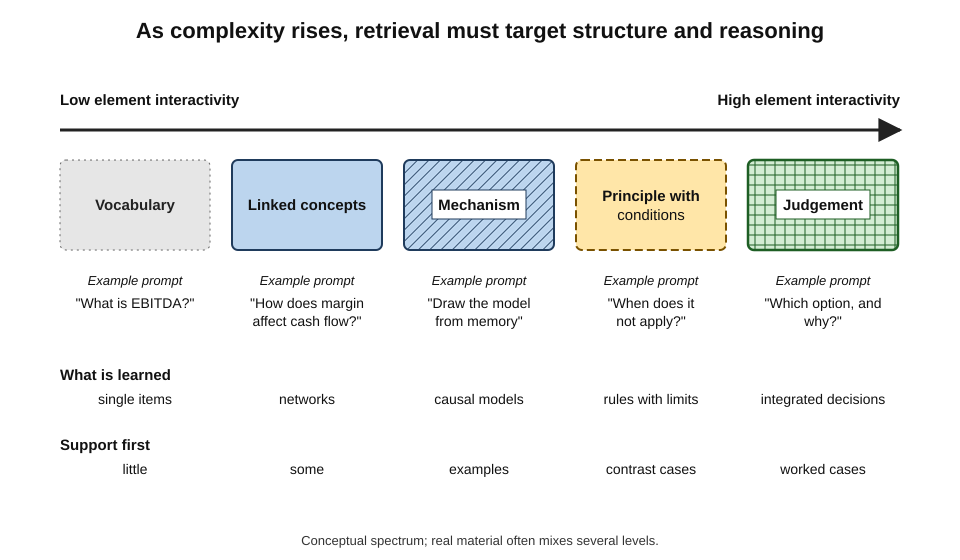
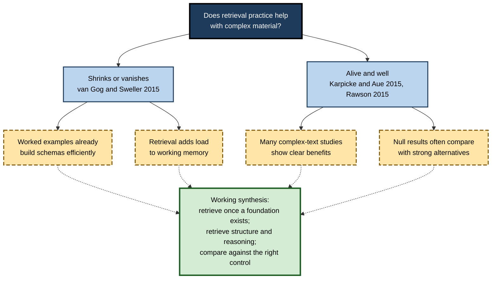
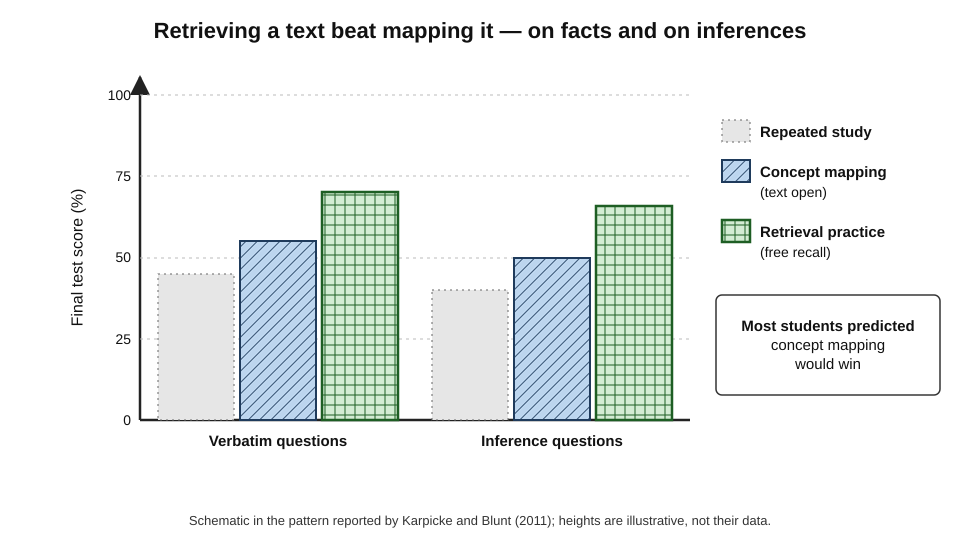
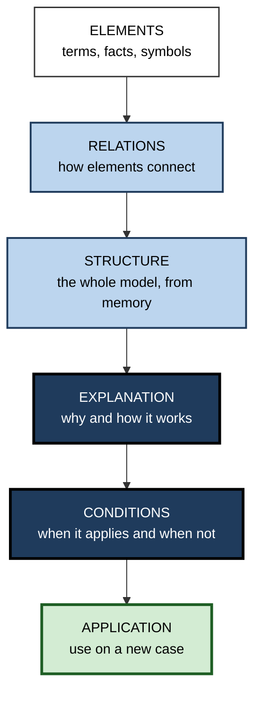

# C.10. Retrieval Practice for Complex Knowledge

Recalling that the capital of Kenya is Nairobi is one thing. Explaining why a central bank's interest-rate rise might weaken a currency in one economy and strengthen it in another — drawing together inflation expectations, capital flows and credibility — is another. Professionals live mostly in the second world: knowledge whose value lies in **connections**, **conditions** and **reasoning**. Whether, and how, retrieval practice helps with such knowledge is one of the most important questions in applied learning science, and one of the most argued about.

> **Definition — Complex knowledge:** knowledge whose understanding requires holding several interacting elements in mind at once — causal mechanisms, multi-step procedures, principles with conditions of application, interconnected concepts — rather than isolated facts or associations.

**Why it matters**

- Most professional expertise is complex knowledge; if retrieval practice helped only with facts, its value at work would be limited.
- The evidence suggests retrieval **does** help complex knowledge — but **what** is retrieved, and **how**, changes.
- A live scientific debate about complex materials has sharpened the conditions under which retrieval works.
- Poorly designed retrieval for complex material degrades into memorising definitions, which looks like learning and is not.

---

## What Makes Knowledge Complex

### Element interactivity

- **John Sweller's cognitive load theory** describes material by its **element interactivity** — how many elements must be processed **together** to understand it.
  - **Low interactivity** — items can be learned one at a time: vocabulary, symbols, names, codes.
  - **High interactivity** — elements make sense only in relation to each other: solving an equation, interpreting a balance sheet, diagnosing a fault, constructing an argument.
- **Working memory** — able to hold only a few elements at once — is the bottleneck for high-interactivity material until **schemas** in long-term memory chunk the elements.

> **Definition — Element interactivity:** the degree to which elements of material must be processed simultaneously in working memory to be understood.

> **Definition — Schema:** an organised structure in long-term memory that groups related elements, so that they can be handled as one unit.

**Figure 1.** From isolated facts to integrated reasoning: what retrieval must target as complexity rises.

### Kinds of complex knowledge

- **Conceptual** — networks of related ideas.
  - *e.g.* how supply, demand, elasticity and substitution relate.
- **Causal and mechanistic** — how a system produces outcomes.
  - *e.g.* how a load balancer, cache and database interact under peak traffic.
- **Procedural with decisions** — multi-step methods with branches.
  - *e.g.* performing a discounted-cash-flow valuation and choosing a discount rate.
- **Principled and conditional** — rules that apply under conditions.
  - *e.g.* when a contract term is implied by law, and when it is not.
- **Ill-structured** — problems with no single right answer.
  - *e.g.* advising a board on restructuring.

| | Simple knowledge | Complex knowledge |
|---|---|---|
| Unit of learning | Single fact or association | Structure, mechanism, principle with conditions |
| Element interactivity | Low | High |
| What failure looks like | Blank or wrong fact | Fragmented explanation; wrong principle chosen; surface reasoning |
| Retrieval prompt | "What is…?" | "Explain how…", "Why…?", "What would happen if…?", "Which principle applies?" |
| Scoring | Right or wrong | Idea units, structure, reasoning quality |
| Typical support needed | Little | Worked examples and foundations first |

---

## The Complex-Materials Debate

### The challenge

**Study card — Tamara van Gog and John Sweller (2015)**

- **Argument:** in an influential review introducing a special journal issue, they argued that the testing effect **decreases or even disappears** as element interactivity increases.
- **Evidence cited:** several studies of problem-solving in which testing did not outperform studying **worked examples**; for example, Wayne Leahy, José Hanham and John Sweller (2015) found no testing effect with high-interactivity material in primary-school mathematics.
- **Explanation proposed:** for complex material, studying a worked example already builds schemas efficiently; retrieval adds load without adding benefit.

### The replies

**Study card — Jeffrey Karpicke and William Aue (2015)**

- **Argument:** "the testing effect is alive and well with complex materials".
- **Points made:**
  - the review omitted many studies showing retrieval benefits with complex texts, including studies that directly manipulated complexity;
  - "complexity" was defined loosely, sometimes as any problem-solving task;
  - some null results compared retrieval with **worked-example study**, which is itself a strong technique, rather than with passive restudy.

- **Katherine Rawson (2015)** reached a similar verdict in her commentary: the testing effect for complex materials is "still a winner".

**Figure 2.** The two positions in the complex-materials debate.

### A working synthesis

- **Retrieval clearly helps complex prose and conceptual knowledge** — explanations, mechanisms, arguments.
- **For learning new problem-solving procedures**, studying worked examples first is often as good as or better than early problem-solving; retrieval adds value once a basic schema exists.
- **The comparison condition matters** — retrieval reliably beats passive restudy; it does not always beat other strong, active techniques.
- **Timing matters** — a 2024 study found that while worked-example study and practice problems produced similar performance after five minutes, **practice problems** (retrieval of procedures) produced better performance after **one week**, independent of task complexity.
- **Learner differences** — a 2025 study with advanced university material found the retrieval benefit held regardless of learners' working-memory capacity and self-efficacy, whereas those factors did predict performance after rereading.

> **Watch out:** both slogans — "retrieval does not work for complex material" and "retrieval works for everything" — are **overstated**. The evidence supports retrieval for complex knowledge when learners have a foundation to retrieve, when retrieval targets structure and reasoning, and when it is compared with passive study.

---

## Evidence That Retrieval Builds Understanding

### Retrieval versus concept mapping

**Study card — Jeffrey Karpicke and Janell Blunt (2011)**

- **Design:** university students read science texts and then either:
  - **studied** the text repeatedly;
  - built **concept maps** with the text available (an elaborative study technique);
  - or practised **retrieval** — writing down everything they could recall, then rereading and recalling again.
- **Final test:** a week later, questions requiring both **verbatim** recall and **inference** — drawing conclusions not stated in the text.
- **Results:**
  - retrieval practice produced **better** performance than concept mapping on **both** verbatim and inference questions;
  - the advantage held even when the final test was itself **building a concept map**;
  - most students predicted concept mapping would be better.
- **Conclusion:** retrieval of a text's ideas built understanding, not only memory for statements.

**Figure 3.** Retrieval beat elaborative concept mapping on both recall and inference.

> **Watch out:** this result does not mean concept mapping is useless. Later work by Janell Blunt and Jeffrey Karpicke (2014) found that building concept maps **from memory** — retrieval-based concept mapping — was as effective as written recall. The active ingredient was **retrieval**, not the format.

### Transfer to new questions and domains

**Study card — Andrew Butler (2010)**

- **Design:** students read passages about scientific and technical concepts and either restudied them or took repeated tests with feedback.
- **Final test:** **new** inferential questions, some requiring application of the concepts to a **different domain** from the one in the passage.
- **Results:** repeated testing produced better performance than repeated study on the new inferential questions, including far-transfer questions.
- **Conclusion:** retrieval with feedback can produce knowledge that is **flexible**, not tied to the original wording.

**Study card — Steven Pan and Timothy Rickard (2018)**

- **Scope:** a meta-analysis of the transfer of test-enhanced learning across a large body of experiments.
- **Results:**
  - testing produced a **moderate** overall benefit on transfer tests (around d = 0.40), smaller than for tested items themselves;
  - transfer was **larger** when practice included **elaborative feedback**, when initial test performance was **high**, and when the response required at test **matched** the practised response;
  - transfer was weak for some kinds, such as application to quite different problems without these supports.
- **Conclusion:** transfer from retrieval is real but conditional; design choices determine it.

| Factor | Effect on transfer from retrieval |
|---|---|
| Elaborative feedback after practice | Increases transfer |
| High initial retrieval success | Increases transfer |
| Practice response matches test response | Increases transfer |
| Practice on facts only, test on application | Little transfer |
| Practice includes explanation or application questions | Increases transfer to similar higher-order questions |

### Explanation-based retrieval

- **Scott Hinze, Jennifer Wiley and James Pellegrino (2013):** when retrieval tasks asked students to **explain** concepts rather than recall details, later performance on inference questions improved; the benefit depended on learners engaging in constructive explanation during the test.
- **Pooja Agarwal (2019):** quizzes with **higher-order** questions improved higher-order exam performance; factual quizzes did not.

> **Key point:** retrieval improves what it exercises. To build reasoning, **retrieve reasoning** — explanations, applications, predictions — not only the facts beneath them.

---

## What to Retrieve When Knowledge Is Complex

### A ladder of retrieval targets

**Figure 4.** Retrieval targets rising from elements to transfer.

- **Elements** — retrieve the vocabulary first, so that working memory is free for relations.
- **Relations** — "How does X affect Y?"
- **Structure** — sketch the whole model or argument from memory.
- **Explanation** — "Explain, without notes, why…"
- **Conditions** — "When would this principle **not** apply?"
- **Application** — a new case requiring the knowledge.

> **Mnemonic — "Every Real Student Eventually Conquers Application":** Elements, Relations, Structure, Explanation, Conditions, Application.

### Retrieval formats for complex knowledge

| Knowledge type | Retrieval format | Example prompt |
|---|---|---|
| Concept network | Concept map from memory; written free recall | "Draw how the components of working capital relate." |
| Causal mechanism | Explain-from-memory; predict-the-outcome | "If the cache fails, what happens to database load and latency? Why?" |
| Procedure with decisions | Example-problem pairs; solve then compare | "Value this firm; justify your discount rate." |
| Principle with conditions | Contrast cases; "does it apply?" questions | "Here are two contracts. In which is the term implied, and why?" |
| Ill-structured judgement | Case analysis from memory; structured argument | "Outline the options for this restructuring and the key risks of each." |

### Foundation first

- **Retrieval needs something to retrieve.** For new high-interactivity material, study **worked examples** or clear explanations before asking for retrieval.
- **Example–problem pairs** — study a worked example, then solve a similar problem from memory — combine the strengths of both.
- **Fading** — progressively remove steps from worked examples until the learner produces the whole solution.

> **Definition — Example–problem pair:** a sequence in which a worked example is studied and then a similar problem is solved without it.

**Figure 5.** Moving from studying examples to retrieving whole solutions.

```mermaid
%%{init: {'theme':'base','themeVariables':{'fontFamily':'Arial, Helvetica, sans-serif','fontSize':'15px','primaryColor':'#FFFFFF','primaryTextColor':'#111111','primaryBorderColor':'#222222','lineColor':'#333333','secondaryColor':'#F2F2F2','tertiaryColor':'#FFFFFF','clusterBkg':'#FAFAFA','clusterBorder':'#555555','edgeLabelBackground':'#FFFFFF','titleColor':'#111111'}}}%%
flowchart LR
    classDef key     fill:#BCD5EE,stroke:#1F3B5C,stroke-width:2px,color:#000000
    classDef accent  fill:#FFE6A8,stroke:#7A5200,stroke-width:2px,stroke-dasharray:8 4,color:#000000
    classDef good    fill:#D3ECD3,stroke:#1E5E24,stroke-width:3px,color:#000000

    W["Study a full<br/>worked example"]
    P1["Solve similar problem<br/>with example hidden"]
    F["Faded example:<br/>fill missing steps"]
    P2["Solve new problem<br/>from memory"]
    X["Explain the principle<br/>and when it applies"]
    D["Days later: mixed<br/>problems, no examples"]

    W ==> P1 ==> F ==> P2 ==> X ==> D

    class W key
    class P1,F,P2 accent
    class X,D good
```

---

## Worked Example: A Retrieval Plan for a Complex Topic

A junior product manager must understand the company's pricing model — tiers, usage-based charges, discount authority, revenue recognition and their interactions.

1. **Foundation (day 1):** study the pricing guide and two annotated worked examples of real deals.
2. **Elements (day 1, end):** ten quick questions on terms — tiers, unit metrics, discount bands.
3. **Structure (day 2):** draw from memory how tier, usage, discount and term length combine into contract value; compare with the guide; correct.
4. **Explanation (day 3):** write, without notes, why multi-year discounts are capped and how usage overages are recognised.
5. **Conditions (day 5):** five "does the rule apply?" cases — e.g. whether a non-profit discount stacks with a multi-year discount.
6. **Application (week 2):** price two new deals from scratch; a senior colleague reviews reasoning.
7. **Mixed review (weeks 3 and 6):** a short set combining elements, explanation and application questions.

| Day | Retrieval target | Format | Feedback |
|---|---|---|---|
| 1 | Elements | Short answer | Answer key |
| 2 | Structure | Diagram from memory | Compare with guide |
| 3 | Explanation | Written paragraph | Idea-unit standard |
| 5 | Conditions | Contrast cases | Model answers with reasons |
| Week 2 | Application | Full deal pricing | Senior review |
| Weeks 3, 6 | Mixed | Short set | Answer key and explanations |

- **Conclusion:** retrieval moves up the ladder from elements to application, with a foundation laid first and feedback at every level.

> **Watch out:** stopping at step 2 — terms and definitions — is the commonest failure. The manager would recognise every term and still misprice a deal.

---

## In Professional Practice

### Clinical reasoning

- **Illness scripts** — Henk Schmidt and Henny Boshuizen described how experienced clinicians organise knowledge of diseases as scripts: enabling conditions, the fault, and its consequences.
- **Retrieval targets:** generating a differential diagnosis from a presentation; explaining how a mechanism produces a sign; predicting the effect of a treatment.
- **Format:** case vignettes answered before the answer is revealed; "think-aloud" explanation.

### Engineering and software

- **Architecture from memory** — redraw a system's data flow and failure modes without the diagram.
- **Incident reasoning** — "given these symptoms, which components could be responsible, and how would you test each hypothesis?"

### Law and finance

- **Issue spotting** — list every issue raised by a fact pattern, then analyse each.
- **Model reasoning** — explain from memory how a change in an assumption flows through a valuation.

### Case study: from definitions to judgement

- **Situation:** a bank's credit-analyst academy taught financial-statement analysis with weekly multiple-choice quizzes on ratios and definitions.
- **Problem:** graduates could define every ratio but wrote weak credit papers; reviewers found that they described ratios without explaining what they implied about risk.
- **Diagnosis:**
  - retrieval targeted **elements** only;
  - no practice required **explanation**, **conditions** or **application** to whole cases.
- **Actions:**
  1. Weekly quizzes were split: one-third element questions, two-thirds **mini-cases** — "Here are three years of statements. What is the main credit risk, and why?"
  2. Each answer required a three-sentence explanation, scored against an idea-unit standard.
  3. Contrast cases showed similar ratios with different implications (*e.g.* low current ratio in a supermarket versus in a manufacturer).
  4. Monthly, analysts wrote a short credit paper from memory before consulting templates.
- **Result:** reviewers' ratings of graduates' credit papers improved over the following two intakes, especially for "explains drivers of risk".
- **Caveat:** cohort comparisons, not randomised; reviewers knew about the redesign.
- **Lesson:** retrieval builds what it targets — to build **judgement**, retrieve **reasoning about cases**.

---

## Combining Retrieval With Self-Explanation

Retrieval says "produce it"; self-explanation says "say why". For complex knowledge, the combination is stronger than either alone.

**Study card — Michelene Chi and colleagues (1989)**

- **Design:** students studied worked examples in physics (mechanics) while thinking aloud; their explanations were recorded and analysed.
- **Results:**
  - students who later solved problems well had generated **many more self-explanations** while studying — explaining why each step followed and how it related to principles;
  - weaker students mostly paraphrased or read the steps.
- **Conclusion:** generating explanations of how and why a solution works is strongly associated with learning from examples; later experiments that **prompted** self-explanation found it improved learning.

> **Definition — Self-explanation:** generating explanations, for oneself, of why steps, facts or claims hold and how they connect to principles or prior knowledge.

**Combining the two**

- **Retrieve, then explain** — recall a solution or mechanism from memory, then explain each step.
- **Explain from memory** — the explanation itself is retrieved, not read: "Without notes, explain why step 3 follows from step 2."
- **Explain the conditions** — "Why would this method fail if the data were not independent?"
- **Compare explanations** — check against an expert explanation; note what was missing.

> **Key point:** for complex knowledge, the most productive retrieval prompt is often "**explain, without looking, why…**" — it retrieves the elements and the structure that connects them.

---

## Retrieval for Multi-Step Skills

### Whole tasks and part tasks

- **Part-task retrieval** — practising components separately: recalling formulae, individual steps, sub-procedures.
- **Whole-task retrieval** — performing or reasoning through a complete realistic task from memory.
- **Jeroen van Merriënboer's four-component instructional design** argues that complex skills are best learned through **whole tasks** of increasing complexity, supported by just-in-time information and by **part-task practice** only for components that must become automatic.
- **Implication for retrieval:** use part-task retrieval for the elements that must be instant (definitions, rules, key numbers), and whole-task retrieval for the integration that defines expertise.

| | Part-task retrieval | Whole-task retrieval |
|---|---|---|
| What is retrieved | A single element or step | The integrated sequence and the decisions between steps |
| Example | "What is the formula for weighted average cost of capital?" | "Value this business from these statements, from memory of the method" |
| Builds | Speed and accuracy of components | Coordination, judgement, transfer |
| Risk | Components never integrated | Overload if components are weak |
| Best use | Elements that must be automatic | Most practice once components are known |

### Problem-solving from memory

- **Attempt before looking** — on each practice problem, commit to an approach before consulting worked solutions.
- **Retrieve the plan first** — state the method and its main steps before calculating.
- **Return to failed problems** — re-attempt them days later, without the solution.
- **Productive failure** — Manu Kapur's studies in mathematics found that attempting complex problems **before** instruction, followed by instruction that builds on students' attempts, can improve conceptual understanding and transfer; the benefit depends on the quality of the subsequent instruction, and findings vary by setting.

---

## Measuring Retrieval of Complex Knowledge

Complex answers cannot be marked right or wrong. Three practical approaches:

- **Idea units** — count key propositions recalled from a text or explanation.
- **Structure scoring** — judge whether relations are correct: for a concept map or diagram from memory, score correct links, not only correct nodes.
- **Rubrics for reasoning** — separate criteria for: correct principle chosen, conditions recognised, steps justified, conclusion supported.

| Method | What it captures | Strength | Weakness |
|---|---|---|---|
| Idea units | Content recalled | Objective, quick with a list | Misses structure and reasoning |
| Structure scoring | Relations among concepts | Reveals understanding of connections | Needs an expert reference map |
| Reasoning rubric | Quality of argument and application | Closest to professional judgement | Slower; needs marker training |

> **Formula — Proportion of correct links:** correct links in a from-memory diagram ÷ links in the expert reference. Example: an engineer's architecture sketch shows 14 of 20 reference links correctly → 14 ÷ 20 = **70%**; three of the six missing links concern the failover path, which becomes the next retrieval target.

---

## Worked Example: Learning a Codebase's Architecture

A software engineer joins a team maintaining a payments platform with a dozen services.

1. **Foundation** — read the architecture document and walk through two real requests with a colleague.
2. **Elements** — 15 quick items: the purpose of each service; which data store each uses.
3. **Structure from memory** — on day 3, draw the request path from client to ledger without the document; compare with the reference; score links (11 of 18).
4. **Explanation** — write from memory why the ledger service is isolated and why writes go through a queue.
5. **Conditions** — "If the queue backs up, which services are affected first, and why?"
6. **Whole task** — in week 2, trace a real production incident's logs and explain the failure path before reading the post-mortem.
7. **Return** — redraw the architecture at weeks 2 and 6; score links each time (16 of 18; 18 of 18).

| Day or week | Retrieval task | Score |
|---|---|---|
| Day 3 | Architecture from memory | 11 of 18 links |
| Day 4 | Explain isolation and queuing | 2 of 4 idea units |
| Week 2 | Incident trace before post-mortem | Correct failure path, one cause missed |
| Week 2 | Architecture redrawn | 16 of 18 links |
| Week 6 | Architecture redrawn | 18 of 18 links |

- **Conclusion:** by retrieving structure, explanation and whole-task reasoning — not only service names — the engineer built a model usable in incidents within six weeks.

> **Watch out:** reading the architecture document repeatedly would have made every service name familiar, while leaving the engineer unable to trace a failure under pressure.

---

## Retrieval of Arguments in Law and the Humanities

In law, history, philosophy and policy, complex knowledge takes the form of **arguments**: claims, reasons, evidence, counter-arguments and their relations.

- **Retrieve the argument map** — from memory, state the claim, the main reasons, the evidence for each and the strongest objection.
- **Retrieve authorities with their reasoning** — not only the name of a case or thinker, but what it decided or argued and why it matters.
- **Retrieve distinctions** — how one case, period or position differs from a similar one; this is the legal and historical form of the contrast pair.
- **Write timed outlines** — a five-minute outline of an answer to an essay or problem question, checked against a model, is efficient practice of the whole structure.

> **Example:** a law student practising negligence writes, without notes, the elements of the duty-of-care test, one leading case for each element with its reasoning, and one situation where the test would be contested — then compares with the textbook.

---

## Complex Knowledge When AI Can Draft the Answer

- **AI can produce the explanation** — a model can write a plausible account of almost any mechanism or argument.
- **The professional must judge it** — evaluating whether an AI's valuation, legal analysis or architectural recommendation is sound requires an **internal model** of the domain.
- **Retrieval builds that model** — explaining, predicting and applying from memory are what make a professional able to spot an AI answer that is fluent but wrong.
- **A practical sequence** — before asking an AI for an analysis, write a short outline from memory of what a good analysis should contain; then compare.

> **In practice:** "**outline, then ask**" — a two-minute retrieval of the expected structure before consulting an AI tool both keeps complex knowledge active and makes the tool's omissions visible.

---

## Case Study: Clinical Reasoning Retrieval in a Residency

- **Situation:** internal-medicine residents prepared for examinations with question banks but struggled to reason aloud through undifferentiated presentations on ward rounds.
- **Problem:** practice targeted **single-best-answer** recognition of diagnoses; residents rarely generated a differential diagnosis or explained the mechanism behind findings.
- **Actions:**
  1. A weekly 30-minute session in which a resident received a short case and, without references, **generated a differential**, explained the key discriminating findings and proposed the next investigation.
  2. Peers and an attending physician gave feedback on reasoning, not only the final answer.
  3. Missed reasoning steps were turned into short retrieval items ("What finding distinguishes X from Y, and why?").
  4. The same cases returned, reworded, a month later.
- **Result:** attending physicians rated residents' case presentations as more structured and better justified over the year; residents reported that the sessions felt harder than question-bank practice.
- **Caveat:** ratings by supervisors who knew about the programme; no control group.
- **Lesson:** to build reasoning, practise **retrieving reasoning** — generating, explaining and justifying — not only selecting the right answer.

---

## Open Questions

- **Where exactly does the testing effect weaken?**
  - The complex-materials debate is partly unresolved because "complexity" is measured inconsistently; studies manipulating element interactivity directly are few.
- **When should learners switch from examples to retrieval?**
  - Expertise and schema development matter, but practical markers for switching are not established.
- **How should complex retrieval be scored at scale?**
  - Explanations and applications need judgement to mark; AI-assisted scoring is promising but unvalidated in most professions.
- **Does retrieval of reasoning transfer to real professional judgement?**
  - Most transfer studies use laboratory or course tests; evidence linking retrieval practice to workplace decision quality is thin.

---

## Summary

- **Complex knowledge** involves many interacting elements — concepts, mechanisms, conditional principles, decision-laden procedures; **element interactivity** and **working memory** shape how it is learned.
- **Debate:** van Gog and Sweller (2015) argued the testing effect shrinks with complexity; Karpicke and Aue (2015) and Rawson (2015) replied that it is alive and well. **Synthesis:** retrieval helps complex knowledge once a foundation exists, when it targets structure and reasoning, and when compared with passive study.
- **Karpicke and Blunt (2011):** retrieval beat concept mapping on both recall and inference; retrieval-based concept mapping also works.
- **Butler (2010):** repeated testing with feedback improved transfer to new inferential and far-transfer questions.
- **Pan and Rickard (2018):** transfer is moderate and conditional — larger with elaborative feedback, high initial success and response match.
- **Retrieve what you want to build:** elements → relations → structure → explanation → conditions → application.
- For new procedures, **worked examples first**, then **example–problem pairs** and **fading**, then mixed retrieval.

---

## Self-Check

1. Define complex knowledge and element interactivity.
2. Summarise the van Gog and Sweller (2015) argument and the main replies.
3. Why does the comparison condition matter in the complex-materials debate?
4. Describe Karpicke and Blunt (2011) and what the later retrieval-based concept-mapping study showed.
5. What did Butler (2010) find about transfer?
6. List three factors that increase transfer from retrieval practice, according to Pan and Rickard (2018).
7. What retrieval formats suit a causal mechanism, a conditional principle and an ill-structured problem?
8. Why should worked examples often come before retrieval for new procedures?
9. Explain example–problem pairs and fading.
10. A training programme quizzes analysts on definitions but their reports lack reasoning. Diagnose and redesign.
11. Design a retrieval plan for learning a company's cloud architecture.
12. Why does "retrieval improves what it exercises" matter for complex knowledge?
13. What did Chi and colleagues (1989) find about self-explanation, and how can it be combined with retrieval?
14. When should part-task retrieval be used, and when whole-task retrieval?

### Answer Key

1. Knowledge requiring several interacting elements to be held in mind together — mechanisms, structured concepts, conditional principles. Element interactivity is the degree to which elements must be processed simultaneously to be understood.
2. They argued the testing effect decreases or disappears with high element interactivity, citing problem-solving studies where testing did not beat worked-example study. Replies: many complex-text studies show benefits; complexity was loosely defined; some comparisons were against strong active techniques.
3. Retrieval reliably beats passive restudy; against worked examples or other active techniques, gains may be smaller or absent, so null results may reflect a strong control rather than a weak retrieval effect.
4. Retrieval of science texts beat elaborative concept mapping on verbatim and inference questions a week later, even with a concept-mapping final test. Concept maps built from memory were as effective as written recall — retrieval was the active ingredient.
5. Repeated testing with feedback produced better performance than restudy on new inferential questions, including far-transfer questions in other domains.
6. Elaborative feedback; high initial retrieval success; a match between practised and tested responses.
7. Mechanism: explain from memory, predict outcomes. Principle: contrast cases, "does it apply?" questions. Ill-structured: case analysis from memory, structured argument.
8. Novices lack schemas; retrieval without a foundation fails or overloads working memory, while worked examples build schemas efficiently.
9. Example–problem pairs: study a worked example then solve a similar problem unaided. Fading: progressively remove steps until the learner produces the whole solution.
10. Retrieval targets only elements. Add mini-cases requiring explanation, contrast cases, idea-unit-scored explanations and whole-task application from memory.
11. E.g. study diagram and docs; quick element questions; redraw architecture from memory; explain data flow and failure modes; "what if" scenarios; diagnose incidents from symptoms; mixed review weeks later.
12. Retrieval strengthens the specific operation practised; retrieving facts builds fact recall, not reasoning. To build understanding and judgement, the retrieval must require explanation, application and conditional reasoning.
13. Students who generated many explanations of why worked-example steps held learned more than those who paraphrased. Combine by retrieving a solution from memory, then explaining each step without notes, and comparing with an expert explanation.
14. Part-task retrieval for elements that must be instant and automatic; whole-task retrieval for most practice once components are known, because integration and judgement define complex skill.

---

## Glossary

| Term | Meaning |
|---|---|
| Cognitive load theory | Theory of how working-memory limits shape learning and instruction. |
| Complex knowledge | Knowledge requiring several interacting elements to be held in mind together. |
| Element interactivity | Degree to which elements must be processed simultaneously to be understood. |
| Example–problem pair | Studying a worked example and then solving a similar problem unaided. |
| Explanation-based retrieval | Retrieval that requires explaining concepts rather than recalling details. |
| Fading | Gradually removing steps from worked examples. |
| Far transfer | Applying learning to a context quite different from the original. |
| Illness script | Clinicians' organised knowledge of a disease's conditions, fault and consequences. |
| Inference question | A question requiring a conclusion not explicitly stated in the material. |
| Part-task practice | Practising components of a complex skill separately. |
| Retrieval-based concept mapping | Building a concept map from memory without the source. |
| Schema | Organised knowledge structure that chunks related elements. |
| Self-explanation | Generating explanations for oneself of why steps or claims hold and how they connect. |
| Structure scoring | Scoring a from-memory diagram or map by the correctness of its links. |
| Whole-task practice | Practising a complex skill through complete, realistic tasks. |
| Worked example | A step-by-step demonstration of how to solve a problem. |
