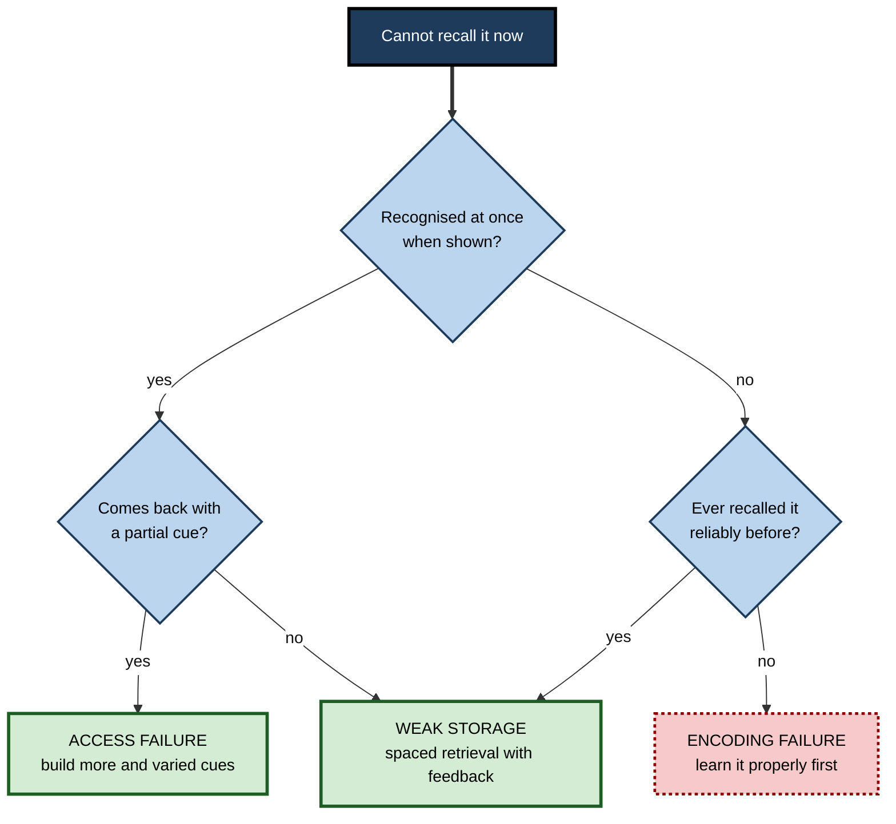
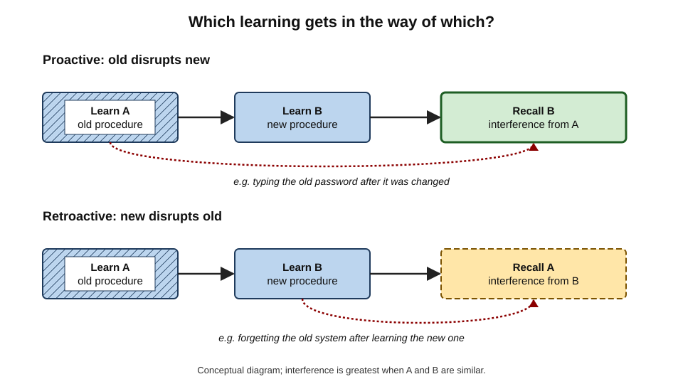
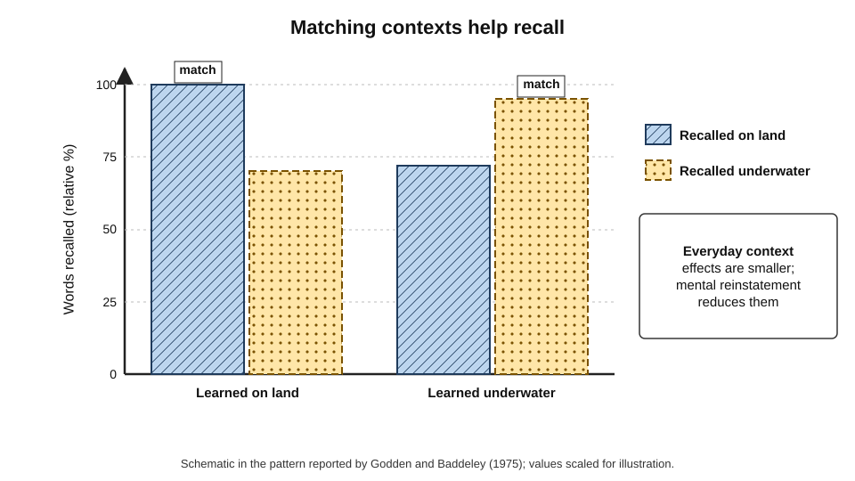
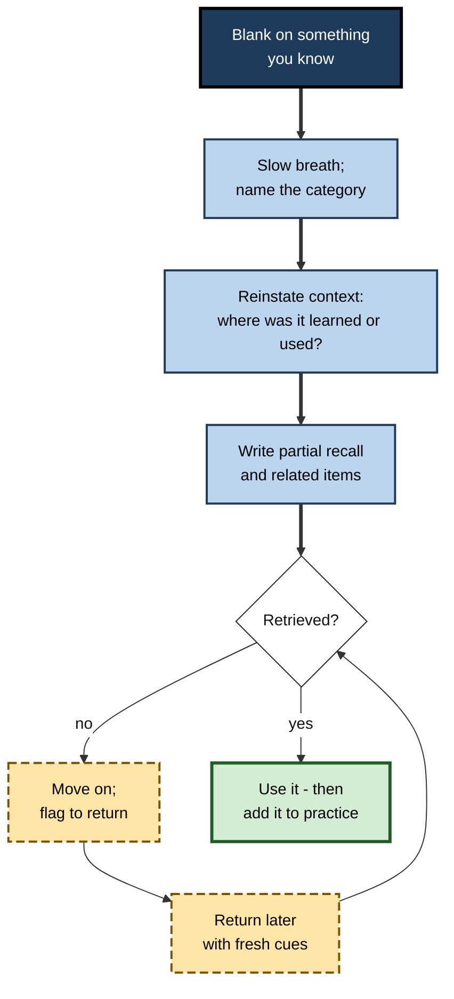
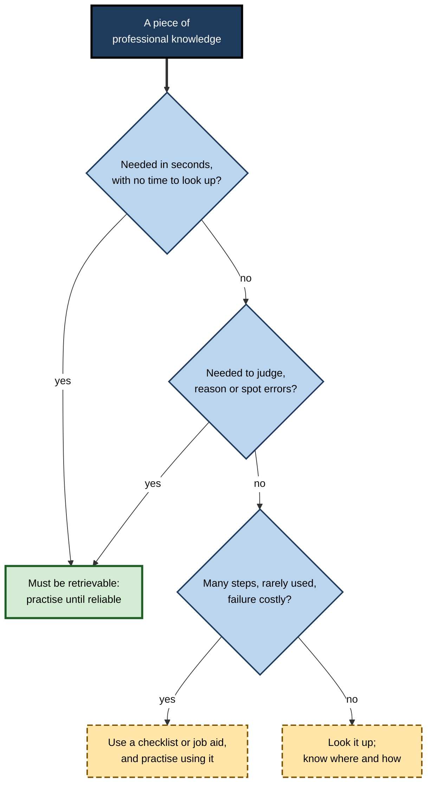

# C.11. Overcoming Retrieval Failure

Mid-presentation, a director is asked for the name of the regulation behind a proposal. She knows it — she has cited it a dozen times — but nothing comes. Two minutes after the meeting the name surfaces unbidden. Nothing was missing from her memory; the **route** to it failed at the moment it was needed. Retrieval failure is ordinary, frequent and often temporary — and much of it can be anticipated, diagnosed, prevented and, sometimes, rescued on the spot.

> **Definition — Retrieval failure:** the inability to bring information into conscious use at a given moment, whether because it was never adequately stored or because stored information cannot be accessed with the cues available.

**Why it matters**

- Professionals are judged at the moment of **retrieval** — in meetings, exams, operating theatres, negotiations — not at the moment of study.
- Different causes of failure need **different remedies**; treating every blank as "I need to re-read" wastes effort.
- Many failures are **access** failures: the knowledge is there, and the right cue, context or calm will release it.
- Organisations that understand retrieval failure design **job aids**, **checklists** and **training conditions** that reduce its cost.

---

## Why Retrieval Fails

### Three points of failure

- **Encoding failure** — the information was never properly stored.
  - *e.g.* failing to recall the design of a coin handled thousands of times — attention never went to the details.
- **Storage loss** — the memory has weakened over time without use.
  - *e.g.* a statistical method last used in university.
- **Access failure** — the memory exists but the current cues do not reach it.
  - *e.g.* a colleague's name that returns an hour later.

> **Key point:** most everyday "forgetting" of things once well learned is **access failure**. Endel Tulving and Zena Pearlstone (1966) showed that cues recover large amounts of material that free recall misses: information can be **available** but not **accessible**.

**Study card — Raymond Nickerson and Marilyn Adams (1979)**

- **Design:** American adults were asked to draw, or pick out from similar drawings, the design of a US one-cent coin.
- **Results:** few could reproduce it accurately; many could not identify the correct design among close alternatives.
- **Conclusion:** frequent exposure does not guarantee encoding of details that were never attended to — some "retrieval failures" are really **encoding failures**.

**Figure 1.** Diagnosing why a retrieval attempt failed.

### Tip-of-the-tongue states

**Study card — Roger Brown and David McNeill (1966)**

- **Design:** students heard definitions of rare words (*e.g.* "a navigational instrument used to measure angles" — *sextant*) and reported when they felt the word was on the tip of the tongue.
- **Results:** in these states, people could often report the **first letter**, the **number of syllables** and words with **similar sound**, before retrieving the word itself.
- **Conclusion:** retrieval is not all-or-nothing; **partial information** about a target is often available.

> **Definition — Tip-of-the-tongue state:** a strong feeling that a known word or name is about to be recalled, accompanied by partial information about it, without full retrieval.

> **Definition — Feeling of knowing:** a judgement that an unrecalled item would be recognised or recalled later; first studied by Joseph Hart (1965), who found such feelings predict later recognition better than chance.

### Blocking

- **Blocking** — a wrong but similar item comes to mind repeatedly and obstructs the target.
  - *e.g.* repeatedly retrieving "IAS 17" when trying to recall "IFRS 16".
- **Persistence of the blocker** — the more the wrong item is retrieved, the stronger it becomes.
- **Retrieval-induced forgetting** — retrieving some items from a set can temporarily suppress related competitors, a process demonstrated by Michael Anderson, Robert Bjork and Elizabeth Bjork (1994).

> **In practice:** when a blocker keeps returning, **stop searching** for a while. Turning attention elsewhere lets the blocker's activation fade; the target often returns unprompted.

### Interference

- **Proactive interference** — earlier learning disrupts recall of later learning.
  - *e.g.* typing an old password after a change.
- **Retroactive interference** — later learning disrupts recall of earlier learning.
  - *e.g.* after learning a new software package, forgetting shortcuts in the old one.
- **Benton Underwood (1957)** argued that much forgetting in laboratory list-learning came from proactive interference from the many lists participants had learned before.

**Figure 2.** Proactive and retroactive interference.

| | Proactive interference | Retroactive interference |
|---|---|---|
| Direction | Old disrupts new | New disrupts old |
| Typical example | Old procedure intrudes after a process change | New system's commands replace memory of the old |
| Increases when | Old and new are similar; old was well learned | New is similar and learned soon after the old |
| Reduced by | Distinctive cues for the new; testing after each block | Retrieval practice of the old; distinctive contexts |

---

## Context, State and Stress

### Context-dependent memory

**Study card — Duncan Godden and Alan Baddeley (1975)**

- **Design:** scuba divers learned word lists either on land or about six metres underwater, then recalled them in the same or the other environment.
- **Results:** recall was substantially better when learning and recall environments **matched**.
- **Conclusion:** the physical context of learning acts as a retrieval cue.

**Figure 3.** Recall is better when the context of recall matches the context of learning.

- **Steven Smith and Edward Vela (2001)** — a meta-analysis found that environmental context effects are **real but modest**, and are reduced when:
  - learners **mentally reinstate** the original context at recall;
  - other, stronger cues are present ("outshining");
  - learning occurred in **several** contexts.
- **Smith, Glenberg and Bjork (1978)** — studying the same material in **two different rooms** improved recall in a third room compared with studying twice in one room.

> **Watch out:** the diver study is often quoted as if context determines memory. Effects in everyday settings, such as studying and sitting an exam in different rooms, are usually **small**. The practical lesson is to **vary** learning contexts and to **reinstate** context mentally, not to worry about exam halls.

### State and mood

- **State-dependent memory** — recall is somewhat better when internal state (*e.g.* alertness, effects of a drug) matches learning; effects are generally weaker than context effects and less reliable.
- **Mood congruence** — people more readily retrieve memories congruent with their current mood; anxious people retrieve threat-related information more easily.

### Stress, anxiety and pressure

- **Acute stress** shortly before retrieval can impair recall of previously learned material, particularly through effects on prefrontal function.
- **Anxiety consumes working memory** — worrying thoughts compete for limited attention (Michael Eysenck's attentional control theory).
- **Choking under pressure** — Sian Beilock and colleagues showed that pressure particularly harms people relying on working-memory-heavy strategies.
- **Retrieval practice as protection** — Amy Smith, Victoria Floerke and Ayanna Thomas (2016) found that material learned through retrieval practice was protected against the usual impairment from acute stress.

> **Definition — Choking under pressure:** performing worse than one's ability in situations where performance matters greatly.

**Interventions studied**

- **Expressive writing** — Gerardo Ramirez and Sian Beilock (2011) found that highly test-anxious students who wrote about their worries for ten minutes before an exam performed better than anxious students who did not.
- **Arousal reappraisal** — Jeremy Jamieson and colleagues (2010) found that telling students that physiological arousal can **improve** performance raised scores on practice mathematics tests.
- **Slow breathing** — commonly recommended to reduce acute physiological arousal; direct evidence on retrieval is limited.

> **Watch out:** the expressive-writing and reappraisal findings are **promising but not settled**; some later replications found smaller or no effects. They are low-cost and low-risk, but should not be presented as guaranteed cures.

---

## Rescuing Retrieval in the Moment

When recall fails during a task, several techniques increase the chance of recovery.

### Techniques

- **Reinstate the context** — mentally return to where and how the information was learned or last used: the room, the document, the conversation, the screen.
- **Generate cues** — run through the alphabet for a first letter; list related terms; picture the page.
- **Retrieve partial information** — what category is it? how long is the word? what was it next to?
- **Approach from another direction** — recall a related example, case or consequence and work back.
- **Switch away and return** — move on; the target often surfaces later (release of a blocker).
- **Write, do not just think** — writing partial recalls frees working memory and produces new cues.
- **Reduce arousal** — a few slow breaths before resuming the search.

> **Mnemonic — "Recall Gets Past Annoying Stuck Words, Really":** Reinstate context, Generate cues, Partial information, Another direction, Switch away, Write it down, Reduce arousal.

**Figure 4.** A sequence for rescuing a failed retrieval under time pressure.

### The cognitive interview

- **Ronald Fisher and Edward Geiselman** developed the cognitive interview for eliciting witness memory; its techniques apply to any effortful recall.
  1. **Reinstate context** — mentally recreate the environment and feelings.
  2. **Report everything** — include fragments, however trivial.
  3. **Change the order** — recall events backwards or from the middle.
  4. **Change the perspective** — recall from another participant's viewpoint.
- **Evidence:** meta-analyses have found that the cognitive interview elicits substantially more correct details than standard interviews, with a small increase in errors.

> **In practice:** in incident post-mortems, ask participants to "take us back to the moment the first alert came in — where were you, what was on your screen?" before asking what they did. Context reinstatement recovers detail that direct questions miss.

| Technique | What it targets | Best used when |
|---|---|---|
| Context reinstatement | Access via contextual cues | Episodic details; "where did I see that?" |
| Alphabet and cue generation | Access via partial lexical cues | Names, terms, words |
| Partial retrieval | Building from fragments | Tip-of-the-tongue states |
| Another direction | Alternative retrieval routes | Concepts with many connections |
| Switch away | Release from blocking | A wrong item keeps intruding |
| Writing fragments | Working-memory relief; new cues | Complex material under pressure |
| Slow breathing, reappraisal | Arousal and anxiety | High-stakes performance |

---

## Preventing Retrieval Failure

### Build more routes

- **Retrieval practice** — the most direct prevention; every successful retrieval strengthens and multiplies access routes.
- **Varied cues** — practise retrieving the same knowledge from different questions, cases and directions.
- **Varied contexts** — study and practise in different places and situations, so recall is not tied to one.
- **Distinctive encoding** — vivid examples and specific cases create distinctive cues that resist interference.

### Practise under realistic conditions

- **Simulate the conditions of use** — time pressure, interruption, audience — so that retrieval is practised in the state in which it will occur.
- **Stress inoculation** — gradual exposure to pressure during practice; used in military, aviation and surgical training.
- **Rehearse beginnings** — the opening lines of a presentation or the first steps of a procedure, which anchor the rest.

### Overlearning — with caution

- **Overlearning** — continued practice after first mastery — improves retention in the short term.
- **Doug Rohrer and colleagues (2005)** found that the benefit of overlearning **faded** over weeks; spreading the same extra practice over time was more efficient for long-term retention.

> **Remember:** practise **past** the first correct recall — but **spread** that extra practice across days rather than piling it into one session.

### Reduce interference

- **Make new learning distinctive** — when procedures change, highlight explicitly what is different from the old one.
- **Test after each block** — interpolated testing reduces the build-up of proactive interference.
- **Retire the old cleanly** — for critical changes (a new dosage protocol, a new password policy), practise the new version in contrast with the old until the new wins reliably.

---

## When to Rely on Memory and When on Aids

Not everything should depend on retrieval. Checklists, job aids and search tools exist because retrieval fails — especially under stress.

**Figure 5.** Deciding whether knowledge must be retrievable from memory or can rely on an aid.

- **Checklists** — Atul Gawande popularised the surgical safety checklist, developed with the World Health Organization; a 2009 study across eight hospitals reported fewer complications and deaths after its introduction.
- **Aids do not remove the need for knowledge** — a checklist prompts steps; it cannot supply the judgement to act on what each step reveals.

| Knowledge | Rely on memory? | Why |
|---|---|---|
| Emergency first actions (anaphylaxis, fire, outage) | Yes | Seconds matter; no time to search |
| Core concepts for judgement | Yes | Needed to interpret, question and spot errors |
| Long, rarely used procedures | Checklist plus familiarity | Memory unreliable; aid prevents omissions |
| Detailed reference data (tax tables, specifications) | Look up | Changes often; errors costly; easy to find |
| Names and context of key clients | Yes, supported by notes | Social and commercial cost of failure |

---

## Worked Example: Diagnosing a Pattern of Exam Blanks

A trainee accountant reports "blanking" on several topics in mock exams despite many hours of study.

1. **Log each blank:** topic, whether the answer was recognised when the paper was marked, whether a hint would have helped.
2. **Classify:**
   - group lease accounting — **not recognised** even on seeing the answer → **encoding failure**;
   - deferred tax — recognised immediately; partial recall with the first step given → **access failure**;
   - consolidation adjustments — recalled in practice at home, lost under exam timing → **pressure-related failure**.
3. **Prescribe:**
   - encoding failure → learn properly: worked examples, explanation, then retrieval;
   - access failure → retrieval practice from varied cues, scenarios and question wordings;
   - pressure failure → timed retrieval practice in mock conditions; brief arousal reappraisal before exams; begin with a quick-win question.
4. **Track:** next mock, record blanks by type again.

| Blank | Recognised when shown? | Hint helped? | Classification | Remedy |
|---|---|---|---|---|
| Group lease accounting | No | No | Encoding failure | Relearn with examples, then retrieve |
| Deferred tax | Yes | Yes | Access failure | Varied-cue retrieval practice |
| Consolidation adjustments | Yes | Not needed at home | Pressure-related | Timed practice under exam conditions |

- **Conclusion:** "blanking" has three causes here; one generic response ("study more") would have wasted much of the effort.

---

## Case Study: The New Procedure That Old Habits Overrode

- **Situation:** a hospital changed its protocol for an anticoagulant, altering a dosage threshold and a monitoring step.
- **Problem:** in the following months, several nurses applied the **old** threshold, despite having completed e-learning on the change.
- **Diagnosis:**
  - **proactive interference** — the old protocol had been used for years and was strongly accessible;
  - the e-learning presented the new protocol on its own, without contrast with the old;
  - no retrieval practice followed; the new protocol was **recognised** but not reliably **retrieved** under ward pressure.
- **Actions:**
  1. A one-page job aid at the point of preparation highlighted **old versus new** side by side.
  2. Short shift-start questions for six weeks asked staff to produce the **new** threshold and monitoring step from memory, with feedback contrasting the old.
  3. Scenario questions included cases where the old threshold would lead to error.
  4. Errors were discussed in safety huddles without blame.
- **Result:** reported deviations to the old threshold fell sharply over the following quarter.
- **Lesson:** when knowledge **changes**, retrieval failure is often interference from the old; practise retrieving the **new**, in explicit contrast with the old, until the new wins.

---

## Bodily States That Weaken Retrieval

### Sleep and fatigue

- **Sleep loss impairs both encoding and retrieval** — attention, working memory and the speed of memory search all decline after a short night.
- **Sleep after learning supports consolidation** — material studied before a night's sleep is generally better retained than material followed by an equal period awake.
- **Practical consequence** — an all-night revision session before an examination trades sleep, which protects retrieval, for extra study of material that will be less retrievable the next day.

### Ageing

- **Name retrieval and tip-of-the-tongue states increase with age** — Deborah Burke and colleagues (1991) found that older adults reported more tip-of-the-tongue experiences than younger adults, especially for proper names.
- **Knowledge itself is often intact** — vocabulary and general knowledge are typically maintained or grow with age; what slows is **access**, particularly for names and rarely used words.
- **Implications** — older professionals benefit from the same remedies: distinctive cues, regular retrieval of critical names and terms, and generating partial information during a block.

> **Key point:** ageing tends to make retrieval **slower and more cue-dependent** rather than emptying memory; more and better cues, and regular use, compensate considerably.

### Illness, medication and stress hormones

- **Acute illness**, some medications (*e.g.* certain sedatives) and alcohol impair retrieval; these effects pass with the state.
- **Chronic stress** is associated with poorer memory performance; managing workload and recovery protects retrieval as well as health.

---

## Retrieval Failure in Teams

Organisations also suffer retrieval failures: the knowledge exists somewhere in the team but cannot be reached when needed.

### Transactive memory

- **Daniel Wegner (1987)** described **transactive memory**: in close groups, members specialise and rely on knowing **who knows what**, so the group remembers more than any individual.
- **Benefit** — efficient division of memory; each person need not know everything.
- **Failure mode** — when the expert is absent, leaves, or is not known to be the expert, the team's retrieval fails even though the knowledge "exists" in the organisation.

> **Definition — Transactive memory:** a shared system in which group members encode, store and retrieve knowledge by relying on each other's areas of expertise, including knowledge of who knows what.

### Organisational remedies

- **Map who knows what** — keep directories of expertise current.
- **Cross-train critical knowledge** — at least two people must be able to retrieve each critical procedure without the other.
- **Rehearse without the expert** — run exercises in which the usual expert is deliberately absent.
- **Write it down — and retrieve it** — documentation helps, but only if people know it exists and have practised using it.

| Team retrieval failure | Cause | Remedy |
|---|---|---|
| "Only Priya knows how to restore the database" | Single point of knowledge | Cross-training; rehearsals without Priya |
| Nobody knows a runbook exists | Documentation not retrievable | Index, link from alerts, practise finding it |
| New joiners do not know whom to ask | Transactive map missing | Expertise directory; onboarding introductions |
| Lessons from past incidents forgotten | No retrieval of post-mortems | Periodic review quizzes on past incidents |

---

## Speaking, Presenting and Answering Under Pressure

Many professional retrieval failures happen in front of others — presentations, interviews, client meetings, examinations.

### Before

- **Practise retrieval in the target format** — answer aloud, standing, timed, ideally to another person.
- **Rehearse openings** — the first minute is when anxiety is highest; a well-retrieved opening reduces pressure on what follows.
- **Prepare recovery phrases** — "Let me come back to that figure in a moment" buys time without a visible blank.
- **Learn structure, not script** — a structure allows recovery from a lost word; a memorised script does not.

### During a blank

1. **Pause and breathe** — a pause of a few seconds is rarely noticed by an audience.
2. **Return to the structure** — "There were three points; the second was about cost…"
3. **Use a partial answer** — give what is known and offer to follow up on the rest.
4. **Move on and return** — the item often resurfaces once attention is elsewhere.

### After

- **Record the failure** — what was blanked, and under what conditions.
- **Add it to practice** — the item becomes a retrieval target, practised under similar pressure.

> **In practice:** in job interviews, a prepared set of five or six well-rehearsed stories, each retrievable by a one-word cue, makes most behavioural questions answerable even when anxiety blocks spontaneous recall.

---

## Retrieval in an Age of External Memory

- **Offloading** — people increasingly store information in devices and search tools rather than in memory.
- **The evidence on "digital amnesia" is mixed** — an influential 2011 claim that people remember less of what they expect to be able to look up did not fully replicate in a large replication project.
- **The practical risk is clearer** — knowledge that is never retrieved from memory, because it is always looked up, loses its retrieval routes; when the tool is unavailable or slow, or when judgement must be immediate, retrieval fails.
- **A balanced policy** — deliberately decide what must remain retrievable from memory, practise it, and offload the rest.

> **Watch out:** "I can always look it up" is true for facts, not for **judgement**. Recognising that something is wrong, or that a question needs asking, depends on knowledge retrievable without a search.

---

## Case Study: The Interview Candidate Who Knew Too Much to Say

- **Situation:** an experienced engineer interviewing for a principal role failed two interviews in which she "went blank" on system-design questions she could answer easily at work.
- **Diagnosis:**
  - at work, retrieval was cued by her own systems, code and colleagues — **context-dependent** retrieval;
  - interviews demanded **free recall** of general design patterns, aloud, under evaluation — a different context, format and level of pressure;
  - she had prepared by **reading** about system design rather than practising answers.
- **Actions:**
  1. She built a **cue structure** for design questions: requirements, scale estimates, components, data, bottlenecks, trade-offs.
  2. Three times a week she answered a design question **aloud**, timed, to a colleague, then compared her answer with notes.
  3. She varied the setting: video call, whiteboard, walking.
  4. She rehearsed recovery phrases and the opening two minutes of each answer.
  5. Before interviews she wrote briefly about her worries and reframed arousal as readiness.
- **Result:** in the next two interviews she reported only brief, recoverable blanks and received an offer.
- **Lesson:** retrieval failure under pressure is often a failure to **practise retrieval in the conditions of use** — format, context and pressure — not a lack of knowledge.

---

## Open Questions

- **How much of everyday forgetting is access failure?**
  - Laboratory evidence shows much "forgotten" material is recoverable with cues; how this applies to years-old professional knowledge is uncertain.
- **Which stress-reduction techniques reliably help retrieval?**
  - Expressive writing, reappraisal and breathing have mixed replication records; effects may depend on the learner and the setting.
- **Does reliance on search and AI change retrieval failure?**
  - If people retrieve less, access routes may weaken; whether this matters depends on how often unaided recall is needed.
- **How should organisations balance memory and aids?**
  - The division between what must be remembered and what can be looked up is rarely decided explicitly and lacks systematic evidence.

---

## Summary

- **Retrieval failure** can arise from **encoding failure**, **weak storage** or **access failure**; most failures of once-learned knowledge are access failures (available but not accessible).
- **Tip-of-the-tongue** states and **feelings of knowing** show partial information is often available.
- **Blocking** and **interference** (proactive and retroactive) obstruct targets; **retrieval-induced forgetting** suppresses competitors temporarily.
- **Context** acts as a cue (Godden and Baddeley, 1975), but everyday effects are modest; **mental reinstatement** and **varied contexts** reduce dependence on context.
- **Stress and anxiety** impair retrieval through working-memory load; retrieval-practised material resists stress; expressive writing and reappraisal are promising but not settled.
- **In the moment:** reinstate context, generate cues, use partial information, approach from another direction, switch away, write fragments, reduce arousal; the **cognitive interview** formalises these.
- **Prevention:** retrieval practice, varied cues and contexts, realistic conditions, spaced extra practice, and explicit contrast when knowledge changes.
- Decide deliberately what must be **remembered**, what needs a **checklist**, and what can be **looked up**.

---

## Self-Check

1. Distinguish encoding failure, storage loss and access failure, with an example of each.
2. What did Tulving and Pearlstone (1966) show about availability and accessibility?
3. Describe the tip-of-the-tongue findings of Brown and McNeill (1966).
4. What is blocking, and what should a person do when it occurs?
5. Distinguish proactive from retroactive interference and give a workplace example of each.
6. Describe Godden and Baddeley (1975) and explain why its everyday implications are limited.
7. How do stress and anxiety impair retrieval? Name two interventions and their evidence status.
8. List five techniques for rescuing a failed retrieval in the moment.
9. What are the four main techniques of the cognitive interview?
10. Why does overlearning need to be spaced?
11. A trainee "blanks" in exams. How would you diagnose the cause of each blank?
12. When a procedure changes, why do staff revert to the old one, and how can training prevent it?
13. Classify these as remember, checklist or look up: a cardiac-arrest algorithm, VAT rates for twenty countries, the steps of an annual server rebuild, the principles of fair presentation in accounts.
14. How does ageing typically affect retrieval, and what compensates?
15. What is transactive memory, and how can its failures be prevented?

### Answer Key

1. Encoding: never stored (coin details never attended to). Storage loss: weakened through disuse (an old statistical method). Access: stored but not reachable with current cues (a name that returns later).
2. Cued recall recovered many items missed in free recall; information can be stored (available) yet not retrievable (inaccessible) without suitable cues.
3. People in tip-of-the-tongue states often knew the first letter, number of syllables and similar-sounding words — partial information about the target.
4. A similar wrong item repeatedly comes to mind and obstructs the target. Stop searching, switch attention, and return later or use other cues.
5. Proactive: old disrupts new (old password typed after a change). Retroactive: new disrupts old (new software shortcuts replacing old ones).
6. Divers recalled words better in the environment where they learned them. Everyday context effects are modest and reduced by mental reinstatement, strong cues and learning in varied contexts.
7. They consume working memory and impair prefrontal retrieval processes. Expressive writing (Ramirez and Beilock, 2011) and arousal reappraisal (Jamieson and colleagues, 2010): promising, with mixed replications.
8. Reinstate context; generate cues; use partial information; approach from another direction; switch away and return; write fragments; slow breathing.
9. Reinstate context; report everything; change order; change perspective.
10. Overlearning benefits fade over weeks (Rohrer and colleagues, 2005); spreading extra practice over time gives more durable retention.
11. Log each blank; check whether the answer was recognised when shown and whether a hint helped; classify as encoding, access or pressure-related; prescribe relearning, varied-cue retrieval or timed realistic practice respectively.
12. Proactive interference from the strongly learned old procedure. Present new versus old in contrast, practise retrieving the new from memory with feedback, use scenarios where the old would cause error, and provide a point-of-use job aid.
13. Cardiac-arrest algorithm: remember (with aid as backup). VAT rates: look up. Annual server rebuild: checklist. Fair-presentation principles: remember (needed for judgement).
14. Retrieval becomes slower and more cue-dependent, with more tip-of-the-tongue states, especially for names (Burke and colleagues, 1991), while knowledge is often intact. Distinctive cues, regular retrieval of critical items and use of partial information compensate.
15. A group's shared system of relying on who knows what (Wegner, 1987). Failures occur when the expert is absent or unknown; prevent them by mapping expertise, cross-training critical knowledge, rehearsing without the expert and making documentation retrievable.

---

## Glossary

| Term | Meaning |
|---|---|
| Access failure | Stored information cannot be retrieved with the cues available. |
| Blocking | A similar wrong item repeatedly obstructs retrieval of the target. |
| Choking under pressure | Performing below ability when performance matters greatly. |
| Cognitive interview | Interview technique using context reinstatement, full report, changed order and perspective. |
| Cognitive offloading | Relying on external tools or records instead of memory. |
| Context reinstatement | Mentally recreating the circumstances of learning to aid recall. |
| Context-dependent memory | Better recall when the recall context matches the learning context. |
| Encoding failure | Information was never adequately stored. |
| Feeling of knowing | A judgement that an unrecalled item would be recognised later. |
| Job aid | An external reference designed to support performance at the point of work. |
| Mood congruence | Easier retrieval of memories that match current mood. |
| Overlearning | Continued practice after first mastery. |
| Proactive interference | Earlier learning disrupting later learning. |
| Retrieval failure | Inability to bring information into use at a given moment. |
| Retroactive interference | Later learning disrupting earlier learning. |
| State-dependent memory | Better recall when internal state matches that at learning. |
| Tip-of-the-tongue state | Feeling that a known item is about to be recalled, with partial information. |
| Transactive memory | A group system of shared memory based on knowing who knows what. |
