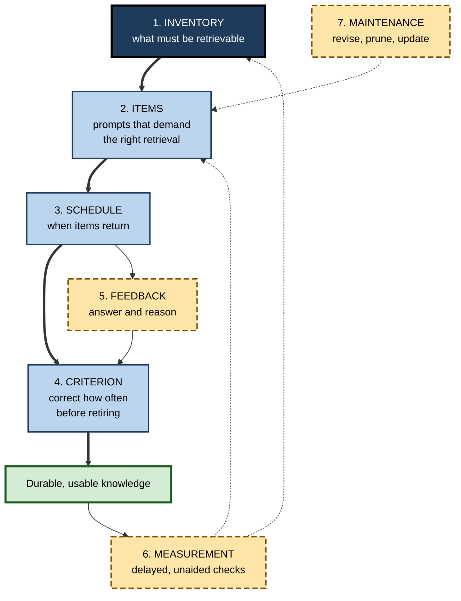
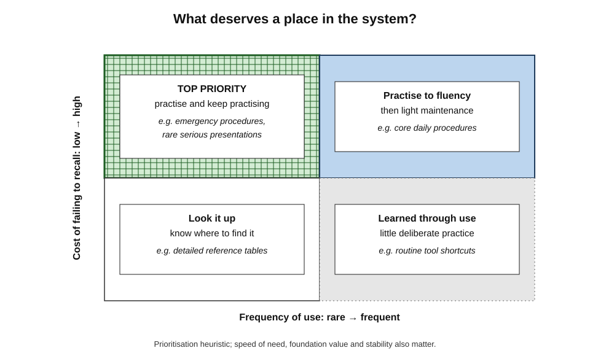
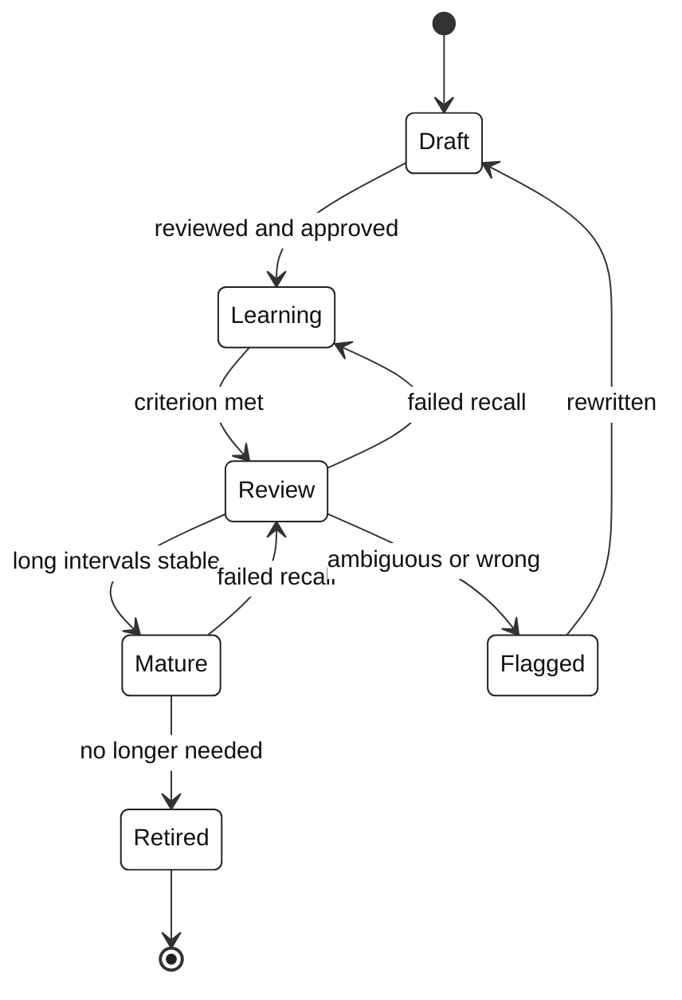
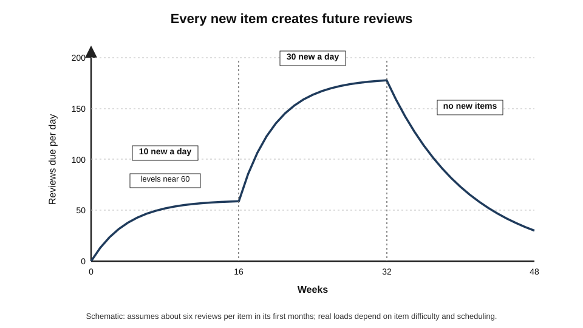
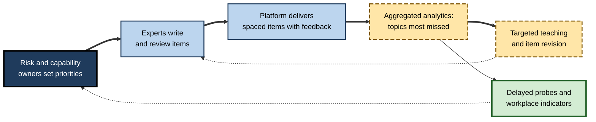

# C.12. Designing a Retrieval Practice System

Most people who try retrieval practice do it in bursts: a flurry of flashcards before an exam, a quiz after a training course, a resolution to "test myself more". Within weeks the cards go unreviewed, the quizzes stop and the knowledge fades. What lasts is not a technique but a **system** — and designing one is an engineering problem as much as a psychological one.

> **Definition — Retrieval practice system:** an organised, sustained arrangement for selecting knowledge to be retained, turning it into retrieval prompts, scheduling and delivering those prompts, providing feedback, measuring retention and maintaining the item set over time — for an individual, a team or an organisation.

**Why it matters**

- The evidence for retrieval practice concerns **repeated** retrieval over **weeks and months**; only a system delivers that.
- Without design, retrieval effort drifts to what is **easy to quiz** rather than what is **important to know**.
- Item sets grow, age and decay; without maintenance, a system becomes a burden and is abandoned.
- In organisations, retrieval systems touch **governance**, **data** and **culture**, not only learning.

---

## The Architecture of a System

### Seven components

1. **Inventory** — what knowledge must be retrievable, and how important is each part?
2. **Items** — the prompts, written so that answering them requires the right retrieval.
3. **Schedule** — when each item returns.
4. **Criterion and retirement** — how often an item must be answered correctly, and when it leaves active practice.
5. **Feedback** — what the learner sees after each attempt.
6. **Measurement** — how retention and transfer are checked.
7. **Maintenance** — who revises, prunes and updates items as knowledge changes.

> **Mnemonic — "Ideas Into Schedules Can Form Memories Methodically":** Inventory, Items, Schedule, Criterion, Feedback, Measurement, Maintenance.

**Figure 1.** The components of a retrieval practice system and how they connect.

---

## Component 1: The Inventory

### What deserves retrieval practice?

Not everything should be memorised. Retrieval practice costs time; it should be spent where unaided recall matters.

- **Criticality** — how costly is failure to recall? (patient harm, legal exposure, lost client)
- **Speed of need** — must it be available in seconds, without looking up?
- **Frequency of use** — is it used often enough to stay fresh naturally, or rarely enough to fade?
- **Foundation value** — does it underpin understanding of much else?
- **Stability** — will it remain true, or change soon?

**Figure 2.** Prioritising knowledge for retrieval practice by criticality and frequency of use.

- **High criticality, rare use** — the **top priority**: knowledge that will be needed suddenly and will otherwise have faded.
  - *e.g.* emergency procedures, disaster-recovery steps, rare but serious clinical presentations.
- **High criticality, frequent use** — practise until fluent, then light maintenance; daily use keeps it fresh.
- **Low criticality, rare use** — look it up; do not practise.
- **Low criticality, frequent use** — learned through use; little deliberate practice needed.

> **Key point:** the most valuable retrieval items are often the ones **least likely** to be practised naturally — critical knowledge that is rarely used.

### Granularity

- **Break knowledge into retrievable units** — one idea per item where possible.
- **Keep higher-level items too** — explanations, structures and applications, which cannot be reduced to single facts.

---

## Component 2: Items

### Principles of item design

- **One idea per item** — Piotr Woźniak, creator of an early spaced-repetition program, called this the **minimum information principle**: simple items are easier to schedule and retrieve reliably.
- **Production over recognition** — answers should be produced, not selected, wherever possible.
- **Direction that matches use** — practise the direction in which knowledge will be retrieved (situation → action, not only term → definition).
- **No hidden cues** — avoid wording that gives away the answer; vary phrasing.
- **Context in the prompt** — enough context to make the question unambiguous.
- **Avoid sets and enumerations** — "list all twelve…" items are hard to retrieve and grade; split them, or use structured prompts.
- **Include why and when** — explanation and condition items alongside fact items.

> **Definition — Minimum information principle:** the guideline that retrieval items should be as simple as possible — ideally a single fact or idea — so that each can be reliably retrieved and scheduled.

> **Definition — Cloze item:** an item in which a key word or phrase is deleted from a statement and must be supplied.

| Weak item | Problem | Better item |
|---|---|---|
| "What are the GDPR principles?" | A set of seven; hard to retrieve and grade | Seven items, each "Which GDPR principle requires…?", plus one structure item |
| "Define accrual." | Only term → definition | "A supplier delivered in March but invoices in April. In which month is the expense recognised, and why?" |
| "Is the threshold 10,000? (yes/no)" | Recognition; 50% guessable | "What is the reporting threshold?" |
| "The 3 Vs of big data are volume, velocity and \_\_\_" | Fine as cloze, but only one cue | Add: "Which of the 3 Vs explains why a batch nightly load is inadequate here?" |
| Card copied from slide text | Learner recalls slide wording, not meaning | Rephrase in own words; add an example |

### Item types by knowledge type

| Knowledge type | Item type | Example |
|---|---|---|
| Term or fact | Short answer; cloze | "What is the default retention period for audit logs?" |
| Concept | Explain in one or two sentences | "Why does a higher discount rate reduce present value?" |
| Procedure | Next step; full sequence | "After isolating the affected host, what is the next step?" |
| Principle with conditions | Applies / does not apply, with reason | "Does the exemption apply to this transfer? Why?" |
| Discrimination | Contrast pairs; which-category | "Is this an outage or a degradation incident under our policy?" |
| Complex structure | Draw or outline from memory | "Sketch the request path from user to database." |

---

## Components 3 and 4: Schedule, Criterion and Retirement

### Scheduling, in brief

- **Items should return after growing intervals** — the core idea of spaced retrieval, whose design is a substantial field in its own right.
- **Simple rules work** for most people and teams:
  - new items: same day, next day, a few days later;
  - after each success: roughly double or triple the interval;
  - after a failure: return soon and restart the growth.
- **Software** can handle this automatically; paper systems such as the **Leitner box** (Sebastian Leitner, 1970s), in which cards move between compartments reviewed at increasing intervals, implement the same logic by hand.

### Criterion: how much is enough?

**Study card — Katherine Rawson and John Dunlosky (2011)**

- **Design:** students learned key concepts by retrieval practice, varying:
  - the **initial criterion** — how many times each item had to be recalled correctly in the first session (one to four or more);
  - the number of later **relearning sessions** in which items were again retrieved to criterion.
- **Results:**
  - raising the initial criterion beyond about **three** correct recalls gave diminishing returns;
  - adding **relearning sessions** produced large gains in long-term retention for little extra time, because relearning took fewer trials each time.
- **Conclusion:** a practical recommendation emerged — recall each item correctly about **three times initially**, then **relearn** it to criterion in **three or more later sessions**.

> **Definition — Criterion level:** the number of correct recalls required before an item is considered learned within a session.

> **Remember:** **"three, then three"** — about three correct recalls at first, then at least three relearning sessions on later days. Initial mastery matters less than coming back.

### Retirement and the item lifecycle

**Figure 3.** The lifecycle of a retrieval item.

- **Retire** items when the knowledge is no longer needed, or is so embedded in daily work that practice adds nothing.
- **Flag** items that are repeatedly failed by many learners — often the item, not the learners, is at fault.
- **Revise** items when the underlying knowledge changes; delete the old version so it does not compete.

---

## Components 5 and 6: Feedback and Measurement

### Feedback

- **Always show the correct answer** after an attempt.
- **Add a one-line reason** for concept and principle items.
- **Return failed items soon** — later in the session or the next day.
- **Confidence ratings** (sure / unsure) cost little and make feedback more effective.

### Measuring whether the system works

- **Delayed, unaided probes** — periodically test a random sample of retired or mature items, without warning.
- **Transfer probes** — new questions or cases that require the knowledge, not seen in practice.
- **Item analytics** — failure rates, time to answer, items that most learners miss.
- **Leading indicators at work** — fewer escalations, fewer look-ups for basic information, fewer errors on audited points.

| Metric | What it shows | Pitfall |
|---|---|---|
| Practice accuracy | How hard current items are | High accuracy may mean items are too easy |
| Review completion rate | Whether the system is being used | Completion is not learning |
| Delayed probe accuracy | Retention | Needs genuinely unannounced items |
| Transfer probe accuracy | Usable understanding | Requires new items to be written |
| Workplace indicators | Real impact | Many other causes; needs comparison |
| Time per day | Sustainability | Rising load predicts abandonment |

> **Watch out:** **review completion** is the metric most systems report and the least informative. A learner can complete every review by flipping cards without retrieving anything.

---

## Component 7: Maintenance and Workload

### Review load

Every item added creates future reviews. Load grows quickly unless additions are controlled.

> **Formula — Approximate daily review load:** reviews per day ≈ new items per day × reviews needed per item in its first months. Example: 10 new items a day, each needing about 6 reviews in its first few months, settles at roughly **60 reviews a day**; at about 10 seconds each, that is about **10 minutes a day**. Adding 30 items a day triples the load to about half an hour.

**Figure 4.** Review load rises after each increase in new items and then levels off.

### Keeping the system healthy

- **Cap additions** — set a daily or weekly maximum of new items.
- **Prune regularly** — retire items no longer needed; merge duplicates.
- **Watch the time budget** — if daily load exceeds the planned budget, add fewer items rather than skipping reviews.
- **Version knowledge** — when a policy changes, update or delete all related items at once; keep a record of changes.
- **Assign ownership** — in teams, each item has an owner responsible for its accuracy.

> **In practice:** **review debt** — a backlog of overdue reviews — is the usual cause of abandonment. If a backlog builds, pause new items and clear the backlog over several days rather than quitting.

| Failure mode | Symptom | Prevention |
|---|---|---|
| Item bloat | Hundreds of trivial items; load unbearable | Inventory and caps on additions |
| Review debt | Backlog of overdue items; avoidance | Time budget; pause new items |
| Recognition drift | Fast, effortless "correct" answers | Typed answers; scenarios; vary wording |
| Stale items | Items contradict current policy | Owners; version control; review cycle |
| Orphan items | Nobody knows why an item exists | Link items to objectives |
| Surveillance creep | Learners game or avoid the system | Keep individual data private |

---

## Personal, Team and Organisational Systems

| | Personal system | Team system | Organisational system |
|---|---|---|---|
| Inventory set by | The individual | Team lead with members | Learning and subject-matter experts with risk owners |
| Items written by | Individual | Members, reviewed by peers | Subject-matter experts, reviewed formally |
| Delivery | Flashcard app, notebook | Shared deck; meeting starters; chat prompts | Microlearning platform; LMS |
| Data | Private | Team-level aggregates | Aggregated by role and topic |
| Maintenance | Individual pruning | Item owners in the team | Governance board; review cycle |
| Main risk | Abandonment | Uneven contribution | Bureaucracy; surveillance |

**Figure 5.** A governance loop for an organisational retrieval system.

---

## Worked Example: A Personal System for a New Role

A newly promoted engineering manager must retain people-management policies, the team's systems architecture and key stakeholders' priorities.

1. **Inventory (week 1):** list knowledge needed **unaided**: 15 HR policy points used in conversations; the architecture's 12 main components and their failure modes; priorities and concerns of 10 stakeholders. Look-up only: detailed leave entitlements, salary bands.
2. **Prioritise:** grievance and performance-process steps (critical, rarely used) first; architecture second; stakeholders third.
3. **Write items:** about 60 — short answers for policy facts, "next step" items for procedures, "draw from memory" for architecture, "what does X care about most, and why?" for stakeholders.
4. **Schedule:** a flashcard app with automatic intervals; cap of 5 new items a day; 10 minutes each morning.
5. **Criterion:** about three correct recalls before an item moves to longer intervals.
6. **Feedback:** answers with a one-line reason; architecture drawings compared against the diagram.
7. **Measure:** at weeks 4 and 12, a colleague asks ten random questions without warning; track how often basic information has to be looked up.
8. **Maintain:** monthly prune; update items when policies change.

| Week | New items | Daily time | Delayed probe (10 questions) |
|---|---|---|---|
| 1–2 | 5 per day | About 5 minutes | — |
| 3–6 | 5 per day | About 10 minutes | Week 4: 7 of 10 |
| 7–12 | 2 per day | About 8 minutes | Week 12: 9 of 10 |
| After 12 | As needed | About 5 minutes | Quarterly |

- **Conclusion:** about ten minutes a day, deliberately aimed, produces reliable unaided recall of the knowledge the role demands.

> **Watch out:** adding every interesting fact encountered in the first weeks would quickly push load past 30 minutes a day — the commonest reason personal systems collapse.

---

## Case Study: An Organisation-Wide Knowledge Retention System

- **Situation:** a global insurer's claims division (about 1,200 handlers) faced frequent regulatory and policy changes; annual e-learning was followed by persistent errors on specific rules.
- **Problem:** audits repeatedly found the same handful of errors — limitation periods, disclosure obligations, fraud indicators.
- **Design:**
  1. **Inventory:** compliance and claims leaders identified 80 rules, ranked by audit findings and severity.
  2. **Items:** subject-matter experts wrote 240 items — scenarios, short answers and contrast pairs — each linked to a rule and an owner; AI tools drafted variants, which experts reviewed.
  3. **Delivery:** three items per handler per week in the claims system, at the start of a shift.
  4. **Criterion:** items recurred until answered correctly three times across separate weeks, then moved to quarterly review.
  5. **Feedback:** correct answer, rule reference and a one-line reason.
  6. **Data:** individual results visible only to the handler; managers saw team-level accuracy by rule.
  7. **Maintenance:** a monthly review retired or rewrote items with very high or very low accuracy; policy changes triggered immediate updates.
  8. **Measurement:** audit error rates on the 80 rules, compared with rules not in the system.
- **Result:** after a year, audit errors on included rules fell substantially more than on comparable excluded rules; average time per handler was about five minutes a week.
- **Side effects:** an early decision to show individual scores to managers was reversed after handlers reported anxiety and colleagues sharing answers.
- **Lesson:** a retrieval system succeeds when it is **targeted** (inventory), **well written** (items), **sustained** (schedule and criterion), **trusted** (private data) and **maintained** (owners and reviews).

---

## Complex Knowledge Inside a System

Systems built from single-fact items are easy to run but leave out much of what professionals need. Explanation, case and structure items can be included with a few adjustments.

- **Explanation items** — "Explain why…" prompts, self-marked against an idea-unit list; scheduled at longer intervals than facts because each takes longer.
- **Case items** — short scenarios requiring a decision and a reason; keep a pool of variants so the same case is not memorised.
- **Structure items** — "Draw the process from memory"; checked against a reference diagram.
- **Rotation rather than repetition** — for complex items, the same concept should return in **new** forms; the item pool for a concept grows, while each individual variant appears rarely.
- **Mixed sessions** — combine quick fact items with one or two complex items per session, so sessions stay short.

| Item type | Time per attempt | Scheduling | Marking |
|---|---|---|---|
| Fact or term | Seconds | Standard growing intervals | Automatic or self-rated |
| Explanation | 1–3 minutes | Longer intervals; fewer per session | Self-marked against idea units |
| Case decision | 1–5 minutes | Rotate variants; one or two per session | Model answer; peer or expert review |
| Structure diagram | 3–10 minutes | Monthly or before need | Compare links with reference |

> **Key point:** a system that contains only facts produces professionals who can answer questions but not **reason**. Budget a share of time — perhaps a fifth to a third — for explanation and case items.

---

## Fitting Retrieval Into the Flow of Work

Systems fail when retrieval depends on remembering to do it. They last when retrieval is **attached to existing routines**.

- **Triggers in the workday**
  - start of shift or stand-up — two or three questions;
  - before a client meeting — a minute recalling the client's priorities and recent history;
  - before a procedure — recalling the steps before opening the checklist;
  - after an incident or a case — writing three things learned, then adding them as items.
- **Triggers in tools**
  - questions delivered inside the chat, ticketing or clinical system already open;
  - prompts linked to calendar events.
- **Triggers in teams**
  - one question at the start of each weekly meeting, written in rotation by team members;
  - retrieval of a past post-mortem's lessons before similar work begins.

> **In practice:** the best predictor of whether a retrieval system survives is **friction**. If starting a session takes more than a few seconds, it will be skipped on busy days — and most days are busy.

---

## Evaluating Your System Honestly

The fairest evaluation is built into the system itself.

1. **Hold out items** — randomly assign a share of eligible items (say, a fifth) to **no practice**.
2. **Practise the rest** as normal.
3. **Probe both** — at intervals, test a random sample of practised and held-out items, unannounced, with new wording.
4. **Compare** — the difference shows what the system adds beyond ordinary work and exposure.
5. **Adjust** — if the difference is small, inspect item quality, schedule and whether retrieval is genuine.

> **Formula — System benefit:** accuracy on practised items − accuracy on held-out items. Example: 81% − 58% = **23 percentage points** at three months. If the system costs 10 minutes a day, that is the gain bought with roughly 15 hours over three months.

> **Watch out:** holding out critical safety knowledge from practice is unethical. Hold-outs should be chosen from items where reduced retention carries little risk, or the comparison should be run on a lower-risk sample.

---

## Worked Example: A Team System for a Data Platform Group

A data-platform team of eight supports internal analysts. Knowledge is spread unevenly; on-call engineers often escalate to the two longest-serving members.

1. **Inventory (two hours, whole team):** list knowledge that on-call engineers must retrieve without help — 30 runbook first steps, 20 data-quality rules, 15 facts about upstream systems and their owners.
2. **Prioritise:** rank by how often escalations involved each item and by the impact of mistakes.
3. **Items:** each engineer writes about eight items in their area; a colleague reviews each for clarity and accuracy. About 65 items in total, a third of them short scenarios.
4. **Delivery:** two items per person each working day, inside the team chat tool, at 9:30.
5. **Criterion:** an item retires to monthly review after three correct answers on separate days.
6. **Feedback:** the item owner's model answer and a link to the runbook section.
7. **Data:** individual results private; a weekly team summary of the five most missed items.
8. **Maintenance:** the item owner updates items when runbooks change; a monthly 15-minute review retires and rewrites items.
9. **Evaluation:** a fifth of the lower-risk items held out; quarterly unannounced probes; escalation counts tracked.

| Quarter | Daily time per person | Practised items correct (probe) | Held-out items correct | Escalations to senior engineers |
|---|---|---|---|---|
| Before | — | — | — | 34 |
| Quarter 1 | About 3 minutes | 78% | 55% | 21 |
| Quarter 2 | About 3 minutes | 84% | 57% | 15 |

- **Conclusion (illustrative data):** three minutes a day produced a large, measurable retention advantage and coincided with fewer escalations; the held-out comparison separates the system's effect from general experience.

> **Watch out:** escalations also fall as engineers gain experience. Without the held-out comparison, the team could not tell how much of the fall was due to the system.

---

## AI in Building and Maintaining Systems

- **Drafting items** — AI can turn runbooks, policies and course notes into candidate items in minutes; experts select and edit.
- **Generating variants** — new wording and scenarios for the same concept, supporting rotation.
- **Detecting stale items** — comparing items with updated documents to flag items that may now be wrong.
- **Marking explanations** — comparing free-text answers with idea-unit lists.
- **Governance** — every AI-drafted or AI-revised item still needs a **human owner** who approves it; changes should be logged.

> **In practice:** treat AI as an **assistant to item owners**, never as the owner. An item that nobody has checked is a liability: it can teach an error to every learner in the system.

---

## Open Questions

- **What is the best way to prioritise knowledge for retrieval?**
  - Criticality and frequency are intuitive criteria, but there is little research on formal prioritisation methods.
- **How can complex knowledge be maintained in item form?**
  - Facts suit simple items; reasoning and judgement resist reduction, and how to schedule explanation and case items is less well studied.
- **What criterion and relearning schedule suit professional knowledge?**
  - "Three, then three" comes from university concept learning; its generalisation to workplace knowledge is plausible but untested.
- **Can AI maintain item banks safely?**
  - AI can detect outdated items and draft revisions; accuracy and accountability for changes need governance.
- **How should organisations measure return on retrieval systems?**
  - Linking retention to business outcomes requires comparison groups that organisations rarely create.

---

## Summary

- A **retrieval practice system** is a sustained arrangement of **inventory, items, schedule, criterion, feedback, measurement and maintenance**.
- **Inventory:** prioritise by criticality, speed of need, frequency, foundation value and stability; **critical but rarely used** knowledge comes first.
- **Items:** one idea per item (**minimum information principle**), production over recognition, direction matched to use, no hidden cues, no unwieldy sets, explanation and condition items too.
- **Schedule:** growing intervals; return failed items soon.
- **Criterion (Rawson and Dunlosky, 2011):** about **three** correct recalls initially, then **three or more relearning sessions** — "three, then three".
- **Lifecycle:** draft, learning, review, mature, retired, flagged.
- **Measure** with delayed, unaided and transfer probes and workplace indicators — not completion rates.
- **Maintain:** cap additions, manage review load, prune, version, assign owners; avoid **review debt**, **bloat**, **recognition drift**, **stale items** and **surveillance creep**.
- Personal, team and organisational systems differ in authorship, data and governance; all need trust and maintenance.

---

## Self-Check

1. Name the seven components of a retrieval practice system.
2. Which knowledge should be prioritised for retrieval practice, and why is "critical but rarely used" knowledge especially important?
3. State the minimum information principle and explain how to handle a list of seven principles.
4. Rewrite "Define depreciation" as a better retrieval item.
5. Describe Rawson and Dunlosky (2011) and the recommendation that follows.
6. Describe the lifecycle of a retrieval item.
7. Why is review completion a poor measure of a system's success? Suggest two better ones.
8. Calculate the approximate daily load of adding 15 items a day, each needing about 6 reviews in its first months, at 8 seconds per review.
9. What is review debt, and how should it be handled?
10. Compare personal, team and organisational systems on authorship, data and maintenance.
11. An organisation's quiz bank contains items contradicting a new policy. What maintenance processes would have prevented this?
12. Design a retrieval system for a new nurse learning a ward's high-risk medicines.
13. How can a retrieval system include complex knowledge without becoming unmanageable?
14. How can a team measure what its retrieval system adds, and what ethical limit applies?

### Answer Key

1. Inventory, items, schedule, criterion and retirement, feedback, measurement, maintenance.
2. Knowledge that is critical, needed quickly, foundational, stable and not refreshed by daily use. Critical rare knowledge will fade without practice and its failure is costly.
3. Items should be as simple as possible — ideally one idea each. Split the list into seven separate items, plus a structure item asking for the overall set or its organisation.
4. E.g. "A delivery van bought for £30,000 is expected to last five years with no residual value. What is the annual straight-line depreciation charge, and why is the cost spread rather than expensed at once?"
5. Students learned concepts by retrieval to different initial criteria and with different numbers of relearning sessions; beyond about three correct recalls initially, gains diminished, while relearning sessions gave large long-term benefits. Recommendation: about three correct recalls initially, then at least three relearning sessions.
6. Draft → learning (after review and approval) → review (criterion met) → mature (stable at long intervals) → retired; failed recalls return items to learning or review; ambiguous or wrong items are flagged and rewritten.
7. Completion can occur without genuine retrieval. Better: delayed unaided probes; transfer probes; workplace indicators such as audit errors.
8. 15 × 6 ≈ 90 reviews per day; 90 × 8 s = 720 s ≈ 12 minutes per day.
9. A backlog of overdue reviews that causes avoidance. Pause new items and clear the backlog over several days; set a time budget and caps on additions.
10. Personal: self-authored, private, self-maintained. Team: members write with peer review, team aggregates, item owners. Organisational: experts write with formal review, aggregated analytics, governance and review cycles.
11. Item owners, links from items to policies, triggered updates on policy change, version control and a periodic review cycle.
12. E.g. inventory of high-risk medicines and their critical facts (doses, monitoring, interactions, antidotes); scenario and short-answer items reviewed by the ward pharmacist; three items per shift; criterion of three correct recalls across separate days; feedback with reason; monthly delayed probes; items updated with protocol changes; data private to the nurse and educator.
13. Include explanation, case and structure items; schedule them at longer intervals; rotate variants rather than repeating one; mix one or two per session with quick fact items; mark against idea units or reference diagrams; budget a fixed share of time for them.
14. Randomly hold out a share of eligible items from practice; probe practised and held-out items unannounced; compare accuracy. Do not hold out critical safety knowledge — choose low-risk items for the comparison.

---

## Glossary

| Term | Meaning |
|---|---|
| Cloze item | An item with a key word deleted from a statement. |
| Criterion level | Number of correct recalls required before an item is considered learned in a session. |
| Delayed probe | An unannounced test of items after a delay, to measure retention. |
| Held-out item | An eligible item deliberately excluded from practice to provide a comparison. |
| Inventory | The prioritised list of knowledge that must be retrievable. |
| Item lifecycle | The stages an item passes through, from draft to retirement. |
| Item owner | The person responsible for an item's accuracy. |
| Leitner box | A paper system in which cards move between compartments reviewed at increasing intervals. |
| Minimum information principle | Retrieval items should be as simple as possible. |
| Recognition drift | Items becoming answerable by quick recognition rather than genuine recall. |
| Relearning session | A later session in which items are retrieved to criterion again. |
| Retrieval practice system | A sustained arrangement for selecting, delivering, scheduling, measuring and maintaining retrieval. |
| Review debt | A backlog of overdue reviews. |
| Review load | The number of reviews required per day. |
| Rotation | Presenting the same concept through different item variants over time. |
| Successive relearning | Retrieval to criterion in an initial session followed by relearning sessions. |
| Transfer probe | A new question requiring the knowledge in an unpractised form. |
| Workflow trigger | An existing routine or tool event to which a retrieval session is attached. |
