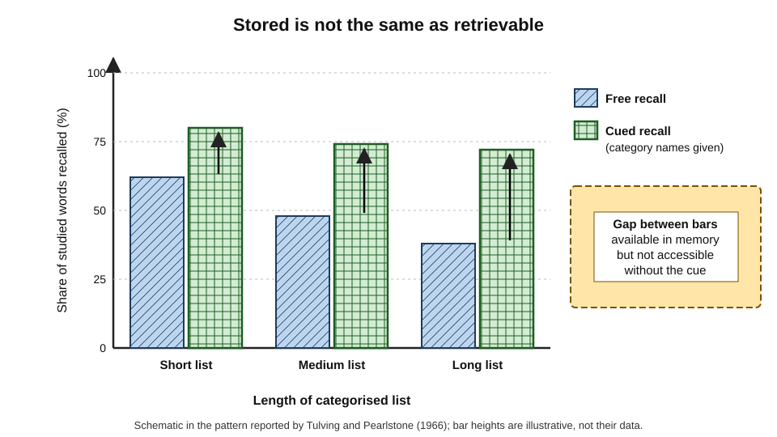
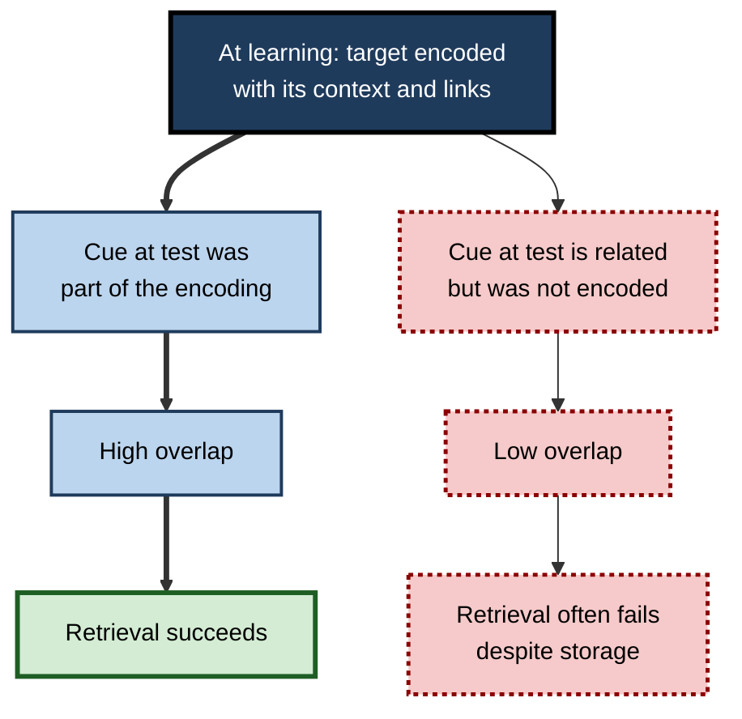
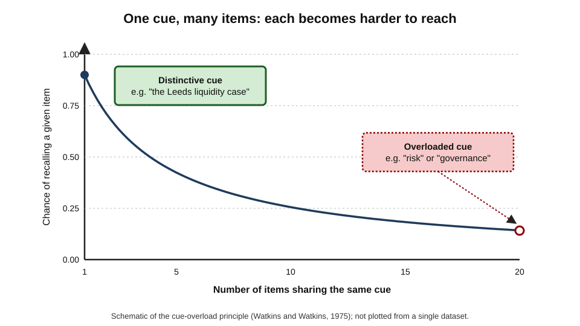
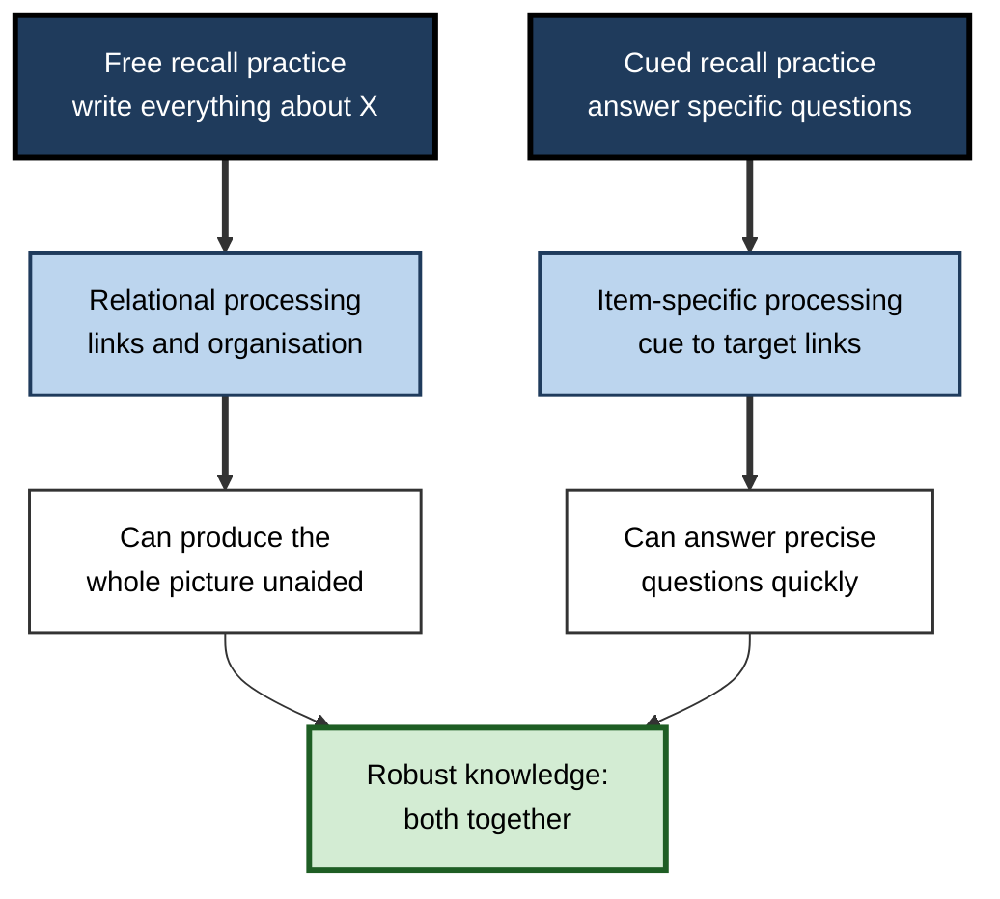

# C.2. Free Recall vs. Cued Recall

Asked "What do you remember from last week's strategy offsite?", most people produce a few scattered points. Asked "What did the finance director say about the Asian market?", the same people suddenly recall a great deal. Nothing was added to their memories between the two questions — only a **cue**. The difference between remembering with and without cues is one of the most revealing facts about memory, and it shapes how retrieval practice should be designed.

> **Definition — Free recall:** producing information from memory with only a general prompt and no specific cues, in any order — *e.g.* "write down everything you can remember about the new tax rules".

> **Definition — Cued recall:** producing information from memory in response to a specific cue that points to it — *e.g.* "What is the deadline for filing a VAT return?" or "Capital of Kenya: N\_\_\_\_\_".

**Why it matters**

- The two tasks reveal **different things** about what a person knows: free recall shows what is **organised and self-accessible**; cued recall shows what is **stored and reachable given a hook**.
- As practice activities, they **train different capabilities** — building structure versus strengthening specific links.
- Real professional work mixes both: writing a report from scratch is free recall; answering a client's specific question is cued recall.
- Choosing the wrong format for practice leaves a learner able to answer questions but unable to produce the whole picture — or the reverse.

---

## Remembering With and Without Help

### The cue-support continuum

Retrieval tasks differ mainly in how much of the work the environment does for the learner.

- **Free recall** — the learner supplies both the **search plan** and the content.
  - *e.g.* listing every step of month-end close from memory.
- **Serial recall** — free recall in a required order.
  - *e.g.* reciting the steps of a surgical safety checklist in sequence.
- **Cued recall** — a cue narrows the search to one target or a small set.
  - *e.g.* "Which journal entry reverses an accrual?"
- **Recognition** — the target itself is presented and must be identified.
  - *e.g.* choosing the correct entry from four options.

> **Definition — Retrieval cue:** any stimulus — a word, question, image, smell, place or partial answer — that helps bring a stored memory into consciousness.

**Figure 1.** Retrieval tasks ordered by how much support the cue provides.

- **Moving right:** more support from the cue → easier, higher scores.
- **Moving left:** more self-generated search → harder, lower scores, more organisation required.

> **Key point:** free and cued recall do not measure "more" and "less" of the same thing. They place the burden of **search** in different hands — the learner's or the cue's.

### The core comparison

| | Free recall | Cued recall |
|---|---|---|
| What the prompt gives | A broad topic only | A specific hook pointing to the target |
| Who organises the search | The learner | The cue |
| Typical score | Lower | Higher |
| What it reveals | Organised, self-accessible knowledge | Stored knowledge and specific associations |
| Processing it trains | **Relational** — links among items | **Item-specific** — the link from cue to target |
| Typical errors | Omissions; items in the wrong category | Wrong answers to particular cues; blanks |
| Ease of scoring | Harder — needs an answer scheme | Easier — one answer per cue |

---

## What Free Recall Reveals

### Patterns in free recall

**The serial-position curve — Bennet Murdock (1962)**

- **Design:** people heard word lists and then recalled them in any order.
- **Results:**
  - the **first few** items were well recalled — the **primacy effect**;
  - the **last few** were best recalled if recall was immediate — the **recency effect**;
  - middle items were recalled worst.
- **Explanation (standard view):** early items receive more rehearsal; final items are still in short-term memory at the moment of recall.

> **Definition — Serial-position curve:** the U-shaped pattern of recall across list positions, combining primacy and recency.

> **Example:** after a long training day, participants best remember the morning's introduction and the final session — the middle of the day fades first. Placing critical content only in the middle is a design error.

**Clustering and organisation**

- **Weston Bousfield (1953):** when lists contained words from categories (animals, names, vegetables) in random order, people recalled them **in category clusters**.
- **Endel Tulving (1962):** even with unrelated words, people developed consistent personal groupings over trials — **subjective organisation** — and recall rose with organisation.
- **Michael Kahana (1996):** in free recall, successively recalled items tend to have been studied **close together in time** — the **temporal contiguity effect**.

> **Definition — Subjective organisation:** the consistent grouping a learner imposes on material across repeated recall attempts.

> **Key point:** free recall is a window onto **structure**. What a person produces, and in what order, shows how their knowledge is organised.

### Why free recall is hard

- **The search problem** — without cues, the learner must generate their own retrieval plan.
- **Output interference** — each item recalled makes the remaining items harder to retrieve, partly because recalled items keep coming back to mind.
- **Stopping too early** — people stop searching while unrecalled items remain retrievable; extra time and prompting often recovers more.

> **Watch out:** a poor free-recall score does **not** mean the information has been lost. As the next section shows, much of it is still there.

---

## What Cued Recall Reveals

### Available versus accessible

**Study card — Endel Tulving and Zena Pearlstone (1966)**

- **Design:** participants studied lists of words drawn from categories, with category names shown at study.
  - At test, one group recalled freely; the other was given the **category names** as cues.
- **Results:**
  - the cued group recalled **substantially more** words, especially with longer lists;
  - when the free-recall group was later given the cues, they too recalled words they had missed.
- **Conclusion:** a memory can be **available** (stored) but **inaccessible** (not retrievable without the right cue). Forgetting is often a failure of access, not of storage.

> **Definition — Availability:** whether information is stored in memory.

> **Definition — Accessibility:** whether stored information can be retrieved under present conditions.

**Figure 2.** Category cues recover memories that free recall missed.

### Encoding specificity

**Study card — Endel Tulving and Donald Thomson (1973)**

- **Design:** people learned target words paired with weakly related words (*e.g.* "train — BLACK").
- **Results:**
  - the studied weak cue ("train") was a **better** cue at test than a strongly associated word ("white") that had not been present at study;
  - in some conditions people could **recall** a word with its studied cue that they had failed to **recognise** on its own.
- **Conclusion:** a cue works to the extent that it was **encoded with the target**. The effectiveness of a cue is set at learning, not at test.

> **Definition — Encoding specificity principle:** retrieval is successful to the extent that information present at retrieval matches information encoded at learning.

**Figure 3.** Why a cue works: overlap between what was encoded and what the test supplies.

### Cue overload

- **Olga Watkins and Michael Watkins (1975):** the more items share a single cue, the less effective that cue is for any one of them.
- **Consequence:** a cue such as "risk" is weak if dozens of facts were filed under it; a distinctive cue such as "the 2008 liquidity squeeze at the Leeds client" is strong.

> **Definition — Cue overload:** the decline in a cue's effectiveness as more items become associated with it.

**Figure 4.** The more items share a cue, the less any one of them is recalled.

> **In practice:** build **distinctive** cues — case names, vivid examples, specific questions — rather than filing everything under broad headings like "governance" or "security".

---

## Free and Cued Recall as Practice

The retrieval practice effect appears with both formats. The question is which format builds which kind of knowledge.

### Relational and item-specific processing

- **Reed Hunt and Gilles Einstein (1981)** distinguished two kinds of processing:
  - **relational processing** — noticing similarities and links among items, building organisation;
  - **item-specific processing** — noticing what is distinctive about each item.
- **Free recall practice** tends to demand relational processing: the learner must find a route through the material, which builds structure.
- **Cued recall practice** tends to strengthen item-specific links: each cue–target association is practised separately.

> **Definition — Relational processing:** encoding that emphasises connections and shared features among items.

> **Definition — Item-specific processing:** encoding that emphasises the distinctive features of individual items.

**Figure 5.** What each practice format tends to build.

### What experiments show

- **John Glover (1989)** — in a series of experiments, an earlier **free recall** test produced better later performance than earlier cued recall or recognition tests.
- **Shana Carpenter and Edward DeLosh (2006)** — practice with **less cue support** produced better later retention across final-test formats.
- **Meta-analytic evidence** (Rowland 2014; Adesope and colleagues 2017) — recall formats generally produce larger testing effects than recognition; differences between free and cued recall are **smaller and less consistent**.
- **Prose and concepts** — free recall of a text ("write all you remember of the passage") has produced strong benefits for meaningful material, including inference questions, in the work of Jeffrey Karpicke and colleagues.

> **Watch out:** the claim that "free recall is always the best practice format" goes **beyond the evidence**. Free recall helps most when organisation matters and when most material can eventually be retrieved; for large sets of discrete associations — terminology, codes, drug doses — cued recall is more efficient.

### Matching the format to later use

- **Transfer-appropriate processing** — practice is most useful when it resembles the way the knowledge will later be retrieved.
- **Professional work provides the cues.**
  - A clinician is cued by **symptoms**; practice from symptom to diagnosis is cued recall in the right direction.
  - A consultant writing an opening proposal must generate the structure **unprompted** — free recall.
  - A solicitor answering a client's question is cued; drafting a memo of advice requires free recall of all the relevant issues.
- **Direction matters.** Practising "term → definition" builds a different link from "definition → term" or "situation → term".

| Professional task | Retrieval demand | Best-matched practice |
|---|---|---|
| Drafting a report or proposal from a blank page | Free recall of structure and content | Write outlines from memory; brain-dump then organise |
| Answering a client's or patient's specific question | Cued recall from situation to answer | Scenario questions; flashcards from case features to answer |
| Following a safety procedure in an emergency | Serial recall under pressure | Recite steps in order from memory; drills |
| Spotting issues in a contract or case | Cued by document features, then free search | Annotated practice cases; "list every issue" exercises |
| Using technical terms correctly in conversation | Cued recall in both directions | Two-way term and definition practice |

---

## Designing Free and Cued Recall Practice

### Free recall formats

- **Blank-page recall** — topic heading only; write or sketch everything remembered.
- **Structured free recall** — a heading plus required categories (causes, steps, exceptions) but no content cues.
- **Explain from memory** — oral or written explanation of a process to an imagined colleague.
- **Concept-map from memory** — draw the relations without looking.

### Cued recall formats

- **Question prompts** — "What are the three conditions for…?"
- **Fill-in-the-blank** — a sentence or diagram with a key element removed.
- **Paired associates** — term → meaning; drug → dose; error code → cause.
- **Scenario cues** — a short case that should trigger a specific rule or response.
- **First-letter or partial cues** — kept for the hardest items, then faded.

> **Remember:** **free recall** builds and tests **structure**; **cued recall** builds and tests **specific links**. Most learning needs both — free recall first to expose the shape of what is known, cued recall to fill the precise gaps.

### Scoring free recall

- **Idea units** — break the source into propositions and count those recalled.
- **Gist versus verbatim** — credit meaning, not exact wording, unless wording itself matters (legal definitions, formulae).
- **Order and structure** — note whether categories and sequences are intact.
- **Errors of commission** — record wrong additions, not only omissions.

> **Formula — Proportion of idea units recalled:** recalled idea units ÷ total idea units. Example: a regulation summary contains 24 idea units; a learner reproduces 15 → 15 ÷ 24 = **62.5%**.

### Worked example: one topic, two formats

A junior data engineer is learning the company's data-governance policy.

1. **Free recall first** — "Write everything you remember about how personal data may be stored and moved." Result: 9 of 20 idea units, grouped loosely under "storage" and "access"; nothing on retention periods or cross-border transfer.
2. **Diagnose** — omissions cluster in two whole categories, so the problem is **organisation** as much as memory.
3. **Targeted cued recall** — ten questions on the missing categories: "What is the default retention period for log data?" "What approval is needed before transferring customer data outside the region?"
4. **Feedback** — check every answer; restudy the two categories.
5. **Free recall again a few days later** — 16 of 20 idea units, now in four clear categories.

| | First free recall | Cued recall round | Second free recall |
|---|---|---|---|
| Score | 9 / 20 idea units | 7 / 10 correct | 16 / 20 idea units |
| What it showed | Two whole categories missing | Specific facts in those categories | Structure and content both improved |
| Next action | Target the missing categories | Restudy errors | Keep in the review cycle |

- **Conclusion:** free recall located the **structural** gap; cued recall fixed the **specific** facts; the second free recall confirmed both.

> **Watch out:** a high cued-recall score on its own can hide a structural gap. Someone who answers every question correctly may still be unable to produce the whole policy unprompted when drafting a document.

### Graduated cueing

- Start with **free recall**; when it stalls, provide the **least** cue that restores retrieval — a category, then an initial letter, then the answer.
- This keeps the learner doing as much retrieval as possible while preventing long, unproductive blanks.
- Record **which level of cue** was needed: it is a sensitive measure of how well each item is known.

---

## In Professional Practice

### Interviews and investigations

- **The cognitive interview** — developed by Ronald Fisher and Edward Geiselman for police witnesses — begins with **free report** ("tell me everything, in any order"), before moving to specific questions.
  - Reason: early specific questions shape and contaminate memory and cut off details the witness would have produced unprompted.
- **Incident reviews** use the same order: free narrative first, cued questions second.

> **In practice:** when gathering information from colleagues after an incident, ask "walk me through what happened" **before** "did you check the backup alerts?" — a leading cue can supply a memory that was never there.

### Exams and certifications

- **Essay and open-response questions** demand free recall and organisation.
- **Short-answer questions** are mostly cued recall.
- **Multiple-choice** is recognition — a different task again, with its own strengths and traps.
- Learners preparing for essay-based exams who practise only with flashcards often find they "know everything but cannot write it" — they have practised cued, not free, retrieval.

### Case study: the trainee who could answer but not advise

- **Situation:** a trainee tax adviser scored highly on weekly short-answer quizzes on rules and thresholds.
- **Problem:** asked to draft a first advice letter for a client with a complex property disposal, she missed three relevant reliefs and structured the letter poorly.
- **Diagnosis:**
  - her practice was entirely **cued** — each question pointed to one rule;
  - she had never practised **generating** the relevant set of issues from a client's facts, which is free recall cued only by a scenario.
- **Actions:**
  1. Each week began with a short case: "List every tax issue raised by these facts" — a free-recall task.
  2. Her list was compared with a supervisor's issue list; missed issues were added to her cued-recall set.
  3. Monthly, she drafted a full advice outline from memory before consulting references.
- **Result:** over three months her issue lists became more complete and better ordered, and supervisors' corrections to her letters shifted from "missed issues" to points of judgement.
- **Lesson:** cued-recall success does not guarantee the ability to **generate the whole picture**; practise the retrieval the job demands.

---

## Building Cues Deliberately

Free recall is hard because the learner must find their own way into memory. Experts make it easier by building **cue structures** in advance — scaffolds that turn a free-recall task into a sequence of self-cued retrievals.

### Cue-dependent forgetting

- **Endel Tulving (1974)** argued that much forgetting is **cue-dependent**: the memory survives, but the cues present at recall no longer match those encoded.
- **Consequence:** the remedy for many "forgotten" items is not relearning but **re-cueing** — finding or rebuilding a cue that reaches them.

> **Definition — Cue-dependent forgetting:** failure to recall information that is still stored, because the cues available at recall do not match those present at encoding.

### Self-generated cue structures

- **Outlines and headings** — a learned skeleton (*e.g.* "context, options, risks, recommendation") turns free recall of a proposal into cued recall of each part.
- **Acronyms and first-letter mnemonics** — compress a list into a cue string; each letter cues one item.
- **Stories and sequences** — linking items into a narrative provides a serial cue chain.
- **The method of loci** — placing items at locations along a familiar route, then mentally walking the route at recall.

**Study card — Martin Dresler and colleagues (2017)**

- **Design:** compared memory athletes with matched controls, then trained naive participants for about six weeks in the method of loci, comparing them with groups who trained in working-memory tasks or did no training.
- **Results:**
  - loci-trained participants more than doubled their word-list recall, an improvement still present months later;
  - their patterns of brain connectivity shifted towards those of the memory athletes.
- **Conclusion:** a self-built cue structure can transform free recall of lists — the athletes' advantage was largely **trained strategy**, not innate capacity.

> **Watch out:** the method of loci is powerful for **ordered lists** — speeches, sequences, item sets — but adds little to understanding. Professionals use it to remember the **order** of what they will say, not the **meaning** of what they know.

| Cue structure | Turns free recall into | Best for | Limitation |
|---|---|---|---|
| Outline or template | Cued recall of each section | Reports, proposals, case analyses | Must itself be learned |
| Acronym | Cued recall of each item | Short, fixed lists | Recalls the label, not the content |
| Story chain | Serial cued recall | Sequences, procedures | Effortful to build |
| Method of loci | Serial cued recall from locations | Speeches, long ordered lists | Little help with understanding |
| Question set | Cued recall from standard questions | Diagnosis, audits, reviews | Can narrow thinking to the questions |

> **Key point:** experts are not better at unaided free recall in general; they carry better **internal cue structures** for their own domain. Much expertise is the ability to cue oneself.

---

## Worked Example: Speaking Without Notes

A consultant must present a 15-minute findings briefing to a client board without slides.

1. **Free recall first** — two days before, write everything to be said, from memory. Result: most points, but in a muddled order, with two key findings missing.
2. **Build a cue structure** — a four-part spine: *situation, three findings, implications, recommendation*. Each finding gets a vivid anchor (*e.g.* "the 40-day invoice backlog").
3. **Serial recall practice** — rehearse aloud from the spine alone, three times, checking against the full notes after each run.
4. **Cued recall on weak points** — five questions on figures and names that were missed: "What is the backlog in days?" "Which region drives it?"
5. **Context variation** — rehearse once standing, once walking, once to a colleague, so recall is not tied to one setting.
6. **Day of the briefing** — a single index card with the four-part spine is carried but not needed.

| Rehearsal | Format | Points recalled (of 18) | Order correct? |
|---|---|---|---|
| Day 1 | Free recall, no structure | 13 | No |
| Day 1, after spine built | Serial recall from spine | 15 | Mostly |
| Day 2 | Serial recall, varied contexts | 17 | Yes |
| Briefing | Spine on card | 18 | Yes |

- **Conclusion:** the presentation became reliable not by more reading but by converting free recall into **self-cued serial recall**, then practising it under varied conditions.

> **In practice:** the most robust speakers memorise **the structure**, not the script. Verbatim memorisation fails catastrophically when one word is lost; a cue structure lets the speaker recover and continue.

---

## Free and Cued Recall in Assessment Design

When recall formats are used to measure learning, the choice between free and cued recall affects what scores mean.

- **Free-recall assessments** — essays, open case analyses, "explain everything about…" questions.
  - **Strength:** reveal organisation and the ability to generate the relevant knowledge unprompted.
  - **Weakness:** harder to mark reliably; scores depend on writing fluency and on what the candidate chooses to include.
- **Cued-recall assessments** — short-answer questions.
  - **Strength:** precise, reliable, cover many points quickly.
  - **Weakness:** the question itself does the organising; candidates are told what is relevant.
- **Combined designs** — a short case followed first by an open question ("What are the issues?") and then by cued questions on each issue separate the two abilities and allow partial credit.

> **Remember:** a cued question tells the candidate **what matters**; a free-recall question asks them to **decide** what matters. Professional work usually needs both, so good assessments include both.

---

## Cues in the Age of Search and AI

- **Search boxes and assistants are cue-supplying machines.** Typing a partial phrase returns the full answer; the person supplies the cue and the tool performs retrieval.
- **Everyday free recall declines in use** — when a full answer is always one prompt away, people practise generating answers less often.
- **The professional risk** — tasks that require generating the relevant set of issues unprompted (drafting advice, designing a system, spotting what is missing) are free-recall tasks. A tool can answer a question; it cannot tell a professional which questions they forgot to ask.
- **A practical counter-habit** — before consulting a tool, write a quick free-recall list of what is already known and what needs checking; then use the tool for cued look-ups on the gaps.

> **In practice:** "**list before you look**" — a one-minute free recall before any search or AI query keeps free-recall ability in use and makes the query sharper.

---

## Open Questions

- **When does free recall practice outperform cued recall practice?**
  - Early studies favoured free recall; later syntheses find small, inconsistent differences. The answer probably depends on material structure, success rates and the final test.
- **How should mixed formats be sequenced?**
  - Free-then-cued is sensible on theoretical grounds, but direct comparisons of sequences are scarce.
- **Can cue overload be managed systematically in large knowledge bases?**
  - Professionals accumulate thousands of facts under the same broad headings; how best to build distinctive cues at scale is little studied.
- **How do digital prompts and autocomplete change everyday retrieval?**
  - Search boxes and AI assistants provide strong cues constantly; whether this weakens unaided, free recall in professionals is not yet well understood.

---

## Summary

- **Free recall** — producing information with only a general prompt; **cued recall** — producing it in response to a specific hook.
- Retrieval tasks lie on a **cue-support continuum**: free → serial → cued → recognition.
- Free recall reveals **organisation**: serial-position effects, **clustering**, **subjective organisation** and temporal contiguity.
- **Tulving and Pearlstone (1966):** cues recover memories that free recall misses — information can be **available but inaccessible**.
- **Encoding specificity (Tulving and Thomson, 1973):** a cue works if it was encoded with the target.
- **Cue overload:** a cue shared by many items is weak; distinctive cues are strong.
- As practice, free recall tends to build **relational** structure; cued recall builds **item-specific** links. Recall formats generally beat recognition; free versus cued differences are inconsistent.
- Match practice to later use (**transfer-appropriate processing**), score free recall by **idea units**, and use **graduated cueing** when recall stalls.
- In investigations and incident reviews, **free report before specific questions** protects memory.

---

## Self-Check

1. Define free recall and cued recall, and give a workplace example of each.
2. Arrange free, serial, cued recall and recognition by cue support and explain what changes along the continuum.
3. What are the primacy and recency effects, and what do they imply for the design of a training day?
4. Describe the Tulving and Pearlstone experiment and the distinction it established.
5. State the encoding specificity principle and explain the "train — BLACK" finding.
6. What is cue overload? How can a professional reduce it?
7. Distinguish relational from item-specific processing and link each to a recall format.
8. Summarise the evidence on whether free or cued recall is the better practice format.
9. A learner scores 95% on flashcards but struggles to write exam essays. Diagnose and prescribe.
10. Explain idea-unit scoring and calculate the score for 18 of 30 units.
11. Why does the cognitive interview begin with free report?
12. Design a practice sequence for a new project manager learning a 12-stage governance process.
13. When would cued recall be more efficient than free recall as practice?
14. What is cue-dependent forgetting, and what remedy does it suggest?
15. How did Dresler and colleagues (2017) show that memory athletes' advantage is largely trained strategy?

### Answer Key

1. Free recall: producing information with only a general prompt — writing all the steps of an onboarding process. Cued recall: answering in response to a specific hook — "What is the approval limit for a purchase order?"
2. Free (learner builds the search) → serial (free, in order) → cued (cue narrows search) → recognition (target presented). Moving towards recognition, the cue does more of the work; scores rise and less self-organisation is required.
3. Primacy: early items recalled well; recency: last items recalled well immediately. Critical content should not sit only in the middle of a long session; it should be revisited and retrieved.
4. Category lists were tested with or without category names; cued recall was much higher, and cues recovered missed words for the free-recall group. Information can be available (stored) but inaccessible without a suitable cue.
5. Retrieval succeeds to the extent that cues at test match what was encoded. A weak associate studied with the target ("train") cued it better than a strong but unstudied associate ("white").
6. The more items attached to one cue, the weaker it is for each. Use distinctive cues: specific cases, examples, precise questions, rather than broad headings.
7. Relational: emphasises links among items — built by free recall, which requires organising a search. Item-specific: emphasises each item's distinctive features — built by cued recall of individual cue–target pairs.
8. Recall formats generally produce larger benefits than recognition. Some studies favoured free recall; syntheses find differences between free and cued recall small and inconsistent. Choice should follow material structure and later use.
9. Practice has been cued recall; essays need free recall and organisation. Add blank-page outlines and timed free-recall essays, check them against model answers, and feed omissions back into the flashcard set.
10. Divide the source into propositions; count those reproduced (crediting gist). 18 ÷ 30 = 60%.
11. Specific questions early can contaminate memory and cut off details the witness would produce unprompted; free report captures more and more accurate information.
12. E.g. study the process once; free recall of all 12 stages with key outputs; check and note missing stages; cued recall on those stages ("What is the exit criterion for stage 7?"); serial recall of the order; repeat free recall a few days later; finally, a scenario: "Which stage is this project in, and what is needed next?"
13. For large sets of discrete, independent associations — terminology, codes, doses — where the target use is cued and organisation adds little.
14. Failure to recall stored information because current cues do not match those encoded (Tulving, 1974). The remedy is often re-cueing — building or reinstating a cue that reaches the memory — rather than relearning.
15. Naive participants trained in the method of loci for about six weeks more than doubled their list recall, with lasting effects and brain-connectivity changes resembling those of memory athletes, while control groups did not.

---

## Glossary

| Term | Meaning |
|---|---|
| Accessibility | Whether stored information can be retrieved under present conditions. |
| Availability | Whether information is stored in memory at all. |
| Clustering | Recalling related items together in groups. |
| Cognitive interview | Interview method that begins with free report and uses context reinstatement. |
| Cue overload | Decline in a cue's effectiveness as more items share it. |
| Cue structure | A self-built scaffold, such as an outline or route, that turns free recall into a sequence of cued retrievals. |
| Cue-dependent forgetting | Failure to recall stored information because current cues do not match those encoded. |
| Cued recall | Producing information in response to a specific cue. |
| Encoding specificity principle | Retrieval succeeds to the extent that cues match what was encoded. |
| Free recall | Producing information with only a general prompt, in any order. |
| Graduated cueing | Providing the least cue needed to restore retrieval, step by step. |
| Idea unit | A single proposition used to score recall of meaningful material. |
| Item-specific processing | Encoding that emphasises each item's distinctive features. |
| Method of loci | A mnemonic in which items are placed at locations along a familiar route and recalled by mentally walking it. |
| Output interference | Recalled items making remaining items harder to retrieve. |
| Primacy effect | Better recall of the first items in a sequence. |
| Recency effect | Better immediate recall of the last items in a sequence. |
| Relational processing | Encoding that emphasises links and shared features among items. |
| Retrieval cue | A stimulus that helps bring a memory to mind. |
| Serial recall | Free recall in a required order. |
| Serial-position curve | U-shaped recall pattern across list positions. |
| Subjective organisation | Consistent personal grouping imposed on material across recall attempts. |
| Temporal contiguity effect | Tendency to recall successively items studied close together in time. |
