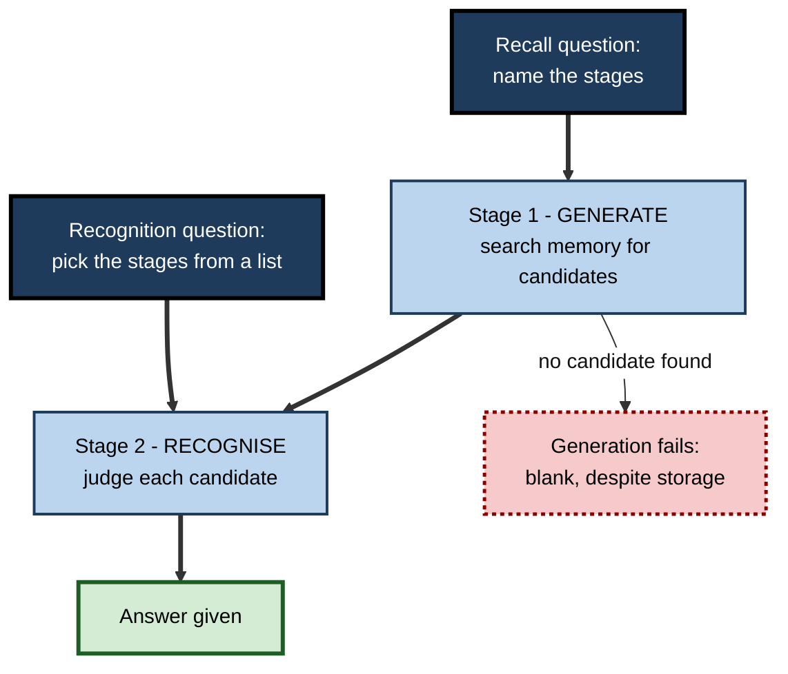
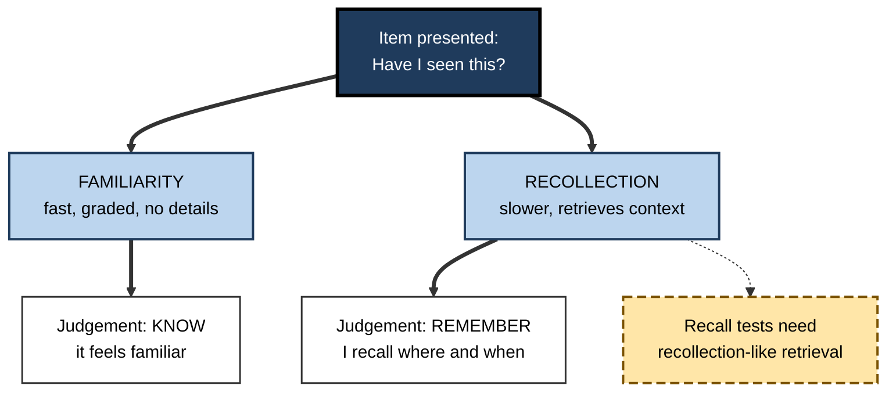
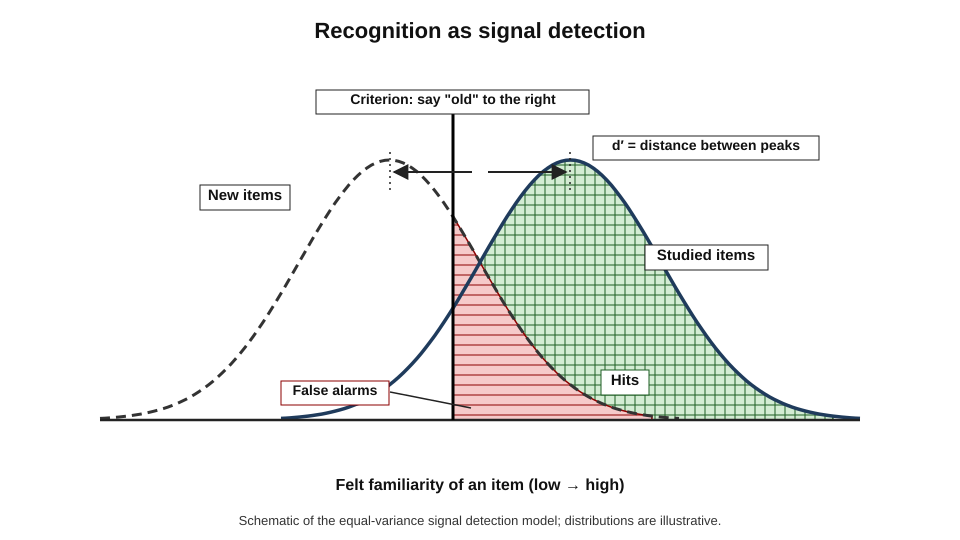
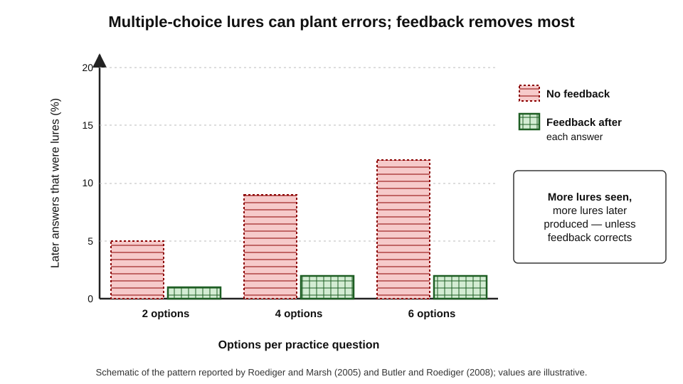
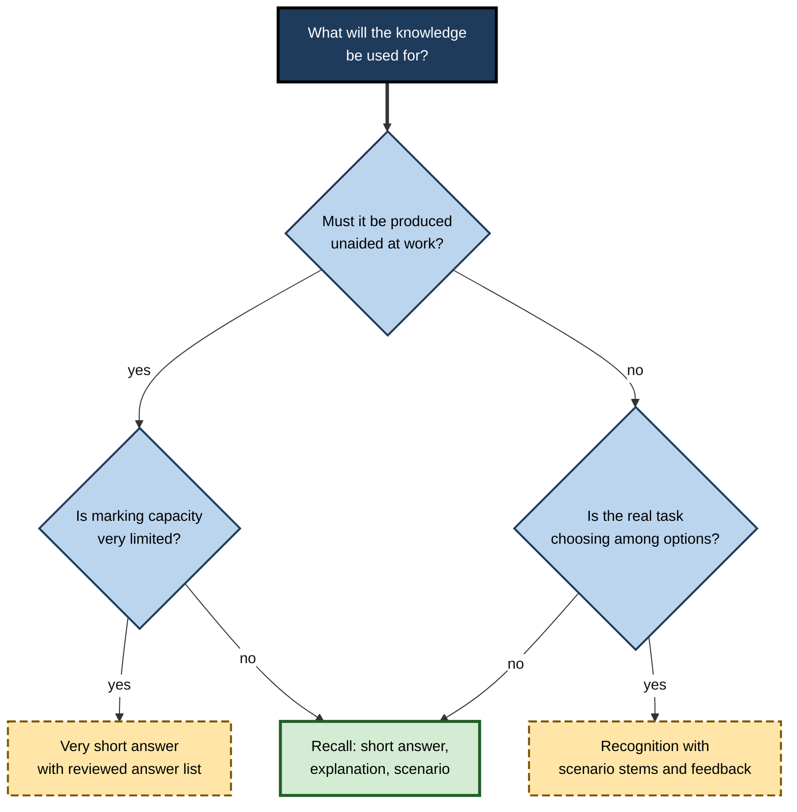

# C.3. Recognition vs. Recall Testing

A project manager cannot name the seven stages of her company's change-control process when asked at a review — yet, shown a list of fifteen candidate stages, she picks out all seven without hesitation. Both performances are real. They are simply different tasks: **recall** requires producing the answer, **recognition** only requires identifying it when it appears. Much confusion about "how well someone knows something" comes from treating the two as the same.

> **Definition — Recall test:** a test in which the learner must **produce** the target information — by writing, saying, drawing or performing it — from memory.

> **Definition — Recognition test:** a test in which the target is **presented** and the learner must judge whether it was learned or select it from alternatives — *e.g.* true/false, yes/no or multiple-choice items.

**Why it matters**

- Recognition scores are almost always **higher** than recall scores for the same knowledge — so they can **overstate** how usable that knowledge is.
- The two formats train and test **different memory processes**.
- Most professional examinations, compliance checks and e-learning modules rely heavily on recognition, chiefly because it is cheap to mark.
- Choosing a format is therefore a decision about **validity**, **learning** and **cost** at once.

---

## Two Ways of Knowing That Something Is Familiar

### Recognition in everyday life

- **Faces** — recognising a former colleague in an airport but being unable to recall their name.
- **Software menus** — finding a function by browsing menus but being unable to type its shortcut.
- **Documents** — knowing a clause "looks right" in a contract while being unable to draft it.
- **Passwords and procedures** — recognising the correct option on a security question while being unable to produce it unaided.

> **Key point:** recognition answers "have I seen this before?"; recall answers "what is it?". The second is the question work usually asks.

### Forms of each

- **Recognition formats**
  - **Yes/no (old/new)** — "Was this word on the list?"
  - **True/false** — a statement to be judged.
  - **Forced-choice / multiple-choice** — select the correct option among alternatives.
  - **Matching** — pair items across two columns.
- **Recall formats**
  - **Free recall** — produce everything about a topic.
  - **Cued recall / short answer** — produce one answer to a specific prompt.
  - **Very short answer** — a word or phrase typed into a blank, with no options.
  - **Constructed response** — explanation, calculation, essay, diagram.

### The core comparison

| | Recognition | Recall |
|---|---|---|
| What is presented | The target itself, among alternatives | A cue or question only |
| What the learner does | Judges familiarity or discriminates among options | Generates the target from memory |
| Typical difficulty | Easier; higher scores | Harder; lower scores |
| Guessing | Possible — chance score above zero | Very limited |
| Marking cost | Low; automatic | Higher; automatic only for short, exact answers |
| Main risk as assessment | Overstates usable knowledge; cueing from options | Marker inconsistency; longer to sit |
| Main risk as practice | Exposure to plausible wrong answers | Long blanks if too hard without feedback |

---

## Why Recognition Is Easier

### The generate–recognise model

- **Proposed by:** Walter Kintsch (1970) and John Anderson and Gordon Bower (1972), among others.
- **Idea:** recall requires two stages; recognition requires only the second.
  1. **Generate** — search memory and produce candidate answers.
  2. **Recognise** — judge whether a candidate is the right one.
- **Prediction:** anything that makes generation hard (a weak cue, a vague question) hurts recall but not recognition.

**Figure 1.** Recall must generate candidates before judging them; recognition starts at the judgement.

> **Watch out:** the generate–recognise model is **incomplete**. Endel Tulving and Donald Thomson (1973) showed that people sometimes **recall** a word with a well-encoded cue that they fail to **recognise** on its own — **recognition failure of recallable words**. Recognition is not simply "recall minus the search"; both depend on how cues match what was encoded.

### Familiarity and recollection

**George Mandler (1980) — the butcher on the bus**

- **Situation:** a person sees a man on a bus who seems familiar but cannot place him.
- **Later:** they realise he is the butcher from the local shop — the context returns.
- **Interpretation:** two different processes produced the two experiences:
  - **familiarity** — a fast, context-free sense of having met before;
  - **recollection** — slower retrieval of specific details and context.

> **Definition — Familiarity:** a quick, graded feeling that something has been encountered before, without retrieval of details.

> **Definition — Recollection:** retrieval of specific details of a prior encounter — where, when, what accompanied it.

- **Dual-process theories** (reviewed by Andrew Yonelinas, 2002) hold that recognition can rest on either process; recall requires something like recollection.
- **Remember/know judgements** — Tulving (1985) asked people whether they "remember" an item (recollect details) or merely "know" it (familiarity). The two judgements respond differently to many manipulations.
- **Single-process alternatives** — global-matching models treat recognition as one continuous strength signal; the debate over whether one or two processes are needed is **not fully settled**.

**Figure 2.** Two routes to a recognition judgement.

> **Key point:** a multiple-choice item can often be answered on **familiarity alone** — which is why a learner may pass a recognition test on material they could not explain.

### The enormous capacity of recognition

- **Roger Shepard (1967):** after viewing several hundred pictures once, people chose the seen picture from a pair with near-perfect accuracy shortly afterwards.
- **Lionel Standing (1973):** recognition remained high even after viewing **ten thousand** pictures.
- **Implication:** recognition is a very sensitive detector of **exposure** — and exposure is not the same as usable knowledge.

---

## Measuring Recognition Properly

### Guessing and correction

- On a four-option multiple-choice test, pure guessing yields about **25%**.
- **Correction for guessing** removes the expected gain from blind guessing.

> **Formula — Correction for guessing:** corrected score = right − wrong ÷ (k − 1), where k is the number of options. Example: 40 items, 4 options; 28 right, 12 wrong → 28 − 12 ÷ 3 = **24** corrected.

> **Watch out:** correction formulae assume guesses are **blind**. Most guesses are **informed** — the learner eliminates some options — so corrections may penalise partial knowledge, and they encourage risk-averse candidates to leave items blank.

### Signal detection

Recognition judgements mix two things: how well old and new items are **discriminated**, and how willing the person is to say "yes".

- **Hit** — saying "old" to a studied item.
- **False alarm** — saying "old" to a new item.
- **Sensitivity (d′)** — how well the person separates old from new.
- **Criterion (c)** — how liberal or conservative the person is in saying "old".

> **Definition — Signal detection theory:** a framework that separates a person's ability to discriminate signals from noise from their bias towards responding "yes".

**Figure 3.** Old and new items produce overlapping familiarity; a criterion divides them.

> **Formula — Sensitivity:** d′ = z(hit rate) − z(false-alarm rate). Example: hits 0.84 (z ≈ +0.99), false alarms 0.16 (z ≈ −0.99) → d′ ≈ **2.0**. A second person with hits 0.93 and false alarms 0.50 has a higher hit rate but d′ ≈ 1.48 − 0 = **1.48** — less discrimination, more bias to say "yes".

> **In practice:** in safety-critical recognition tasks — spotting phishing emails, abnormal X-rays, fraudulent transactions — report **false alarms as well as hits**. A screener who flags everything has a perfect hit rate and no skill.

### Options as cues

- **The cueing effect** — options can remind learners of answers they could not have produced; scores rise without knowledge rising.
- **Testwiseness** — strategies that exploit item-writing flaws: the longest option, "all of the above", grammatical mismatch, options that echo the stem.
- **Very short answer questions** — in medical education, typed one-to-three-word answers to clinical vignettes have been found more discriminating than single-best-answer items and less prone to cueing, while remaining machine-markable with a reviewed answer list.

---

## Recognition and Recall as Practice

Assessment is only half the story. Both formats can serve as retrieval practice — with different strengths and risks.

### Recall practice usually builds more

- **Recall formats** require generation, which strengthens retrieval routes; meta-analyses generally find **larger** testing effects for recall practice than for recognition practice.
- **Short answer versus multiple choice** — Sean Kang, Kathleen McDermott and Henry Roediger (2007) found short-answer practice with feedback produced better retention than multiple-choice practice with feedback across final-test formats.

### But good multiple choice also works

**Study card — Jeri Little, Elizabeth Bjork, Robert Bjork and Genna Angello (2012)**

- **Design:** students read passages and then took multiple-choice or cued-recall practice tests; multiple-choice alternatives were **competitive** — plausible and drawn from the passage.
- **Results:**
  - both practice formats improved later recall of the tested information;
  - multiple-choice practice **also** improved later performance on **related** questions whose answers had been the incorrect alternatives;
  - cued-recall practice did not produce this benefit for related information.
- **Conclusion:** well-designed multiple choice can induce genuine retrieval — learners must recall why each plausible option is right or wrong.

**Study card — Kathleen McDermott, Pooja Agarwal and colleagues (2014)**

- **Setting:** middle-school science and high-school history classes.
- **Design:** some content was quizzed with multiple-choice items, some with short-answer items, some not quizzed.
- **Results:** both quiz formats improved later unit-exam performance compared with unquizzed content; the **format of the quiz mattered less** than whether quizzing occurred.
- **Conclusion:** in real classrooms, frequent low-stakes multiple-choice quizzing is a practical and effective tool.

### The negative suggestion effect

**Study card — Henry Roediger and Elizabeth Marsh (2005)**

- **Design:** students took multiple-choice tests with two, four or six options, then a later cued-recall test.
- **Results:**
  - multiple-choice practice produced an overall testing benefit;
  - but students also sometimes produced the **wrong options** they had seen as answers on the later test — more so with more lures;
- **Conclusion:** exposure to plausible wrong answers can plant errors.

**Study card — Andrew Butler and Henry Roediger (2008)**

- **Design:** multiple-choice practice with no feedback, immediate feedback or delayed feedback.
- **Results:** feedback **increased** the benefit and **reduced** later lure intrusions; delayed feedback was at least as effective as immediate.
- **Conclusion:** the negative effects of multiple-choice practice can be largely prevented with feedback.

**Figure 4.** Feedback removes most of the errors that multiple-choice lures can plant.

> **Remember:** **multiple-choice practice needs feedback.** Without it, the lures are the most dangerous part of the question.

### Comparing practice formats

| | Recognition practice (MCQ, true/false) | Recall practice (short answer, explanation) |
|---|---|---|
| Typical testing benefit | Smaller to medium | Medium to larger |
| Benefit for related untested content | Possible with competitive lures | Usually limited to tested content |
| Risk of learning errors | Lure intrusions without feedback | Repeating own wrong answers without feedback |
| Time per item | Short | Longer |
| Suits | Large classes, quick checks, discrimination among similar concepts | Durable retention, production, transfer |

---

## Test Expectancy

- **Learners study differently for different tests.**
  - Expecting recognition, they focus on **recognising** details; expecting recall, they organise and rehearse more deeply.
- **Evidence:** studies of test expectancy (*e.g.* by Jason Finley and Aaron Benjamin, 2012) found that learners who expected recall tests adopted more effective encoding strategies and performed better even on recognition tests.
- **Consequence:** announcing that assessment will be **recall-based** improves learning before any test takes place.

> **In practice:** telling a team "you will be asked to explain this without slides next week" changes how they listen this week.

---

## Designing Recognition and Recall Items

### Writing better multiple-choice items

1. **Stem as a question** — the stem should be answerable before reading the options ("cover-the-options" rule).
2. **Plausible distractors** — drawn from real misconceptions or confusions, not silly fillers.
3. **One best answer** — defensible, unambiguous.
4. **No cue leaks** — options of similar length and grammar; no "all of the above".
5. **Test application** — scenario stems ("A client presents with…") rather than definition recall.
6. **Feedback that explains** — why the answer is right *and* why the lures are wrong.

> **Mnemonic — "QUAPEF" — "Questions Under A Plausible Exam Format":** Question stem, Unique best answer, Application, Plausible distractors, Eliminate cue leaks, Feedback.

### Choosing a format

**Figure 5.** Choosing between recognition and recall formats.

### Worked example: rewriting a compliance quiz

A bank's anti-money-laundering refresher ends with ten true/false items. Average score: 96%.

1. **Diagnose:** true/false has a 50% guessing floor; items are copied from the slides; no application.
2. **Replace five items** with scenario multiple choice:
   - *Before:* "True or false: cash deposits over the threshold must be reported." 
   - *After:* "A customer deposits several amounts just below the reporting threshold over a week. What is the most appropriate action?" — with plausible lures drawn from real staff errors.
3. **Replace three items** with very short answers: "Name the role to whom a suspicion must be reported."
4. **Add two explanation items:** "In two sentences, explain why structuring deposits is itself suspicious."
5. **Add feedback** that explains each lure.

| | Original quiz | Redesigned quiz |
|---|---|---|
| Format | 10 true/false | 5 scenario MCQ, 3 very short answer, 2 explanations |
| Guessing floor | 50% | About 12% on MCQ items; near zero elsewhere |
| Average score | 96% | 71% at first attempt |
| What it now shows | Familiarity with slide wording | Ability to recognise and act on suspicious patterns |

- **Conclusion:** the lower score is **more accurate**, not worse. The redesigned quiz is also a better learning event.

> **Watch out:** managers may read the falling average as a training failure. Report it as a **change in measurement**, with the new baseline.

### Case study: a certification that did not certify

- **Situation:** a cloud-services firm certified its support engineers with a 60-item multiple-choice exam; pass rates exceeded 90%.
- **Problem:** customer escalations showed certified engineers frequently could not configure the services they were certified on.
- **Diagnosis:**
  - items tested recognition of feature names and definitions;
  - several options leaked cues; many items could be answered by familiarity with the documentation;
  - the exam measured **exposure**, not the ability to **produce** a working configuration.
- **Actions:**
  1. Half the items were replaced by short performance tasks in a sandbox — configure, diagnose, fix.
  2. Remaining multiple-choice items were rewritten as troubleshooting scenarios with lures based on real support tickets.
  3. Practice quizzes during training gave explanatory feedback.
- **Result:** first-attempt pass rates fell to around two-thirds; within two quarters, escalations attributed to configuration errors by certified staff declined.
- **Lesson:** a recognition test measures whether someone **knows it when they see it**; the job required knowing it when they **need** it.

---

## Formats Between Recognition and Recall

The choice is not binary. Several formats reduce the weaknesses of standard multiple choice while keeping much of its convenience.

### Reducing guessing and cueing

- **Confidence-weighted items** — the learner marks an answer and a confidence level; confident errors lose more than unsure ones.
  - **Benefit:** rewards accurate self-knowledge and discourages bluffing.
  - **Risk:** may penalise cautious or anxious learners more than knowledgeable ones.
- **Elimination testing** — the learner crosses out every option they believe wrong; credit reflects partial knowledge.
- **Open-then-closed items** — the learner first types an answer, then sees options and may confirm or change it. The first answer measures recall; the second recognition.
- **Discrete-option items** — options are shown one at a time and judged true or false before the next appears, so options cannot be compared side by side.
- **Extended matching** — a long list of options (often 10–20) used for several scenarios, reducing guessing and the cueing effect of a short list; common in medical examinations.

| Format | Guessing floor | Cueing from options | Marking | Best use |
|---|---|---|---|---|
| Standard four-option MCQ | About 25% | High | Automatic | Quick checks with feedback |
| Extended matching | Low | Lower | Automatic | Diagnosis, classification |
| Confidence-weighted MCQ | About 25%, but bluffing penalised | High | Automatic | Calibration training |
| Open-then-closed | Near zero on first answer | None on first answer | Partly automatic | Separating recall from recognition |
| Very short answer | Near zero | None | Automatic with reviewed list | Facts and diagnoses |
| Short constructed answer | Near zero | None | Manual or AI-assisted | Explanation, reasoning |

> **In practice:** the **open-then-closed** design is a cheap diagnostic. The gap between first-answer accuracy and final-answer accuracy shows how much of a learner's apparent knowledge is recognition only.

### Recognition as a professional skill

Some professional tasks genuinely are recognition tasks, and should be practised and assessed as such.

- **Detection** — spotting the abnormal X-ray, the fraudulent transaction, the phishing email, the security vulnerability in code.
- **Review** — checking a draft contract, audit working papers or a colleague's analysis for errors.
- **Selection** — choosing the right option from a defined set, as in triage categories.

For such tasks:

- **Practise discrimination, not exposure** — mixed sets of genuine and near-miss cases, with feedback.
- **Measure sensitivity and false alarms** — a screener who flags everything is not skilled.
- **Expect criterion shifts** — under pressure or after a recent costly miss, people become more liberal ("flag everything"); training should make the trade-off explicit.

> **Definition — Receiver operating characteristic (ROC) curve:** a plot of hit rate against false-alarm rate across different response criteria, showing a detector's sensitivity independent of where the criterion is set.

> **Key point:** in detection work, the goal of practice is to **increase sensitivity** (d′), not merely to say "yes" more often. Feedback on misses **and** false alarms is required.

---

## Recognition, Recall and AI Output

Generative AI changes the balance of professional work: more time is spent **reviewing** drafts produced by tools and less **producing** from scratch.

- **Reviewing is a recognition task** — the professional judges whether presented text, code or analysis is right.
- **But familiarity misleads** — fluent, well-formatted output **feels** correct; plausibility is processed as familiarity.
- **Error detection depends on recall** — to notice that a cited regulation is outdated, or that a function mishandles an edge case, the reviewer must be able to retrieve what should be there.
- **Omissions are invisible to recognition** — a recognition check confirms what is present; it cannot notice what is **missing**. Spotting omissions requires free recall of what a complete answer would contain.

> **Watch out:** "I'll just check the AI's work" assumes recognition is enough. It is not: reviewers who cannot **recall** the expected content will approve fluent but incomplete or wrong output.

**Practising review deliberately**

- **Generate before reviewing** — list from memory the key points a correct answer should include, then compare the AI output with the list.
- **Seeded-error exercises** — practise on drafts with planted errors and omissions; score hits, misses and false alarms.
- **Rotate formats** — alternate review tasks with production tasks so production skill does not fade.

---

## Case Study: Very Short Answers in a Medical School

- **Situation:** a medical school's knowledge tests used single-best-answer multiple-choice items written to a high standard.
- **Problem:** teachers suspected that students passed items by **recognising** the most plausible option, without being able to generate a diagnosis from a vignette — the skill needed on the ward.
- **Pilot:** a sample of items was presented in two formats to the same cohort:
  - the usual five-option single-best-answer version;
  - a **very short answer** version: the same vignette, with a typed answer of one to three words.
- **Marking:** answers were machine-matched against a list of accepted responses, which clinicians reviewed and extended before results were released.
- **Findings:**
  - scores were **lower** in the very-short-answer format, especially on items where an option list had made the answer obvious;
  - the format **discriminated** better between stronger and weaker students;
  - the review of accepted answers took clinicians a few hours per paper, much less than marking free text.
- **Decision:** the school introduced a proportion of very-short-answer items into progress tests and practice quizzes, and used them as retrieval practice with feedback.
- **Lesson:** removing the options removed the **cueing** and exposed the gap between recognising and producing a diagnosis — at a marking cost close to that of multiple choice.

> **Watch out:** very-short-answer marking depends on a well-maintained list of acceptable answers; synonyms, abbreviations and spelling variants must be reviewed, or correct answers will be marked wrong.

---

## Worked Example: Turning Recognition Practice Into Recall Practice

A cybersecurity analyst revises for a certification using a bank of 500 multiple-choice questions. Practice scores are 85%; first-attempt mock-exam scores are 64%.

1. **Diagnose:** the bank has been repeated several times; the analyst recognises **questions** and their **answer positions**, not the underlying knowledge.
2. **Cover the options:** for each item, read the stem, write or say an answer **before** viewing the options.
3. **Score twice:** record "recalled" (answer produced before seeing options) and "recognised" (correct only after seeing options).
4. **Target the gap:** items that were recognised but not recalled go into a short-answer deck.
5. **Rewrite stale items:** for items seen many times, write a new scenario testing the same concept.
6. **Retest:** a new mock exam after two weeks.

| Measure | Before | After two weeks |
|---|---|---|
| Practice score, options visible | 85% | 82% |
| Recalled before seeing options | Not measured | 58% → 74% over the period |
| Mock-exam score (new items) | 64% | 76% |

- **Conclusion:** the visible practice score barely moved, but the **recall** score and performance on **new** items rose — the change converted recognition practice into retrieval practice.

> **Remember:** **cover the options**. Answering a multiple-choice stem before looking at the choices turns any question bank into recall practice for free.

---

## Open Questions

- **One process or two?**
  - Whether recognition rests on distinct familiarity and recollection processes, or one strength signal, is still debated in memory research.
- **How should multiple choice be used as practice at scale?**
  - Competitive lures help related learning, but plant errors without feedback; the best balance of lure plausibility, feedback timing and repetition is not established.
- **Can automated marking make recall formats routine?**
  - Very short answers and AI-assisted marking of explanations promise recall-based testing at recognition-like cost; marking accuracy and fairness need careful study.
- **How much does test expectancy explain classroom effects?**
  - Part of the benefit of recall-based assessment may come from how students prepare rather than from the test itself.

---

## Summary

- **Recall** requires producing the target; **recognition** requires identifying it when presented.
- Recognition is easier — the **generate–recognise** model explains much of this, but **recognition failure of recallable words** shows it is incomplete.
- **Dual-process theory:** recognition can rest on **familiarity** or **recollection** (Mandler's butcher on the bus; remember/know judgements); single-process models remain an alternative.
- Recognition capacity is vast (Shepard; Standing), so it detects **exposure** more than usable knowledge.
- Measure recognition with **signal detection** (d′, criterion) and treat **correction for guessing** with care.
- **Options cue answers**; very short answer formats reduce cueing at low marking cost.
- As practice, **recall** usually gives larger benefits; **competitive multiple choice** also works and can aid related content (Little and colleagues, 2012).
- Multiple-choice practice can plant **lure errors** (Roediger and Marsh, 2005); **feedback** prevents most of this (Butler and Roediger, 2008).
- Expecting a **recall** test improves study before the test.

---

## Self-Check

1. Define recall and recognition tests and give two formats of each.
2. Explain the generate–recognise model and one finding that challenges it.
3. Distinguish familiarity from recollection using Mandler's example.
4. Why can a learner pass a multiple-choice test on material they cannot explain?
5. Calculate the corrected score for 50 four-option items with 35 right and 15 wrong. What does the formula assume?
6. Compute d′ for hits 0.84 and false alarms 0.16; explain what it measures and why hits alone mislead.
7. What did Little and colleagues (2012) find about competitive multiple-choice practice?
8. Describe the negative suggestion effect and how to prevent it.
9. What is test expectancy and why does it matter for course design?
10. Rewrite the item "True or false: passwords should be changed regularly" as a scenario multiple-choice item with plausible lures.
11. A firm's certification has a 95% pass rate but certified staff underperform. Propose a diagnosis and a redesign.
12. When is recognition the right format for assessing professional competence?
13. Name three formats that reduce guessing or cueing compared with standard multiple choice, and one weakness of each.
14. Why is reviewing AI-generated work not a purely recognition task, and how can review skill be practised?

### Answer Key

1. Recall: the learner produces the target — free recall, short answer, explanation. Recognition: the target is presented to be identified — true/false, multiple choice, matching.
2. Recall requires generating candidates and then recognising the right one; recognition skips generation. Challenge: Tulving and Thomson showed people can recall words with a well-encoded cue that they fail to recognise, so recognition is not simply easier recall.
3. Familiarity: a fast sense of having met the man on the bus; recollection: retrieving that he is the butcher from the local shop.
4. Recognition can rest on familiarity alone; options cue answers; guessing and elimination add points; none requires generating or explaining the knowledge.
5. 35 − 15 ÷ 3 = 30. It assumes wrong answers come from blind guessing among all options.
6. d′ = 0.99 − (−0.99) ≈ 2.0. It measures ability to discriminate studied from new items independent of bias; a person who says "yes" to everything has perfect hits but no discrimination.
7. Multiple-choice practice with plausible, passage-based alternatives improved later recall of tested information and also of related information that had appeared as lures, which cued-recall practice did not.
8. After multiple-choice practice, learners sometimes later produce lures as answers, more with more lures. Provide feedback (immediate or delayed) and write lures that will be corrected.
9. Learners prepare differently for different expected tests; expecting recall leads to deeper, more organised study. Announcing recall-based assessment improves learning in advance.
10. E.g. "A colleague's account has had the same strong password for two years with no sign of compromise. Under current guidance, what is the best action? (a) force an immediate change; (b) leave it unless compromise is suspected, and ensure multi-factor authentication; (c) require monthly changes; (d) shorten it so it is memorable." Lures reflect common outdated beliefs; feedback explains why forced periodic changes are no longer generally recommended.
11. Diagnosis: items test recognition of terms; cue leaks; no production or application. Redesign: performance tasks, scenario items with realistic lures, recall formats, explanatory feedback, and follow-up on job outcomes.
12. When the real task is itself discrimination among presented options — triaging alerts, selecting a diagnosis from a differential, reviewing a draft for errors — or as a quick, well-written check backed by feedback.
13. Extended matching (still recognition); confidence-weighted items (may penalise cautious learners); very short answer (needs a reviewed list of acceptable answers); open-then-closed (more time per item); elimination testing (more complex scoring).
14. Fluent output feels correct, and omissions cannot be recognised because they are absent; detecting errors and gaps requires recalling what should be there. Practise by listing expected points before reviewing, using seeded-error exercises scored for hits and false alarms, and alternating review with production.

---

## Glossary

| Term | Meaning |
|---|---|
| Confidence-weighted item | A multiple-choice item in which credit depends on both answer and stated confidence. |
| Correction for guessing | Adjustment that subtracts the expected gain from blind guessing. |
| Criterion (c) | A person's bias towards answering "old" or "yes" in recognition. |
| Cueing effect | Options in a recognition item reminding learners of answers they could not produce. |
| Distractor (lure) | An incorrect option in a multiple-choice item. |
| Dual-process theory | View that recognition rests on familiarity and recollection. |
| d′ (d-prime) | Sensitivity: z(hit rate) − z(false-alarm rate). |
| Elimination testing | A format in which the learner marks every option believed wrong, earning credit for partial knowledge. |
| Extended matching item | An item using a long option list for several scenarios, reducing guessing and cueing. |
| False alarm | Responding "old" to a new item. |
| Familiarity | A fast feeling of prior encounter without details. |
| Generate–recognise model | Recall = generating candidates then recognising the right one. |
| Hit | Responding "old" to a studied item. |
| Negative suggestion effect | Later production of multiple-choice lures as answers. |
| Open-then-closed item | An item answered first without options, then with options, separating recall from recognition. |
| Recall test | Test requiring production of the target from memory. |
| Recognition failure of recallable words | Failing to recognise a word that can be recalled with its studied cue. |
| Recognition test | Test in which the target is presented to be identified. |
| Recollection | Retrieval of specific details and context of an earlier encounter. |
| Remember/know judgement | Self-report distinguishing recollection from familiarity. |
| ROC curve | A plot of hit rate against false-alarm rate across response criteria. |
| Signal detection theory | Framework separating discrimination from response bias. |
| Test expectancy | The kind of test a learner expects, which shapes how they study. |
| Testwiseness | Exploiting item-writing flaws to answer without knowledge. |
| Very short answer question | Typed answer of a few words with no options, marked against a reviewed list. |
