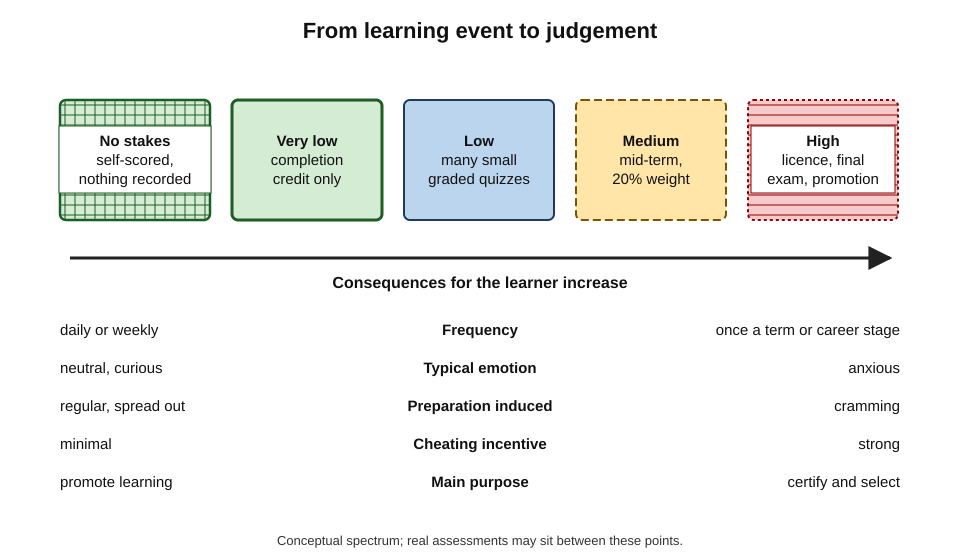
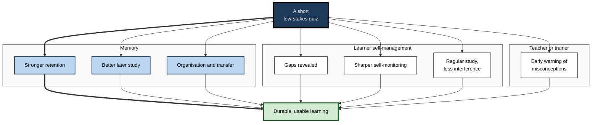
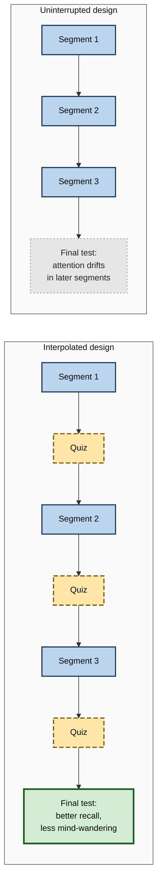
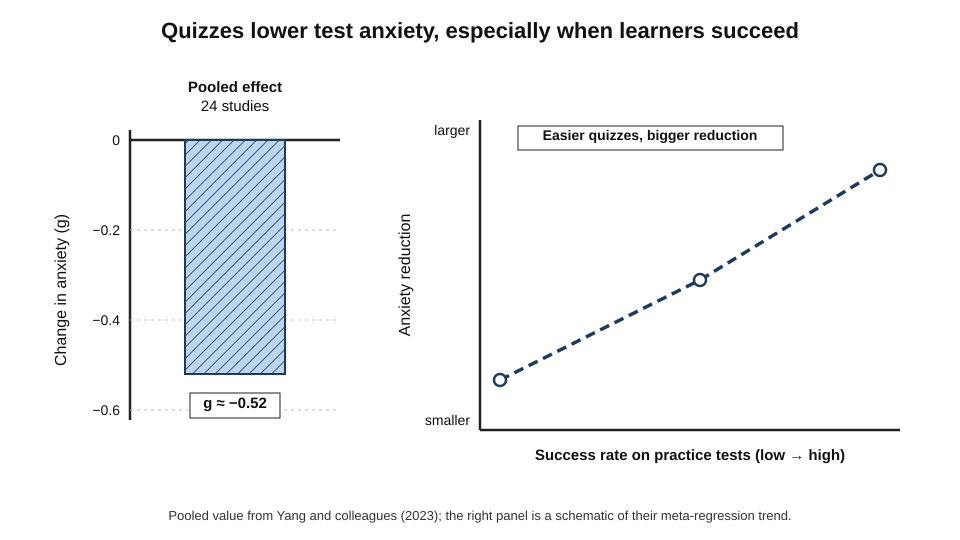
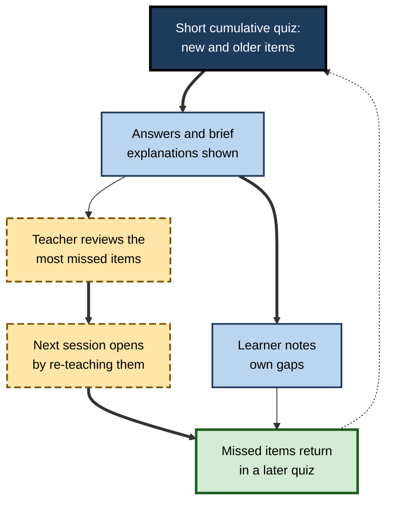
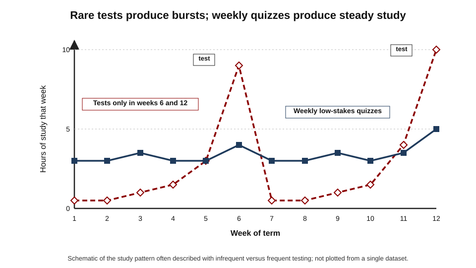

# C.4. Low-Stakes Quizzing Benefits

A team leader starts every Monday meeting with three quick questions about last week's product release — no names recorded, answers revealed after a minute, then on to the agenda. Six weeks later the team handles customer questions about the release noticeably better than a sister team that received the same briefing. Nobody was graded, nobody felt examined, and yet the quiz did real work. That is the promise of **low-stakes quizzing**: the learning power of testing without the costs of high-stakes examination.

> **Definition — Low-stakes quiz:** a short retrieval exercise whose result carries little or no consequence for the learner — ungraded, or contributing only a small share of any final mark — used mainly to promote learning rather than to certify it.

**Why it matters**

- It captures most of the benefits of retrieval practice in a form that is **cheap, frequent and acceptable** to learners.
- It produces **indirect benefits** — better attention, more regular study, sharper self-assessment, earlier teacher intervention — on top of the direct memory benefit.
- It tends to **reduce**, not increase, test anxiety.
- It avoids the distortions that high stakes create: cramming, cheating, guessing strategies and narrowed learning.

---

## What "Stakes" Means

### The stakes spectrum

- **No stakes** — anonymous or self-scored; nothing recorded.
  - *e.g.* a self-check at the end of an e-learning page.
- **Very low stakes** — recorded for participation or completion only.
  - *e.g.* a weekly quiz that earns credit for being attempted.
- **Low stakes** — a small share of a final grade, with many opportunities.
  - *e.g.* ten weekly quizzes worth 1% each.
- **Medium stakes** — meaningful weight but not decisive.
  - *e.g.* a mid-term worth 20%.
- **High stakes** — decisive consequences.
  - *e.g.* a licensing examination, a promotion assessment, a final exam worth 70%.

**Figure 1.** As stakes rise, the purpose of a test shifts from learning to judgement.

> **Key point:** "stakes" is about **consequences for the learner**, not difficulty. A hard quiz can be low-stakes; an easy test can be high-stakes.

### Formative and summative purposes

> **Definition — Formative assessment:** assessment used to guide further learning and teaching.

> **Definition — Summative assessment:** assessment used to certify or judge what has been learned at the end of a period.

- **Low-stakes quizzes are formative** in purpose — but they are also **learning events**, which is a stronger claim than "assessment for learning" usually makes.
- **High-stakes tests can teach too** — but their consequences change how learners prepare and behave in ways that often undermine learning.

| | Low-stakes quizzing | High-stakes testing |
|---|---|---|
| Main purpose | Promote and guide learning | Certify, rank or select |
| Frequency | Frequent — daily or weekly | Infrequent — once a term or a career stage |
| Learner emotion | Neutral to mildly positive | Anxiety, sometimes severe |
| Preparation it induces | Regular, distributed study | Cramming before the event |
| Cheating incentive | Minimal | Strong |
| Information for teachers | Early, continuous | Late, often too late to act |
| Direct memory benefit | Large, through repetition | Present, but from fewer occasions |

---

## Ten Benefits of Quizzing

Henry Roediger, Adam Putnam and Megan Smith (2011) listed ten benefits of testing. Grouped by who benefits, they form a useful map of what a quiz achieves.

### Benefits for memory

- **1. Retrieval aids later retention** — the direct testing effect.
- **2. Testing improves later study** — after a quiz, restudy is more productive (**test-potentiated learning**).
- **3. Testing produces better organisation of knowledge** — retrieval reorganises what is known.
- **4. Testing improves transfer** — retrieved knowledge is more readily applied to new contexts, though transfer is smaller than direct retention.
- **5. Testing can aid retrieval of untested material** — sometimes, especially when material is integrated; but this benefit is less reliable.

### Benefits for the learner's self-management

- **6. Testing identifies gaps** — learners discover what they do not know.
- **7. Testing improves metacognitive monitoring** — learners' judgements of their own knowledge become more accurate.
- **8. Testing encourages students to study** — frequent quizzes produce more regular study.
- **9. Testing prevents interference from earlier material** — interpolated tests help learners keep successive lists or lectures separate.

### Benefits for the teacher or trainer

- **10. Testing provides feedback to instructors** — misunderstandings are visible in time to act.

> **Mnemonic — "Retrieval Is Often The Underrated Gift Making Study Interesting and Fruitful":** Retention, Improved later study, Organisation, Transfer, Untested material, Gaps, Monitoring, Study regularly, Interference, Feedback to instructors.

**Figure 2.** A quiz benefits memory, the learner and the teacher.

---

## Attention, Interference and Regular Study

### Quizzes inside lectures and videos

**Study card — Karl Szpunar, Novall Khan and Daniel Schacter (2013)**

- **Design:** students watched a 21-minute recorded statistics lecture in four segments.
  - One group answered brief questions after **each** segment.
  - Others did unrelated tasks, or restudied, between segments.
- **Results:**
  - the interpolated-test group reported **much less mind-wandering**;
  - took **more notes**;
  - performed **better** on a final test;
  - and reported **less anxiety** about the final test.
- **Conclusion:** brief quizzes inside a lecture keep attention on the material, especially in online learning, where mind-wandering is common.

> **Definition — Interpolated testing:** inserting short tests between segments of a learning session, rather than only at the end.

**Figure 3.** Interpolated quizzes in a recorded lecture.

### Protecting against interference

- **Proactive interference** — earlier learning disrupts memory for later learning.
- **Karl Szpunar, Kathleen McDermott and Henry Roediger (2008):** when people learned several lists in succession, those tested after each list showed less build-up of interference and recalled the final list much better.
- **Workplace parallel:** back-to-back training modules blur together; a short quiz after each module keeps them distinct.

> **Definition — Proactive interference:** the disruption of new learning or recall by previously learned material.

### Regular study instead of cramming

- **Frequent quizzes spread study.** When tests are infrequent, study bunches before each test — a "scalloped" pattern; frequent quizzes produce steadier study.
- **James Pennebaker, Samuel Gosling and Jason Ferrell (2013):** in a large introductory psychology course at the University of Texas, short daily online quizzes at the start of each class were associated with **higher performance** in that course and in later courses, and with a **narrower gap** between students from different social-class backgrounds.
- **James Leeming (2002):** an "exam-a-day" procedure in undergraduate courses was associated with better performance and retention than a few large exams.

> **Watch out:** Pennebaker's and Leeming's studies were course redesigns compared with earlier cohorts, not randomised experiments; they support but do not prove a causal effect of quizzing alone.

---

## Anxiety and Stakes

### Do quizzes make learners anxious?

A frequent worry is that more testing means more anxiety. The evidence points the other way, provided stakes stay low.

**Study card — Pooja Agarwal and colleagues (2014)**

- **Setting:** middle- and high-school students in classes that used regular low-stakes retrieval quizzes.
- **Result:** in a survey, a large majority — about **72%** — reported that the quizzes made them **less nervous** about unit tests and exams; few reported more nervousness.
- **Interpretation:** familiarity with the format and better preparation reduce fear of the final test.

**Study card — Chunliang Yang and colleagues (2023)**

- **Scope:** a meta-analysis of 24 studies with about 3,400 participants on whether practice tests change test anxiety.
- **Results:**
  - practice tests **reduced** test anxiety by a **medium** amount (about g = −0.52);
  - little evidence of publication bias;
  - **easier** practice tests (higher success) reduced anxiety more than difficult ones.
- **Conclusion:** concerns that quizzing provokes anxiety are not supported; quiz design still matters.

**Figure 4.** Practice tests reduce test anxiety, and more so when learners mostly succeed.

> **Remember:** **frequent, low-stakes, mostly-successful** quizzes lower anxiety; **rare, high-stakes, punishing** tests raise it.

### When pressure removes the benefit

**Study card — Scott Hinze and David Rapp (2014)**

- **Design:** students read science texts and took retrieval quizzes under either **normal** conditions or **performance pressure** (told their score would affect a partner's reward and that they were being observed).
- **Results:** under pressure, retrieval practice no longer improved performance on later **inference** questions, although it still helped some factual recall.
- **Conclusion:** pressure can consume the cognitive resources that retrieval needs to build understanding.

> **Watch out:** "gamified" quizzes that reward **speed** and display **leaderboards** can quietly convert a low-stakes quiz into a pressured one. Speed points encourage fast guessing over effortful retrieval; public rankings raise social stakes. Use them sparingly and never as the only quiz form.

**Study card — Bridgid Lyle and Nicole Crawford (2011)**

- **Setting:** an undergraduate statistics course taught in two years.
- **Design:** in one year, students answered two to four short questions at the end of each lecture on that lecture's content; in the comparison year, they did not.
- **Results:** students who completed the end-of-lecture retrieval questions scored higher on course examinations.
- **Conclusion:** even a few minutes of low-stakes retrieval per lecture can improve exam performance in a quantitative course.
- **Caveat:** a comparison between years rather than a randomised experiment.

### Graded or ungraded?

- **Arguments for small grades:** participation rises; learners take quizzes seriously.
- **Arguments against:** grading invites cheating, copying and anxiety, and shifts attention from learning to points.
- **Evidence:** Maya Khanna (2015) found that **ungraded** pop quizzes in an introductory psychology course were followed by better final-exam performance than **graded** pop quizzes or no quizzes.

| Weighting scheme | Participation | Anxiety and cheating risk | Learning benefit | Best used when |
|---|---|---|---|---|
| Ungraded, anonymous | Can be low if optional | Very low | Good if taken seriously | Within live sessions, self-paced modules |
| Completion credit only | High | Low | Good | Weekly course quizzes |
| Small grade, many quizzes, lowest dropped | High | Low to moderate | Good | Courses needing an incentive |
| Large grade per quiz | High | High | Reduced by pressure and cheating | Rarely appropriate for learning quizzes |

> **In practice:** a common, sensible compromise is **completion credit** plus **dropping the lowest scores** — learners must engage, but a bad day costs nothing.

---

## Designing Low-Stakes Quizzes

### Principles

1. **Short** — three to ten questions; two to ten minutes.
2. **Frequent** — every session or every week.
3. **Cumulative** — mix current material with earlier material.
4. **Mostly successful** — aim for most learners to get most items right after effort.
5. **Feedback** — answers shown promptly, with brief explanations.
6. **Recall where possible** — short answers and explanations; well-written multiple choice where marking load requires.
7. **Non-punitive** — no public ranking; results not used for appraisal.
8. **Acted upon** — the teacher or manager adjusts what follows according to the results.

> **Remember:** short, frequent, cumulative, mostly successful, with feedback, recall-based, non-punitive — and acted upon.

**Figure 5.** The weekly cycle of a low-stakes quiz.

### Quiz formats compared

| Format | When | Length | Strength | Watch for |
|---|---|---|---|---|
| Do-now / warm-up | Start of session | 3–5 questions | Retrieves earlier material; settles attention | Becomes routine if never cumulative |
| Interpolated questions | Between segments | 1–3 questions | Reduces mind-wandering; separates topics | Breaks flow if too long |
| Exit ticket | End of session | 1–3 questions | Shows what landed; informs next session | Measures immediate learning only |
| Cumulative weekly quiz | Once a week | 8–15 questions | Spaced retrieval of all prior material | Must be marked or self-marked quickly |
| Pop quiz (ungraded) | Unannounced | 3–5 questions | Encourages regular study | Resentment if graded |

### Worked example: a quiz scheme for a 12-week course

A university lecturer teaches a 12-week introductory finance module to 300 students.

1. **Each lecture:** two interpolated questions via a classroom response system, results shown immediately with explanation — ungraded.
2. **Each week:** an online quiz of ten questions — six on that week, four drawn from earlier weeks; two attempts allowed; answers shown after submission.
3. **Weighting:** 10 weekly quizzes × 1% each for completion with at least 50% correct; lowest two dropped.
4. **Teacher action:** every Monday the lecturer reviews the three items most often missed and opens the next lecture with them.
5. **Evaluation:** compare final-exam performance on quizzed versus unquizzed sub-topics, and with the previous year's cohort.

- **Total weight:** at most 10% of the module; no single quiz matters.
- **Student time:** about 15 minutes per week.
- **Conclusion:** the scheme delivers frequent, cumulative retrieval with feedback while keeping stakes and marking costs minimal.

> **Watch out:** allowing unlimited attempts with answers visible after each attempt invites **answer-farming** — repeating until the right options are known. Limit attempts or randomise item banks.

---

## In Professional Practice

### Settings

- **Clinical teams** — morning "safety huddles" that begin with one question about a recent protocol change.
- **Engineering teams** — short quizzes in on-call handovers about recent incidents and runbook changes.
- **Sales teams** — weekly three-question product checks delivered in the CRM.
- **Regulated industries** — spaced question sets replacing a single annual compliance test.

> **In practice:** the most important rule in workplaces is the **firewall**: quiz results must not feed performance ratings. Once they do, people guess, look up answers or avoid the quizzes, and the learning benefit disappears.

### Case study: the weekly product pulse

- **Situation:** a B2B software company released product updates monthly; account managers attended a 45-minute briefing on each release.
- **Problem:** customers often knew more about new features than their account managers; the briefings had high attendance but little effect.
- **Actions:**
  1. A three-question "product pulse" was sent each Monday through the team chat tool — two questions on the latest release, one on an older one.
  2. Answers were free-text or multiple choice with explanation shown immediately after.
  3. Results were reported only as team-level percentages; individual results were visible only to the individual.
  4. Product managers used the commonest wrong answers to adjust the next briefing.
- **Result:** participation stabilised at about four in five account managers; customer-facing errors about feature availability, logged by the support team, declined over two quarters.
- **Side effects:** a short-lived leaderboard was introduced and then removed after participation fell among lower scorers.
- **Lesson:** keep it **short, frequent, cumulative and private**, and let the results change the teaching.

### Ethics and fairness

- **Privacy** — quiz data about individuals' knowledge gaps is sensitive; collect only what is needed.
- **Accessibility** — time limits and speed scoring disadvantage some learners; allow adjustments.
- **Equity** — frequent low-stakes quizzing has been associated with **narrower** achievement gaps; high-stakes regimes may widen them.

---

## How Quizzes Change What Learners Do Between Them

The indirect benefits of quizzing are easy to underrate because they happen out of sight — in what learners do on the days **between** quizzes.

### Better self-monitoring

- **The problem:** learners judge how well they know material by how familiar it feels, which is a poor guide.
- **What quizzing adds:** an attempt from memory provides **direct evidence**. Judgements made after trying to retrieve are much more accurate than judgements made while looking at the material.
- **Consequence:** after a quiz, learners spend restudy time on what they actually got wrong, not on what merely felt hard.

> **Definition — Judgement of learning:** a learner's prediction of how well they will remember an item later; such judgements are more accurate when made after an attempt to retrieve the item from memory.

### Steadier study

- **Infrequent tests produce study bursts** — effort concentrates just before each test, followed by long gaps.
- **Frequent quizzes flatten the pattern** — a little study each week to keep up, which also spaces practice naturally.
- **Procrastination** — a quiz every week reduces the payoff of postponing study, because the next small consequence is always close.

### Changed encoding

- **Test expectancy** — learners who expect to be quizzed attend more closely and organise material more actively during lectures and reading.
- **Note-taking** — in interpolated-testing studies, learners took more notes when quizzes were expected.

**Figure 6.** Study activity across a term with rare tests and with weekly quizzes.

> **Key point:** much of what a weekly quiz achieves happens **before** it is taken — in the extra attention, notes and short study sessions it prompts.

---

## Honesty, Collaboration and AI

Low stakes reduce the incentive to cheat, but online quizzes still invite shortcuts — now including asking an AI system for the answers.

- **Why shortcuts defeat the purpose** — a quiz answered by searching, copying or asking an AI produces no retrieval; it is simply a lookup.
- **Low stakes are the main defence** — when nothing depends on the score, the main reason to cheat disappears; learners who understand the purpose mostly do not bother.
- **Design defences**
  - **In-person or live** quizzes for the most important retrieval.
  - **Short time windows** — a few minutes per quiz leaves little time to look things up.
  - **Explain-in-your-own-words items** that are hard to outsource meaningfully.
  - **Randomised item banks** so answers cannot be shared.
- **Collaborative quizzes** — learners first answer individually, then discuss in pairs and answer again. The individual attempt keeps the retrieval; the discussion adds explanation.

> **Watch out:** heavy proctoring and surveillance of low-stakes quizzes raises their stakes and anxiety, undermining the very conditions that make them work. Use design, not surveillance.

---

## Worked Example: A Low-Stakes Quiz Routine for a Data Team

A data-engineering team of twelve adopts a new data-governance standard and a new orchestration tool in the same quarter.

1. **Choose the target knowledge** — 40 points: 25 rules from the governance standard, 15 operational facts about the orchestration tool.
2. **Write items** — short scenarios answered in a sentence ("A pipeline writes customer emails to a shared bucket. Which rule is broken, and what is the fix?").
3. **Set the routine** — every Tuesday stand-up begins with three questions, answered individually in a chat thread within two minutes; answers and one-line reasons are posted immediately afterwards.
4. **Make it cumulative** — from week 3, one of the three questions comes from earlier weeks.
5. **Keep stakes at zero** — no names on a summary; the team lead sees only how many answered correctly.
6. **Close the loop** — any item missed by more than a third of the team is discussed for two minutes at the next stand-up.
7. **Evaluate** — after twelve weeks, compare governance-review findings with those of a sister team that received the same documentation but no quizzes.

| Measure | Team with quizzes | Sister team |
|---|---|---|
| Time spent per person per week | About 4 minutes | 0 |
| Governance-review findings, quarter after adoption | Few, mostly minor | Several, including two repeated basic breaches |
| Engineers' self-rated confidence | Moderate | High |

- **Conclusion:** about four minutes a week was enough to make the new rules retrievable at the moment of writing code; the sister team's high confidence was not matched by its review findings.

> **Watch out:** the comparison between two teams is suggestive, not conclusive — teams differ. A stronger evaluation would quiz half of the rules and compare findings on quizzed and unquizzed rules within the same team.

---

## Low-Stakes Quizzing Online and at a Distance

Online and asynchronous courses depend on quizzes even more than classroom teaching, because there is no teacher to notice confusion in the room.

- **Embedded questions in videos** — questions that pause a recorded lecture every few minutes reproduce the interpolated-testing effect and reduce mind-wandering.
- **Short quizzes at the end of each module** — with immediate feedback, unlimited time but limited attempts.
- **Discussion after quizzes** — a forum thread for the most missed question invites explanation from peers and tutors.
- **Visible progress** — learners see their own delayed-quiz results improving, which sustains motivation without public comparison.
- **Low completion as a signal** — in self-paced courses, quiz completion often falls first when learners are about to drop out; tutors can use it to intervene early.

> **Watch out:** in open online courses, many quizzes are answered by searching the course pages in another window. Explain why closed-book attempts matter, keep items scenario-based, and treat quiz scores as information for the learner rather than as grades.

---

## Low-Stakes Quizzing for Experienced Professionals

Experienced staff are often the most resistant to quizzes, which they associate with school or with compliance policing. Framing and design matter.

- **Frame it as maintenance, not examination** — "keeping critical knowledge fresh", as pilots and anaesthetists rehearse rare emergencies.
- **Ask about consequential, rarely used knowledge** — experts value questions on the cases they seldom meet but must handle well.
- **Use peer-written questions** — senior practitioners writing items for each other raises quality and ownership.
- **Make it private** — individual results visible only to the individual.
- **Keep it very short** — one or two questions at natural moments, such as the start of a shift or a team meeting.

> **In practice:** in continuing professional development, several professional bodies have moved from infrequent, long recertification examinations towards **regular short question sets** across the certification period — low stakes for each question, with feedback, and assessment based on performance over time.

---

## Open Questions

- **How small can stakes be before engagement drops?**
  - Ungraded quizzes can work, but in voluntary settings many learners skip them; the optimal incentive is unknown and probably varies by culture and context.
- **How much of the benefit is direct memory, and how much is regular study?**
  - Classroom effects mix the testing effect with changed study habits; separating them is difficult.
- **Does gamification help or harm?**
  - Points and competition may raise participation while reducing effortful retrieval; systematic evidence is limited.
- **What is the right success rate for both learning and anxiety?**
  - Easier quizzes reduce anxiety more; harder retrieval may build more memory; the best balance is unsettled.

---

## Summary

- **Low-stakes quizzes** are short, frequent retrieval exercises with little or no consequence; they are learning events as well as formative assessment.
- **Stakes** concern consequences, not difficulty; high stakes produce cramming, cheating and anxiety.
- **Ten benefits** (Roediger, Putnam and Smith, 2011): retention, better later study, organisation, transfer, some untested material, gap detection, better monitoring, regular study, less interference, feedback to instructors.
- **Interpolated quizzes** reduce mind-wandering and interference (Szpunar and colleagues, 2008 and 2013).
- **Frequent quizzing** spreads study and was associated with narrower achievement gaps in a large course redesign.
- Quizzes **reduce** test anxiety on average (about g = −0.52), especially when mostly successful; **performance pressure** can remove benefits for understanding.
- **Ungraded or lightly weighted** quizzes, completion credit and dropped lowest scores keep stakes low.
- Design: **short, frequent, cumulative, mostly successful, with feedback, recall-based, non-punitive and acted upon**; at work, keep quiz data out of appraisal.

---

## Self-Check

1. Define a low-stakes quiz and explain why stakes and difficulty are different dimensions.
2. Distinguish formative from summative assessment. Why is a low-stakes quiz more than formative assessment?
3. List the ten benefits of testing, grouped by who benefits.
4. Describe the Szpunar, Khan and Schacter (2013) study and its implications for online learning.
5. What is proactive interference, and how do interpolated tests reduce it?
6. Summarise the evidence on quizzing and test anxiety.
7. What did Hinze and Rapp (2014) find, and what does it imply for gamified quizzes?
8. Compare three weighting schemes for course quizzes and recommend one.
9. Why might allowing unlimited quiz attempts undermine learning?
10. A head of sales wants quiz scores on the team dashboard ranked by name. Advise.
11. Design a low-stakes quizzing routine for a hospital ward adopting a new medication protocol.
12. Why should the Pennebaker and Leeming findings be interpreted cautiously?
13. Describe Lyle and Crawford (2011) and its main limitation.
14. Name three indirect benefits of weekly quizzes that occur between quizzes, and three design defences against looking up or AI-generating answers.

### Answer Key

1. A short retrieval exercise with little or no consequence for the learner, used to promote learning. Stakes are consequences; difficulty is how hard items are — a hard quiz can be ungraded; an easy exam can decide a licence.
2. Formative guides further learning; summative certifies at the end. A low-stakes quiz also directly strengthens memory through retrieval — it is a learning activity, not only information for guidance.
3. Memory: retention, better later study, organisation, transfer, untested material. Learner: gap detection, monitoring, regular study, reduced interference. Instructor: feedback on misconceptions.
4. Students watching a recorded lecture answered questions after each segment or did other tasks; the quizzed group mind-wandered less, took more notes, scored higher and felt less anxious. Online lectures should include brief interpolated questions.
5. Earlier learning disrupting later learning. Testing after each block helps keep blocks distinct and reduces the build-up of interference.
6. Surveys (about 72% of students less nervous in Agarwal and colleagues, 2014) and a meta-analysis of 24 studies (g ≈ −0.52) show practice tests reduce anxiety, particularly when learners mostly succeed.
7. Performance pressure removed the benefit of retrieval for inference questions. Gamified speed scoring and leaderboards can create pressure and encourage guessing, so they should be used sparingly.
8. Ungraded (low anxiety, possibly low participation); completion credit with lowest dropped (high participation, low anxiety — usually best); large weight per quiz (pressure and cheating). Recommend completion credit with dropped lowest scores.
9. Learners can repeat until they have identified the right options — recognition of answer positions, not retrieval. Limit attempts or randomise items.
10. Advise against: public ranking raises stakes, discourages lower scorers and invites gaming. Show team-level results; let individuals see their own; use results to adjust training, not to rate people.
11. E.g. a one-question check at each shift handover for four weeks (dose, contraindication, monitoring step), answers shown immediately; weekly cumulative five-question set; anonymous results reviewed by the practice educator to target teaching; no link to appraisal.
12. They compared redesigned courses with earlier cohorts rather than randomising; other changes and cohort differences could contribute. They are consistent with, not proof of, a quizzing effect.
13. In a statistics course, students answering a few retrieval questions at the end of each lecture scored higher on exams than a previous cohort without them; the comparison was between years, not randomised.
14. Indirect: more accurate self-monitoring and better-targeted restudy; steadier, spaced study with less procrastination; more attentive encoding and note-taking. Defences: keep stakes low; short time windows; explain-in-your-own-words items; randomised banks; live or in-person retrieval for key content.

---

## Glossary

| Term | Meaning |
|---|---|
| Answer-farming | Repeating a quiz until correct options are known, without genuine retrieval. |
| Classroom response system | Technology for collecting live answers from a group. |
| Collaborative quiz | A quiz answered first individually and then again after discussion with peers. |
| Completion credit | Marks awarded for attempting a quiz rather than for its score. |
| Do-now | A short retrieval task at the start of a session. |
| Exit ticket | A short question set at the end of a session. |
| Formative assessment | Assessment used to guide further learning and teaching. |
| High-stakes test | A test with decisive consequences for the learner. |
| Interpolated testing | Inserting short tests between segments of a learning session. |
| Judgement of learning | A learner's prediction of how well an item will be remembered later. |
| Low-stakes quiz | A short retrieval exercise with little or no consequence. |
| Mind-wandering | Attention drifting from the task to unrelated thoughts. |
| Performance pressure | Stress caused by consequences or observation of performance. |
| Proactive interference | Disruption of new learning by earlier learning. |
| Stakes | The consequences of a test result for the learner. |
| Summative assessment | Assessment that certifies learning at the end of a period. |
| Test anxiety | Fear and worry about being tested that can impair performance. |
| Test expectancy | What kind of test a learner expects, which shapes attention and study. |
| Test-potentiated learning | Improved effectiveness of study that follows a test. |
