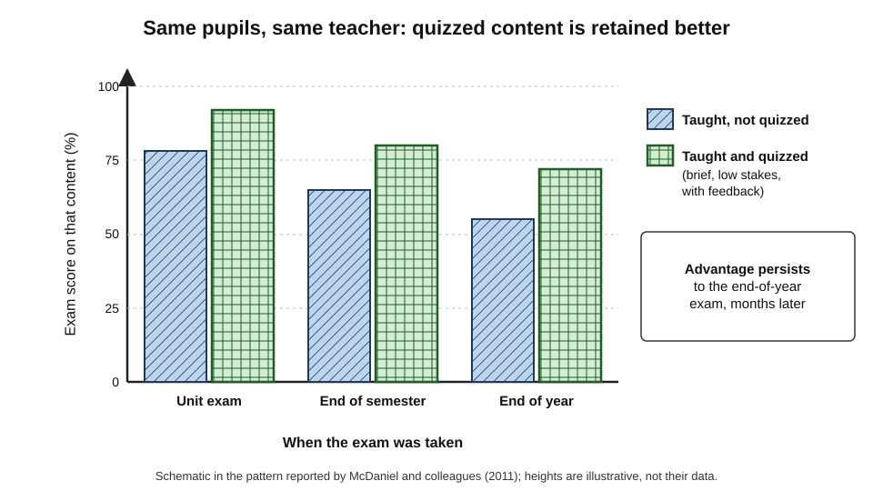
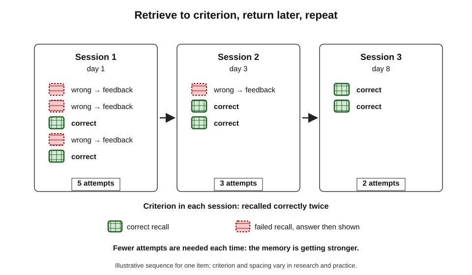
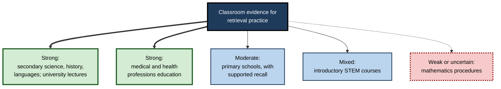
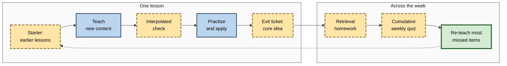
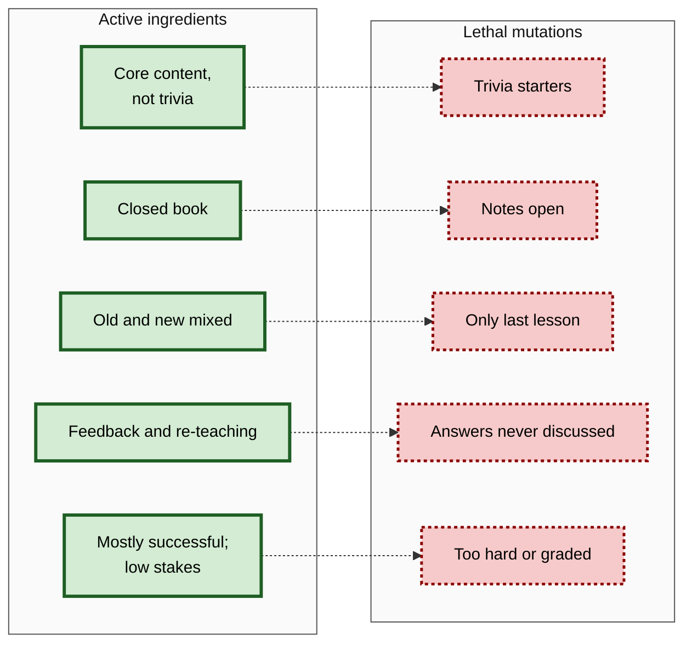

# C.5. Retrieval Practice in Academic Settings

In a laboratory, a retrieval experiment takes an hour: students read a passage, recall it, and return a week later. A school year is different. Thirty pupils, five lessons a week, a crowded curriculum, absences, homework that may or may not be done, and examinations months away. The question that matters to teachers, lecturers and course designers is whether the testing effect **survives contact with real education** — and, if so, how to build it into teaching without breaking everything else.

> **Definition — Classroom retrieval practice:** the deliberate, regular use of activities that require learners to recall course content from memory — quizzes, starters, written recall, practice questions — as part of ordinary teaching, with the aim of improving long-term learning rather than measuring it.

**Why it matters**

- Laboratory effects often shrink or vanish in real classrooms; retrieval practice is one of the few that has been tested repeatedly **in situ** and largely holds up.
- Classroom implementation raises design problems that laboratories avoid: **time, coverage, marking, motivation, fidelity**.
- Schools, universities and professional schools have adopted retrieval routines widely — sometimes well, sometimes in forms that lose the active ingredient.
- The evidence base itself has **limits** by subject and age, which teachers need to know to use it well.

---

## From Laboratory to Classroom

### What changes in real settings

- **Material** — complex, connected curricula rather than word lists.
- **Delays** — weeks to months between learning and the exam, rather than days.
- **Control** — time on task, homework and absence are not fully controlled.
- **Final tests** — teacher-made or national exams, not experimenter-designed tests.
- **Learners** — mixed ages, abilities, languages and motivations.

| | Laboratory experiments | Classroom studies |
|---|---|---|
| Who teaches | Experimenter or none | The usual teacher |
| What is learned | Short, self-contained material | The real curriculum |
| Retention interval | Minutes to a week or two | Weeks to a full term or year |
| Comparison | Restudy for equal time | Unquizzed content in the same course, other classes, or earlier cohorts |
| Strength | High internal validity | High external validity |
| Weakness | Artificial | Less control; harder to isolate causes |

> **Key point:** the most persuasive classroom studies use a **within-class design**: every pupil is quizzed on some content and not on other, comparable content, and both appear on the later exam. This removes differences between pupils and teachers.

> **Definition — Within-subject (within-class) design:** a design in which every learner experiences all conditions — here, quizzed and unquizzed content — so that comparisons are not confounded by differences between learners.

### The Columbia Middle School project

**Study card — Mark McDaniel, Pooja Agarwal, Barbie Huelser, Kathleen McDermott and Henry Roediger (2011)**

- **Setting:** eighth-grade science classes in a public middle school in Illinois, USA.
- **Design:**
  - across the year, some course content was quizzed with brief low-stakes multiple-choice quizzes in class — before the lesson, after the lesson and before the unit test;
  - other comparable content was taught but not quizzed;
  - quizzes were delivered with classroom response devices and immediate feedback.
- **Results:**
  - on unit exams, end-of-semester and end-of-year exams, quizzed content was remembered **substantially better** than unquizzed content — roughly the difference between a strong and a middling grade;
  - the benefit persisted to the **end-of-year** exam months later.
- **Conclusion:** brief quizzes integrated into ordinary lessons produced durable gains in a real school.

**Study card — Henry Roediger, Pooja Agarwal, Mark McDaniel and Kathleen McDermott (2011)**

- **Setting:** sixth-grade social studies in the same school district.
- **Design:** quizzed versus unquizzed content; and in one experiment, quizzing compared with **restudying** the same content in class for equal time.
- **Results:**
  - quizzed items were better retained on chapter and end-of-semester exams;
  - quizzing beat equal-time restudy, not only no activity.
- **Conclusion:** the classroom testing effect is a genuine retrieval effect, not simply extra exposure.

**Figure 1.** Exam performance on quizzed and unquizzed content in a within-class design.

### What the reviews say

- **Pooja Agarwal, Ludmila Nunes and Janell Blunt (2021)** — a review of about 50 classroom experiments in schools and universities: the great majority showed medium or large benefits of retrieval practice, across subjects and ages.
- **Chunliang Yang and colleagues (2021)** — 222 classroom studies: an average gain of about half a standard deviation, larger with feedback and repeated quizzing.
- **The Education Endowment Foundation (2021)** — a review of cognitive-science approaches in English classrooms judged retrieval practice **promising** but noted that evidence on how teachers implement it at scale, and its impact on attainment in ordinary schools, was **thinner** than laboratory evidence.

> **Watch out:** reviews of classroom studies include many designs; some compare with **no activity**, which inflates apparent effects. The within-class, equal-time studies are the strongest evidence.

---

## Evidence by Level and Subject

### Primary schools

- Children benefit from retrieval practice, but young learners may need **more support** — guided recall, prompts, picture cues — because unaided free recall can produce too little success.
- Jeffrey Karpicke and colleagues found that elementary pupils learned more from retrieval when it was **structured** (*e.g.* recall within an outline) than from unstructured free recall.
- A 2025 study in real primary classrooms found that testing at longer intervals outperformed re-reading at shorter intervals — an effect that combines retrieval with spacing.

### Secondary schools

- The strongest school evidence comes from **middle and high school** science, history and languages.
- **Format matters less than frequency** — multiple-choice and short-answer quizzes both helped when used regularly with feedback.
- **Higher-order quizzes** — Pooja Agarwal (2019) found that quizzes requiring application and analysis improved higher-order exam performance, while quizzes on facts alone did not transfer to higher-order questions; **mixed** quizzes helped both.

### Universities

- **Large lecture courses** — interpolated questions, weekly online quizzes and cumulative practice tests are widely studied and generally beneficial.
- **Successive relearning** — Katherine Rawson, John Dunlosky and Sharon Sciartelli (2013) had introductory psychology students retrieve key concepts to a criterion (correct several times) in several spaced sessions; retention of those concepts on later exams was markedly better than for concepts studied the usual way.
- **STEM courses** — a 2024 analysis of spaced retrieval practice across nine introductory STEM courses found benefits in some courses and not others — a "glass half full or half empty" picture.

> **Definition — Successive relearning:** retrieving each item until it is correctly recalled a set number of times in a session, then repeating the process in later sessions.

**Figure 2.** Successive relearning: retrieve to criterion, then return later and do it again.

### Mathematics

- A 2025 meta-analysis found the testing effect in mathematics to be **small and uncertain**, whereas spacing was beneficial.
- **Possible reasons:**
  - maths learning is often already **practice-based** — solving problems is itself retrieval of procedures, so "restudy" comparisons are not pure;
  - final tests demand **new problems**, which need transfer of principles;
  - quiz items may target **facts** (definitions, formulae) when exams demand **procedures**.

> **Watch out:** "retrieval practice works for all subjects" is too strong. It is well established in fact- and concept-rich subjects; in mathematics, the evidence favours **spaced, mixed problem practice** more than quizzing as such.

### Professional schools

- **Medicine** — Douglas Larsen and colleagues showed that medical residents and students retained clinical knowledge far better after repeated short-answer testing than after restudy. **Progress testing** — giving all students in a medical programme the same comprehensive test several times a year, as pioneered in Dutch and Canadian schools — embeds frequent retrieval across a whole curriculum.
- **Law** — practice problem questions and closed-book outlines are traditional; controlled evidence is sparser.
- **Nursing, pharmacy, dentistry** — question banks and spaced quizzes are widespread; residents who answer more practice questions during the year tend to gain more on in-training examinations, though such correlations do not prove causation.

**Figure 3.** Where the classroom evidence is strongest.

---

## Classroom Routines

### Building retrieval into a lesson

- **Starter (do-now)** — three to five questions on earlier lessons as pupils arrive.
- **Interpolated questions** — brief checks between chunks of instruction.
- **Mini whiteboards** — every pupil writes an answer; the teacher sees all at once.
- **Brain dump** — two minutes writing everything remembered about a topic before it is extended.
- **Exit ticket** — one or two questions on the lesson's core idea.
- **Cumulative weekly quiz** — mixes this week with earlier weeks.
- **Retrieval homework** — short question sets instead of re-reading tasks.

**Figure 4.** Retrieval opportunities across a lesson and a week.

| Routine | Time | Who sees results | Main benefit | Main risk |
|---|---|---|---|---|
| Starter | 5 min | Teacher and pupil | Retrieves older content; settles class | Becomes trivia, never cumulative |
| Mini whiteboards | 1–3 min | Teacher, instantly | Whole-class check; every pupil retrieves | Copying neighbours |
| Brain dump | 2–4 min | Pupil, then teacher | Reveals structure of knowledge | Too little success for weak learners |
| Exit ticket | 3 min | Teacher, after class | Shows what landed today | Measures only immediate learning |
| Cumulative quiz | 10–15 min | Both | Spaced, mixed retrieval | Marking load if not automated |
| Retrieval homework | 15–20 min | Both | Moves revision out of class | Answers looked up or copied |

> **In practice:** the most useful teacher question after a quiz is not "what was the average?" but "**which item did most pupils miss, and what will I do about it tomorrow?**"

### Making it cumulative

- **Rule of thirds** — a common heuristic: in a starter, one question from last lesson, one from last month, one from last term.
- **Interleaved content** — questions from different topics in one quiz force pupils to identify which knowledge applies, a combination with its own evidence base.
- **Spaced return** — content quizzed once in September and never again will fade by June.

### Feedback in class

- **Show answers promptly** — at least the correct answer.
- **Explain common errors** — name the misconception and correct it.
- **Self-marking** — pupils mark their own quiz against the answers; quick, and makes them process the feedback.

---

## When Implementation Goes Wrong

### Lethal mutations

> **Definition — Lethal mutation:** a change to an educational practice during implementation that removes its active ingredient while keeping its surface form. The term comes from the work of Ann Brown and Joseph Campione.

- **Trivia starters** — questions about isolated, low-value facts; retrieval occurs, but of the wrong things.
- **Copying from the board** — "retrieval" tasks completed with notes open.
- **Never cumulative** — only last lesson is quizzed; nothing is spaced.
- **No feedback** — pupils never learn whether they were right.
- **Too hard** — most pupils retrieve nothing, and the activity becomes a guessing game.
- **Grades attached** — anxiety and cheating return.
- **Recognition only** — every check is a multiple-choice poll with weak lures.

| Mutation | Why it fails | Fix |
|---|---|---|
| Trivia starters | Retrieves low-value facts | Ask about core concepts and their use |
| Notes open | No retrieval occurs | Closed book; check afterwards |
| Only last lesson | No spacing | Mix recent and older questions |
| No feedback | Errors persist | Reveal answers and explain errors |
| Too hard | Little success, no strengthening | Add cues; teach first; reduce load |
| Heavy grading | Pressure and cheating | Completion credit or none |

**Figure 5.** Active ingredients of classroom retrieval and the mutations that remove them.

### Student resistance

- **Pupils prefer re-reading** — it feels better; quizzes reveal ignorance.
- **Explain the reason** — teaching pupils about the testing effect itself, with a classroom demonstration (quizzed versus re-read material on a later test), changes attitudes in some studies.
- **Keep success high** — learners who mostly succeed feel competent and engage.

> **Watch out:** knowing about retrieval practice does not mean students will use it. Studies of strategy instruction find that **knowledge of strategies changes behaviour only modestly** unless teachers build the strategy into routines.

---

## Worked Example (illustrative): Designing a Unit for Retrieval

A secondary geography teacher plans a six-week unit on river processes.

1. **Identify core knowledge** — 25 key concepts (erosion processes, landforms, flood management) and 6 explanations that pupils must produce.
2. **Write a question bank** — 75 short-answer and 30 well-written multiple-choice items, plus 6 "explain from memory" prompts.
3. **Starters every lesson** — three questions: last lesson, two weeks ago, previous unit.
4. **Weekly cumulative quiz** — ten items, self-marked; teacher reviews the three most missed.
5. **Successive relearning homework** — an online set on the 25 concepts, each to be answered correctly twice per session, in three sessions over the unit.
6. **Pre-assessment brain dump** — before the end-of-unit test, five minutes writing everything about flood management; pupils compare with a model list.
7. **Evaluate** — compare end-of-unit and end-of-year performance on these concepts with the previous year's cohort and with an unquizzed comparison topic.

| | Previous year | Redesigned unit |
|---|---|---|
| Retrieval opportunities per concept | About 1 (end-of-unit test) | 6–10 across six weeks |
| Feedback | After the test, weeks later | Same lesson or same week |
| Additional lesson time | — | About 8 minutes per lesson |
| Teacher marking | End-of-unit test | Mostly self-marked or automated |

*Illustrative figures.*

- **Conclusion:** retrieval becomes part of every lesson at modest cost; the evaluation plan distinguishes genuine improvement from cohort differences.

> **Watch out:** comparing with the previous year's cohort is weak evidence — cohorts differ. The within-unit comparison with an **unquizzed topic** is stronger.

---

## Case Study (illustrative): A Department-Wide Retrieval Policy

- **Situation:** a secondary school's history department adopted a policy: every lesson begins with a five-question retrieval starter.
- **Initial result:** after a year, end-of-year results were unchanged.
- **Diagnosis (by observing lessons and sampling starters):**
  1. most questions asked for dates and names unrelated to the explanations examined;
  2. questions were almost entirely about the **previous lesson**;
  3. pupils often answered with exercise books open;
  4. answers were read out but errors rarely discussed.
- **Actions:**
  1. Questions were rewritten to target core concepts and causal explanations ("Why did the Corn Laws divide the Conservative Party?").
  2. A 1–2–2 pattern was introduced: one question from last lesson, two from earlier in the year, two from earlier years.
  3. Starters became closed-book, with self-marking against the answers shown.
  4. Teachers chose one misconception per week to re-teach.
  5. A termly cumulative quiz was added, ungraded.
- **Result:** in the following year, the department's internal assessments showed better retention of earlier topics, and teachers reported that pupils used prior knowledge more readily in essays; national exam outcomes improved modestly, though other changes occurred at the same time.
- **Lesson:** a policy that preserves the **form** of retrieval but not its **active ingredients** — meaningful content, spacing, closed-book effort and feedback — changes little.

---

## Retrieval Practice and Generative AI in Education

- **Question generation** — teachers and lecturers increasingly use AI tools to draft quiz items; early studies in university courses report that AI-generated retrieval questions can support retention, provided teachers **check and edit** them.
- **AI tutors** — tools that answer questions immediately may **replace** retrieval if pupils ask rather than recall; tutors designed to prompt recall and give hints preserve it.
- **Homework integrity** — retrieval homework can be completed by an AI system; in-class retrieval becomes more important.

> **In practice:** treat AI as a **question-writing assistant**, not a question-writing authority — check accuracy, alignment with the curriculum and difficulty before use.

---

## Teaching Students to Retrieve on Their Own

Classroom quizzes reach students for minutes a day. Most study happens alone, where students tend to fall back on re-reading. Teaching students to use retrieval independently extends the effect into the hours that matter most.

### What students actually do

**Study card — Marissa Hartwig and John Dunlosky (2012)**

- **Design:** a survey of several hundred undergraduates about their study strategies, scheduling and grades.
- **Results:**
  - self-testing was reported by many students, but mostly to **check** learning rather than to **learn**;
  - students who reported self-testing tended to have **higher** grades;
  - many students scheduled study by the nearest deadline rather than by plan, and planned scheduling was associated with better grades.
- **Conclusion:** students know some effective strategies but use them for the wrong reasons and at the wrong times.
- **Caveat:** survey correlations — stronger students may simply choose better strategies.

### Strategy instruction

- **Explain the science briefly** — what the testing effect is and why it feels less effective than re-reading.
- **Demonstrate on the class** — a short in-class experiment (half the terms quizzed, half re-read, tested a week later) makes the effect personal.
- **Model the routine** — show how to turn notes into questions, cover answers, check and repeat.
- **Provide tools** — question banks, blank recall sheets, flashcard templates.
- **Build it into homework** — set retrieval tasks rather than "revise chapter 4".
- **Follow up** — ask what students did, and show them the link between their retrieval and their results.

> **Watch out:** a single lesson on study strategies changes beliefs more than behaviour. Studies of strategy training find that students often revert to re-reading unless retrieval is built into **routines and assignments**, not just recommended.

### Practice papers and exam preparation

- **Past and mock papers** are retrieval practice at the scale of a whole exam — but only if attempted **closed-book** before the mark scheme is consulted.
- **Common error:** reading through past papers with the mark scheme alongside — recognition, not retrieval.
- **Better sequence:**
  1. attempt under timed, closed-book conditions;
  2. mark against the scheme;
  3. write a short note on each error and its cause;
  4. turn errors into retrieval items for the following weeks;
  5. re-attempt the missed questions a week later.

> **In practice:** "**attempt, mark, explain, return**" turns past papers from a confidence exercise into one of the most powerful forms of exam preparation.

---

## Retrieval in Vocational and Professional Education

- **Apprenticeships and technical training** — retrieval of procedures and safety rules is best practised as **performance**: carrying out the steps from memory on equipment or simulators, with an instructor's feedback.
- **Nursing and allied health** — short scenario questions at the start of placement shifts; skills stations where procedures are performed without prompts.
- **Law schools** — closed-book outlines and problem questions written under time limits mirror the retrieval demands of practice.
- **Accountancy and finance** — question banks for professional examinations are the dominant study tool; the key design issue is whether they are used for retrieval (attempt first) or reading (explanation first).
- **Executive education** — case discussions benefit from a short individual written recall ("what were the three decisions the CEO faced?") before discussion, so that every participant retrieves before listening to others.

| Setting | Typical retrieval form | Main risk |
|---|---|---|
| Apprenticeship workshops | Perform procedure from memory | Instructor prompts too soon |
| Nursing placements | Scenario questions at handover | Questions skipped when wards are busy |
| Law school | Timed closed-book problems | Outlines memorised verbatim without application |
| Professional exam preparation | Question banks | Explanations read before answering |
| Executive education | Individual recall before discussion | Discussion replaces individual retrieval |

---

## Teachers as Designers of Retrieval

### Fidelity and professional development

- **Fidelity** — the degree to which a practice is carried out as intended. Retrieval routines lose fidelity quickly when teachers are rushed.
- **What helps teachers implement well:**
  - **shared question banks** for each unit, written and refined by departments;
  - **observation and feedback** on retrieval routines, as on any teaching skill;
  - **simple design rules** (closed book, cumulative, core content, feedback);
  - **time** — protected planning time to write good questions.

> **Definition — Implementation fidelity:** the extent to which a practice is delivered as designed, including its essential components.

### Question quality as a teaching skill

- **Good retrieval questions require subject expertise** — knowing which ideas are central, which misconceptions are common, and which wording reveals understanding.
- **Departmental review** — teachers critiquing each other's questions improves quality faster than individual effort.
- **Retire weak questions** — items that everyone gets right effortlessly, or that are ambiguous, should be rewritten.

---

## Case Study (illustrative): Retrieval Practice in a Large First-Year Course

- **Situation:** a first-year biology course with about 600 students had high failure rates on the cumulative final examination; students reported studying mainly in the week before exams.
- **Problem:** lecture content was covered once; weekly assessments were open-book worksheets; students' study was concentrated and passive.
- **Actions:**
  1. **Interpolated questions** — three response-system questions in every lecture, with discussion of the commonest wrong answer.
  2. **Weekly online quiz** — ten items, closed-book honour code, 20-minute time limit, half on earlier weeks; completion credit only.
  3. **Successive relearning** — a set of 40 core concepts practised online to criterion (correct three times) in three sessions across the term.
  4. **Study-skills session** in week 2 — a short demonstration of the testing effect using the students' own data from the first quiz.
  5. **Mock final** — attempted closed-book three weeks before the exam, with feedback and a re-attempt of missed items.
- **Results:** in the redesigned year, the failure rate on the final fell and performance on the 40 core concepts was much higher than on comparable concepts not in the relearning set; students reported spreading study across the term.
- **Side effects:** response-system participation dropped mid-term until the lecturer began discussing every question's results; the closed-book honour code was not fully observed by all.
- **Caveat:** year-to-year comparison; the within-course comparison of relearned versus non-relearned concepts is the stronger evidence.
- **Lesson:** at scale, retrieval works when it is **frequent, cumulative, automated, low-stakes and visible to students as useful**.

---

## Open Questions

- **How large is the effect at scale, with ordinary implementation?**
  - Most classroom studies involved researchers working closely with teachers; effects under routine, unsupported implementation are less well known.
- **Why is the effect weaker in mathematics?**
  - Whether this reflects the subject, the comparison conditions or the test formats is unresolved.
- **How should retrieval be balanced with new teaching?**
  - Every minute spent on retrieval is a minute not spent on new content; the optimal proportion is unknown.
- **Which learners benefit most?**
  - Some studies suggest larger gains for lower-attaining learners; others find no difference. Results are mixed.
- **Does retrieval practice improve higher-order learning?**
  - It does when the quizzes themselves are higher-order; fact quizzes alone appear not to transfer to analysis and evaluation.

---

## Summary

- **Classroom retrieval practice** builds regular recall into ordinary teaching; it survives the move from laboratory to classroom better than most techniques.
- **Within-class designs** — quizzed versus unquizzed content for the same pupils — give the strongest evidence.
- **Columbia Middle School studies** (McDaniel, Roediger, Agarwal, McDermott, 2011) showed durable gains in science and social studies, including over equal-time restudy.
- **Reviews:** most classroom experiments show medium or large benefits; average around half a standard deviation; implementation evidence at scale is thinner.
- **By level:** strong in secondary schools, universities and medical education; primary pupils need **supported** recall; **mathematics** shows small and uncertain effects.
- **Higher-order quizzes** build higher-order learning; fact quizzes alone do not.
- **Successive relearning** — retrieve to criterion across sessions — produces durable course gains.
- **Routines:** starters, interpolated checks, mini whiteboards, brain dumps, exit tickets, cumulative quizzes, retrieval homework.
- Beware **lethal mutations**: trivia, open notes, no spacing, no feedback, too hard, graded, recognition only.

---

## Self-Check

1. Why are within-class designs especially persuasive in classroom research?
2. Summarise the McDaniel and colleagues (2011) study and its main finding.
3. What did Roediger and colleagues (2011) add by comparing quizzing with restudy?
4. What did Agarwal (2019) find about fact quizzes and higher-order quizzes?
5. Describe successive relearning and the evidence for it.
6. Why might the testing effect be smaller in mathematics?
7. What is a lethal mutation? Give four examples in retrieval practice.
8. A department's starters have not improved results. List four questions to ask when investigating.
9. Design a starter routine that is cumulative.
10. How should a teacher respond to pupils who say quizzes are pointless because they "already know it"?
11. What are the risks and benefits of AI-generated quiz questions?
12. Explain why comparing with the previous year's cohort is weak evidence and propose a stronger design.
13. What did Hartwig and Dunlosky (2012) find about students' use of self-testing, and what is the main caution?
14. How should past examination papers be used to function as retrieval practice?

### Answer Key

1. Each pupil experiences both quizzed and unquizzed content, so differences between pupils, teachers and classes cannot explain the result.
2. In eighth-grade science, content quizzed in class with brief low-stakes quizzes and feedback was remembered substantially better than unquizzed content on unit, semester and end-of-year exams.
3. It showed that quizzing beat restudying the same content for equal time, so the effect is a retrieval effect, not merely extra exposure.
4. Higher-order quizzes improved higher-order exam performance; fact-only quizzes did not transfer to higher-order questions; mixed quizzes helped both.
5. Retrieving each item to a criterion (*e.g.* correct twice) in each of several spaced sessions. Rawson, Dunlosky and Sciartelli (2013) found markedly better exam retention of relearned concepts in an introductory course.
6. Maths learning already involves problem-solving practice; final tests require new problems and transfer; quizzes may target facts rather than procedures; spacing may carry more of the benefit.
7. A change during implementation that removes the active ingredient while keeping the form. Examples: trivia questions; notes open; only last lesson quizzed; no feedback; too hard; heavy grading; recognition only.
8. E.g. What content do questions target? Are they cumulative? Are they closed-book? Is feedback given and are errors re-taught? How much success do pupils have?
9. E.g. five questions each lesson: one from last lesson, two from earlier this term, two from previous terms or years; closed-book; self-marked against displayed answers; the most missed item re-taught.
10. Explain that the feeling of knowing is unreliable and that retrieval itself strengthens memory; demonstrate with a mini-experiment; keep success high; point out that "already knowing it" is exactly when a quick quiz costs little and protects retention.
11. Benefits: speed, volume, variety. Risks: factual errors, misalignment with the curriculum, inappropriate difficulty, weak lures. Teachers must check and edit before use.
12. Cohorts differ in prior attainment, teachers and circumstances. A stronger design compares quizzed and unquizzed topics within the same cohort, or randomises classes or topics.
13. Many students self-tested, but mainly to check learning rather than to learn; self-testing and planned scheduling were associated with higher grades, while deadline-driven study was common. The data are correlational survey results.
14. Attempt them closed-book and timed; mark against the scheme; explain each error; turn errors into retrieval items; re-attempt missed questions about a week later. Reading papers alongside the mark scheme is recognition, not retrieval.

---

## Glossary

| Term | Meaning |
|---|---|
| Brain dump | Writing everything remembered about a topic in a short time. |
| Classroom retrieval practice | Regular recall activities built into ordinary teaching. |
| Cumulative quiz | A quiz that includes both recent and earlier content. |
| Exit ticket | A short question set at the end of a lesson. |
| Implementation fidelity | The extent to which a practice is delivered as designed, including its essential components. |
| Interpolated question | A brief check inserted between segments of instruction. |
| Lethal mutation | An implementation change that removes a practice's active ingredient. |
| Mini whiteboard | A small board on which every pupil writes an answer for the teacher to see. |
| Progress testing | Comprehensive tests given repeatedly to all students across a programme. |
| Starter (do-now) | A short retrieval task at the start of a lesson. |
| Strategy instruction | Teaching learners how and why to use particular study strategies. |
| Successive relearning | Retrieving items to criterion in each of several spaced sessions. |
| Within-subject design | Every learner experiences all conditions, so comparisons are within learners. |
