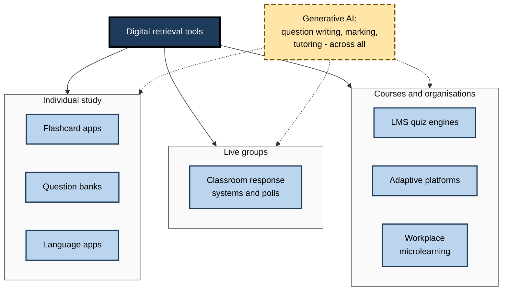
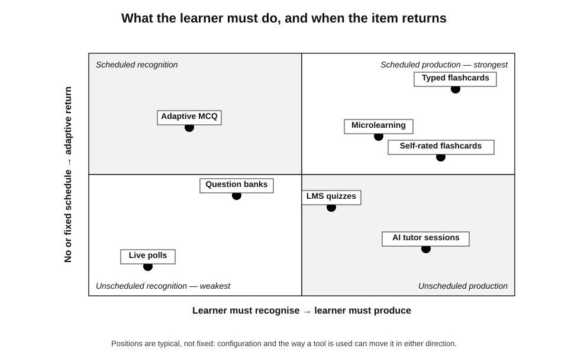
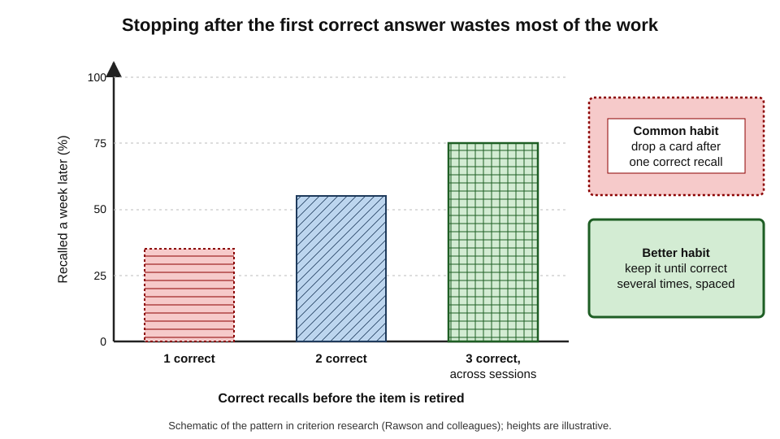
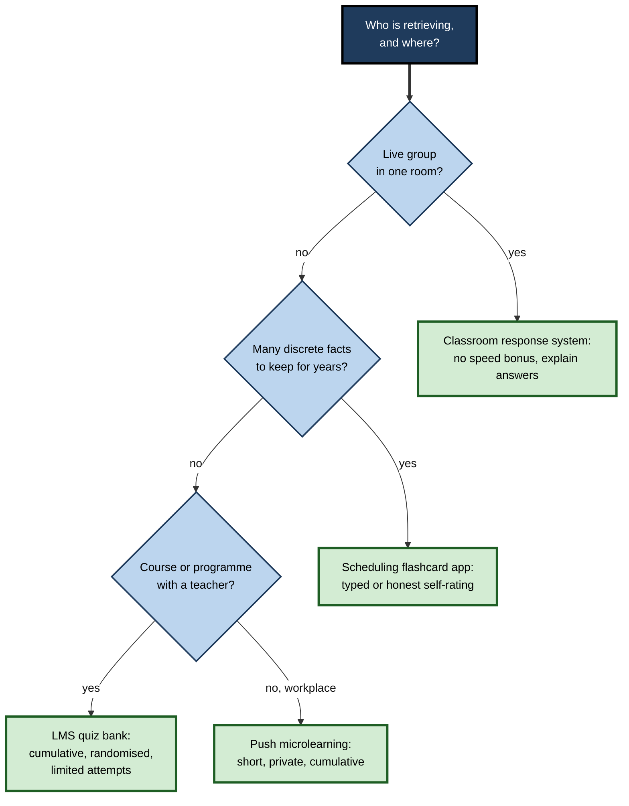
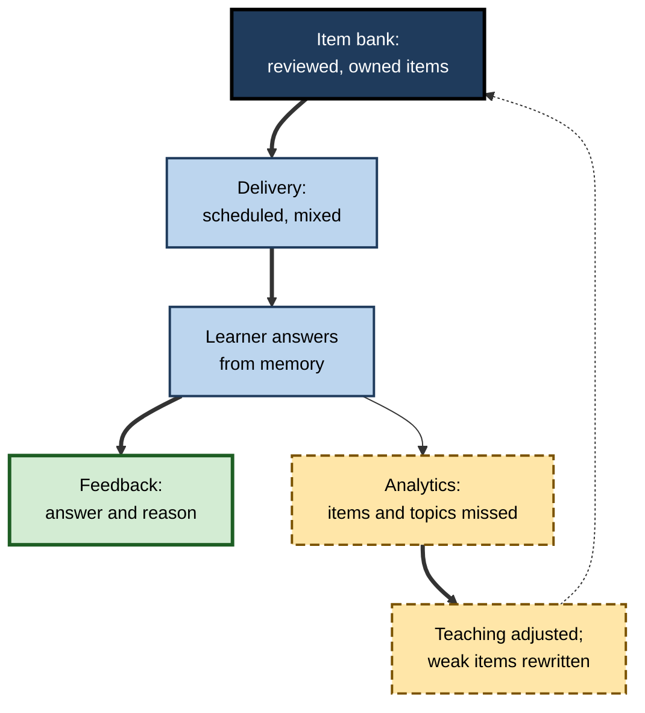

# C.6. Digital Tools for Retrieval Practice

A medical student answers forty practice questions on a phone during a commute; a lecturer polls three hundred students in ten seconds and sees that two-thirds chose the same wrong answer; a compliance team receives two questions a week in their chat tool; a language learner keeps a daily streak in an app. Each is retrieval practice delivered by software. Digital tools make retrieval **cheap, frequent, scheduled and measurable** — and they also make it easy to do badly at scale.

> **Definition — Digital retrieval tool:** software that presents prompts requiring learners to retrieve knowledge from memory, records their responses, and usually provides feedback, scheduling or analytics.

**Why it matters**

- Software removes the main practical barriers to retrieval practice: **writing, delivering, marking and scheduling** questions.
- It can deliver retrieval **between** lessons and meetings — where most forgetting happens.
- It generates **data** about what learners know, which can guide teaching or, misused, become surveillance.
- Tool design silently decides whether learners **produce** answers or merely **recognise** them, whether they get feedback, and whether old material ever returns.

---

## The Landscape of Tools

### Main categories

- **Flashcard applications** — learner-created or shared cards; many schedule reviews automatically.
  - *e.g.* Anki, Quizlet, Brainscape, RemNote.
- **Classroom response systems** — live polling of a group, with instant aggregate results.
  - *e.g.* hand-held "clickers", Mentimeter, Poll Everywhere, Kahoot!, Socrative.
- **Learning-management-system quizzes** — question banks inside course platforms, with randomisation and automatic marking.
  - *e.g.* Moodle, Canvas, Blackboard quiz engines.
- **Question banks** — large curated sets for professional examinations.
  - *e.g.* medical licensing, accountancy and bar-examination banks.
- **Adaptive learning platforms** — select questions according to estimated knowledge.
- **Language-learning apps** — short, game-like retrieval of vocabulary and grammar.
  - *e.g.* Duolingo, Memrise.
- **Workplace microlearning platforms** — short question sets pushed to employees' phones or chat tools.
- **Generative-AI tools** — create questions from source text, mark open answers, act as tutors.

**Figure 1.** Digital retrieval tools by setting.

### Categories compared

| Category | Who writes items | Response type | Scheduling | Feedback | Typical weakness |
|---|---|---|---|---|---|
| Flashcard apps | Learner or shared decks | Self-graded recall; some typed | Often automatic | Answer shown | Poor cards; dishonest self-grading |
| Classroom response systems | Teacher | Mostly multiple choice; some free text | None — live | Aggregate, instant | Recognition only; speed pressure |
| LMS quizzes | Teacher or course team | Mixed; auto-marked | Set by teacher | Configurable | Rarely cumulative; answer-farming |
| Question banks | Expert authors | Mostly multiple choice with explanations | Learner-chosen | Detailed explanations | Recognition; passive reading of explanations |
| Adaptive platforms | Vendor or institution | Mixed | Algorithmic | Configurable | Opaque algorithms; cost |
| Workplace microlearning | L&D team | Multiple choice, short answer | Push schedule | Brief | Trivial items; data misused for appraisal |
| Generative AI | The model, from sources | Any, including open answers | Depends on host | Generated | Errors, misalignment, over-helping |

---

## What Makes a Tool Good for Retrieval

The software matters less than whether it preserves the **active ingredients** of retrieval practice.

### The active ingredients, translated into features

- **Production** — can learners type, say or write answers, rather than only pick options?
- **Feedback** — is the correct answer, and ideally an explanation, shown after each attempt?
- **Return of old material** — does the tool bring back items after delays and keep mixing earlier content in?
- **Criterion** — can items be repeated until recalled correctly several times?
- **Item quality control** — can items be edited, flagged and retired?
- **Low stakes** — can results be kept private or formative?
- **Analytics for action** — does the teacher see which items and misconceptions are commonest?
- **Friction** — is starting a session quick enough to fit into spare minutes?

> **Remember:** a tool is only as good as the retrieval it causes — **production, feedback, return, criterion, item quality, low stakes, actionable analytics, low friction**.

**Figure 2.** Tool types positioned by what they demand of the learner and how intelligently they schedule practice.

### Self-grading and honesty

Many flashcard tools show the answer and ask the learner to rate their own recall ("again", "hard", "good", "easy").

- **Advantage** — supports any answer type, including explanations and diagrams.
- **Risk** — learners glance at the prompt, flip quickly and give themselves credit for **recognition** of the answer rather than genuine recall.
- **Covert retrieval** — Megan Smith, Henry Roediger and Jeffrey Karpicke (2013) found that retrieving silently "in the head" produced benefits similar to saying answers aloud — **if** people genuinely attempted retrieval.
- **Typed answers** — force production and make errors visible; slower, but more honest.

| Response mode | Production required | Speed | Honesty | Best for |
|---|---|---|---|---|
| Flip and self-rate | Optional — depends on learner | Fast | Vulnerable to "I knew that" | Experienced, disciplined learners; complex answers |
| Type exact answer | Yes | Slower | High | Terms, names, formulae, vocabulary |
| Multiple choice | No — recognition | Fast | High, but guessable | Discrimination among similar concepts |
| Free text marked by AI | Yes | Moderate | High if marking is accurate | Explanations and short arguments |

> **Watch out:** the most common failure with flashcard apps is **flipping too soon**. A useful discipline is to say or write the answer — even a rough version — **before** revealing it.

### Dropping items too early

- **The problem:** learners tend to stop practising an item after getting it right **once**.
- **Kathryn Wissman, Katherine Rawson and Mary Pyc (2012):** a survey of students' flashcard use found that most dropped a card once they had recalled it correctly a single time.
- **Criterion research** by Katherine Rawson and colleagues shows that several correct recalls, spread across sessions, produce much better long-term retention than one.
- **Nate Kornell and Robert Bjork (2008):** allowing learners to drop cards they felt they knew sometimes harmed learning, because the dropped items were not as well learned as learners believed.

**Figure 3.** One correct recall is not enough: retention by number of correct recalls before stopping.

> **Remember:** a good tool keeps items in circulation **after** they are first answered correctly — and a good learner lets it.

---

## Live Response Systems in Teaching

### How they help

- **Every learner answers**, not just the confident few who raise hands.
- **Instant aggregate data** — the teacher sees misconceptions in seconds.
- **Peer discussion** — Eric Mazur's peer instruction at Harvard used concept questions polled before and after students discussed their answers with neighbours; the share of correct answers typically rose after discussion.
- **Structure for interpolated testing** — questions between lecture segments keep attention.

### How they go wrong

- **Speed scoring** — tools that award more points for faster answers reward quick guessing over effortful retrieval.
- **Public leaderboards** — raise social stakes; lower scorers disengage.
- **Recognition only** — most live polls are multiple choice; well-written lures are essential.
- **Novelty fades** — gamified excitement drops after weeks; the routine must stand on its own.

> **In practice:** in game-based quiz tools, **switch off speed bonuses** where possible, allow thinking time before answers open, and follow every question with a short explanation of the correct answer and the commonest wrong one.

---

## Scheduling and Adaptivity

- **Fixed schedules** — the teacher sets when quizzes occur; simple and transparent.
- **Expanding schedules** — items return at increasing intervals.
- **Algorithmic scheduling** — software estimates each item's memory strength from the learner's history and schedules review just before it is likely to be forgotten; its mechanics, and the spacing research behind it, form a field of their own.
- **Adaptive item selection** — platforms choose the next item based on estimated knowledge, focusing on weak areas.

> **Watch out:** adaptivity optimises what the algorithm can measure — usually **recall of individual items**. It does not guarantee that the items are the **right** items, or that the learner understands how they connect.

---

## Generative AI and Retrieval

### What AI tools can do

- **Generate questions** from lecture notes, documents or policies — quickly and in quantity.
- **Generate distractors** for multiple-choice items, drawing on plausible misconceptions.
- **Mark open answers** against a model answer and give feedback.
- **Act as a quizzing partner** — asking questions, giving hints, following up on errors.

### What the early evidence shows

**Study card — Yuan An, John Liu, Niyam Acharya and Ruhma Hashmi (2025)**

- **Setting:** two university data-science courses, about 60 students.
- **Design:** in one week, students received multiple-choice retrieval questions generated by a large language model; in another, they did not.
- **Results:** knowledge retention was higher after the week with AI-generated questions (about 89% versus 73% accuracy).
- **Caveat:** a small within-course comparison across different weeks and topics; the authors stressed that instructors had to **check and revise** the generated questions before release.

> **Watch out:** this is early, small-scale evidence. It shows that AI-generated items **can** support retrieval practice, not that they are as good as expert-written items, nor that they are safe without review.

### Risks

- **Factual errors** — confident but wrong questions or answers.
- **Misalignment** — items on minor details rather than core objectives.
- **Weak lures** — distractors that are obviously wrong, turning questions into recognition exercises.
- **Over-helping** — AI tutors that supply answers instead of prompting recall replace retrieval with reading. In a 2025 field experiment in Turkish high-school mathematics, an unrestricted AI assistant raised practice scores but lowered later unaided exam scores, while a version designed to give hints largely avoided this harm.
- **Data protection** — uploading course or client materials to external services may breach confidentiality.

| | Expert-written items | AI-generated items, reviewed | AI-generated items, unreviewed |
|---|---|---|---|
| Accuracy | High | High if review is careful | Variable |
| Alignment with objectives | High | Good | Variable |
| Volume and variety | Limited by time | High | Very high |
| Cost per item | High | Low | Very low |
| Risk of planting errors | Low | Low | Significant |

> **In practice:** use AI to produce a **first draft** of a question bank — perhaps three times as many items as needed — then have a subject expert select, correct and improve the best third.

---

## Choosing and Implementing a Tool

**Figure 4.** A decision path for choosing a retrieval tool.

### Implementation steps

1. **Define what must be retrievable** — objectives first, tool second.
2. **Write or curate items** — production formats where possible; scenario-based multiple choice where not.
3. **Configure feedback** — answers and explanations after each attempt.
4. **Configure return** — cumulative mixing; repeated correct recall before an item is retired.
5. **Protect stakes** — private individual data; aggregate reporting to managers.
6. **Pilot** — a small group; check item quality, timing and friction.
7. **Act on the data** — re-teach common errors; retire weak items.
8. **Evaluate** — compare delayed, unaided performance with a comparison group or period.

**Figure 5.** The data loop of a well-run digital retrieval system.

### Worked example: choosing a tool for a regulatory update

A pharmaceutical company must ensure 400 sales staff retain new promotional-code rules for a year.

| Requirement | Option A: annual e-learning module with end quiz | Option B: microlearning platform with spaced question sets |
|---|---|---|
| Retrieval occasions in a year | 1 | About 25 (two questions every fortnight) |
| Production | Multiple-choice recognition | Mixed: scenario MCQ and short typed answers |
| Feedback | Score only | Explanation after every item |
| Return of old material | None | Items recur until answered correctly three times across sessions |
| Data to managers | Individual pass/fail | Team-level accuracy by rule |
| Staff time | 60 minutes once | About 2 minutes per fortnight — about 50 minutes per year |

- **Step 1:** objectives — the twelve rules most often breached in audits.
- **Step 2:** 60 items written by compliance staff, half drafted with AI assistance and reviewed by legal.
- **Step 3:** schedule — two items per fortnight per person, mixing new and old rules.
- **Step 4:** evaluation — audit findings on those twelve rules compared with the previous year.
- **Conclusion:** for similar total time, Option B provides about 25 times as many retrieval occasions, with feedback and spacing, and gives the compliance team data on which rules are poorly understood.

> **Watch out:** if team-level data are later broken down by name for disciplinary use, participation and honesty will fall. Decide data use **before** launch and tell staff.

### Case study: a question bank that taught reading, not recall

- **Situation:** a postgraduate medical training programme licensed a large question bank with excellent explanations.
- **Problem:** trainees used it heavily but improvement on in-training examinations was disappointing for many.
- **Diagnosis:**
  - many trainees used "tutor mode", reading the explanation immediately after each guess, and skipped questions they found hard;
  - they rarely returned to missed questions; effectively, the bank was being **read**, not used for **retrieval**;
  - questions were attempted in topic blocks matching what had just been read.
- **Actions:**
  1. Trainees were encouraged to answer **timed, mixed blocks** before reading explanations.
  2. Missed questions were tagged and re-attempted a week later without the explanation visible.
  3. A short "explain the answer in one sentence" step was added before viewing the explanation.
- **Result:** trainees who adopted the routine reported more errors at first but better retention of missed topics; programme leads observed improved in-training scores in the following year among high adopters.
- **Caveat:** adopters were self-selected, so motivation may explain part of the improvement.
- **Lesson:** the same tool can deliver retrieval practice or passive reading; the **routine** decides which.

---

## Paper, Screen and Distraction

- **Medium** — retrieval effects appear on paper and on screen; there is no strong evidence that one medium produces better retrieval effects than the other.
- **Distraction** — phones deliver notifications alongside quizzes; brief sessions in a focused mode reduce this.
- **Handwriting and drawing** — some knowledge (diagrams, chemical structures, mathematical working) is retrieved more naturally on paper or with a stylus.
- **Accessibility** — digital tools can provide screen readers, adjustable time limits and larger text; they can also exclude learners without reliable devices or connectivity.

> **Key point:** choose the medium that makes **genuine production** easiest for the material — typing for terms, drawing for diagrams, speaking for languages.

---

## Writing Items for Digital Delivery

Digital tools reward items that can be answered and marked quickly, which tempts designers towards recognition. Careful item design keeps production in the system.

### Typed answers and automatic marking

- **Exact-match marking** — suitable for codes, names, numbers and single terms.
- **Tolerant matching** — accept spelling variants, abbreviations, synonyms and different orders; build the accepted-answer list from real learner responses.
- **Numerical tolerance** — accept answers within a stated range for calculations.
- **Keyword marking for short explanations** — check for required elements ("must mention both X and Y"); crude, but useful with human review of borderline answers.
- **AI-assisted marking** — large language models can compare a free-text answer with a model answer and an idea-unit list; accuracy should be checked against expert marking on a sample before relying on it.

> **Watch out:** if correct answers are marked wrong because of spelling or wording, learners quickly stop typing and start guessing or flipping. **Review rejected answers** regularly and extend the accepted list.

### Item formats that suit screens

- **Short scenario with typed answer** — "A user reports X. What is the first diagnostic step?"
- **Image hotspot** — click the abnormality on an image, the faulty component on a diagram.
- **Ordering** — arrange the steps of a procedure; harder than recognition, easy to mark.
- **Drag-to-categorise** — sort items into categories; good for discrimination.
- **Two-step items** — choose an answer, then choose or type the reason.

| Format | Production required | Marking | Good for | Weakness |
|---|---|---|---|---|
| Typed short answer | Yes | Automatic with tolerant list | Terms, facts, diagnoses | List maintenance |
| Ordering | Partly | Automatic | Procedures, sequences | Can be solved by elimination |
| Image hotspot | Partly | Automatic | Visual detection | Limited to visual material |
| Two-step answer and reason | Partly to fully | Automatic or AI-assisted | Concepts and principles | Longer to write |
| Free-text explanation | Yes | Human or AI-assisted | Understanding, reasoning | Marking cost and accuracy |

---

## Using an AI Assistant as a Quizzing Partner

General-purpose AI assistants can act as patient question-setters. The difference between a useful partner and a harmful shortcut lies in **how they are asked**.

### Prompting for retrieval, not answers

1. **Provide the source** — paste the notes, policy or chapter, so questions are grounded in the right content.
2. **Ask for questions only** — request one question at a time, with no answer shown until the learner replies.
3. **Specify the format** — short answer or explanation rather than multiple choice.
4. **Ask for feedback on the learner's answer** — what was right, what was missing, what was wrong, with reference to the source.
5. **Ask for follow-ups on errors** — a new question on the same point later in the session.
6. **Ask for mixing** — questions drawn from across the material, not in order.

> **Example:** "Here are my notes on IFRS 16. Ask me one short-answer question at a time, mixing topics. Wait for my answer. Then tell me what I got right and what I missed, quoting the notes. Return to anything I get wrong later in the session."

### Risks to manage

- **Hallucinated content** — questions or "correct answers" not supported by the source; grounding in pasted material and checking against it reduces this.
- **Over-lenient feedback** — assistants may praise vague answers; asking for strict comparison against required elements helps.
- **Temptation to ask for the answer** — the shortcut is always one message away; the learner's discipline is the safeguard.
- **Confidentiality** — client or company material may not be uploaded to external tools; use approved, internal tools where required.

> **Key point:** an AI assistant becomes a retrieval tool when the learner **answers first**; it becomes a reading tool when the learner **asks first**.

---

## Evaluating a Retrieval Tool Before Adoption

Organisations often choose tools on features, price and appearance. The questions below focus on whether a tool will produce retrieval.

| Question | Good sign | Warning sign |
|---|---|---|
| What must learners do to answer? | Type, select a reason, perform | Click one of four options only |
| What happens after an answer? | Correct answer and explanation; return of misses | Score only |
| Does old material come back? | Cumulative mixing; repeat until criterion | Items retired after one correct answer |
| Who can edit and retire items? | Owners can edit; analytics flag weak items | Fixed vendor content |
| Who sees individual data? | Learner only; aggregates to managers | Individual leaderboards to managers |
| How long does a session take to start? | Seconds, from tools already in use | Separate log-in and navigation |
| Can results be exported for evaluation? | Item-level data available | Only completion rates |

### Worked example: comparing two vendor proposals

A professional-services firm compares two microlearning platforms for 3,000 staff.

1. **Run a pilot** — 60 staff per platform for six weeks, using the same 50 items on independence rules.
2. **Check response modes** — Platform A: multiple choice only. Platform B: multiple choice, typed answers and two-step reasons.
3. **Check scheduling** — Platform A: fixed weekly push of new items, no repetition. Platform B: missed items return; correct items repeat at growing intervals.
4. **Check data** — Platform A: completion dashboards by name. Platform B: item-level accuracy, aggregates by team.
5. **Measure outcome** — at week 8, an unannounced 20-item typed-answer test for both pilot groups.

| | Platform A | Platform B |
|---|---|---|
| Completion rate | 91% | 84% |
| Average time per week | 3 minutes | 5 minutes |
| Unannounced typed test at week 8 | 52% | 71% |
| Licence cost per user | Lower | Higher |

- **Conclusion:** Platform A looked better on completion and cost; Platform B produced substantially more retained knowledge. The decision depends on the value of the knowledge, but the comparison shows that **completion is not the outcome**.

> **Watch out:** pilot groups must be comparable — assign staff to platforms at random, or the comparison may reflect who volunteered rather than what the tools do.

---

## Data, Privacy and Accessibility

- **Data minimisation** — collect only what is needed for learning: item responses and timing, not unrelated behaviour.
- **Purpose limitation** — in jurisdictions covered by data-protection law such as the UK and EU GDPR, data collected for learning should not be repurposed for performance management without a lawful basis and transparency.
- **Retention** — delete individual-level response data after a defined period; keep aggregated item statistics for improvement.
- **Transparency** — tell learners what is recorded, who sees it and for how long.
- **Accessibility** — screen-reader compatibility, keyboard navigation, adjustable time limits and captions for audio; time-limited and speed-scored quizzes disadvantage some disabled learners.
- **Offline and low-bandwidth access** — essential for field staff and for learners with poor connectivity.

> **In practice:** publish a short **learning-data statement** with any retrieval tool: what is collected, who sees it, how long it is kept and what it will never be used for.

---

## Case Study: An AI Quizzing Partner for Junior Lawyers

- **Situation:** a law firm wanted trainee solicitors to retain key procedural rules and deadlines, which they frequently looked up or got wrong under time pressure.
- **Design:**
  1. an approved, internal AI assistant was given the firm's procedural guides as its only source;
  2. trainees used a standard prompt: one question at a time, short-answer format, no answers shown before a reply, strict feedback against the guide, return of errors;
  3. sessions of ten minutes, three times a week, for two months;
  4. the knowledge-management team reviewed a weekly sample of generated questions and feedback for accuracy.
- **Results:**
  - in a closed-book check after two months, trainees who used the assistant regularly answered more deadline and procedure questions correctly than those who used it rarely;
  - the weekly sample found a small number of inaccurate questions, mostly caused by ambiguous passages in the guides, which were then rewritten.
- **Side effects:** some trainees used the assistant to ask questions rather than answer them; the prompt was built into the tool so that the default was quizzing.
- **Caveat:** regular users were self-selected and may have been more motivated.
- **Lesson:** an AI assistant can be an effective retrieval partner when **grounded** in approved sources, **configured** to ask rather than tell, and **audited** for accuracy.

---

## Open Questions

- **Are AI-generated items as effective as expert-written ones?**
  - Early studies are small and short; comparisons of quality, learning and error rates at scale are needed.
- **Can AI marking of explanations be trusted?**
  - Automated marking would make free-recall practice cheap; its accuracy, bias and acceptability are not yet well established.
- **Does gamification help long-term learning?**
  - Streaks, points and badges increase engagement in the short term; their effect on durable learning, and on intrinsic motivation, is uncertain.
- **How should learning data be governed?**
  - The line between formative analytics and performance surveillance is unclear in many organisations.
- **Do AI tutors build or replace retrieval?**
  - Design appears to decide the answer; which features reliably preserve effortful recall remains under study.

---

## Summary

- **Digital retrieval tools** — flashcard apps, response systems, LMS quizzes, question banks, adaptive platforms, language apps, microlearning and generative AI — make retrieval cheap, frequent and measurable.
- Judge a tool by the **active ingredients** it preserves: production, feedback, return of old material, criterion, item quality, low stakes, actionable analytics, low friction.
- **Self-grading** is flexible but vulnerable to flipping too soon; **typed answers** are slower but honest; **covert retrieval** works if genuinely attempted.
- Learners **drop items too early**; tools should keep items in circulation after the first correct recall.
- **Live response systems** engage every learner; switch off speed bonuses, avoid public leaderboards and explain answers.
- **Adaptive scheduling** optimises recall of items, not their selection or connection.
- **Generative AI** can draft questions and mark answers; early evidence is promising but small; **expert review** is essential; AI that gives answers can replace retrieval.
- The **routine**, not the tool, decides whether retrieval happens.

---

## Self-Check

1. Name six categories of digital retrieval tool with an example of each.
2. List the eight features that indicate a tool supports genuine retrieval practice.
3. Compare self-graded flashcards with typed answers.
4. What did Smith, Roediger and Karpicke (2013) find about covert retrieval, and what is the condition?
5. Why do learners drop flashcards too early, and what is the consequence?
6. How can a game-based quiz tool undermine retrieval practice? How can this be prevented?
7. Summarise the An and colleagues (2025) study and its limitations.
8. What risks arise from unreviewed AI-generated questions?
9. A trainee uses a question bank in "tutor mode" and reads every explanation immediately. Advise them.
10. Design a digital retrieval scheme for a team learning a new incident-response process.
11. Why does adaptive scheduling not guarantee good learning?
12. A manager asks for individual quiz scores to include in appraisals. Respond.
13. How can an AI assistant be prompted to support retrieval practice rather than replace it?
14. In a vendor comparison, one platform shows higher completion and the other higher scores on a delayed unannounced test. Which matters more, and why?

### Answer Key

1. Flashcard apps (Anki); classroom response systems (Mentimeter); LMS quizzes (Moodle); question banks (medical licensing banks); language apps (Duolingo); workplace microlearning; generative-AI tools.
2. Production, feedback, return of old material, criterion (repeated correct recall), item quality control, low stakes, actionable analytics, low friction.
3. Self-grading: fast, supports complex answers, but learners may credit recognition. Typed: forces production and shows errors; slower; suits exact answers.
4. Silent, mental retrieval produced benefits similar to overt answers — provided learners genuinely attempted to retrieve before seeing the answer.
5. One correct recall feels like knowing; dropping then leaves items weakly learned, so long-term retention is much lower than with several correct recalls across sessions.
6. Speed bonuses reward guessing; leaderboards raise stakes; recognition-only formats. Switch off speed scoring, allow thinking time, keep results private, explain answers.
7. Students in data-science courses retained more in a week with LLM-generated retrieval questions (about 89% vs 73%). Limitations: small sample, comparison across weeks and topics, instructor review required.
8. Factual errors, misalignment with objectives, weak lures, inappropriate difficulty, planting misconceptions, confidentiality breaches.
9. Attempt timed, mixed blocks first; commit to an answer and a one-line reason before reading explanations; tag misses and re-attempt them a week later without explanation.
10. E.g. 30 items on the process (roles, escalation thresholds, communication steps), mostly typed short answers and scenarios; two items pushed weekly in the chat tool with explanations; items recur until correct three times over weeks; quarterly simulated incident; team-level analytics only.
11. It optimises timing for the items it has, measured by recall; it cannot judge whether those items are the right ones, whether they are well written, or whether learners understand connections.
12. Advise against: it raises stakes, encourages guessing and looking up answers, and destroys the learning value; use team-level data to target training, and assess performance by other means.
13. Provide the source; ask for one question at a time with no answer until the learner replies; request short-answer or explanation formats; ask for strict feedback against the source; ask for errors to return later; ask for mixed topics.
14. The delayed test, because it measures retained knowledge; completion shows only that sessions were opened. Cost and the value of the knowledge then decide whether the better platform is worth it.

---

## Glossary

| Term | Meaning |
|---|---|
| Adaptive learning platform | Software that selects items based on estimated learner knowledge. |
| Algorithmic scheduling | Software timing of reviews based on each item's estimated memory strength. |
| Classroom response system | Tool for polling a live group and showing results instantly. |
| Covert retrieval | Retrieving an answer silently without producing it aloud or in writing. |
| Data minimisation | Collecting only the data needed for a stated purpose. |
| Digital retrieval tool | Software that prompts retrieval, records responses and often gives feedback or scheduling. |
| Flashcard application | Software presenting prompt–answer cards, often with scheduling. |
| Gamification | Use of points, streaks, badges and competition to motivate use. |
| Item bank | A pool of questions from which quizzes are drawn. |
| Microlearning | Very short learning activities delivered frequently. |
| Peer instruction | Method in which students answer concept questions, discuss with peers and answer again. |
| Purpose limitation | The principle that data collected for one purpose should not be reused for another without a lawful basis. |
| Self-grading | Learner rates their own recall after seeing the answer. |
| Speed bonus | Extra points for answering quickly in game-based quizzes. |
| Tolerant matching | Automatic marking that accepts spelling variants, synonyms and alternative forms of a correct answer. |
| Tutor mode | Question-bank setting showing the explanation immediately after each answer. |
| Two-step item | An item requiring an answer and then the reason for it. |
