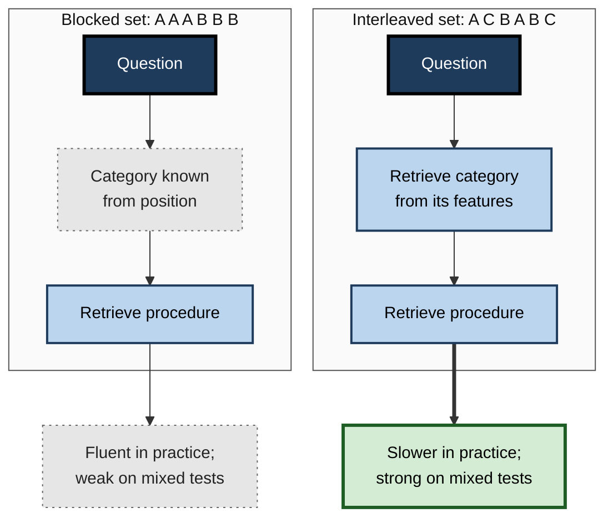
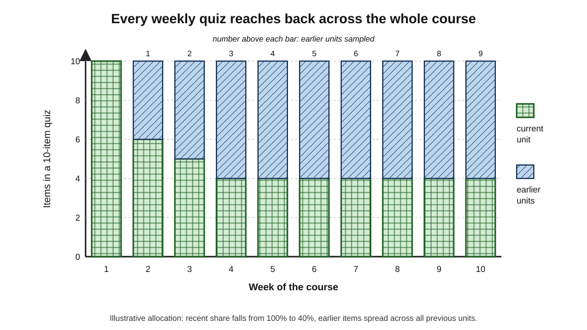
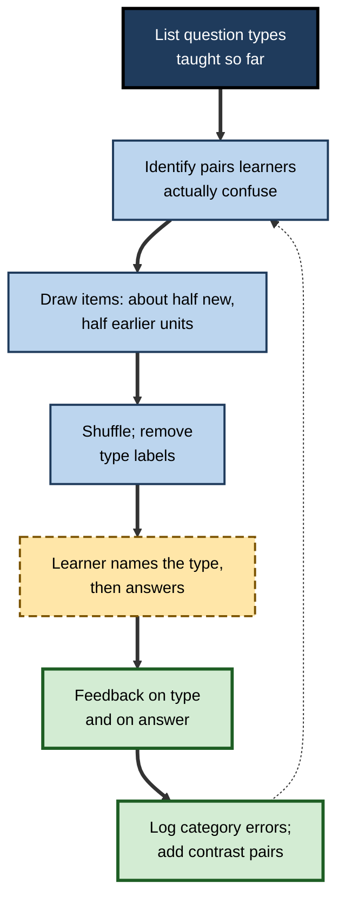
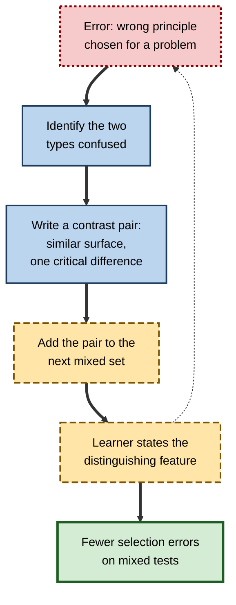
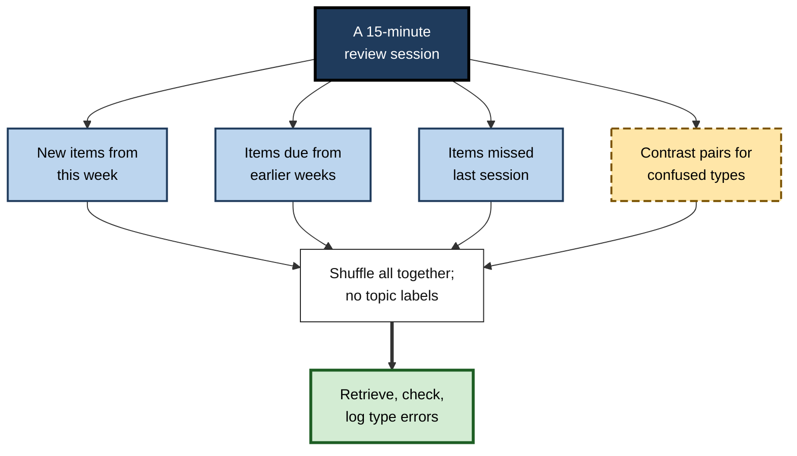

# C.7. Interleaved Retrieval Practice

An accountancy student finishes a chapter on depreciation and answers twenty depreciation questions in a row — all correct. The exam, however, does not announce which topic each question belongs to. Faced with a mixed paper, she must first decide **what kind of problem this is** before she can recall **how to solve it**, and that first step is precisely what her practice never asked of her. Interleaved retrieval practice closes this gap by mixing different kinds of question in the same practice set.

> **Definition — Interleaved retrieval practice:** retrieval practice in which questions on different topics, categories or problem types are mixed within a session, so that the learner must identify which knowledge or procedure each question calls for before retrieving it.

> **Definition — Blocked retrieval practice:** retrieval practice in which all questions of one type are completed before moving to the next type (AAA BBB CCC).

**Why it matters**

- Real tasks rarely arrive labelled. A clinician, engineer or lawyer must recognise **which** principle applies before applying it.
- Blocked practice lets learners skip that recognition step — the chapter heading supplies it.
- Mixing questions turns retrieval from "how do I do this?" into "**what is this, and how do I do it?**".
- Mixed, cumulative quizzes also bring old material back — so they combine retrieval with return of earlier content at no extra cost.

---

## Two Things Retrieved, Not One

### "Which" and "how"

- **Retrieving the procedure** — recalling the steps, formula or fact.
  - *e.g.* the straight-line depreciation formula.
- **Retrieving the category** — recognising which procedure the problem requires.
  - *e.g.* noticing that this question, about an asset losing value faster in early years, needs reducing-balance, not straight-line.
- **In blocked practice**, the category is given by position: the learner knows every question in the block is the same type.
- **In interleaved practice**, the learner must retrieve the category from features of the question itself.

> **Key point:** interleaving adds a **discrimination** retrieval — deciding what kind of problem is in front of you — on top of the usual content retrieval. It is the retrieval that most closely resembles real work.

**Figure 1.** Blocked practice supplies the category; interleaved practice makes the learner retrieve it.

### Vocabulary

> **Definition — Discriminative contrast:** the learning that comes from experiencing different categories close together, so that the features that distinguish them become noticeable.

> **Definition — Cumulative quiz:** a quiz that draws questions from all material covered so far, not only the most recent unit.

> **Definition — Strategy selection:** choosing the appropriate method or principle for a problem — the "which" step.

---

## Three Levels of Mixing in Retrieval

Research on interleaving in general — mainly comparing blocked and mixed **problem practice** and category learning — finds clear benefits for confusable categories and mathematical problem types, and smaller or absent benefits for very different or entirely new material. The concern here is narrower and practical: how mixing is built **into retrieval practice itself** — the quizzes, tests and review queues that learners and teachers actually use.

- **Within a question set** — a single quiz or practice session mixes topics and question types.
  - *e.g.* a weekly quiz in which questions on tax, contract law and ethics appear in random order without headings.
- **Across a course** — tests and quizzes are **cumulative**, so every retrieval occasion samples earlier units as well as the latest.
  - *e.g.* a final examination covering the whole year rather than the last term.
- **Within a review queue** — the order in which a learner's retrieval items come up for review is mixed across topics rather than grouped.
  - *e.g.* one shuffled flashcard collection rather than separate decks studied one at a time.

| Level | What is mixed | Main benefit | Main cost | Typical tool |
|---|---|---|---|---|
| Within a set | Topics and question types in one session | Practises identifying the type; reduces reliance on position | Lower practice scores; slower sessions | Mixed quizzes, mock papers |
| Across a course | Old and new units on every occasion | Old material is retrieved again and again; expectation of later testing changes study | Larger item pools; more marking | Cumulative quizzes and finals |
| Within a review queue | Order of items due for review | Each item is separated from its neighbours; topic cues removed | Feels less organised | Shuffled decks; mixed review queues |

> **Key point:** mixing inside retrieval does two jobs at once — it adds the "which is it?" step, and it brings earlier material back for another retrieval. Most of its practical value comes from the second job being **automatic**.

---

## Cumulative Tests and Quizzes

### The evidence

**Study card — Karl Szpunar, Kathleen McDermott and Henry Roediger (2007)**

- **Design:** participants studied several word lists in succession. Some were told to expect a **cumulative** final test on all lists; others expected to be tested only on the most recent list.
- **Results:** those expecting the cumulative test recalled the **earlier** lists much better on the final test.
- **Interpretation:** the expectation changed behaviour during learning — learners kept earlier material active, effectively retrieving and rehearsing it across the session.
- **Conclusion:** simply announcing that testing will be cumulative improves retention of earlier material.

**Study card — Maya Khanna, Amy Badura Brack and Laura Finken (2013)**

- **Setting:** introductory psychology courses with either a cumulative or a non-cumulative final examination.
- **Results:** students who sat a **cumulative** final retained more of the course content when tested again some months later.
- **Conclusion:** cumulative assessment shows its benefit in **long-term retention**, not in the immediate grade.

> **Watch out:** cumulative finals are often unpopular and can look like "making the exam harder". The benefit appears months later, when the material is needed in the next course or on the job — exactly where nobody is measuring.

- **Mixed question types** — Pooja Agarwal (2019) found that quizzes combining factual and higher-order questions supported both kinds of later performance, whereas factual quizzes alone did not carry over to higher-order questions.

### How a cumulative quiz should be composed

- **Weight recent material more heavily** — it is the least consolidated.
- **Keep sampling all earlier units** — items from every earlier unit should appear regularly, not only in the final weeks.
- **Weight by importance and fragility** — topics with high error rates or high consequences appear more often.
- **Rotate items within each unit** — draw different items from a pool so that learners retrieve knowledge, not remembered questions.

**Figure 2.** Composition of a cumulative weekly quiz across a ten-week course.

> **Formula — Allocating items in a cumulative quiz:** items from the current unit = total × recent share; remaining items are divided among earlier units in proportion to their weights. Example: a 10-item quiz in week 6 with a 40% recent share → 4 items on unit 6; the other 6 shared among units 1–5. If unit 3 has double weight because of high error rates, the weights are 1, 1, 2, 1, 1 (total 6) → unit 3 receives 2 items and each other unit 1.

---

## Designing Interleaved Retrieval Sets

### Principles

1. **Teach first, then mix** — introduce each type with examples (often blocked), then move quickly to mixed retrieval.
2. **Mix confusable types** — put side by side the categories learners actually confuse.
3. **Hide the labels** — no headings that reveal the type of each question.
4. **Ask "which" explicitly** — sometimes require the learner to name the type or principle before solving.
5. **Make it cumulative** — include earlier units in every set.
6. **Give feedback on both steps** — was the category right, and was the procedure right?
7. **Expect lower practice scores** — and explain why to learners.

> **Mnemonic — "The Mixed Habit Always Creates Fewer Errors":** Teach first, Mix confusables, Hide labels, Ask which, Cumulative, Feedback on both steps, Expect lower practice scores.

**Figure 3.** Building an interleaved, cumulative retrieval set.

### Contrast pairs

- **A contrast pair** is two questions that look similar but need different principles.
  - *e.g.* in tax: two disposals, one qualifying for a relief and one not, differing in a single fact.
  - *e.g.* in medicine: two chest X-rays, one showing pneumonia and one pleural effusion.
  - *e.g.* in software: two failing tests, one due to a race condition and one to a stale cache.
- **Why they work:** the learner must retrieve the **distinguishing feature**, which is exactly what is needed in practice.

> **In practice:** after any error in strategy selection, write a **contrast pair** for the two confused types and add it to the retrieval set.

**Figure 4.** How a strategy-selection error becomes a contrast pair.

### Worked example (illustrative): from blocked to interleaved revision

A trainee actuary revises four types of probability problem: binomial, Poisson, normal approximation and conditional probability.

| | Blocked plan | Interleaved plan |
|---|---|---|
| Session 1 | 15 binomial problems | 4 of each type, shuffled |
| Session 2 | 15 Poisson problems | 4 of each type, shuffled, plus 4 from last month's topics |
| Session 3 | 15 normal approximation | As above, with 3 contrast pairs |
| Session 4 | 15 conditional probability | As above; each problem labelled by type **before** solving |
| Practice accuracy | High — about 85% | Lower — about 60% at first, rising to 75% |
| Typical exam error | Wrong distribution chosen | Fewer wrong choices; more arithmetic slips |

*Illustrative figures.*

1. **Step 1:** check that each type has been learned at least once with worked examples — interleaving is for retrieval, not first exposure.
2. **Step 2:** build mixed sets with labels removed.
3. **Step 3:** require a one-word type label before each solution.
4. **Step 4:** record whether errors are in type selection or in execution.
5. **Step 5:** for each type-selection error, add a contrast pair to the next session.
- **Conclusion:** the interleaved plan produces lower practice scores but targets the error that actually costs marks — choosing the wrong method.

> **Watch out:** a learner who sees practice accuracy fall from 85% to 60% may abandon the plan. The fall shows that the practice now includes the hard part of the task.

---

## Hidden Topic Cues in Mixed Quizzes

Removing headings is not enough to make a quiz genuinely mixed. Questions often **announce their own topic** through wording, layout or numbers, and learners quickly learn to read these signals instead of the problem.

- **Vocabulary cues** — a question containing "depreciation" or "lease" names its topic; the learner retrieves the method by keyword, not by analysing the situation.
- **Format cues** — all questions on one topic share a table layout or a diagram style.
- **Number cues** — percentages always mean one method; large round numbers another.
- **Position cues** — even in "mixed" quizzes, items may cluster by topic because they were added to the bank in batches.

**Removing them**

- **Describe situations, not topics** — "A van bought for £30,000 is expected to be worth very little after five years…" rather than "Calculate the depreciation…".
- **Vary formats across topics** — use the same layouts for different kinds of problem.
- **Write near-miss items** — scenarios that use one topic's vocabulary but require another topic's method.
- **Shuffle at delivery** — randomise order every time rather than relying on a fixed "mixed" sequence.

> **Watch out:** if learners can name the topic of every question from its first five words, the quiz is still effectively **blocked**. A quick check: give a colleague the first line of each item and ask them to guess the topic.

| Hidden cue | Example | Repair |
|---|---|---|
| Topic keyword in the stem | "Using the matching principle, …" | Describe the transaction instead |
| Consistent layout per topic | Every tax question has a table | Use tables across topics |
| Consistent numbers per method | Interest questions always use percentages | Mix numeric forms |
| Fixed item order | Bank exported in creation order | Randomise at each delivery |

---

## Mixed Retrieval for Language Learners

Language learning offers a clear case of the "which" problem: learners often know two forms but choose the wrong one in speech.

- **Blocked drills** — twenty sentences all requiring the subjunctive; the learner knows the answer before reading each sentence.
- **Mixed retrieval** — sentences requiring indicative or subjunctive, past or imperfect, *ser* or *estar*, in random order; the learner must decide from meaning.
- **Production, not selection** — say or write the full sentence rather than choosing the form from options.
- **Contrast pairs** — two sentences differing in one word that changes the required form ("I think that…" versus "I doubt that…").
- **Spoken retrieval** — the choice must eventually be made at speaking speed; timed spoken drills come after accurate untimed ones.

> **In practice:** after a grammar point is introduced, a learner should meet it **mostly in mixed sets** within a week — otherwise they learn to use it only when the lesson's title tells them to.

---

## Interleaved Retrieval Schedules

The order in which items come up for review is a design choice in its own right, especially for learners using flashcards or review queues.

### One stack or many small ones

**Study card — Nate Kornell (2009)**

- **Design:** students learned vocabulary word pairs with flashcards. The same number of cards and trials were organised either as **one large stack** (so each card's repetitions were spread apart by many other cards) or as **several small stacks** studied one after another (so each card's repetitions came close together).
- **Results:**
  - the **large stack** produced better recall for the great majority of participants;
  - most participants nonetheless **believed** the small stacks had worked better.
- **Conclusion:** keeping many items in one mixed review queue separates the repetitions of each item, making each retrieval harder and more effective — and learners misjudge it.

> **Remember:** **one big shuffled stack beats many small sorted ones** — and will feel worse while doing it.

### Building a mixed review session

**Figure 5.** Composition of a mixed retrieval session.

- **Mix due items across topics** — rather than finishing one topic's cards before starting another.
- **Separate repeats of the same item** — a missed item returns later in the session, after several other items, not immediately.
- **Interleave new with old** — new items are spread through the session rather than grouped at the start.
- **Keep sessions short** — mixed sessions are more tiring; ten to twenty minutes is usually enough.

> **In practice:** if a flashcard tool offers separate decks by topic, a single combined review of all decks is usually the better default once each topic has been introduced.

---

## Mixed Examinations and Mock Papers

- **Real examinations are usually mixed** — questions are not grouped under the chapter they come from.
- **Revision by chapter mirrors the textbook, not the exam** — learners rehearse each topic with its label attached.
- **Mock papers as mixed retrieval** — attempting a full mixed paper under timed, closed-book conditions practises both identifying question types and retrieving the method.
- **Build mixed mini-papers** — five to ten questions drawn at random from all topics, attempted weekly during revision, with feedback.
- **Analyse errors by type** — "chose the wrong method" calls for contrast pairs; "chose the right method but executed badly" calls for more practice of that method.

| Error after a mixed paper | Diagnosis | Next step |
|---|---|---|
| Wrong method chosen | Discrimination failure | Contrast pairs; "name the type" practice |
| Right method, wrong execution | Procedural weakness | Targeted practice of the method, then return to mixing |
| Blank — no idea where to start | Category not retrievable from features | Revisit worked examples; list the cues that signal each type |
| Ran out of time | Slow retrieval | More timed mixed practice |

---

## Worked Example (illustrative): Building a Cumulative Retrieval Plan for a Course

A training manager runs a ten-week product-specialist programme with one new module per week. Each week ends with a 12-item quiz.

1. **Pool size** — for each module, write 25 items, so that later quizzes can draw fresh items rather than repeat old ones.
2. **Recent share** — 50% in weeks 1–3 (when there is little to review), falling to 33% from week 4.
3. **Weights** — modules whose items show error rates above 40% get double weight in later quizzes.
4. **Mixing** — items shuffled, no module labels; two contrast pairs each week for the most confused pair of product configurations.
5. **Feedback** — correct answer and one-line reason; missed items return in the following week's quiz.
6. **Final assessment** — a cumulative 40-item test in week 10 and an unannounced 20-item test three months later.

| Week | Items on current module | Items on earlier modules | Modules sampled |
|---|---|---|---|
| 2 | 6 | 6 | 1 |
| 4 | 4 | 8 | 1–3 |
| 7 | 4 | 8 | 1–6, weighted |
| 10 | 4 | 8 + 40-item cumulative test | All |

*Illustrative figures.*

- **Check the load:** by week 10, module 1 has been retrieved on about nine occasions; without cumulative quizzes it would have been retrieved once.
- **Conclusion:** the plan costs no extra quiz time — the same 12 items a week — but turns every quiz into spaced, mixed retrieval of the whole programme.

> **Watch out:** a pool that is too small means the same items recur so often that learners remember the **questions** rather than the knowledge. Plan the pool size before the course starts.

---

## Mixed Retrieval in Professional Practice

- **Medicine** — mixed sets of clinical cases and images improve diagnostic discrimination; blocked "chapter" practice in question banks hides the differential diagnosis step.
- **Law** — problem questions that mix contract, tort and restitution issues force identification of the cause of action.
- **Software engineering** — mixed debugging exercises train identification of the class of fault.
- **Languages** — mixing grammatical constructions that learners confuse (*e.g.* Spanish *ser* and *estar*, or French *passé composé* and *imparfait*) supports choosing correctly in speech.
- **Customer service** — mixed scenario quizzes train advisers to recognise which policy applies.

### Case study (illustrative): diagnostic errors in a radiology rotation

- **Situation:** junior doctors on a radiology rotation studied teaching files organised by condition — a folder of pneumothorax films, a folder of effusions, a folder of consolidations.
- **Problem:** on mixed reporting lists, they frequently confused effusion with consolidation and missed small pneumothoraces.
- **Diagnosis:** practice had been **blocked**: each film was viewed knowing its diagnosis category in advance; the discrimination step was never practised.
- **Actions:**
  1. Teaching files were re-organised into **mixed** sets of twenty unlabelled films.
  2. For each film the trainee committed to a diagnosis before seeing the report.
  3. Commonly confused pairs were shown **side by side** after errors.
  4. Each weekly set included films from earlier weeks.
- **Result:** trainees' accuracy on the mixed sets started lower than on the old blocked files but rose over the rotation; consultants reported fewer discrimination errors on real reporting lists.
- **Caveat:** no randomised comparison; improvement over a rotation is expected anyway.
- **Lesson:** if work arrives mixed, retrieval practice must be mixed.

### Case study (illustrative): a policy quiz that told advisers which policy applied

- **Situation:** an insurance contact centre trained advisers on six claims policies, each taught in its own module, each followed by a quiz on that policy.
- **Problem:** quiz scores were high, but on live calls advisers frequently applied the wrong policy — for instance treating accidental damage under the terms for theft.
- **Diagnosis:** every quiz question sat under its policy's heading; advisers had practised retrieving **the rules of a named policy**, never **which policy a customer's situation fell under**.
- **Actions:**
  1. Module quizzes were replaced, from the third module on, by **mixed scenario quizzes** covering all modules taught so far.
  2. Each scenario required two answers: which policy applies, and what the adviser should do.
  3. Contrast pairs were written for the three most commonly confused policy pairs.
  4. A monthly mixed quiz continued after training for three months, drawing on call-quality findings.
- **Result:** quiz scores fell at first and then rose; call-quality audits showed fewer wrong-policy errors over the following quarter.
- **Lesson:** a quiz that names the topic tests the rules; a mixed quiz tests whether the adviser can tell **which rules** apply.

---

## When Not to Mix Retrieval

Mixing is a strong default once material has been learned, but not a universal rule.

- **First retrieval of brand-new material** — the first one or two retrievals of a new topic are often best done on that topic alone, straight after worked examples, so that enough retrieval succeeds to build a starting schema.
- **Unrelated subjects** — mixing biology questions with French vocabulary adds switching costs without adding useful discrimination; mix **within** a domain where confusions actually occur.
- **Long, integrated tasks** — a case analysis or design exercise should not be broken up by unrelated questions; mix at the level of whole tasks instead.
- **Very low success** — if mixed sets produce mostly blanks, return briefly to blocked practice with feedback, then mix again.
- **Time-critical procedures** — emergency drills are first rehearsed as complete sequences; mixing comes later, by varying which emergency is presented.

| Situation | Better choice | Reason |
|---|---|---|
| First retrieval after a new lesson | Blocked, with examples | Too little success if mixed at once |
| Two topics learners confuse | Mixed, with contrast pairs | Discrimination is the skill needed |
| Unrelated subjects | Separate sessions | Switching cost, no useful contrast |
| Whole case or design task | Mix across tasks, not within | Integration requires continuity |
| Emergency drills | Whole sequence first, then varied scenarios | Sequence must be fluent before variation |

> **Remember:** **block to start, mix to keep** — and mix things that are genuinely likely to be confused.

---

## Learners' Beliefs

- **Mixed retrieval feels worse** — it is slower, less accurate, and lacks the comfortable sense of finishing a topic.
- **Learners prefer grouping** — in Kornell's flashcard study, most students believed the small, grouped stacks had helped them more, the opposite of the result; similar misjudgements appear across the wider interleaving literature.
- **What helps** — explaining in advance why scores will drop, and showing learners their own delayed results.

> **Watch out:** learner satisfaction surveys will often rate mixed and cumulative quizzes **lower**. Judge them by delayed, mixed tests.

---

## Adaptive Mixing and AI

- **Adaptive review systems** already interleave by default: items due for review come from many topics at once.
- **AI-generated contrast items** — generative tools can draft near-miss scenarios that differ in one critical feature; experts must check that the critical difference is real and correctly answered.
- **Diagnosing discrimination errors** — analytics can flag pairs of topics that learners confuse with each other, so that contrast pairs are targeted.
- **Risk** — algorithms that cluster items by topic for convenience can silently reintroduce blocking.

> **In practice:** when evaluating a quiz platform, check whether its review mode **mixes** topics and whether it can generate cumulative quizzes from a whole item pool — not only quizzes per module.

---

## Open Questions

- **What is the best share of recent versus earlier material in a cumulative quiz?**
  - Heuristics of a third to a half recent are common; direct comparisons of different proportions are scarce.
- **How large should item pools be?**
  - Too-small pools invite question memorisation; the threshold has not been established.
- **When should mixing begin?**
  - Mixing after each type has been introduced is common advice; the best point, and whether it differs by learner, is unsettled.
- **Do cumulative finals help more than cumulative weekly quizzes?**
  - Both are associated with better retention; their relative and combined effects are little studied.
- **Can AI build reliable contrast pairs at scale?**
  - Promising, but unproven; errors in the critical difference would teach the wrong distinction.

---

## Summary

- **Interleaved retrieval practice** mixes topics and question types within retrieval, so learners must retrieve **which** knowledge applies as well as **how** to apply it.
- Mixing operates at three levels: **within a set**, **across a course** (cumulative tests) and **within a review queue**.
- **Cumulative testing** improves long-term retention: expecting a cumulative test improves memory for earlier material (Szpunar and colleagues, 2007); cumulative finals improve retention months later (Khanna and colleagues, 2013).
- **Mixed question types** support both factual and higher-order performance (Agarwal, 2019).
- **Compose cumulative quizzes** by weighting recent material, sampling all earlier units, weighting fragile topics and rotating items from adequate pools.
- **Review queues** should be mixed: one shuffled stack beats many small ones (Kornell, 2009).
- **Mixed exams and mock papers** practise discrimination; analyse errors by type; use **contrast pairs** after selection errors.
- Mixed retrieval **feels worse** and lowers practice scores; judge it by delayed, mixed tests.

---

## Self-Check

1. Define interleaved and blocked retrieval practice.
2. What two things must be retrieved in interleaved practice, and why is the first important?
3. Name the three levels at which retrieval can be mixed and give an example of each.
4. Describe Szpunar, McDermott and Roediger (2007) and explain how expectation produced the benefit.
5. What did Khanna and colleagues (2013) find about cumulative finals, and why might the benefit go unnoticed?
6. A 12-item week-8 quiz has a one-third recent share; earlier units 1–7 have weights 1, 1, 1, 2, 1, 1, 1. How many items does each unit receive?
7. Describe Kornell (2009) and its implication for flashcard use.
8. List four rules for composing a mixed review session.
9. How should errors on a mixed mock paper be classified and acted upon?
10. What is a contrast pair? Write one for a field you know.
11. Why does a small item pool undermine cumulative quizzing?
12. A training team's module quizzes score highly but staff apply the wrong policies on the job. Diagnose and redesign.
13. Give three situations in which mixed retrieval is not the best choice, and say what to do instead.

### Answer Key

1. Interleaved: questions on different topics or types mixed within retrieval, without labels. Blocked: all questions of one type completed before the next.
2. The category (which principle or procedure applies) and the content (the procedure itself). Category retrieval is what real tasks demand and blocked practice supplies for free.
3. Within a set (a mixed weekly quiz); across a course (cumulative quizzes and finals); within a review queue (one shuffled flashcard collection).
4. Learners expecting a cumulative final test recalled earlier lists much better than those expecting a test only on the latest list; the expectation led them to keep earlier material active during learning.
5. Students with cumulative finals retained more content months later; the benefit appears long after the course, where it is rarely measured.
6. Recent share: 12 ÷ 3 = 4 items on unit 8. Remaining 8 items over total weight 8: unit 4 gets 2, units 1, 2, 3, 5, 6 and 7 get 1 each.
7. Vocabulary cards studied as one large stack (repetitions spread apart) produced better recall than several small stacks, for most participants, who nonetheless believed small stacks were better. Use one combined, shuffled review rather than separate small decks.
8. Mix due items across topics; separate repeats of the same item; spread new items through the session; keep sessions short; include contrast pairs; remove topic labels.
9. Wrong method → discrimination failure → contrast pairs and "name the type" practice. Right method, poor execution → targeted method practice. Blank → revisit examples and cue lists. Out of time → timed mixed practice.
10. Two similar-looking items needing different principles, differing in one critical feature — *e.g.* two contracts identical except that one lacks consideration.
11. Items recur so often that learners remember the questions and answers rather than retrieving the underlying knowledge.
12. Module quizzes label the topic, so staff never practise identifying which policy applies. Replace them with mixed, cumulative scenario quizzes requiring the policy and the action, add contrast pairs for confused policies, and continue mixed quizzes after training.
13. First retrieval of new material (retrieve the topic alone after examples); unrelated subjects (separate sessions); very low success on mixed sets (brief blocked practice with feedback, then mix again); whole case tasks (mix across tasks); emergency drills (whole sequence first, then varied scenarios).

---

## Glossary

| Term | Meaning |
|---|---|
| Blocked retrieval practice | Completing all questions of one type before the next. |
| Contrast pair | Two similar items requiring different principles. |
| Cumulative quiz | A quiz drawing on all material covered so far. |
| Cumulative test expectancy | Expecting a final test on all material, which changes how earlier material is kept active. |
| Discriminative contrast | Learning distinguishing features by experiencing categories close together. |
| Interleaved retrieval practice | Retrieval practice mixing topics or question types so the learner must identify each. |
| Item pool | The set of items from which quizzes are drawn. |
| Mixed review queue | A review order that mixes items from all topics rather than grouping them. |
| Recent share | The proportion of a cumulative quiz drawn from the latest unit. |
| Strategy selection | Choosing the right method or principle for a problem. |
