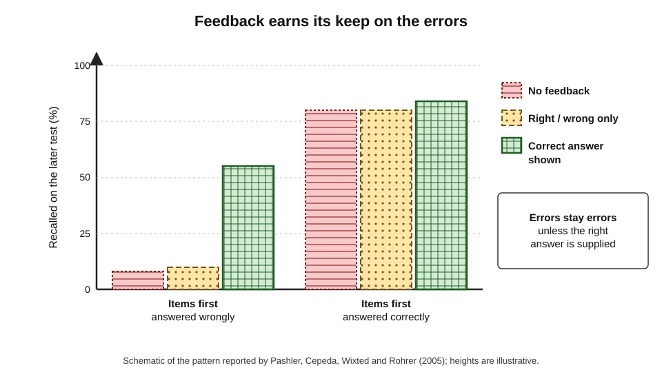
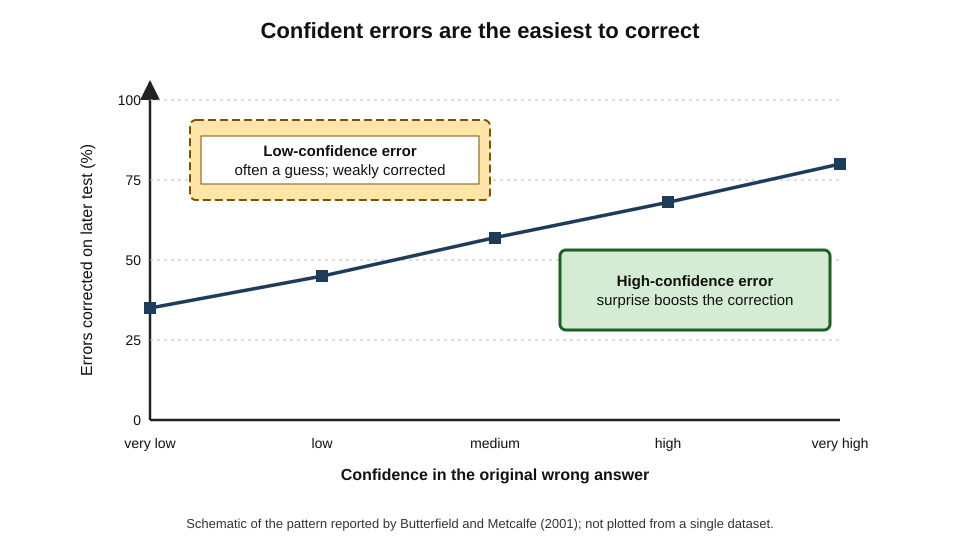
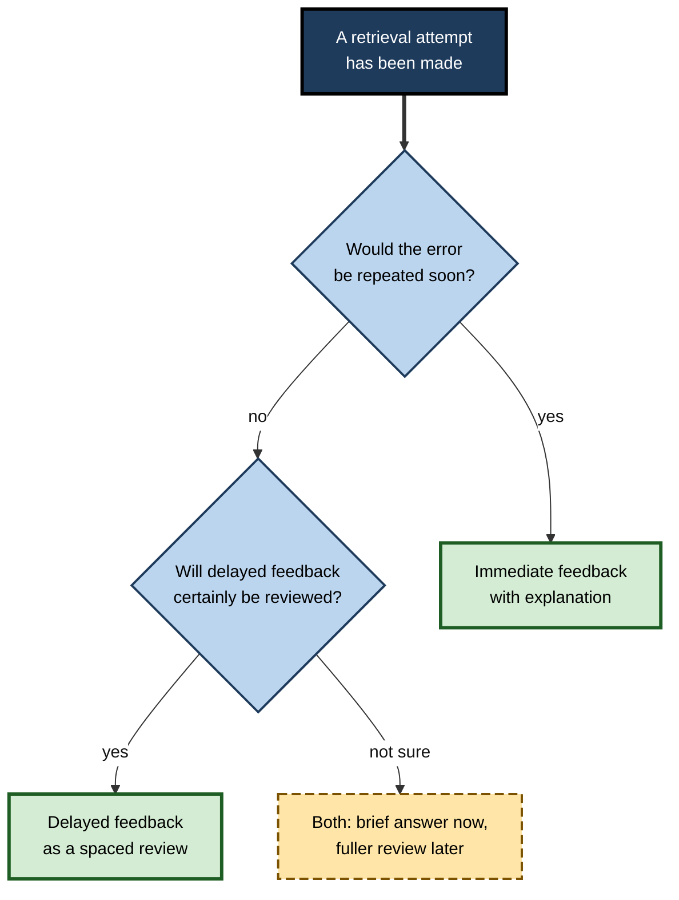
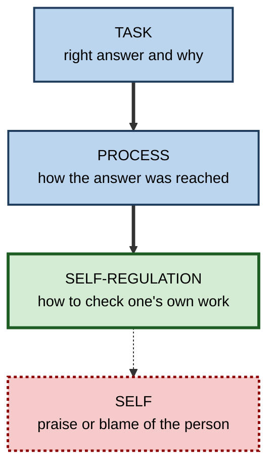
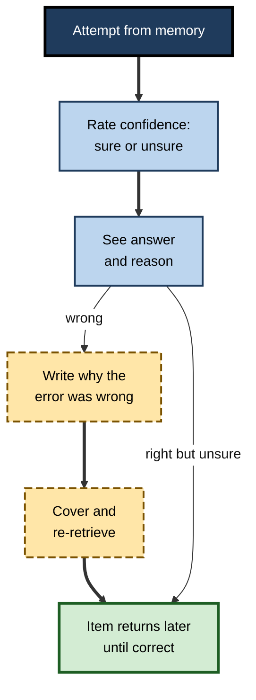

# C.8. Feedback After Retrieval Attempts

A new financial analyst is asked, from memory, which accounting standard governs leases. She answers confidently — and wrongly. If nobody tells her, the act of retrieval has just **strengthened an error**: next time the wrong standard will come to mind even faster. If she is told the right answer, and why her answer was tempting but wrong, the same moment becomes one of the most powerful learning events of her week. **What happens immediately after a retrieval attempt** decides whether retrieval practice teaches or misleads.

> **Definition — Feedback (after retrieval):** information given to a learner after a retrieval attempt about its correctness, the correct answer, or the reasons behind it, intended to confirm, correct or deepen what was retrieved.

**Why it matters**

- Retrieval strengthens **whatever** is retrieved — including errors. Feedback is what stops practice from consolidating mistakes.
- Feedback is the largest single amplifier of the testing effect in meta-analyses of both laboratory and classroom studies.
- Feedback lets learners use retrieval at a level of **difficulty** where many attempts fail — without that failure being wasted.
- Badly designed feedback — too vague, too late, about the person rather than the task, or ignored — can do little or even harm.

---

## What Feedback Does

### Three jobs

- **Correct errors** — replace a wrong answer with the right one.
- **Confirm uncertain successes** — strengthen correct answers that were given with low confidence.
- **Deepen understanding** — explain why the answer is right, linking it to principles so it can be applied elsewhere.

> **Key point:** without feedback, retrieval practice works only for items the learner already retrieves correctly. With feedback, **every** attempt — success or failure — can produce learning.

### Types of feedback

- **Verification** — right or wrong, nothing more.
  - *e.g.* a red cross on a quiz item.
- **Correct-answer feedback** — the right answer is shown.
  - *e.g.* "The answer is IFRS 16."
- **Elaborative (explanatory) feedback** — the answer plus reasons, examples or principles.
  - *e.g.* "IFRS 16 replaced IAS 17 for most leases from 2019; it requires lessees to recognise most leases on the balance sheet."
- **Answer-until-correct feedback** — the learner keeps trying until right.
  - *e.g.* scratch-card answer sheets that reveal whether each choice is correct.
- **Hints or cues** — partial information prompting another retrieval attempt.
  - *e.g.* "It is an IFRS issued in 2016."

| Type | What the learner receives | Corrects errors? | Builds understanding? | Cost to produce |
|---|---|---|---|---|
| Verification only | Right / wrong | Weakly — learner must still find the answer | No | Very low |
| Correct answer | The right answer | Yes | Little | Low |
| Elaborative | Answer plus explanation | Yes | Yes — supports transfer | Higher |
| Answer-until-correct | Repeated attempts with verification | Yes, through further retrieval | Some | Low |
| Hint, then retry | Partial cue, second attempt | Yes, if retry succeeds | Some | Moderate |

> **Watch out:** **verification-only** feedback is common in automated quizzes ("3 out of 10") and is the weakest form. Telling a learner they were wrong without telling them what is right leaves the error in place.

---

## The Evidence for Feedback

### Feedback after errors is what matters most

**Study card — Harold Pashler, Nicholas Cepeda, John Wixted and Doug Rohrer (2005)**

- **Design:** participants learned foreign-language word pairs and took a test; they then received no feedback, verification only, or the correct answer.
- **Results:**
  - for items answered **incorrectly**, correct-answer feedback produced dramatically better later recall than no feedback or verification alone;
  - for items answered **correctly**, feedback added little;
  - verification alone did almost nothing for errors.
- **Conclusion:** the main value of feedback is in **correcting errors**; it must contain the right answer.

**Figure 1.** Feedback transforms errors; it adds little to confident successes.

### Feedback strengthens uncertain successes

**Study card — Andrew Butler, Jeffrey Karpicke and Henry Roediger (2008)**

- **Design:** students answered general-knowledge multiple-choice questions, rated their confidence, and received or did not receive feedback.
- **Results:** feedback improved later retention of **correct but low-confidence** answers, which otherwise were often lost.
- **Conclusion:** feedback is also valuable when the learner was right **by luck or with doubt**; confirming a fragile memory strengthens it.

### High-confidence errors are corrected best

**Study card — Brady Butterfield and Janet Metcalfe (2001)**

- **Design:** people answered general-knowledge questions, rated confidence, and then saw the correct answers; a later test followed.
- **Results:** errors made with **high** confidence were **more** likely to be corrected on the later test than errors made with low confidence.
- **Conclusion:** the surprise of discovering a confident belief was wrong appears to increase attention to, and memory for, the correction — the **hypercorrection effect**.

> **Definition — Hypercorrection effect:** the finding that errors committed with high confidence are more likely to be corrected after feedback than low-confidence errors.

**Figure 2.** The more confident the error, the more likely feedback is to fix it.

### Confidence and accuracy together

| | Correct answer | Wrong answer |
|---|---|---|
| **High confidence** | Feedback adds little; brief confirmation | Feedback especially effective (hypercorrection); explain why the belief was wrong |
| **Low confidence** | Feedback important — confirms fragile memory | Feedback essential — provide answer and a cue for next time |

> **In practice:** asking learners to rate their confidence before seeing feedback costs a second and makes the feedback more effective — it sharpens the surprise of confident errors and highlights fragile successes.

### Meta-analytic evidence

- **Testing-effect meta-analyses** (Rowland, 2014; Yang and colleagues, 2021) — testing effects were substantially larger when practice tests were followed by feedback.
- **Feedback in education generally** — Benedikt Wisniewski, Klaus Zierer and John Hattie (2020) pooled hundreds of studies: feedback improves learning by a medium amount on average, with **high-information** feedback (answer plus explanation and guidance) most effective.
- **Feedback can backfire** — Avraham Kluger and Angelo DeNisi (1996) found that in more than a third of feedback interventions, performance actually **declined**, especially when feedback drew attention to the **self** rather than the **task**.

> **Watch out:** "feedback always helps" is false. Feedback that praises or criticises the person, compares them with others, or is vague can reduce performance. Feedback after retrieval should be about the **answer and the task**.

---

## Timing: Now or Later?

### The puzzle

- **Common intuition:** immediate feedback is best — correct errors before they settle.
- **Many laboratory studies:** **delayed** feedback produced better long-term retention.

**Study card — Andrew Butler, Jeffrey Karpicke and Henry Roediger (2007)**

- **Design:** students read passages and took multiple-choice tests with no feedback, immediate feedback after each item, or feedback delayed until after the test or longer.
- **Results:** delayed feedback produced **better** performance on a final test a week later than immediate feedback; both beat no feedback.
- **Explanation proposed:** delayed feedback acts as a **spaced** second exposure; it may also be processed more fully once the pressure of the test has passed.

**Study card — Hillary Mullet, Andrew Butler and colleagues (2014)**

- **Setting:** an undergraduate engineering course.
- **Design:** feedback on homework problems was given immediately on submission or delayed by about a week.
- **Results:** delayed feedback produced **better** performance on later exam problems — even though students **preferred** immediate feedback.
- **Conclusion:** the delay benefit can appear in real courses, and learners misjudge it.

### Why the evidence seems mixed

- **James Kulik and Chen-Lin Kulik (1988):** in their review, **immediate** feedback tended to win in **applied classroom** studies, **delayed** feedback in **laboratory** list-learning studies.
- **Reasons:**
  - in classrooms, "delayed" feedback is often **never processed** — returned work is not read;
  - in laboratories, delayed feedback is guaranteed to be attended to;
  - immediate feedback prevents errors from being **rehearsed** across a session, which matters when the same error would recur.

| | Immediate feedback | Delayed feedback |
|---|---|---|
| Error correction before it repeats | Strong | Weaker if the error recurs in the meantime |
| Spacing benefit | None | Acts as a spaced re-exposure |
| Likelihood that feedback is processed | High | Lower in practice — often ignored |
| Learner preference | Strongly preferred | Less popular |
| Best when | Errors would otherwise be repeated; procedures; novices | Feedback will certainly be reviewed; retention over weeks |

> **Remember:** the best feedback is **feedback that is processed**. Delayed feedback that is ignored is worse than immediate feedback that is read.

**Figure 3.** Choosing when to give feedback.

---

## Feedback That Deepens

### Elaborative feedback and transfer

**Study card — Andrew Butler, Namrata Godbole and Elizabeth Marsh (2013)**

- **Design:** students read texts and answered short-answer questions; feedback was either the correct answer alone or the correct answer with an **explanation**.
- **Results:**
  - both forms helped later retention of the tested facts similarly;
  - **explanation** feedback produced better performance on later **inference** questions requiring application of the concepts.
- **Conclusion:** if the aim is transfer, feedback should explain **why**, not only **what**.

- **Steven Pan and Timothy Rickard (2018)** — a meta-analysis of transfer of test-enhanced learning found that transfer was larger when practice included **elaborative feedback**.

> **Key point:** correct-answer feedback fixes the item; explanatory feedback builds the **principle** that lets the learner answer the next, different question.

### Levels of feedback

**John Hattie and Helen Timperley (2007)** distinguished four levels at which feedback can operate.

- **Task level** — is the answer correct? what is the right answer?
- **Process level** — what strategy or reasoning produced the answer? how could it be improved?
- **Self-regulation level** — how can the learner monitor and correct their own work?
- **Self level** — praise or criticism of the person ("well done, you are clever").

**Figure 4.** Four levels of feedback, from the task to the person.

- **After retrieval**, task-level feedback is essential; process-level feedback is valuable for procedures and problem-solving; self-regulation feedback teaches learners to check themselves.
- **Self-level feedback** — "great job!" — carries little information and, in Kluger and DeNisi's review, often diverted attention from the task.

> **Mnemonic — "To Practise Retrieval, Skip Self-talk":** Task, Process, Regulation are useful; Self-level praise adds little.

---

## Making Learners Process Feedback

### The ignored-feedback problem

- **Learners look at the score, not the corrections.** Returned quizzes are often filed unread.
- **Explanations are skimmed.** In question banks, explanations are scrolled past once the answer is seen.

### Techniques that force processing

- **Re-retrieve after feedback** — after seeing the correct answer, cover it and produce it again.
- **Explain the error** — write one line on why the wrong answer was wrong.
- **Answer-until-correct** — keep attempting until right, each attempt a new retrieval.
- **Correction cycles** — missed items return later in the session or in the next session until answered correctly.
- **Compare with a model answer** — for free-recall and explanation tasks, compare point by point with an idea-unit standard.

**Figure 5.** A feedback routine that makes learners process the correction.

### Self-scoring accuracy

- **The problem:** learners grading their own free-recall answers tend to be **lenient**, crediting partial or vague answers as correct.
- **John Dunlosky, Marissa Hartwig, Katherine Rawson and Amanda Lipko (2011):** providing an **idea-unit standard** — a list of the key components of a correct answer — made students' self-scoring considerably more accurate.

> **In practice:** when learners mark their own retrieval, give them the **answer broken into required elements**, not just a model paragraph. "Did my answer include A, B and C?" is far harder to fudge than "Was my answer like this one?"

---

## Worked Example: Upgrading a Quiz's Feedback

A professional-services firm runs a monthly ten-question quiz on its risk and independence rules. Current feedback: "You scored 7/10."

1. **Add correct answers** — every item shows the correct answer after submission.
2. **Add explanations** — two sentences per item: the rule and the reason.
3. **Add confidence ratings** — before submitting each answer, staff mark "sure" or "unsure".
4. **Target feedback** — confident errors trigger a short "common misconception" note; unsure correct answers trigger a brief confirmation with the rule restated.
5. **Add a correction cycle** — missed items return in next month's quiz.
6. **Add a re-retrieval step** — after reviewing feedback, staff answer the missed items again immediately.

| | Original | Upgraded |
|---|---|---|
| Feedback content | Score only (verification) | Answer, explanation, misconception note |
| Use of confidence | None | Targets hypercorrection and fragile successes |
| Errors after one month | Often repeated | Retested; repeated errors flagged to learner |
| Time per staff member | 5 minutes | About 9 minutes |
| Expected outcome | Little change in knowledge | Corrected errors; better application to new cases |

- **Conclusion:** four extra minutes per month turn a measurement into a learning event.

> **Watch out:** if quiz scores feed staff appraisals, people will look up answers before submitting, and the feedback has nothing to correct. Keep the quiz formative.

---

## Feedback in Professional Settings

- **Simulation debriefs** — in clinical and aviation simulation, debriefing after a scenario is where much of the learning occurs; skilled debriefers combine task feedback with questions about the participant's reasoning.
- **Code review** — comments that explain the principle ("this introduces a race condition because…") build transferable knowledge; comments that only fix ("change this line") do not.
- **After-action reviews** — what was expected, what happened, why, what to do differently: process-level feedback for teams.
- **Mentoring** — immediate correction during a client call may embarrass; a brief note afterwards, followed by a chance to practise, may be better.

### Case study: errors that would not go away

- **Situation:** a hospital pharmacy team ran weekly online quizzes for junior pharmacists on high-risk medicines.
- **Problem:** audit showed the same dosing errors recurring in practice despite high quiz participation.
- **Diagnosis:**
  - the quiz showed **only the score**, with correct answers available on a separate page few visited;
  - confident wrong beliefs about two drugs had been **retrieved and reinforced** weekly;
  - missed items never returned.
- **Actions:**
  1. Correct answer and a two-sentence rationale shown after every item.
  2. Confidence ratings added; confident errors triggered a short case illustrating the consequence of the error.
  3. Missed items reappeared in the following two weeks' quizzes.
  4. Pharmacists re-answered missed items immediately after reading feedback.
- **Result:** within three months, the recurring errors on those drugs fell to near zero in quiz data, and the audit recorded fewer related interventions.
- **Lesson:** retrieval without corrective feedback can **entrench** the very errors training is meant to remove.

---

## Feedback Across Kinds of Knowledge

What feedback should contain depends on what was retrieved.

### Facts and associations

- **Correct-answer feedback** is usually sufficient; explanations add little for an isolated fact.
- **Return the item** later in the session — a single exposure to the right answer after an error is often not enough.

### Concepts and principles

- **Explanatory feedback** — why the answer is right, and why a tempting alternative is wrong.
- **Link to the principle** — name the rule or concept that the item exemplifies, so it can be recognised in new cases.

### Procedures and problem-solving

- **Process feedback** — where in the sequence the error occurred, not only that the final answer was wrong.
- **Worked solution after an attempt** — studying a full solution immediately after a failed attempt is an efficient form of feedback for novices.

### Motor and performance skills

- **The guidance hypothesis** — Alan Salmoni, Richard Schmidt and Charles Walter (1984), reviewing motor-learning research, proposed that feedback after **every** attempt can make learners dependent on it: performance during practice is good, but falls when feedback is removed.
- **Faded and summary feedback** — giving feedback on a decreasing share of attempts, or summarising several attempts at once, often produced better retention in motor-skill studies, though not in every case.

> **Definition — Guidance hypothesis:** the proposal that frequent feedback guides performance during practice but can create dependence, so that learning — measured without feedback — suffers.

| Knowledge type | Most useful feedback | Timing | Caution |
|---|---|---|---|
| Fact or association | Correct answer | Immediate or end of set | Repeat the item later |
| Concept or principle | Answer plus explanation and principle | Soon enough to be read | Keep explanations short |
| Procedure | Where the process went wrong; worked solution | After the attempt | Avoid step-by-step prompting during the attempt |
| Motor or performance skill | Faded or summary feedback | After sets of attempts | Constant feedback can create dependence |
| Judgement and reasoning | Comparison with expert reasoning | After the attempt, often in discussion | Several defensible answers may exist |

> **Watch out:** the guidance hypothesis comes mainly from **motor learning**. For verbal knowledge — facts, concepts — evidence consistently favours giving feedback on every error. Fading applies to skills that will later be performed **without** an external signal of correctness.

---

## Writing Feedback Text for Automated Quizzes

In digital quizzes, feedback is written once and read thousands of times. Its wording deserves as much care as the question.

1. **State the correct answer first** — learners scan for it.
2. **Give the reason in one or two sentences** — the principle, not a paragraph of background.
3. **Address the most common wrong answer** — "Many choose B because…; but…".
4. **Point to the source** — the policy section or chapter, for those who want more.
5. **Avoid evaluative language** — no "Wrong!" or "Excellent!"; neutral statements keep attention on the content.
6. **Keep it short** — feedback longer than about 60 words is often skimmed.

> **Example:** "The answer is 72 hours. Under the regulation, a notifiable breach must be reported to the regulator within 72 hours of the organisation becoming aware of it. A common error is to count from the breach itself rather than from awareness. Source: incident policy, section 4.2."

---

## Who Gives the Feedback

### Peers

- **Peer feedback** after a retrieval exercise — comparing answers with a partner, then with the model answer — adds explanation and discussion.
- **Quality varies** — peers may confirm each other's errors; peer comparison should end with an authoritative answer.

### Self

- **Self-checking** against an answer key or idea-unit standard is the most scalable form of feedback.
- **Accuracy depends on the standard** — learners mark leniently against model paragraphs, more accurately against lists of required elements.

### Software and AI

- **Automated feedback** is immediate and consistent for closed answers.
- **AI-generated feedback on open answers** can explain errors in natural language, but:
  - it may be **wrong** or **over-lenient**;
  - it may praise style rather than content;
  - it should be checked against expert feedback on a sample before being relied on.

> **In practice:** when using AI to give feedback on explanations, ask it to compare the answer **element by element** with a model answer or idea-unit list, and to list what is missing — not to give an overall impression.

---

## Feedback, Errors and Emotion

- **Errors feel threatening** — especially for high achievers and in public settings.
- **Error-friendly framing** — presenting errors during practice as expected and useful increases willingness to attempt hard retrieval.
- **Psychological safety in teams** — when admitting a wrong answer carries social cost, people avoid retrieval or guess safely; private retrieval and blameless discussion protect learning.
- **Feedback tone** — neutral, specific, task-focused feedback ("the threshold is 10,000, not 5,000, because…") is better than evaluative feedback ("wrong again").

> **Key point:** feedback works through **attention**. Anything that makes learners defensive — public exposure, blame, comparison with others — diverts attention from the correction to the self.

---

## Worked Example: Feedback on an Explanation Item

A trainee data analyst answers, from memory: "Why can an average be misleading for skewed data?" Her answer: "Because outliers affect it."

1. **Idea-unit standard** prepared in advance:
   - (a) the mean is pulled towards extreme values;
   - (b) in skewed distributions the mean and median differ;
   - (c) the median better represents a "typical" value;
   - (d) an example — such as income or house prices.
2. **Compare element by element:** the answer contains (a) partly; it omits (b), (c) and (d).
3. **Feedback given:**
   - "Correct that extreme values pull the mean. Missing: in skewed data the mean and median diverge; the median often better represents the typical case; an example such as household income would show this."
4. **Re-retrieval:** the trainee covers the feedback and writes a new answer.
5. **Return:** the item reappears two days later in a different form: "A dashboard reports average order value rising 20% after one very large order. What should the analyst report instead, and why?"

| Stage | Content of answer | Idea units (of 4) |
|---|---|---|
| First attempt | "Outliers affect it" | 0.5 |
| After feedback, re-retrieved | Mean pulled by extremes; differs from median in skewed data; median more typical; income example | 4 |
| Two days later, new scenario | Reports median with explanation | 3.5 |

- **Conclusion:** element-by-element feedback, re-retrieval and a later transfer item turned a vague, partly correct answer into usable understanding.

> **Watch out:** "Good — outliers do affect the mean" would have been accurate but nearly useless feedback. Partial answers need to be told **what is missing**.

---

## Case Study: Simulation Debriefs That Changed Practice

- **Situation:** a hospital ran monthly simulated emergencies for ward teams — a deteriorating patient, a cardiac arrest — followed by a short debrief.
- **Problem:** the same omissions recurred across simulations: late calls for help, missed checks of the airway, poor handover of information.
- **Diagnosis:**
  - debriefs were brief and mostly **evaluative** ("that went well", "a bit slow");
  - feedback was **not specific** to steps of the procedure;
  - nobody re-performed the missed steps after the debrief.
- **Actions:**
  1. Debriefs were restructured: participants first **recalled** the sequence of events and decisions themselves, then compared it with the protocol.
  2. Facilitators gave **task- and process-level** feedback on two or three specific points, explaining the reason for each.
  3. The team **re-ran** the critical segment immediately, applying the correction.
  4. Two retrieval questions on the missed steps were sent to participants a week later.
- **Result:** in later simulations, the recurring omissions became much less frequent, and teams' calls for help came earlier.
- **Lesson:** feedback after performance-based retrieval is most effective when it is **specific, explained and followed by another attempt**.

---

## Open Questions

- **When exactly is delayed feedback better?**
  - Laboratory and classroom results diverge; the role of whether feedback is processed, and of material type, is not fully resolved.
- **How much explanation is optimal?**
  - Explanations aid transfer, but long explanations are skimmed; the best length and form are unknown.
- **Can AI feedback on open answers be trusted?**
  - Automated explanatory feedback on free-text retrieval is now possible; its accuracy, tone and effect on learning need systematic study.
- **Why does hypercorrection occur?**
  - Surprise, attention and stronger prior knowledge among confident learners have all been proposed; their relative contributions are debated.

---

## Summary

- **Feedback** after retrieval corrects errors, confirms fragile successes and deepens understanding; it is the strongest amplifier of the testing effect.
- **Types:** verification (weakest), correct answer, elaborative, answer-until-correct, hint-and-retry.
- **Pashler and colleagues (2005):** feedback matters most after **errors** and must contain the answer.
- **Butler, Karpicke and Roediger (2008):** feedback rescues **low-confidence correct** answers.
- **Hypercorrection (Butterfield and Metcalfe, 2001):** high-confidence errors are corrected best.
- **Timing:** delayed feedback often wins in laboratories and some courses; immediate feedback often wins in classrooms because delayed feedback is ignored. Feedback must be **processed**.
- **Explanatory feedback** improves **transfer** (Butler, Godbole and Marsh, 2013; Pan and Rickard, 2018).
- **Levels:** task, process and self-regulation feedback help; **self-level** praise or blame adds little and can harm (Kluger and DeNisi, 1996).
- Make learners process feedback: **re-retrieve**, explain errors, correction cycles, idea-unit standards for self-scoring.

---

## Self-Check

1. Why can retrieval practice without feedback strengthen errors?
2. Name five types of feedback and rank their effectiveness for correcting errors.
3. What did Pashler and colleagues (2005) find about verification and correct-answer feedback?
4. Why is feedback valuable for correct answers given with low confidence?
5. Describe the hypercorrection effect and how a quiz could exploit it.
6. Summarise the evidence on immediate versus delayed feedback and explain the apparent conflict.
7. What did Butler, Godbole and Marsh (2013) find about explanation feedback?
8. Describe Hattie and Timperley's four levels and which help after retrieval.
9. What did Kluger and DeNisi (1996) find, and what is the lesson?
10. Give three techniques that force learners to process feedback.
11. How can learners' self-scoring be made more accurate?
12. A training quiz reports only a score. Redesign its feedback in four steps.
13. A manager says feedback should always be immediate. Respond with evidence.
14. What is the guidance hypothesis, and when does it apply?
15. A trainee gives a partly correct explanation. What should feedback contain, and what should happen next?

### Answer Key

1. Retrieval strengthens whatever is retrieved; a wrong answer retrieved and never corrected becomes easier to retrieve again.
2. Verification, correct answer, elaborative, answer-until-correct, hint-then-retry. For correction: elaborative and correct-answer strongest; answer-until-correct and hint-retry effective; verification weakest.
3. For errors, correct-answer feedback greatly improved later recall; verification alone did almost nothing; for correct answers, feedback added little.
4. Low-confidence correct answers are fragile and often lost; feedback confirms and strengthens them.
5. Confident errors are more likely to be corrected after feedback, probably through surprise and attention. Ask for confidence ratings and give especially clear corrections, with explanation, for confident errors.
6. Laboratory studies and some course studies favour delayed feedback (spaced re-exposure); classroom reviews often favour immediate feedback, partly because delayed feedback is not processed. The key is that feedback is attended to.
7. Explanation feedback and correct-answer feedback helped tested facts equally, but explanation feedback improved later inference questions — better transfer.
8. Task, process, self-regulation, self. Task feedback is essential after retrieval; process and self-regulation feedback help with procedures and independence; self-level praise adds little.
9. In more than a third of feedback interventions, performance declined, especially with feedback focused on the self. Feedback should concern the task and the answer.
10. Re-retrieve the answer after feedback; write why the error was wrong; return missed items in later sessions until correct; compare with an idea-unit standard; answer-until-correct.
11. Provide idea-unit standards listing the required elements of a correct answer (Dunlosky and colleagues, 2011).
12. Show the correct answer; add a brief explanation; add confidence ratings with targeted notes for confident errors; return missed items later and require re-retrieval.
13. Immediate feedback helps when errors would recur and ensures processing; but delayed feedback often improves long-term retention in laboratory and some course studies (Butler and colleagues, 2007; Mullet and colleagues, 2014). The rule is: ensure feedback is processed, and consider a brief answer now with a fuller review later.
14. The proposal (Salmoni, Schmidt and Walter, 1984) that feedback after every attempt can create dependence, so that performance without feedback suffers. It comes from motor learning; for verbal knowledge, feedback on every error remains advisable.
15. An element-by-element comparison with an idea-unit standard, stating what was right and what was missing; then immediate re-retrieval, and a later transfer item on the same idea.

---

## Glossary

| Term | Meaning |
|---|---|
| Answer-until-correct | Feedback format in which the learner keeps trying until right. |
| Confidence rating | A learner's judgement of how sure they are of an answer. |
| Correct-answer feedback | Feedback that supplies the right answer. |
| Correction cycle | Returning missed items in later sessions until answered correctly. |
| Delayed feedback | Feedback given some time after the retrieval attempt. |
| Elaborative feedback | Feedback that explains why the answer is correct. |
| Faded feedback | Feedback given on a decreasing proportion of attempts as skill develops. |
| Feedback | Information after a retrieval attempt about its correctness or the correct answer. |
| Guidance hypothesis | Frequent feedback guides practice performance but can create dependence and harm learning. |
| Hypercorrection effect | Greater correction of high-confidence errors than low-confidence errors. |
| Idea-unit standard | A list of key components of a correct answer used for scoring. |
| Immediate feedback | Feedback given straight after each response. |
| Process-level feedback | Feedback on the strategy or reasoning behind an answer. |
| Self-level feedback | Praise or criticism directed at the person. |
| Self-regulation feedback | Feedback that helps learners monitor and correct their own work. |
| Summary feedback | Feedback given about a set of attempts rather than after each one. |
| Task-level feedback | Feedback on the correctness of the answer itself. |
| Verification feedback | Feedback that says only right or wrong. |
