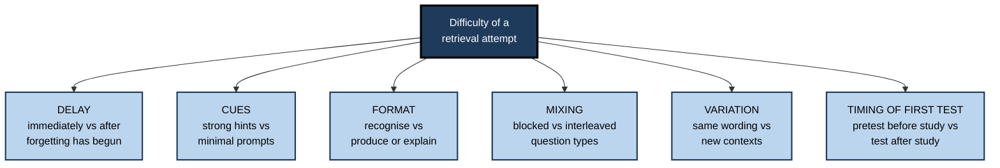
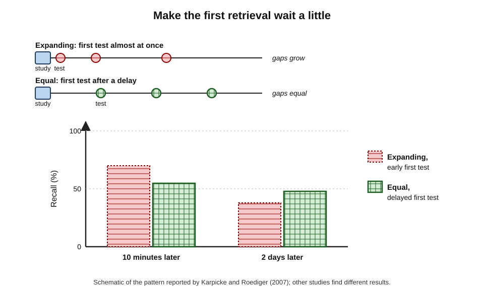
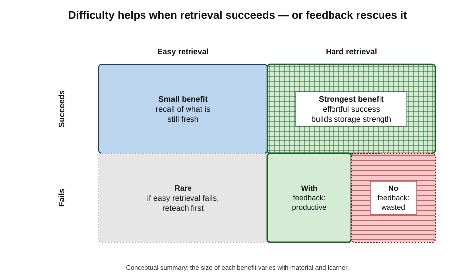
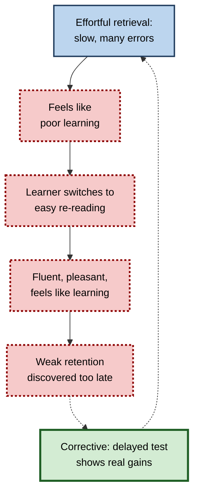
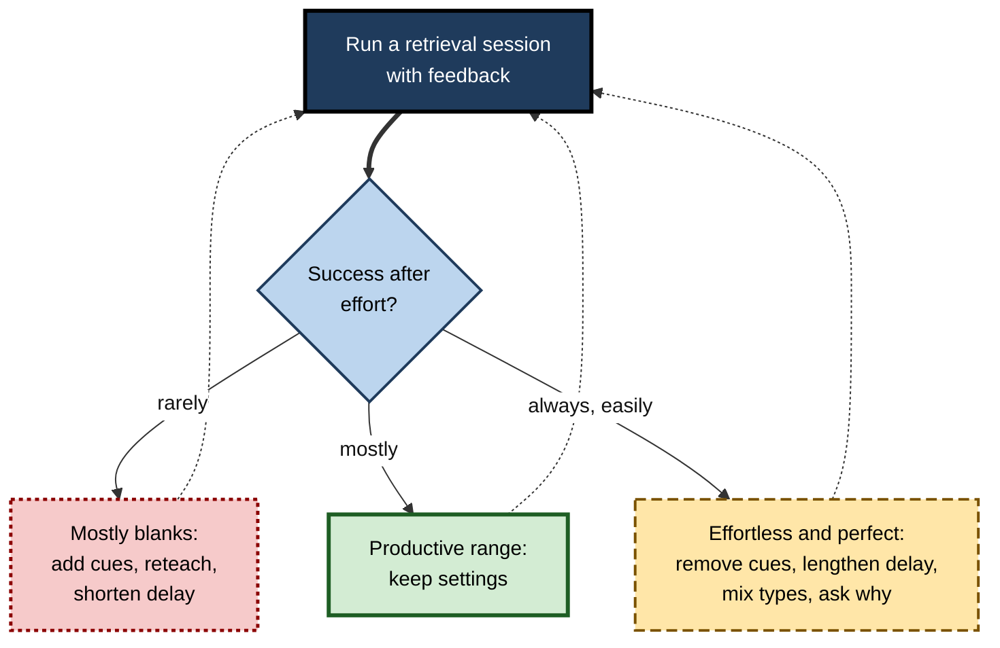

# C.9. Desirable Difficulties in Retrieval

Two engineers study the same cloud-security checklist. The first quizzes herself immediately after reading, with the headings visible, and gets everything right. The second waits until the next morning, hides the headings and struggles to produce half the items before checking. The first session felt productive; the second felt like failure. A month later, the second engineer remembers far more: the struggle was the **mechanism** of her learning, not a sign that it was failing.

> **Definition — Desirable difficulty (in retrieval):** a feature of a retrieval task that makes successful retrieval harder or slower in the moment, but increases long-term retention or transfer — provided the learner can still succeed, or can recover through feedback.

**Why it matters**

- It explains why the **easiest** forms of self-testing — immediate, heavily cued, blocked, recognition-only — are also among the **least** effective.
- It gives practitioners **levers**: delay, cue strength, format, mixing, variability — each of which can be adjusted.
- It warns that **not all difficulty is desirable**: retrieval that fails without feedback, or overwhelms working memory, teaches little.
- It explains a persistent obstacle — learners and organisations judge learning by how **easy** practice feels.

---

## Where the Idea Comes From

### Robert Bjork's proposal

- **Robert Bjork (1994)** coined "desirable difficulties" for conditions that slow apparent progress but enhance long-term learning: spacing, interleaving, variation, reduced feedback in motor learning, and **testing** rather than restudy.
- The idea rests on the distinction between **performance** during practice and **learning** shown later.
- The **new theory of disuse** (Robert and Elizabeth Bjork, 1992) supplies the mechanism:
  - every memory has a **storage strength** (how well learned) and a **retrieval strength** (how accessible now);
  - retrieving a memory when its retrieval strength is **low** produces a **larger** gain in storage strength than retrieving it when it is already highly accessible.

> **Key point:** retrieval is most valuable when the memory is **nearly, but not quite, lost** — hard enough to require real effort, easy enough to succeed.

### The essential condition

- A difficulty is desirable **only if it engages processes that support learning** — search, reconstruction, discrimination, elaboration — and only if those processes can **succeed**.
- Elizabeth and Robert Bjork have repeatedly emphasised the qualifier: difficulties are desirable when the learner is **equipped to overcome them**.

> **Watch out:** "struggle is good" is a dangerous slogan. Struggle that ends in a blank, without feedback, is simply failure. Struggle created by an unreadable font, a noisy room or confusing instructions is **undesirable** difficulty.

---

## The Levers of Retrieval Difficulty

Each lever below can be set easier or harder.

**Figure 1.** Six levers that set the difficulty of a retrieval attempt.

### Delay: let some forgetting happen

- **Immediate retrieval** is easy — the information is still active — and builds little.
- **Delayed retrieval** — after some forgetting — is harder and builds more.
- **Within a session:** increasing the number of other items between repetitions of an item makes each retrieval harder and more effective; Mary Pyc and Katherine Rawson (2009) showed this with foreign-vocabulary pairs.
- **Across sessions:** returning to material after days is the basis of spaced retrieval, whose scheduling is a large subject in its own right.

**Study card — Jeffrey Karpicke and Henry Roediger (2007)**

- **Design:** people learned word pairs and practised retrieval on schedules that were either **expanding** (first test very soon, then longer gaps) or **equally spaced** (first test after a moderate delay, gaps equal).
- **Results:**
  - expanding schedules gave better performance on a test **soon** after practice;
  - equally spaced schedules gave better retention **two days later**;
  - the critical factor appeared to be the **delay before the first retrieval** — an early, easy first test produced less long-term benefit.
- **Conclusion:** making the first retrieval a little harder, by delaying it, improved durable learning.

**Figure 2.** An easy first retrieval helps in the short term; a delayed first retrieval helps more later.

> **Watch out:** the expanding-versus-equal debate is **not settled**. Other studies have found expanding schedules equal or superior, especially when the first test is not too early or when feedback is given. The robust lesson is narrower: do not make the first retrieval **trivially** easy.

### Cues: give as little as works

- **Strong cues** (first letters, multiple-choice options, visible headings) make retrieval easy and less effective.
- **Weak or no cues** require self-generated search, which strengthens more retrieval routes.
- **Graduated cueing** — offering the minimal cue needed only after an unaided attempt — keeps difficulty high while preventing failure.

### Format: produce rather than recognise

- **Recognition** can be answered on familiarity; **production** requires reconstruction.
- **Explanation** ("why does this work?") is harder than recall of a fact and builds understanding.
- Meta-analyses generally find larger benefits for recall formats, though good multiple-choice items with plausible alternatives also induce effortful retrieval.

### Mixing and variation

- **Interleaving** question types makes each retrieval harder by adding the step of identifying what kind of problem it is.
- **Varying contexts and wording** — asking the same principle through different scenarios — prevents retrieval from becoming tied to a single cue.

> **Definition — Retrieval variability:** practising retrieval of the same knowledge from different cues, contexts or question forms.

### Testing before study

- **Pretesting** — attempting questions **before** learning the material — is a radical difficulty: most answers are wrong.
- **Yet** two meta-analyses (2022 and 2024) found reliable benefits for later memory of the pretested information, of small-to-medium and medium size, provided the correct answers are then studied.
- **Productive failure** — Manu Kapur's work in mathematics education, in which students attempt to solve problems before instruction — is a related idea; its benefits depend on careful design of the subsequent instruction.

| Lever | Easier setting | Harder (often more effective) setting | When harder becomes undesirable |
|---|---|---|---|
| Delay | Immediately after study | After hours or days | So long that nothing is retrievable and no feedback follows |
| Cues | Strong cues, options visible | Minimal cues, free recall | Learner cannot start; long blanks |
| Format | Recognition | Production, explanation | Explanation required before basics are known |
| Mixing | Blocked by type | Interleaved | Categories entirely new and very different |
| Variation | Same wording each time | New scenarios and phrasings | Variation so great the principle is unrecognisable |
| First test | After study | Before study (pretest) | No correct answers ever provided |

---

## When Difficulty Is Desirable

### Success and feedback decide

The two factors that most determine whether a difficult retrieval helps are whether it **succeeds**, and whether **feedback** follows if it does not.

**Figure 3.** Difficulty pays off when retrieval succeeds or when feedback rescues failure.

- **Hard and successful** — the best case: maximal strengthening.
- **Hard, failed, with feedback** — still productive: the failed search prepares the mind to encode the answer.
- **Hard, failed, no feedback** — little learning; risk of frustration.
- **Easy and successful** — some benefit, but small.

> **Remember:** **hard + success = strong; hard + failure + feedback = good; hard + failure alone = wasted.**

### The learner's starting point

- **Prior knowledge** — the same task can be a desirable difficulty for an experienced learner and an overwhelming one for a novice.
- **Expertise reversal** — Slava Kalyuga and colleagues showed that supports which help novices (worked examples, strong guidance) can hinder experts, and vice versa. For retrieval, novices need **more cues and earlier tests**; experts benefit from **less support and longer delays**.
- **Working memory** — tasks requiring many elements to be held at once may exceed capacity; then additional retrieval difficulty adds load rather than learning.

> **Definition — Expertise reversal effect:** the finding that instructional supports which help novices can become ineffective or harmful for more knowledgeable learners.

### Material complexity

- **Simple items** — vocabulary, facts — tolerate high difficulty; failure is easily repaired by feedback.
- **Complex, interconnected material** — difficulty should come from **retrieving the structure** (explain, connect, apply) rather than from obscure cues; working memory limits matter more.

### Motivation

- **Persistence** — repeated failure can reduce effort and confidence, especially in learners who already doubt their ability.
- **Framing** — explaining in advance that effortful retrieval is supposed to feel hard helps learners persist.
- **Visible progress** — tracking delayed test results lets learners see the payoff.

---

## The Misinterpretation of Effort

### Why learners avoid desirable difficulties

**Study card — Afton Kirk-Johnson, Brian Galla and Scott Fraundorf (2019)**

- **Design:** in several studies, learners experienced both effortful and less effortful study strategies (*e.g.* testing versus restudy; interleaving versus blocking), then rated how much they had learned and chose strategies for later study.
- **Results:**
  - learners who felt a strategy was more **effortful** judged that they had learned **less** from it;
  - those judgements predicted **avoiding** the effortful strategy in future, even when it was more effective.
- **Conclusion:** learners use felt effort as a cue to **poor** learning — the **misinterpreted-effort hypothesis**.

> **Definition — Misinterpreted-effort hypothesis:** the proposal that learners interpret mental effort during study as a sign of ineffective learning, and therefore avoid effortful but effective strategies.

**Figure 4.** How the feeling of effort steers learners away from effective retrieval.

### Counteracting it

- **Tell learners what to expect** — "this will feel harder and you will get more wrong; that is how it works".
- **Show the evidence on themselves** — a quick classroom demonstration with a delayed test makes the effect personal.
- **Reframe errors** — record errors as information, not failure.
- **Use delayed measures** — report progress on delayed, unaided tests, not practice scores.

> **In practice:** training teams who introduce harder retrieval exercises should expect **lower end-of-session satisfaction** and plan to report **delayed** performance to stakeholders, or the programme will be judged on the wrong evidence.

---

## Calibrating Difficulty

### How hard is "just right"?

- **No single number** — the optimal success rate depends on material, learner and whether feedback is given.
- **Practical heuristics** used in research and practice:
  - aim for most items to be retrieved correctly **after effort**;
  - if success falls very low and stays low, **add cues or reteach**;
  - if success is near perfect and effortless, **lengthen delays, remove cues or mix types**.
- **A theoretical result:** Robert Wilson and colleagues (2019), modelling learning in machine-learning algorithms and simple models of animal learning, derived an optimal error rate of roughly **15%** for certain kinds of training — the so-called "85% rule".

> **Watch out:** the "85% rule" comes from **computational models** of particular learning tasks. It is not an empirically established rule for human retrieval practice, and should be treated as a rough reference point, not a target.

**Figure 5.** A practical loop for keeping retrieval difficulty in the productive range.

### Worked example: tuning a team's flashcard deck

A security operations team uses a shared deck of 150 cards on attack techniques. After a month, logs show 97% of answers marked correct, average response under three seconds.

1. **Diagnose:** near-perfect, fast responses mean retrieval is **too easy** — little strengthening is taking place.
2. **Remove cues:** card fronts named the technique and asked for its identifier; rewrite them as **scenarios** ("A process spawns PowerShell with an encoded command from a document macro. Which technique, and what is the first containment step?").
3. **Change format:** require a typed answer and a one-line justification.
4. **Mix:** shuffle across tactic categories rather than studying by category.
5. **Lengthen delay:** lengthen review intervals for cards answered correctly twice.
6. **Monitor:** after two weeks, correct responses fall to about 75%, average time rises to about 20 seconds; errors are concentrated in distinguishing similar techniques — exactly the skill needed in incident triage.

| | Before tuning | After tuning |
|---|---|---|
| Card front | Technique name | Realistic scenario |
| Response | Self-rated recall of an identifier | Typed answer and justification |
| Order | By category | Mixed |
| Success rate | About 97% | About 75% |
| Time per card | Under 3 seconds | About 20 seconds |
| What is practised | Recognition of labels | Diagnosis and response selection |

- **Conclusion:** lower success and slower responses here signal **more** learning, because the retrieval now resembles the job.

> **Watch out:** if success fell to 30%, the deck would have overshot. Add cues or introductory worked examples before pushing difficulty further.

---

## Desirable Difficulties at Work

### Case study: the onboarding programme that felt too easy

- **Situation:** a consultancy's two-week onboarding included daily quizzes on methods and frameworks; average scores were above 90%, and satisfaction was high.
- **Problem:** in their first client engagements, new consultants struggled to choose and apply frameworks unprompted.
- **Diagnosis:**
  - quizzes were given **immediately** after each session;
  - questions mirrored slide wording and were mostly multiple choice;
  - topics were quizzed **in blocks** matching the day's content.
- **Actions:**
  1. Each day's quiz moved to the **next morning** and drew on all earlier days.
  2. Questions became **mini-cases** requiring consultants to choose a framework and justify it in two sentences.
  3. Cues were removed; options appeared only after a first written attempt.
  4. Facilitators explained at the start that scores would drop and why.
- **Result:** quiz scores fell to around 65–70% and satisfaction dipped slightly; engagement managers reported that new consultants framed problems more independently in their first projects.
- **Lesson:** a quiz that everyone passes easily is usually **measuring recency**, not building capability.

### Professional uses

- **Aviation** — recurrent simulator training introduces unannounced failures, making retrieval of procedures harder and more realistic.
- **Medicine** — case presentations in which the trainee must generate the differential diagnosis before seeing investigations.
- **Software** — debugging exercises with the error message removed, forcing hypothesis generation.
- **Sales** — role-plays with unscripted objections rather than rehearsed ones.

---

## Variability: Retrieving the Same Knowledge in Different Ways

One of the oldest desirable difficulties comes from motor learning and applies strongly to retrieval: practising under **varied** conditions is harder but transfers better.

**Study card — Robert Kerr and Bernard Booth (1978)**

- **Design:** children practised throwing beanbags at a target on the floor while unable to see it during the throw.
  - One group practised only at a distance of **3 feet**.
  - Another practised at **2 and 4 feet**, never at 3.
- **Test:** all children threw from **3 feet**.
- **Results:** the varied group was **more accurate at 3 feet** than the group that had practised only at 3 feet.
- **Conclusion:** varied practice built a more general skill than practice of the exact test condition.

> **Definition — Variability of practice:** practising a skill or retrieving knowledge under varied conditions, cues or forms, which is harder during practice but supports transfer.

**Applied to retrieval**

- **Vary the cue** — ask for the same concept from its definition, from an example, from a consequence and from a counter-example.
- **Vary the direction** — term → meaning, meaning → term, situation → term.
- **Vary the context** — different scenarios, industries, numbers and wording.
- **Vary the output** — say it, write it, draw it, apply it.

> **Key point:** retrieval tied to a single question becomes retrieval of that question. Varying how knowledge is asked for makes it available **however** it is needed.

| Same retrieval every time | Varied retrieval |
|---|---|
| "Define working capital." (every week) | Define it; compute it from a balance sheet; explain why a fast-growing firm may run short of it; spot the problem in a cash-flow forecast |
| "What is the escalation threshold?" | State it; decide whether a given incident meets it; explain why it was set there |
| Same diagram labelled each time | Draw it from memory; predict what happens if one component fails; compare with an alternative design |

---

## When Difficulty Becomes Harmful

### Errorless learning in memory impairment

- **Alan Baddeley and Barbara Wilson (1994)** found that people with severe amnesia learned word lists better when errors were **prevented** during learning (errorless learning) than when they were encouraged to guess (errorful learning).
- **Explanation proposed:** without intact explicit memory, patients cannot remember that a guess was wrong; the guess itself is strengthened.
- **Lesson for everyone:** errorful retrieval helps only if the learner can **remember the correction**. When feedback is absent, or memory for the correction is poor, errors can be learned.

### Overload

- **High element interactivity** — when a retrieval task requires holding many interacting elements at once, adding difficulty can exceed working-memory capacity; the learner retrieves nothing coherent.
- **Novices** — difficulties that suit experts (no cues, long delays, mixed types) can overwhelm novices before a schema exists.

### Anxiety and pressure

- **High stakes plus high difficulty** — difficult retrieval under evaluation can trigger anxiety that consumes working memory; the difficulty then measures composure, not knowledge.
- **Repeated failure** — learners who fail repeatedly may stop trying or conclude they lack ability.

> **Remember:** difficulty is desirable only when four conditions hold: the learner has **a foundation**, retrieval **can succeed** or feedback **follows**, **working memory** is not overloaded, and the **stakes** are low enough to allow effort without fear.

| Condition | Desirable difficulty | Undesirable difficulty |
|---|---|---|
| Learner's knowledge | Foundation exists | Material entirely new |
| Outcome | Success after effort, or failure with feedback | Repeated failure without correction |
| Cognitive load | Within working-memory limits | Overload; nothing coherent retrieved |
| Stakes | Low; errors safe | High; errors costly or public |
| Memory for corrections | Intact | Impaired (as in severe amnesia) |

---

## Difficulty in Procedural and Performance Skills

- **Contextual interference** — in motor-skill research, practising several skills in a mixed order (high contextual interference) slows practice but often improves retention, as John Shea and Robyn Morgan (1979) reported; the effect is a performance-skill cousin of interleaved retrieval.
- **Unannounced events in simulation** — aviation and medical simulations introduce unexpected failures so that procedures must be retrieved rather than anticipated.
- **Reduced prompts** — trainees perform procedures without checklists in practice (while checklists remain mandatory in real work), to build retrievable knowledge of the steps.
- **Time pressure, introduced gradually** — practice first at comfortable speed, then with increasing time pressure, so that retrieval holds up when needed fast.

> **In practice:** in simulation-based training, make the scenario **hard enough that procedures must be recalled**, but debrief every error immediately — difficulty without debriefing becomes merely stressful.

---

## Worked Example: Checking Whether a Difficulty Is Desirable

A learning designer proposes removing all hints from a compliance quiz to make it "more challenging". Before rolling it out, she tests whether the change helps.

1. **Split items at random** — of 40 items, 20 are presented with hints as before; 20 without hints, but with a hint available after a first unaided attempt.
2. **Run for four weeks** — 200 staff, three items per week each, feedback after every item.
3. **Measure practice data** — first-attempt accuracy, time per item and how often the after-attempt hint was used.
4. **Measure the outcome** — an unannounced test of all 40 items at week 8, with new wording.
5. **Decide:**
   - if the no-hint items show **lower practice accuracy but higher week-8 accuracy**, the difficulty is desirable;
   - if they show lower accuracy at **both** points, the difficulty is undesirable — add cues or reteach.

| Measure | Items with hints | Items without hints (hint after attempt) |
|---|---|---|
| First-attempt practice accuracy | 88% | 64% |
| Hint used after attempt | — | 31% of attempts |
| Week-8 unannounced test | 61% | 72% |

- **Conclusion (illustrative data):** the harder version lowered practice scores and raised retention — a desirable difficulty. The after-attempt hint kept failures from being wasted.

> **Watch out:** without the week-8 test, the designer would have seen only the fall from 88% to 64% and might have reversed a beneficial change. Difficulty must be judged on **delayed** measures.

---

## Case Study: Making Sales Role-Plays Hard Enough

- **Situation:** a software company trained new account executives with role-plays in which trainers played customers using a script of standard objections.
- **Problem:** executives performed well in role-plays but struggled with real customers' unexpected objections, often reverting to reading prepared answers.
- **Diagnosis:**
  - objections arrived in a **predictable order** and wording, so executives retrieved scripted replies by position;
  - trainers prompted when executives hesitated;
  - nothing varied between rehearsals.
- **Actions:**
  1. Objections were drawn **at random** from a bank of 40, worded differently each time.
  2. Trainers stopped prompting; after a 20-second pause, they offered a one-word cue only.
  3. Each executive answered the same objection in **different customer contexts** (finance director, IT lead, procurement).
  4. Every role-play ended with a two-minute debrief of the weakest answer and an immediate second attempt.
- **Result:** role-play performance initially dropped; within a month, managers observing real calls rated executives' handling of objections higher than in previous intakes.
- **Lesson:** variability, reduced cues and unpredictable order made retrieval harder and **more like the real task** — and the debrief kept the difficulty productive.

---

## Building Difficulty Into Workplace Programmes

- **Delay the first quiz** — move the end-of-session quiz to the next morning; a night's forgetting makes the retrieval more valuable.
- **Remove slide-wording cues** — questions written in different words from the training materials prevent retrieval by phrase-matching.
- **Ask for decisions, not definitions** — "What would you do?" is harder and closer to the job than "What is…?".
- **Return after weeks** — follow-up questions at two and six weeks are harder than anything in the session and do the most for retention.
- **Tell participants** — explain at the start that questions will feel harder than usual quizzes, and why.

> **In practice:** a single change — moving the end-of-course quiz to a week **after** the course — often does more for retention than any change to the course itself, because it converts an easy recency check into a desirable difficulty.

---

## Adaptive Difficulty and AI

- **Adaptive systems** can adjust difficulty item by item — shortening intervals after failures, removing cues after successes.
- **Large language models** can generate varied versions of an item — new scenarios, wording and numbers — supporting retrieval variability at scale.
- **Risks**
  - systems that optimise practice **accuracy** will drift towards making items easier;
  - generated variants may change the concept being tested, not only its surface.
- **Design rule** — adaptive systems should target a **productive range** of success with feedback, and be judged on delayed outcomes, not session scores.

---

## Open Questions

- **Can the optimal difficulty be predicted for an individual?**
  - Adaptive systems estimate memory strength, but setting difficulty for complex knowledge and individual motivation remains largely judgement.
- **How do difficulties combine?**
  - Delay, cue reduction, interleaving and variation may add, overlap or overload; their interactions are little studied.
- **Which difficulties transfer to complex skills?**
  - Most evidence concerns facts and concepts; desirable difficulties for multi-step professional judgement are less well mapped.
- **How can learners be persuaded to choose difficulty?**
  - Telling learners about desirable difficulties changes beliefs more than behaviour; durable changes in strategy choice are hard to produce.

---

## Summary

- A **desirable difficulty** in retrieval makes retrieval harder now but improves long-term retention or transfer — **if** the learner can succeed or recover with feedback.
- **Origin:** Robert Bjork (1994); mechanism from the **new theory of disuse** — retrieval when accessibility is low builds more storage strength.
- **Levers:** delay, cue strength, format, mixing, variation, pretesting.
- **Karpicke and Roediger (2007):** an early, easy first retrieval helped short-term but less long-term; the expanding-schedule debate is unsettled.
- **Pretesting** produces reliable benefits when answers are then studied.
- Difficulty is desirable when it engages useful processing, retrieval **succeeds** or **feedback** follows, and it fits the learner's prior knowledge (**expertise reversal**) and working memory.
- **Misinterpreted effort** (Kirk-Johnson and colleagues, 2019): learners read effort as poor learning and avoid effective strategies.
- **Calibrate:** mostly successful after effort; add cues if blanks dominate; remove cues, lengthen delays and mix if retrieval is effortless. The "85% rule" is a model-based reference, not an empirical law.

---

## Self-Check

1. Define a desirable difficulty in retrieval and state its essential condition.
2. Explain how the new theory of disuse accounts for the benefit of difficult retrieval.
3. Name six levers of retrieval difficulty and give an easy and a hard setting for each.
4. Describe Karpicke and Roediger (2007) and the caution needed in interpreting it.
5. Why can pretesting help even though most answers are wrong?
6. Explain the four combinations of difficulty, success and feedback.
7. What is the expertise reversal effect, and what does it imply for retrieval difficulty?
8. Describe the misinterpreted-effort hypothesis and two ways to counteract it.
9. Where does the "85% rule" come from, and how should it be used?
10. A team's flashcard success rate is 98% with three-second responses. What would you change?
11. A learner's success rate on a new mixed set is 25%. What would you change?
12. Explain why an onboarding quiz with 90% average scores may be a warning sign.
13. Describe Kerr and Booth (1978) and explain how variability applies to retrieval practice.
14. Why did errorless learning help people with severe amnesia, and what general lesson follows?

### Answer Key

1. A feature that makes retrieval harder or slower now but improves long-term retention or transfer. Condition: the learner must be able to succeed, or to recover through feedback, and the difficulty must engage useful processing.
2. Each memory has storage and retrieval strength; retrieving when retrieval strength is low produces larger gains in storage strength, so effortful retrieval of a partly forgotten item builds more learning.
3. Delay (immediate vs later), cues (strong vs minimal), format (recognise vs produce), mixing (blocked vs interleaved), variation (same wording vs new contexts), first test (after study vs pretest).
4. Expanding schedules with an early first test helped a soon test; equal schedules with a delayed first test helped retention two days later. Other studies find expanding schedules equal or better; the robust lesson is not to make the first retrieval trivially easy.
5. The attempt activates related knowledge and prepares the mind to encode the answer, which is then studied; meta-analyses find reliable benefits.
6. Hard and successful: strongest. Hard, failed, with feedback: productive. Hard, failed, without feedback: little learning. Easy and successful: small benefit.
7. Supports that help novices can hinder experts. Novices need more cues and earlier tests; experts benefit from less support and longer delays.
8. Learners interpret effort as poor learning and avoid effortful strategies. Counter by explaining in advance, demonstrating with delayed tests, reframing errors and reporting delayed measures.
9. From computational models of learning by Wilson and colleagues (2019), deriving an optimal error rate around 15% for certain tasks. Use only as a rough reference; it is not an empirical rule for human retrieval.
10. Remove cues; rewrite as scenarios; require typed answers and justifications; mix categories; lengthen review intervals.
11. Provide worked examples or brief reteaching; add graduated cues; reduce the number of types mixed; ensure feedback; shorten delays.
12. High immediate scores often reflect recency and cued recognition rather than durable, transferable capability; the quiz may be too easy to build learning.
13. Children who practised beanbag throws at 2 and 4 feet were more accurate at 3 feet than children who practised only at 3 feet. In retrieval, varying cues, direction, context and output form builds knowledge that can be retrieved however it is needed.
14. They could not remember that their guesses had been corrected, so guesses were strengthened (Baddeley and Wilson, 1994). Errorful retrieval helps only when learners can remember the correction; without feedback or memory for it, errors can be learned.

---

## Glossary

| Term | Meaning |
|---|---|
| Contextual interference | Mixing several skills in practice, which slows practice but often improves retention. |
| Desirable difficulty | A condition that hinders immediate performance but improves long-term learning, if surmountable. |
| Equally spaced schedule | Retrieval practice with equal gaps between attempts. |
| Errorless learning | Learning in which errors are prevented during practice. |
| Expanding schedule | Retrieval practice with gaps that grow after each attempt. |
| Expertise reversal effect | Supports that help novices become ineffective or harmful for experts. |
| Graduated cueing | Providing the minimal cue needed after an unaided attempt. |
| Misinterpreted-effort hypothesis | Learners read effort as a sign of poor learning. |
| New theory of disuse | Bjork and Bjork's theory distinguishing storage strength from retrieval strength. |
| Pretesting | Attempting questions before studying the material. |
| Productive failure | Attempting problems before instruction, followed by instruction that builds on the attempts. |
| Retrieval effort hypothesis | More effortful successful retrievals produce more learning. |
| Retrieval strength | How accessible a memory is at present. |
| Retrieval variability | Practising retrieval of the same knowledge from different cues and contexts. |
| Storage strength | How well established a memory is. |
| Undesirable difficulty | Difficulty that does not engage learning-relevant processing, or cannot be overcome. |
| Variability of practice | Practising under varied conditions or cues, which supports transfer. |
