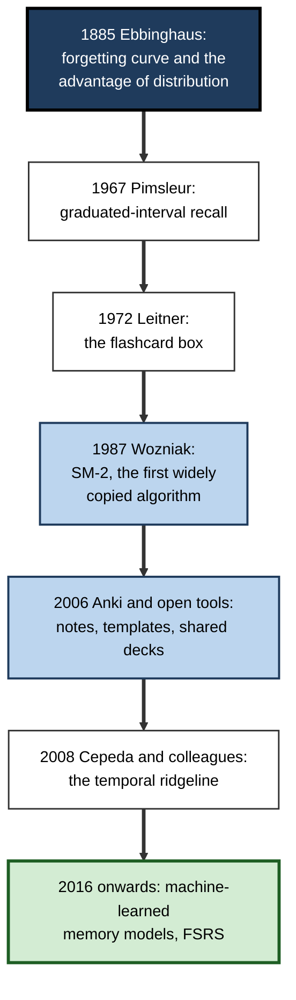
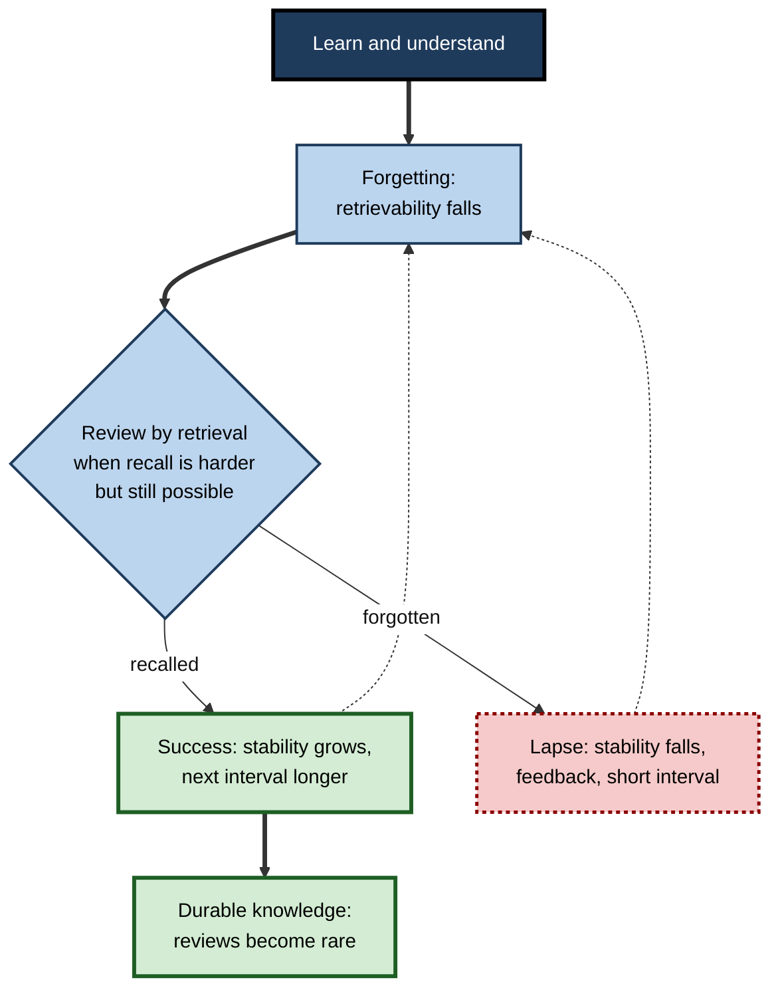
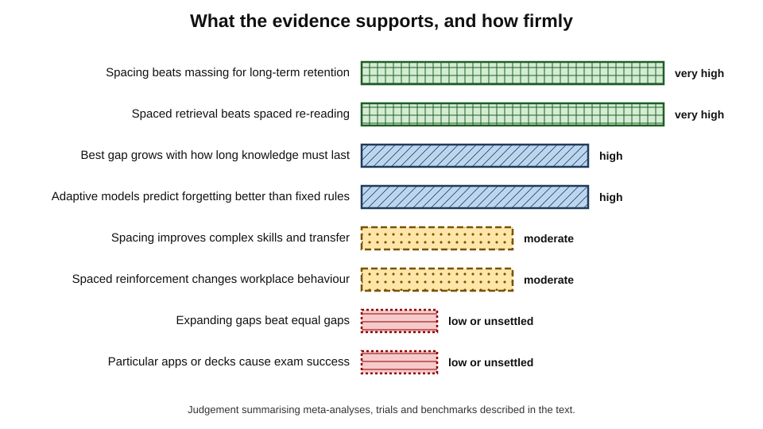
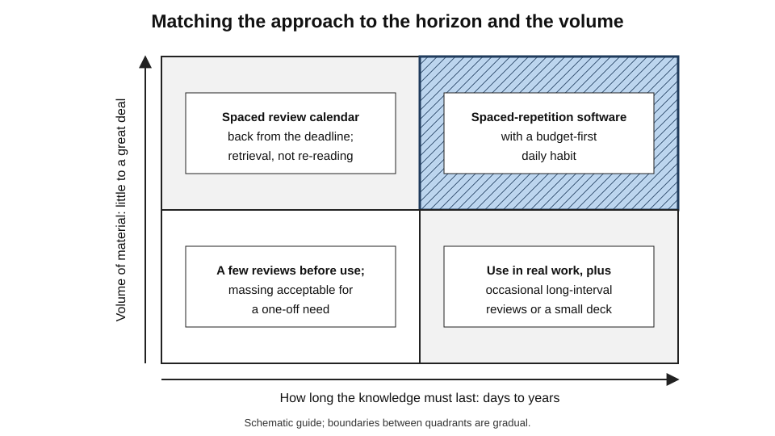
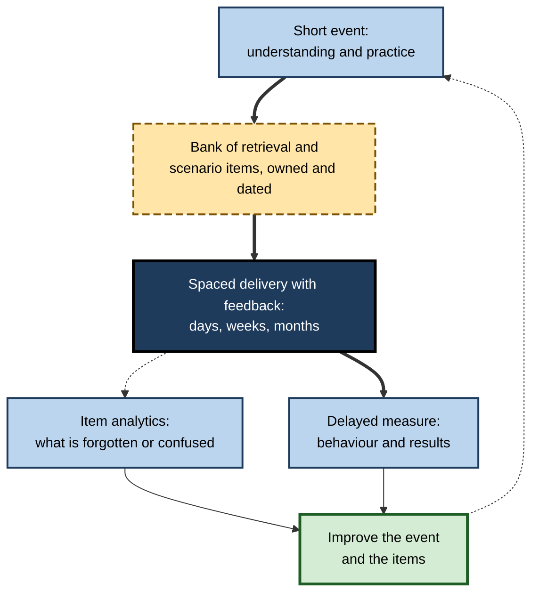

# D. Spaced Repetition

Almost everything a professional learns begins to fade the moment the learning ends. A procedure practised in training, a regulation read last quarter, a hundred words of a new language — each follows the same steep-then-slow decline.

Most people respond by re-learning from scratch when the need arises, or by cramming before it does. A small but growing number respond differently: they return to what they have learned at **planned, widening intervals**, retrieving it just as it begins to slip, and so keep large bodies of knowledge available for years at a cost of minutes a day.

> **Definition — Spaced repetition:** a method of learning and retaining knowledge in which the same material is retrieved on repeated occasions separated by increasing intervals, each review timed for when the memory has weakened but can still be recovered, so that knowledge becomes progressively more durable for the least total effort.

**Why it matters**

- It turns one of the most reliable findings in psychology — the **spacing effect** — into a practical, repeatable discipline.
- It makes **long-term retention a choice** rather than an accident: what is reviewed stays; what is not, fades.
- It underpins exam preparation in medicine, law and accountancy, vocabulary learning for hundreds of millions of language learners, and reinforcement programmes in organisations.
- It is cheap: the main cost is coordination and habit, not time.
- In an age when answers can be generated on demand, it is how professionals keep the knowledge they need to **think with** and to **judge** what tools produce.

---

## The Idea and Its Scope

### Three ingredients

- **Repetition** — the same knowledge is encountered more than once.
- **Spacing** — the encounters are separated by gaps, during which some forgetting occurs.
- **Retrieval** — each encounter requires recalling the knowledge, not merely re-reading it.

> **Key point:** spacing decides **when** the learner returns; retrieval decides **what happens** when they do. Spaced repetition is the combination of both, organised into a schedule.

### What it is and is not

- **It is** a schedule-driven discipline for keeping knowledge available.
- **It is not** a way to understand material for the first time — understanding must come first; spaced repetition preserves it.
- **It is not** synonymous with flashcards — calendars of topic recall, redo lists of problems, cumulative quizzes and periodic drills are all spaced repetition.
- **It is not** the same as interleaving, which mixes different kinds of problems in one session, though the two are often combined.
- **It is not** limited to facts — concepts, procedures and distinctions can be spaced, though facts are where it is easiest.

| | Massed study | Spaced re-reading | Spaced repetition (spaced retrieval) |
|---|---|---|---|
| Timing | One concentrated block | Several sessions over time | Several sessions at widening intervals |
| Activity | Reading, drilling | Reading again | Recalling, then checking |
| Feels | Fluent, productive | Familiar, easy | Effortful, sometimes frustrating |
| Short-term result | High | Moderate | Moderate |
| Long-term result | Low | Moderate | High |
| Signal about forgetting | None | Weak | Clear: each failure is visible |

---

## Origins and History

**Figure 1.** Milestones in the development of spaced repetition.

### From the laboratory to the box

- **Hermann Ebbinghaus (1885)** measured forgetting on himself with nonsense syllables and found both the steep-then-slow **forgetting curve** — whose measurement, interpretation and misquotation form a subject of their own — and the advantage of distributing repetitions across days.
- **The twentieth century** confirmed the **spacing effect** across materials, ages and species, yet education largely ignored it — Frank Dempster (1988) called it a case study in the failure to apply research.
- **Paul Pimsleur (1967)** proposed fixed, expanding intervals for language learning, each about five times the last.
- **Sebastian Leitner (1972)** turned spacing into a cardboard box: cards answered correctly move to compartments reviewed less often; missed cards return to the start.

### From the box to the algorithm

- **Piotr Woźniak (1987)** derived the **SM-2** algorithm from records of his own forgetting: one day, six days, then intervals multiplied by an "ease factor" that adapts to each item. It became the most copied scheduling rule in history.
- **Anki (2006)**, **Mnemosyne** and later many language and study apps put SM-2-style scheduling on every phone.
- **Machine-learned models** — Duolingo's half-life regression (2016), personalised classroom review (Lindsey and colleagues, 2014) and the open **FSRS** scheduler (from 2022) — replaced hand-set rules with models fitted to hundreds of millions of reviews.

> **Key point:** the history moved from **discovering** that spacing works, to **mechanising** it so individuals could apply it, to **modelling** forgetting precisely enough to schedule each item for each person.

---

## The Central Model

### The forgetting–review cycle

- After learning, the probability of recalling an item — its **retrievability** — falls along a forgetting curve.
- A successful review restores retrievability and increases the memory's **stability**: the next decline is slower.
- Because stability grows, the next review can come later — intervals **widen** with each success.
- A failed review (a **lapse**) reduces stability; the item returns on a short interval and climbs again.

> **Definition — Stability:** how slowly a memory loses accessibility; in modern schedulers, the time it takes for recall probability to fall to a set level.

> **Definition — Retrievability:** the probability that a memory can be recalled at a given moment.

**Figure 2.** The forgetting–review cycle at the heart of spaced repetition.

### Why the timing works

- **Desirable difficulty** — a review that requires effort produces more long-term gain than an easy one; the Bjorks' new theory of disuse holds that storage gains are largest when retrieval strength has fallen.
- **Study-phase retrieval** — returning after a gap forces the learner to retrieve the earlier encounter, which strengthens it.
- **Consolidation** — gaps, especially including sleep, allow memories to stabilise between sessions.
- **The practical rule** that follows: return when recall has become **harder but not impossible**.

### How long to wait

- The best gap depends on **how long the knowledge must last**: Cepeda and colleagues (2008) found that the optimal gap grows with the retention interval but shrinks as a proportion of it — roughly a fifth of a few weeks, a twentieth of a year.
- Gaps slightly **too long** cost less than gaps **too short**.
- Modern schedulers express timing as a **target recall probability** — commonly about 90% — and compute each item's interval to meet it; raising the target sharply increases workload.

> **Formula — Daily workload of a steady system:** daily reviews ≈ 8 to 10 × new items added per day, once the system has run for a couple of months. Example: 15 new items a day → about **120–150 reviews**, roughly **15–20 minutes** at 8 seconds each.

> **Remember:** the three levers of every spaced-repetition system are **what** enters it (item quality and selection), **how fast** it enters (new items per day) and **how much recall** is demanded (the target).

---

## Why Spacing Works

Several mechanisms contribute; none explains every finding alone, and different ones probably dominate at different time scales.

- **Deficient processing** — an immediate repeat feels familiar and receives less attention; a repeat after a gap is processed fully.
- **Encoding variability** — sessions on different occasions store the material with different contexts, giving more cues for later retrieval.
- **Study-phase retrieval** — returning after a gap forces retrieval of the earlier encounter; effortful, successful retrieval strengthens memory most, which explains why benefits rise with the gap and then fall when the gap is too long for retrieval to succeed.
- **Consolidation** — memories stabilise between sessions, especially during sleep; at the cellular level, spaced training engages the processes of long-term memory more effectively than massed training.
- **Storage and retrieval strength** — in the new theory of disuse of Robert and Elizabeth Bjork, gains in storage are largest when retrieval strength has fallen, so a review after some forgetting builds more durable memory.

> **Key point:** the mechanisms converge on one practical principle — **return when recall has become harder but is still possible, and make the return an act of retrieval**.

---

## The Evidence in Outline

### What is well established

- **Spacing beats massing** for long-term retention, across hundreds of experiments (Cepeda and colleagues' 2006 synthesis), many settings and species; classroom meta-analyses in 2025 confirm moderate effects in real teaching.
- **Spaced retrieval beats spaced re-reading**, and spacing retrieval episodes beats massing them.
- **Optimal gaps scale with the retention interval**.
- **Adaptive, model-based schedules** predict forgetting better than fixed rules and, in controlled classroom and platform studies, improve retention or engagement.

**Study card — Shana Carpenter, Harold Pashler and Nicholas Cepeda (2009)**

- **Design:** secondary-school pupils studying United States history reviewed course facts either one week or sixteen weeks after learning them; the final test came nine months later.
- **Results:** the later review produced better retention at nine months.
- **Conclusion:** within an ordinary school course, a review long after learning outperforms an early one when knowledge must last — the logic of spacing holds outside the laboratory.

**Study card — B. Price Kerfoot and colleagues (2007)**

- **Design:** a randomised trial in which urology residents received short case-based questions by email, repeated at intervals with explanations, on some topics but not others.
- **Results:** knowledge of the spaced topics was higher and persisted for months after the programme.
- **Conclusion:** spaced, question-based delivery works for busy professionals in real working conditions.

### What is qualified or uncertain

- **Expanding versus equal gaps** — once total spacing is equated, neither reliably wins; the first gap and the amount of spacing matter more.
- **Complex skills and understanding** — spacing helps, but effects are smaller and less studied than for facts.
- **Specific products** — observational links between deck use and exam scores (common in medicine) cannot separate the tool from the motivated student.
- **Algorithm comparisons** — strong on prediction accuracy, thin on independently measured learning outcomes.

**Figure 3.** Confidence in the main claims about spaced repetition.

> **Watch out:** confident claims that a particular app "guarantees" retention, or that learners "forget 90% within a week without it", misrepresent the evidence. The robust claims concern **principles** — spacing, retrieval, sensible gaps — not products or precise percentages.

---

## Methods and How They Fit Together

### The family of methods

- **Spaced-repetition software** — the most efficient method for large collections of facts and concepts; its quality depends on the scheduler, on configuration and above all on the items placed in it. The most widely used general tool, Anki, rewards careful setup of daily limits, scheduling and grading.
- **Item design** — focused, precise, consistent prompts, chosen selectively, are the single largest determinant of a system's cost and value.
- **Spaced review calendars** — topics recalled on paper on planned dates, for material that does not suit cards.
- **Spaced problem practice** — whole problems redone at intervals, essential in mathematics, engineering and other technical fields.
- **Cumulative quizzes and drills** — courses and organisations that keep returning to earlier material.

### Different domains, different emphases

- **Languages** — the birthplace of spaced repetition; vocabulary, characters and phrases suit it well, provided reviews are balanced with listening, reading and speaking.
- **Technical and professional fields** — cards hold facts, conditions and distinctions; problems and cases build procedure and judgement; changing knowledge must be dated and maintained.

**Figure 4.** Matching the approach to the time horizon and the volume of material.

### Interaction between levels

| Level | Typical form | Strength | Common failure |
|---|---|---|---|
| Item | A well-written prompt | Precise, gradable retrieval | Vague, overloaded cards that keep failing |
| Session | A daily review | Brief, regular retrieval with feedback | Peeking; dishonest grading |
| System | A scheduled collection | Tracks thousands of items | Too many new items; hidden backlog |
| Habit | A daily routine across years | Compounding benefit | Collapse after a missed week |
| Programme | Courses, reinforcement after training | Spacing built into the curriculum | Unit-only testing; event-only budgets |

> **Key point:** spaced repetition succeeds or fails at the level of **systems and habits** more often than at the level of science. The design of the daily routine and the long-term maintenance of the collection are as much part of the method as the algorithm.

---

## The Landmark Debates

### Memorisation versus understanding

- **The criticism:** spaced repetition breeds rote memorisation — learners who can recite but not reason.
- **The response:** spaced repetition preserves whatever is put into it; cards written after understanding, from several angles, with application prompts, maintain understanding; cards written before understanding preserve words.
- **The resolution:** understand first, then space; pair cards with problems and real use.

### Algorithm versus simplicity

- **For sophisticated algorithms:** they predict forgetting better and can save reviews for the same retention.
- **For simplicity:** a paper box or a fixed calendar, used consistently, captures most of the benefit; tuning an algorithm can become a distraction.
- **The resolution:** use a good scheduler if available, set it sensibly, and spend effort on items and habits rather than settings.

### Expanding versus uniform gaps

- **The long-standing intuition** favours expanding gaps; **controlled comparisons** find little difference once total spacing is equal.
- **Adaptive schedules** dissolve the debate: they expand for items that succeed and contract for items that fail.

### Self-made, shared or generated items

- **Self-made** items add the processing of selection and paraphrase.
- **Shared** decks save time and are often more accurate, especially for standard syllabuses.
- **AI-generated** items are fast but can be wrong, vague or excessive.
- **The resolution:** combine curated content with personal editing; let AI draft, but keep selection and verification human.

### Individual tool or organisational design?

- **Individual tools** have solved scheduling for motivated learners.
- **Organisations** still mass training into events and measure satisfaction at the end of the day; the larger gains lie in redesigning programmes around spaced follow-up and delayed measurement.

---

## Spaced Repetition at Scale

### In education

- **Cumulative assessment** — quizzes and exams that include earlier material encourage spacing.
- **Curriculum design** — revisiting topics at intervals rather than teaching each once.
- **Personalised review software** in courses, which has outperformed generic spacing in controlled classroom studies.

### In organisations

- **Reinforcement after training** — short scenario questions at widening intervals for weeks or months after an event.
- **Certification maintenance** — critical knowledge kept current with periodic spaced checks.
- **Onboarding** — spaced review of systems, policies and terminology.
- **Analytics** — item-level error rates reveal which knowledge decays fastest and which training content is unclear.

**Figure 5.** Designing spaced reinforcement around a training event.

> **In practice:** the most effective learning teams now budget for the **months after** a training event — spaced, retrieval-based follow-up — rather than spending everything on the event itself, and judge success by delayed, behavioural measures.

### Worked example: redesigning product training for a sales organisation

A software company trains 200 sales staff on each quarterly product release in a four-hour session.

1. **Diagnose:** staff score well on the end-of-session quiz; a month later, customer calls reveal confusion about new features and pricing rules.
2. **Shorten the event** to two hours focused on understanding and demonstration.
3. **Build an item bank** of about 60 short scenario questions on features, limits, pricing and competitor differences, reviewed by product managers.
4. **Schedule spaced delivery:** two questions a day through a reinforcement tool; correct answers return at widening intervals, missed answers return within days, every answer followed by an explanation.
5. **Maintain:** retire questions when features change; date-stamp pricing questions.
6. **Measure:** call-review accuracy at 30 and 60 days, compared with the previous release.

| | Previous design | Spaced design |
|---|---|---|
| Instruction time | 4 hours | 2 hours plus about 2 minutes a day for 8 weeks |
| End-of-session quiz | High | Moderate |
| Accuracy on calls at 30 days | Low; frequent escalations | Higher; fewer escalations |
| Knowledge of next release's changes | Mixed with old information | Old questions retired, new ones added |
| Data for the training team | Satisfaction scores | Item-level error rates |

- **Conclusion:** total time is similar, but knowledge is available when customers ask.

> **Watch out:** spaced follow-up only works if questions require **retrieval and application** and come with feedback; spaced reminder emails that restate slides add little.

### Case study: a hospital pharmacy's high-alert medicines programme

- **Situation:** a hospital pharmacy department trained pharmacists and pharmacy technicians annually on high-alert medicines — anticoagulants, insulin, opioids, concentrated electrolytes.
- **Problem:** audit of near-miss reports showed recurring errors months after training, concentrated on dose limits and look-alike, sound-alike drug names.
- **Diagnosis:**
  1. a single annual session — a massed event followed by eleven months of forgetting;
  2. errors concentrated on **similar** items, where interference is greatest;
  3. no mechanism to keep the knowledge current as guidance changed.
- **Actions:**
  1. kept a shorter annual session focused on principles and case discussion;
  2. built a shared item bank of about 250 focused prompts — dose limits, monitoring requirements, and **contrast items** for confusable drug names — each with a source and review date;
  3. delivered items through spaced-repetition software at a target of about 0.92 for this critical set, with five to ten minutes of daily review built into the start of shifts;
  4. allowed a **light mode** during periods of severe staffing pressure: reviews only, no new items;
  5. assigned an owner to update items when local guidance changed;
  6. tracked near-miss reports and item-level error rates quarterly.
- **Result:** near-miss reports involving the targeted medicines fell over the following year; item analytics revealed two confusable pairs that also prompted changes to shelf labelling.
- **Side effects:** maintaining the item bank required protected time from senior pharmacists; a few staff found daily review intrusive until it was tied to shift handover.
- **Lesson:** spaced repetition worked as a **system** — focused items on the riskiest knowledge, a sustainable daily habit, ownership of changing content and measurement of real outcomes.

---

## Barriers and How They Are Overcome

- **The fluency illusion** — massed study feels better. **Remedy:** explain the spacing effect; show delayed results; expect lower practice scores.
- **Scheduling** — tracking what is due by hand is impractical. **Remedy:** software, or simple review calendars.
- **Overload** — adding too much too fast. **Remedy:** budget-first limits on new items.
- **Poor items** — vague, overloaded prompts. **Remedy:** focused design; rewrite repeated failures.
- **Broken habits** — missed days snowball. **Remedy:** a minimum session on bad days; never miss twice; planned light periods.
- **Organisational incentives** — events and satisfaction scores are rewarded. **Remedy:** budget for follow-up; report delayed, behavioural outcomes.
- **Changing knowledge** — items go out of date. **Remedy:** dates, sources, owners and periodic pruning.

> **Mnemonic — "FOSHOC":** **F**luency illusion, **O**verload, **S**cheduling, **H**abits, **O**rganisational incentives, **C**hanging knowledge — the six barriers.

---

## Spaced Repetition and Artificial Intelligence

- **Creation** — language models can draft items from any material, removing the main time cost of building a collection; they also tempt learners to add far more than can be sustained.
- **Evaluation** — models can judge free-text answers and give explanations after errors.
- **Scheduling** — machine-learned memory models already drive modern schedulers; sequence models trained on review logs are being explored.
- **Tutoring** — a well-designed AI tutor can return to earlier topics at intervals; a general assistant that simply answers questions replaces retrieval with lookup.
- **What must still be remembered** — the knowledge needed to frame questions, to work at speed and to **check** what AI produces; spaced repetition is how that knowledge is kept.

> **In practice:** let AI **draft and explain**; keep **selection, verification and the daily budget** under human control.

---

## What Distinguishes Expert Practice

- **Selectivity** — experts card a small fraction of what they read: foundations, fluency-critical and judgement-critical knowledge.
- **Understanding first** — items are written after the idea is clear, from several angles.
- **Budget-first habits** — new items set by the time available in a bad week.
- **Honest retrieval** — full answers attempted before checking; failures graded as failures.
- **Maintenance** — leeches rewritten, obsolete items retired, changing facts dated and sourced, collections tiered by importance.
- **Integration** — review linked to real problems, cases, conversations and work; the collection follows the career.
- **Patience** — the payoff is measured in years, not weeks.

---

## Individual Differences and Boundary Conditions

- **Degree of initial learning** — weakly learned material needs a short first gap, or nothing will be retrieved.
- **Prior knowledge** — experts attach new details to existing structures and tolerate longer gaps.
- **Type of material** — benefits are largest for facts, vocabulary and concepts; smaller and less studied for complex skills and judgement.
- **Retention horizon** — for knowledge needed only within hours, massing may be adequate; spacing pays as the horizon lengthens.
- **Age and memory ability** — spacing helps children, adults, older adults and people with memory impairment, though suitable gaps differ.
- **Sleep and life circumstances** — disrupted sleep reduces consolidation; irregular schedules call for event-based cues and planned light periods.

| Condition | Effect on spacing benefit | Practical adjustment |
|---|---|---|
| Weak initial learning | Benefit lost if the first gap is long | Short first gap; then widen |
| Rich prior knowledge | Benefit retained at longer gaps | Fewer early reviews |
| Complex, interdependent skill | Smaller benefit | Mass the first block; space later practice |
| Very short horizon | Little benefit | Massing acceptable |
| Long horizon | Large benefit | Gaps of weeks to months |

---

## The Enterprise Landscape

### Where spacing appears in organisations

- **Compliance refreshers** — data protection, anti-money-laundering, safety: short scenario questions through the year replacing or supplementing an annual module.
- **Sales and product enablement** — launch training followed by spaced questions and practice calls.
- **Clinical and safety-critical skills** — brief, frequent simulation and manikin practice.
- **Professional certification** — several medical specialty boards now use **longitudinal assessment**, sending physicians small sets of questions with feedback at regular intervals instead of a single examination every decade.
- **Engineering readiness** — periodic incident drills and runbook reviews for rarely used procedures.

> **Definition — Longitudinal assessment:** assessment delivered as frequent small question sets with feedback over a long period, rather than as one high-stakes examination.

### What the evidence supports

- **Strong:** the underlying principles; randomised trials of spaced question programmes in medical education.
- **Moderate:** organisational case evidence showing improvements in audits, errors and observed behaviour after spaced reinforcement, usually without randomisation.
- **Weak:** many vendor claims for microlearning products, often based on internal data without comparison groups.
- **Cautionary:** a large 2025 study at a United States health system found that annual and embedded phishing training produced little measurable reduction in click rates — delivering content at intervals does not guarantee retrieval, practice or behaviour change.

### Evaluating a spaced programme

1. **Define the behaviour** that should change and when it occurs.
2. **Measure at the time of use** — weeks or months after training, not at its end.
3. **Use a comparison** — a previous cohort, a staggered roll-out or randomly chosen teams.
4. **Read participation alongside outcomes** — completion is not learning.
5. **Use item statistics** to improve both the questions and the original training.

---

## Evidence on AI-Era Tools

- **Machine-learned schedulers** predict recall better than fixed rules on large review datasets; their effect on long-term learning outcomes is less directly measured.
- **AI-generated items** save time but carry risks of error and over-production; evidence comparing generated, edited and self-written items is still thin.
- **AI tutors** that withhold answers and revisit earlier material can support learning; studies of unrestricted assistants show raised assisted performance with weaker unaided performance in some settings.
- **Implication:** AI is most valuable for the labour of spaced repetition — drafting, explaining, scheduling — while the learner's own retrieval remains the active ingredient.

---

## Open Questions

- **How well does spaced repetition build understanding and transfer?**
  - Evidence is strongest for facts and vocabulary; effects on complex reasoning and novel problems depend on item design and are less studied.
- **How much do better algorithms improve real learning?**
  - Prediction accuracy has improved markedly; independent trials of long-term outcomes are scarce.
- **What target recall is best for professionals?**
  - Moderate targets minimise effort; the value of higher retention for real performance is unmeasured.
- **How should interconnected knowledge be scheduled?**
  - Current models treat items as independent; real knowledge is a network.
- **Why do so many learners abandon spaced repetition, and what keeps the rest going?**
  - Overload and loss of meaning are plausible causes; rigorous long-term studies of persistence are lacking.
- **How will AI change what professionals need to retain?**
  - Offloading will grow; the knowledge required to supervise AI may become more, not less, important to hold in memory.

---

## Summary

- **Spaced repetition** combines **repetition**, **spacing** and **retrieval** into a schedule of reviews at widening intervals, timed for when memory has weakened but is recoverable.
- It descends from **Ebbinghaus's** forgetting curve and spacing findings, through **Pimsleur's** graduated intervals and the **Leitner box**, to **SM-2**, **Anki** and machine-learned schedulers such as **FSRS**.
- The central model: **retrievability** falls; successful reviews raise **stability** so intervals can grow; **lapses** reset progress; reviews are most valuable when recall is **harder but possible**.
- Optimal gaps **grow with the retention interval**; too long costs less than too short; modern systems schedule to a **target recall** (often about 90%), with workload rising steeply at higher targets.
- Evidence: very strong for spacing and spaced retrieval; strong for gap scaling and adaptive models; moderate for complex skills and workplace behaviour; weak for expanding-gap superiority and product-specific claims.
- Methods range from **software** and **well-designed items** to **review calendars**, **spaced problem practice** and **cumulative quizzes**; domains such as languages and technical fields need different emphases.
- Debates resolve towards **understanding first**, **simple but consistent schedules or good algorithms**, **adaptive gaps**, and **human-curated items**.
- At scale, programmes should replace massed events with **spaced, retrieval-based follow-up** and **delayed measurement**.
- Success depends on **systems and habits**: selective items, budget-first limits, honest retrieval, maintenance and integration with real work.

---

## Self-Check

1. Define spaced repetition and identify its three ingredients.
2. Why is spaced repetition not the same as using flashcards?
3. Trace the main stages in the history of spaced repetition and explain what each contributed.
4. Explain the forgetting–review cycle using the terms stability, retrievability and lapse.
5. Why are reviews most valuable when recall has become harder but is still possible?
6. What did Cepeda and colleagues (2008) find about optimal gaps, and what practical rule follows?
7. Estimate the daily reviews and time for a learner adding 25 new items a day.
8. Which claims about spaced repetition are strongly supported, and which are weak or unsettled?
9. Respond to the criticism that spaced repetition produces rote memorisation.
10. How do adaptive schedules resolve the expanding-versus-uniform debate?
11. Describe how an organisation should redesign a one-off training event using spaced repetition.
12. List the six barriers to spaced repetition and a remedy for each.
13. What roles can AI play in spaced repetition, and what should remain under human control?
14. A professional asks whether spaced repetition is still worth it when AI can answer any factual question. Give a reasoned answer.
15. Explain how deficient processing, study-phase retrieval and consolidation each contribute to the spacing effect, and the practical principle they share.
16. An organisation reports 95% completion of its spaced compliance questions. What else would you need before concluding the programme works?

### Answer Key

1. A method in which the same material is retrieved on repeated occasions at widening intervals, timed for when memory has weakened but can still be recovered. Ingredients: repetition, spacing, retrieval.
2. Flashcards are one format; spaced repetition is a schedule-driven discipline that can use topic-recall calendars, redo lists of problems, cumulative quizzes and drills — and flashcards used without spacing are not spaced repetition.
3. Ebbinghaus measured forgetting and the advantage of distribution; Pimsleur proposed expanding intervals; Leitner mechanised spacing in a box; Woźniak's SM-2 automated adaptive intervals; Anki and other tools spread them widely; research such as Cepeda's quantified gaps; machine-learned models personalised scheduling.
4. Retrievability (recall probability) falls after learning; a successful review restores it and increases stability so the next decline is slower and the next interval longer; a lapse reduces stability and returns the item to short intervals.
5. Effortful successful retrieval produces larger gains in storage strength (desirable difficulty, new theory of disuse, study-phase retrieval); reviewing when recall is easy adds little, and reviewing too late means recall fails.
6. The optimal gap grows with the retention interval but shrinks as a proportion of it (about 20% for weeks, 5–10% for a year), and too-long gaps cost less than too-short ones. Rule: set gaps as a fraction of how long knowledge must last, and err on the long side.
7. About 8–10 × 25 = **200–250 reviews a day**; at 8 seconds each, about **27–33 minutes**.
8. Strong: spacing beats massing; spaced retrieval beats spaced re-reading; optimal gaps scale with retention interval; adaptive models predict better. Moderate: complex skills, workplace behaviour. Weak or unsettled: expanding beats equal gaps; specific apps or decks cause exam success.
9. Spaced repetition preserves what is put into it. If items are written after understanding, from several angles, with application prompts and paired with problems and real use, it maintains understanding; rote results come from carding before understanding.
10. They lengthen intervals after successes and shorten them after failures, so each item's schedule expands or contracts according to its own performance; the fixed shape matters little.
11. Shorten the event to focus on understanding; build a bank of retrieval and scenario items; deliver them at widening intervals with feedback for weeks or months; retire and update items as knowledge changes; measure delayed, behavioural outcomes against a comparison.
12. Fluency illusion — explain and show delayed results; overload — budget-first new-item limits; scheduling — software or calendars; habits — minimum sessions, never miss twice, light modes; organisational incentives — budget for follow-up and report delayed outcomes; changing knowledge — dates, sources, owners, pruning.
13. AI can draft items, evaluate answers, explain errors, schedule with learned models and tutor across sessions. Humans should control what enters the collection, verify accuracy, and keep the daily budget.
14. Yes, for some knowledge: what must be used at speed, what frames good questions, and what is needed to judge whether AI answers are correct. Rarely used, easily checked, frequently changing details can be offloaded. Spaced repetition makes retaining the important core cheap, so the decision is about selection, not abandonment.
15. Deficient processing: immediate repeats receive less attention than repeats after a gap. Study-phase retrieval: returning after a gap requires effortful retrieval of the earlier encounter, which strengthens memory, up to the point where retrieval fails. Consolidation: memories stabilise between sessions, especially in sleep. Shared principle: return when recall has become harder but is still possible, and make the return an act of retrieval.
16. Evidence that the questions require genuine retrieval and application (item statistics, difficulty); delayed measures of the target behaviour at the time of use (audit findings, errors, observations); and a comparison with a previous cohort or untreated group. Completion shows participation, not learning.

---

## Glossary

| Term | Meaning |
|---|---|
| Adaptive schedule | A schedule that adjusts each item's next interval according to performance. |
| Consolidation | Stabilisation of memories between learning episodes, partly during sleep. |
| Deficient processing | Reduced attention to immediately repeated material. |
| Desirable difficulty | A condition that lowers short-term performance but improves long-term learning. |
| Desired retention | The target probability of recall at which a review is scheduled. |
| Ease factor | In SM-2, the multiplier applied to an item's interval after each success. |
| Encoding variability | Storage of material with varied contexts across separate sessions. |
| Forgetting curve | The steep-then-slow decline in retention after learning. |
| FSRS | An open, model-based scheduler using difficulty, stability and retrievability. |
| Interleaving | Mixing different topics or problem types within a session. |
| Lapse | A review in which a previously learned item is forgotten. |
| Leitner system | A box-based manual spacing method with promotion and demotion of cards. |
| Longitudinal assessment | Frequent small question sets with feedback over a long period. |
| Retention interval | The time from the last review to the moment knowledge is used. |
| Retrievability | The probability that a memory can be recalled at a given moment. |
| Retrieval practice | Recalling information from memory rather than re-reading it. |
| SM-2 | Woźniak's 1987 scheduling algorithm based on ease factors. |
| Spaced repetition | Retrieval of the same material at widening intervals timed against forgetting. |
| Spacing effect | Better long-term retention from spaced than from massed study. |
| Stability | How slowly a memory loses accessibility. |
| Study-phase retrieval | Retrieval of an earlier encounter triggered when material is studied again. |
| Temporal ridgeline | The line joining optimal gaps across retention intervals. |
