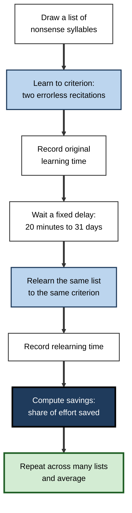
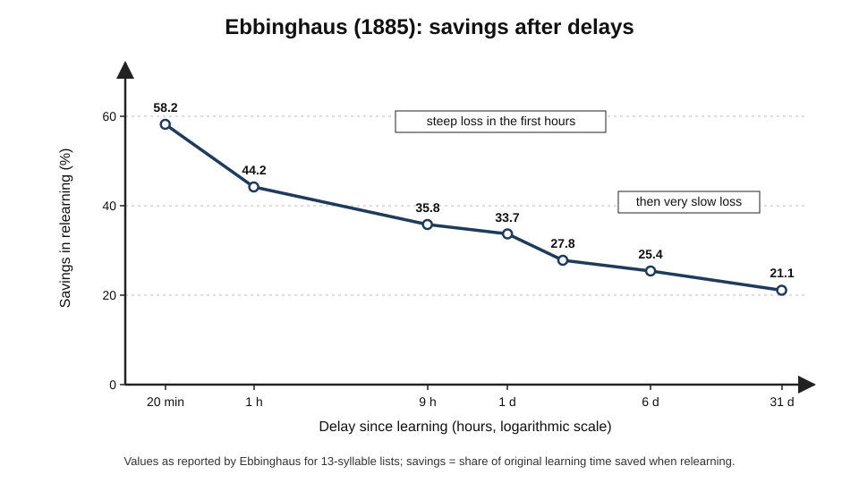
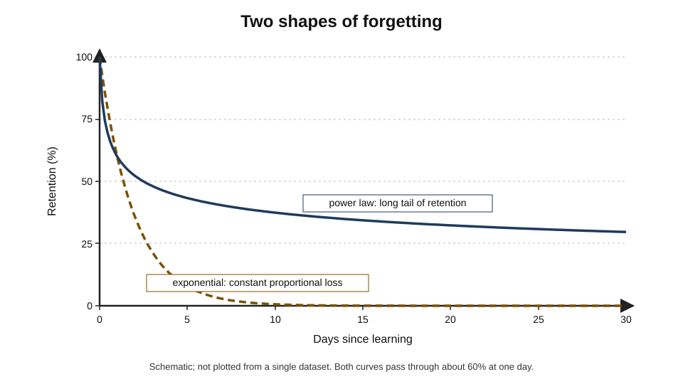
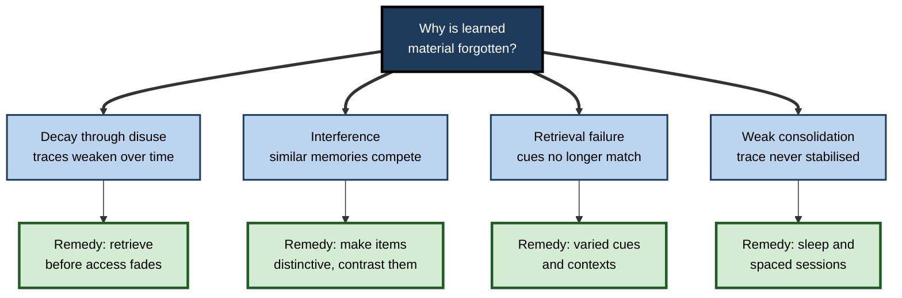
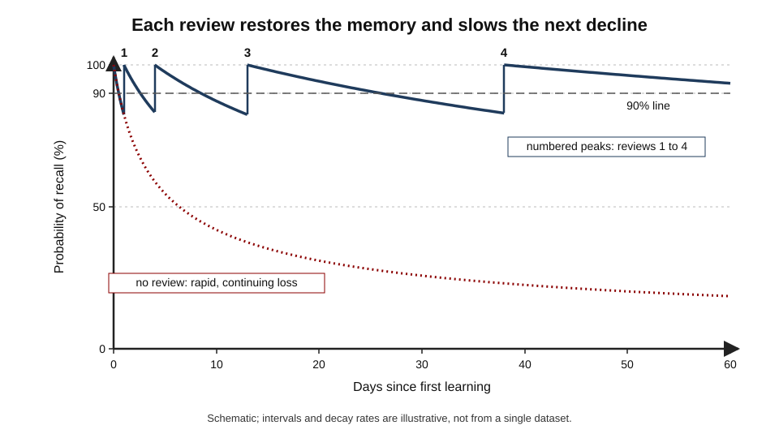
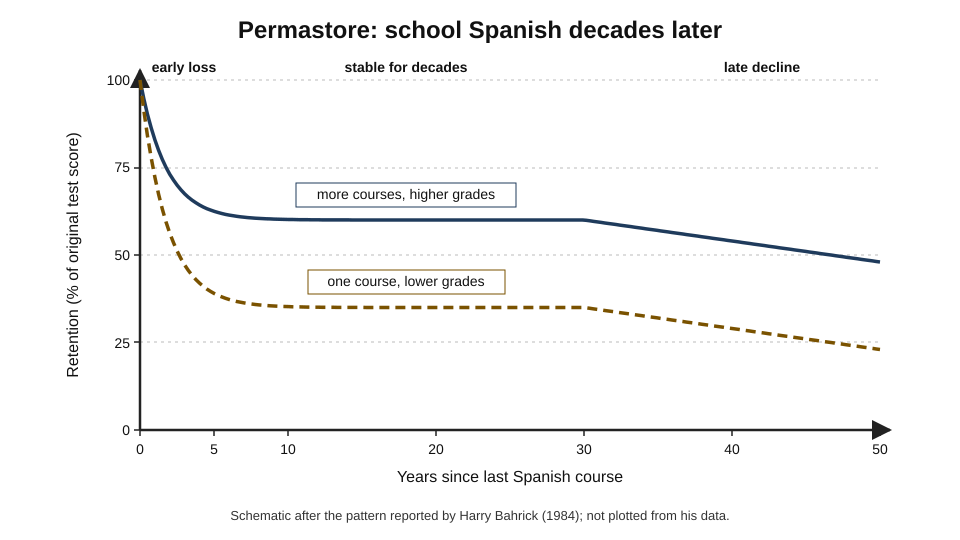

# D.1. Ebbinghaus Forgetting Curve

A consultant leaves a workshop on a new pricing model able to explain every step. Two days later, asked by a client, she recalls the outline but not the thresholds; a month later she remembers only that "there were three tiers". Nothing dramatic happened in between — no illness, no distraction. She simply forgot, and she forgot in a pattern that has been measured, reproduced and modelled for more than a century.

> **Definition — Forgetting curve:** the relationship between the time elapsed since learning and the amount of learned material still retained; retention falls steeply soon after learning and ever more slowly afterwards.

**Why it matters**

- It is the **problem statement** behind every spacing schedule and every spaced-repetition program: reviews are timed against it.
- It explains why training that is never revisited loses most of its value within weeks.
- It turns "I keep forgetting" from a personal failing into a **predictable process** that can be managed.
- It is one of the oldest quantitative laws in psychology, and its modern mathematical forms drive the scheduling algorithms used by millions of learners.
- It is also one of the most **misquoted** findings in education and corporate training — knowing what it does and does not show protects against bad advice.

---

## Hermann Ebbinghaus and the First Measurement of Memory

### The man and the problem

- **Hermann Ebbinghaus (1850–1909)** — a German psychologist working largely alone, without a laboratory or research assistants.
- **The challenge he set himself:** philosophers had argued for centuries that the "higher mental processes", memory among them, could not be studied experimentally.
- **His answer:** treat memory like a physical quantity — control the material, control the conditions, measure the outcome, repeat until the numbers are stable.
- **Publication:** *Über das Gedächtnis* (*On Memory*), 1885 — widely regarded as the first experimental study of a higher mental process.

### The nonsense syllable

> **Definition — Nonsense syllable:** a meaningless consonant–vowel–consonant combination such as *DAX*, *BOK* or *ZEP*, used to study memory without the help of prior knowledge.

- **Why he invented it:**
  - Real words and poems are learned at very different speeds because they connect to existing knowledge in different ways.
  - Nonsense syllables are roughly **equally unfamiliar**, so differences in learning reflect the conditions being tested, not the material.
- **The pool:** about 2,300 syllables, drawn at random to build lists.
- **The trade-off:** control was bought at the price of **realism** — a limitation that matters greatly when the results are applied to meaningful material.

### The method of savings

- **Learning phase:** read a list aloud at a fixed pace until it could be recited twice without error; record the time or the number of readings needed.
- **Delay:** wait a set interval — minutes, hours, days.
- **Relearning phase:** learn the same list again to the same criterion; record the time needed.
- **Measure:** the proportion of the original effort that was **saved**.

> **Formula — Savings:** savings (%) = (original learning time − relearning time) ÷ original learning time × 100. Example: 1,000 seconds to learn, 580 seconds to relearn → (1,000 − 580) ÷ 1,000 = **42% savings**.

- **Why savings, not recall:**
  - Recall is all-or-nothing for each item; savings detects memory too weak to produce recall.
  - Savings showed that "forgotten" material still leaves a **trace** that speeds relearning.

**Figure 1.** The procedure Ebbinghaus used to measure forgetting.

### Ebbinghaus as his own subject

- He was the **only participant**, testing himself over years (the main series in 1879–80, repeated in 1883–84).
- **Precautions:** fixed time of day, fixed reading pace, a regular routine, many lists averaged together.
- **Criticism:** a single, highly practised, highly motivated subject; no independent check.
- **Defence:** his results have been reproduced many times with other people and other materials — the general shape holds.

---

## The Curve Itself

### The numbers

**Study card — Ebbinghaus (1885), the forgetting experiment**

- **Design:** many lists of 13 syllables learned to criterion; each list relearned after one of seven delays.
- **Results (savings):**
  - 20 minutes — about **58%**;
  - 1 hour — about **44%**;
  - about 9 hours — about **36%**;
  - 1 day — about **34%**;
  - 2 days — about **28%**;
  - 6 days — about **25%**;
  - 31 days — about **21%**.
- **Conclusion:** most of the loss happens in the **first hour or so**; after a day the decline continues, but very slowly; a measurable trace remains after a month.

**Figure 2.** Savings after delays from twenty minutes to a month.

> **Key point:** forgetting is **fast, then slow**. The first hours after learning are when most is lost, which is why the first review matters more than any later one.

### Ebbinghaus's own formula

- He fitted his data with a logarithmic expression in which savings fall in proportion to a power of the **logarithm** of time.
- The details of his equation matter less than its message: equal **ratios** of time produce roughly equal **losses** — going from 1 hour to 10 hours costs about as much as going from 1 day to 10 days.

> **Formula — Ebbinghaus's fit:** b = 100k ÷ ((log t)^c + k), with b the savings in per cent, t the minutes since learning, and constants k ≈ 1.84 and c ≈ 1.25. Example: at t = 60 minutes, log t ≈ 1.78, (1.78)^1.25 ≈ 2.06, so b ≈ 184 ÷ (2.06 + 1.84) ≈ **47%** — close to the 44% he observed.

### What else he discovered

- **Memory span** — a list of about seven syllables could be recited after a single reading; longer lists needed sharply more repetitions.
- **Overlearning** — extra repetitions beyond the first perfect recitation increased savings the next day, but with diminishing returns per repetition.
- **Distribution of practice** — repetitions spread over several days produced the same savings as a much larger number crammed into one day; he reported that 38 repetitions spread over three days matched about 68 on a single day.
- **Meaningful material** — stanzas of Byron's poem *Don Juan* were learned with a small fraction of the repetitions needed for nonsense lists of similar length.
- **Remote associations** — syllables that had been two or three places apart in a list became linked as well as neighbours, a finding that anticipated later theories of associative memory.

> **Watch out:** the distribution finding is the true ancestor of spaced repetition. Ebbinghaus measured the **forgetting** curve and the **spacing** advantage in the same book, but the first is the one usually remembered.

---

## Reading the Curve Correctly

### Savings is not recall

- Ebbinghaus measured **savings**, not the percentage of items a learner can produce.
- A 34% savings after one day does **not** mean that 66% of the material was "lost" or that 34% could be recalled.
- Recall of nonsense syllables after a day would be far lower than 34%; recall of a meaningful lecture would usually be far higher.

### The famous numbers are not universal

> **Watch out:** claims such as "people forget 70% of training within 24 hours" or "90% within a week" are often attributed to Ebbinghaus. They do not come from his data, they ignore that he studied **nonsense syllables** under **savings** measurement, and the precise figures circulating in corporate learning material are usually invented or untraceable. The **shape** of the curve generalises; the **numbers** do not.

| | Ebbinghaus's experiment | A typical workplace training session |
|---|---|---|
| Material | Meaningless syllables | Meaningful procedures, concepts, stories |
| Link to prior knowledge | Deliberately none | Usually substantial |
| Measure | Savings in relearning | Recall, recognition, on-the-job use |
| Learner | One highly practised researcher | Many people of mixed motivation |
| Degree of original learning | Fixed criterion | Variable; often not checked |
| What generalises | Steep-then-slow shape | Steep-then-slow shape, with much slower overall loss |

### Forgetting is not erasure

- **Savings** proves that a memory can be inaccessible yet still present.
- **Cue-dependent forgetting:** Endel Tulving and Zena Pearlstone (1966) showed that people who could not freely recall words from a list produced many of them when given category cues — the words were **available but not accessible**.
- **Storage strength versus retrieval strength:** in the new theory of disuse developed by Robert and Elizabeth Bjork (1992), what falls along the forgetting curve is mainly **retrieval strength** — the ease of access now — while **storage strength** can remain high.

> **Key point:** the forgetting curve describes the decline in **accessibility**. Much of what seems forgotten is recoverable with cues or brief relearning — which is exactly what a well-timed review exploits.

---

## The Mathematics of Forgetting

### Exponential forgetting

> **Definition — Exponential forgetting:** forgetting in which a constant **proportion** of what remains is lost in each unit of time.

> **Formula — Exponential curve:** R = e^(−t/S), where R is the probability of recall, t the time since the last review and S the memory's **stability**, the time it takes for R to fall to about 37%. Example: S = 5 days, t = 5 days → R = e^(−1) ≈ **0.37**; t = 1 day → R = e^(−0.2) ≈ **0.82**.

- **Appeal:** simple; one parameter per memory; a natural "half-life" (time to 50% is S × ln 2 ≈ 0.69 S).
- **Problem:** predicts that retention approaches zero quickly — real data show a long tail.

### Power-law forgetting

> **Definition — Power-law forgetting:** forgetting in which retention falls in proportion to a power of elapsed time, so the **rate** of loss itself slows down as time passes.

> **Formula — Power curve:** R = a × (1 + t)^(−b), where a is the initial level and b the rate of decay. Example: with a = 1 and b = 0.3, after 9 days R = 10^(−0.3) ≈ **0.50**; after 99 days R = 100^(−0.3) ≈ **0.25** — eleven times the delay only halves retention again.

**Study card — John Wixted and Ebbe Ebbesen (1991)**

- **Design:** recall and recognition of words and faces measured at many delays; several mathematical functions fitted to the data.
- **Results:** power functions fitted forgetting consistently better than exponential functions.
- **Conclusion:** forgetting looks less like a fixed-rate decay and more like a process that slows as a memory ages — consistent with **Jost's law**.

**Study card — David Rubin and Amy Wenzel (1996)**

- **Design:** 105 different two-parameter mathematical functions were fitted to 210 published retention datasets spanning a century of research.
- **Results:** a handful of functions — logarithmic, power and related forms — fitted the data well; simple exponential decay usually did not.
- **Conclusion:** the "law of forgetting" is better described by functions with a long, slowly declining tail.

**Figure 3.** Exponential and power-law forgetting compared.

### Why averaging matters

- If each individual memory decays **exponentially** but at its own rate, the **average** across many memories or many people produces a curve that looks like a **power law**.
- This means the shape of a group curve may not reveal the shape for any single item.
- **Consequence for scheduling:** an algorithm that tracks each card's own stability can use simple decay per card, while an algorithm that uses one curve for everything should use a power-like curve.

> **In practice:** modern spaced-repetition schedulers such as FSRS use a **power-shaped** forgetting curve calibrated so that recall probability is exactly 90% when the elapsed time equals the memory's stability; recent versions learn the curve's steepness from each user's own review history.

> **Formula — A modern scheduler's curve:** R = (1 + (19/81) × t/S)^(−0.5). Example: at t = S, R = (100/81)^(−0.5) = 0.9 → **90%**; at t = 3S, R = (138/81)^(−0.5) ≈ **0.77**.

### Jost's laws

**Adolf Jost (1897)**

- **First law:** of two memories of equal strength, the **older** one benefits more from a further repetition.
- **Second law:** of two memories of equal strength, the **older** one will decay more slowly from now on.
- **Meaning:** a memory that has survived a long time has proved its stability; age carries information about future forgetting.

> **Mnemonic — "Old is Gold":** under Jost's laws, an older memory both gains more from review and fades more slowly.

| | Exponential model | Power model |
|---|---|---|
| Rate of loss | Constant proportion per unit time | Slows as time passes |
| Long-term tail | Approaches zero quickly | Long, slowly declining tail |
| Fits group data | Usually poorly | Usually well |
| Fits a single item | Often adequate | Also adequate |
| Consistent with Jost's laws | No | Yes |
| Typical use | Simple models, half-life regression | Modern schedulers, research models |

---

## Why Forgetting Happens

Ebbinghaus measured *how much* is forgotten; later research asked *why*. Several mechanisms operate together.

**Figure 4.** Main explanations of forgetting and the remedy each implies.

### Decay

- **Idea:** memory traces weaken with the passage of time when not used.
- **Problem:** time alone is hard to separate from what happens during the time; most researchers now see pure decay as a minor or contested contributor.
- **Modern form:** decay of **retrieval strength** through disuse, while storage remains.

### Interference

> **Definition — Interference:** forgetting caused by competition between similar memories; **proactive** interference is old learning disrupting new, **retroactive** interference is new learning disrupting old.

- **John McGeoch (1932)** argued that forgetting is caused by what happens in the interval, not by time itself.
- **Examples:**
  - *proactive* — a new phone number is hard to learn because the old one keeps intruding;
  - *retroactive* — after learning a second software tool's shortcuts, the first tool's shortcuts become muddled.
- **Professional relevance:** interference is worst among **similar** items — tax rates for neighbouring years, near-identical drug names, similar legal sections.

**Study card — John Jenkins and Karl Dallenbach (1924)**

- **Design:** two participants learned lists of nonsense syllables and were tested after one to eight hours spent either **asleep** or **awake** with normal activity.
- **Results:** retention was markedly better after sleep than after the same period awake.
- **Conclusion:** forgetting depends on what happens during the delay; activity during waking hours interferes more than sleep. Later work added an active role for sleep in **consolidating** memories.

### Retrieval failure

- The memory exists but the available cues do not reach it.
- **Encoding specificity (Tulving and Thomson, 1973):** recall is best when cues at retrieval match those present at learning.
- **Professional relevance:** knowledge learned only in a classroom can be hard to retrieve on the job, where the cues are different.

### Weak consolidation

- New memories are fragile; biological processes over hours and days, including during sleep, stabilise them.
- Disruption soon after learning — fatigue, sleep loss, a flood of similar material — leaves weaker traces.

> **Key point:** the forgetting curve is the **sum** of all these processes. Spacing and review work against several at once — they re-access memories before retrieval fails, add new retrieval cues and allow consolidation between sessions.

---

## What Changes the Rate of Forgetting

The curve is not a fixed constant of nature. Its steepness changes enormously with the material, the learner and how the learning was done.

**Figure 5.** Factors that make forgetting slower or faster.

```mermaid
%%{init: {'theme':'base','themeVariables':{'fontFamily':'Arial, Helvetica, sans-serif','fontSize':'15px','primaryColor':'#FFFFFF','primaryTextColor':'#111111','primaryBorderColor':'#222222','lineColor':'#333333','secondaryColor':'#F2F2F2','tertiaryColor':'#FFFFFF','clusterBkg':'#FAFAFA','clusterBorder':'#555555','edgeLabelBackground':'#FFFFFF','titleColor':'#111111'}}}%%
flowchart TD
    classDef core    fill:#1F3B5C,stroke:#000000,stroke-width:3px,color:#FFFFFF
    classDef good    fill:#D3ECD3,stroke:#1E5E24,stroke-width:3px,color:#000000
    classDef caution fill:#F6CACA,stroke:#8B0000,stroke-width:2.5px,stroke-dasharray:3 3,color:#000000

    R["Rate of forgetting"]
    subgraph SLOW["Slower forgetting"]
        S1["Meaningful material<br/>linked to prior knowledge"]
        S2["Higher degree of<br/>original learning"]
        S3["Earlier spaced<br/>retrievals"]
        S4["Sleep after learning"]
        S5["Distinctive,<br/>well-organised items"]
    end
    subgraph FAST["Faster forgetting"]
        F1["Isolated, arbitrary facts"]
        F2["Learning stopped at<br/>first correct answer"]
        F3["Single massed session"]
        F4["Many similar items<br/>learned together"]
        F5["No later use<br/>or retrieval"]
    end

    S1 -.-> R
    S2 -.-> R
    S3 -.-> R
    S4 -.-> R
    S5 -.-> R
    F1 -.-> R
    F2 -.-> R
    F3 -.-> R
    F4 -.-> R
    F5 -.-> R

    class R core
    class S1,S2,S3,S4,S5 good
    class F1,F2,F3,F4,F5 caution
```

### Meaningfulness and prior knowledge

- Material that connects to an existing body of knowledge is forgotten far more slowly than isolated facts.
- **Example (illustrative):** a cardiologist hearing about a new heart drug relates it to known mechanisms and remembers it for months; a layperson forgets the name within a day.
- **Principle:** the forgetting curve for **understood** material is much flatter than for memorised strings.

### Degree of original learning

- The more thoroughly something is learned in the first place, the higher the curve starts and the more slowly it falls.
- **Overlearning** — continuing practice after first mastery — raises later retention, but the benefit **fades over weeks** and costs time that spacing would use better.

**Study card — Doug Rohrer and colleagues (2005)**

- **Design:** students learned geography facts or word definitions with either a standard number of trials or double the trials (overlearning), then were tested after delays of one to nine weeks.
- **Results:** overlearning helped at one week; the advantage shrank sharply by later tests.
- **Conclusion:** overlearning in a single session is an inefficient route to long-term retention; additional effort is better spent on **later, spaced** sessions.

### Type of knowledge and skill

- **Skills used continuously** (cycling, swimming, typing) decay slowly.
- **Procedures with many discrete steps** (an emergency checklist, a rarely used software routine) decay quickly.
- **Skill decay research** in training settings — summarised in a meta-analysis by Winfred Arthur and colleagues (1998) — found that decay grows with the length of non-use and is greater for cognitive, discrete-step tasks than for continuous physical ones.

> **Example:** life-support and resuscitation skills are well known to decline noticeably within months of certification when not practised, which is why many health systems now require frequent brief refreshers rather than relying on biennial courses.

### Sleep, health and stress

- Sleep after learning supports consolidation; sleep deprivation before learning impairs encoding.
- Acute stress at retrieval can block access to well-learned material — the "blank" in an interview or exam.

| Material or skill | Typical forgetting pattern | Main reason | Typical professional response |
|---|---|---|---|
| Arbitrary facts (codes, names, numbers) | Very steep | No meaning to hold them | Spaced retrieval; external lookup where acceptable |
| Concepts understood deeply | Shallow | Integrated with prior knowledge | Occasional application and explanation |
| Discrete procedures, rarely used | Steep after weeks of non-use | Many steps, little natural rehearsal | Checklists plus periodic drills |
| Continuous motor skills | Very shallow | Integrated, self-cueing | Little maintenance needed |
| Vocabulary in a foreign language | Steep early, then stabilising | Arbitrary form–meaning links | Spaced review and use in context |

---

## Repetition Reshapes the Curve

### Each review resets and flattens

- Reviewing material restores retrieval strength — the curve jumps back up.
- After each **successful, well-timed** review the next decline is **slower** — the memory has become more stable.
- The interval needed before the next review therefore **grows**: a day, then several days, then weeks, then months.

**Figure 6.** Successive reviews restore recall and slow each subsequent decline.

> **Definition — Memory stability:** how slowly a memory loses accessibility; often defined as the time taken for recall probability to fall to a set level such as 90%.

> **Definition — Retrievability:** the probability that a memory can be recalled at a given moment.

### The two-component model

- **Piotr Woźniak** and colleagues (1995), developing the SuperMemo software, formalised memory in two variables:
  - **retrievability** — the chance of recall now, which falls with time;
  - **stability** — how fast retrievability falls, which rises with each successful review.
- The Bjorks' storage and retrieval strength are a close psychological counterpart.
- **Key empirical regularity:** the **gain** in stability from a review is largest when retrievability has fallen low — reviewing when recall is still easy adds little.

> **Key point:** forgetting is not an enemy of review but its **fuel**. Reviews timed when a memory is fading but still recoverable produce the largest gains in stability.

### Worked example (illustrative): how much review does a fact need?

A compliance analyst must remember a regulatory threshold for at least a year. Assume each successful review multiplies stability by about 2.5, starting at one day.

| Review | Days after previous review | Stability after review (days) | Cumulative day |
|---|---|---|---|
| Learn | — | 1 | 0 |
| 1 | 1 | 2.5 | 1 |
| 2 | 2.5 | 6 | 3.5 |
| 3 | 6 | 16 | 9.5 |
| 4 | 16 | 40 | 25.5 |
| 5 | 40 | 100 | 65.5 |
| 6 | 100 | 250 | 165.5 |
| 7 | 250 | 625 | 415.5 |

- **Result:** about **seven reviews** carry the fact past a year at roughly 90% recall each time, at perhaps ten seconds each — about a minute of total effort.
- **Contrast:** without review, recall of an isolated number after a year is close to zero.

> **Watch out:** the multiplier is illustrative. Real stability gains vary by item, person and the difficulty of each recall; an item that is **failed** loses much of its stability and must climb again.

---

## Very Long-Term Retention

### Permastore

**Study card — Harry Bahrick (1984)**

- **Design:** tested Spanish vocabulary, grammar and reading comprehension in about 700 people who had studied Spanish at school or university between a few months and 50 years earlier; recorded how much they had studied and how well.
- **Results:**
  - retention fell during the first **three to six years**;
  - what remained then stayed almost **unchanged for about 30 years**;
  - a further decline appeared only in the oldest groups, plausibly reflecting ageing;
  - people who had taken **more courses** and earned **higher grades** retained much more.
- **Conclusion:** knowledge that survives the early years may enter a highly stable state, which Bahrick called **permastore**.

> **Definition — Permastore:** a state of very long-term retention, reached by well-learned and repeatedly studied knowledge, in which further forgetting over decades is minimal.

**Figure 7.** The pattern of retention for school Spanish over fifty years.

- **Bahrick, Bahrick and Wittlinger (1975)** — names and faces of high-school classmates were **recognised** at high levels for decades, while unaided **recall** of names declined much more.
- **What predicts permastore:** extended, **spaced** study across several courses — not a single intense course.

> **Key point:** the long tail of the forgetting curve is not a mathematical curiosity. With enough spaced learning, a substantial part of knowledge becomes nearly permanent.

---

## Replications and Modern Evidence

**Study card — Jaap Murre and Joeri Dros (2015)**

- **Design:** a modern replication of Ebbinghaus's savings experiment; one participant spent about 70 hours learning and relearning lists of nonsense syllables at delays from 20 minutes to 31 days.
- **Results:** the curve closely matched Ebbinghaus's; savings showed a small **upward jump around the 24-hour point**, which Ebbinghaus's data also hint at.
- **Conclusion:** the forgetting curve is replicable after 130 years; the bump at one day may reflect **sleep-related consolidation**.

- **Replication status overall:** the steep-then-slow shape is among the most reliable findings in psychology; it has been reproduced with words, pictures, facts, skills and real-world knowledge.
- **What is still debated:**
  - the precise mathematical form for individuals versus groups;
  - how much forgetting is true loss versus retrieval failure;
  - the role of sleep at specific delays.

> **Watch out:** Murre and Dros, like Ebbinghaus, used a **single participant**. Their study confirms the method and shape, not population-wide numbers.

---

## The Curve in Professional Practice

### Training decay and the case for reinforcement

- **Typical pattern:** a one-off training event produces good end-of-course scores, followed by rapid loss of detail over the next weeks unless the knowledge is used.
- **Organisational consequences:**
  - procedures done incorrectly months after training;
  - repeated "refresher" courses that re-teach from scratch;
  - the false belief that people "were never trained".
- **Response:** plan **reinforcement** — brief, spaced retrieval of key points at increasing intervals after the event — rather than a longer course.

> **In practice:** many learning teams now budget for the period **after** training — short scenario questions at days 2, 7, 21 and 60 — rather than spending all resources on the event itself.

### Deciding what must be retained

- Not everything needs fighting the curve.
- **Retain in memory:** knowledge needed **instantly**, without time to look it up, or needed to judge whether a lookup or an AI answer is right.
- **Keep external:** knowledge needed rarely, that changes often, or that is easy to check.
- **Accept forgetting:** details whose loss has little cost; savings means they can be relearned quickly if needed.

### Case study (illustrative): an airline's emergency-procedure recall

- **Situation:** cabin crew completed thorough annual emergency-procedure training with high pass rates.
- **Problem:** in unannounced drills months later, crew were slow on rare procedures — for example, the exact sequence for a particular door type or a rarely used piece of equipment.
- **Diagnosis:**
  1. procedures with many discrete steps follow a **steep** forgetting curve;
  2. annual training produced a high peak followed by eleven months of decline;
  3. real-world use of rare procedures was, by definition, rare — so no natural review occurred.
- **Actions:**
  1. kept the annual practical training;
  2. added short **scenario questions** on a tablet before selected duties, scheduled at increasing gaps after training;
  3. focused the questions on rare, high-risk procedures and **similar** procedures likely to be confused;
  4. measured performance in unannounced drills rather than in the annual test.
- **Result:** drill performance late in the training year improved and became much more uniform across crew; the time cost was a few minutes per month per person.
- **Lesson:** the forgetting curve predicts **where** knowledge will fail — rare, discrete, similar items — and **when**; reinforcement placed against the curve is cheap compared with the cost of failure.

### Misuses of the curve

- **Selling content:** "people forget 90% in a week, so buy our microlearning" — numbers without a source, applied to any material.
- **Blaming learners:** treating forgetting as laziness rather than a predictable process.
- **Massing refreshers:** a long annual refresher re-teaches what was lost but leaves the next decline unchanged.
- **Ignoring meaning:** treating understood concepts as if they decayed like nonsense syllables leads to over-reviewing what is stable and under-supporting what is not.

> **Remember:** the curve's **shape** is reliable; its **steepness** depends on the material, the depth of learning and earlier reviews; its **remedy** is spaced retrieval before access fails.

---

## The Curve and Artificial Intelligence

- **Prediction at scale:** spaced-repetition platforms now fit forgetting curves to hundreds of millions of reviews, predicting each learner's recall of each item with useful accuracy.
- **Personalisation:** modern algorithms estimate stability and difficulty per item and per learner rather than using one fixed curve.
- **Offloading:** when answers can be generated on demand, more knowledge can be safely left to decay — but enough must remain in memory to frame questions and check answers.
- **Machine forgetting:** neural networks suffer **catastrophic forgetting** when trained sequentially; one of the remedies, rehearsing old examples alongside new ones, is the machine analogue of spaced review.

---

## Open Questions

- **What is the true shape of forgetting for a single memory?**
  - Group data fit power functions; individual items may follow exponential decay; separating the two needs very large datasets that are only now becoming available.
- **How much forgetting is loss and how much is inaccessibility?**
  - Savings and cueing reveal hidden memory, but whether any trace is ever completely lost cannot easily be tested.
- **What role does sleep play at particular delays?**
  - The bump near 24 hours suggests a consolidation effect, but its size and generality are uncertain.
- **Can permastore be engineered deliberately?**
  - Bahrick's data are observational; the precise amount and spacing of study needed to make knowledge permanent is not known.
- **How should forgetting be modelled for complex knowledge?**
  - Most models treat items as independent; real knowledge is interconnected, so reviewing one idea may strengthen or interfere with others.

---

## Summary

- **The forgetting curve** shows that retention falls steeply after learning and then ever more slowly; it was first measured by **Hermann Ebbinghaus (1885)** using **nonsense syllables** and the **method of savings**.
- His savings fell from about **58% at 20 minutes** to about **34% at one day** and **21% at 31 days**; he also discovered the advantage of **distributed** over massed repetition.
- **Savings is not recall**: the popular "forget 70% in 24 hours" figures misuse his data; the **shape** generalises, the **numbers** do not.
- Forgetting is mainly a loss of **retrieval strength**; much "forgotten" material is **available but not accessible**.
- Group data fit **power functions** better than exponentials (**Wixted and Ebbesen**, **Rubin and Wenzel**); **Jost's laws** say older memories gain more from review and decay more slowly.
- Causes include **decay**, **interference**, **retrieval failure** and **weak consolidation**; sleep reduces forgetting (**Jenkins and Dallenbach**).
- The rate of forgetting depends on **meaningfulness**, **degree of original learning**, **type of skill**, earlier **spaced reviews** and sleep; overlearning in one session helps only briefly.
- Each well-timed review restores **retrievability** and increases **stability**, so intervals can grow; gains are largest when recall has become harder.
- **Bahrick's permastore** shows that well-learned, spaced knowledge can last for decades.
- In organisations, the curve justifies **planned reinforcement** after training, focused on rare, discrete and easily confused knowledge.

---

## Self-Check

1. Why did Ebbinghaus use nonsense syllables, and what did this choice cost?
2. Explain the method of savings and calculate the savings when a list took 600 seconds to learn and 390 seconds to relearn.
3. State approximately what savings Ebbinghaus found at 20 minutes, one day and one month, and describe the shape these numbers make.
4. Why is the claim "people forget 70% of what they learn within a day" a misuse of Ebbinghaus's work?
5. Distinguish storage strength from retrieval strength, and explain how cue-dependent forgetting supports the distinction.
6. Compare exponential and power-law forgetting. Which fits group data better, and why might averaging matter?
7. State Jost's two laws and explain what they imply for review schedules.
8. Name four causes of forgetting and give a remedy for each.
9. Describe the Jenkins and Dallenbach study and its conclusion.
10. Why is overlearning in a single session a weak strategy for long-term retention?
11. Using R = e^(−t/S), calculate recall probability after 10 days for a memory with a stability of 20 days.
12. What is permastore, and what predicted who reached it in Bahrick's study?
13. A training manager plans a two-day annual refresher on a safety procedure used about twice a year. Using the forgetting curve, critique the plan and propose a better one.
14. A colleague says that because people forget, it is pointless to learn anything an AI tool can look up. Evaluate this view.

### Answer Key

1. Nonsense syllables are roughly equally unfamiliar, so learning speed reflects the conditions tested rather than prior knowledge. The cost was realism: meaningful material is learned faster and forgotten more slowly, so his numbers do not transfer directly to real learning.
2. Savings compares relearning effort with original effort. (600 − 390) ÷ 600 = 0.35 → **35%** savings.
3. About 58% at 20 minutes, 34% at one day and 21% at 31 days. The curve drops steeply in the first hour, then declines ever more slowly, with a long tail.
4. He measured **savings** of **nonsense syllables** by one practised learner, not recall of meaningful content by typical learners. Recall of meaningful training is usually far better, and the precise circulating percentages are not from his data. Only the shape generalises.
5. Storage strength is how well established a memory is; retrieval strength is how accessible it is now. Tulving and Pearlstone found that items not freely recalled could be produced with category cues, showing that items can be stored (available) but not accessible.
6. Exponential: a constant proportion lost per unit time, approaching zero quickly. Power: the rate of loss slows as time passes, leaving a long tail. Power fits group data better. Averaging many exponential curves with different rates produces a power-like group curve, so the group shape may not reflect the shape for individual items.
7. Of two equally strong memories, the older one benefits more from a repetition and decays more slowly. Schedules should therefore lengthen intervals as memories age and reserve frequent review for young memories.
8. Decay through disuse — retrieve before access fades; interference — make similar items distinctive and contrast them; retrieval failure — practise with varied cues and contexts; weak consolidation — protect sleep and space sessions.
9. Two participants learned nonsense syllables and were tested after hours spent asleep or awake. Retention was much better after sleep, showing that activity during the delay causes forgetting (interference) and later supporting a role for sleep in consolidation.
10. Its benefit fades within weeks (Rohrer and colleagues, 2005), and the extra time spent would produce more durable retention if moved into later, spaced sessions.
11. R = e^(−10/20) = e^(−0.5) ≈ **0.61**, about a 61% chance of recall.
12. A state in which well-learned knowledge is retained with little loss for decades. In Bahrick's study, more courses and higher grades — extended, spaced study — predicted much higher long-term retention.
13. A procedure used twice a year follows a steep curve; an annual two-day event creates one peak followed by months of decline, so performance is weakest when the rare event may occur. Better: a shorter practical session plus brief scenario questions spaced at increasing intervals (for example days 2, 7, 21, 60, 120), with extra focus on steps easily confused, and evaluation by unannounced drills.
14. Partly right: rarely used, easily checked and changeable details can be offloaded. But knowledge needed instantly, knowledge needed to judge whether the tool's answer is right, and foundations for further learning must remain in memory. The forgetting curve is manageable through spaced review, so "people forget" is a reason to plan retention, not to abandon it.

---

## Glossary

| Term | Meaning |
|---|---|
| Consolidation | Biological processes that stabilise a new memory over hours and days. |
| Cue-dependent forgetting | Failure to recall a stored memory because suitable retrieval cues are missing. |
| Decay | Weakening of memory with disuse over time. |
| Distributed practice | Repetitions spread over separate sessions rather than massed together. |
| Encoding specificity | Recall is best when retrieval cues match those present at learning. |
| Exponential forgetting | Loss of a constant proportion of what remains in each unit of time. |
| Forgetting curve | Retention plotted against time since learning; steep at first, then slow. |
| Interference | Forgetting caused by competition between similar memories. |
| Jost's laws | Older memories of equal strength gain more from repetition and decay more slowly. |
| Memory stability | How slowly a memory loses accessibility. |
| Method of savings | Measuring memory by how much less effort relearning needs than original learning. |
| Nonsense syllable | A meaningless consonant–vowel–consonant string used in memory research. |
| Overlearning | Continuing practice after first reaching mastery. |
| Permastore | Very long-term, highly stable retention of well-learned knowledge. |
| Power-law forgetting | Forgetting whose rate slows as time passes, leaving a long tail. |
| Proactive interference | Older learning disrupting the learning or recall of newer material. |
| Retrievability | Probability that a memory can be recalled at a given moment. |
| Retrieval strength | How accessible a memory is now. |
| Retroactive interference | Newer learning disrupting recall of older material. |
| Savings | The share of original learning effort saved when relearning. |
| Skill decay | Loss of trained skill or knowledge during periods of non-use. |
| Storage strength | How well established a memory is. |
| Two-component model | A model describing memory by its retrievability and stability. |
